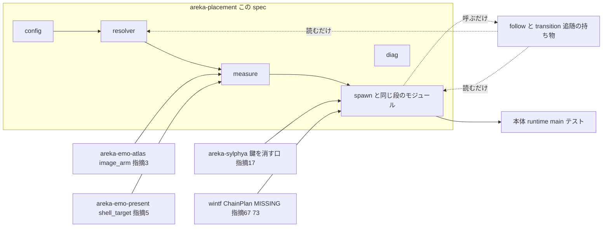
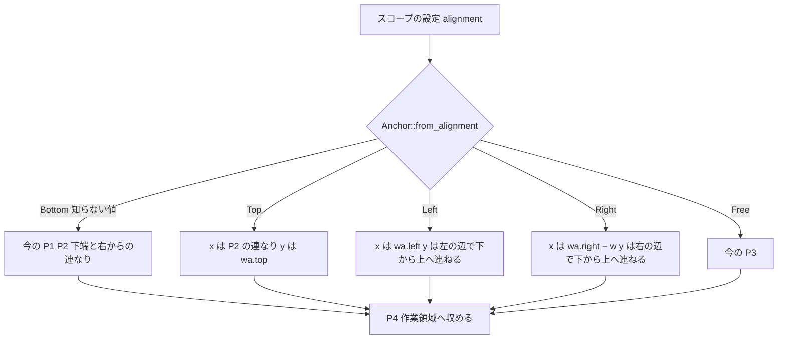
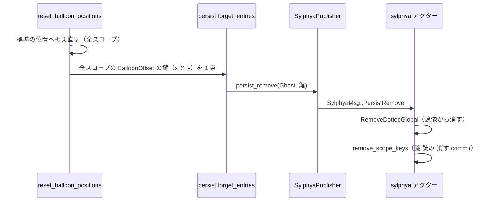

# 設計: audit-placement-core（配置の crate の核の見直し）

## Overview

この設計は、`areka-placement` の核（窓の出し方・設定・保存・重なりの順・DPI ほか）と本体の `placement_tests/` の一部に `/ponytail:ponytail-audit` をかけて出た 80 件（`research.md` 2 節・要件の「確定した指摘の一覧」）を、1 本の spec の中で全部直す直し方を決める。80 件とも直す（裁定で残す指摘は 0 件・2 本目の spec も切らない＝議題 7）。

直し方は ponytail の「いちばん小さな完全な変更」に従う。消せるものは消し、写しは今ある置き場へまとめ、記録の無い失敗の道には `warn!` を 1 行足し、直した所を使うテスト・fixture・examples・呼び出し元まで直し切る。新しい依存は足さない。

**Users**: 開発者（配置の crate を直す人・読む人）と、areka を使う利用者（窓の出る位置・次の起動のバルーンの位置・他人のゴーストの絵で落ちないこと）。

**Impact**: 外から見た振る舞いが変わるのは 3 か所だけ。
- `seriko.alignmenttodesktop` の `top`／`left`／`right` のシェルが、最初からその辺に置かれる（指摘 1・議題 1）。
- 拡大率の違うモニタに移ったバルーンも、面を変えたときに新しい面の標準の位置へ置き直される（指摘 2）。
- バルーン位置初期化の後、次の起動もキーワードの標準の位置に出る（指摘 17・議題 3）。

### Goals

- 確定した 80 件を全部直す（要件 4.1・4.2）。
- 申し送りの件（要件 2）を片づける。
- 直したバグ・危ない所の 1 件ずつに、壊れたら落ちるテストを置く（要件 6.6）。
- 直し終えたら同じ作法で audit をかけ直して新しい指摘 0 件・全体テスト緑（要件 6）。

### Non-Goals

- 新しい機能。
- `audit-placement-follow` の持ち物（`src/follow*`・`src/transition_*`・`placement_tests/transition_*`）の直し。
- 作業領域が変わったときにキャラ窓を辺へ沿わせ直す所（本体の側・`window-snap` の件 1 に残す）。
- clippy の指摘の機械的な直し（`clippy-199-lints` の持ち物）。
- `vendors/` の下。

## Boundary Commitments

### This Spec Owns

- `crates/areka-placement/` のうち `src/follow*`・`src/transition_*` でない全ファイル（本番のコード・テスト・テストの支え・`examples/window-placement.rs`・`Cargo.toml` の `async-io` の行）の、確定した 80 件の直し。
- `crates/areka/src/placement_tests/` のうち `transition_*` でない 9 ファイル（`mod.rs` を含む）と、そこへ足す 1 ファイル（`zorder_branch_coverage_test_support.rs`）。
- 範囲の外の、直しに要る最小の箇所（裁定の議題 3・5・6・7 で認められたもの）:
  - `crates/areka-emo-atlas/src/decode/image_arm.rs`（指摘 3・1 行）と、その兄弟のテスト。
  - `crates/areka-emo-present/src/shell_target.rs`（指摘 5・上限を渡す入口を足すだけ）。
  - `crates/areka/src/runtime/assets.rs`（指摘 5・上限を渡す兄弟を足すだけ）と、`crates/areka/src/runtime/move_cue_place.rs`（指摘 13）。
  - `crates/areka-sylphya/`（指摘 17・鍵を消す口を足すだけ）。
  - 指摘 51・62・8・19・42 の、本体の呼び手（`crates/areka/src/main.rs`・`runtime/switch_assets.rs`・`runtime/frame/drain_resnap.rs` と本体のテスト）。
  - 指摘 47 の根の `Cargo.toml` の `[workspace.dependencies]` と `crates/areka/Cargo.toml`・`crates/wintf/Cargo.toml` の `async-io` の行。
  - 指摘 67・73 の wintf（`ecs/window/zorder_chain.rs` の `ChainPlan.absent`・`log_chain_absent`）と、本体の `runtime/frame/zorder_drain.rs`。
- 申し送りの書き足し: `.kiro/specs/window-snap/brief.md`（議題 1）・`.kiro/specs/runtime-crate-split/brief.md`（要件 2.9）・`.kiro/specs/clippy-199-lints/brief.md`（要件 4.4）・`.kiro/specs/audit-areka-app/brief.md`（指摘 42 で古くなる `collision-probe.rs` の doc）。
- 振る舞いが変わる指摘 1・17 の文書: `doc/ukadoc-coverage/ledger/assets.toml`（`seriko.alignmenttodesktop` の 8 項目）・`ledger/sakura-script.toml`（`\![execute,resetballoonpos]`）・`doc/COMPAT_ARCHITECTURE.md` の 8 章。

### Out of Boundary

- `audit-placement-follow` の持ち物のファイル（読む・呼ぶのはよい。書かない・要件 8.1）。例外は 1 か所だけ: 指摘 2 で `follow/drag_follow.rs` のドラッグで基準を据え直す所に `BalloonUserMoved` を付ける 1 行（設計の討議の議題 1・相手の着地の後に申し合わせて行う）。`follow.rs:L53` が引く `BALLOON_LIMIT_CLAMP_TAG`、`follow/offset_space.rs:L66` が引く根の `scale_signed`、`follow/*` が引く `clamp_rect_to_work_area`・`follow_balloon` の名前と形は変えない。
- `follow/work_area_clamp.rs:L18` の「examples は `#[path]` で配置の層を取り込む」の古い文（追随の持ち物）。直さず、`audit-placement-follow` のセッション（終わっていればその完了の申し送り）へ知らせる（要件 7.4）。
- wintf の `MonitorRecord`・矩形の型・`DESPAWNED_SKIP_TAG` の綴り・記録の出所 `areka_placement::diag`（要件 8.3・指摘 0 件）。
- 作業領域の変化での辺への沿わせ直し（`window-snap` の件 1）。
- `Cargo.lock`（指摘 47 は同じ版を表へ移すだけで変わらない）。
- `vendors/`。

### Allowed Dependencies

- 今の依存だけ。`areka-placement` は `areka-emo-atlas`・`areka-emo-present`・`areka-sylphya`・`wintf`・`bevy_ecs`・`tracing`・`windows`・`async-io`、テストは `log-capture-kit`・`sample-ghost-kit`・`temp-path-kit`。
- 本体は `areka-emo-atlas` に直に依存している（`crates/areka/Cargo.toml:L58`）ので、指摘 5 の `AnimationLimits` を本体で書いても依存は増えない。
- 依存の向き `config` ← `resolver` ← `measure` ← `spawn`／`follow`（と同じ段のモジュール）、`diag` は最下流、は変えない（指摘 9 は文を今の参照に合わせる）。
- 新しい依存は足さない。要ると分かったら直さずに議題にする（要件 8.5）。

### Revalidation Triggers

- **公開の形が狭まる（指摘 8・19・42・45・51・62・議題 5）**: 次の名前が本番のビルドから crate の外へ見えなくなる、または形が変わる。直す前にツリー全体を grep し直し、まだ走っている兄弟のセッションへ名前を知らせる（要件 8.7）。
  - 本番の外で見えなくなる（`test-support` の機能では今の道のまま見える）: `dpi_sync::{evaluate, DpiSyncDecision, DpiSyncOutcome, DPI_SYNC_HOLD_MAX_FRAMES}`・`balloon_lock::HoldReason`・`balloon_limit::BALLOON_LIMIT_CLAMP_TAG`・`PREPARE_GHOST_WINDOWS_CONTEXT`・`prepare_ghost_windows_with_work_area`・`source::load_descript_source`。
  - 形が変わる: `BalloonLockLedger::reason` は `balloon_lock::hold_reason(&ledger, scope)` へ（使い手は crate の中の 1 か所と本体のテスト 2 本）。`persist::load_restored_state` の `default_encoding` の引数が消える。`chain_finalize::moved_default_pos` が消える。
  - 消える: `impl Default for AuthorDpi`。`test_support::EMILY_SHAPED_GHOST_DESCRIPT`・`EMILY_SHAPED_SHELL_DESCRIPT` は `pub(crate)`。
- **公開の形に足す**: `areka_placement::work_area_px`（指摘 13）・`areka_emo_present::load_shell_target_with_limits`（指摘 5）・`areka_sylphya::SylphyaPublisher::persist_remove` と `SylphyaMsg::PersistRemove`・`Effect::{RemoveDottedGlobal, PersistRemove}`・`persist::remove_scope_keys`（指摘 17）・`persist::forget_entries`（配置・指摘 17）・`test_support` の小道具（指摘 65・80）。`SylphyaMsg`・`Effect` に腕が増えるので、crate の外でこの 2 つを網羅して `match` する所が無いことを実装の頭で grep する。
- **wintf の型が変わる（指摘 73・`audit-wintf-window` の着地の後）**: `ChainPlan.absent` が `Vec<(u32, String)>` から `Vec<(u32, char, u32)>`（グループの ID・種別の字・スコープ）になり、`log_chain_absent` の引数も同じ値になる。使い手は本体の `runtime/frame/zorder_drain.rs`（`ZOrderAbsentReports.reported`）とテスト。
- **外から見た振る舞い**: 指摘 1（上・左・右に吸着するシェルの最初の位置）・2（面の置き直し）・17（初期化の後の次の起動）。本体の reseed・reset・spawn のテストのうち `alignmenttodesktop` の `top`／`left`／`right` を使うものの期待が動く。
- **相手の着地で前提が変わる**: `audit-wintf-window` の 11 番（`WindowHandle.instance` を消す）が配置の 14 ファイルの構築の式に及ぶ見込み。実装の頭で相手の着地の後の `main` を取り込み、この設計が名指す行を grep し直して読み替える。

## Architecture

### Existing Architecture Analysis

- 配置は lib の crate（`crates/areka-placement`）で、本体の bin とテストが使う。lib の根から `pub` の道で届く項目には `dead_code`・`unused_imports` が鳴らない。`examples/` は `areka_placement::…` を使い、`#[path]` でソースを取り込まない。この 2 つの事実が、指摘 6・7 の「効いていない属性・古い理由の文」の根。
- テストの支えは 3 種類ある。①`test_support.rs`（`cfg(any(test, feature = "test-support"))`・本体のテストも使う）、②`placement_shared_test_support.rs`（`cfg(test)`・crate の中だけ）、③モジュールごとの兄弟の `*_test_support.rs`。写しのまとめ先は、本体のテストも使うなら ①、crate の中だけなら ② か ③ を使う。
- 本体は dev-dependency でだけ `test-support` を付ける（`crates/areka/Cargo.toml:L97`）。本番のビルドに `test-support` は立たない。
- 範囲の 1,000 行の近く: `measure_tests.rs` 999・`persist_restore_tests.rs` 939・`persist.rs` 928・`lib.rs` 918。

### Architecture Pattern & Boundary Map



**Architecture Integration**:
- 選んだ形: 今の構造の中で直す（`research.md` 6.1 の案 C）。本番の直しは今のファイルの中、写しのまとめは今ある支えへ。新しいファイルは 2 つだけ（Z 順のテストの支え・本体の分岐の表の検査の支え）。
- 守る型: 失敗は `warn!`／`error!` を出してから縮退する。テストは決定論。記録の綴りと出所は変えない。
- 新しく置くもの: どれも写しを 1 つにするか、裁定で認めた口（指摘 5・17）だけ。

### Technology Stack

| 層 | 選んだもの | この spec での役目 | 注 |
|---|---|---|---|
| 言語 | Rust（edition は今のまま） | 全部 | 新しい依存なし |
| ECS | `bevy_ecs` | 配置の相・部品 | 形は変えない |
| 絵の読み | `image` 0.25.10 | 指摘 3 | `PngDecoder::new` は `Limits::no_limits()`（レジストリのソースで確かめた）＝見出しの寸法で先に断る |
| 記憶 | `areka-sylphya`（`toml`） | 指摘 17 | 足すだけ |
| テスト | `log-capture-kit`・`temp-path-kit`・`sample-ghost-kit` | 記録の確かめ・一時フォルダ | 今の依存 |

## File Structure Plan

### Directory Structure

```
crates/areka-placement/
├── Cargo.toml                         # 指摘 47: async-io を workspace の表から引く
├── examples/window-placement.rs       # 指摘 4・61
└── src/
    ├── lib.rs                         # 指摘 6・9・12・13・41・42・43・45・46（work_area_px を足す）
    ├── resolver.rs                    # 指摘 1・7・37（clamp_axis を crate の中へ開く）
    ├── face_windowposition.rs         # 指摘 2・18
    ├── reseed.rs                      # 指摘 12・18（据え直しの関数）・35・78
    ├── reset_balloon_pos.rs           # 指摘 17・18・50
    ├── reset_pos.rs                   # 指摘 13
    ├── persist.rs                     # 指摘 16・17（forget_entries）・37・51・52
    ├── source.rs                      # 指摘 7・19・53
    ├── measure.rs・measure_first_frame.rs  # 指摘 6・41・55・58
    ├── config.rs                      # 指摘 22・23・41
    ├── descript_window_keys.rs        # 指摘 6・7・9・56
    ├── spawn.rs                       # 指摘 6・25・26・41・63・68・70
    ├── diag.rs                        # 指摘 6・7・27・67・68
    ├── chain_finalize.rs・chain_realign.rs  # 指摘 28・29・41・62・71
    ├── dpi_sync.rs                    # 指摘 8・38・39・41
    ├── balloon_lock.rs・balloon_limit.rs  # 指摘 8・37・40
    ├── sticky_group_ledger.rs         # 指摘 36
    ├── zorder_group_ledger.rs・zorder_chain_compose.rs  # 指摘 7・30・41・72・73
    ├── test_support.rs                # 指摘 8・57・65・80（共有の小道具）
    ├── placement_shared_test_support.rs  # 指摘 10・11（TempDir の確かめ 1 本）
    ├── spawn_test_support.rs          # 指摘 64
    ├── zorder_test_support.rs         # 新: 指摘 32・77（Z 順のテストの写しを 1 つに・cfg(test)）
    └── *_tests.rs                     # 各指摘のテストの直し（下の表）
crates/areka/src/placement_tests/
├── mod.rs                             # 新しい支えの宣言
└── zorder_branch_coverage_test_support.rs  # 新: 指摘 34（check_table）
```

### Modified Files

範囲の中（`crates/areka-placement/src/` ほか・指摘の番号）:
- `lib.rs` — 6（`L71`・`L123`・`L789`・`L838` の属性を消す）・9（`L8-L15` の規約の文を書き直す）・12（`scale_then_merge` を置く）・13（`work_area_px`・`square_dpi` を置き `work_area_of` と `L451` を直す）・41（6 行）・42（`prepare_stages` を消し、`prepare_ghost_windows_with_work_area` に cfg）・43・45・46・8（`PREPARE_GHOST_WINDOWS_CONTEXT`）・`zorder_test_support` の宣言。
- `resolver.rs` — 1（4 つの辺・Seam の warn は知らない値だけ）・7（`L418` の属性）・37（`clamp_axis` を `pub(crate)`）。
- `face_windowposition.rs` — 2（比べに丸めの許しを入れる）・18。
- `reseed.rs` — 12・18（`reinstall_balloon`）・35（`warn!`）・78（`restore_empty`）。
- `reset_balloon_pos.rs` — 17・18・50（記憶の鍵を 1 回で消す）。
- `reset_pos.rs` — 13。
- `windowposition.rs` — 44（`apply_windowposition` を `&mut ScopeConfig` を受ける形に・届かない腕を消す）と `placement_windowposition_tests.rs`（その腕のテストを消す）。
- `persist.rs` — 16（`merge_scope` の `warn!`）・17（`forget_entries`）・37・51・52。
- `source.rs` — 7・19（cfg）・53（`read_kv`）。
- `measure.rs` — 41・55・58。`measure_first_frame.rs` — 6（`L11`）。
- `config.rs` — 22（`L627-L643` の空振り）・23（`L518` の文・テスト）・41。
- `descript_window_keys.rs` — 6（`L7`）・7（`L188`）・56。
- `spawn.rs` — 6（`L33-L35`・`L535-L537`・`L193-L196`）・25（宣言）・26・41・63・70（doc）。
- `diag.rs` — 6（`L53-L56`）・7（`L167`・`L248`）・27（doc）・67・68。
- `chain_finalize.rs` — 28（`finalize_chain` を消す）・29（`join_usable`）・41・62・71（doc）。`chain_realign.rs` — 41。
- `dpi_sync.rs` — 8（テストに開く項目を私有の子モジュールへ）・38・39・41。
- `balloon_lock.rs` — 8（`HoldReason`・`hold_reason`）・40。`balloon_limit.rs` — 8（`BALLOON_LIMIT_CLAMP_TAG`）・37。
- `sticky_group_ledger.rs` — 36。
- `zorder_group_ledger.rs` — 7（`L668`）・30（`L721-L722` の文）・72。`zorder_chain_compose.rs` — 41・73。
- `test_support.rs` — 8（EMILY を `pub(crate)`）・57・65・80。
- `examples/window-placement.rs` — 4・61。`Cargo.toml` — 47。
- テスト（消す・まとめる・足す）: 下の「Components and Interfaces」の各単位と「Testing Strategy」の表のとおり。
- 本体の `placement_tests/` — `measure_bake_log_tests.rs`・`measure_bake_count_tests.rs`（5）・`spawn_assembly_tests.rs`（6・66）・`spawn_zorder_pair_deferred_tests.rs`（65）・`zorder_*_branch_coverage_tests.rs`（34）・`reset_balloon_pos_tests.rs`（17・80）・`mod.rs`。

範囲の外（裁定で認めた最小の箇所）:
- `crates/areka-emo-atlas/src/decode/image_arm.rs` と `image_arm_tests.rs` — 3。
- `crates/areka-emo-present/src/shell_target.rs`・`balloon.rs` — 5。
- `crates/areka/src/runtime/assets.rs` — 5（`build_shell_assets_with_limits`・`build_balloon_assets_with_limits`）。`runtime/move_cue_place.rs` — 13。`main.rs`・`runtime/switch_assets.rs` — 51。`runtime/frame/drain_resnap.rs` — 62。`runtime/frame/zorder_drain.rs` と同じ所のテスト — 73。本体のテストのうち 8・19・42 の名前を使うもの（`ghost_session_restart_tests.rs`・`runtime/frame/switch_finish_tests.rs` の `reason` の呼び出し）。
- `crates/areka-sylphya/src/actor.rs`・`persist/mod.rs` と兄弟のテスト — 17。
- `crates/wintf/src/ecs/window/zorder_chain.rs` — 73。根の `Cargo.toml`・`crates/areka/Cargo.toml`・`crates/wintf/Cargo.toml` — 47。
- `.kiro/specs/window-snap/brief.md`・`.kiro/specs/runtime-crate-split/brief.md`・`.kiro/specs/clippy-199-lints/brief.md` — 申し送り。

1,000 行の番人（要件 9.1）: 行が増えるのは `persist.rs`（＋約 25 行＝約 953）・`lib.rs`（足す約 20・消す約 25＝増えない）・`persist_restore_tests.rs`（先に 20・49 で約 75 行消してから 16 のテストを約 20 行足す）。`measure_tests.rs` は減るだけ（11・21・54・59 で約 130 行減る）。範囲の外で 1,000 行に近いのは `crates/areka-emo-present/src/shell_target.rs`（956 行・指摘 5 で入口を足す）と `crates/areka-sylphya/src/actor.rs`（854 行・指摘 17 で腕を足す）。足して越えるなら、兄弟のファイルへ分ける。どのタスクも終わりに、触った 1,000 行の近くのファイルの行数を測り、1,000 を越えるなら兄弟のファイルへ分ける（番人の例外表へは足さない）。

### 実装で足したファイルと範囲の外で触ったファイル（2026-11-15・実装の後に追記）

実装のあいだに、上の File Structure Plan と Modified Files に無いファイルが増えた。どれも理由と数え方は `research.md` の節に書いてあり、この設計の決めは変わらない。

新しく足したファイル:
- `crates/areka-placement/src/chain_rule.rs` と `chain_rule_tests.rs` — 連鎖の決まりを 1 か所にまとめた総括（`research.md` 18.10・515・520）。
- `crates/areka-placement/src/persist_save.rs` — `persist.rs` が 1,000 行に近づいたので、保存の側を兄弟のファイルへ分けた（434・`research.md` 18.6）。
- `crates/areka-placement/src/test_support_com_tests.rs` — `with_com_initialized` が自分で初期化に成功したときだけ後始末する、という檻（指摘 57・コミット `65eb915f5`・`research.md` 1.4 と 18.1）。
- 本体の `crates/areka/src/runtime/frame_chain_rule_tests.rs` と `frame_chain_finalize_align_tests.rs` — 起動の確定と連鎖の決まりのテスト（485・494・495・515・520・`research.md` 18.7〜18.10）。

範囲の外で触ったファイル（指摘の番号・`research.md` の節）:
- 本体の `runtime/frame/switch.rs`・`runtime/skin_switch.rs`・`runtime/frame/switch_finish_face_tests.rs`・`switch_finish_tests.rs` — 454・472（18.6〜18.7）。
- 本体の `runtime/frame.rs`・`runtime/frame_test_support.rs`・`runtime/frame_chain_finalize_*_tests.rs`・`runtime/frame/drain_resnap.rs` — 485・494・495・515・520（18.7〜18.10）。
- 本体の `ghost_session.rs`・`main_restore_seam_tests.rs` — 51（`research.md` 5 節の表）。
- `crates/log-capture-kit/tests/temp_path_guard_test.rs` — 522（例外の表から 2 行を消しただけ・18.9）。
- `crates/wintf/src/ecs/window/zorder_chain_diag.rs`・`zorder_chain_diag_tests.rs` — 73。`zorder_pair.rs` — 25（doc の 2 行）。
- `crates/ukadoc-survey/src/evidence/extract_tests.rs` — 説明の行の番号だけ（18.1）。
- `doc/ukadoc-coverage/briefing.md`・`briefing-assets.md`・`ledger/assets.toml` — 台帳の追随（18.1）。
- `crates/areka/examples/collision-probe.rs` と `collision-probe/` の下 — コメントの行の番号だけ（19.2）。
- 追随の持ち物（`audit-placement-follow` の側）: `follow/drag_follow.rs` の 1 行（Implementation Notes 2.4・`research.md` 19.2）と `follow_drag_end_persist_tests.rs`（同 4.5・形の変更で避けられなかった）。

## System Flows

### 指摘 1: 最初の位置の解き方（`resolve_placement` の P1〜P4）



- 解いた位置は、追随の `project_anchor(anchor, 位置, 寸法, 作業領域)` を通しても変わらない形にする（べき等）。上の辺は x を保ち、左右の辺は y を保つ射影なので、左右の辺のスコープを縦に連ねても、ドラッグや大きさの変化で動かない。並べ直し・起動・記憶からの戻し・その後のドラッグが同じ標準の位置になる。
- 左右の辺のスコープは横の連なり（P2 の x）を進めない。縦の連なりは辺ごと（左・右）に前のスコープの y を持つ。`defaultx`・`defaulty` は左右の辺では使わない（固定される軸と、下端と同じく使わない軸）。
- Seam の `warn!` は、`from_alignment` が `Bottom` へ倒す知らない値のときだけ出す。正典の値（`top`・`left`・`right`）では出さない。

### 指摘 17・50: バルーン位置初期化の記憶



- 次の起動の `merge_scope` は鍵が無いので、キーワード（`windowposition.x,top` ほか）から標準を導き直す。古いドラッグの値も残らない。
- 書き込み（commit）の失敗は、`save_scope` と同じ道で `error!`＋`PersistOutcome::Degraded` を返し、失敗の受け口へ届く。

## Requirements Traceability

| 要件 | 中身 | 設計の要素 |
|---|---|---|
| 1.1・1.2・1.3・1.4・1.5 | 範囲・測り直し・上限なし（1.3）・全部読む（1.4）・通し番号 | ギャップ分析で済み（`research.md` 1・2 節）。かけ直し（U27）も同じ作法 |
| 1.6 | 申し送りとの対応 | `research.md` 3 節。この設計は同じ番号で直す（5〜9・41） |
| 1.7 | 約束に触れる指摘の印 | 「Revalidation Triggers」・「実装の順」 |
| 2.1 | 古い理由の `#[allow]` | U9（指摘 6） |
| 2.2 | 「古くなっていない」とされた属性 | U9（指摘 7・議題 2） |
| 2.3 | 外から使う公開の見直し | U11（指摘 8・19・42・45）・U12（51・62） |
| 2.4 | 依存の向きの規約 | U9（指摘 9・案 a） |
| 2.5 | `scale_signed` の形 | 変えない（U9 は文だけ・申し合わせは要らない） |
| 2.6 | wintf との重なり | 指摘にならなかった（`research.md` 3.1）。直すもの無し |
| 2.7・2.8 | 環境変数で赤になるテスト | U8（指摘 5） |
| 2.9 | 古い名前と申し送り | U10（指摘 41） |
| 2.10 | `move_cue_place.rs` の申し送り | U12（指摘 13）・U28（完了の申し送りの 1 行） |
| 3.1・3.2・3.3 | 討議で確定・一覧（3.2） | 済み（requirements.md の裁定・一覧） |
| 4.1・4.2 | 全部直す | U1〜U26 が 80 件を受け持つ（下の対応表） |
| 4.3 | 直し切る | 各単位の「直し切る所」・要件 7.1 の grep |
| 4.4 | clippy との重なりの記録 | U28（clippy を回して重なりを `clippy-199-lints` の brief へ） |
| 5.1・5.2・5.3・5.4 | 残す指摘の裁定（3 種類に当たらない指摘は議題にせず直す＝5.3） | 裁定で残す指摘は 0 件（議題 1〜4 は直すと裁定）。かけ直しで新しく出たら同じ扱い |
| 6.1・6.2・6.3・6.4 | かけ直し・0 件まで直す（6.2）・5 回目の打ち切り・記録 | U27（`research.md` の「かけ直しの記録」節） |
| 6.5 | 全体テスト | U28 |
| 6.6 | 壊れたら落ちるテスト | 「Testing Strategy」の表 |
| 6.7 | 決定論 | 指摘 5・10・11 の直しと「Testing Strategy」の決定論の節 |
| 7.1・7.3 | 呼び出し元の grep・消す前の確かめ | 各単位の頭で行う（実装の順の表） |
| 7.2・8.7 | 走っている相手との申し合わせ・名前の知らせ | U1（着手の確かめ）・U11・U12・U25 の頭 |
| 7.4 | 範囲の外の指摘の申し送り | `follow/work_area_clamp.rs:L18` を追随の側へ（Out of Boundary） |
| 8.1・8.2・8.3・8.4・8.8 | C20 の約束（公開の形は足すだけと議題 5 の例外＝8.2） | Boundary Commitments・Revalidation Triggers。wintf の型に触れる 73 と、根と wintf の `Cargo.toml` に触れる 47 は、議題 7 の裁定で相手の着地の後に行う（U25）。`follow*` に書かない・wintf の綴りを変えない・依存を足さない・`Cargo.lock` を変えない・`vendors/` に触らない |
| 8.5・8.6 | 依存の議題・約束に触れる指摘 | 依存を足す直しは 0。約束に触れる指摘は議題 5〜7 で裁定済み |
| 8.9 | 実装の順 | 「実装の順」の節 |
| 9.1 | 1,000 行 | File Structure Plan の行数の見込み |
| 9.2 | 記録の無い失敗の道を作らない | 指摘 16・26・35・40 の直し。17 の消す口も `save_scope` と同じ失敗の道 |
| 9.3 | 終了の道 | 触らない（終了の道に関わる指摘は無い） |
| 9.4 | 一時フォルダは `target` の下 | 指摘 10・11 |
| 9.5 | GPU のテストは実 GPU | GPU のテストを足さない・今のものはそのまま |
| 9.6 | 文字化け | 読む側を直す（起きたときの決まり・今の指摘には無い） |
| 10.1・10.2 | 2 本目の spec | 切らない（議題 7）。28 タスクの見込みは開発者が認めた |

## Components and Interfaces

### 一覧（実装の単位）

単位はタスクの区切りの候補。番号は実装の順の既定（「実装の順」の節）。

| 単位 | 指摘 | 主なファイル | 規模 |
|---|---|---|---|
| U1 着手の確かめ | — | 相手の着地・grep・名前の知らせ | S |
| U2 resolver の 4 つの辺 | 1・48 | `resolver.rs`・`resolver_resolve_tests.rs`・`resolver_resolve_balloon_tests.rs`・`window-snap` の brief | M |
| U3 resolver のテストの写しと `clamp_axis` | 14・15・37・79 | `resolver_*_tests.rs`・`resolver.rs`・`persist.rs`・`balloon_limit.rs`・`balloon_limit_tests.rs` | S |
| U4 面の置き直しの比べ（動かした印） | 2 | `face_windowposition.rs`・`face_windowposition_tests.rs`・`persist.rs`（`merge_scope`）・`reseed.rs`（`reinstall_balloon`）・追随の `follow/drag_follow.rs`（1 行・相手の着地の後） | M |
| U5 材料の合流と据え直し | 12・18・43・44 | `lib.rs`・`reseed.rs`・`face_windowposition.rs`・`reset_balloon_pos.rs`・`windowposition.rs`・`placement_windowposition_tests.rs` | S |
| U6 測りの読み手の上限 | 3 | `areka-emo-atlas` の `image_arm.rs`・`image_arm_tests.rs` | S |
| U7 手本 | 4・61 | `examples/window-placement.rs`・`Cargo.toml`（`[[example]] test = true`） | S |
| U8 環境変数で赤になるテスト | 5 | `shell_target.rs`・`balloon.rs`・`runtime/assets.rs`・3 本のテスト | M |
| U9 属性と規約の文 | 6・7・9・46・68 | `lib.rs`・`diag.rs`・`descript_window_keys.rs`・`resolver.rs`・`source.rs`・`zorder_group_ledger.rs`・`measure_first_frame.rs`・`spawn.rs`・`spawn_assembly_tests.rs`・`diag_tests.rs`・`chain_finalize_tests.rs` | S |
| U10 古い名前 | 41 | 13 ファイル・`runtime-crate-split` の brief | M |
| U11 公開を狭める | 8・19・42・45 | `dpi_sync.rs`・`balloon_lock.rs`・`balloon_limit.rs`・`lib.rs`・`source.rs`・`test_support.rs`・本体のテスト | M |
| U12 主モニタの作業領域と公開の形の変更 | 13・51・62 | `lib.rs`・`reset_pos.rs`・`persist.rs`・`chain_finalize.rs`・本体の `move_cue_place.rs`・`main.rs`・`switch_assets.rs`・`drain_resnap.rs` | S |
| U13 persist | 16・20・49・52 | `persist.rs`・`persist_*_tests.rs`・`balloon_offset_*_tests.rs` | S |
| U14 sylphya の鍵を消す口 | 17 | `areka-sylphya` の `actor.rs`・`persist/mod.rs`・テスト | M |
| U15 初期化で鍵を消す | 17・50 | `persist.rs`・`reset_balloon_pos.rs`・`pt/reset_balloon_pos_tests.rs` | S |
| U16 測りのテストと一時フォルダ | 10・11・21・54・59・60 | `measure_tests.rs`・`measure_template_tests.rs`・`placement_monitor_tests.rs`・`placement_shared_test_support.rs`・`sample_test_support_tests.rs` | S |
| U17 設定・descript・source・measure の小さな直し | 22・23・24・53・55・56・58 | `config.rs`・`config_limit_tests.rs`・`descript_window_keys*.rs`・`source.rs`・`measure.rs` | S |
| U18 spawn のテスト | 25・64・65・66・69 | `spawn_*_tests.rs`・`spawn_test_support.rs`・`test_support.rs`・`pt/spawn_*` | S |
| U19 spawn の本番と COM の支え | 26・57・63・70 | `spawn.rs`・`spawn_clickthrough_tests.rs`・`test_support.rs` | S |
| U20 経路の表と連鎖 | 27・28・29・71 | `diag.rs`・`diag_tests.rs`・`chain_finalize*.rs` | S |
| U21 Z 順の台帳 | 30・33・72・75・76・77 | `zorder_group_ledger.rs`・`zorder_*_tests.rs`・`zorder_test_support.rs`（新） | M |
| U22 Z 順の鎖のテストと分岐の表 | 31・32・34・74 | `zorder_chain_*_tests.rs`・`zorder_test_support.rs`・`pt/zorder_*`・`pt/zorder_branch_coverage_test_support.rs`（新） | S |
| U23 DPI の整合の門 | 38・39 | `dpi_sync.rs`・`dpi_sync_tests.rs` | S |
| U24 記録の無い縮退と記録の取り違え | 35・36・40・78 | `reseed.rs`・`reseed_tests.rs`・`sticky_group_ledger*.rs`・`balloon_lock*.rs` | S |
| U25 相手の着地の後の 3 件 | 47・67・73 | `Cargo.toml` 3 本と根・`diag.rs`・wintf の `zorder_chain.rs`・`zorder_chain_compose.rs`・本体の `zorder_drain.rs` | M |
| U26 balloon のテストの小道具（最後） | 80 | `balloon_limit*_tests.rs`・`balloon_lock*_tests.rs`・`test_support.rs`・`pt/reset_balloon_pos_tests.rs` | S |
| U27 audit のかけ直し | — | 範囲の 114 ファイル＋足したファイル | M |
| U28 全体テストと申し送り | — | `tools/test-all.ps1`・3 つの brief・完了の申し送り | S |

### 必ず直す

#### U2 指摘 1: `alignmenttodesktop` の top／left／right（議題 1）

| 項目 | 中身 |
|---|---|
| 意図 | 最初の位置を、吸着の辺（`anchor`）と同じ辺で解く |
| 要件 | 4.1・6.6・5.2（ukadoc は討議で確かめ済み） |

- `resolve_placement` の P4 の前で `Anchor::from_alignment(&sc.alignment)` を 1 度だけ引き、上の「System Flows」の表のとおりに x・y を決める。出力の `anchor` 欄も同じ値を使う（2 度引かない）。
- `Seam` の `warn!` は、`from_alignment` が `Bottom` を返す知らない値のときだけ出す。`from_alignment`（`resolver.rs:L458-L470`）は知らない値で既に `warn!` を出すので、`resolve_placement` の側の `warn!`（`L279-L285`）は消す（知らない値の警告は呼び出し 1 回につき 1 行）。
- 網羅台帳を同じ PR で直す（`structure.md` の「互換の振る舞いを着地させた spec が台帳を更新する」）: `doc/ukadoc-coverage/ledger/assets.toml` の `seriko.alignmenttodesktop` の 8 項目の説明を「最初の位置は 4 つの辺で解く・作業領域が変わったときの沿わせ直しは下端だけ（`window-snap` の件 1）」に改める。状態は `degraded` のまま（沿わせ直しが残るため）。台帳から作る説明の文書（`doc/ukadoc-coverage/briefing*.md`）は、生成の道具があればそれで作り直し、手では直さない。
- doc を直す: `resolver.rs:L218` の P1 の説明（`Seam(_)` は下端、の文）・`L254-L258`（「挙動出力は Bottom と同一」）・`config.rs` の `Alignment::Seam` の doc（「bottom として配置」）。
- 直し切る所: `resolver_resolve_tests.rs` の T-R5（下の Testing Strategy）。本体の reseed・reset・spawn のテストのうち `top`／`left`／`right` を使うものの期待（実装で `cargo test -p areka` を回して洗い出す）。
- `window-snap` の brief の「追記（2026-10-23）件 1」の下に「最初の位置（`resolve_placement`）は `audit-placement-core` で 4 つの辺で解く形に直した。作業領域が変わったときに辺へ沿わせ直す所はこの件に残る」と 1 行書き足す。

#### U4 指摘 2: 面の windowposition の置き直しの比べ

- 両辺を同じ丸めで作る形（`research.md` 8 節 13）は作れない（`research.md` 11.2＝基準の DPI の窓寸が世界に残っていない）。丸めの差を許す形（3px）は、作者の DPI と主モニタの DPI が違う構成や、拡大率が 3 倍以上になる移りで取りこぼしが残り、3px 以内だけ動かしたバルーンを「動かしていない」と取り違える。そこで、値の比べをやめて「利用者が動かした」ことを状態で持つ（設計の討議の議題 1・2026-11-14 推奨案で承認）。
- 新しい部品（キャラ窓の entity に付ける・crate の中）:
  ```rust
  /// 利用者がこのスコープのバルーンを標準の位置から動かした印。
  /// 付ける: ドラッグで追随の基準を据え直したとき・記憶から戻したずらしを使ったとき。
  /// 外す: 標準の位置へ据え直したとき（reinstall_balloon）。
  #[derive(Component)]
  pub(crate) struct BalloonUserMoved;
  ```
- 印を付ける所は 2 つ。
  - 利用者のドラッグ: 追随の持ち物の `follow/drag_follow.rs` の、ドラッグで基準を据え直す所に 1 か所だけ足す。相手の指摘 3 の直しで、この塊は私有の関数 `reestablish_balloon_follow(world, balloon, balloon_pos)` に切り出され、`on_balloon_drag`（ドラッグ中）と `on_balloon_drag_end`（離したとき）の 2 か所から呼ばれる（2026-11-14 相手のセッションの知らせ）。insert はこの関数の中に置く（離したときも利用者が動かした事実なので付ける）。相手が守りの関数を `follow/visibility.rs` へ移していても、置き場は同じ関数の中。キーワードの再導出（`follow/keyword_base.rs:L152`）は利用者の操作ではないので付けない。`audit-placement-follow` の着地の後に行い、触る前に相手と申し合わせる（相手が完了していれば、その完了の申し送りに残す）。
  - 記憶からの戻し: `persist.rs` の `merge_scope` が、記憶の鍵（バルーンのずらしの x・y）から値を採ったスコープに付ける。
- 印を外す所: U5 の `reinstall_balloon`（標準の部品で据え直す 3 か所が呼ぶ）。指摘 17 の初期化の後は記憶の鍵も無いので、次の起動でも付かない。
- `face_windowposition.rs:L62-L64` の比べは `!world.entity(c).contains::<BalloonUserMoved>()` にする。値の比べ（`f.offset() == before...`）は消す。
- C20 の約束 ⑵（相手の持ち物の関数の形を変えない）: `drag_follow.rs` の関数の形は変えず、中に 1 行を足すだけ。相手の着地の後なので並走とはぶつからない（要件 8.1 の例外・設計の討議で承認）。
- 実装の順: U4 は U5（`reinstall_balloon` を置く）の後に行う。

#### U6 指摘 3: 測りの読み手の上限

- `areka-emo-atlas/src/decode/image_arm.rs` の `read_first_frame` の先頭に `super::pixel_len(info.width, info.height)?;` を 1 行足す（資産の道と測りの道が通る共有の所で 1 度だけ直す）。`pixel_len` は `decode.rs:L46` の `pub(crate)` のまま。
- `image` 0.25.10 の `PngDecoder::new` は `Limits::no_limits()` で開き、見出しの寸法どおりに確保する（レジストリのソース `src/codecs/png.rs:L42-L43`）。WebP も確保の上限をかけない（`audit-emo-atlas` の設計の決め 2）。だから寸法の確かめは読む前に要る。
- 直し切る所: 配置の側は変えない（`FirstFrameDecoder` は `decode_first_frame` の `Err` で全体の読みへ戻るが、その `decode` は WIC の道で `check_image` の上限を通る）。

#### U7 指摘 4・61: 手本

- `examples/window-placement.rs:L300` の第 3 引数を `scope as u32` にし、`L298` と冒頭 `L10-L11` の説明を「スコープごとのバルーンの面 0」に直す。
- 61: `L280-L284` の代わりの面を、測りと同じ `builtin_default_surface(scope)`（`measure.rs:L245`）にする。測りの関数が `pub` でなければ、手本が使う今の公開の入口（`prepared.default_surfaces`）の上で同じ答えになる形を選ぶ（公開は足すだけ）。
- 全体テストで確かめる（設計の討議の議題 2・2026-11-14 推奨案で承認）: 手本の中の「スコープごとにどのバルーンの絵を使うか」（4）と「面が無いときの代わりの面」（61）を、窓も GPU も使わない小さな純粋な関数にし、手本の中に `#[cfg(test)] mod tests` の `#[test]` を置く。`crates/areka-placement/Cargo.toml` に次を足し、`cargo test` が手本の `#[test]` を走らせるようにする（`main` は走らない）。
  ```toml
  [[example]]
  name = "window-placement"
  test = true
  ```
  `Cargo.toml` のこの節は、`audit-placement-follow` が触る `log-capture-kit` の行とも、こちらの指摘 47 の `async-io` の行とも別。触る前に相手へ知らせる。

### 直したほうがよい

#### U8 指摘 5: 環境変数で赤になるテスト

- `areka-emo-present/src/shell_target.rs` に `pub fn load_shell_target_with_limits(shell_dir, decoder, limits: AnimationLimits) -> Result<ShellTarget, ShellLoadError>` を足す。中の `load_shell_target_with` に `limits` を渡し、記録を出す道は `bake_with_limits(.., limits)` で焼く。`load_shell_target` は `AnimationLimits::from_env()` を渡す（今の振る舞い）。記録を出さない道（採寸）は今のまま `bake_quiet`（採寸の読み手は動く絵の道に入らないので上限を使わない・doc に 1 行）。
- 本体の `runtime/assets.rs` の `build_shell_assets` の中身を `pub(crate) fn build_shell_assets_with_limits(.., limits)` へ移し、`build_shell_assets` はそれを `AnimationLimits::from_env()` で呼ぶ（形は変えない・呼び手 `assets.rs:L252`・`switch_assets.rs:L219` は触らない）。
- `areka-emo-present/src/balloon.rs` に `pub fn build_balloon_target_from_faces_with_limits(.., limits)` を足し、本体の `build_balloon_assets` も同じ形で `pub(crate) fn build_balloon_assets_with_limits(.., limits)` へ中身を移す（測りの数のテストの動く絵の検体ではバルーンの面 2 枚も動く絵のため・`research.md` 11.4）。
- テスト: `measure_first_frame_tests.rs` の `Way::RawBake` は `bake_with_limits(.., AnimationLimits::default())`。本体の `measure_bake_log_tests.rs:L227`・`measure_bake_count_tests.rs:L116` は `build_shell_assets_with_limits(.., AnimationLimits::default())` と `build_balloon_assets_with_limits(.., AnimationLimits::default())`。
- 実装での確かめ（1 度だけ）: 3 本を `AREKA_ANIMATED_IMAGE_MAX_FRAMES=1` を立てて走らせ、立てないときと同じに緑（要件 2.7・2.8）。

#### U9 指摘 6・7・9・46・68: 属性と規約の文

- 6: `lib.rs:L69-L71`・`L123`・`L789`・`L838` の属性を理由の文ごと消す。`diag.rs:L53-L56`・`descript_window_keys.rs:L7`・`measure_first_frame.rs:L11`・`spawn.rs:L33-L35`・`L535-L537`・`pt/spawn_assembly_tests.rs:L183-L185` の「`#[path]` で取り込むので `crate::` を使わない」の理由を消す（残す文は今の事実だけ）。`descript_window_keys.rs:L7` は「`crate::` を参照しない」を消す（`L13` が `super::config` を引く）。
- 7: `descript_window_keys.rs:L188`・`resolver.rs:L418`・`diag.rs:L167` は属性だけを消し、項目と理由の doc を先送りの印として残す（議題 2）。`diag.rs:L248`・`zorder_group_ledger.rs:L668` は属性を消す（`L664-L667` の「許可を与える」の文も直す）。`source.rs:L131` は U11 で cfg に替える。
- 9（案 a）: `lib.rs:L8-L15` を今の参照に合わせて書き直す。名指すのは `config` ← `resolver` ← `measure`（`error`・`descript_window_keys` を引く）← `spawn`・`follow` と同じ段のモジュール（ほかの 21 のモジュール）。同じ段どうしは引き合ってよいと書き、輪を列挙する: `chain_finalize`↔`chain_realign`（`on_insert` の hook）・`chain_realign`→`spawn`→`chain_finalize`・`follow` と同じ段のモジュールの両向き。根を引く子（`reset_pos`→`primary_monitor`・`follow/offset_space`→`scale_signed`）も書く。参照は変えない（`follow*` の `use` に響く案 b は取らない・`research.md` 8 節 14）。
- 46: `lib.rs:L459-L461` の「綴りを固定するテストはまだ無い」の 1 文を消す。68: `diag.rs:L35`・`L151`・`L244`・`diag_tests.rs:L45`・`L367`・`chain_finalize_tests.rs:L202`・`spawn.rs:L193-L196` の数と名前を今の物に合わせる。
- 実装での確かめ: `cargo check -p areka-placement --all-targets` と `--features test-support` で警告が増えない（`research.md` 7 節 2・設計の段の読みでは、9 つの属性の項目はどれも lib の根から `pub` の道で届く）。

#### U10 指摘 41: 古い名前

- `research.md` 3.6 の表の 13 ファイル・27 行の `emo2_boot`・`Emo2Wiring` を今の名前（`runtime`・`runtime::wiring` ほか、指す物の今の名）へ直す。`lib.rs:L69` は U9 で消えるので 26 行。直す前に `rg -n 'emo2_boot|Emo2Wiring' crates/areka-placement` で数え直す。
- `runtime-crate-split` の brief へ「`areka-placement` の 13 ファイル・27 行（うち 1 行は属性ごと消した）を `audit-placement-core` が直した。残るのは追随の持ち物の 9 ファイル・20 行（`audit-placement-follow` の持ち場）と、本体の外の残り 30 ファイル・49 行」と書く。同 brief の「4 行は棚卸㊲で直した」は事実と合う（PR#454）ので正さない。

#### U11 指摘 8・19・42・45: 公開を狭める（議題 5）

テストだけに開く項目の置き方を 1 つに決める。

| 種類 | 置き方 | 当たる項目 |
|---|---|---|
| 使い手 0 | `pub(crate)` か消す | `test_support::EMILY_SHAPED_GHOST_DESCRIPT`・`EMILY_SHAPED_SHELL_DESCRIPT`（`pub(crate)`）・`impl Default for AuthorDpi`（消す） |
| crate の本番も使わない | 項目に `#[cfg(any(test, feature = "test-support"))]` | `source::load_descript_source`（19・`persist::project_restore` と同じ形）・`prepare_ghost_windows_with_work_area`（42） |
| crate の本番は使い、外ではテストだけ | 同じファイルの私有の子モジュール `test_open` へ定義を移し、`#[cfg(feature = "test-support")] pub use test_open::{…};` と `#[cfg(not(feature = "test-support"))] pub(crate) use test_open::{…};` の 2 行で開く（道は今のまま） | `dpi_sync::{evaluate, DpiSyncDecision, DpiSyncOutcome, DPI_SYNC_HOLD_MAX_FRAMES}`・`balloon_lock::{HoldReason, hold_reason}`・`balloon_limit::BALLOON_LIMIT_CLAMP_TAG`・根の `PREPARE_GHOST_WINDOWS_CONTEXT` |

- `pub(crate)` の項目を `pub use` で開き直すことは Rust が許さないので、私有の子モジュールの `pub` の項目を開く形にする。子モジュールは親の私有の欄を読める。
- `BalloonLockLedger::reason` はメソッドなので開く段を切り替えられない。`test_open` の中の関数 `hold_reason(ledger: &BalloonLockLedger, scope: u32) -> Option<HoldReason>` にし、crate の中の呼び手（`balloon_lock.rs:L125`）と本体のテスト 2 本（`ghost_session_restart_tests.rs:L281`・`runtime/frame/switch_finish_tests.rs:L762`）を直す。
- `DPI_SYNC_HOLD_MAX_FRAMES` は追随の持ち物の `pt/transition_judge_verdict.rs:L57` が `areka_placement::dpi_sync::DPI_SYNC_HOLD_MAX_FRAMES` の道で読む。本体のテストのビルドは `test-support` が立つので、道も名前も変わらない（申し合わせのとおり・要件 8.1）。`follow.rs:L53` の `BALLOON_LIMIT_CLAMP_TAG` は crate の中なので `pub(crate) use` で届く。
- 直す前に（要件 8.7）: 名前ごとにツリー全体を grep し直し、まだ走っている兄弟のセッション（`audit-placement-follow` ほか）へ名前を知らせる。
- 確かめ: `cargo build -p areka`（`test-support` なし）と `cargo test -p areka --no-run` の両方が組める。

#### U12 指摘 13・51・62

- 13: `lib.rs` に `pub fn work_area_px(monitor: &Monitor) -> RectPx`（`RECT` を単位変換なしで写す）と `pub(crate) fn square_dpi(dpi: u32) -> DPI`（`u16::try_from(dpi).unwrap_or(u16::MAX)` の両軸）を置く。`work_area_of`（`monitor.map(work_area_px).ok_or_else(..)` の形・`error!` は残す）・`reset_pos.rs:L69-L77`・`lib.rs:L451`（`as u16` の切り詰めを飽和へ）・本体の `runtime/move_cue_place.rs:L86-L95` から使う。`primary_work_area` の形（`Option` を返す）は取らない（並べ直しは DPI も要るので主モニタそのものを引く）。
- 51: `persist::load_restored_state` の `default_encoding` を消し、中で `DefaultEncoding::Ansi` を使う。呼び手 `crates/areka/src/main.rs:L785`・`runtime/switch_assets.rs:L239`・テストを直す。
- 62: `chain_finalize::moved_default_pos` と `chain_finalize_tests.rs:L337-L346` を消し、呼び手 `runtime/frame/drain_resnap.rs:L588` で直に書く（`L16` の import も消す）。

#### U13 指摘 16・20・49・52: persist

- 16: `merge_scope`（`persist.rs:L527-L584`）で、4 つの鍵（窓の x・y、バルーンのずらしの x・y）のどれかが「在るが読めない」とき、または窓の位置が片方の軸だけのときに、`warn!(target: "areka::persist::restore", event = "persist_value_unusable", scope, key, value, …)` を 1 行ずつ出して今のとおり既定へ戻る。`parse_px` の doc（`L48-L55`）の「呼び手が warn を出す」は、この実装を指す文に直す。
- 20: (a) `balloon_offset_persist_roundtrip_tests.rs:L459-L501`、(b) `balloon_offset_supply_tests.rs:L366-L378`、(c) 3 本のうち `persist_entries_tests.rs:L95-L117` を残して 2 本を消す、(d) `persist_restore_tests.rs:L65-L90` は `balloon_pos` の確かめを `L95-L131` へ移してから消す。roundtrip の裁定（2026-08-14・08-27）を確かめる本体は残す。
- 49: `persist_entries_tests.rs:L31-L36`・`persist_restore_tests.rs:L770-L786` を消す。52: `persist.rs:L9-L15`・`L633-L639` の「書く時機は 2 つだけ」を今の 6 か所の一覧に直す（実装で `persist_entries` の呼び手を grep して並べる）。

#### U14・U15 指摘 17・50: 初期化で記憶の鍵を消す（議題 3・案 1）

sylphya に足す口（足すだけ・今の関数の形は変えない）:

```rust
// areka-sylphya/src/actor.rs
pub enum SylphyaMsg { /* 今の腕 */ PersistRemove { scope: PersistScope, keys: Vec<PersistKey> } }
pub enum Effect { /* 今の腕 */ RemoveDottedGlobal { key: String }, PersistRemove { scope: PersistScope, keys: Vec<PersistKey> } }
impl SylphyaPublisher { pub fn persist_remove(&self, scope: PersistScope, keys: Vec<PersistKey>); }
// areka-sylphya/src/persist/mod.rs
pub fn remove_scope_keys(scope: PersistScope, roots: &ScopeRoots, io: &dyn PersistIo, keys: Vec<PersistKey>) -> PersistOutcome;
```

- `SylphyaCore::apply` は `PersistRemove` に、鍵ごとの `RemoveDottedGlobal { key: key.to_canonical_key() }` と `PersistRemove` を返す。アクターの実行は前者で鏡像の大域点付き区画から消し（実際に消えるときだけ後継の像を出す＝`RemoveFlatPerAsker` と同じ形）、後者で `remove_scope_keys` を呼んで失敗を受け口へ中継する（`PersistSave` と同じ形）。
- `remove_scope_keys` は `save_scope` と同じ錠・既存の読み・控え・commit の道を通る。`save_scope` の本体を、doc に手を入れる関数を受け取る私有の 1 本（`update_scope`）へまとめ、`save_scope` は値を書く、`remove_scope_keys` は doc と土台の表（`to_toml_string_over` の `base`）の両方から鍵を消す。空になった `[balloon-offset."N"]` の表は消す。
- 配置の側: `persist.rs` に `pub fn forget_entries(world: &World, keys: Vec<PersistKey>)`（`persist_entries` の兄弟・`PersistWiring` が無ければ同じく `debug!`＋何もしない）。`reset_balloon_pos.rs:L98-L99` は、スコープの繰り返しの中で書かず、戻せた全スコープの `BalloonOffset` の x・y の鍵を集めて、繰り返しの後に 1 回だけ `forget_entries` を呼ぶ（指摘 50）。doc の「記憶へ標準のずらしを書く」は「記憶の鍵を消す（次の起動はキーワードから標準を導き直す）」に直す。
- 範囲の外の文書を同じ PR で直す: `doc/ukadoc-coverage/ledger/sakura-script.toml` の `\![execute,resetballoonpos]` の項目と `doc/COMPAT_ARCHITECTURE.md` の 8 章（`L152`）の「戻したずらしを記憶に書く」を「記憶の鍵を消す」に改める。台帳から作る文書は、生成の道具があればそれで作り直す。
- 規模の見込み: U14（sylphya）と U15（配置）の 2 タスク。

#### U16 指摘 10・11・21・54・59・60

- 10: `placement_monitor_tests.rs:L250-L252` の固定の名前を `TempDir::new()`（隣の `placement_prepare_tests.rs:L240-L241` と同じ）へ。
- 11: `measure_tests.rs:L14-L25`・`L38-L68` の写しを消し、`crate::shared_test_support::TempDir` と `crate::test_support::with_com_initialized` を使う。
- 10・11 の確かめ: `placement_shared_test_support.rs` に、`TempDir::new()` の道がワークツリーの `target\test-roots\` の下にあることを確かめるテストを 1 本足す（要件 9.4・6.6）。
- 21: `measure_tests.rs:L118-L125`・`L129-L162`・`L330-L379` を消す。54: `L945-L949`・`L980-L999` の `emo2_utf8_fixture_decodes_to_the_same_text_as_before` を消す（較正の当たりは `measure_template_tests.rs:L186-L215` に今あるので移す物は無い・実装で確かめる）。59: `measure_tests.rs:L665`・`measure_template_tests.rs:L25` の数と文を今の値に。60: `sample_test_support_tests.rs` の 2 本を消し、ファイルと宣言も消す（中身が 0 になるため）。

#### U17 指摘 22・23・24・53・55・56・58

- 22: `config_limit_tests.rs` の 5 本と `scope_config_for` を消し、2 本を残す。`config.rs:L627-L643` の空振りのテストも消す。
- 23: `config.rs` の中のテストに、`balloon.alignment,center` と `sakura.defaultx,abc` の 2 行の入力で `log_capture_kit::capture` を使い、2 つの `warn!` が 1 件ずつ出て値が既定（Left・None）になるテストを 1 本足す。`L518` の「呼び出し側 warn」の文を今の実装に合わせる。
- 24: `descript_window_keys_tests.rs:L100-L118` を消す。53: `source.rs:L158-L159`・`L187-L188` の 1 行を `read_kv` 1 つに。55: `measure.rs:L114-L119`・`L447-L450` を `SizeKind::Balloon.reason_prefix()` に。58: `measure.rs:L303-L312` を `map().collect()` に。
- 56: `descript_window_keys.rs:L127-L130` の `scope as u32` を `u32::try_from(scope)` にし、収まらない番号は `L204-L211` と同じく集合に入れない。

#### U18 指摘 25・64・65・66・69

- 25: `spawn_zorder_pair_export_tests.rs` を消し、`spawn.rs` の宣言も消す。`spawn_zorder_pair_wiring_tests.rs:L133-L153` と `wire_inserts_plan_a_strategy_resource` を消す。
- 64: `spawn_zorder_pair_wiring_tests.rs:L50-L98`・`spawn_zorder_chain_wiring_tests.rs:L55-L97` の窓を作る道具を `spawn_test_support.rs` へ移し、`L275-L282` の `code_only` は `test_support::code_only` を使う。
- 65: 2 つの片割れ（crate の `spawn_zorder_pair_deferred_tests.rs:L83-L131`・`L248-L315` と本体の `pt/spawn_zorder_pair_deferred_tests.rs:L43-L91`・`L143-L205`）の共通の走査を `test_support::zorder_pair_deferred` に関数として足し、両方から呼ぶ。
- 66: `pt/spawn_assembly_tests.rs:L571-L581`・`L592-L595` の 3 つの assert を消す。69: `spawn_clickthrough_tests.rs:L9-L21`・`spawn_follow_pipeline_tests.rs:L255-L258` の経緯の注記を消す。

#### U19 指摘 26・57・63・70

- 26: `spawn.rs:L784-L786` で `handle` が `None` なら、`warn!(event = "clickthrough_register_skipped", ..)` を出してから戻る。
- 57: `test_support.rs:L18-L26` の `with_com_initialized` は `CoInitializeEx` の答えを取っておき、成功（`S_OK`・`S_FALSE`）のときだけ `CoUninitialize` を呼ぶ。形は同じ。
- 63: `spawn.rs:L629-L645` の `external_position_authority()` を値そのもの（定数）にし、呼び手を直す。
- 70（doc を直す形・議題 7）: `spawn.rs:L441-L447`・`L614-L616` の doc に「戻り値は Resource の写しで、書いても Resource は変わらない（変えるなら World の Resource へ書く）」を足す。戻り値の形は変えない。

#### U20 指摘 27・28・29・71

- 27（小さい案と筋の案の間の形）: `diag_tests.rs` の手で並べ直した 13 個を、網羅の `match`（`fn expected(route: PlacementRoute) -> (usize, bool)`＝並びの番号と `is_system_reanchor` の答え）に替える。経路を 1 つ足すと `match` が組めなくなり、テストを直す人が `ALL` を確かめる。テストは `ALL` の各要素の番号が 0〜N−1 をちょうど 1 度ずつ埋めることと、`is_system_reanchor` が表の答えと等しいことを確かめる。`diag.rs:L241-L263` の doc の主張をこのテストを指す文に直す。`macro_rules!` は使わない（本番の形を変えずに済むため）。同じ形の見送りの理由の一覧（`chain_finalize_tests.rs:L435-L453`）も同じ網羅の `match` にする。
- 28: `chain_finalize_tests.rs` は 4 本（実機の再現・欠陥の式の否定・2 度目は何もしない・停滞の診断）を残して重なる 7 本を消し、`chain_finalize.rs:L129-L143` の `#[cfg(test)] pub fn finalize_chain` を消す。
- 29: `chain_finalize.rs` に私有の `fn join_usable(width: i32) -> bool`（今の 2 か所の式）を置き、`L381-L391` と `L414-L427` から呼ぶ。
- 71（doc に条件を足す形）: `chain_finalize.rs:L446-L452`・`L591-L601` に「数えるのはこの診断を呼ぶ巡の数。tick の門で巡が間引かれると、時間で見た警告は間引きの割合だけ遅れる。時間で数えるのは門を既定で開ける段で」を足す。

#### U21 指摘 30・33・72・75・76・77

- 30（議題 4）: `zorder_property_deferral_tests.rs:L553-L612` の `t_zpd50` と import を消す。檻のファイルの説明で要件 13.5 を受け持つのは `t_zpd30` と書き換える。`zorder_group_ledger.rs:L721-L722` の置き場の理由の文を直す。
- 33: `t_zwo08`・`t_zwo12`・`t_zgp26`・`t_zgp19` の前半・`t_zgp27` の頭の 3 つの assert を消す（分岐の対応表が名指すものは残す）。
- 72: `zorder_group_ledger.rs:L372-L445` の補いの段は既に置いた要素を `HashSet<GroupElement>` で、`L676-L690` の再指定の判定は位置を `HashMap<GroupElement, usize>` で引く。出す順・答えは変えない（既存のテストが守る）。台本の引数の長さの上限には依らない形なので、測りは要らない。
- 75: `zorder_group_ledger_state_tests.rs:L595-L600`・`L651-L675` の説明と入力を合わせる。76: `L115-L122` の `code_only` は `test_support::code_only`、`zorder_chain_compose_written_order_tests.rs:L246-L251` の `token` は本番の `element_text` を使う。
- 77: `b`・`s`・`ent`・`edge`・`tag_group` の 6 ファイルの写しを、新しい `src/zorder_test_support.rs`（`#[cfg(test)] pub(crate) mod`・`lib.rs` で宣言）へまとめる。

#### U22 指摘 31・32・34・74

- 31: `zorder_chain_tail_order_tests.rs:L5-L7`・`L48-L74` の「未解決の欠陥」の説明を 1〜2 行の今の事実（wintf の `nudge_command` は直っている）に縮め、数と名前を今のファイルに合わせる。
- 32: tail と inversion の Win32 の道具を `zorder_test_support.rs` へまとめる。走査の上限（`steps > 100_000`）と `is_invalid` の確かめは、まとめた 1 つに入れる（両方のテストがその守りを得る）。
- 34: 本体の `pt/zorder_branch_coverage_test_support.rs`（新）に `check_table(branches, files, coverage)` を置き、2 つの表の検査から呼ぶ。名前の重なりの検査（今は inversion の側だけ）も `check_table` に入れる。
- 74: `zorder_chain_compose_tests.rs` の `t_zcc17` と、`t_zcc18` の重なる呼び出し（`L743-L746`・`L787-L811`）を消す。

#### U23 指摘 38・39: DPI の整合の門

- 38: `dpi_sync.rs:L184-L189`・`L264-L273` の帰属のモニタの拡大率の式を、私有の `fn table_dpi_of(world, window) -> Option<u32>` 1 つにする。`defers_window_write` で記録の値を組むのは `transition_diag::is_enabled()` が真のときだけにする（判定は今と同じ）。
- 39: DPI を持たない窓（`L182`・`L184` の `map_or(0, ..)`）は `Proceed` を返す（doc の約束どおり）。

#### U24 指摘 35・36・40・78: 記録の無い縮退と記録の取り違え

- 35: `reseed.rs:L205-L207` の `unwrap_or(running.char_rect)` を `unwrap_or_else` にし、中で `warn!(event = "reseed_work_area_missing", scope, ..)` を出してから窓の矩形で代える（起動の関門 `balloon_limit.rs:L259-L268` と同じ姿勢）。
- 36: `sticky_group_ledger.rs` の `apply_descript` に `when: &'static str` を足し、`seed_sticky_descript` は `"seed"`、`replace_sticky_descript` は `"replace"` を渡して `L275` で使う。
- 40: `balloon_lock.rs:L55-L61` の `replace_balloon_lock_descript` で帳簿が無いとき、`L65-L69` と同じ `warn!(event = "balloon_lock_ledger_missing")` を出してから帳簿を据える。
- 78: `reseed.rs:L67-L75`（記憶の重ね合わせが空）の `reason` を `"restore_empty"` に分ける（`L213-L219` の `"resolve_empty"` はそのまま）。

#### U25 指摘 47・67・73: 相手の着地の後の 3 件

- 47（`wintf-winmsg-executor-import` の着地の後）: 根の `Cargo.toml` の `[workspace.dependencies]` に `async-io = { version = "2.6", default-features = false }` を足し、`crates/areka-placement/Cargo.toml:L46`・`crates/areka/Cargo.toml:L47`・`crates/wintf/Cargo.toml:L36` を `async-io = { workspace = true }` にする。`Cargo.lock` が変わらないことを `git diff --exit-code Cargo.lock` で確かめる。
- 67（`audit-wintf-window` の着地の後）: `diag.rs:L141-L145` の私有の `UNKNOWN` を消し、wintf の `ecs::window::transition_diag::MISSING`（`pub const`）を使う。綴り `"-"` は同じ。
- 73（`audit-wintf-window` の着地の後）: wintf の `ChainPlan.absent` を `Vec<(u32, char, u32)>`（宣言したグループの ID・種別の字 `b`／`s`・スコープ）にし、`log_chain_absent(group_id, kind, scope)` が記録の行を組むときだけ `{kind}{scope}` を作る（行の綴り `[zorder-chain] absent group_id= element=` は同じ）。配置の `zorder_chain_compose.rs:L144` は値を積むだけにし、種別の字は `element_text` と同じ表（私有の `fn kind_char`）から取る。本体の `runtime/frame/zorder_drain.rs` の `ZOrderAbsentReports.reported` と `report_absent_elements` を同じ値の型に直す。直し切る所: `zorder_chain_compose_tests.rs`・本体の `zorder_drain_projection_tests.rs` ほか `absent` を比べるテスト。

#### U26 指摘 80: balloon のテストの小道具（最後に行う）

- `balloon_limit_tests.rs:L26-L33`・`L69-L74`・`balloon_limit_gate_tests.rs:L428-L466`・`balloon_limit_flip_tests.rs:L69-L82`・`L212-L217`・`balloon_lock_drag_tests.rs:L51-L66`・`L264-L266`・`balloon_lock_tests.rs:L32-L34`・本体の `pt/reset_balloon_pos_tests.rs:L42-L50` の写しを、`test_support.rs` へ 1 つずつまとめる（本体のテストも使うので ① の支え）。`contained` は `saturating_add` の形に揃える。
- 範囲の中だけでまとめる（`areka-sylphya` の `SharedFakeIo` には impl を足さない・議題 6）。
- `audit-wintf-input` がドラッグの知らせの `is_primary` の 2 行を消す（`balloon_lock_drag_tests.rs`・`balloon_limit_flip_tests.rs`）。その着地の後に行う。相手が遅れて、こちらが先に着地するときは「後から着地する側が読み手を直す」に戻し、相手が直す。

#### U27 audit のかけ直し・U28 全体テストと申し送り

- U27: 確定した直しを全部入れた後、同じ範囲（受け持つ 114 ファイル・足した 2 ファイル・範囲の外で直した所は除く）に、件数の上限なし・全部読む作法で `/ponytail:ponytail-audit` をかけ直す。新しい指摘は直してかけ直す。5 回目で 0 件に収まらず、5 回目の指摘に「必ず直す」と本番の振る舞いに関わるものが 1 件も無ければ、開発者に一言知らせ、5 回目の指摘を直したところで打ち切る（要件 6.3）。回ごとの組ごとの件数と判定を `research.md` の「かけ直しの記録」節に書く（要件 6.4）。かけ直しで要件 5 の 3 種類に当たる指摘が出たら、直さずに開発者の裁定を仰ぐ。
- U28: `pwsh -NoProfile -File tools/test-all.ps1` を 1 回。触っていないクレートだけが赤なら、そのクレートだけを 1 回回し直す（開発の決まり）。`cargo clippy -p areka-placement --all-targets --features test-support` を 1 回回し、この spec が直した所と重なる clippy の指摘（の消えた分）を `clippy-199-lints` の brief に書く（要件 4.4・`research.md` 7 節 7）。完了の申し送りに「指摘 13 で本体の `crates/areka/src/runtime/move_cue_place.rs` の主モニタの作業領域の写しを `areka_placement::work_area_px` に替えた」を 1 行書く（要件 2.10・`research.md` の「完了の申し送り」節）。追随の持ち物の古い文（`follow/work_area_clamp.rs:L18`）も同じ節に書き、`audit-placement-follow` へ渡す。指摘 42 で `prepare_stages` を消すと、範囲の外の `crates/areka/examples/collision-probe.rs` の doc が古くなるので、持ち主の `audit-areka-app` の brief へ申し送る（要件 7.4・持ち主の実在は申し送る前に確かめる）。

### 80 件と単位の対応

| 単位 | 指摘 |
|---|---|
| U2 | 1・48 |
| U3 | 14・15・37・79 |
| U4 | 2 |
| U5 | 12・18・43・44 |
| U6 | 3 |
| U7 | 4・61 |
| U8 | 5 |
| U9 | 6・7・9・46・68 |
| U10 | 41 |
| U11 | 8・19・42・45 |
| U12 | 13・51・62 |
| U13 | 16・20・49・52 |
| U14・U15 | 17・50 |
| U16 | 10・11・21・54・59・60 |
| U17 | 22・23・24・53・55・56・58 |
| U18 | 25・64・65・66・69 |
| U19 | 26・57・63・70 |
| U20 | 27・28・29・71 |
| U21 | 30・33・72・75・76・77 |
| U22 | 31・32・34・74 |
| U23 | 38・39 |
| U24 | 35・36・40・78 |
| U25 | 47・67・73 |
| U26 | 80 |

計 80 件（どの単位にも載らない指摘は無い・2 つの単位に載る指摘も無い。17 は U14 と U15 で口と使い手を分ける）。

U5 の中身（表に入れなかった小さな単位の詳細）:
- 12: `lib.rs` に `pub(crate) fn scale_then_merge(cfg, windowpositions, scopes, k_shell, k_balloon)`（シェルの軸の換算 → `windowposition` の合流の 2 行を順に呼ぶ）を置き、`lib.rs:L424-L435` と `reseed.rs:L182-L194` から呼ぶ。
- 18: `reseed.rs` に `pub(crate) fn reinstall_balloon(world, running: &RunningScope, base: OffsetBase, keyword_base: Option<(BalloonXMode, PointPx)>)`（`BalloonFollow::new` → `BalloonKeywordBase` を入れるか外す → `follow_balloon(.., Restore)` の 3 手）を置き、`face_windowposition.rs:L66-L86`・`reset_balloon_pos.rs:L78-L97`・`reseed.rs:L79-L99` から呼ぶ。`follow_balloon` の綴りと形は変えない。
- 43: `lib.rs:L589-L595` の何も絞らない `present` の絞り込みを消し、`load_scope_windowpositions` を直に呼ぶ。
- 44: `windowposition.rs:L202-L225` の `apply_windowposition` を `&mut ScopeConfig` を受ける形にし、本番で届かない腕（`L433-L439` の引き直しが無いとき）とそのテストを消す（crate の中の関数・公開の形に響かない）。

U3 の中身:
- 14: `resolver_balloon_keyword_tests.rs:L22-L29`・`L50-L57` を消し、`resolver_resolve_test_support.rs` のものを使う。
- 15: `resolver_resolve_contract_tests.rs:L24-L45`・`resolver_balloon_keyword_tests.rs:L388-L419`（T-K6）・`L625-L653`（T-K8）を消す。
- 37: `resolver.rs:L408-L410` の `clamp_axis` を `pub(crate)` にし、`balloon_limit.rs:L83-L92`・`persist.rs:L160-L162` の写しを消して使う。`balloon_limit_tests.rs:L57-L63` の参照の写しと `t_bl6`（`L356-L382`）を消す。`clamp_rect_to_work_area` の名前と形は変えない。
- 79: `balloon_limit_tests.rs:L388-L410` の `t_bl7` を消す。

U13 から U16 の行数の順: `persist_restore_tests.rs` は U13 の中で、先に 20(c)(d)・49 で消してから 16 のテストを足す。

## Data Models

記憶のファイル（`sylphya.toml`）の形は変えない。指摘 17 の後、初期化をしたゴーストの `[balloon-offset."N"]` の表は消える（空になった表は書かない）。読み手は今も「鍵が無い＝キーワードと既定から標準を導く」と読む（`merge_scope`）。

wintf の `ChainPlan.absent` の値の型だけが変わる（指摘 73・上の U25）。

## Error Handling

- 足す `warn!`（どれも縮退は今と同じ・記録だけが増える）: `persist_value_unusable`（16）・`clickthrough_register_skipped`（26）・`reseed_work_area_missing`（35）・`balloon_lock_ledger_missing` を `replace_balloon_lock_descript` でも（40）。記録の名前は実装で近くの語に揃えてよいが、テストはその名前で確かめる。
- 指摘 17 の消す口は、`save_scope` と同じく錠が取れない・既存が使えない・commit の失敗で `error!` を出して `PersistOutcome::Degraded` を返し、失敗の受け口へ届く（記録の無い失敗の道を作らない・要件 9.2）。
- 指摘 3 の上限は `Err(String)`（今の失敗の形）で返り、測りの読み手は全体の読みへ戻り、そこで WIC の道の `check_image` が断る（落ちない）。
- 指摘 1 の Seam の `warn!` は知らない値のときだけ。正典の値で出ていた警告（スコープの数の 2 乗）は無くなる。

## Testing Strategy

### 壊れたら落ちるテスト（要件 6.6）

直したバグと危ない所（`research.md` 4 節の 23 件）の 1 件ずつに置く。あわせて、直しの形を固定するテストを 50・61 にも置く。

| 指摘 | テスト（置き場） | 直す前の結果 |
|---|---|---|
| 1 | T-R5 を書き直す: `top`・`left`・`right` の 2 スコープで、上は `y == wa.top`・x は Bottom と同じ連なり、左は `x == wa.left`・スコープ 1 の y がスコープ 0 の y − h1、右は `x == wa.right − w`。各スコープの位置に `project_anchor` を通しても同じ（べき等）。知らない値は Bottom と同じ幾何で `warn!` が呼び出し 1 回につき 1 行・正典の値では 0 行（`resolver_resolve_tests.rs`） | 上・左・右が下端に置かれて赤 |
| 2 | 作者 96・`offsetx,129`・バルーン幅 400・`alignment,left`、基準 96 の `BalloonFollow` を 144 へ追随させた窓で面の `windowposition` を変えると置き直される。ドラッグで 1px だけ動かした窓（`BalloonUserMoved` が付く）は置き直されない。記憶のずらしから戻した窓も置き直されない。標準へ据え直した後は印が外れて置き直される（`face_windowposition_tests.rs`） | 差 1px で「動かしてある」とされ赤 |
| 3 | 小さな APNG を見出し `16385×1` の `AnimationInfo` で `read_first_frame` に渡すと `Err` で、文に上限 `16384` が出る（`image_arm_tests.rs`） | 寸法の食い違いの文で赤（上限の文が無い） |
| 4・61 | 手本の中の `#[test]`（`[[example]] test = true` で全体テストに入る）: scope 1 のバルーンの絵の選びが scope 1 を返す・面が無いときの代わりの面が `builtin_default_surface(scope)` と等しい | scope 0 の絵を返して赤 |
| 5 | 3 本（`measure_first_frame_tests` の該当・本体の `measure_bake_log_tests`・`measure_bake_count_tests`）が上限を明示して焼く。実装で 1 度、`AREKA_ANIMATED_IMAGE_MAX_FRAMES=1` を立てて緑を確かめる | 環境変数で赤 |
| 10・11 | `TempDir::new()` の道が `target\test-roots\` の下にある（`placement_shared_test_support.rs`） | —（直しの形を固定する） |
| 16 | 窓の x が `"12.5"`・バルーンのずらしの片方の軸だけの記憶で、`warn!` が鍵ごとに 1 行出て既定へ戻る（`persist_restore_tests.rs`） | 記録が 0 行で赤 |
| 17 | ドラッグで記憶したずらしがある状態で初期化すると、記憶のファイルに `[balloon-offset."0"]`・`"1"` が無く、ほかの表は残る。次の起動の戻しはキーワードの標準になる（本体の `pt/reset_balloon_pos_tests.rs`）。sylphya の側: `remove_scope_keys` が鍵だけを消し、知らない表と値を残す・錠と commit の失敗で `Degraded`（`persist_tests.rs`）。`PersistRemove` が鏡像から鍵を消す（`actor_tests.rs`） | 標準のずらしが生の px で残って赤 |
| 23 | `balloon.alignment,center`・`sakura.defaultx,abc` で `warn!` が 1 件ずつ・値は既定（`config.rs` のテスト） | —（今まで檻が無かった） |
| 26 | `WindowHandle` の無い窓で登録の口が `warn!` を 1 行出す（`spawn_clickthrough_tests.rs` に 1 本） | 記録が 0 行で赤 |
| 27 | 網羅の `match` で `ALL` の番号と `is_system_reanchor` を確かめる（`diag_tests.rs`）。経路を足すと組めない | `ALL` の入れ忘れで緑のまま |
| 35 | `MonitorSnapshot` の無い世界でシェルを替えると `warn!` が 1 行（`reseed_tests.rs`） | 記録が 0 行で赤 |
| 36 | シェルの切り替えで窓の無いスコープの記録が `when="replace"`（`sticky_group_ledger_world_tests.rs`） | `when="seed"` で赤 |
| 37 | `balloon_limit_tests.rs` の今のテストが本番の `clamp_axis` を通る（写しと比べる `t_bl6` は消す） | —（写しを消す直し） |
| 38 | `dpi_sync_tests.rs` の今のテスト（表の DPI の引き）がそのまま緑 | —（式を 1 つにする直し） |
| 39 | DPI を持たない窓の `evaluate` が `Proceed`・30 フレーム後も警告 0 行（`dpi_sync_tests.rs`） | `Hold` で赤 |
| 40 | 帳簿の無い世界で `replace_balloon_lock_descript` が `warn!` を 1 行出して帳簿を据える（`balloon_lock_tests.rs`） | 記録が 0 行で赤 |
| 48 | `balloon.alignment,none` でキャラ窓の中心がちょうど作業領域の中央のとき左側に付く（`resolver_resolve_balloon_tests.rs`） | `<` を `<=` に変えても緑だった |
| 50 | 2 スコープの初期化で記憶の書き込み（commit）が 1 回（本体の `pt/reset_balloon_pos_tests.rs`・fake の IO が数える） | 2 回で赤 |
| 56 | `1 << 32` のスコープの `balloon.dontmove` が集合の 0 番に入らない（`descript_window_keys_tests.rs`） | 0 番に入って赤 |
| 57 | STA で初期化した糸で `with_com_initialized` を呼んだ後も、その糸の COM が初期化されたまま（もう一度の `CoInitializeEx(STA)` が `S_FALSE`）（`test_support.rs` の兄弟のテスト） | `CoUninitialize` で外れて `S_OK` になり赤 |
| 70・71 | doc を直す形（議題 7）で、コードの振る舞いは変わらない。壊れる直しが無いのでテストは足さない | — |

テストを足さない指摘とその理由: 6・7・9・31・41・46・52・59・68・69（説明と属性だけ）・12・13・18・29・43・44・53・55・58・63（写しを 1 つにする直し・今のテストが守る）・14・15・20〜22・24・25・28・30・33・49・54・60・66・74・79（テストを消す・まとめる側）・32・34・64・65・76・77・80（テストの支えのまとめ）・8・19・42・45・51・62（公開の形の整理・本番と `test-support` の両方のビルドで確かめる）・47（`Cargo.lock` が変わらないこと）・67・73（記録の綴りが同じことを今の記録のテストが守る）・72（答えと順が同じことを今のテストが守る）・75（テストの説明と入力の直し）。

### 振る舞いが変わらないことの確かめ

- 指摘 1・2・17 のほかに外から見た振る舞いを変えない。どのタスクの後も `cargo test -p areka-placement --features test-support` と、本体に響くタスクの後は `cargo test -p areka` が緑。
- Z 順の記録の行（`[zorder-chain] absent …`）・`[despawn-skip]`・記録の出所 `areka_placement::diag` の綴りは変わらない。

### 決定論（要件 6.7）

- 時間・乱数・画面に依らない。GPU のテストは足さない。一時フォルダは `target\test-roots\` の下（指摘 10・11）。
- 環境変数に依らない: 動く絵を焼くテストは上限を明示して渡す（指摘 5）。
- 記録の確かめは `log-capture-kit` で捕まえる。

## 実装の順（要件 8.9）

「areka棚卸」は C20 を 2 段に分けた（2026-11-14・requirements.md の「実装の順」）。先の段は `wintf-visual-damage-redraw`・`wintf-winmsg-executor-import`・`audit-wintf-window`・`audit-placement-follow`、後の段は `audit-wintf-input`・`audit-tools-perf-run`・`audit-tools-perf-judge`・この spec。この spec の実装（`/kiro-impl`）は先の段の 4 本が着地してから始める。後の段では `audit-wintf-input` と並んで走り、重なるのは指摘 80 だけ（`audit-tools-perf-*` とは重ならない）。

- U1（着手の確かめ）で次を行う: 先の段の 4 本の着地を `main` の履歴で確かめ、`main` を取り込む。この設計が名指す行を grep し直して読み替える（`audit-wintf-window` の 11 番が配置の 14 ファイルの構築の式に及んだか・`audit-placement-follow` の `move_window_with_route` の変化が `chain_realign.rs`・`dpi_sync_tests.rs` に響いたか）。響いた所は、こちらで赤も含めて合わせる（申し合わせのとおり）。まだ走っている兄弟のセッションへ、U11・U12・U25 で変える名前を知らせる（要件 8.7）。
- 指摘 47・67・73（U25）は、相手（`wintf-winmsg-executor-import`・`audit-wintf-window`）の着地が前提。どちらも先の段で、この spec は全体がその後に始まるので、U25 の頭で着地を確かめ直すだけでよい。
- **指摘 80（U26）は、ほかの直しを全部終えた後の最後の実装の単位にする**（2026-11-14 C20 の段の指示）。`audit-wintf-input` が `balloon_lock_drag_tests.rs`・`balloon_limit_flip_tests.rs` の `is_primary` の 2 行を消すのを待つためである。`audit-wintf-input` は同じ後の段で並んで走るので、U26 の頭でその着地を確かめる（走っていれば相手のセッションと申し合わせる・要件 7.2）。`audit-wintf-input` がこの spec より遅れて着地するときは、申し合わせの「後から着地する側が読み手を直す」に戻す（相手が直す）。
- `audit-placement-follow` とは `crates/areka-placement/Cargo.toml` の別の行を触る（相手は `log-capture-kit` の行、こちらは `async-io` の行だけ）。`DPI_SYNC_HOLD_MAX_FRAMES` を `test-support` の内側へ移すのは U11 で行う。

単位の既定の並び:

U1 → U2 → U3 → U5 → U4 → U6 → U7 → U8 → U9 → U10 → U23 → U11 → U12 → U13 → U14 → U15 → U16 → U17 → U18 → U19 → U20 → U21 → U22 → U24 → U25 → **U26（最後の実装）** → U27 → U28

- U23（`dpi_sync.rs` の式）を U11（同じファイルの項目を私有の子モジュールへ移す）の前に置くと、移す前に中身が直り、移す差分が 1 度で済む。
- U9（属性と規約の文）を U11 の前に置くと、消す属性と cfg に替える属性（`source.rs:L131`）が重ならない。
- U14（sylphya の口）を U15（配置の使い手）の前に置く。
- U5（`reinstall_balloon` を置く）を U4（その中で印を外す）の前に置く。
- U3 は `balloon_limit_tests.rs` に触る（37・79）。U26 も同じファイルに触るが、U26 が最後なので重ならない。

## タスクの見込み（要件 10）

| 組 | 単位 | 見込み |
|---|---|---|
| 準備 | U1 | 1 |
| 必ず直す | U2・U4・U6・U7 | 4 |
| 直したほうがよい | U3・U5・U8・U9・U11・U12・U13・U14・U15・U16・U20・U21・U22・U23・U24 | 15 |
| できれば | U10・U17・U18・U19・U25・U26 | 6 |
| 確かめ | U27（かけ直し）・U28（全体テストと申し送り） | 2 |
| 計 | | **28** |

20 を越えるが、1 本で行うと開発者が裁定した（議題 7・要件 10 は当たらない）。U5・U17〜U19 のように小さな単位は、タスクの段で隣の単位とまとめてよい（触るファイルが同じなら）。

## 設計の段で決めた事項（`research.md` 8 節 13〜20・7 節）

1. **指摘 2（8 節 13）**: 同じ丸めの形は作れない（`research.md` 11.2）。差を許す形（3px）は取らず、「動かした印」`BalloonUserMoved` を状態で持つ（設計の討議の議題 1）。追随の持ち物の `drag_follow.rs` に 1 行を足すのは、相手の着地の後に申し合わせて行う。
2. **指摘 9（8 節 14）**: 案 a（文を今の参照に合わせる）。参照は変えない。
3. **指摘 1 のスコープ 1 以降（8 節 15）**: 上の辺は横の連なり（P2）のまま、左右の辺は辺ごとに下から上へ連ねる。`project_anchor` を通しても動かない形にするため。
4. **指摘 5 の口（8 節 16）**: `load_shell_target_with_limits`・`build_balloon_target_from_faces_with_limits`（emo-present）と `build_shell_assets_with_limits`・`build_balloon_assets_with_limits`（本体・`pub(crate)`）を足す。今の関数の形は変えない。
5. **指摘 13（8 節 17）**: `work_area_px(&Monitor) -> RectPx`（公開に足す）と `square_dpi(u32) -> DPI`（crate の中）を `lib.rs` に置き、本体の `move_cue_place.rs:L86-L95` も `work_area_px` を使う。
6. **指摘 27（8 節 18）**: テストの網羅の `match` で入れ忘れを組めなくする（本番の形は変えない・`macro_rules!` は使わない）。
7. **指摘 70・71（8 節 19）**: doc を直す。戻り値と数え方は変えない。
8. **7 節の調べ（8 節 20）**: `image` の `Limits`＝読んで確かめた（`no_limits`）。属性を外したときの警告＝読みでは増えない、実装で `cargo check` を 1 回。起動の経路の `resize_window_to`＝指摘 1 で最初の位置そのものを直すので問わなくてよい。96→144 の数値＝U4 のテストで固定する。heartbeat の間隔＝指摘 71 は doc に条件を書く形なので値は要らない。台本の引数の長さ＝指摘 72 は長さに依らない形なので要らない。`clippy-199-lints` との重なり＝U28 で clippy を回して確かめる。
9. **公開を狭める形（議題 5）**: 上の U11 の表の 3 種類。メソッドの `reason` は関数 `hold_reason` にする。
10. **指摘 17 の口の形（議題 3）**: `PersistRemove`（投函）・`RemoveDottedGlobal`・`PersistRemove`（効果）・`remove_scope_keys`（`save_scope` と同じ道を 1 本にまとめる）。値の空文字で消す約束（`LastRunning` の形）は取らない（壊れた値と見分けがつかず、指摘 16 の `warn!` に当たるため）。
