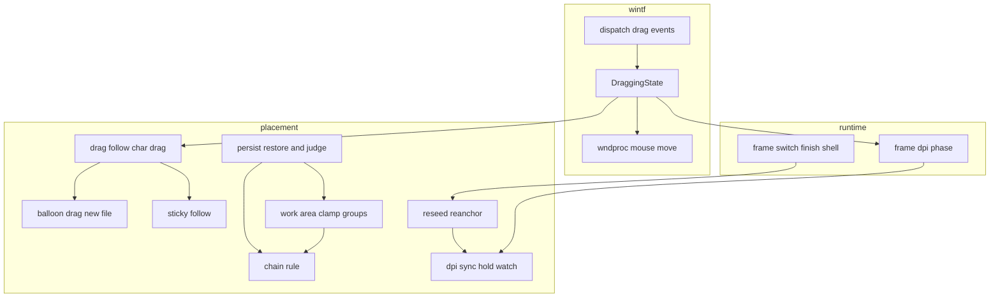
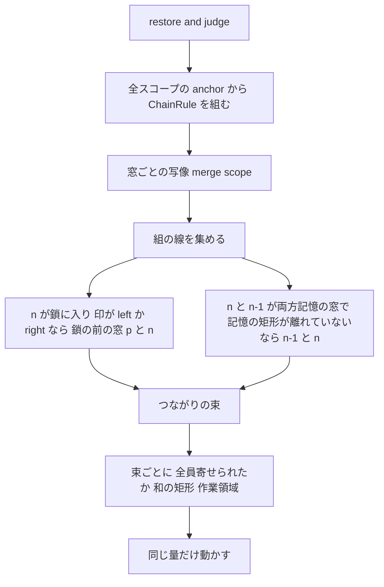
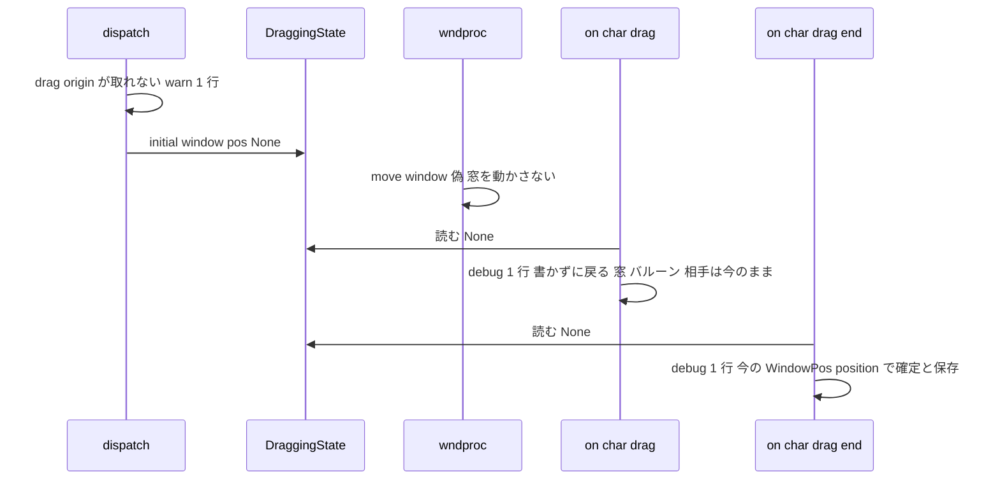
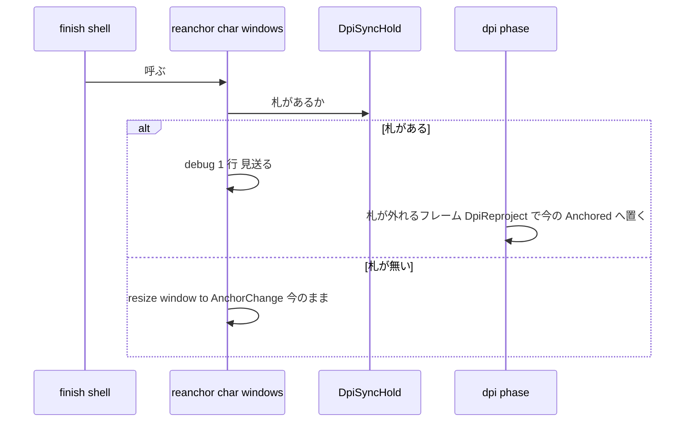
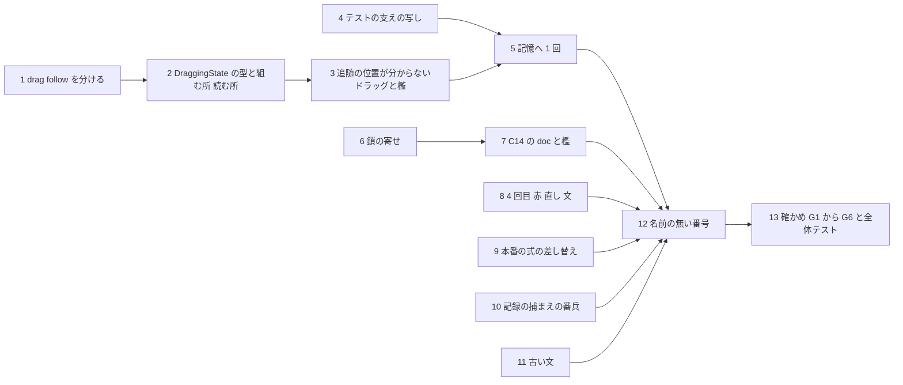

# 設計: audit-placement-follow-residue

> 2026-11-17 `kiro-spec-design`。測ったツリーは枝 `claude/kiro-start-audit-placement-follow-residue-68f4ba` の頭 `c66f7ee54`（`main` `5749a4c72` の上に spec の文書のコミットだけ）。行の番号はこのツリーのもので、着手のときに `main` で測り直す（要件 10.1）。調べの記録は `research.md` の 9 節。

## Overview

**Purpose**: 完了した `audit-placement-follow` の範囲（配置の crate `areka-placement` の追随と移り変わりの判定）に `audit-placement-core` が申し送った件を全部直す。直す件は 7 つの塊に分かれる（要件の Introduction の表）: 鎖の寄せ・ドラッグの始めの位置（164）・`follow/drag_follow.rs` の 1,000 行・共有の部品の写し・記憶へ書く回数（7 回目）・アンカーの変化の書き込み（4 回目）・古い文と名前の無い番号。

**Users**: ゴーストの利用者（窓が思わぬ所へ動かない・記憶から戻した組がばらけない）と、配置の crate を直す開発者（写しと古い文が無い・番号に spec の名前が付いている）。

**Impact**: 振る舞いが変わるのは 4 か所だけ: ⑴ 記憶から戻した窓の組の作り方（鎖の前の窓との組） ⑵ 始めの位置が分からないドラッグ（どの窓も動かさない） ⑶ 組のドラッグの終わりの記憶への書き込み（1 回） ⑷ 拡大率の整合待ちの札のある窓へのシェルの切り替えの置き直し（札が外れるまで見送る）。ほかは振る舞いを変えない直し（ファイルの分け方・写しを共有の部品へ・説明と番号）。wintf の公開の型 `DraggingState` の欄の型が 1 つ変わる（crates.io の次の版 0.2.0 に入る壊れる変更）。

### Goals

- 要件 1〜7 の件が全部直り、要件 8 の「残す件」は 0（設計で新しく当たった件も 0）。
- 直した振る舞い 1 つにつき、壊れたら落ちる決定論のテストが 1 本以上ある（要件 10.2）。
- 要件 1.8・7.4 の grep が下の「確かめ」の形の結果になり、どのファイルも 1,000 行の番人の下（要件 3・9.1）。全体テストが緑（要件 10.3）。

### Non-Goals

- 鎖の決まりそのもの（`chain_rule.rs` の規則・`audit-placement-core` の `research.md` 18.10「この仕様で行く」）と `defaultx` の読み（`defaultx-canon`）を変えること。
- 新しい機能・audit のかけ直し（要件 10.5）・clippy の指摘の機械的な直し・`vendors/`。
- 番人の例外表とその数の行の変更、例外表に載るファイル（`follow/window_move.rs`・`transition_judge_verdict_tests.rs` ほか）を割ること。
- wintf の中の控え `DragState::Dragging.initial_window_pos`（`ecs/drag/state/mod.rs:84`）の型をそろえること（下の「決め 2」）。

## Boundary Commitments

### This Spec Owns

- 記憶から戻した窓の組の寄せ（`follow/work_area_clamp.rs` の `keep_restored_groups` と、呼び手 `persist::restore_and_judge` の組の入力）。
- 起動の確定と詰め直しの寄せの反対の側の決め（`opposite`）の説明とその檻。
- wintf の `DraggingState.initial_window_pos` の型と、それを組む所・読む所の全部（範囲の外の crate の呼び手を含む・要件 2.6）。
- 追随のキャラ窓のドラッグ（`on_char_drag`・`on_char_drag_end`・`policy_mapped_position`）の「始めの位置が分からない」ときの振る舞いと記録。
- `follow/drag_follow.rs` の分け方（新しい `follow/balloon_drag.rs`）。
- 組のドラッグの終わりの記憶への書き込みの束ね方（`sticky_follow::finish_char_drag` と `on_char_drag_end`）。
- シェルの切り替えの置き直し（`reseed::reanchor_char_windows`）と整合待ちの札の関係。
- 受け持つ範囲（`crates/areka-placement/src/` の `follow*`・`transition_*`、`crates/areka-runtime/src/placement_tests/transition_*`）の写し・古い文・名前の無い番号。
- 491・432・431 の本番の式の差し替え先（`balloon_limit.rs`・`reseed.rs`・`persist.rs`・`transition_diag.rs`・`follow/visibility.rs`・`follow/work_area.rs`）。

### Out of Boundary

- `chain_rule.rs` の規則（`ChainView::joins`・`ChainRule::prev` の答え）。この spec は口を 1 つ開くだけで、答えを変えない。
- 起動の確定（`chain_rule::boot_chain`）・詰め直し（`chain_realign.rs`）・印の保存（`persist_save.rs`）の鎖の扱い。
- 拡大率の相（`areka-runtime` の `frame/dpi.rs` の `dpi_phase_with`）と整合待ちの札の付け外し（`dpi_sync.rs`）。札が外れるフレームの書き込みはそのまま使い、変えない。
- `crates/log-capture-kit/tests/file_length_guard_test.rs` の例外表（`audit-test-kits`）。`crates/areka-runtime/src/placement_tests/mod.rs`（`audit-emo2-boot-spine`）。
- `Cargo.toml`・`Cargo.lock`（依存を足さない）。

### Allowed Dependencies

- 配置の crate の中の共有の部品: `chain_rule::{ChainRule, ChainTerms, ChainView}`・`chain_finalize::judge_adjacency`・`resolver::clamp_axis`・根の `work_area_px`・`scale_signed`・`follow::visibility::rect_at`・`test_support`（`SharedFakeIo`・`zorder_pair_deferred::code_only`・`point`・`contained`）・`placement_shared_test_support`（`assert_no_event`・`k`・`events_with`）。
- 依存の向きは今のまま: wintf ← `areka-placement` ← `areka-runtime` ← `areka`。wintf の側の直しは配置の crate を知らない（wintf の中で閉じる）。
- 記録は `tracing`（今の使い方）と `log-capture-kit`（テストの捕まえ・`env-filter` を宣言しない＝380）。

### Revalidation Triggers

- `wintf::ecs::drag::DraggingState` の欄の型（`initial_window_pos` が `Option`）: wintf を crates.io から使う外の利用者は v0.2.0 で直しが要る。areka の木の中の利用者はこの spec で全部直す。
- `ChainRule::from_terms` をテストの外へ開く: 鎖の見方を組む所が `persist.rs` に 1 つ増える（`audit-placement-core` 18.10「これで終わる理由」2 の列が 3 → 4）。`defaultx-canon` は鎖の寄せと同じ所を通るので、この spec の着地の後に取る（roadmap どおり）。
- `finish_char_drag` の戻りの型: 呼び手は `on_char_drag_end` とテストだけ。
- `reanchor_char_windows` が札のある窓を見送る: シェルの切り替えの直後の位置が、札が外れるフレームまで前の揃え方のまま残る（最大 30 フレーム）。`audit-emo2-boot-frame`（`frame/switch.rs` の持ち主）が切り替えの段を直すときに読む。

## Architecture

### Existing Architecture Analysis

- 追随（`follow`）はファサードの形（`follow.rs` が子のモジュールを束ね、子どうしは `super::` で辿る・structure.md「ファサード形式」）。新しい子 `follow/balloon_drag.rs` もこの形に入れる。
- 鎖の答えは `chain_rule.rs` の `ChainRule` 1 か所が持つ（18.10）。記憶の戻し `persist::restore_and_judge` は World を持たない純関数で、`ChainRule` を組む口（`of`・`of_ghost_windows`）は World を要るので今は使えない。テストだけの `from_terms` がある。
- wintf のドラッグは、配り（`dispatch_drag_events`）が `DraggingState` を挿し、wndproc（`mouse_move.rs`）が `DraggingState` を正本として窓を動かす（`move_window` が真の窓だけ）。areka が書く窓（吸着した窓・組に入った窓）は `move_window: false` で、`on_char_drag` が唯一の書き手。
- 整合待ちの札（`DpiSyncHold`）の見張りは、書き込みの口 `enqueue_window_set_pos` が経路語で「見送りが覆う経路」かを分ける（`deferral_covers_route`）。`ChainRealign` は自前の見送りを持つので覆う側にいる。

### Architecture Pattern & Boundary Map



**Architecture Integration**:

- 選んだ形: 今の形をそのまま使う。新しい部品は `follow/balloon_drag.rs`（中身は移すだけ）だけ。
- 鎖の寄せは `ChainRule` を記憶の戻しでも組んで渡す（決め 1）。追随に鎖の式を持たない。
- 164 は型に「分からない」を持たせる（決め 2）。`DraggingState` の「在る＝ドラッグ中」の意味は変えない。
- 4 回目は呼び手（`reanchor_char_windows`）が札のある窓を見送る（決め 5）。経路語の分け方は変えない。
- steering の守り: 1,000 行の番人・決定論のテスト・記録の無い失敗の道を作らない・依存を足さない。

### Technology Stack

| 層 | 使うもの | この spec での役 | 注 |
|---|---|---|---|
| 言語・ECS | Rust 2024・`bevy_ecs`（今の版） | 部品の形と World の読み書き | 変えない |
| 窓の土台 | `wintf`（ワークスペースの版 0.1.0・`publish = true`） | `DraggingState` の欄の型 | 次の公開 0.2.0 で壊れる変更（決め 2） |
| 記録 | `tracing`・`log-capture-kit` | 記録と、その捕まえのテスト | `env-filter` を宣言しない（380） |
| 確かめ | `git grep`・PowerShell・`tools/test-all.ps1` | 要件 1.8・7.4 の仕分けと全体テスト | 道具は足さない |

新しい依存は無い（要件 9.4）。

## 決め（要件の討議から回された 8 件）

| # | 何を | 決め | 理由 |
|---|---|---|---|
| 1 | 鎖に入るかの渡し方（3.2 の B1〜B3） | **B1**: `ChainRule::from_terms` の `#[cfg(test)]` を外し、`restore_and_judge` が全スコープの `ScopePlacement::anchor` から組んで `keep_restored_groups` へ渡す | 写しを持たない形はこれだけ。`chain_rule.rs` の差は属性 1 行と doc だけで、規則は変えない（要件 8.4） |
| 1b | 記憶の矩形の組（R1〜R3） | **R1**: 印の組は（鎖の前の窓, n）、矩形の組は今と同じ番号の続く対 (n−1, n) | 18.10 の表の T5・T7・T29 の F の列「合う」を動かさない（要件 1.4）。R2 は完了した `window-work-area-clamp` 要件 4.1 の読みを狭める裁定になる |
| 1c | 組の束ね方 | 「ひと続き」をやめ、印の組と矩形の組をつないだ**つながりの束**にする | 鎖の前の窓との組は並びの中で飛び飛びになる（辺のスコープを挟む）ので、隣どうしを伸ばす形では作れない |
| 2 | 164 の持たせ方（3.1 の A1〜A3） | **A1**: `DraggingState.initial_window_pos: Option<(f32, f32)>`。`None`＝始めの位置が取れなかった | 前例 `WindowDragContext.initial_window_pos: Option<Point>` と同じ形。在る無しを見る 7 か所の意味を保つ。取り違えを型が許さない。wintf の中の控えは `move_window && is_some()` で既に守っているので型をそろえない |
| 2b | 離したときに位置が出せないとき | 今の「`DraggingState` が無いとき」の縮退（`WindowPos.position`＝動いていない今の位置で書く）を通す（設計の討議で自明な直しとして閉じた） | 新しい枝を作らない。書くのは今いる所で、(0,0) を基準にした位置ではない（要件 2.4）。保存を飛ばしても記憶の値は同じなので、枝を足す理由が無い |
| 2c | 追随の側の記録 | `policy_mapped_position` が「始めの位置が分からない」で `None` を返すたびに `debug!` を 1 行（記録の札 `CHAR_DRAG_ORIGIN_UNKNOWN_TAG`・`entity` 付き）。wintf の始めの `warn!` 1 行（`entity`・`window`・理由）はそのまま | 「どの窓か」は wintf の `warn!` が持つ。追随の側は今の「`DraggingState` 不在」の `debug!` と同じ回数と水準にそろえ、状態を足さない |
| 3 | C14 の `opposite`（3.3） | **C1**: 振る舞いを変えず doc と檻 | 18.10 の C14 どおり。辺のスコープとの組の反対の側はほぼ画面の外で、結果は端へ寄せる |
| 4 | `drag_follow.rs` の分け方（3.5） | バルーン単独のドラッグの塊（503〜1000 行・`known_position` を除く）と記録の札（26〜33 行）を `follow/balloon_drag.rs` へ移す。`known_position`（550 行）は残る側の `guard_balloon_position`（488 行）も呼ぶので `drag_follow.rs` に残して `pub(super)` にし、`balloon_drag.rs` は `super::drag_follow::known_position` を引く。`CW_USEDEFAULT` の `use` は両方のファイルに置く | 塊のあいだの呼び合いは、`known_position` の 1 つを除いて一方向（⑴⑵ は ⑶ を呼ばない）。外への名前は `follow.rs` から今のまま（設計の検証の指摘 2） |
| 5 | 4 回目の直し方（3.4 の D1〜D3） | **D3**（2026-11-17 設計の討議 議題 1 で確定）: `reanchor_char_windows` は札のある窓を見送り `debug!` を残す。札が外れるフレームの拡大率の相の書き込みが、入れ直した揃え方で置く | 札は「古い作業領域で射影した中間の矩形を書かない」ためにある（`dpi_sync.rs` の doc・要件 5.8）。シェルの置き直しも作業領域へ射影する書き込みなので見送るのが札の意味に合い、`AnchorChange` は「見送りが覆う経路」のまま正しくなる（`EXPECTED` の表も変わらない） |
| 6 | `rect_at` の開け方 | `visibility.rs:111` の `rect_at` を `pub(crate)` にし、`follow.rs:166` の私有の `use` から外して `pub(crate) use self::visibility::rect_at;` を 1 行足す | `pub(super)` の項目は広く出し直せない（research 4 節 9） |
| 7 | 7 回目の束の印 | 相手の束と動かした窓の束を 1 つにして `persist_entries` を 1 回だけ呼ぶ。足される印は今の N+1 回の和と同じ（下の「記憶へ 1 回」） | `send_entries` は束の位置の鍵から触れる組の印を足し、同じ印の鍵を重ねない |
| 8 | 4 回目が鳴るか（要件 6.1） | 鳴る。設計の段で配置の crate の一時の試しで確かめた（`reanchor_char_windows` を札のある窓に揃え方 `top` で呼ぶと `debug_assert!` が `route=Some(AnchorChange)` で落ちる・試しは消した）。本番で札のある間に切り替えが終わるのを止める所は無い（`frame/switch.rs` と `dpi_sync.rs` のあいだ） | 要件 6.1 の確かめは、タスクで同じ形の檻を先に赤で置いて固める（要件 6.4） |

## File Structure Plan

### Directory Structure

```
crates/areka-placement/src/
├── chain_rule.rs                 # from_terms をテストの外へ（属性 1 行・doc）※C22 の触るファイルの外
├── persist.rs                    # restore_and_judge が ChainRule を組む・491 の矩形 2 か所
├── follow.rs                     # balloon_drag の mod と use・rect_at を crate へ・古い文
├── follow/
│   ├── drag_follow.rs            # キャラ窓のドラッグとバルーンの追随だけ（約 500 行）・164・7 回目
│   ├── balloon_drag.rs           # 新: バルーン単独のドラッグ（約 510 行・移すだけ）
│   ├── work_area_clamp.rs        # つながりの束の組・opposite の doc・joined_with_prev を消す
│   ├── sticky_follow.rs          # finish_char_drag が束を返す・scg
│   ├── visibility.rs             # clamp_x_into を消す・rect_at を pub(crate)
│   ├── work_area.rs              # from_monitors が work_area_px を使う・doc
│   ├── move_shift.rs             # 根の scale_signed・名前の無い番号
│   ├── window_move.rs            # AnchorChange の doc（例外表のファイル・割らない）
│   └── keyword_base.rs           # AnchorChange の doc
├── reseed.rs                     # 札のある窓を見送る・491 の矩形
├── balloon_limit.rs              # 491 の矩形 2 か所
├── transition_diag.rs            # live_work_area_bottom が work_area_px を使う
└── lib.rs                        # 「根を引く子」の文
crates/wintf/src/ecs/drag/mod.rs  # DraggingState の欄の型
```

### Modified Files

塊ごとに並べる（`_Boundary:_` の単位）。行は今のツリーの番号。

**1,000 行（要件 3）**

- `crates/areka-placement/src/follow/drag_follow.rs` — 503〜1000 行（`on_balloon_drag`・`reestablish_balloon_follow`・`on_balloon_drag_end`・`retire_keyword_base_on_save`・`apply_release_limit_correction`）と 26〜33 行（`BALLOON_DRAG_BASE_UNPINNED_TAG`）を外す。`known_position`（550 行）は残して `pub(super)` にする（決め 4）。中身・記録の文・順は変えない。
- `crates/areka-placement/src/follow/balloon_drag.rs`（新）— 外した塊。`use` は `super::`（ファサード）から引き、`known_position` は `super::drag_follow::known_position`、`CW_USEDEFAULT` は自前の `use`。
- `crates/areka-placement/src/follow.rs` — `mod balloon_drag;` を足し、78〜82 行の `on_balloon_drag`・`on_balloon_drag_end` の再束縛を `self::balloon_drag::` へ。52・64 行の `drag_follow::on_balloon_drag_end` の名指しを直す。
- 名指しの文を直す（説明だけ）: `resolver.rs:103`・`:150`、`resolver_resolve_balloon_tests.rs:126`、`spawn.rs:200`・`:229`、`windowposition.rs:16`、`diag.rs:213`、`follow/window_move.rs:168`（`drag_follow::retire_keyword_base_on_save`）、`follow_balloon_drag_tests.rs:7`（`use super::balloon_drag::BALLOON_DRAG_BASE_UNPINNED_TAG`）。**`resolver.rs`・`spawn.rs`・`windowposition.rs`・`diag.rs`・`resolver_resolve_balloon_tests.rs` は C22 の触るファイルの列の外**（同じ crate・同じウェーブで `areka-placement` に触る相手はいない＝約束 ⑷）。

**164（要件 2）**

- wintf `crates/wintf/src/ecs/drag/mod.rs` — `initial_window_pos: Option<(f32, f32)>` と doc（`None` の意味）。
- wintf `crates/wintf/src/ecs/drag/dispatch.rs` — 103 行の `unwrap_or((0,0))` をやめ、`origin.map(..)` を入れる。`debug!` の欄も `Option` で出す。
- wintf `crates/wintf/src/ecs/window_proc/mouse_move.rs` — `dragging_window_origin` は live の `initial_window_pos` が `Some` のときだけそれを使い、`None` なら控えへ（控えは `move_window` が偽なので使われない）。
- wintf のテスト: `ecs/drag/systems.rs:41`（`Some((0.0, 0.0))`）、`ecs/window_proc/mouse_move_drag_origin_tests.rs`（`live` の手伝いと `None` の対）、`ecs/drag/dispatch_order_tests.rs`（189 行の「始めの位置は無い」の場面で `DraggingState.initial_window_pos` も `None` を足す）、`tests/drag/dispatch_test.rs:117`・`:442`・`:484`。
- 配置 `crates/areka-placement/src/follow/drag_follow.rs` — `policy_mapped_position` の `None` の腕と記録の札。
- 配置のテスト: `follow_test_support.rs:90-95`（`dragging_state` が `Some`）、`follow_drag_end_gate_tests.rs`（`destination()` の前提を作り直す・下の Testing）、`follow_drag_tests.rs`（位置が分からないドラッグの檻）。
- `crates/areka-runtime/src/frame/dpi.rs` — `realign_drag_grab` は `None` なら置き直さず `debug!`。`rescale_drag_grab` の形は変えない。
- `crates/areka-runtime/src/frame_dpi_drag_grab_tests.rs`（34・60・78・137・185 行）・`frame_chain_realign_exclusion_tests.rs:248`。
- 本体 `crates/areka/src/runtime_tests/frame_chain_finalize_persist_restart_tests.rs:66`・`frame_chain_rule_tests.rs:414`・`crates/areka/src/input_events/drag_test_support.rs:242-250`（`Some(..)` を入れる・doc の「(0,0) のまま」を「`None` のまま」へ）。
- 本体 `crates/areka/src/input_events/drag_tests.rs:9`（説明の「(0,0) のまま入る」）と、`set_initial_window_pos` を呼ばずに偽の HWND の (0,0) に寄りかかった期待が見つかればその檻。**`drag_tests.rs` は C22 の触るファイルの列の外**（持ち主の `input-crate-split`・`audit-areka-input-menu` は C23 以後で今は走っていない）。
- 触る所の確かめ: 型を変えるとコンパイラが組む所と `.0`／`.1` で読む所を全部示す。`git grep -n "DraggingState" -- crates` の 31 ファイルのうち、在る無しだけを見る所（`chain_realign.rs`・`work_area_clamp.rs`・`move_shift.rs`・`sticky_follow.rs`・wintf `systems.rs` の本体・`dispatch_order_tests.rs`・`wndproc_bridge_drag_cancel_tests.rs`・`examples/taffy_flex_demo/drag.rs`）は変えない。

**鎖の寄せ（要件 1）**

- `crates/areka-placement/src/chain_rule.rs` — `from_terms` の `#[cfg(test)]` を外し、doc を「見方の列から組む（World を持たない記憶の戻しと檻の口）」へ。**C22 の触るファイルの列の外**（持ち主の `audit-placement-core` は着地済み・同じウェーブに触る相手はいない）。
- `crates/areka-placement/src/persist.rs` — `restore_and_judge` が `placements` を `restored_windows` へ渡す前に `ChainRule` を組み、`keep_restored_groups(&windows, &chain, snapshot)` を呼ぶ。362 行の doc（「組 (n−1, n)」の読みが無いことを確かめる）。
- `crates/areka-placement/src/follow/work_area_clamp.rs` — `keep_restored_groups` の組の作り方・`RestoredWindow::mark` の doc（392 行）・`keep_restored_groups` の doc（404〜411 行）・`joined_with_prev` を消す・`opposite` の doc（298 行）。
- `crates/areka-placement/src/follow.rs:122-123` — 説明の古い名（`apply_restored_placements` → `restore_and_judge`）と名前の無い番号。
- テスト: `follow_work_area_clamp_restore_tests.rs`（`keep_restored_groups` の呼び 10 か所に鎖を渡す・`apart_or_non_consecutive_pairs_are_not_grouped` の作り直し・T6／T8・T5 の檻）、`persist_restore_group_tests.rs`（記憶の戻しの道の T6・T8）、`follow_work_area_clamp_chain_tests.rs`（C14）。

**写し（要件 4）**

- 本番: `follow/move_shift.rs:18`（`crate::scale_signed`）・`follow/visibility.rs:138`（`clamp_x_into` を消して `resolver::clamp_axis(x, wa.left, wa.right.saturating_sub(w))`）・`follow/visibility.rs:111`（`rect_at` を `pub(crate)`）・`follow/work_area.rs:42-56`（`crate::work_area_px` と doc）・`balloon_limit.rs:202`・`:291`・`reseed.rs:347`・`persist.rs:215`・`:245`（`rect_at`）・`transition_diag.rs:685-700`（`.map(crate::work_area_px)`）・`follow.rs:165-168`（`rect_at` を crate へ）・`lib.rs:24-26`（「根を引く子」に `follow/move_shift`→`scale_signed`、`follow/work_area`・`transition_diag`→`work_area_px` を足す）。
- テストの支え: `follow_test_support.rs`（`assert_no_event`・`point`・`contained`・`code_only`・`SharedFakeIo` と `SylphyaRig` の写しを消す・`position_of`・`drag_event`・`drag_end_event_at`・`window_pos_sized`・`point_of` を `pub(crate)`）、`spawn_follow_pipeline_tests.rs:37`・`balloon_limit_flip_tests.rs:336`・`balloon_lock_drag_tests.rs:48`（写しを消す）、`follow_move_shift_tests.rs:35`（`k`）、`follow_sticky_follow_drag_tests.rs:79`（`events_of` → `events_with`）、写しの使い手（消す前に `git grep` で全部・要件 4.4）。
- 記録の捕まえの番兵: `follow_transition_diag_tests.rs:280`・`follow_window_move_diag_tests.rs:483`。
- `follow_visibility_balloon_wiring_tests.rs:384`・`follow_visibility_char_wiring_tests.rs:666` の `clamp_x_into` の名指し。
- `follow/sticky_follow.rs:379`（「scg 7.3」→「`areka-P0-scope-chain-gap` 要件 7.3」）。

**記憶へ 1 回（要件 5）**

- `crates/areka-placement/src/follow/sticky_follow.rs` — `finish_char_drag` が相手の束を返す。
- `crates/areka-placement/src/follow/drag_follow.rs` — `on_char_drag_end` が束を 1 つにして 1 回書く。
- テスト: `follow_sticky_follow_drag_tests.rs` — `finish_char_drag` を直に呼んで相手の位置を `rig.saved()` で見る 3 本（147・203・240 行・要件 5.2 を固める檻）は、返る束の中身を見る形へ書き直す。`let ((), events) = capture(..)` の 3 か所（158・277・354 行）は戻りの型に合わせる。ほかの呼びは戻りを使わない形のまま。回数の檻は `on_char_drag_end` を通して足す（設計の検証の指摘 1）。
- 書き手の一覧の文（説明だけ）: `persist.rs:9-12`（「書く呼び手は次の 4 か所」）・`persist_save.rs:33`（`PersistWiring`）・`follow/drag_follow.rs:135`。**`persist_save.rs` は C22 の触るファイルの列の外**（同じ crate・同じウェーブに触る相手はいない）。

**アンカーの変化（要件 6）**

- `crates/areka-placement/src/reseed.rs` — `reanchor_char_windows` が札のある窓を見送る。
- `crates/areka-placement/src/reseed_tests.rs` — 鳴るかの檻（赤を先に）・見送りの檻・札が外れた後の書き込みの檻。
- `crates/areka-placement/src/follow/window_move.rs:526-530`・`:130`（例外表のファイル・行を足すのは文に要る分だけ・要件 9.1）・`follow/keyword_base.rs:47`。

**古い文と名前の無い番号（要件 7）**

- `crates/areka-placement/src/follow_drag_tests.rs:144`（帳面の名）・`follow.rs:122`・`crates/areka-runtime/src/placement_tests/transition_judge.rs:45-50`（999 行・行を増やさない）。
- 受け持つ範囲の 60 ファイル（`crates/areka-placement/src/follow*` 42・`transition_*` 2・`crates/areka-runtime/src/placement_tests/transition_*` 16）の名前の無い番号。`crates/areka-runtime/src/placement_tests/` の下はファイルを足し引きしない（要件 9.3）。`transition_judge.rs`・`transition_judge_tests.rs`（999 行）は行を増やさない。

## System Flows

### 記憶から戻した窓の組（要件 1）



- 印の線は `chain.prev(ChainView::Saved, n)` が記憶から戻した窓のときだけ引く（既定の位置のままの窓とは組にしない。起動の確定が付け直す）。n が鎖に入らない（左右の辺）なら印の線を引かない（要件 1.4）。
- 矩形の線は今の `joined_with_prev` の矩形の腕と同じ（番号の差 1・`judge_adjacency` が `Apart` でない）。辺のスコープも番号が続けば矩形で組にする（T5・T7・T29）。
- 束の後の判定（全員寄せられたか・見えている窓・和の矩形・作業領域が取れないとき）は今のまま。束は一番小さい番号の順に処理し、束の中は番号の昇順（記録の並びが今と同じ）。

### 始めの位置が分からないドラッグ（要件 2）



- 吸着した窓・組に入った窓（`move_window: false`）: `on_char_drag` は書かずに戻る（バルーン・組の相手も動かさない）。
- 組に無い `Free` の窓（`move_window: true`）: wintf が動かさない（今の守り）。`on_char_drag` は動いていない `WindowPos.position` を読むだけ。
- `on_char_drag_end`: どの窓も `policy_mapped_position` が `None` → 今の位置で確定（`enqueue_window_set_pos` は同じ位置）→ `reset_applied` → `follow_balloon` → `finish_char_drag`（量 0）→ 今の位置を記憶へ。(0,0) を基準にした位置は書かない（要件 2.4）。今まで `Free` の窓は離したときに (0,0)＋差の所へ書かれていた（その穴もこれで閉じる）。

### シェルの切り替えの置き直し（要件 6）



- 札が外れるフレームの拡大率の相は、札のある窓を毎フレーム対象に入れ（`dpi.rs:355-363`）、通ったフレームで `reconcile_window_size` か `reproject_char_window_at_current_size` を呼ぶ。どちらも `resize_window_to` を通り、入れ直した `Anchored` で射影する。打ち切り（30 フレーム）の後も同じ。

## Requirements Traceability

| 要件 | 要旨 | 部品 | 口 | 流れ |
|---|---|---|---|---|
| 1.1 | 組の相手は鎖の前の窓（`ChainView::Saved`） | RestoreGroup | `ChainRule::from_terms`・`prev` | 記憶から戻した窓の組 |
| 1.2 | T6: 辺を飛ばした p と n を組に・辺と n を印で組にしない | RestoreGroup | `keep_restored_groups` | 同上 |
| 1.3 | T8: 0 と 2 を組に | RestoreGroup | 同上 | 同上 |
| 1.4 | 辺のスコープは印の相手にしない・矩形は (n−1, n) | RestoreGroup | 同上 | 同上 |
| 1.5 | `opposite` の振る舞いを保ち doc と檻 | ChainClamp | `opposite` | — |
| 1.6 | 最後の位置は起動の確定が直す形のまま | RestoreGroup | 触らない（`boot_chain`） | — |
| 1.7 | `RestoredWindow::mark`・`keep_restored_groups` の doc | RestoreGroup | doc | — |
| 1.8 | 追随に鎖の式の写しを残さない | RestoreGroup | `joined_with_prev` を消す | 確かめ G1 |
| 1.9 | T6・T8 の檻 | Testing | `persist_restore_group_tests.rs` ほか | — |
| 2.1 | (0,0) を始めの位置にしない | DraggingStateType | `DraggingState.initial_window_pos: Option` | 始めの位置が分からないドラッグ |
| 2.2 | その回はどの窓も動かさない | CharDragOrigin | `policy_mapped_position` | 同上 |
| 2.3 | 記録に残す | DraggingStateType・CharDragOrigin | wintf の `warn!`・`CHAR_DRAG_ORIGIN_UNKNOWN_TAG` の `debug!` | 同上 |
| 2.4 | (0,0) 基準の位置を記憶へ書かない | CharDragOrigin | `on_char_drag_end` の縮退 | 同上 |
| 2.5 | 位置が取れれば今と同じ | DraggingStateType・CharDragOrigin | `Some` の腕 | — |
| 2.6 | 組む所・読む所を全部直す | DraggingStateType | 型の変更とコンパイラ | — |
| 2.7 | 持たせ方の比べと公開の段への影響 | DraggingStateType | 決め 2・「公開の段への影響」 | — |
| 2.8 | wintf と追随の両方の檻 | Testing | — | — |
| 3.1 | 164 と番号の直しの前に分ける | BalloonDragSplit | 作業の順 | — |
| 3.2 | 分けるだけ・振る舞いを変えない | BalloonDragSplit | 移すだけの段 | — |
| 3.3 | 分けた後も上限の下・例外表に足さない | BalloonDragSplit | 行の数 | 確かめ G5 |
| 4.1 | 写しを消す | SharedCopies | 共有の部品 | — |
| 4.2 | 記録の捕まえに番兵 | SharedCopies | `diag_tests.rs` の形 | — |
| 4.3 | `scg` を略さない | StaleText | doc | — |
| 4.4 | 消す前に使い手を確かめる | SharedCopies | `git grep` | — |
| 4.5 | 本番の式の差し替えで位置と矩形を保つ | SharedCopies | 式は同じ・今の檻 | — |
| 4.6 | `work_area.rs` の doc と `lib.rs` の文 | SharedCopies | doc | — |
| 5.1 | 1 つの束で 1 回書く | DragEndPersist | `finish_char_drag` の戻り | — |
| 5.2 | 束の中身は今と同じ | DragEndPersist | `origin_position`・`saved_form_anchor` | — |
| 5.3 | 回数の檻 | Testing | `SharedFakeIo::commit_count` | — |
| 6.1 | 鳴るかをテストで確かめる | ReseedHold | 決め 8・赤の檻 | シェルの切り替えの置き直し |
| 6.2 | 鳴るなら違反として記録しない | ReseedHold | 札のある窓を見送る | 同上 |
| 6.3 | `AnchorChange` の説明 | StaleText | `window_move.rs`・`keyword_base.rs` の doc | — |
| 6.4 | 振る舞いの檻 | Testing | `reseed_tests.rs` | — |
| 7.1 | 消えた名前の説明 | StaleText | doc | — |
| 7.2 | 名前の無い番号を消すか名前を足す | NumberCleanup | 直し方の規則 | — |
| 7.3 | 帳面の名を残さない | StaleText | doc | 確かめ G3 |
| 7.4 | grep の仕分け | NumberCleanup | 確かめの手順 | 確かめ G2 |
| 8.1 | 残すのは 3 つの場合だけ | 全体 | 残す件は 0 | — |
| 8.2 | 裁定を覆す直しは議題に | 全体 | 当たる件は 0（R2 は採らない） | — |
| 8.3 | SSP・ukadoc に関わる振る舞い | 全体 | 当たる件は 0（変える振る舞いは配置の内側だけ） | — |
| 8.4 | 鎖の決まりと `defaultx` を変えない | RestoreGroup | `from_terms` を開くだけ・`default_x: None` は Saved で読まれない | — |
| 8.5 | 確定した件を書き加える | 全体 | 要件の「確定した件」（設計で足す件は 0） | — |
| 9.1 | 1,000 行を越えない | 全体 | 行の数の確かめ | 確かめ G5 |
| 9.2 | 例外表を変えず、表のファイルを割らない | 全体 | `window_move.rs` は doc だけ | — |
| 9.3 | `placement_tests/` にファイルを足し引きしない | NumberCleanup | 文の直しだけ | — |
| 9.4 | 依存を足さない | 全体 | `Cargo.toml`・`Cargo.lock` に触らない | 確かめ G6 |
| 9.5 | 形を変えたら呼び手を全部直す | DraggingStateType・DragEndPersist・RestoreGroup | コンパイラと `git grep` | — |
| 9.6 | 失敗を記録に残す | CharDragOrigin・ReseedHold | `warn!`／`debug!`（失敗の道は足さない） | — |
| 9.7 | 実機の根は `target` の下 | 全体 | 実機のテストは足さない | — |
| 9.8 | `vendors/` と clippy の機械的な直し | 全体 | 触らない | — |
| 10.1 | 行の番号を引き直す | 全体 | 着手のとき `main` で | — |
| 10.2 | 直した振る舞いごとの檻 | Testing | 下の Testing Strategy | — |
| 10.3 | 全体テスト | 全体 | `pwsh -NoProfile -File tools/test-all.ps1` | — |
| 10.4 | grep と行の数を完了の記録へ | 全体 | 確かめ G1〜G6 | — |
| 10.5 | audit をかけ直さない | 全体 | — | — |

## Components and Interfaces

| 部品 | 層 | 役 | 要件 | 主な依存 | 契約 |
|---|---|---|---|---|---|
| RestoreGroup | 配置・記憶の戻し | 記憶から戻した窓の組をつながりの束で作る | 1.1〜1.4, 1.6〜1.9, 8.4 | `ChainRule` (P0)・`judge_adjacency` (P0) | Service |
| ChainClamp | 配置・鎖の寄せ | `opposite` の doc と檻 | 1.5 | — | — |
| DraggingStateType | wintf・ドラッグ | 始めの位置が分からないを型に持つ | 2.1, 2.3, 2.5〜2.7, 9.5 | — | State |
| CharDragOrigin | 配置・追随 | 位置が分からないドラッグで窓を動かさない | 2.2〜2.5, 9.6 | `DraggingState` (P0) | Service |
| BalloonDragSplit | 配置・追随 | `drag_follow.rs` を分ける | 3.1〜3.3 | — | — |
| DragEndPersist | 配置・追随 | 組のドラッグの終わりを 1 回で書く | 5.1〜5.3 | `persist_entries` (P0) | Service |
| ReseedHold | 配置・シェルの切り替え | 札のある窓の置き直しを見送る | 6.1, 6.2, 6.4, 9.6 | `DpiSyncHold` (P0)・拡大率の相 (P1) | Service |
| SharedCopies | 配置 | 写しを共有の部品へ | 4.1, 4.2, 4.4〜4.6 | 共有の部品 (P0) | — |
| StaleText | 配置・`areka-runtime` | 古い文 | 4.3, 6.3, 7.1, 7.3 | — | — |
| NumberCleanup | 配置・`areka-runtime` | 名前の無い番号 | 7.2, 7.4, 9.3 | — | — |

### 配置・記憶の戻し

#### RestoreGroup

| 欄 | 中身 |
|---|---|
| Intent | 記憶から戻した窓を、鎖の決まりの組（印）と記憶の矩形の組でつないだ束ごとに寄せる |
| Requirements | 1.1, 1.2, 1.3, 1.4, 1.6, 1.7, 1.8, 1.9, 8.4 |
| ファイル | `follow/work_area_clamp.rs`・`persist.rs`・`chain_rule.rs` |

**Responsibilities & Constraints**

- 組の相手を引くのは `ChainRule::prev(ChainView::Saved, n)` だけ。追随の側で「下の番号で鎖に入る一番近いもの」を探さない（要件 1.8）。
- 束の後の判定と記録（`remembered-visible`・`partner-visible`・`no-work-area`・`shifted`）は今の語のまま。
- 寄せた位置を記憶へ書き戻さない（`restore_and_judge` は純関数のまま）。

**Contracts**: Service [x]

##### Service Interface

```rust
// chain_rule.rs（属性を外すだけ・名前と形は今のまま）
impl ChainRule {
    /// 見方の列から組む（World を持たない記憶の戻しと檻の口）。
    pub(crate) fn from_terms(scopes: Vec<(usize, ChainTerms)>) -> Self;
}

// follow/work_area_clamp.rs
pub(crate) struct RestoredWindow {
    pub scope: usize,
    pub remembered: ChainRect,
    pub projected: PointPx,
    pub shown: PointPx,
    /// 鎖の前の窓との組（ChainView::Saved）の覚えた印。
    pub mark: Option<AdjacencyMark>,
}

pub(crate) fn keep_restored_groups(
    windows: &[RestoredWindow], // 記憶から位置を戻したスコープだけ・スコープ昇順
    chain: &ChainRule,          // 全スコープ（記憶の無いものを含む）の descript の揃え方
    snapshot: &MonitorSnapshot,
) -> Vec<GroupShift>;
```

- Preconditions: `windows` はスコープ昇順で重複が無い。`chain` は `placements` の全スコープを持つ（`ChainTerms { descript: p.anchor, default_x: None, live: p.anchor }`）。`ScopePlacement::anchor` は起動の前の resolver の出力で、descript の揃え方と同じ（台本の吸着は無い）。
- Postconditions: 返す `GroupShift` は、2 窓以上の束で、全員が今の判定で寄せられ、和の矩形の作業領域が取れた束の窓のうち、`shown` と違うものだけ。1 窓の束は返さない。
- Invariants: 印の線は「n が `ChainView::Saved` で鎖に入る」かつ「n の印が `left`／`right`」かつ「`p = chain.prev(Saved, n)` が `windows` に在る」ときだけ。矩形の線は「n−1 と n が両方 `windows` に在る」かつ「`judge_adjacency(rem(n−1), rem(n))` が `Apart` でない」ときだけ。`default_x` は `ChainView::Saved` が読まない（`ChainView::joins`）ので `None` で答えは変わらない。

**Implementation Notes**

- 束ね方: スコープは数個なので、窓ごとに束の番号を持ち、線ごとに大きい番号の束を小さい番号の束へ付け替える素朴な形で足りる（新しい型は作らない）。
- `restore_and_judge` は `placements` を `restored_windows` へ移す前に `ChainRule` を組む（借用のため）。`apply_restored_placements` と `reseed.rs:70`（1 スコープ）の呼び手はそのまま通る。
- 今の檻の `apart_or_non_consecutive_pairs_are_not_grouped` の `skipped`（0 と 2・印 `right`）は、鎖の入力が無いと意味が決まらない。「スコープ 1 が在って鎖に入る」場合（組にしない）に書き直し、T8（1 が無い）・T6（1 が辺）の場合を別の檻にする。
- 危うさ: T6 ⑵（辺のスコープ k と n の記憶の矩形が隣り合う）は R1 で幾何どおりの組として残る。18.10 の T5 の行（「番号が続けば記憶の矩形で組」）どおり。

### 配置・鎖の寄せ

#### ChainClamp（summary）

- `opposite` の doc に 2 つを書く: ⑴ `JoinLeftOffset` は回さない（`defaultx` の隙間の組は端へ寄せる・18.10 の C14） ⑵ 辺のスコープとの組（詰め直しの ⑷ が付ける `JoinLeft`／`JoinRight`）は回す側に入るが、辺のスコープは作業領域の端に揃っているので反対の側はほぼ画面の外で、結果は端へ寄せる（`Edge`）。記憶からの組の寄せ（`keep_restored_groups`）はここを通らない。
- 振る舞いは変えない。

### wintf・ドラッグ

#### DraggingStateType

| 欄 | 中身 |
|---|---|
| Intent | ドラッグの始めの窓の位置が取れなかったことを、(0,0) と取り違えない型で持つ |
| Requirements | 2.1, 2.3, 2.5, 2.6, 2.7, 9.5 |
| ファイル | `crates/wintf/src/ecs/drag/mod.rs`・`dispatch.rs`・`ecs/window_proc/mouse_move.rs` |

**Contracts**: State [x]

##### State Management

```rust
#[derive(Component, Debug, Clone, Copy)]
#[component(storage = "SparseSet")]
pub struct DraggingState {
    /// ドラッグ開始位置（スクリーン座標、物理ピクセル）
    pub drag_start_pos: PhysicalPoint,
    /// ドラッグを始めたときの窓の位置（枠を含むスクリーン座標・物理ピクセル・整数の値）。
    /// `None` は位置が取れなかった（窓に位置が無い・座標の変換が失敗した）ドラッグで、
    /// その回は窓を動かさない。
    pub initial_window_pos: Option<(f32, f32)>,
}
```

- 在る＝ドラッグ中の意味は変えない（`None` でも挿す）。在る無しを見る所（詰め直し・大きくなった窓の寄せ・面の move のずれ・次の画面の更新の予約・`DragEvent.start_position`）は今のまま。
- 配り: 位置が取れないとき今の `warn!`（「ドラッグを始めた窓の位置が取れない: 窓は動かさない」・`entity`・`window`・`reason`）を 1 行出し、`None` を入れる。
- wndproc: `dragging_window_origin` は `live` が在り `initial_window_pos` が `Some` のときだけそれを使う。`move_window` は控えの `ctx.move_window && ctx.initial_window_pos.is_some()` のままなので、`None` の回は窓を動かさない。
- 拡大率の相（`areka-runtime`）: `realign_drag_grab` は `None` なら置き直さない（掴んだ点が無い）。`debug!` を 1 行。

**公開の段（crates.io）への影響**（要件 2.7）

- `wintf::ecs::drag::DraggingState`（`wintf::ecs` からも出し直し）の公開の欄 `initial_window_pos` の型が `(f32, f32)` から `Option<(f32, f32)>` へ変わる＝組む側も読む側も壊れる変更。
- crates.io にある wintf は 0.1.0（タグ `v0.1.0`）。この変更は次のリリース（v0.2.0・まだ出していない）の wintf 0.2.0 に入る。0.x の版で 2 つ目の数を上げる版は壊れる変更を許す（cargo の版の読み）ので、版の決め方は変わらない。
- 公開の段（`.github/workflows/crates-io.yml`・`tools/crates-io.ps1` の包む確かめ）は型の変更に関係しない。`cargo-semver-checks` のような確かめは使っていない。
- 木の外の利用者への知らせ: PR の本文と完了の記録に「wintf 0.2.0 で `DraggingState.initial_window_pos` が `Option` になる（位置が取れないドラッグは `None`）」を書く（設計の討議 議題 3 で確定）。`/release` が見どころ `doc/release-notes/v{版}.md` をその版の変更から書くときに拾う。`doc/crates-io-publish.md` は公開の手順の文書なので直さない。

### 配置・追随

#### CharDragOrigin

| 欄 | 中身 |
|---|---|
| Intent | 始めの位置が分からないドラッグで、追随もドラッグした窓も動かさず、記録を残す |
| Requirements | 2.2, 2.3, 2.4, 2.5, 9.6 |
| ファイル | `follow/drag_follow.rs` |

**Contracts**: Service [x]

##### Service Interface

```rust
/// 始めの位置が分からないドラッグで窓を動かさなかった記録の札（決定論テストが逐語で固定する）。
pub(super) const CHAR_DRAG_ORIGIN_UNKNOWN_TAG: &str = "[char-drag] OriginUnknown";

/// `None` は ⑴ DraggingState が無い ⑵ DraggingState の始めの位置が分からない、のどちらか。
/// ⑵ は `debug!`（札・entity）を 1 行残す。
fn policy_mapped_position(world: &World, entity: Entity, anchor: Anchor, cursor: Point) -> Option<Point>;
```

- `on_char_drag`（areka が書く窓の腕）: `None` なら書かずに戻る（今の形）。バルーンと組の相手は `follow_balloon`・`follow_partners_on_drag` の前に戻るので動かない。
- `on_char_drag_end`: `None` なら今の縮退（`WindowPos.position`）で確定と保存。ドラッグした窓は動いておらず、組の相手は量 0 で今の所に書かれ、記憶に入るのは今の位置。
- Postconditions: 始めの位置が分からない回は、ドラッグした窓・バルーン・組の相手の `WindowPos.position` がドラッグの前と同じ。記憶の値は離したときの今の位置。

**Implementation Notes**

- 記録の回数: wintf の `warn!` がドラッグの始めに 1 行（どの窓か）、追随の `debug!` が `on_char_drag` と `on_char_drag_end` の呼びごとに 1 行。今の「`DraggingState` 不在」の `debug!` と同じ水準と回数。
- `reset_applied`（面の move のずれを 0 から数え直す）は、動かさずに離した回でも今のドラッグの終わりと同じく走る（元の所で離したドラッグと同じ）。

#### DragEndPersist

| 欄 | 中身 |
|---|---|
| Intent | 組のドラッグの終わりで、動かした窓と相手の位置を 1 つの束で 1 回だけ記憶へ書く |
| Requirements | 5.1, 5.2, 5.3 |
| ファイル | `follow/sticky_follow.rs`・`follow/drag_follow.rs` |

**Contracts**: Service [x]

##### Service Interface

```rust
/// ドラッグの終わり: 最終の量で相手を書き、相手の記憶の束を返し、控えを外す。
/// 書くのは呼び手（`on_char_drag_end`）で、動かした窓の束と合わせて 1 回にする。
/// 控えが無い（組でない）ときは空。
pub(crate) fn finish_char_drag(world: &mut World, dragged: Entity, final_pos: PointPx)
    -> Vec<(PersistKey, String)>;
```

- `on_char_drag_end`: `let mut entries = finish_char_drag(..);` の後、`CharWindowMarker` があれば動かした窓の `char_pos_entries` を足し、束が空でなければ `persist_entries` を 1 回呼ぶ。`CharWindowMarker` が無いときは今の `warn!` を出し、相手の束だけを書く。
- 束の中身（要件 5.2）: 相手は `origin_position`（面の move のずれを引いた元の位置）を `saved_form_anchor` の形で、動かした窓は今の形のまま。値は今と同じ。
- 書く時機: 今の最後の書き込み（動かした窓）と同じ時点＝`finish_char_drag` の中のドラッグ中に変わった向きの当て直しの後。

**記憶へ 1 回の印**（決め 7）: `send_entries` は束の位置の鍵ごとに触れる組の印を足し、同じ印の鍵を重ねない。寄せた起動の古い記憶の印の外し（`clamped_old_memory`）は「束が位置を書かないスコープ」を外すが、N+1 回のどの回でも位置を書いたスコープの印はその回で書かれていたので、1 回にまとめても書く印の集まりは同じ。違うのは記録の「印を書き足さない」の `info!` が 1 束で 1 行になること（今は束の数だけ）と、相手の組の印を読む時点が動かした窓の当て直しの後になること（ドラッグ中に台本が向きを変えた回だけ・今の最後の書き込みと同じ画面を読む）。

### 配置・シェルの切り替え

#### ReseedHold

| 欄 | 中身 |
|---|---|
| Intent | 整合待ちの札のある窓へ、シェルの切り替えの置き直しを書かない |
| Requirements | 6.1, 6.2, 6.4, 9.6 |
| ファイル | `reseed.rs` |

**Contracts**: Service [x]

##### Service Interface

```rust
/// 入れ直した揃え方（`Anchored`）でキャラ窓を今の窓寸のまま置き直す。整合待ちの札
/// （`DpiSyncHold`）のある窓は置き直さず `debug!`（`event = "reseed_held"`・scope）を残す——
/// 札が外れるフレームの拡大率の相が、入れ直した揃え方で置く。
pub fn reanchor_char_windows(world: &mut World, windows: &GhostWindows);
```

- `PlacementRoute::AnchorChange` は「見送りが覆う経路」のまま（`deferral_covers_route`・檻の `EXPECTED` を変えない）。覆うのは呼び手の見送り（`ChainRealign` の自前の見送りと同じ形）。
- 札の無い窓は今のまま（`resize_window_to(.., AnchorChange)`・べき等の読み飛ばしも今のまま）。

**Implementation Notes**

- 危うさ: 札のある窓だけ、新しい揃え方が当たるのが札の外れるフレーム（最大 30 フレーム後）まで遅れる。バルーンは `resize_window_to` の随伴で、そのフレームに付いて動く。
- D1（`AnchorChange` を「見送らないことが正しい経路」へ移す）は採らない（設計の討議 議題 1）。札のある窓へ古い作業領域で射影した位置を書くことになり、札の守りに穴が開くため。

### 配置（写し・文・番号）

#### SharedCopies（summary）

| 件 | 直し | 確かめ |
|---|---|---|
| 83 | `follow_test_support::assert_no_event` を消し、使い手を `placement_shared_test_support::assert_no_event` へ | 使い手の檻がそのまま通る |
| 91 の残り | `move_shift.rs:18` を `crate::scale_signed` へ | 式は同じ |
| 2 回目・511 | `point`・`contained`・`code_only`・`SharedFakeIo`／`SylphyaRig` の写しを消し `test_support` の共有へ。`contained` は飽和の足し算になる（期待が変わる檻が無いかを使い手で確かめる） | 使い手の檻が通る |
| 220・219 | `k` → `placement_shared_test_support::k`・`events_of` → `shared_test_support::events_with` | 同上 |
| 358・426 | `follow_test_support` の 5 つの部品を `pub(crate)` にし、3 つのテストの写しを消す | 同上 |
| 431 | `clamp_x_into` を消し `resolver::clamp_axis(x, wa.left, wa.right.saturating_sub(w))` | 式は同じ（`x.min(hi).max(lo)`）・今の可視の檻 |
| 432 | `MonitorSnapshot::from_monitors` を `monitors.iter().map(crate::work_area_px)` へ・doc の `primary_work_area` を消す | 今の作業領域の檻 |
| 491 | 5 か所を `rect_at(pos, size)` へ（`reseed.rs` は `Point` を `PointPx` へ写して渡す） | 今の limit・反転・記憶の戻しの檻 |
| 19.2 の残り | `transition_diag::live_work_area_bottom` を `.map(crate::work_area_px)` へ | 今の移り変わりの記録の檻 |
| 記録の捕まえ | 2 つの手書きの捕まえに、`diag_tests.rs:345-415` と同じ番兵（窓の中で 1 行出し、捕まらなければ panic）を足す。`capture_under_filter` へは寄せない | 番兵が捕まる |

- 要件 4.5: 差し替える式はどれも今の式と同じ値を返す（飽和の足し算を含めて同じ形）ので、窓の位置と矩形は変わらない。今の檻が通ることで確かめる。

#### StaleText（summary）

- `follow.rs:122`: 「記憶から戻した組の寄せ（`window-work-area-clamp`）。呼び手は記憶の戻し（`persist::restore_and_judge`）」の形へ。
- `follow_drag_tests.rs:144`: 帳面の名 `[[test-only-decision-branches-not-proven-wiring]]` を消し、言いたいこと（判定の枝の檻は配線を証明しない）を平らな文で残す。
- `crates/areka-runtime/src/placement_tests/transition_judge.rs:45-50`: 置き場を `crates/areka-runtime/src/frame_transition_*` に、宣言を「`areka-runtime` の `lib.rs` が `#[cfg(test)] mod placement_tests;` で宣言する」に直す。理由の文（bin crate ゆえ…）は今の事実（lib の crate）に合わせて書き直す。999 行なので行を増やさない（同じ行の数で書き換える）。
- `follow/window_move.rs:526-530`: 「本番では `reseed::reanchor_char_windows`（シェルの切り替えのたび）が書く。札のある窓は呼び手が見送る（札が外れるフレームの拡大率の相が置く）ので覆われている。`anchor_changed_system` は schedule に登録しない見本」の形へ。`:130` の上流の一覧に `reanchor_char_windows` を足す。
- `follow/keyword_base.rs:47`: 書き手の名（`reanchor_char_windows`）を足す。
- `follow/sticky_follow.rs:379`: 「scg 7.3」→「`areka-P0-scope-chain-gap` 要件 7.3」。

#### NumberCleanup

| 欄 | 中身 |
|---|---|
| Intent | 受け持つ範囲の名前の無い番号を、消すか spec の名前を足す |
| Requirements | 7.2, 7.4, 9.3 |
| ファイル | 上の 60 ファイル |

**直し方の規則**（`audit-placement-core` の 165・166〜207 と同じ形）

1. 番号の出どころの spec を決める: 同じ項目の doc か、ファイルの頭の doc が名指す spec → 無ければ `git log -S'<番号の文>' --format=%s -- <file>` のコミットの題（`feat(<spec>): ...` の形）→ それでも決まらなければ番号を消す（文の中身は残す）。
2. 名前を足すときは同じ行に書く（「`window-work-area-clamp` 要件 4.1」「`areka-P0-window-link-directives` タスク 6.2」の形）。行をまたがない（7.4 の仕分けは行で見る）。
3. 番号が言いたいことを足していない（「task 1.4 で新設」のような来歴だけ）なら消す。
4. 二重角括弧の task 番号（`[[4.6 の教訓]]` の形・16 行）は括弧をほどき、spec の名前を足すか消す。
5. 素の要件の番号（「（4.2/4.3/4.7）」の形で grep に当たらないもの）は、同じ説明の中にある番号を直すときに同じ規則で扱う（設計の討議 議題 2 で確定・範囲の全部を読んで探し尽くすことはしない）。設計の記号（`D13`・`DD15`・`C5`・「設計の決め 12」）は番号の直しの的にしない。
6. 999 行の 2 ファイルは同じ行の中で書き換え、行を増やさない。例外表のファイル（`follow/window_move.rs`・`transition_judge_verdict_tests.rs`）は割らない。

規模の目安（今のツリー・下の G2 の仕分けで名前の無い行）: task 190 行（45 ファイル）・指摘 36 行（17 ファイル）・二重角括弧 16 行（4 ファイル）・要件 541 行（56 ファイル）。

## 作業の順



- 1 は 2・3（`drag_follow.rs` に触る）と 12（`drag_follow.rs` の「2.4」「4.5」ほか）より先（要件 3.1）。1 は移すだけの段で、今のテストがそのまま通ることを確かめてから次へ（要件 3.2）。
- 2 は型を変えた後にツリーがビルドできる単位（組む所は `Some(..)` で包み、読む所は `None` を素通しする最小の形）。3 で追随の振る舞いと檻・偽の HWND に寄りかかった期待の作り直しを入れる。
- 4 は 5 の前（回数の檻が共有の `SharedFakeIo::commit_count` を使う）。
- 12 は他の塊が同じ説明を直し終えた後（同じ行を 2 度直さない）。受け持つ範囲で 2〜3 タスクに分けてよい（配置の crate の本番・配置の crate のテスト・`areka-runtime` の `placement_tests/`）。
- 6〜11 は互いに触るファイルが重ならない（`follow.rs` は 1・6・9・11 が触るので、同じ時に並べない）。

## Error Handling

### Error Strategy

- 新しい失敗の道は作らない。164 の「位置が分からない」は今ある `warn!`（wintf）に追随の `debug!` を足すだけで、`Err` を返す道は増えない。
- 札のある窓の見送りは失敗でなく決まった見送りなので `debug!`（`event = "reseed_held"`）。今の `reseed_skipped`（窓寸が読めない・`warn!`）と語を分ける。
- 拡大率の相の `realign_drag_grab` の `None` は `debug!`（掴んだ点が無いので置き直さない）。

### Monitoring

- 実機のログで 164 は wintf の `warn!`「ドラッグを始めた窓の位置が取れない: 窓は動かさない」と追随の `[char-drag] OriginUnknown` で追える。4 回目は `reseed_held` と、札が外れるフレームの `DpiReproject` の窓移動の記録で追える。

## Testing Strategy

直した振る舞い 1 つにつき、壊れたら落ちる檻を 1 本以上置く（要件 10.2）。置き場は今のファイル（上限の下に入るもの）。

### 単体（配置の crate）

1. 鎖の寄せ（`follow_work_area_clamp_restore_tests.rs`・`ChainRule::from_terms` で鎖を組む）: ⑴ T8＝0 と 2 だけ・2 の印 `right`・記憶が外で隣り合う → 1 つの組として同じ量だけ寄せる ⑵ T6 ⑴＝0 下端・1 右の辺・2 下端・2 の印 `right` → 0 と 2 を組にする ⑶ T6 ⑵＝1 右の辺で記憶の矩形が 2 と離れている・2 の印 `right` → 1 と 2 を組にしない ⑷ 0・1・2 が鎖に入り 1 が記憶に無い・2 の印 `right` → 0 と 2 を組にしない（今の `apart_or_non_consecutive_pairs_are_not_grouped` の書き直し） ⑸ T5＝0 が右の辺・1 下端・記憶の矩形が重なる → 組にする（矩形の線は辺のスコープにも当たる）。どれも印の線を (n−1, n) で引く形に戻すと落ちる。
2. 鎖の寄せの道（`persist_restore_group_tests.rs`・`apply_restored_placements` に T6・T8 の形の `ScopePlacement`（揃え方つき）と記憶を渡す）: T8 と T6 ⑴ で組の差が保たれる（要件 1.9。この道は World を持たない純関数なので、檻は配置と記憶の形で T6・T8 を組む。要件 1.9 の文もそう直した）。
3. C14（`follow_work_area_clamp_chain_tests.rs`）: ⑴ 作業領域 0..1000・右の辺のスコープ（`Keep(DesktopEdge)`・x 400・幅 600）の左に `JoinLeft` で付けた幅 500 の窓 → 左に入らず反対の側も入らず `Edge`（x 0） ⑵ `JoinLeftOffset` の窓が入らないとき反対の側を試さず `Edge`。`opposite` を変えると落ちる。
4. 164 の追随（`follow_drag_tests.rs`）: 吸着した組の窓に `initial_window_pos: None` の `DraggingState` と相手とバルーンを持たせて `on_char_drag` → 窓・バルーン・相手の位置が前と同じ・`CHAR_DRAG_ORIGIN_UNKNOWN_TAG` の `debug!` が 1 行。`(0,0)` で写すと落ちる。
5. 164 の離したとき（`follow_drag_end_gate_tests.rs`）: `None` で `on_char_drag_end` → 記憶に入る位置は今の位置（(0,0)＋差でない）。`Free` の窓でも同じ。今ある関門の檻は、開始の後に `initial_window_pos` を窓の位置にする手伝いを足し、`destination()` を「窓の位置＋差」へ作り直す（偽の HWND の (0,0) に寄りかからない）。
6. 記憶へ 1 回（`follow_sticky_follow_drag_tests.rs`・共有の `SharedFakeIo::commit_count`）: 相手 2 つの組のドラッグを `on_char_drag_end` で終える → 書き込みの回数が 1・束に 3 窓の位置と今と同じ印。N+1 回に戻すと落ちる。`finish_char_drag` を直に呼ぶ 3 本の檻は、返る束に相手の元の位置（面の move のずれを引いた位置）と `saved_form_anchor` の形が入ることを見る（要件 5.2）。
7. 4 回目（`reseed_tests.rs`）: ⑴ 赤を先に: 札のある窓に揃え方 `top` のシェルを入れて `reanchor_char_windows` → 直す前は `debug_assert!` で落ちる（`#[should_panic]` の形で置き、直した後に下の ⑵ へ書き換える） ⑵ 直した後: 札のある窓は位置が前のまま・`reseed_held` の `debug!`・札の無い窓は新しい揃え方へ動く ⑶ 札を外して `resize_window_to(.., DpiReproject)` → 新しい揃え方の位置に置かれる（見送った揃え方が後で当たる）。
8. 写しと本番の式: 差し替えた式の今の檻がそのまま通る（要件 4.5）。記録の捕まえの番兵は、捕まえの窓を閉じたまま出すと panic する形を 1 本ずつ（`diag_tests.rs` と同じ）。

### 単体（wintf）

1. `tests/drag/dispatch_test.rs`: 位置の取れる窓 → `Some((100.0, 200.0))`（今の 117 行）。
2. `ecs/drag/dispatch_order_tests.rs`: 始めの位置の無い場面（189 行）で `DraggingState.initial_window_pos` が `None`。`unwrap_or((0,0))` に戻すと落ちる。
3. `ecs/window_proc/mouse_move_drag_origin_tests.rs`: live が在り始めの位置が `None` → 控えの値を返す。

### 結合（`areka-runtime`・本体）

1. `frame_dpi_drag_grab_tests.rs`: 位置の分からないドラッグ中に大きさが変わっても `None` のまま（置き直さない）・位置の分かるドラッグは今のまま。
2. 本体 `input_events/drag_*` の檻: `set_initial_window_pos` で位置を入れる今の檻がそのまま通る。偽の HWND の (0,0) に寄りかかった檻が見つかれば同じ手伝いを足す。

### 移すだけの段（要件 3.2）

- `drag_follow.rs` を分けた直後に `cargo test -p areka-placement` が今と同じ数で通る（テストの名前と数を変えない）。

## 確かめ（要件 1.8・7.4・10.4）

受け持つ範囲のパスは `P='crates/areka-placement/src/follow*' 'crates/areka-placement/src/transition_*' 'crates/areka-runtime/src/placement_tests/transition_*'`（git の pathspec の `*` は `/` を越えるので `follow/` の下も入る）。

- **G1**（要件 1.8）: `git grep -n "joined_with_prev" -- crates` が 0 行。`git grep -nE "ChainRule::(of|from_terms)|joins_chain\(|chain_gap\(" -- crates ':!*_tests.rs'` の当たりのファイルが `chain_finalize.rs`・`chain_realign.rs`・`chain_rule.rs`・`persist_save.rs`・`resolver.rs`・`persist.rs`（新）だけで、`follow/` の下が 0。
- **G2**（要件 7.4）: 次の 4 つの grep の当たりから、行の中身（`path:line:` を外した残り）に spec の名前（`.kiro/specs` と `.kiro/specs/completed` の下のフォルダ名）を 1 つも含まない行を数え、どれも 0。

  ```powershell
  $names = (Get-ChildItem .kiro/specs, .kiro/specs/completed -Directory).Name | Where-Object { $_ -ne 'completed' }
  $paths = @('crates/areka-placement/src/follow*', 'crates/areka-placement/src/transition_*', 'crates/areka-runtime/src/placement_tests/transition_*')
  foreach ($p in @('(task|タスク) ?[0-9]+', '指摘 ?[0-9]+', '\[\[[0-9]+\.[0-9]+', '(要件|Req) ?[0-9]+\.[0-9]+')) {
    $hits = @(git grep -nE $p -- $paths)
    $unnamed = @($hits | Where-Object { $c = $_ -replace '^[^:]+:\d+:', ''; -not ($names | Where-Object { $c.Contains($_) }) })
    "$p total=$($hits.Count) unnamed=$($unnamed.Count)"
  }
  ```

  今のツリーの数: task 218／190・指摘 39／36・二重角括弧 16／16・要件 577／541（全部／名前の無い行）。直した後は 4 つとも unnamed=0。
- **G3**（要件 7.3）: `git grep -nE "\[\[[a-z]" -- $paths` が 0 行。
- **G4**（要件 4.1）: `git grep -nE "fn (clamp_x_into|assert_no_event|point|contained|code_only|k|events_of)\b|struct SharedFakeIo" -- 'crates/areka-placement/src/follow*' 'crates/areka-placement/src/spawn_follow_pipeline_tests.rs' 'crates/areka-placement/src/balloon_limit_flip_tests.rs' 'crates/areka-placement/src/balloon_lock_drag_tests.rs'` が 0 行（今は写しの 8 行だけが当たる）。`git grep -nE "fn (drag_event|point_of|window_pos)\b" -- 'crates/areka-placement/src/spawn_follow_pipeline_tests.rs' 'crates/areka-placement/src/balloon_limit_flip_tests.rs' 'crates/areka-placement/src/balloon_lock_drag_tests.rs'` が 0 行（今は 358・426 の写しの 3 行）。`git grep -nE "windowposition::scale_signed|\bscg\b" -- 'crates/areka-placement/src/follow*'` が 0 行。
- **G5**（要件 3・9.1）: `follow/drag_follow.rs` と `follow/balloon_drag.rs` の行の数（どちらも 1,000 の下）と、`cargo test -p log-capture-kit --test file_length_guard_test` が緑。
- **G6**（要件 9.4）: `git diff --stat main -- Cargo.toml '**/Cargo.toml' Cargo.lock` が空。
- 全体テスト: `pwsh -NoProfile -File tools/test-all.ps1` が緑（要件 10.3）。G1〜G6 の結果と行の数を完了の記録に残す（要件 10.4）。

## 未決（2026-11-17 の設計の討議で全部閉じた・開発者「推奨どおり承認」）

1. ~~4 回目の直し方~~: D3（議題 1）。
2. ~~164 で離したときに位置が出せないとき~~: 今の縮退を通す（決め 2b・自明な直しで閉じた）。
3. ~~素の要件の番号~~: 同じ説明の中で直すときに同じ規則で扱う（議題 2）。
4. ~~wintf の公開の段の知らせ~~: PR の本文と完了の記録に書く（議題 3）。
5. ~~要件 1.9 の「World で」~~: 記憶の戻しの道は World を持たない純関数なので、檻は配置と記憶の形で T6・T8 を組む。要件 1.9 の文を「T6・T8 の形の入力で」に直した（自明な直しで閉じた）。
6. ~~C22 の触るファイルの列の外~~: 触る（自明な直しで閉じた）。列の外のファイルは `chain_rule.rs`（決め 1）・`resolver.rs`・`spawn.rs`・`windowposition.rs`・`diag.rs`・`resolver_resolve_balloon_tests.rs`（`drag_follow` の名指しの文だけ）・`lib.rs`・`persist_save.rs`・`spawn_follow_pipeline_tests.rs`・`balloon_lock_drag_tests.rs`（どれも `areka-placement`）と、本体 `input_events/drag_tests.rs`（説明と、要れば檻）。C22 の 5 本のどれもこれらに触らない（約束 ⑷ で `audit-emo2-boot-spine` は `areka-placement` に触らない・本体の `input_events/` の持ち主 `input-crate-split`・`audit-areka-input-menu` は C23 以後）。
