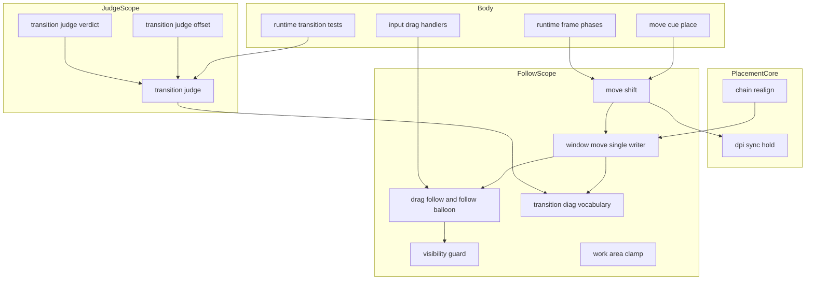
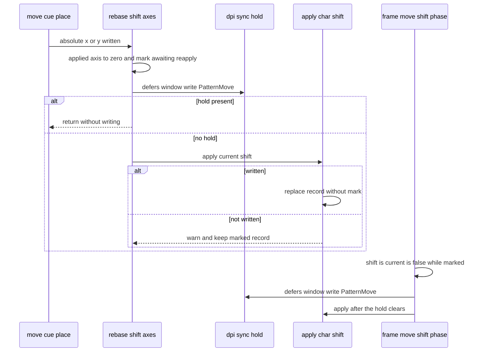
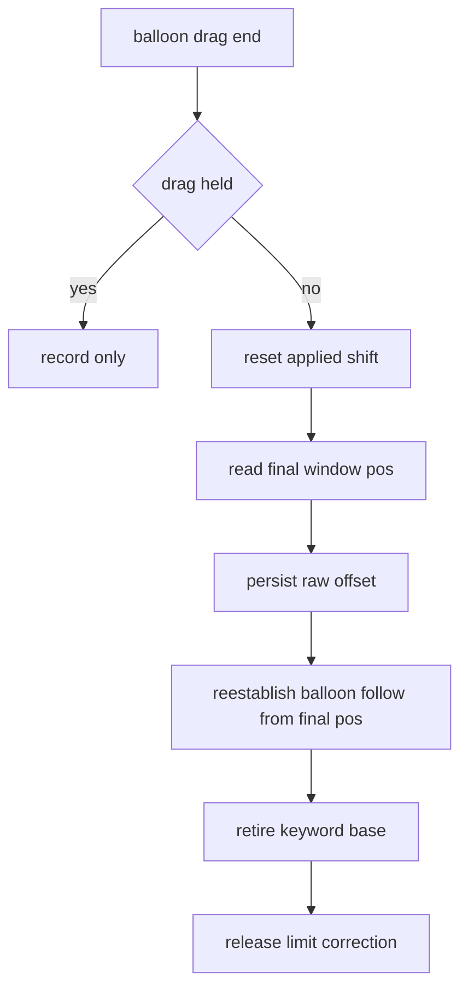

# 設計: audit-placement-follow（配置の追従と移り変わりの判定の見直し）

## Overview

この spec は、配置の crate（`areka-placement`）の追従（`follow*`）と移り変わりの記録（`transition_diag*`）、本体のテスト専用の判定器（`placement_tests/transition_*`）に `/ponytail:ponytail-audit` をかけて出た 28 件の指摘を、3 つの組とも直す。直す対象と裁定は `requirements.md` の「確定した直す対象」が正本で、この文書は指摘ごとの直し方（何を消すか・どこにまとめるか・呼び出し元とテストをどう直すか）を決める。

使う人は開発者。直した後は、キャラ窓とバルーン窓の追従が DPI の移り変わり・`\![move]`・面の `move` のずれ・ドラッグで今と同じに働き、違っていた所（守りが抜ける・記録が事実と違う・保存の値と今の位置が食い違う）だけが揃う。判定器は壊れた行や測っていない scope を合格にしなくなる。テストは壊れたら落ちる形になり、写しが減る。

新しい機能・新しい依存・新しい層は作らない。公開の形は、使い手 0 の項目を狭めることと `pub use` を 2 つ足すことのほかは変えない（要件 7.1・7.8）。

### Goals

- 確定した 28 件を、裁定どおりに全部直す（21 は 1 行の説明を足して残す・8 は system を残して属性と説明を直す・28 は使い手 0 を狭め、テストだけが使う分は `runtime-crate-split` へ申し送る）。
- 直したバグと危ない所の 1 件ずつに、壊れたら落ちる決定論のテストを置く（要件 5.6・5.7）。
- 直した後に同じ範囲へ audit をかけ直して新しい指摘 0 件、全体テスト緑（要件 5.1〜5.5）。

### Non-Goals

- 範囲の外のファイルの見直し（同じ crate の核は `audit-placement-core`・wintf は `audit-wintf-window`／`audit-wintf-input`）。範囲の外に同じ写しや古い参照があっても直さず、持ち主へ伝える（要件 6.4）。
- 判定器のファイルの置き場の移動（C21 の `runtime-crate-split` の仕事）。
- `MonitorSnapshot` を wintf の `Monitor` へ寄せる直し（議題 9 で残すと確定）。
- 画面端でのバルーンの左右反転など、守りの先の置き方（指摘 6 は記録の語だけを直す）。

## Boundary Commitments

### This Spec Owns

- 範囲の 56 ファイル（`crates/areka-placement/src/` の `follow.rs`・`follow/` の 10・`transition_diag.rs`・`follow_*_tests.rs`・`follow_test_support.rs`・`transition_diag_tests.rs`、`crates/areka/src/placement_tests/` の `transition_*` 15）の中身。
- この設計で新しく作る兄弟のテストのファイル 2 本（File Structure Plan）。
- 追従の振る舞いのうち、指摘で揃える所: `ChainRealign`・`PatternMove` の随伴バルーンの守り（2）、バルーンを離したフレームの追従の基準（3）、守りの記録の語（4・6）、面の `move` のずれを寄せる先（5）、`\![move]` の当て直しと札（1）。
- 判定器の合否の規則のうち、指摘で厳しくする所（12・13・27）。

### Out of Boundary

- 同じ crate の核のファイル（`chain_realign.rs`・`dpi_sync.rs`・`diag.rs`・`balloon_limit.rs`・`persist*`・`spawn*` ほか）の中身。この spec は核の公開の関数（`dpi_sync::defers_window_write` ほか）を呼ぶだけ。
- 本体の `runtime/`・`input_events/`・`mcp/` の中身（呼び手の署名は変えない）。
- wintf の型と欄（`DraggingState.initial_inset`・ドラッグの知らせの `is_primary` は `audit-wintf-input` の直しの対象で、この spec は触らない）。
- 番人の見張りのファイル（`crates/log-capture-kit/tests/*`）の持ち物は `audit-test-kits`。この spec が触るのは、要件 8.3 の 1,000 行の例外表の 1 項目だけ（`with_default_guard_test.rs` は触らない・議題 6）。
- 完了した spec の文書は、指摘 6 の語の表（`areka-P0-dpi-window-vanish/diagnosis-procedure.md`）に 1 行足すことのほかは書き換えない。

### Allowed Dependencies

- 今の依存だけを使う: `wintf`（`drain_window_pos_commands`・`CW_USEDEFAULT`・ドラッグの型）、`bevy_ecs`、`tracing`、`log-capture-kit`（`capture`・`expect_one`・`ensure_interest_probes`）、`temp-path-kit`、`tracing-subscriber`（dev・既にある）。
- 同じ crate の核の公開の項目（`dpi_sync::{defers_window_write, HoldSite}`・`balloon_limit::clamp_rect_to_work_area`・`chain_finalize::*`）を呼ぶ。核の項目の署名は変えない（要件 7.2）。
- 依存の向きは今のまま: `config` ← `resolver` ← `measure` ← `spawn`／`follow` ← 本体。`diag` は最下流。判定器（本体の `placement_tests`）は配置の crate の公開の語（`transition_diag` の `pub const`）を読むだけ。
- `Cargo.toml`・`Cargo.lock` は変えない（`crates/areka-placement/Cargo.toml` も触らない・議題 6 は案 乙）。

### Revalidation Triggers

- `follow_balloon` の守りが `ChainRealign`・`PatternMove` に効くようになる（2）: 連鎖の解き直しと面の `move` のずれのテスト（核の `chain_realign_*_tests.rs`・本体の `runtime/frame_chain_realign_*_tests.rs`・`runtime/frame/move_shift_tests.rs`）を回し直す。
- 守りの記録の語が変わる（4 で `OffscreenPull` の行が減る・6 で `HiddenAfterClampX` が増える）: 実機の手順書の数え方（`diagnosis-procedure.md`）を読む人。
- 判定器の違反の腕が増える（12・13・27）: 判定器を引く本体の `runtime/frame_transition_atomicity_tests.rs`・`frame_transition_branch_tests.rs`（判定器の署名は変えないので、コードの直しは要らない）と、実機のサインオフを回す人。
- 公開の形（28）: `VisibilityVerdict`・`guard_visibility` を `pub(crate)` へ、`ChainPlacement`・`ChainClampOutcome` を `pub use` へ。
- 1,000 行の例外表から `transition_judge_tests.rs` の項目が消える（`audit-test-kits`・ほかの C20 の spec が同じ表を触るときは表の行がぶつかりうる）。

## Architecture

### Existing Architecture Analysis

- `follow.rs` はファサード形式で、`follow/` の下の 10 のモジュールを再公開と私有の再束縛でつなぐ。テストは `follow.rs` の接続宣言の下の兄弟のファイル（`follow_*_tests.rs`）で、`super::` から引く。テストの共通の部品は `follow_test_support.rs`（モジュール名 `test_support`）。
- 窓を書く口は `window_move::enqueue_window_set_pos` 1 つ（単一ライター）。経路の語（`PlacementRoute`）を必ず載せ、整合待ちの札（`DpiSyncHold`）の見張りもここにある。随伴のバルーンは `drag_follow::follow_balloon` が「キャラ窓の位置＋オフセット＋バルーンのずれ」で書き、守り（`guard_balloon_position`）を随伴の引き金で選ぶ。
- 判定器は `transition_judge.rs`（行の読みと遷移の切り出し・`split_transitions`）・`transition_judge_verdict.rs`（1 フレームの揃い）・`transition_judge_offset.rs`（バルーンの追随のオフセット）の 3 本で、共通の行の組み立ては `transition_judge_test_support.rs`。判定器そのものも本体の `#[cfg(test)] mod placement_tests` の下にある。
- 直す前の型の穴（ギャップ分析 1 節）: 同じ決まりを 2 か所で別に当てる（2・20）・記録の順（1）・記録の語（4・6）・ドラッグの終わり（3・7）・判定器の緩さ（12・13・27）・テストの写しと偽の安心（11・14〜19）・古い `#[allow]` と説明（9・22）。

### Architecture Pattern & Boundary Map



- 選んだ形: 今の形のまま、指摘ごとにいちばん小さい直しを入れる（ギャップ分析 6 節の案 C）。必ず直すの 2 は「随伴の書き手を `follow_balloon` 1 本にする」案 B の芯だけを取る。
- 新しい矢印は 1 本だけ: `MoveShift --> DpiSync`（指摘 1・核の公開の `defers_window_write` を読む）。`WindowMove --> DragFollow` は今もある（`resize_window_to` が `follow_balloon` を呼ぶ）が、指摘 2 で `move_window_with_route` からも呼ぶ。
- steering の決まり: 単一ライター・網羅 `match`・記録の無い失敗の道を作らない・決定論のテスト・テストの兄弟のファイル・1,000 行を守る。

### Technology Stack

| 層 | 使うもの | この spec での役 | 備考 |
|---|---|---|---|
| 配置の crate | Rust 2024・`bevy_ecs` 0.19・`tracing` | 追従の直し | 依存の追加 0 |
| テスト | `log-capture-kit`・`temp-path-kit`・`wintf::ecs::window::drain_window_pos_commands` | 記録と書込の列を確かめる | 既にある dev の依存だけ |
| 判定器 | 本体の `placement_tests`（`#[cfg(test)]`） | 合否の規則の直し | 判定器の公開の関数の署名は変えない |

## File Structure Plan

### Directory Structure

```
crates/areka-placement/src/
├── follow.rs                                   # ファサード: 再公開の整理（9・28）・新しい接続宣言 1 つ
├── follow/
│   ├── anchor.rs                               # 23: DragPositionPolicy・BottomSnapPolicy を消し私有の関数へ／8・22 の説明
│   ├── drag_follow.rs                          # 3・7・20・22（守りの関数は 1,000 行の逃げ道で visibility.rs へ移しうる）
│   ├── move_shift.rs                           # 1・5・22
│   ├── offset_space.rs                         # 9・10・22 の説明
│   ├── sticky_follow.rs                        # 21 の 1 行の説明
│   ├── visibility.rs                           # 4・6・28・22
│   ├── window_move.rs                          # 2・8・20・22（例外表・行を増やさない）
│   ├── work_area.rs                            # 9・22 の説明と属性
│   └── work_area_clamp.rs                      # 9・20・23・28
├── transition_diag.rs                          # 9・22 の属性と説明
├── follow_test_support.rs                      # 16 の部品の受け皿・6 の語の定数・22
├── follow_visibility_balloon_words_tests.rs    # 新規: 4・6 のテスト（守りの記録の語）
└── follow_*_tests.rs ほか                       # 11・15・16・18・19・22・24・25 の直し（下の表）

crates/areka/src/placement_tests/
├── transition_judge.rs                         # 22・23（TransitionOrigin::of の見え方）
├── transition_judge_offset.rs                  # 12・13・23・27・新しい接続宣言 1 つ
├── transition_judge_verdict.rs                 # 23（`-` の整形を 1 つへ）
├── transition_judge_test_support.rs            # 16 の受け皿・23（replace_once）・22
├── transition_judge_offset_negative_tests.rs   # 新規: 12・13・14 ⑵⑶⑷・27 のテスト
└── transition_judge_*_tests.rs ほか             # 14 ⑴・15・16・19・22・26 の直し
```

新しいファイルの名は `structure.md` の導出規則に従う: `follow_visibility_balloon_words_tests.rs` は `follow.rs`＋モジュール `visibility_balloon_words_tests`、`transition_judge_offset_negative_tests.rs` は最長の stem `transition_judge_offset`＋モジュール `negative_tests`（`transition_judge.rs` に `offset_negative_tests` のモジュールは無いので前向きにも衝突しない）。どちらも本番のファイル側には `#[cfg(test)] #[path = "…"] mod …;` の接続宣言だけを足す。 `transition_judge_offset.rs` の今の 2 つの接続宣言はモジュール名に stem をそのまま使っている（`mod transition_judge_offset_tests;`・`mod transition_judge_offset_signoff_tests;`）が、名を変えるとテストの名（モジュールの道）が変わるので触らず、新しい宣言だけを `structure.md` の形（`mod negative_tests;`）にする（同じファイルに 2 つの形が並ぶのは承知のうえ・設計の検証の重くはない点）。

### Modified Files（範囲の外）

- `crates/log-capture-kit/tests/file_length_guard_test.rs` — `transition_judge_tests.rs` が 1,000 行以下になったら `OVER_LIMIT_ALLOWED` の項目を消し、`OVER_LIMIT_ALLOWED_COUNT` を 5→4 にする（要件 8.3・この 2 か所だけ）。
- `.kiro/specs/completed/areka-P0-dpi-window-vanish/diagnosis-procedure.md` — 指摘 6 の新しい語の行を O17 の次に 1 行、接頭の語の数の文（「3 語」）を今の数に直す（議題 3 の「語の表を持つ文書も合わせて直す」）。
- `.kiro/specs/runtime-crate-split/brief.md` — 申し送りの節を足す（旧い名前を直したこと・テストだけが使う公開の一覧・判定器の古い行の参照の残り）（要件 2.9・7.9）。
- 範囲の外のテストが指摘 2 で赤になったときだけ、その赤を緑に戻す最小の直し（並走の申し合わせ）。
- 触らないと決めたもの: `crates/areka-placement/Cargo.toml`・`crates/log-capture-kit/tests/with_default_guard_test.rs`・`.kiro/steering/structure.md`（議題 6 は案 乙・議題 11）。

## System Flows

### `\![move]` の絶対の軸の当て直し（指摘 1）



- 札がある間は書かない（`enqueue_window_set_pos` の見張りは鳴らない）。印が立った記録は `shift_is_current` を偽にするので、毎フレームの相が札の明けた後に当て直す。
- `origin_position`（保存の側）は当てた分しか読まないので、印の有無で保存の値は変わらない。

### バルーンを離したときの順（指摘 3・DD6）



- 出し直し（Reestablish）は保存（Persist）の後、補正（Correct）の前。補正後の位置は保存値にも今の追従にも入らない（DD6 のまま）。

## Requirements Traceability

| 要件 | 一言 | 受け持つ所 | 確かめ |
|---|---|---|---|
| 1.1 | 56 ファイルだけに audit | ギャップ分析（`research.md` 2 節） | 済み |
| 1.2 | 件数の上限なし | 同 3 節 | 済み |
| 1.3 | 読まなかった所なし | 同 2 節 | 済み |
| 1.4 | 番号と組を残す | 同 3 節 | 済み |
| 1.5 | 確定した一覧を要件へ | `requirements.md`「確定した直す対象」 | 済み |
| 2.1 | 申し送り ⑴〜⑶ の判断 | `research.md` 4 節・本書「指摘ごとの直し方」9・28 | 済み・28 は 13.2 で振り分けを直した |
| 2.2 | 古い理由を残さない | 指摘 9・22 | 再 audit |
| 2.3 | 属性が要るか確かめて消す | 指摘 9（33 個を消す・`follow.rs:112` と `work_area_clamp.rs:118` は要らなくなる形にする） | `cargo check` の警告 0 |
| 2.4 | 属性と語彙の口を分けて判断 | 指摘 8（system は残す・属性だけ消す）・`transition_diag.rs` の 14 個 | 再 audit |
| 2.5 | `follow.rs:108`・`window_move.rs:449` を消し `follow.rs:123` は残す | 指摘 9 | `cargo check` |
| 2.6 | ⑶ の要らない公開の一覧 | 指摘 28・`research.md` 13.2 | 済み |
| 2.7 | ⑴ の判断 | 残す（議題 9） | 済み |
| 2.8 | 旧い名前の判断 | 指摘 22（21 か所を直す） | grep 0 件 |
| 2.9 | 申し送り | `runtime-crate-split/brief.md` | タスク 4.5 |
| 3.1 | 3 つの組とも直す | 「指摘ごとの直し方」の 28 件 | 再 audit |
| 3.2 | 裁定のほかは残さない | 21（残す）・8（system を残す）・28（後へ）だけ | 再 audit |
| 3.3 | 呼び出し元・テストまで直し切る | 各件の「直す所」の欄 | 全体テスト |
| 4.1 | 3 種類に当たる直しは議題 | 設計の段から返した 2 件（議題 6 の決め直し・議題 11）・「設計の段で決めた議題」 | 2026-11-14 に推奨案で確定 |
| 4.2 | ukadoc で確かめる | 議題 2（`move` の項・要件の討議で済み） | 済み |
| 4.3 | 当たらないものは直す | 28 件のうち議題のほか | — |
| 4.4 | 残す裁定を記す | `requirements.md`（21・8・28） | 済み |
| 5.1 | もう一度 audit | タスク 5.1 | 検証の記録 |
| 5.2 | 0 件まで | タスク 5.1 | 同 |
| 5.3 | 5 回目で打ち切り | タスク 5.1 | 同 |
| 5.4 | 結果の記録 | タスク 5.1 | 同 |
| 5.5 | 全体テスト緑 | タスク 5.2 | `tools/test-all.ps1` |
| 5.6 | 1 件 1 本以上のテスト | Testing Strategy の表 | 各タスク |
| 5.7 | 決定論のテスト | Testing Strategy | 各タスク |
| 6.1 | 呼び出し元を全部直す | 2（`move_window_with_route`）・23（`DragPositionPolicy`）・28 | grep・ビルド |
| 6.2 | 走っているセッションと申し合わせ | 「並走の申し合わせと着地の順」 | 伝言の記録 |
| 6.3 | 消す前にツリー全体で確かめる | 8・15・16・19・23・28 | grep |
| 6.4 | 範囲の外の要らない所を直さない | Boundary・16・22・24 の「範囲の外は残す」 | レビュー |
| 7.1 | 公開の形は足すだけ | 28（例外は 7.8）・`MonitorDpiEntry` は狭めない | ビルド |
| 7.2 | 核の項目の形を変えない | 1（呼ぶだけ）・2（署名は変えない） | ビルド |
| 7.3 | 形を変えずに直せないものは議題 | 28 のテストだけの分（申し送りで確定済み） | 済み |
| 7.4 | wintf に触らない | Boundary | レビュー |
| 7.5 | 依存を足さず `Cargo.lock` を変えない | 17（案 乙・`Cargo.toml` も `Cargo.lock` も触らない） | `git diff Cargo.lock` |
| 7.6 | 新しい依存は議題 | 依存の追加 0 | — |
| 7.7 | `vendors/` に触らない | Boundary | レビュー |
| 7.8 | 使い手 0 の公開を狭める | 28・23 | grep し直し・核へ一言 |
| 7.9 | テストだけの公開は申し送る | 28 | `runtime-crate-split/brief.md` |
| 8.1 | 1,000 行の番人を赤にしない | 「1,000 行の計画」 | 番人のテスト |
| 8.2 | 例外表の 3 本に行を足さない | 同 | 行数 |
| 8.3 | 上限の下になったら表から消す | `transition_judge_tests.rs` | 番人のテスト |
| 8.4 | 記録の無い失敗の道を作らない | 7（`warn!` へ）・1（書けないときの記録） | テスト |
| 8.5 | 終了の道は正規の実装 | 終了の道に触る直しは 0（2 の守りの破棄済みの腕は今の `debug!` のまま） | レビュー |
| 8.6 | 実機の根は `target` の下 | 26 | 再 audit |
| 8.7 | GPU のテストは実 GPU | GPU のテストに触る直しは 0 | — |
| 8.8 | 文字化けは読む側を直す | 規律として守る | — |
| 9.1 | 20 を越えたら切る議題 | 議題 1 で切らないと確定 | 済み |
| 9.2 | 1 本で 28 件 | 「タスクの切り方の見通し」（26 タスク） | タスク生成 |

## Components and Interfaces

### 一覧

| 部品（ファイル） | 指摘 | 一言 | 公開の形 |
|---|---|---|---|
| `follow/move_shift.rs` | 1・5・22 | 当て直しの札と印・寄せる先 | 変えない（記録は `pub(crate)` の型の欄を 1 つ足す） |
| `follow/window_move.rs` | 2・8・20・22 | 随伴を `follow_balloon` へ・位置の印・説明 | 変えない |
| `follow/drag_follow.rs` | 3・7・20・22 | 離したときの出し直し・`warn!`・寸の印 | 変えない |
| `follow/visibility.rs` | 4・6・22・28 | 引き寄せの条件・新しい語・`pub(crate)` | `VisibilityVerdict`・`guard_visibility` を狭める |
| `follow/anchor.rs` | 8・22・23・28 | trait と構造体を消す・説明 | `DragPositionPolicy`・`BottomSnapPolicy` を消す |
| `follow/work_area_clamp.rs` | 9・20・23・28 | 高さの印・基準の付け直し・`#[cfg(test)]` | `ChainPlacement`・`ChainClampOutcome` を `pub use` |
| `follow.rs`・`work_area.rs`・`offset_space.rs`・`transition_diag.rs`・`sticky_follow.rs`・`keyword_base.rs` | 9・10・21・22・28 | 属性と説明 | 再公開の行を減らす（28）・足す（`pub use` 2 つ） |
| `placement_tests/transition_judge_offset.rs` | 12・13・23・27 | 壊れた行・scope ごと・往復の数え方・読めない欄 | 判定器の関数の署名は変えない（違反の腕を 2 つ足す） |
| `placement_tests/transition_judge.rs`・`transition_judge_verdict.rs` | 22・23 | 説明・`TransitionOrigin::of` の見え方・`-` の整形 | 変えない |
| テストの部品とテスト | 11・14〜19・24〜26 | 写しを消す・落ちうる確かめへ | — |

### 指摘ごとの直し方

各件の「直す所」は、直しで変わる呼び出し元・テスト・fixture まで含む（要件 3.3）。行の番号は着手のとき（`30a343eb`）のもので、実装では名で引き直す。

#### 必ず直す

**1. `\![move]` の当て直しと札（`follow/move_shift.rs`）**
- `MoveShiftApplied` に「当て直し待ち」の印 `awaiting_reapply: bool` を足す（`pub(crate)` の型・欄は私有）。
- `rebase_shift_axes`: 記録の当てた分を軸ごとに 0 にし、印を立てて記録を入れ直す。`dpi_sync::defers_window_write(world, window, HoldSite::PatternMove)` が真なら書かずに戻る。偽なら `apply_char_shift` を呼ぶ。
- `apply_char_shift`: 書けたら今と同じく印の無い記録で置き換える。書けなかったとき（`no_window_position`・`no_work_area`・`write_refused`）は記録を変えない（印が立ったまま残る）。
- `shift_is_current`: 記録に印が立っていれば偽。
- `reset_applied`（ドラッグの終わり・`drag_follow.rs` の `on_char_drag_end` と `on_balloon_drag_end` が呼ぶ）: `applied` を 0 にするのに合わせて印も `false` に戻す（1 行）。戻さないと、印が立ったまま利用者が窓を離したとき、毎フレームの相が置いた所へずれを足し直して窓が跳び、完了した `seriko-pattern-calls` の決め（ドラッグの終わりは置いた所を新しい元の位置にする・task 6.2）を壊す（設計の検証の重い問題 1）。
- 署名は 4 つとも変えない。呼び手 `runtime/move_cue_place.rs`・`runtime/frame/move_shift.rs` は直さない。
- テスト（`follow_move_shift_tests.rs`）: ⑴ 札のある窓で絶対の軸の当て直しを呼んでも書込の列が空で panic しない・`shift_is_current` が偽・札を外して `apply_char_shift` を呼ぶと当たる。⑵ 作業領域の無い World で当て直しの後に `shift_is_current` が偽。直す前は ⑴ が panic・⑵ が真。

**2. 随伴を `follow_balloon` へ（`follow/window_move.rs`）**
- `move_window_with_route` の随伴の自前の式（`BalloonFollow` を読む所からバルーンを書く所まで）を、キャラ窓を書けた後の `follow_balloon(world, window, Point { x, y }, BalloonFollowTrigger::Placement(route))` の 1 呼び出しに替える。`MoveCue` は守りの対象でないので、`\![move]` の書込は今と同じ。
- `move_window_to` の説明（「唯一の位置ライター」「呼び手はどれも `MoveCue` を名乗る」）を事実に直す（22 の一部）。
- 署名は変えない。呼び手 `chain_realign.rs`（核）・`move_shift.rs`・本体は直さない。
- テスト（`follow_window_move_tests.rs`）: `ChainRealign` と `PatternMove` で、前の位置では見えていたバルーンが、キャラ窓を左端のモニタの x=0 へ置くと画面の外へ丸ごと出る形（offset −400・幅 350）が引き戻され、`ClampX` の行が `route=BalloonFollow` で 1 行出る。`MoveCue` で同じ幾何は引き戻されない（守りの対象外であることの対）。直す前は前の 2 つが外へ出たまま。
- 範囲の外のテストが赤になったときは「並走の申し合わせ」のとおり。

**3. 離したフレームの最後の動き（`follow/drag_follow.rs`）**
- `on_balloon_drag` の「`BalloonFollow.balloon == 自バルーン` のキャラ窓を逆引きし、`balloon_pos − char_pos` で基準を確立し直す」塊を私有の関数 `reestablish_balloon_follow(world, balloon, balloon_pos)` に切る。`on_balloon_drag` はそれを呼ぶ。
- `on_balloon_drag_end` の保存（手順 2）の直後・素材の退役（手順 3）の前に同じ関数を呼ぶ。説明の「`BalloonFollow.offset` は本ハンドラでは変異させない」を「保存の直後に最終確定位置から出し直す（補正の前の位置）」に直す。DD6 の 4 手順の説明に 2′ を足す。
- テスト（`follow_balloon_drag_tests.rs`）: 最後の `DragEvent` の位置と違う最終の `WindowPos` で `DragEnd` を送ると、`BalloonFollow.offset()` が保存した値と同じ。直す前は最後の `DragEvent` の値のまま。`BalloonLimit(true)` の補正が要る形で、出し直した基準が補正の前の位置であること（DD6 の順）も 1 本。

**4. `OffscreenPull` の誤った記録（`follow/visibility.rs`）**
- `evaluate_visibility_guard` の `OffscreenPull` の条件に「`raw != proposed`」を足す（動かしていなければ引き寄せていない）。キャラ窓の道（射影が動かしたときだけ `raw != proposed`・`move_shift` は `raw == proposed`）でも正しい。
- `follow_visibility_char_wiring_tests.rs` の `an_offscreen_projection_input_warns_on_a_non_drag_route` は射影が動かす形なので変わらない。
- テスト（新しい `follow_visibility_balloon_words_tests.rs`）: バルーンの寄せ（`ClampX` が出る形）と留置（`Keep`）の 2 本で `OffscreenPull` が 0 行。直す前は 1 行ずつ出る。

#### 直したほうがよい

**5. 面の `move` のずれの寄せる先（`follow/move_shift.rs`）**
- `apply_char_shift` の `clamp_rect_to_work_area(anchored, size, area)` の `area` を、作業領域と元の矩形（`rect_at(base, size)`）を両方含むいちばん小さい矩形にする（4 辺の `min`／`max`）。元の矩形が作業領域の中にあれば今と同じ（`move,0,10,0,9999` は今のとおり中へ戻る）。
- テスト（`follow_move_shift_tests.rs`）: 作業領域の右端 1920・幅 200 の Free の窓を x=1820 に置き、ずれ (5,0) で x が 1820 のまま・(0,0) で 1820。作業領域の中の窓での `9999` の寄せは今のまま（既にあるテスト `a_huge_shift_is_pulled_into_the_work_area_and_zero_returns_to_base` が見る）。

**6. `ClampX` の後も見えない窓（`follow/visibility.rs`・`follow_test_support.rs`・手順書）**
- `evaluate_visibility_guard` で判定が `ClampX(clamped)` のとき、`rect_at(clamped, size)` がどの作業領域とも交わらなければ `ClampX` の行の代わりに `[visibility-guard] HiddenAfterClampX` の行を同じ欄・同じ `warn!` で出す。位置は今と同じ（`verdict.position()`）。
- 語の定数 `VISIBILITY_HIDDEN_AFTER_CLAMP_TAG` を `visibility.rs` に、テストの写し `HIDDEN_AFTER_CLAMP_TAG` を `follow_test_support.rs` に足す（今の 4 語と同じ置き方）。`guard_visibility` の事後条件の説明（「寄せた後は作業領域と交わる」）を「射影が Y を決めた正常系でだけ成り立つ。バルーンでは成り立たないことがあり、そのときは `HiddenAfterClampX`」に直す。
- 手順書 `areka-P0-dpi-window-vanish/diagnosis-procedure.md` の O17 の次に新しい語の行を足し、「3 語は接頭辞 `[visibility-guard]` を共有する」を「4 語」に直す（手順書の表に載る O17〜O19 と新しい語の 4 つ。手順書の表に無い `OffscreenPull` は数えず、表にも足さない）。
- テスト（`follow_visibility_balloon_words_tests.rs`）: 下に揃えたキャラ窓 y=640・バルーン offset (100,−1000)・提案 (1600,−360)・500×300 で `HiddenAfterClampX` が 1 行・`ClampX` が 0 行・位置は x=1420。交わる正常系では `ClampX` が 1 行・`HiddenAfterClampX` が 0 行（対）。

**7. 保存を黙って捨てる道（`follow/drag_follow.rs`）**
- `on_balloon_drag_end` の 3 か所（バルーンの位置が無い・`BalloonWindowMarker` が無い・追従元のキャラ窓が無い）と、`on_char_drag_end` の 2 か所（`DraggingState` も位置も無い・`CharWindowMarker` が無い）を `debug!` から `warn!` にする。文には「位置を保存しなかった」を必ず入れる。
- 追従元を探す問い合わせ `Query<(Entity, &BalloonFollow, &WindowPos, &Anchored)>` から `&Anchored` を外し `Option<&Anchored>` にする（記録の `anchor` だけが使う）。
- ハンドラは wintf の `EventHandler` の形で `bool`（伝播を止めるか）を返すので `Err` は返せない。`logging.md` の水準の表で、次のドラッグで直る失敗は `warn!`。
- テスト（`follow_drag_end_gate_tests.rs`）: 部品を 1 つずつ外した表のテスト 1 本（印の無いバルーン・印の無いキャラ窓・`Anchored` の無いキャラ窓）。`Anchored` の無いキャラ窓でもバルーンの保存が書かれること、ほかの 2 つで `warn!` が 1 行ずつ出ること。

**8. `anchor_changed_system`（`follow/window_move.rs`・`follow/anchor.rs`）**
- system と 4 本のテストは残す。`#[allow(dead_code)]` を消す（`pub` の項目なので lint は鳴らない・議題 5）。公開は `pub` のまま（`research.md` 13.2）。
- 説明を「本番のアンカーの変化は `reseed` から `resize_window_to` で書く。この system は schedule に登録しない、永続 `SystemState` の書き方の見本」に直す（`window_move.rs` の system の説明・`anchor.rs` の `Anchored` の説明の「反応 system は後続 task の領分」）。`deferral_covers_route` の `AnchorChange` の腕の説明（「本番では未結線」）は今も事実なので残す。
- 範囲の外の 5 か所の説明（本体 `runtime/frame.rs` ほか）は直さない。

**9. 古い `#[allow]` と説明（申し送り ⑵）**
- 消す 33 個: `research.md` 4 節の表で「要らない」の行（`follow.rs` の 83・103・108・130・132・138・157・167・171、`work_area.rs:278`、`work_area_clamp.rs` の 38・41・44・48・63・79・95・202、`transition_diag.rs` の 14 個、`window_move.rs:449`）。
- `follow.rs:112` の `pub(crate) use` の 5 項目: `ChainClampOutcome`・`ChainPlacement` は `pub use` の行へ移す（28）。`WORK_AREA_KEEP_TAG`・`WORK_AREA_UNRESOLVED_TAG` の再束縛は消し、テストは定義元の道（`super::work_area_clamp::…`）で引く。`resolve_chain_in_work_area` は定義を `#[cfg(test)]` にし、テストは同じく定義元の道で引く（23）。属性は行ごと消える。
- `work_area_clamp.rs:118` の属性: `#[cfg(test)]` にするので消える。
- `follow.rs:123`（`GroupShift`）は残す（要件 2.5）。
- 説明を今の事実（配置は lib の crate・examples は公開の API だけを使う・呼び手は `runtime::…`）に合わせる: `follow.rs` の 77〜82・98〜102・110〜111・126〜129・134〜137・147〜149・153〜156・165〜166・169〜170、`work_area.rs:275-277`、`work_area_clamp.rs:18-20` と各行の注、`transition_diag.rs:38-46` と 14 行の注、`offset_space.rs:49-58`。`transition_judge.rs:47` の「areka は bin crate」は今も事実なので残し、49 行の「`#[cfg(test)]` と同じ形」だけ直す。
- 確かめ: `cargo check -p areka-placement --lib --tests --examples` と `cargo check -p areka --tests` で新しい警告 0。

**10. `OffsetRescale::Unchanged` の説明（`follow/offset_space.rs`）**
- 2 か所を「比が恒等。呼び手は `apply_rescaled` で `base.offset` を書き戻す（144→192→144 で高い DPI の値が残らないように）」に直す。テストは要らない（説明だけ）。

**11. 壊れても落ちるテストの無い本番の分岐 7 つ（テストだけ）**

| 分岐 | 足すテスト | 置く所 |
|---|---|---|
| ⑴ `enqueue_window_set_pos` の `SWP_NOSIZE` の付け外し | 移動だけと寸つきの 2 本で `drain_window_pos_commands()` の `flags`・`w`・`h` を見る。「書込の列は私有で覗けない」の説明を直す（`follow_window_move_tests.rs`・`follow_resize_tests.rs` の該当の説明） | `follow_window_move_tests.rs` |
| ⑵ ドラッグの終わりの保存の形を descript の向きで選ぶ | `AnchorSource { descript: Bottom, by_script: true }`＋`Anchored(Free)`・幅 200 の窓を (100,300) で離すと x=200 を保存する 1 本、組の相手で 1 本、相手に `Anchored` が無いときの `warn!` で 1 本 | `follow_drag_end_persist_tests.rs`・`follow_sticky_follow_drag_tests.rs` |
| ⑶ `on_balloon_drag_end` の `Tunnel` と他の窓宛ての守り | 今の `drag_handlers_ignore_events_targeting_other_entities` に 2 つの呼び出しを足す | `follow_drag_tests.rs` |
| ⑷ `write_refused` で記録を書かない・持ち主の無いバルーン | `missing_inputs_do_not_apply` に 2 つの形を足す | `follow_move_shift_tests.rs` |
| ⑸ 記憶から戻した組の印だけで繋がる腕 | 離れた矩形の `Right`・`Left` の 2 本 | `follow_work_area_clamp_restore_tests.rs` |
| ⑹ 面の拡大の寄せが提案の矩形の作業領域を使う・`no-work-area` | モニタ 2 台で提案が別のモニタに載る 1 本・空の写しの 1 本 | `follow_work_area_clamp_grow_tests.rs`・`follow_work_area_clamp_chain_tests.rs` |
| ⑺ `keyword_base.rs` の `warn!` の 2 腕 | 部品を 1 つずつ外す表のテスト 1 本 | `follow_keyword_base_tests.rs` |

**12. 判定器が壊れた行を黙って捨てる（`placement_tests/transition_judge_offset.rs`・`transition_judge_offset_signoff_tests.rs`）**
- ⑴ `judge_offset_log` で、`split_transitions` が区切りに入れなかった行（最初の起点より前の前置き＝`judge_transition_log` の `unassigned_malformed_records` と同じ数え方）のうち、`kind=offset` で形の壊れた行ごとに違反 `OffsetViolation::UnassignedMalformedRecord { detail }` を 1 件足す。
- ⑵ 走り手 `signoff_offset_log` の「追随レコードが 1 行も無い」の `Err` の文に、判定の報告（`{report}`）を足す。
- テスト（`transition_judge_offset_negative_tests.rs`）: 起点の前の壊れた `keyword-pending` の行で赤・全部の行が壊れたときの `Err` に違反の一覧が載る。

**13. 判定器の数え方（`placement_tests/transition_judge_offset.rs`）**
- ⑴ `check_alignment_residual`: 測った数をキーワード指定の scope ごとに数え、0 の scope ごとに `OffsetViolation::KeywordScopeUnmeasured { scope }` を出す。母数が空のときは今の `NoKeywordAlignmentMeasured { keyword_scopes: 0 }` のまま。往復の門（`NoRoundTripObserved`）は全体で 1 回以上のまま（完了した `areka-P0-balloon-offset-dpi` の設計の決め・`research.md` 13.1 の 4）。
- ⑵ `check_round_trip`: 同じ鍵の行が最初の行と同じ遷移なら往復に数えない。
- ⑶ `residual_measurable`: `base_dpi == new_dpi` の行は `None`（作りから残差 0 の行を測った数に入れない）。
- 今のテストの `NoKeywordAlignmentMeasured { keyword_scopes: 1 }` を期待する所（`transition_judge_offset_tests.rs` の該当の 1 本）は `KeywordScopeUnmeasured` へ直す。
- テスト（`transition_judge_offset_negative_tests.rs`）3 本: scope 1 だけ測れていない形で赤・同じ遷移の二重の行で往復に数えない・戻りの側だけ `base_dpi == new_dpi` の `rescaled` を持つ scope で赤。
- 実機のログ（完了した spec の `signoff-2026-08-28.log`）を判定器のランナーへ通し、緑のままであることを確かめる（赤になったら、その違反が本当の欠陥かを読んで開発者へ知らせる）。

**14. 判定器の分岐の負のテスト（テストだけ）**
- ⑴ 直の書込とまとめられた書込が同じ窓に混ざる形で `note_follow_landing` の守り（後ろにある着地を残す）を外すと赤になる 1 本（`transition_judge_coalesced_follow_tests.rs`）。
- ⑵ 往復の鍵の `base_offset`・`base_dpi`（基準の付け替えで区切る）・⑶ 残差の境ちょうど 3.0 px が緑・⑷ `STABLE_VERDICTS` を全部回す・`expected_verdicts` の非恒等の腕と恒等の腕・壊れた点の欄（`new_offset=abc`）・`base_dpi=0` の行（0 割りしない）を 1 本ずつ（`transition_judge_offset_negative_tests.rs`）。

**15. 失敗しえないテスト・名と違うテスト（テストだけ・18 を含む）**

| 場所 | 直し |
|---|---|
| `transition_signoff_procedure_tests.rs` の `read_procedure`（`.rs` の手順書） | `.rs` のときは `//!` の行だけを残して読む（1 行）。説明から語を消すと赤になる |
| `follow_offset_space_tests.rs` の `transition_verdict_is_axis_independent` | 定数どうしの `assert_ne!` を消し、軸を入れ替えた入力で `rescale_follow_offset` の値が同じことを見る |
| `follow_offset_component_tests.rs` の手で値を渡す 2 本 | `rescale_follow_offset` で往復を歩いて値を出す |
| `follow_offset_space_tests.rs` の `assert_value_untouched` の自明な 1 行 | 消す（呼ぶ 7 か所は腕を先に確かめている） |
| `transition_judge_reobservation_tests.rs` の検体の `t_us` だけを比べる 1 本 | 消す |
| `transition_diag_tests.rs` の `the_declared_field_lists_match_the_lines_that_are_actually_built` | 行の欄の名から接頭の 3 欄を除いた集合と表の完全一致にし、`chain`・`snapshot` の行も組む |
| `transition_judge_offset_tests.rs` の較正 `format!("let x = {probe};")` | 判定器のソースに `OFFSET_VERDICT_RESCALED` の名が在ることを見る |
| `follow_move_shift_tests.rs` の `extreme_balloon_shift_does_not_overflow` | 飽和した位置の値を見る |
| `follow_anchor_tests.rs:330-361`（部品の付け外しだけ） | 消す |
| `follow_drag_tests.rs:94-105`・`follow_balloon_drag_tests.rs:286-291` | 常に成り立つ「変わらない」を消し、書込の列が空であることを見る |
| `follow_window_move_hold_watch_tests.rs:116` | 先に落ちる重複の確かめを消す |
| `transition_judge_tests.rs:867-893` | 定数どうしの `assert_ne!` を `balloon_follow_windows.is_empty()` に替える |
| `transition_judge_verdict_tests.rs:124-138` | 起点で始まらない空でない列を入れる（行は増やさない・19 で減る分の中で） |
| `follow_visibility_char_wiring_tests.rs:413-437` | 戻り値を `assert!` し、上書きと `let _ = old_pos;` を消す |
| `transition_judge_origin_tests.rs:228-234` | 落ちない数の比べを消す |
| `transition_diag_tests.rs:347-385`・`:658-661`・`follow_transition_diag_tests.rs:418-439` | 含まれる確かめ・字面の固定を消す |
| `follow_work_area_tests.rs:191,302` | 包みと中身の比べを消す（`work_area.rs:76-77` の名指しも直す） |
| `follow_resize_tests.rs` の算数の言い直し 5 か所 | 消す |
| 18: `follow_visibility_char_wiring_tests.rs:78-103` の 7 経路の表 | 消す（`follow_default_pos_track_tests.rs` が固定済み） |
| 18: `follow_visibility_balloon_wiring_tests.rs` の `fired == 7` | 数を外す（`Drag` の腕と経路ごとの一致は残す） |

**16. テストの組み立て部品の写し（範囲の中だけ）**
- `follow_test_support.rs` へ上げて写しを消す: limit の 2 ファイルの `wa`・`single_monitor`（`odd_edge_snapshot` と同じなら置き換え）・`balloon_size`・`max_pos`・`contained`・`base_placement`・`world_with`・`base_world`・4 つの定数、`left_wa` の写し、`assert_no_event`（3 つ）、`dpi(v)`（3 つ）、`k_axis`（2 つ）、`point`・`pt` の写し、`tagged`（3 つ・`guard_events` へ）、`SharedFakeIo` と sylphya の組み立て（範囲の中の 8 つ・本物のファイルの組み立て 2 つ）、`gap_bound_char_world`／`_with_balloon` の写し、`char_with_far_balloon_world`（`char_with_balloon_window_pos` で言える）、`code_only`（2 つ）、同じ `Monitor` の値（3 つ）。
- `transition_judge_test_support.rs` へ上げる・使う: `deterministic_verdict`・`deterministic_violations`（`summarize_lines` を使う）、`log_of`（2 つ）、`monitor_with_raw_frame` のリテラル `entity=2v0`（部品の組み立てを使う）、手書きの `replace_once`（部品を使う）。
- 要らない `fs::remove_file` 4 か所（`TempPath` がフォルダごと消す）を消す。
- 範囲の外の写し（`persist_*`・`reset_pos`・`balloon_lock_drag_tests`・`balloon_limit_gate_tests`・`placement_windowposition_vocab_tests`・`reseed_test_support`・`resolver_test_support`）は残し、`audit-placement-core` へ伝える。
- `follow_test_support.rs` は `audit-wintf-input` が `is_primary`・`initial_inset` の行に触るので、上げる部品はファイルの末尾へ足し、その行には触らない。

**17. ログを捕まえる手段の写し（案 乙・議題 6）**
- 写しは 2 つとも残す（`with_default` の素の呼び出しは番人の例外表 `ALLOWED_DIRECT_CALLS` に理由つきで載っているので、表も見張りも触らない）。
- `follow_window_move_diag_tests.rs` の `window_move_output_under_filter` の窓の中（`with_default` の閉包の先頭）で対照の行を 1 行出す。置き方は `follow_transition_diag_tests.rs` の `CONTROL_LINE` と同じ（`info` 水準・既定の `info` でも手順書の directive でも通る target・ファイルの中の定数 1 つ）。
- その写しを使う 2 本（`window_move_records_are_silent_under_default_info_filter`・`window_move_records_light_up_under_the_procedure_directive`）は、主張の前に対照の行が出力に在ることを `assert!` する。捕まえる手段が死ぬと「出ない」のテストが赤になる。
- `follow_transition_diag_tests.rs` の写しは既に対照を確かめているので直さない。`crates/areka-placement/Cargo.toml`・`with_default_guard_test.rs`・`structure.md` は触らない。

#### できれば

**19. 同じことを 2 度確かめるテスト（テストだけ）**
- 消す・まとめる: `transition_judge_verdict_tests.rs:1011-1025`（2 つの数の確かめは `:394-408` へ移す）、`transition_judge_tests.rs:628-668`、`transition_judge_frame_tests.rs:120-142`、`transition_judge_offset_tests.rs` の `:321`・`:512`・`:598`・`:741`（中身の確かめは `:243` へ）、`follow_offset_space_tests.rs:41-129` の初めの 4 本と `:862-882`、`follow_resize_tests.rs:545-587`・`:938`（範囲の外の `diag_tests.rs` の側は残す）、`follow_window_move_tests.rs` の `:234`・`:194`、`follow_window_move_diag_tests.rs:241`、`follow_drag_end_limit_tests.rs:648-673`、`follow_anchor_tests.rs` の Bottom の重複（23 で `BottomSnapPolicy` を消すので、その直のテスト `:18-81` を消し、縮退の腕（snapshot 無し・非正寸・空の snapshot）は `project_anchor(Bottom, ..)` のテストに残っていることを確かめる。無ければ移す）、`follow_visibility_guard_tests.rs:214-289`。
- `transition_judge_tests.rs` は 1,000 行以下になる見込み（「1,000 行の計画」）。

**20. 未確定の印の扱いを揃える**
- `window_move.rs` の `resize_window_keep_position`: 位置が `CW_USEDEFAULT` なら「位置が無い」と同じ `warn!`＋`false`（`.filter` 1 つ・行は増やさない）。
- `drag_follow.rs` の `on_char_drag_end` の保存: 寸に `.filter(|s| s.width > 0 && s.height > 0)`。寸が無いときは今のとおり左上のまま。
- `work_area_clamp.rs` の `place_chain_in_work_area`: 高さに `.filter(|&h| h > 0)`（`Unresolved` の `no-window-height` へ入る）。
- テスト 3 本: 位置が印のバルーンへ寸を書くと書込の列が空（`follow_window_move_tests.rs`）・寸が印の Bottom の窓を離すと保存の x が左上のまま（`follow_drag_end_persist_tests.rs`）・高さが印のスロットが `Unresolved`（`follow_work_area_clamp_chain_tests.rs`）。

**21. 組のドラッグの終わりのずれ** — 残す（議題 7）。`sticky_follow.rs` の相手の保存（`origin_position` で当てた分を引く所）に 1 行の説明「利用者が手で置いたのは動かした窓だけ・相手のずれはまだ相手の面のアニメーションのもの（seriko-pattern-calls の設計・task 6.2）」を足す。

**22. 古くなった説明（旧い名前 `emo2_boot` を含む）**
- 直す一覧は `research.md` 3 節の 22（旧い名前 9 ファイル 21 か所・crate の形・数・済んだ話・行の番号と名の参照）が正本。各行を今の事実に合わせるか消す。行の番号での参照は名（関数・型・節）に替える。
- `transition_judge.rs:22,403` の `judge-perf.py` の行番号の参照は「tools/perf/ の Python の道具の `parse_fields` と同じ規則」と、ファイル名を書かずに指す（`audit-tools-perf-judge` との申し合わせ）。
- `transition_judge.rs:15`・`transition_judge_offset.rs:19` の `super::transition_diag` へのリンクは `areka_placement::transition_diag` へ直す。
- `transition_judge_tests.rs:1-8` の姉妹のモジュールの一覧は、一覧を足さずに「`transition_judge.rs` の接続宣言が正本」と 1 文で指す（行を増やさない）。
- 範囲の外の古い参照（`runtime/frame_transition_atomicity_tests.rs:57,150`・核の `diag_tests.rs:158,278,492`）は直さず、持ち主へ伝え、`runtime-crate-split` の brief にも書く。
- 確かめ: 受け持ちの 56 ファイルで `rg -n 'emo2_boot|Emo2Wiring'` が 0 件。

**23. 要らない小さなコード**
- `anchor.rs`: trait `DragPositionPolicy` と構造体 `BottomSnapPolicy` を消し、`project_anchor` の Bottom の腕が呼ぶ私有の関数 `bottom_snap(raw, size, snapshot)` 1 つにする（中身と `debug!` の縮退はそのまま）。`follow.rs` の再公開の行を消す。説明の名指しを直す。使い手はツリー全体で 0（消す前に grep し直す・要件 6.3・7.8）。
- `work_area_clamp.rs`: `resolve_chain_in_work_area` を `#[cfg(test)]` にする。`place_chain_in_work_area` の基準の付け直し（`base = ChainRect { x: to.x, y: to.y, ..*r }`）3 か所を、`match` の後の 1 か所にする（`continue` を無くす）。
- `transition_judge_offset.rs` の `collect_offset_transitions`: 起点の読み直しをやめ、`TransitionOrigin::of` の結果（`old_dpi`・`new_dpi`）を使う（`of` を `pub(super)` にする）。届かない `continue` の 2 腕が消える。
- 「値が無いときは `-`」の整形 3 つ（`transition_judge_verdict.rs` の 2 か所・`transition_judge_offset.rs` の 1 か所）を 1 つの関数にし、リテラルでなく `MISSING` を使う。
- `transition_judge_test_support.rs` の `replace_once`: `replacen(needle, replacement, 1)` にし、置き換えた数が 1 であることを `assert!` する。
- 接続宣言に付いた `#[cfg(test)]` 12 個（`transition_judge.rs` の 10・`transition_judge_offset.rs` の 2）は消さない（議題 11・`structure.md` の接続規約「冗長でも付ける」のとおり・直す対象に数えない）。新しく足す接続宣言（`transition_judge_offset_negative_tests.rs`）にも同じく付ける。

**24. 出荷の作りでだけ赤になるテスト** — `follow_window_move_hold_watch_tests.rs` の `#[should_panic(expected = "DpiSyncHold")]` の 2 本に `#[cfg_attr(not(debug_assertions), ignore = "debug_assert! に依る")]` を付ける。範囲の外の同じ形（`dpi_sync_tests.rs`・`frame_work_area_resnap_hold_tests.rs`）は持ち主へ伝える。

**25. 取り消しのテストの位置** — `follow_drag_end_gate_tests.rs` の `ended()` で `cancelled=true` のときは開始の位置を載せ、期待を開始の位置にする（本体 `input_events/drag_tests.rs` が固定する本番の形に合わせる）。

**26. サインオフのログの置き場** — `transition_judge_offset_signoff_tests.rs` の手順の例を `$LOG = "<ワークツリーの絶対パス>\target\transition-signoff\signoff.log"` にし、「置き場はワークツリーの `target` の下」と 1 文書く。

**27. 読めない `base_dpi`・`scope`（`transition_judge_offset.rs`）**
- `offset_row` で、`scope`・`base_dpi` の生の欄が `MISSING`（`-`）でなく数にもならなければ `Err`（＝`MalformedRecord`）にする。無い・`-` は今のとおり `None`。
- テスト（`transition_judge_offset_negative_tests.rs`）: `verdict=anchored base_dpi=19x` と `scope=x` の行がそれぞれ `MalformedRecord` になる。テストの部品の説明（「読めない欄の誤りは `frame`・`t_us` だけ」）を直す。

**28. 範囲の外に使い手の無い公開**
- 狭める（C20 のうち・要件 7.8）: `VisibilityVerdict`・`guard_visibility` を `pub(crate)` にし、`follow.rs` の再公開の行を消す。crate の中のテストは `super::visibility::{…}` で引く（`follow` の子のモジュールなので届く）。`DragPositionPolicy`・`BottomSnapPolicy` は 23 で消す。
- 狭めない: `MonitorDpiEntry`（公開の欄 `MonitorDpiTable.entries` の要素の型で、本体のテストが欄を読む）と `anchor_changed_system`（議題 4・5）。理由は `research.md` 13.2。
- 足す: `ChainPlacement`・`ChainClampOutcome` を `pub use self::work_area_clamp::{…}` へ（名で呼べるようにするだけ）。
- 消す・狭める名前の参照の後始末（要件 6.3・6.4・設計の検証の重い問題 2）: 範囲の中のテスト `follow_anchor_tests.rs:93-112`（`BottomSnapPolicy.resolve` を呼ぶ）は、`project_anchor(Bottom, ..)` の期待の値で書き直す（19 の `:18-81` と合わせて消すのではなく、Bottom の腕の確かめとして 1 本だけ残す）。説明のリンクは、消す名前（`[`BottomSnapPolicy`]`・`drag_follow.rs:48`・`window_move.rs:116`）はふつうの文の語へ、狭める名前（`[`guard_visibility`]`・`drag_follow.rs:367,425` の `pub fn follow_balloon` の説明）はリンクを外して文の語にする。範囲の外の核の説明 4 行（`persist.rs:227,238`・`persist_restore_tests.rs:295`・`resolver.rs:438` の `BottomSnapPolicy`）は直さず、核へ伝える一覧に入れる。
- 申し送る（要件 7.9）: `on_balloon_drag`・`sync_drag_writer`・`WORK_AREA_CLAMP_TAG`・`AnchorSource`・`WorkAreaResolution`・`work_area_for_window_with_origin`・`move_window_with_route`・`MonitorSources::is_empty`・`MonitorDpiEntry`・`transition_diag.rs` の語と欄と行の組み立ての大半を `runtime-crate-split/brief.md` へ。
- 手順: 下げる前にツリー全体（`vendors/` を除く・テストと examples と文字列を含む）を grep し直して使い手 0 を確かめ、`audit-placement-core` のセッションへ一言知らせる。下げた後にコンパイラが `private_interfaces` か `dead_code` を出したら、その項目は狭めずに申し送りの側へ回す（`#[allow]` を足さない）。

## Data Models

変わる型だけを書く。どれも crate の中か判定器の中の型で、crate の外から見える形は 28 のほかは変わらない。

```rust
// crates/areka-placement/src/follow/move_shift.rs（pub(crate)・欄は私有）
pub(crate) struct MoveShiftApplied {
    want: (i64, i64),
    ratio: ScaleRatio,
    applied: PointPx,
    /// 絶対の位置への `\![move]` の後、まだ当て直していない（真の間は shift_is_current が偽）。
    awaiting_reapply: bool,
}

// crates/areka-placement/src/follow/visibility.rs
const VISIBILITY_HIDDEN_AFTER_CLAMP_TAG: &str = "[visibility-guard] HiddenAfterClampX";

// crates/areka/src/placement_tests/transition_judge_offset.rs（判定器・テスト専用）
pub enum OffsetViolation {
    // 今の腕はそのまま。足す腕は 2 つ。
    /// 遷移の区切りに入らなかった（最初の起点より前の）壊れた追随レコード。
    UnassignedMalformedRecord { detail: String },
    /// キーワード指定の scope のうち、揃えを 1 度も測れていない scope。
    KeywordScopeUnmeasured { scope: Option<u32> },
}
```

- 不変条件: `awaiting_reapply == true` の記録は、`applied` が「今の位置 − 元の位置」の実際の値（絶対の軸は 0）を持つ。`apply_char_shift` が書けたとき、または利用者のドラッグの終わり（`reset_applied`）でだけ `false` になる。
- 新しい語の行は `ClampX` の行と同じ欄（`entity`・`route`・`old_rect`・`proposed`・`clamped`・`size`・`clamp_wa`）を持つ。1 回の判定で `ClampX` と `HiddenAfterClampX` のどちらか 1 行だけが出る。
- 新しい違反の腕は `Display` で 1 行の日本語の文を持ち、`{FIELD_SCOPE}` などの語は発行側の定数を参照する（判定器はリテラルを書かない決まりのまま）。

## Error Handling

- 記録の無い失敗の道を作らない（要件 8.4）。新しく作る道は 1 だけで、札で書かなかったときは今の毎フレームの相と同じく黙って次へ回す（札そのものは `dpi_sync` が記録を持つ・`HoldSite::PatternMove` の見送りと同じ扱い）。書けなかったときは `apply_char_shift` の `move_shift_skipped` の `warn!` が今のとおり出る。
- 7 の 5 か所は `warn!`。ドラッグのハンドラは `bool` を返す形なので `Err` を返さない（伝播を止めない）。
- 2 で増える `WorkAreaUnresolved` の `warn!` は、守りが判定できなかった事実の記録で、今の `resize_window_to` の随伴と同じ形。
- 判定器は、読めない行・測っていない scope を違反として報告し、走り手の `Err` は判定の報告を載せる（12 ⑵）。

## Testing Strategy

- どのテストも決定論（時刻の値・スレッドの並び・`HashMap` の並びに依らない）。一時フォルダは `temp-path-kit`（`<workspace>\target\test-roots\`）。GPU に触るテストは無い。
- 直したバグと危ない所の 1 件ずつのテスト（要件 5.6）:

| 指摘 | 壊れたら落ちるテスト | 置く所 |
|---|---|---|
| 1 | 札のある窓で書かない・`shift_is_current` が偽／書けなかった後に偽／印が立った窓を `DragEnd` で離すと `shift_is_current` が真で、毎フレームの相を回しても書込の列が空 | `follow_move_shift_tests.rs` |
| 2 | `ChainRealign`・`PatternMove` でバルーンが引き戻される／`MoveCue` は引き戻さない | `follow_window_move_tests.rs` |
| 3 | 最終の `WindowPos` と最後の `DragEvent` が違うときに `BalloonFollow.offset()` が保存値と同じ／補正の前の位置 | `follow_balloon_drag_tests.rs` |
| 4 | バルーンの寄せと留置で `OffscreenPull` 0 行 | `follow_visibility_balloon_words_tests.rs` |
| 5 | 端に置いた窓がずれで寄らず 0 で戻る | `follow_move_shift_tests.rs` |
| 6 | 縦に見えないときは `HiddenAfterClampX`・交わるときは `ClampX` | `follow_visibility_balloon_words_tests.rs` |
| 7 | 部品を 1 つずつ外すと `warn!`・`Anchored` が無くても保存する | `follow_drag_end_gate_tests.rs` |
| 11 | 7 つの分岐（上の表） | 上の表 |
| 12 | 起点の前の壊れた行で赤・`Err` に一覧 | `transition_judge_offset_negative_tests.rs` |
| 13 | scope ごと・二重の行・恒等比の `rescaled` | 同 |
| 14 | 判定器の 4 つの分岐 | 同・`transition_judge_coalesced_follow_tests.rs` |
| 17 | 対照の行を先に確かめる（捕まえる手段が死ぬと「出ない」の 2 本が赤） | `follow_window_move_diag_tests.rs` |
| 20 | 3 つの印 | 上の 20 の欄 |
| 25 | 取り消しが開始の位置 | `follow_drag_end_gate_tests.rs` |
| 27 | 読めない `base_dpi`・`scope` が `MalformedRecord` | `transition_judge_offset_negative_tests.rs` |

- 結びのテスト: `cargo test -p areka-placement`、本体の `placement_tests`・`runtime::frame_chain`・`runtime::frame_transition`・`runtime::move_cue`・`input_events::drag` の名のテスト（2・3・7 の呼び手の道）。
- 実機のログの読み直し（13）: 完了した `areka-P0-balloon-offset-dpi/signoff-2026-08-28.log` を `AREKA_TRANSITION_LOG` に絶対パスで与え、`cargo test -p areka transition_judge_offset_signoff -- --ignored` で緑を確かめる（実機の走行は要らない・ログはリポジトリにある）。
- 静的な確かめ: `cargo check` の新しい警告 0（9）・受け持ちで `emo2_boot` 0 件（22）・1,000 行の番人のテスト・`with_default_guard_test.rs` の見張りが今のまま緑（例外表は触らない）。
- 最後に audit のかけ直し（要件 5.1〜5.4）と全体テスト（`pwsh -NoProfile -File tools/test-all.ps1`・要件 5.5）。

## 1,000 行の計画（要件 8.1〜8.3）

| ファイル | 着手のとき | 入る直し | 決め |
|---|---|---|---|
| `follow/window_move.rs`（例外表） | 1,231 | 2（自前の式 約 17 行を 1 呼び出しへ）・8（属性 1 行）・20（`.filter`）・22 | 終わりの行数が 1,231 を越えない。新しいテストはここに書かない。上限の下には入らないので表は残す |
| `placement_tests/transition_judge_tests.rs`（例外表） | 1,039 | 19（−41）・15（置き換え）・22（一覧を足さず 1 文で指す） | 1,000 行以下にし、番人の例外表の項目と件数の定数を消す（`every_over_limit_exception_is_still_over_the_limit` があるので、下に入ったら消すのは必須） |
| `placement_tests/transition_judge_verdict_tests.rs`（例外表） | 1,037 | 19（約 −13）・15（置き換え・行は増やさない） | 終わりの行数が 1,037 を越えない。見込みは約 1,024 行で表は残る。1,000 行以下に入ったら、`transition_judge_tests.rs` と同じく例外表の項目と件数の定数を消す（要件 8.3・番人の `every_over_limit_exception_is_still_over_the_limit`） |
| `placement_tests/transition_judge.rs` | 999 | 22（説明）・23（`of` の見え方） | 1,000 を越えない（説明は書き換えで、足すときは同じ説明の古い文を削る） |
| `follow/drag_follow.rs` | 978 | 3（関数へ切る）・7・20・22（`:517-518` の済んだ話を消す） | 1,000 を越えない。越える見込みなら、`guard_balloon_position`（守りの関数・約 70 行）を守りの本体のある `follow/visibility.rs`（365 行）へ移す |
| `follow_visibility_balloon_wiring_tests.rs` | 962 | 16・18 で減る・22 | 新しいテストは新しいファイルへ（4・6） |
| `follow_resize_tests.rs` | 950 | 11 ⑴ の説明・15・19 で減る | 新しいテストを足さない |
| `follow_drag_tests.rs` | 897 | 11 ⑶（+約 10）・16（−約 60） | — |
| `transition_judge_offset_tests.rs` | 836 | 13（期待の直し）・19（減る） | 新しいテストは新しいファイルへ |

## 並走の申し合わせと着地の順（C20）

- **C20 の 2 つの段**（2026-11-14 areka棚卸）: 前の段＝`wintf-visual-damage-redraw`・`wintf-winmsg-executor-import`・`audit-wintf-window`・この spec。後の段＝`audit-wintf-input`・`audit-tools-perf-run`・`audit-tools-perf-judge`・`audit-placement-core`（前の段が全部着地してから実装する）。この spec の進みが段に対して遅れたら、areka棚卸へ知らせる。
- **着地の順**: この spec が先に実装して着地し、`audit-placement-core` が後から着地して合わせる（2026-11-14 の申し合わせ・進行役の伝言）。
  - 指摘 2 で核のテスト（`chain_realign.rs` の周り・`dpi_sync_tests.rs` ほか）が赤になったら、合わせるのは後から着地する核の側。ただしこの spec の枝の先で赤のまま着地はできない（全体テスト緑・要件 5.5）ので、この spec の枝の先で赤になった範囲の外のテストは、この spec が最小の直しで緑に戻して着地し、直した所を核のセッションへ知らせる。核は自分の書き換えの上でそれに合わせる。
  - 核の先触れ（2026-11-14）: 核は着地の後に、`follow/drag_follow.rs` の基準を据え直す所へ印 `BalloonUserMoved` の insert を 1 行足す。この spec の 3 でその塊は私有の関数 `reestablish_balloon_follow` になり、ドラッグ中と離したとき（保存の直後）の 2 か所から呼ばれる。その旨を核へ返した。
  - この spec は `crates/areka-placement/Cargo.toml` を触らない（議題 6 は案 乙）。`Cargo.toml` の直し（`async-io` をワークスペースの表へ移すほか）は核だけが行う。
  - 核は後で `DPI_SYNC_HOLD_MAX_FRAMES` ほかテストだけが使う公開を `cfg(any(test, feature = "test-support"))` の内側へ移す。判定器のテストは本体の `test-support` の機能で届くので、この spec の側の直しは要らない。
  - 28 で狭める前に、核のセッションへ一言知らせる（要件 7.8）。16・22・24 の範囲の外の写しと古い参照は相手の持ち物として残し、一覧を伝える。23 で `BottomSnapPolicy` を消すと古くなる核の説明 4 行（`persist.rs:227,238`・`persist_restore_tests.rs:295`・`resolver.rs:438`）もこの一覧に入れる。
- **`audit-wintf-window`**（前の段）: wintf の `Monitor` は変えない（型・欄・関数とも今のまま）。消すのは `WindowHandle.instance` だけで、この spec に届くのは `follow_test_support.rs` の `fake_handle` の `instance: HINSTANCE::default(),` の 1 行だけ。後から着地する側が合わせる（相手は最後のタスクで行い、行う前に知らせる）。この spec はその行に別の直しを入れない。
- **`audit-wintf-input`**（後の段・この spec の後に着地）: wintf の `DraggingState.initial_inset` を `initial_window_pos` へ改名し、`is_primary` の欄を消す。読み手（`follow/drag_follow.rs` の `policy_mapped_position`・`follow_test_support.rs` の `dragging_state`・`drag_event*`）は、この spec の着地の後に相手が直す。この spec はその欄に別の直しを入れない。16 で `follow_test_support.rs` へ上げる部品はファイルの末尾に足す。
- **`audit-tools-perf-judge`**（後の段）: `transition_judge.rs` の 22 行・403 行の `judge-perf.py` の行番号の参照は、この spec が 22 で「tools/perf/ の Python の道具の `parse_fields` と同じ規則」と関数の名だけで指す形に直す（ファイル名は書かない）。どちらの順で着地してもずれない。
- **`audit-test-kits`**（C22・後）: 番人の例外表の持ち物。この spec は 1,000 行の表の 1 項目と件数の定数だけを消す（要件 8.3）。
- **`runtime-crate-split`**（C21・後）: 判定器を `areka-runtime` へ移す前に、この spec が着地する。旧い名前を直したことと、テストだけが使う公開の一覧と、範囲の外の古い参照を brief へ申し送る。
- **`wintf-winmsg-executor-import`**（`Cargo.lock` の席）: この spec は `Cargo.lock` を変えない。

## タスクの切り方の見通し（要件 9.2・26 タスク）

| 段 | タスク | 指摘 |
|---|---|---|
| 1 部品 | 1.1 追従のテストの部品を `follow_test_support.rs` へまとめる | 16（追従） |
| | 1.2 判定器のテストの部品をまとめる・`replace_once` を直す | 16（判定器）・23 の一部 |
| 2 必ず直す | 2.1 `\![move]` の当て直しと札 | 1 |
| | 2.2 随伴を `follow_balloon` へ（範囲の外の赤の確かめ込み） | 2 |
| | 2.3 離したフレームの出し直し | 3 |
| | 2.4 `OffscreenPull` の条件（新しいテストのファイル） | 4 |
| 3 直したほうがよい | 3.1 面の `move` のずれの寄せる先 | 5 |
| | 3.2 `HiddenAfterClampX` と手順書の語の表 | 6 |
| | 3.3 保存を捨てる道を `warn!` へ | 7 |
| | 3.4 古い `#[allow]` と説明・`anchor_changed_system` の説明 | 8・9 |
| | 3.5 本番の説明（`OffsetRescale` と旧い名前ほか） | 10・22（本番） |
| | 3.6 本番の分岐のテスト ⑴〜⑷ | 11 |
| | 3.7 本番の分岐のテスト ⑸〜⑺ | 11 |
| | 3.8 判定器の壊れた行と読めない欄（新しいテストのファイル） | 12・27 |
| | 3.9 判定器の数え方と実機のログの読み直し | 13 |
| | 3.10 判定器の負のテスト | 14 |
| | 3.11 偽の安心のテスト（追従の側）と 7 経路の表 | 15・18 |
| | 3.12 偽の安心のテスト（判定器の側） | 15 |
| | 3.13 ログを捕まえる手段の写しに対照の行（案 乙） | 17 |
| 4 できれば | 4.1 重なるテストの整理・`transition_judge_tests.rs` を例外表から外す | 19 |
| | 4.2 未確定の印を揃える | 20 |
| | 4.3 小さな直し（説明 1 行・出荷の作り・取り消し・ログの置き場） | 21・24・25・26 |
| | 4.4 要らない小さなコード（`DragPositionPolicy` ほか） | 23 |
| | 4.5 公開を狭める・`pub use` を足す・申し送り | 28・要件 2.9 |
| | 4.6 判定器とテストの説明 | 22（判定器・テスト） |
| 5 確かめ | 5.1 audit のかけ直し（0 件まで・5 回目で打ち切り） | 要件 5.1〜5.4 |
| | 5.2 全体テスト | 要件 5.5 |

- 先に 1.1・1.2（部品を先に上げると、テストを足す・消す手間が 1 度で済む）。
- `follow.rs` を触るタスク（3.4・4.4・4.5）は順に行う。`move_shift.rs`（2.1・3.1）、`drag_follow.rs`（2.3・3.3・4.2）、`visibility.rs`（2.4・3.2）、`transition_judge_offset.rs`（3.8・3.9・3.10・4.4）も同じファイルどうしで順に行う。
- 2.2 は核の連鎖のテストを回すので、2.1 の後（`move_shift.rs` の書込の道が先に固まる）。
- 4.1 の `transition_judge_tests.rs` の行数は、3.12・4.6 の直しを入れた後の数で例外表から外す（4.6 を 4.1 の前に回してもよい）。

## 設計の段で決めた議題（2026-11-14・推奨案・2026-11-04 開発者「audit系は推奨案でよい」の常の承認による）

正本は `requirements.md`「確定した直す対象」の議題 6 と議題 11。

1. **議題 6 の決め直し（指摘 17）**: 案 乙。案 甲（env-filter を開けて写しを `capture_under_filter` へ）は、完了した `areka-P0-test-cage-determinism` の決め（`env-filter` を宣言してよいのは `wintf` だけ）と見張り ⑷、例外表 `ALLOWED_DIRECT_CALLS` の 2 項目に当たると設計の段で分かった（`research.md` 13.1 の 5）。写しは残し、`follow_window_move_diag_tests.rs` の写しにだけ対照の行と先の確かめを足す。`crates/areka-placement/Cargo.toml`・`with_default_guard_test.rs`・`structure.md` は触らない。
2. **議題 11（指摘 23 の 1 項目）**: テストのファイルの接続宣言に付いた `#[cfg(test)]` 12 個（`transition_judge.rs` の 10・`transition_judge_offset.rs` の 2）は消さずに残す。`structure.md` の接続規約「冗長でも付ける」のとおりで、直す対象に数えない（再 audit の「新しい指摘 0 件」の数からも外す・要件 4.4）。
