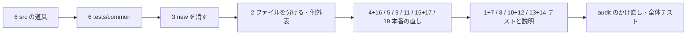

# 設計: audit-seriko（SERIKO の見直しの直し）

## Overview

**目的:** `crates/areka-seriko/` に ponytail-audit がかけた指摘のうち、要件 8 の表で「直す」とした 18 件（1〜17・19）を、それぞれ最も小さな完全な変更で直す。指摘 18・20 は直さずに記録だけ残す。
**使う人:** areka の開発者と、この後に同じクレートを作り直す v0.2.0 の spec（`draw-methods-canon` ほか）。
**変わること:** 本番の振る舞いが変わるのは 2 か所だけ。指摘 9（開発のビルドでも `panic` せず `warn!` を残して続ける）と指摘 19（`--offline-dump` の待ちに上限）。ほかは同じ振る舞いのまま、写しの統合・テストの補強・要らない口の削除・説明の直しになる。

### Goals
- 要件 8.1 の 18 件を全部直し、直した所が壊れたら落ちるテストを置く（要件 4.1）。
- 直した後の audit が 0 件、全体テストが緑（要件 5・4.5）。
- 1,000 行の例外表から `actor_bind_loop_tests.rs` の行を消す（指摘 2）。

### Non-Goals
- 指摘 18（`emit_display`）・指摘 20（`trigger.rs:167-171`）の直し（要件 8.2・8.3）。
- clippy の指摘の機械的な直し（`clippy-199-lints`）、新しい機能、v0.2.0 の作り直しの先取り。
- `BindResolver::from_groups` の中身（`audit-parsers-sakura` の持ち物）。

## Boundary Commitments

### This Spec Owns
- `crates/areka-seriko/` の全ファイル（本番・テスト・素材・`Cargo.toml`）の、要件 8 の 18 件の直し。
- 新しいファイル 3 つ: `src/lib_test_support.rs`・`src/actor_tick_tests.rs`・`tests/common/mod.rs`。
- seriko の公開の口の縮小: `BindResolver::new`・`BindOptionDecls` の削除、7 つの口の `pub(crate)` 化（指摘 15）。
- 指摘 18・20 を残した記録（検証の記録・要件 5.3）。

### Out of Boundary
- 範囲の外のファイルは次の 2 つだけを、決めた行だけ触る（要件 7.4）。
  - `crates/log-capture-kit/tests/file_length_guard_test.rs`: `OVER_LIMIT_ALLOWED` の `actor_bind_loop_tests.rs` の行（75〜78 行）と `OVER_LIMIT_ALLOWED_COUNT`（101 行）。
  - `crates/areka/src/emo2_boot/shell_carry_tests.rs`: `BindResolver::new`・`BindOptionDecls` の呼び出し元（19・38〜43 行の `names`）。
- `BindResolver::from_groups` の中身と、parsers の着せ替えの読みの型（`audit-parsers-sakura`）。
- `crates/log-capture-kit/src/event.rs:145`・`src/event_tests.rs:15・102` の「出所は `table.rs` の `capture_logs`」という文（呼び出し元でないので触らない）。
- `vendors/`、`doc/`・`docs/` を名指す行（足さない・変えない・要件 6.7）。

### Allowed Dependencies
- 今の依存だけ（`areka-parsers`・`areka-emo-compose`・`areka-sakura`・`dola`・`tracing`、テスト用に `log-capture-kit`・`sample-ghost-kit`）。依存は足さず、`Cargo.lock` を変えない（要件 6.5）。
- テストが着せ替えの読みを作るのは `areka_parsers::package::resolve_with_shell` だけ（もう使っている口）。

### Revalidation Triggers
- 公開の口が減る（`BindResolver::new`・`BindOptionDecls`・指摘 15 の 7 つ）。ツリーの中の外の使い手は `shell_carry_tests.rs` だけで、この spec が直す。並走の spec が新しく使い始めていたら、着地の前に main を取り込んで探し直す。
- `--offline-dump` は、`runonce` の待ちの合計が 10 分を越える面で、10 分の時点の面を書き出す（指摘 19）。
- 1,000 行の例外表の件数: ほかの見直しの spec も同じ表の行を消しうる。着地の前に main を取り込み、件数は「取り込んだ後の表の行の数」に合わせる（9 → 8 を決め打ちしない）。
- `audit-parsers-sakura` と同じ `bind.rs`・`resolve.rs` に触る。行がぶつかったら後から着地するほうが main を取り込んで揃える（research.md 8 節 3）。

## Architecture

### Existing Architecture Analysis
- 依存の向き `table.rs` → `timeline.rs`／`trigger.rs`／`talk.rs` → `looper.rs`／`parts.rs` → `actor.rs` は変えない（`structure.md` の `areka-seriko`）。
- 一番上（`looper_*.rs`）と部品（`parts_*.rs`）の配線は、同じ型・同じ関数を使う決まり（spec `areka-P0-seriko-trigger-intervals` 要件 5.4）。指摘 4・5 はこの決まりに寄せる直しで、新しい層は作らない。
- 指令を出す口は `emit_display` の 1 か所（指摘 18 を残す理由）。この spec はその形を変えない。

### Architecture Integration
- 選んだ形: 今のファイルの中の直し（research.md 6 節の案 B に近い順）。新しいファイルはテストの道具の受け口 2 つと、分けたテスト 1 つだけ。
- テストの道具の置き場は `structure.md` の決まりに従う: 層をまたぐものは `src/lib_test_support.rs`（`lib.rs` が `#[cfg(test)] #[path = "lib_test_support.rs"] mod test_support;` で繋ぎ、`crate::test_support::…` で呼ぶ）、役者だけのものは `actor_test_support.rs`、一番上だけのものは `looper_test_support.rs`、状態だけのものは `state_test_support.rs`。

## 指摘ごとの直し（要件 8.1 の正本の一覧）

| 番号 | 直し（最も小さな完全な変更） | 触るファイル | 直したことを示すテスト |
| --- | --- | --- | --- |
| 1 | `non_monotonic_tick_is_ignored` を差し替える: 1000（初回）→ 2000（抽選で発火）→ 2150 → 2050（戻る）。animation はコマ 2 枚で、2050 と 2150 の間にコマが替わるように待ちを置く。戻る刻みで指令が 0 件、`last_seen == Some(2150)`。 | `looper_tests.rs` | 番人（`looper.rs:433-441`）を外すと 2050 で前のコマへ巻き戻る `Show` が出て赤 |
| 2 | `mod tick_loop_tests`（1012〜1375 行）を `src/actor_tick_tests.rs` へ移し、`actor.rs` に接続宣言を足す。写しの道具（`pat`・`surface_with`・`shell_table_of`・`table_single`・`live_cfg`・`always_fire`・`shown_shell_states`）は消し、`crate::looper::tests` の同じ中身のもの（`pat`・`surface_with`・`shell_table`・`table_single`・`cfg`・`always_fire`・`shown_shell_with_binds`）を使う。`shown_shell_states(sid)` は着せ替え `{1100, 1207}` 付きで組むので、差し替え先は `shown_shell`（着せ替えが空）ではなく `shown_shell_with_binds(sid, BindSet::from_ids([1100, 1207]))`（移すテストは `Show` の欄を `..` で読み飛ばすので、取り違えても緑のまま通ってしまう）（要るものを `pub(crate)` に上げる）。写しでない `fire_once` はそのまま移す。例外表の行を消し、件数を取り込んだ後の行の数にする。指摘 3 の後に行う。 | `actor_bind_loop_tests.rs`・`actor_tick_tests.rs`（新）・`actor.rs`・`looper_tests.rs`（可視性だけ）・`file_length_guard_test.rs`（範囲の外） | 見張り `file_length_guard_test` が、行を消した表で緑（行を残すと「越えていない例外」で赤） |
| 3 | `BindResolver::new`（`bind.rs:199-227`）と `BindOptionDecls`（`bind.rs:112-129`・`lib.rs:59` の再輸出・`lib.rs:21` の doc）を消す。テストの名前の表は descript の文字列 → `groups_of` → `BindResolver::from_groups` で組む。`bind.rs:281` の doc の「`new` で組んだ表は…」を消す。 | `bind.rs`・`lib.rs`・`bind_tests.rs`・`bind_named_tests.rs`・`actor_bind_loop_tests.rs`・`actor_clock_tests.rs`・`actor_parts_tests.rs`・`actor_replace_tests.rs`・`tests/bind_e2e.rs`・`tests/common/mod.rs`・`shell_carry_tests.rs`（範囲の外） | 移した全テストが今と同じ期待値で緑（本番と同じ道で組む）。期待値が変わるテストが出たら、それは `new` が本番と違った証拠なので、本番の答えへ直して記録に残す |
| 4 | ⑴ 開閉を写す `match`（`looper_trigger.rs:57-62`・`parts_trigger.rs:60-65`）を `Armed::follow` 1 つに。⑵ 鳴らした記録の `match`（`looper_trigger.rs:124-147`・`parts_trigger.rs:106-132`）を `trigger::log_fired` 1 つに。⑶ 「3 語の引き金か」（`looper.rs:219-224`・`parts.rs:183-188`）を `LoopTrigger::is_word` 1 つに。 | `trigger.rs`・`looper_trigger.rs`・`parts_trigger.rs`・`looper.rs`・`parts.rs` | 今の引き金のテスト（`looper_trigger_tests`・`parts_trigger_tests`・`looper_talk_tests`・`trigger_tests`）が記録の文字ごと同じで緑 |
| 5 | 「印を戻さない」を `run_calls` の最後の 1 か所へ移し、2 つの貸し口は渡された値を置くだけにする。「止めた相手が `always` か」は `run_calls` が表から引いて `stop` に渡し、2 つの貸し口の `anims` の欄を消す。 | `calls.rs`・`looper_calls.rs`・`parts_calls.rs`・`calls_tests.rs` | 新しいテスト: 当て終えた印が 500 の再生を時刻 300 で回しても印は 500 のまま、続けて 600 で回しても 400 の `move` は 2 度当たらない。`max` を外すと赤 |
| 6 | 写しの道具を受け口へ寄せる（下の「テストの道具のまとめ先」）。 | 約 40 のテストファイル・新しい受け口 2 つ | 寄せた後も全テストが同じ期待値で緑（道具の振る舞いは変えない） |
| 7 | ⑴ `prefix_alike_name_is_not_bind`: 記録が空でなく、`actor.rs:663-667` の `debug!` の 1 行が在ることも確かめる。⑵ `table.rs:742-743`: 採った animation の本数が 3（surface30 の `CallOnly` を含む）に等しいことを確かめ、コメントを直す。⑶ `ticks_add_no_warn`: 刻みの間に `Show` の指令が 1 つ以上出たことを確かめる。⑷ `word_warns` の 2 つ目の枝を較正する（`ComposeMethod::from_name("start")` の記録を 1 件と数える）。 | `actor_bind_noevent_tests.rs`・`table.rs`・`table_calls_check_tests.rs`・`table_calls_dot_sakura_tests.rs` | それぞれ、確かめる相手（`debug!`・余分な animation・刻みの道・欄の形）を壊すと赤 |
| 8 | 本番は変えず、テストを 1 本ずつ足す: ⑴ `periodic,0`・`talk,0` を型で組んで警告して採らない（`table.rs:227-243`）。⑵ 動く絵の子の待ちの合計 0 を警告して採らない（`table.rs:398-405`）。⑶ `name_of` の未宣言は `None`、同じ番号に名前 2 つは表の順で最初（`bind.rs:367-373`）。⑷ `apply_named_bind` をスコープ 2（`char2`）で、排他と `mustselect` の両方。⑸ `always` を印のある状態で続けて当て、前の周の終わりのコマを 1 度だけ当てる（`calls.rs:167-184`）。⑹ 役者を止めた後の `send_replace` が `false`（`actor.rs:204-208`）。 | `table.rs`（中のテスト）・`bind_tests.rs`・`bind_named_tests.rs`・`calls_tests.rs`・`actor_replace_tests.rs` | 各テストが、試す分岐を外すと赤 |
| 9 | `glyph_wall_ms` の `debug_assert!`（`looper_trigger.rs:181`）を消す。`warn!` の道をテストで固める。 | `looper_trigger.rs`・`looper_trigger_tests.rs` | 列に無い序数で呼ぶと `now_ms` を返し、`glyph`・`now_ms` の欄を持つ `warn!` が 1 行出る。`debug_assert!` を戻すと `panic` で赤 |
| 10 | `R_POST_AND_KOMAINU`・`r_post_and_komainu_shell_root`・その自己テストを消す。 | `sample_test_support.rs`・`sample_test_support_tests.rs` | 消す前の確かめ（下の「消す前の確かめ」）を記録に残す。テストは消すだけ |
| 11 | `ScopeStates` の `scopes`・`balloon` を `BTreeMap` にする（触るファイルに `state_stage_tests.rs` を含む）。`shown_slots()` を `stage_slots()` と同じ「スコープの昇順 → シェル → バルーン」で組み、`looper.rs:476-481` の並べ替えと `slot_rank`（`looper.rs:152-157`）、`state.rs:338` の `shown.sort()` を消す。`state.rs:4-5・132・671-673` の誤った説明を直す。 | `state.rs`・`looper.rs` | 乱数を焼き込んだ抽選の順のテスト（`looper_tests.rs` の `lottery_consumes_*`・`looper_always_tests.rs`・`looper_trigger_tests.rs`）が期待値を変えずに緑（理由は research.md 9 節）。ただし今のテストが見るのは「スコープ 0 → 1（シェルだけ・`looper_tests.rs:408`）」と「同じスコープの中でシェル → バルーン（`looper_tests.rs:456`）」だけで、スコープをまたぐ順は見ていない。そこで `state_stage_tests.rs`（118 行・`shown_slots` を見ているテストの兄弟。`looper_tests.rs` は 1,000 行の余裕が無いので使わない）に 1 本足す: スコープ 0 と 1 の両方にシェルとバルーンを出し、`shown_slots()` が「0 シェル → 0 バルーン → 1 シェル → 1 バルーン」の順であることを確かめる。`scopes` を回し終えてから `balloon` を回す形に一時的に変えると赤になることを 1 回確かめる |
| 12 | 古い説明を直すか消す: `actor.rs:29-31・145-146`、`resolve.rs:84-85`、`state_surface_tests.rs:172`、`looper_parts_emo2_tests.rs:17-72`（理由の 2 行だけ残し、手書きの数と一覧を消す）。 | 左の 4 ファイル | 説明だけの直し（テストは無い） |
| 13 | 自分と比べるだけのテストを消す: `resolve.rs:206-211・306-314`、`output.rs:214・219`、`timeline_repeat_tests.rs:293-305`、`settle_tests.rs:193-198`、`timeline.rs:514-519`。 | 左の 5 ファイル | 消すだけ |
| 14 | 重なったテストを消す: `bind_tests.rs:375・775・787`、`state_surface_tests.rs:157-170・215-230`。 | `bind_tests.rs`・`state_surface_tests.rs` | 消すだけ（残る `:275`・`:696`・`:744`・`:6-21` が同じことを見る） |
| 15 | `accumulate`・`SETTLE_TICK_MS`・`lap_of`・`always_at`・`AlwaysView`・`LotteryBoundary`・`ScopeState` を `lib.rs` の `pub use` から外し、定義を `pub(crate)` にする。`lib.rs` の doc の列から外す。 | `lib.rs`・`bind.rs`・`settle.rs`・`timeline.rs`・`state.rs` | クレートとツリー全体のビルドが通る（消す前の確かめは下） |
| 16 | `Armed::arm` の `at_ms` を `u64` にし、`visible_since: open.then_some(at_ms)` にする。呼び手 6 か所を直す。指摘 4 と同じタスクで行う。 | `trigger.rs`・`looper_trigger.rs`・`parts_trigger.rs`・`trigger_tests.rs` | 今の引き金のテストが緑 |
| 17 | `parts.rs:560-565` の `contains_key` → `insert` → `get_mut` の届かない `else` を消し、`get_mut` が `None` のときだけスコープの名前を写して入れる 1 つの分岐にする（毎刻みの写しを避ける 90 行の理由は保つ）。 | `parts.rs` | 今の部品のテストが緑 |
| 19 | `settle_surface` の進め方に上限 `SETTLE_MAX_TICKS = 37_500`（16ms × 37,500 ＝ 10 分）を置く。終わりの時刻は `until.min(SETTLE_MAX_TICKS * SETTLE_TICK_MS)`。越えたら `warn!` を 1 行残して、その時刻まで進めた面を返す。上限の内は今と同じ道（要件 8.5）。 | `settle.rs`・`settle_tests.rs` | ⑴ 待ちが上限ちょうどの面は `warn!` 0 行で今と同じ。⑵ 上限の 1ms 後に次のコマへ替わる `runonce` の面は、`warn!` 1 行（欄 `surface_id`・`max_ticks`・`wait_ms`）で、替わる前のコマを返す。上限を外すと替わった後のコマになり赤 |

### 残す指摘の記録（要件 8.2・8.3）
- 指摘 18 と 20 はコードを変えない。記録は要件 8.2・8.3 の文のまま、最後の検証の記録（要件 5.3）に「残すと裁定された件の番号」として写す。

### テストの道具のまとめ先（指摘 6）
| 道具 | 今の写し | まとめ先 |
| --- | --- | --- |
| `table_of`（読む → 組む → 表）・`scope()`・`capture_logs`（行の列）・`capture_text`（つないだ文字列）・`table_and_logs`・`warns`・`KINDS`（`check_calls` の 6 種）・`part_playing(at)`・1 コマの `PatternState`／`LoopFrame` | research.md 3 節の 6 の各所（`table.rs:587` の中の写しを含む） | `src/lib_test_support.rs`（`crate::test_support`） |
| 役者の時計つきの組み（Rig 4 本）・`balloon_cue`（3 本） | `actor_test_support.rs`・`actor_clock_tests.rs`・`actor_parts_tests.rs`・`actor_stage_tests.rs`・`actor_dispatch_tests.rs`・`actor_replace_tests.rs`・`actor_strict_tests.rs` | `actor_test_support.rs` の `ClockRig`（構築の引数に「統括器の設定・名前の表・静的な着せ替え」を受ける）と `cue()` |
| `emote_cue`・`emo2_surfaces_txt`・`emo2_resolver`・`TalkNotice`・`NullTextSink`・着せ替えの読み（指摘 3 用） | `tests/cue_sequence.rs`＝`tests/regression.rs`、`tests/balloon_face_e2e.rs`＝`tests/bind_e2e.rs` | `tests/common/mod.rs`（各テストが `mod common;`。使わない道具が出るテストのために先頭に `#![allow(dead_code)]`） |

- 写しの中身が少しずつ違うもの（Rig の時計の有無など）は、違いを構築の引数で表す。`actor_stage_tests.rs` の Rig は時計を持たない。`ClockRig` の時計（時刻 0 のまま）に揃えて期待値が変わるなら、その Rig は寄せずに止めて報告する（振る舞いを変える寄せはしない）。
- 道具の名が本番の項目と同じなら、`structure.md` のとおり明示の `use` で受ける（E0659 を避ける）。

## File Structure Plan

### 新しいファイル
```
crates/areka-seriko/
├── src/
│   ├── lib_test_support.rs   # 層をまたぐテストの道具（指摘 6）。lib.rs が #[cfg(test)] で繋ぐ
│   └── actor_tick_tests.rs   # 刻みの道の役者テスト（指摘 2・actor_bind_loop_tests.rs から移す）
└── tests/
    └── common/mod.rs         # 統合テストの共有の道具（指摘 6・指摘 3 の着せ替えの読み）
```

### 変えるファイル（本番）
- `src/trigger.rs` — `Armed::follow`・`log_fired`・`LoopTrigger::is_word` を足し、`arm` の引数を `u64` に（4・16）。
- `src/looper_trigger.rs` — 開閉の写し・鳴らした記録を `trigger.rs` の口へ（4・16）、`debug_assert!` を消す（9）。
- `src/parts_trigger.rs` — 同上（4・16）。
- `src/looper.rs` — `is_trigger_word`・並べ替え・`slot_rank` を消す（4・11）。
- `src/parts.rs` — `is_trigger` を消す（4）、届かない `else` を消す（17）。
- `src/calls.rs` — 印を戻さない決まりと `always` の判定を `run_calls` へ（5）。
- `src/looper_calls.rs`・`src/parts_calls.rs` — 貸し口を値を置くだけに、`anims` の欄を消す（5）。
- `src/state.rs` — `BTreeMap`・`shown_slots` の組み方・説明（11）、`ScopeState` を `pub(crate)`（15）。
- `src/bind.rs` — `new`・`BindOptionDecls` を消す（3）、`accumulate` を `pub(crate)`（15）。
- `src/settle.rs` — 上限と `warn!`（19）、`SETTLE_TICK_MS` を `pub(crate)`（15）。
- `src/timeline.rs` — 4 つの口を `pub(crate)`（15）、自分と比べるテストを消す（13）。
- `src/lib.rs` — 再輸出と doc の列（3・15）、`test_support` の接続宣言（6）。
- `src/actor.rs` — 古い説明（12）、`actor_tick_tests.rs` の接続宣言（2）。
- `src/resolve.rs`・`src/output.rs` — 古い説明（12）・自分と比べるテスト（13）。
- `src/table.rs` — 中のテスト: `capture_logs` を受け口へ（6）、本数の確かめ（7）、足すテスト 2 本（8）。

### 変えるファイル（テスト・素材）
- 受け口: `src/actor_test_support.rs`（`ClockRig` の構築の引数・`cue()`）、`src/looper_test_support.rs`・`src/state_test_support.rs`（写しを消して `crate::test_support` を使う）、`src/sample_test_support.rs`（10）。
- 写しを消して受け口を使うテスト: research.md 3 節の 6 に挙げた各ファイル（`src/` の約 35 ファイルと `tests/` の 4 ファイル）。
- 指摘 1・3・5・7・8・9・12・13・14・16・19 の表の「触るファイル」のテスト。どれも兄弟のテストファイルの今の形のまま直す。

### 範囲の外（決めた行だけ）
- `crates/log-capture-kit/tests/file_length_guard_test.rs` — 例外表の 1 行と件数（2）。
- `crates/areka/src/emo2_boot/shell_carry_tests.rs` — `names(multiple)` を descript の文字列で組む形にし、今ある `char2_names` の中身（作業フォルダに書いて読む）を 1 つの道具にして両方から呼ぶ（3）。

### 1,000 行の見積もり（要件 6.1）
| ファイル | 今 | 見込み | 中身 |
| --- | --- | --- | --- |
| `looper.rs` | 993 | 約 975 | 消すだけ（4・11）。足す行は無い |
| `parts.rs` | 973 | 約 963 | 消すだけ（4・17） |
| `looper_tests.rs` | 970 | 約 975 | 指摘 1 の差し替え（+約 10）と `capture_logs` を寄せる（−5） |
| `table.rs` | 929 | 約 960 | 足すテスト 2 本（+約 35）と `capture_logs` を寄せる（−5） |
| `parts_tests.rs` | 921 | 約 905 | 寄せるだけ（6） |
| `actor_bind_loop_tests.rs` | 1,375 | 1,000 未満 | 移す（−約 364）と指摘 3（−約 20）。指摘 3 の後でも 1,000 行を越えるなら、刻みの道の前の最後の組（939〜1010 行）も `actor_tick_tests.rs` へ移す |
| `actor_tick_tests.rs`（新） | — | 約 300 | 写しの道具を消した分だけ移す前より短い |

## Components and Interfaces

本番の口の形（中身は書かない）。

```rust
// trigger.rs（指摘 4・16）
impl Armed {
    pub(crate) fn arm(at_ms: u64, open: bool, revealed: Option<u64>) -> Armed;
    /// 在る状態へ窓の開け閉めを写す（開いた＝show・閉じた＝hide・同じなら何もしない）。
    pub(crate) fn follow(&mut self, open: bool, at_ms: u64, revealed: Option<u64>);
}
impl LoopTrigger {
    /// runonce・periodic・talk の 3 語か。
    pub(crate) fn is_word(&self) -> bool;
}
/// 鳴らした記録（runonce・periodic は info!・talk は debug!）。part が Some なら欄 part と文言の「part 」を足す。
pub(crate) fn log_fired(
    anim: &LoopAnimation,
    started_at_ms: u64,
    scope: &ActorKey,
    slot: Slot,
    part: Option<&dyn std::fmt::Display>,
);
```
- 約束: `log_fired` の出す行は、段・欄の並び（`scope`・`slot`・`part`・`animation_id`・`started_at_ms`）・文言が今の 2 か所と 1 字も違わない。
- 構える側（入口が無いときの `Armed::arm` と `debug!`）は、`HashMap` と `BTreeMap` で入口の型が違うので今の場所に残す。

```rust
// calls.rs（指摘 5）
pub(crate) trait CallPlays {
    fn playing(&self, animation: u32) -> Option<(u64, Option<u64>)>;
    /// 印をこの値にする（戻さない決まりは run_calls が受け持つ）。
    fn set_acts_through(&mut self, animation: u32, through_ms: u64);
    fn start(&mut self, animation: u32, at_ms: u64);
    /// 再生と欄を外す。always が真なら止めた always の印を付ける。
    fn stop(&mut self, animation: u32, always: bool);
    fn playing_ids(&self) -> Vec<u32>;
}
```
- `run_calls` の事後条件: 再生中の全部の印は `max(前の印, now_ms)`（前の印が無ければ `now_ms`）。
- `always` は `animation_of(target)` の `trigger` が `Always` のとき真（表に無い相手は偽＝今と同じ）。

```rust
// settle.rs（指摘 19）
pub(crate) const SETTLE_MAX_TICKS: u64 = 37_500;
// 越えたとき: tracing::warn!(surface_id, max_ticks = SETTLE_MAX_TICKS, wait_ms = until, "…上限の時点で打ち切る…")
```

```rust
// state.rs（指摘 11）
pub struct ScopeStates {
    scopes: BTreeMap<ActorKey, ScopeState>,
    balloon: BTreeMap<ActorKey, ScopeState>,
    // ほかの欄は今のまま
}
// shown_slots(): スコープの昇順 → シェル → バルーンの順で返す（公開の形は今のまま）
```

```rust
// lib_test_support.rs（指摘 6・crate::test_support・#[cfg(test)]）
pub(crate) fn table_of(text: &str) -> AnimationTable;
pub(crate) fn scope() -> ActorKey;
pub(crate) fn capture_logs<F: FnOnce()>(f: F) -> Vec<String>;
pub(crate) fn capture_text<F: FnOnce()>(f: F) -> String;
pub(crate) fn table_and_logs(text: &str) -> (AnimationTable, Vec<String>);
pub(crate) fn warns(logs: &[String]) -> Vec<&String>;
pub(crate) const KINDS: [&str; 6];
pub(crate) fn part_playing(at: u64) -> Option<PartAnim>;
```
- 着せ替えの読み `groups_of(shell: &str)` は今の `bind_tests.rs:443` に置いたまま使う（もう `crate::bind::tests::groups_of` で他から呼ばれている）。名前の表が要るテストは `BindResolver::from_groups(&groups_of(本文))` で組む。

## System Flows


- 順は直列。指摘 6 を先にし、後から足すテストがまとめた道具を使えるようにする。指摘 3 は指摘 2 より先（1,000 行の見積もり）。本番の直しは 1 指摘群 1 タスクで、同じファイルに触るものは同じタスクにまとめる（4 と 16、15 と 17）。見積もりは 15 前後のタスク（20 を越えない・要件 8.6）。
- 範囲の外のファイルに触るタスク（2・3）は、触る前に持ち主（`audit-test-kits`・`audit-emo2-boot-spine`）の spec が走っていないかを `.kiro/specs/` と作業場の枝で確かめる（要件 7.6）。走っていれば要件 7.3 に従う。

## 消す前の確かめ（要件 7.1・7.2）
- 消す・形を変える口（`BindResolver::new`・`BindOptionDecls`・指摘 15 の 7 つ・`r_post_and_komainu_shell_root`・`R_POST_AND_KOMAINU`・`is_trigger_word`・`is_trigger`・`slot_rank`・`CallPlays::stop` の引数・`Armed::arm` の引数）は、消す前にツリー全体（`crates/` の全部・テスト・素材・設定・文字列）を `rg -n '\b名前\b'` で探し、件数と探した日の `HEAD` をタスクの記録に残す。設計の段の確かめでは、ツリーの外の使い手は `shell_carry_tests.rs` の `BindResolver::new`・`BindOptionDecls` だけだった。
- 消した後は `cargo build --workspace --all-targets` が通ることで、見落とした呼び出し元が無いことを確かめる。

## Requirements Traceability

| 要件 | 設計の受け持ち |
| --- | --- |
| 1.1・1.2・1.3・1.4・1.5・1.6 | ギャップ分析の段で済み（research.md 1〜3 節）。この設計はその一覧を正本として使う |
| 2.1 | 「指摘ごとの直し」の表＝要件 8 の一覧どおり |
| 2.2 | 18 件すべてに直しの行がある。残すのは 18・20 だけ |
| 2.3 | 各行の「最も小さな完全な変更」と「触るファイル」（呼び出し元・テスト・素材まで） |
| 2.4 | 要件 8.6 で 1 本と確定。タスクは 15 前後（20 を越えない） |
| 3.1・3.2・3.3 | 残すのは 18（種類 1）と 20（種類 2）だけ。ほかの指摘は裁定に触れない（9 は記憶の決めごとに沿う側の直し） |
| 3.4 | 「残す指摘の記録」 |
| 3.5 | 一覧のほかの指摘は全部直す |
| 4.1 | 表の「直したことを示すテスト」（壊したら赤になることを、確かめる行を外して確かめる） |
| 4.2 | 足すテストは注入の時計・決め打った乱数・`log-capture-kit` の捕まえだけを使う |
| 4.3 | GPU に触る直しは無い |
| 4.4 | 作業フォルダは `sample_ghost_kit::WorkDir`（ワークツリーの `target\` の下）だけ |
| 4.5 | 最後のタスクで `pwsh -NoProfile -File tools/test-all.ps1` |
| 5.1・5.2・5.3 | 最後のタスク（audit のかけ直し・0 件になるまで・記録に 18・20 の番号） |
| 6.1 | 「1,000 行の見積もり」と指摘 2 |
| 6.2 | 指摘 9・19 の道は `warn!` を残して続ける（失敗を返す道ではない）。足す失敗の道は無い |
| 6.3 | 終了の道に触る直しは無い（指摘 8 ⑹ は止めた後の振る舞いを試すだけ） |
| 6.4 | 文字化けに当たったら読む側を直す（どのタスクでも同じ） |
| 6.5・6.6 | 依存を足さない（Allowed Dependencies）。足さないと直せない指摘は無い |
| 6.7 | `doc/`・`docs/` を名指す行を足さない（Out of Boundary） |
| 7.1・7.2 | 「消す前の確かめ」 |
| 7.3 | `audit-parsers-sakura` との申し合わせ（Revalidation Triggers）。範囲の外の 2 ファイルの持ち主の確かめ（System Flows） |
| 7.4 | Out of Boundary の 2 ファイルと決めた行だけ。`log-capture-kit` の「出所」の文は触らない |
| 7.5 | clippy だけの指摘は直さない（audit が同じ所を指したものは無い・research.md 4 節） |
| 7.6 | System Flows の持ち主の確かめ |
| 8.1 | 「指摘ごとの直し」の 18 行 |
| 8.2・8.3 | 「残す指摘の記録」 |
| 8.4 | 指摘 19 の `warn!`（`surface_id`・`max_ticks`・`wait_ms`）と上限の時刻の面を返す |
| 8.5 | 上限の内は終わりの時刻が `until` のまま＝今と同じ 16ms ごとの道 |
| 8.6 | 1 本で直す（System Flows のタスクの見積もり） |

## Error Handling
- 指摘 9: 序数が列に無いのは決まりの破れ。今の `warn!`（`glyph`・`now_ms`）を残して刻みの時刻で代え、役者は止めない。どのビルドでも同じ道になる。
- 指摘 19: 待ちが上限を越えるのは作者の書いた値。`warn!` を 1 行残し、上限の時刻の面で書き出しを続ける（`settle_surface` は今と同じく `PatternState` を返し、`Err` を返す形にはしない）。
- そのほかの直しは失敗の道を足さない。消す `else`（指摘 17）は届かない枝で、記録の道ではない。

## Testing Strategy
- **直したことを示すテスト**（表の右の列）: 指摘 1・5・7・8・9・11・19 で足す・差し替えるテストは、確かめる行（番人・`max`・`debug!`・分岐・`min` など）を一時的に外して赤になり、戻して緑になることを、タスクの中で 1 回ずつ確かめて記録する（経路から外す摂動）。
- **振る舞いを変えない直し**（3・4・6・11・15・16・17。11 は順を見張るテストを 1 本足す）: 今のテストが期待値を変えずに緑であることが証拠。指摘 4 は記録の文字を見るテスト（`を鳴らした`・`引き金を構えた` を探すテスト）が同じ文字で緑であることも含む。
- **消すだけの直し**（10・13・14）: 残るテストが同じことを見ていることを表の行で示し、テストの数が減ることを記録する。
- **最後のタスク**: クレートのテスト → 全体テスト（`tools/test-all.ps1`）→ 同じ作法の audit のかけ直し（要件 5）。
