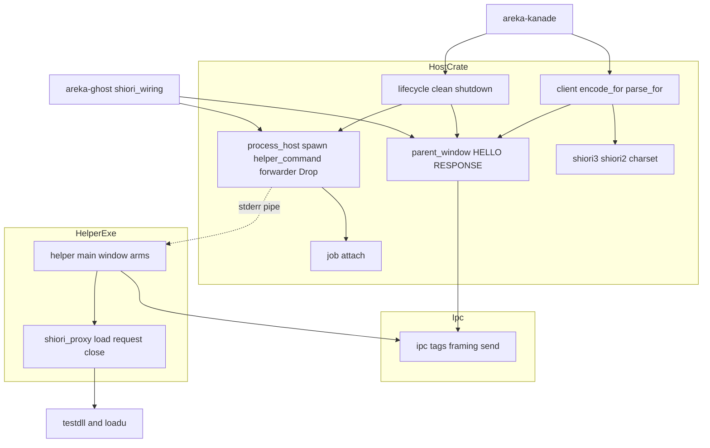
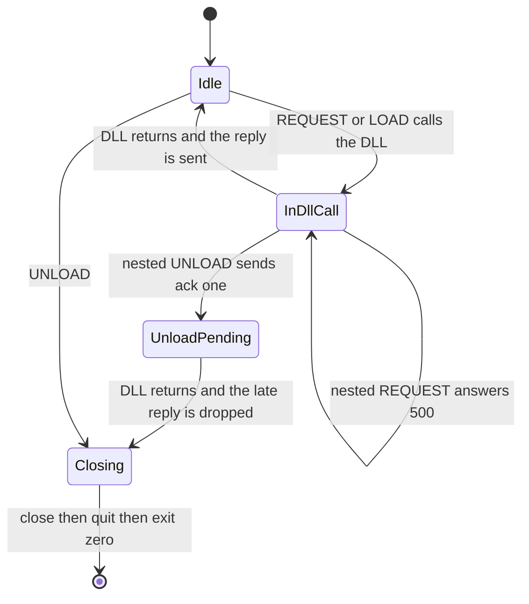
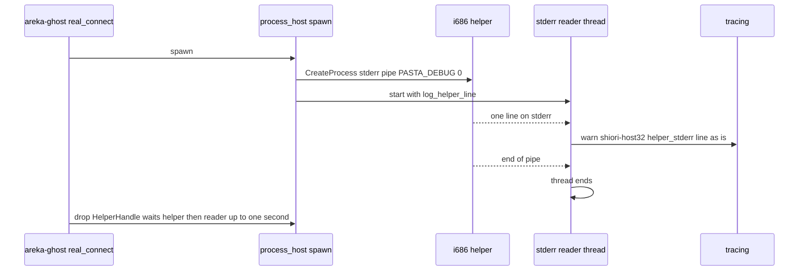

# 設計: audit-shiori-host32

## Overview

**Purpose**: x64／arm64 の areka から 32bit の SHIORI の DLL を動かす中継（host・helper・その間の取り決め）と試験用の DLL 2 つを、ponytail の audit で見直して出た 48 件の指摘のうち、要件の討議で残すと決めた 2 件（27・39）を除く 46 件を直す。直し方は「いちばん小さな完全な変更」に従い、指摘 1 件ごとに、直す場所・直し方・それが壊れたら落ちるテストを決める。

**Users**: 開発者（直った結果を受け取る）と、本 spec の実装係（この文書の「修正のまとまり」がそのままタスクになる）。

**Impact**: 本番の振る舞いが変わるのは次の 7 点だけで、ほかは記録・テスト・説明・内側の形の直しである。① helper が SHIORI の DLL を読むときの依存の探し先が絞られる（件 1）② helper の下の pasta がデバッグの待ち受けを開かない（件 2）③ helper の標準エラーの行が areka の記録に `warn` で出る ④ SHIORI が起こしたプロセスがゴーストを閉じても殺されない ⑤ DLL の呼び出しの最中に UNLOAD が届いても helper が落ちない ⑥ 親の窓が子でない送り手の HELLO・RESPONSE を受けない ⑦ 応答のヘッダの値の前後の空白の削り方と、同じ名前のヘッダが重なったときの決まり。

### Goals

- 46 件を 3 つの組とも全部直す（要件 3.1・10.2）。
- 直したバグと危ない所の 1 件ごとに、壊れたら落ちる決定論のテストを 1 本ずつ置く（要件 4.1・4.2）。
- `shiori-host32-host` の公開の形は足すことのほかは変えない。例外は開発者が討議で決め、`runtime-module-untangle` のセッションと申し合わせた指摘 26 の消去だけ（要件 6.4・10.9）。
- 依存を足さず、C19 のあいだは `Cargo.lock` に手を入れない（要件 5.6）。
- 直した後の audit のかけ直しで新しい指摘 0 件・全体テストが緑（要件 9）。

### Non-Goals

- 新しい機能（要件 3.4）。helper の下の pasta のデバッグの待ち受けを開ける口は作らない（要件 10.4）。
- `crates/shiori-abi/`・`crates/shiori4-testdll/`（要件 10.1）。
- 指摘 27（`request_of`）・39（実物の pasta の任意のテスト）の直し（要件 10.3）。
- 本体 `crates/areka/`・`vendors/`・C19 のほかの 7 本が触るファイル（要件 6.3・6.6）。
- `wintf-winmsg-executor` の中の直し（外のクレートはそのまま使う）。

## Boundary Commitments

### This Spec Owns

- `crates/shiori-host32-host/`・`crates/shiori-host32-helper/`・`crates/shiori-host32-ipc/`・`crates/shiori-host32-testdll/`・`crates/shiori-host32-testdll-loadu/` の全ファイル（本番のコード・テスト・試験の道具・`Cargo.toml`・`README.md`）。
- helper を起こす手順（引数・環境・作業フォルダ・標準エラー・job）と、helper の中の DLL の読み込み・呼び出し・後始末の決まり。
- helper の標準エラーの行を areka の記録へ回す決まり（行の文は変えない・`warn` の段・宛名 `shiori-host32`）。
- テストの一時の置き場の決まり（ワークスペースの `target\test-roots\` の下・`temp-path-kit` と同じ場所）。

### Out of Boundary

- 本体 `crates/areka/` 全部（`emo2_boot/spine.rs`・`spine_hold_support.rs` などの `shiori-host32-host` の使い手を含む）。本体の実機の試験が探す `[helper] LOAD 失敗（観測・ack[0]）: …` の文は変えない。
- `crates/areka-ghost/src/shiori_inproc.rs`（件 1 の手本・書き換えない）と `crates/real-run-kit/`（件 2 の手本・書き換えない）。
- `crates/pilot/`（自分の写しを持つ・本 spec の直しは響かない）。
- `vendors/`（`vendors/pasta` の DLL は実機の確かめで読むだけ）。
- clippy の指摘の機械的な直し（`clippy-199-lints`）。重なった場所は記録だけ残す（要件 3.5）。
- 範囲の外のファイルで見つけた別の指摘（その範囲の spec の持ち物）。

### Allowed Dependencies

- 今ある依存だけ: `windows`（ワークスペースの版 0.62・機能の行を足すのは可＝`Cargo.lock` は変わらない）・`wintf-winmsg-executor` 0.0.5・`encoding_rs`・`tracing`・`thiserror`・`shiori-host32-ipc`・dev の `log-capture-kit`。
- 新しい依存・dev-dependency は足さない（`temp-path-kit` も足さない）。
- 依存の向きは今のまま: `shiori-host32-ipc` ← `shiori-host32-host`／`shiori-host32-helper`。host と helper はコードで互いに依存しない（プロセスの境で `WM_COPYDATA` だけ）。試験用の DLL はどのクレートにも依存しない（取り決めの値は写しで持ち、互いの場所を注釈で指す）。

### Revalidation Triggers

- `RequestError`・`ShioriError` の表示の文が変わる（`areka-kanade` の記録の文が変わる・文字列で比べる使い手は無い＝grep 済み）。
- helper の標準エラーが親から受け継がれず、areka の記録へ回る（helper の標準エラーを直接読む使い手は無い＝grep 済み）。
- job に `JOB_OBJECT_LIMIT_SILENT_BREAKAWAY_OK` が付く（SHIORI が起こしたプロセスの寿命が変わる）。
- 親の窓が HELLO を 1 度だけ・子のプロセスからだけ受ける（新しい `ParentMessageWindow::expect_helper_pid` を呼ぶ使い手は子のプロセス番号で縛られる）。
- 公開の項目の消去（指摘 26・`EXIT_POLL_INTERVAL`・ipc の `PAYLOAD_HEADER_LEN`）。
- 応答のヘッダの値の読み方（同じプロセス内の道も同じ関数を使う＝どのゴーストにも効く）。

## Architecture

### Existing Architecture Analysis

- host（x64／arm64）が i686 の helper を起こし、両者はメッセージだけの窓どうしの `WM_COPYDATA` で要求と応答を運ぶ。往復は同時に 1 つで、host は `SendMessageTimeout` の待ちの中で helper の RESPONSE を受け皿（`ResponseSlot`）へ受ける。
- 窓の手続きは `wintf-winmsg-executor` 0.0.5 の `Window<S>` が持つ。**その窓の手続き（`util/window.rs` の `wndproc_typed`）は panic を受け止めない**＝窓の手続きの中の panic は `extern "system"` を越えてプロセスを止める（R3・ソースで確かめた）。
- 窓のクラスはプロセスに 1 度だけ登録され（`static CLASS_REGISTRATION: Once`）、窓は呼ぶたびに作られる。**ソースには「1 プロセスに窓 1 組」の制限は見当たらない**（R4）。今のテストの直列の錠（`WINDOW_TEST_SERIAL`）と「`--test-threads=1` で回す」の説明は、この制限を前提にしている。
- 終了の正規の道は UNLOAD → helper の `ShioriByteProxy` の後始末（`unload` → `FreeLibrary`）→ メッセージの回しの正常な終わり → 終わりの値 0。job（閉じたら全部殺す）は親が UNLOAD を送らずに終わった時の安全網。

### Architecture Pattern & Boundary Map



**Architecture Integration**:
- 型: 今の層をそのまま保つ（新しい層・新しい trait・新しいクレートを作らない）。
- 新しい部品は内側の関数だけ（`helper_command`・`forward_helper_stderr`・`encode_for`・`parse_for`・`push_references`・`request_clean_shutdown_within`・`wait_for_exit`・`ShioriByteProxy::close`・`helper_log`）と、足す公開の口 1 つ（`ParentMessageWindow::expect_helper_pid`）。
- steering の決まり: 記録の無い失敗の道を作らない（失敗は `error!`／helper では `[helper]` の行＋エラーの戻り値）・終了は正規の道・テストの根は `target\` の下・決定論のテスト・揺れるテストの手当てはテストの的を外さない・1 フレーム遅らせる解を取らない・文字化けは読む側を直す。

### Technology Stack

| 層 | 選んだもの／版 | 役目 | 備考 |
|----|----|----|----|
| 取り決め | `shiori-host32-ipc`（ワークスペースの中） | タグ・枠の確かめ・送り | `PAYLOAD_HEADER_LEN` を消す |
| Win32 | `windows` 0.62.2（ワークスペースの版） | `LoadLibraryExW`・`GlobalSize`／`GlobalLock`・`WaitForSingleObject`・`GetWindowThreadProcessId`・`QueryInformationJobObject`・`MultiByteToWideChar`・`CREATE_NO_WINDOW` | 機能の行を足すのは host の `Win32_Globalization`・helper の `Win32_System_Console`・testdll の `Win32_System_DataExchange` だけ（`Cargo.lock` は変わらない＝R6・R8） |
| 窓の手続き | `wintf-winmsg-executor` =0.0.5 | 親と helper のメッセージだけの窓 | 変えない・panic を受け止めない前提で設計する |
| 記録 | `tracing`（host）・標準エラーの行（helper） | 記録 | helper の行は host が `warn` で記録へ回す |
| テストの記録の捕捉 | `log-capture-kit`（dev・今あるもの） | 記録の段・宛名・文を確かめる | 全体の捕捉（`install_global_capture_all`）は使わない＝番人の例外表を増やさない |

## File Structure Plan

### Directory Structure（新しく作るファイル）

```
crates/shiori-host32-host/
├── src/client_tests.rs              # client.rs の中のテストを移したもの＋版で分ける道のテスト（U10）
├── src/shiori3_tests.rs             # shiori3.rs の中のテストを移したもの＋値の空白と重なりのテスト（U11）
├── src/process_host_stderr_tests.rs # 標準エラーの回しのテスト（行の読み・記録の形・実 helper の行が届く）（U5）。成果物の探し方は #[path = "../tests/common/mod.rs"] で結合テストの道具を引く（写しを作らない）
├── tests/common/mod.rs              # 結合テストの共通の道具: 成果物の探し方・テストの根・握手の上限（U1）。テストごとに使う関数が違うので、頭に理由つきの `#![allow(dead_code)]` を置く（使わない関数の警告を出さない）
└── tests/helper_env_e2e.rs          # 親に PASTA_DEBUG=1 を立てて自分を起こし直し、helper の下で 0 であることを確かめる（U4）
crates/shiori-host32-helper/
├── src/proxy_test_support.rs        # helper のテストの共通の道具: 試験用の DLL の探し方・写し・テストの根（U1）
└── src/shiori_proxy_tests.rs        # shiori_proxy.rs の中のテストを移したもの＋件 1・長さ・null・close のテスト（U1・U2・U12・U13）
```

### Modified Files

- `crates/shiori-host32-host/Cargo.toml` — `windows` の機能に `Win32_Globalization` を足す（U5）。U17 で `event-listener` の行を消す。
- `crates/shiori-host32-host/README.md` — 今の姿に書き直す（32）。
- `crates/shiori-host32-host/src/lib.rs` — 説明を直す（32）・消した項目の再公開を外す（26）。
- `crates/shiori-host32-host/src/process_host.rs` — `helper_command`（2・16）・標準エラーの回し（4）・`HelperHandle` の Drop と `wait_for_exit`（14・36）・`try_wait` の失敗の記録（10）・`CREATE_NO_WINDOW` を `windows` から（30）・Unix の腕を消す（31）・`ExitKind::Terminated` の説明（25）・`shortcut:` の注釈（37）・使い手のいない項目を消す（26）・重複のテストを消す（21）。
- `crates/shiori-host32-host/src/process_host_image_tests.rs` — 重複のテストを 1 本にまとめる側（21）。
- `crates/shiori-host32-host/src/job.rs` — `SILENT_BREAKAWAY_OK`（13）・宛名（34）・テストの `ping` をじかに起こす（43）。
- `crates/shiori-host32-host/src/lifecycle.rs` — `request_clean_shutdown_within`（17）・送りの失敗の後の問い直し（24）・`WaitForSingleObject` 1 回（36）・宛名（34）・Drop を `HelperHandle` へ移す（14）・説明（32）・使い手のいない項目を消す（26）・時間に頼るテスト（48）。
- `crates/shiori-host32-host/src/parent_window.rs` — 不正なメッセージの記録と数の削除（11）・送り手の確かめと `expect_helper_pid`（38）・窓 2 組のテストと直列の錠（40）・時間に頼るテスト（48）。
- `crates/shiori-host32-host/src/client.rs` — `encode_for`／`parse_for`（15・46）・読めない応答の `error!`（5）・中のテストを `client_tests.rs` へ。
- `crates/shiori-host32-host/src/shiori3.rs` — `push_references`（46）・値の空白（22）・重なり（23）・中のテストを `shiori3_tests.rs` へ。
- `crates/shiori-host32-host/src/shiori2.rs` — `push_references` を使う（46）。
- `crates/shiori-host32-host/src/charset.rs`・`charset_tests.rs` — 警告済みの集まりの上限（41）・置き換えの数え直しで ASCII を飛ばす（42）。
- `crates/shiori-host32-host/src/error.rs` — 表示の文に中身と原因を載せる（6）。
- `crates/shiori-host32-host/tests/{error_paths,lifecycle_cyclic_e2e,lifecycle_kill_e2e,shiori_load_e2e,shiori_request_e2e}.rs` — 共通の道具へ寄せる（21）・根を `target\` の下へ（3）・`HelperGuard` を消す（14）・`error_paths` の 3 本目を消す（18）・時間に頼る確かめ（48）・使い手のいない項目のテストを消す（26）・説明（40）。
- `crates/shiori-host32-helper/Cargo.toml` — 説明（32）・U17 で `thiserror` の行を消す。
- `crates/shiori-host32-helper/src/main.rs` — 再入の旗（8）・`helper_log`（9・12）・`PostMessageW` の失敗と空の `lparam` の記録（12）・Vec を写さない（44）・古い allow と説明（32・33）・UNLOAD の後始末を `close` で（9）。
- `crates/shiori-host32-helper/src/shiori_proxy.rs` — `LoadLibraryExW`（1）・応答の長さの確かめ（7）・`close` と失敗の種類（9）・テストだけの `ansi_encode` を消す（19）・説明（32）・HGLOBAL の写しの注釈（47）・中のテストを `shiori_proxy_tests.rs` へ。
- `crates/shiori-host32-helper/src/{main_loopback_tests,shiori_proxy_loadu_tests,main_classify_tests,main_response_flavor_hung_cage_tests}.rs` — 共通の道具へ寄せる（21）・根（3）・再入・null・空の `lparam` のテスト（8・12・20）・説明（32）。
- `crates/shiori-host32-ipc/Cargo.toml` — U17 で `windows-core` の行を消す。
- `crates/shiori-host32-ipc/src/lib.rs` — `PAYLOAD_HEADER_LEN` とそのテストを消す（45）・説明（32）。
- `crates/shiori-host32-testdll/Cargo.toml`・`crates/shiori-host32-testdll-loadu/Cargo.toml` — `windows = { workspace = true }`（29）。testdll は `Win32_System_DataExchange` を足す（U3）。
- `crates/shiori-host32-testdll/src/lib.rs` — 試しの ID を 5 つ足す（U3）・説明（32）・注釈（47）。
- `crates/shiori-host32-testdll-loadu/src/lib.rs` — 中のテストの根（3）・注釈（47）。

範囲の外で触るファイル（要件 3.2・6.1・6.2。どれも C19 のほかの 7 本の「触るファイル」に無い）:

- `crates/areka-ghost/src/shiori_wiring.rs` — 握手の時間切れの誤りに helper の終わり方を載せる（35）・`expect_helper_pid` を呼ぶ（38）。35 のテストは新しい兄弟のファイル `crates/areka-ghost/src/shiori_wiring_handshake_tests.rs`（`#[cfg(test)] #[path]` で引く）に置く。
- `crates/areka-ghost/tests/ghost/common.rs`・`tests/ghost/real_pasta_test.rs`・`tests/ghost/snapshot_capture_test.rs`・`tests/real_pasta_online.rs` — 当座の錠 `real_pasta_turn` とその取り回し・「`PASTA_DEBUG=0` で回す」の説明を消す（要件 10.5）。
- `crates/log-capture-kit/tests/temp_path_guard_test.rs` — 例外表から本範囲の 10 件を外し、件数と説明を直す（3。`runtime-module-untangle` が触る同じ場所の 2 つの番人とは別のファイル）。
- `crates/areka-kanade/tests/kanade/idle_pump_test.rs`・`real_helper_test.rs` — 送り手の確かめ（38）で古びる所があれば直す（要件 4.5。確かめの結果、直す所が無ければ触らない）。

## 修正のまとまり（タスクの元）

全部で 18。U1 から順に進める。同じファイルに触るまとまりどうしは並べて走らせない（下の表の「触るファイル」）。

C19 の中の着手の順（2026-11-13 棚卸・開発者の承認）: audit 系の 4 本は、audit 系でない 4 本（`runtime-module-untangle`・`dola-yaml-backend`・`wintf-d2d-composite-rules`・`emo-text-reveal-incremental`）の後に実装する。本 spec の縛りは U17（`dola-yaml-backend` の着地の後）だけ。

| まとまり | 指摘 | 触るファイル（主なもの） | 先に要るもの |
|---|---|---|---|
| U1 試験の置き場・共通の道具・中のテストを兄弟のファイルへ（はじめに範囲の 5 クレートの clippy の警告の一覧を基準として `research.md` に控える＝要件 3.5） | 3・21・48（一部） | host `tests/`・`process_host*.rs` のテスト・`lifecycle.rs` のテスト・`client.rs`→`client_tests.rs`・`shiori3.rs`→`shiori3_tests.rs`／helper `proxy_test_support.rs`・`shiori_proxy.rs`→`shiori_proxy_tests.rs`・`main_loopback_tests.rs`・`shiori_proxy_loadu_tests.rs`／loadu `lib.rs`／`temp_path_guard_test.rs` | — |
| U2 件 1: 依存の探し先を絞る | 1 | helper `shiori_proxy.rs`・`shiori_proxy_tests.rs` | U1 |
| U3 試験用の DLL の試しの ID と版のピン | 29・47・32（testdll の分） | testdll `Cargo.toml`・`lib.rs`／loadu `Cargo.toml`・`lib.rs`／helper `shiori_proxy.rs`（注釈 1 行） | U1 |
| U4 件 2: helper の起こし方と、その試験 | 2・16・要件 10.4 | host `process_host.rs`・`tests/helper_env_e2e.rs`・`tests/common/mod.rs`／`temp_path_guard_test.rs` | U1・U3 |
| U5 helper の標準エラーを記録へ回す（helper の標準の取っ手を SHIORI の子へ受け継がせない） | 4・18・要件 10.12 | host `Cargo.toml`・`process_host.rs`・`process_host_stderr_tests.rs`・`tests/error_paths.rs`／helper `Cargo.toml`・`main.rs`・`main_loopback_tests.rs` | U4 |
| U6 host の記録の穴と文字コードの上限・速さ | 6・10・41・42 | host `error.rs`・`process_host.rs`・`charset.rs`・`charset_tests.rs` | U5 |
| U7 後始末と job | 13・14・37・43 | host `process_host.rs`・`job.rs`・`lifecycle.rs`（Drop）・`tests/` の `HelperGuard` | U6 |
| U8 親の窓: 記録・送り手・窓 2 組・areka-ghost の当座の錠（窓 2 組のテストが緑の後） | 11・38・40・48（一部）・要件 10.5 | host `parent_window.rs`・`lifecycle.rs`（錠）・`tests/common/mod.rs`・`tests/lifecycle_cyclic_e2e.rs`（説明）／areka-ghost `shiori_wiring.rs`・錠の 4 ファイル／areka-kanade のテスト（要るときだけ） | U4・U7 |
| U9 正常終了の道 | 17・24・34・36・48（一部） | host `lifecycle.rs`・`job.rs`（宛名）・`process_host.rs`（`wait_for_exit` を使う） | U7・U8 |
| U10 版で分ける道とその写し | 5・15・46 | host `client.rs`・`client_tests.rs`・`shiori3.rs`・`shiori2.rs` | U1 |
| U11 応答のヘッダの読み方 | 22・23 | host `shiori3.rs`・`shiori3_tests.rs`・`shiori2_tests.rs` | U10 |
| U12 helper の小さな失敗の道と記録の口 | 9・12・44・要件 10.11 | helper `main.rs`・`shiori_proxy.rs`・`main_loopback_tests.rs`・`shiori_proxy_tests.rs`・`main_classify_tests.rs` | U2・U3 |
| U13 helper の応答の長さと空の応答 | 7・20 | helper `shiori_proxy.rs`・`shiori_proxy_tests.rs`・`main_loopback_tests.rs` | U12 |
| U14 helper の再入 | 8 | helper `main.rs`・`main_loopback_tests.rs` | U13 |
| U15 説明と小さな形 | 19・25・30・31・32・33・35・45 | host `process_host.rs`・`lifecycle.rs`・`lib.rs`・`README.md`／helper `main.rs`・`shiori_proxy.rs`・`Cargo.toml`・テスト 2 本／ipc `lib.rs`／areka-ghost `shiori_wiring.rs` | U9・U14 |
| U16 使い手のいない公開の項目を消す | 26（＋`EXIT_POLL_INTERVAL`） | host `process_host.rs`・`lifecycle.rs`・`lib.rs`・`tests/lifecycle_kill_e2e.rs` ほか | U15 |
| U17 使っていない依存を消す（待ちあり） | 28 | host・helper・ipc の `Cargo.toml`・`Cargo.lock` | `dola-yaml-backend` の `main` への着地 |
| U18 仕上げ: audit のかけ直しと全体テスト | 要件 9・3.5 | 記録（`research.md`）・直しが生む指摘の直し | U1〜U16（U17 は着地していれば） |

## 指摘ごとの直し方・場所・縛るテスト

「テスト」の列は、直しを戻したら落ちるテストの名前（実装で名前は多少変わってよいが、確かめる中身は変えない）。「—」はバグでも危ない所でもない直し（説明・形・速さ・消去）で、ビルドと既存のテストが受ける。

### 必ず直す

| # | まとまり | 直し方 | 場所 | テスト |
|---|---|---|---|---|
| 1 | U2 | `load_library_quiet` が `LoadLibraryExW(wide, None, LOAD_LIBRARY_SEARCH_DLL_LOAD_DIR \| LOAD_LIBRARY_SEARCH_DEFAULT_DIRS)` を呼ぶ（エラーの窓を止める手当ては残す＝要件 7.2）。取り込みと説明（`:10-11`・`:79-84`・`:110`・`:177-181`）を直す | helper `shiori_proxy.rs` | `shiori_proxy_tests.rs::a_relative_dll_path_is_refused`（i686 だけ＝`#[cfg(target_arch = "x86")]`。作業フォルダからの相対の道では `LoadLibraryFailed`、同じ DLL の絶対の道では読める。`LoadLibraryW` に戻すと相対で読めて赤）。既存の `kernel32_yields_entry_not_found`・折り返しのテスト・host の `shiori_load_e2e` が要件 7.3 を受ける |
| 2 | U4 | `spawn` の `Command` の組み立てを内側の `helper_command(..) -> Command` へ出し、`.env("PASTA_DEBUG", "0")` を足す（口は設けない＝要件 10.4） | host `process_host.rs` | `process_host` のテスト `helper_command_sets_args_env_cwd_and_pasta_debug_zero`（`get_envs()` に `("PASTA_DEBUG", Some("0"))`）と、`tests/helper_env_e2e.rs::pasta_debug_is_zero_under_the_helper`（下の「件 2 の試験」） |
| 3 | U1・U4 | テストの根を `<ワークスペース>\target\test-roots\shiori-host32-<名>-<pid>-<連番>` にまとめる（`CARGO_MANIFEST_DIR` から 2 つ上の `target`＝`temp-path-kit` と同じ場所。`CARGO_TARGET_TMPDIR` は使わない＝単体・結合・i686 のテストで 1 つの決まりにする）。根は `TestRoot`（Drop で消す）で持ち、helper を持つ値より先に作って後に消える順に置く。helper の終わりは `HelperHandle` の Drop が待つ（U7）ので、消すときに DLL がまだ読まれている事故が無くなる | host `tests/common/mod.rs`・helper `proxy_test_support.rs`・loadu `lib.rs` のテスト。`process_host.rs` の `.bat` のテストは U4 で消える | `temp_path_guard_test.rs` の 4 本（`every_exception_still_has_a_real_hit`・`the_measurement_is_not_vacuous_and_matches_the_allow_table` ほか）。例外表から本範囲の 10 件を外すので、`std::env::temp_dir` を範囲のどこかに戻すと赤になる |

### 直したほうがよい

| # | まとまり | 直し方 | 場所 | テスト |
|---|---|---|---|---|
| 4 | U5 | `helper_command` で `.stderr(Stdio::piped())`。`spawn_command` は子の標準エラーが管なら、helper 1 つに 1 本の読み手のスレッド（名前 `shiori-host32-stderr`）を起こし、行ごとに `log_helper_line(pid, 行)`＝`warn!(target: "shiori-host32", event = "helper_stderr", pid, "{行}")` で書く。行の文は変えない（Display で書く＝逃がしの文字を入れない）。行は UTF-8 で読み、UTF-8 でない行は OS の ANSI コードページ（`MultiByteToWideChar(CP_ACP)`）で読む（文字化けは読む側で直す）。読みの失敗は `error!` で 1 行書いて終わる。`HelperHandle` の Drop は helper の終わりを待った後、読み手の終わりを 1 秒まで待つ（終わった helper の最後の行が、接続の失敗の報告より先に記録に入る）。待ちきれなければ読み手を切り離し、`debug` で 1 行書く。SHIORI が取っ手を受け継ぐ形で起こしたプロセスが管の書き口を持ったまま残り、ゴーストを閉じるたびに Drop が 1 秒止まる道を断つため、helper は始めに自分の標準入力・標準出力・標準エラーの取っ手を受け継がせない印にする（内側の `disinherit_std_handles()`＝`GetStdHandle` の 3 つに `SetHandleInformation(.., HANDLE_FLAG_INHERIT, 0)`。取っ手が無い・失敗は `[helper]` の行で書いて続ける。helper の `windows` の機能に `Win32_System_Console` を足す＝`Cargo.lock` は変わらない） | host `process_host.rs`・`Cargo.toml`／helper `main.rs`・`Cargo.toml` | `process_host_stderr_tests.rs` の 3 本: `forward_lines_reads_utf8_and_ansi_lines`（行の切り方と 2 つの読み方）・`a_helper_line_is_logged_verbatim_at_warn`（段・宛名・文がそのまま）・`real_helper_stderr_reaches_the_sink`（`spawn_command_with(helper_command(実の i686 helper, 根, "x.dll", 0), 集める口)` で起こし、helper が書く `[helper] 窓生成/HELLO 失敗` の行が届く＝`helper_command` の管と読み手の起こし方を縛る。成果物が無ければ panic＝要件 4.4）。あわせて helper の `main_loopback_tests.rs::std_handles_are_not_inherited`（i686 だけ。管を標準エラーにした自分の子を起こすか、テストの中で継げる取っ手を標準エラーに据えてから `disinherit_std_handles()` を呼び、`GetHandleInformation` で `HANDLE_FLAG_INHERIT` が落ちている。呼ばないと赤） |
| 5 | U10 | `parse_for` が読めなかったとき（`ShioriError::Parse`）、応答の長さと 1 行目（先頭 80 バイトまで）を `error!(target: "shiori-host32", event = "shiori_response_unreadable", ..)` で書いてから返す | host `client.rs` | `client_tests.rs::an_unreadable_response_is_logged_as_error`（ごみの応答で `ERROR` が 1 行・`event` の値） |
| 6 | U6 | `ShioriError::Status` の表示に `ErrorLevel`・`ErrorDescription` を載せる（無ければ出さない）。`RequestError::Ipc` を `#[error("ipc transport failure: {0}")] Ipc(#[source] IpcError)` にする | host `error.rs` | `error.rs` の既存の 2 本（`:121`・`:139`）を新しい文に改め、`source()` が中の `IpcError` を返すことを足す |
| 7 | U13 | `request` は応答の HGLOBAL を `GlobalLock` で先頭の場所にし（動くメモリでも正しく読む）、`GlobalSize` が 0 か `len` より小さければ `[helper]` の行を書き、`GlobalUnlock`・`GlobalFree` して `ProxyError::ResponseLengthMismatch { declared, allocated }` を返す。折り返しの REQUEST の腕は 500 を返す（今の `Err` の扱いのまま） | helper `shiori_proxy.rs` | `shiori_proxy_tests.rs::a_response_longer_than_its_allocation_is_refused`（試験用の DLL の `OnTestLenOverflow`。i686 だけ） |
| 8 | U14 | 下の「helper の再入」の決まり | helper `main.rs` | `main_loopback_tests.rs::unload_during_a_dll_call_defers_the_unload` と `request_during_a_dll_call_gets_500`（試験用の DLL の `OnTestReenter`。i686 だけ） |
| 9 | U12 | `ShioriByteProxy::close(self) -> Result<(), ProxyError>` を足し、`unload` の偽を `ProxyError::UnloadReturnedFalse`、`FreeLibrary` の失敗を `ProxyError::FreeLibraryFailed(..)` で返す。UNLOAD の腕は `close` を呼び、失敗を `[helper]` の行で書き、返事は今と同じ [1]（要件 10.11）。Drop（UNLOAD を経ない道）は同じ後始末を呼び、失敗を行で書く。確立の途中の失敗の `FreeLibrary`（`:233-235`・`:252-254`）も失敗を行で書く | helper `shiori_proxy.rs`・`main.rs` | `shiori_proxy_tests.rs::close_reports_unload_returning_false`（`OnTestUnloadFalse` の後の `close` が `UnloadReturnedFalse`）と `main_loopback_tests.rs::unload_ack_stays_one_when_unload_returns_false`（返事は [1]・記録の行がある） |
| 10 | U6 | `poll_exit_kind` の `try_wait` の失敗を内側の `note_try_wait(result) -> Option<ExitKind>` で受け、`error!` を書いてから「動いている」とみなす（今の向きは変えない）。`poll_exit`（`:323-325`）は U16 で消える | host `process_host.rs` | `process_host` のテスト `a_try_wait_failure_is_logged`（作った `io::Error` を渡して `ERROR` が 1 行・戻りは `None`） |
| 11 | U8 | 知らない種類・長さの合わないメッセージ・形の崩れた HELLO・無視する既知の種類で `warn!(target: "shiori-host32", event = "parent_frame_ignored", reason, ..)` を書く。本番で読まれない数（`hellos`・`bad_frames`・`ignored_known`）は消し、テストは記録で確かめる | host `parent_window.rs` | `parent_window` の窓のテスト `ignored_frames_are_logged`（未知のタグ・形の崩れた HELLO でそれぞれ `WARN`） |
| 12 | U12 | 自分の窓を起こす `PostMessageW` の失敗を `[helper]` の行で書く（内側の `wake_self(hwnd) -> bool`）。`lparam` が空の `WM_COPYDATA` を不正なメッセージとして数え、行を書く | helper `main.rs` | `main_loopback_tests.rs::wake_self_logs_a_post_failure`（無い窓の値で偽・行がある）と `an_empty_copydata_is_counted_as_bad`（`lparam` 0 で `bad_frames` が 1 増え、行がある） |
| 13 | U7 | job の設定を `JOB_OBJECT_LIMIT_KILL_ON_JOB_CLOSE \| JOB_OBJECT_LIMIT_SILENT_BREAKAWAY_OK` にする（要件 10.7） | host `job.rs` | `job.rs` のテスト `job_limits_let_grandchildren_break_away`（`QueryInformationJobObject` で読み戻した旗が 2 つとも立っている） |
| 14 | U7 | `HelperHandle` に Drop を置く: 子を `kill` し（終わっていれば何もしない）、`wait_for_exit(5 秒)` で終わりを待ち、`kill` の失敗と待ちの時間切れを `error!` で書く。`HelperLifecycle` の Drop は消す（中の `HelperHandle` の Drop が受ける）。結合テストの `HelperGuard` の 3 つの写しを消す | host `process_host.rs`・`lifecycle.rs`・`tests/` | `process_host` のテスト `dropping_a_handle_without_job_ends_the_child`（job を持たない `HelperHandle` で長く走る `ping.exe` を包み、Drop の後に取っ手の複製で終わりを確かめる） |
| 15 | U10 | 版で分ける 2 か所を `encode_for(version, negotiator, req, is_resource) -> Option<Vec<u8>>` と `parse_for(version, negotiator, req, resp, is_resource) -> Result<ParsedResponse, ShioriError>` へ出す。`get_with_headers`・`notify_with_headers` はこれを呼ぶだけにする | host `client.rs` | `client_tests.rs::encode_for_picks_the_codec_by_version` と `parse_for_picks_the_reader_by_version`（腕を入れ替えると結果が変わる入力＝2.x の資源の `String:` の値など）。片道のイベントの構造のテスト（`the_one_way_event_body_contains_no_adoption_path`）は `encode_for(` を求め、`parse_for` を禁じる語に足す（的は変えない） |
| 16 | U4 | `.bat` を手で組み直す写しのテスト（`process_host.rs:651-733`）を消し、#2 のテストが `helper_command` の `get_args()`・`get_envs()`・`get_current_dir()` を確かめる | host `process_host.rs` | #2 と同じテスト |
| 17 | U9 | `pub(crate) fn request_clean_shutdown_within(&mut self, window, ack_timeout, exit_timeout)` を置き、公開の `request_clean_shutdown` は定数でこれを呼ぶ | host `lifecycle.rs` | `lifecycle` のテスト 3 本（下の「正常終了の試験」） |
| 18 | U5 | `error_paths.rs` の 3 本目（`:292-351`）を消す。強制終了の見つけ方は `lifecycle_kill_e2e` が本物の握手で確かめ、helper が自分で終わる道の記録は #4 の `real_helper_stderr_reaches_the_sink` が受ける | host `tests/error_paths.rs` | — （テストそのものの直し） |
| 19 | U15 | 日本語の道について `init_bytes(&InitEntry::Load(..), 道) == encode_with_codepage(CP_ACP, 道)` を確かめるテストを置き、テストだけの `ansi_encode` とそのテストを消す | helper `shiori_proxy.rs`・`shiori_proxy_tests.rs` | `shiori_proxy_tests.rs::load_gets_the_path_in_the_ansi_code_page`（UTF-8 で渡す・腕を入れ替えると赤。CP_ACP で表せない PC では両方が `EncodingFailed` で一致する＝それでも UTF-8 に替えると赤） |
| 20 | U13 | 既存の `is_invalid` の確かめを残し、テストで縛る | helper `shiori_proxy.rs` | `shiori_proxy_tests.rs::a_null_response_is_request_failed`（`OnTestNull` で `RequestFailed`）と `main_loopback_tests.rs::a_null_response_answers_500`（i686 だけ） |
| 21 | U1 | host の結合テストは `tests/common/mod.rs`（`resolve_helper_exe`・`resolve_testdll`・`workspace_i686_target_base`・`TestRoot`・握手の上限）を `mod common;` で使う。helper のテストは `proxy_test_support.rs`（`resolve_testdll`・`copy_testdll_into_unique_target_dir`・`TestRoot`）を使う。`cmd_exit` は `process_host` のテストの `pub(crate)` 1 つにし、`lifecycle` のテストが使う。`process_host.rs:548-559` の重複のテストを消し、`process_host_image_tests.rs` の 1 本に任せる。host と helper の `TestRoot` は互いの場所を注釈で指す（クレートをまたいで共有するには新しいクレートが要る） | 上の通り | — （テストの道具の直し） |

### できれば

| # | まとまり | 直し方 | 場所 | テスト |
|---|---|---|---|---|
| 22 | U11 | 値の前後は半角の空白とタブだけを削る（`trim_matches([' ', '\t'])`）。ヘッダ名と `Charset` の値も同じ削り方にそろえる。SSP で測れて結果が違えば SSP に合わせる（下の「実装の段で確かめること」） | host `shiori3.rs` | `shiori3_tests.rs::a_value_keeps_full_width_spaces`（`Value: 　こんにちは　` が全角の空白を残す）。2.x の `Sentence` も同じ関数を通る＝`shiori2_tests.rs` に 1 本 |
| 23 | U11 | 同じ名前のヘッダは全部先勝ちにそろえる（`Charset` はもう先勝ち）。SSP で測れて結果が違えば SSP に合わせる | host `shiori3.rs` | `shiori3_tests.rs::the_first_of_duplicated_headers_wins`（`Value` と `Charset` が 2 つずつの応答で、どちらも 1 つ目） |
| 24 | U9 | UNLOAD の送りが失敗したら `status()` を問い直し、終わっていれば `Ok(終わり方)` を返す（記録は `info` で「送りの最中に終わっていた」） | host `lifecycle.rs` | `lifecycle` のテスト `a_helper_that_dies_during_unload_is_reported_as_exited` |
| 25 | U15 | `ExitKind::Terminated` の腕は残し、説明を「Windows の `ExitStatus::code()` はいつも値を持つので、この腕は Windows では起きない（`TerminateProcess(..,1)` は `Abnormal(1)`）」に直す。偽のテスト `classify_terminated_branch_logic` を消す（要件 10.13） | host `process_host.rs` | — |
| 26 | U16 | 下の「使い手のいない公開の項目」 | host `process_host.rs`・`lifecycle.rs`・`lib.rs`・テスト | — （消去。消す前にツリー全体を grep し直す＝要件 3.3） |
| 28 | U17 | 下の「使っていない依存」 | 3 つの `Cargo.toml` | — |
| 29 | U3 | 2 つの `Cargo.toml` を `[dependencies.windows] workspace = true` と機能の行にする（重い機能はワークスペースの機能に含まれていて、i686 の段では helper がもう同じ機能で組んでいる＝組みの重さは増えない）。`git diff --exit-code Cargo.lock` で変わらないことを確かめる（R6） | testdll・loadu の `Cargo.toml` | — （`Cargo.lock` の差分 0 を記録） |
| 30 | U15 | `windows::Win32::System::Threading::CREATE_NO_WINDOW` を使い、手の定義と古い説明を消す。`lib.rs` の「`process_host` は std だけ」の説明を直す | host `process_host.rs`・`lib.rs` | — （既存の `process_host_console_tests` が `CREATE_NO_WINDOW` を縛っている） |
| 31 | U15 | `terminate` の `InvalidInput` の腕を消す（今の std の Windows の `kill` は終わったプロセスに `Ok` を返す＝ソースで確かめた） | host `process_host.rs` | — |
| 32 | U15・U3 | 研究の §4 の 32 に挙げた説明を今の姿に書き直す（README の役目と依存の一覧・「後のタスクでつなぐ」などの未来の話・固まりの檻は i686 だけ・testdll の「`len` が null なら null」→「400 の応答」など） | 挙げた場所 | — |
| 33 | U15 | helper の欄 `window` の `#[cfg_attr(not(test), allow(dead_code))]` と古い説明、`main.rs:31-32` の無いモジュールの allow の説明を消す | helper `main.rs` | — |
| 34 | U9 | `lifecycle.rs` と `job.rs` の記録の宛名を `target: "shiori-host32"` にそろえる（`process_host.rs` の `LOG_TARGET` を `pub(crate)` にして使う） | host `lifecycle.rs`・`job.rs` | 「正常終了の試験」の 3 本が、`error!` の宛名が `shiori-host32` であることも確かめる |
| 35 | U15 | `real_connect` の握手の時間切れで `poll_exit_kind(&mut helper)` を問い、終わっていれば「helper は終わり方 {kind:?} で終わった」を誤りの文に載せる | areka-ghost `shiori_wiring.rs` | `shiori_wiring_handshake_tests.rs::handshake_timeout_names_the_helper_exit`（引数を受け付けずにすぐ終わる OS の実行ファイル（例 `whoami.exe`）を helper として渡し、誤りの文に終わり方が載る。握手の 5 秒を 1 回待つ） |
| 36 | U9 | ack の後の終わりの見張りを `HelperHandle::wait_for_exit(exit_timeout)`（`WaitForSingleObject` 1 回。待つ長さはミリ秒へ切り上げる＝短く待たない）にする | host `lifecycle.rs`・`process_host.rs` | — （「正常終了の試験」の `ExitTimeout` と既存の `lifecycle_cyclic_e2e` の正常終了が受ける） |
| 37 | U7 | `// shortcut: 起こしてから job に入れるまでのあいだに areka が落ちると helper が残る。閉じるには CREATE_SUSPENDED か PROC_THREAD_ATTRIBUTE_JOB_LIST（std の Command の外）が要る。残った helper が実際に見つかったら上げる` を置く | host `process_host.rs` | — |
| 38 | U8 | 下の「親の窓の送り手の確かめ」 | host `parent_window.rs`・areka-ghost `shiori_wiring.rs` | `parent_window` の窓のテスト 3 本（下） |
| 40 | U8 | 下の「窓を作るテストの並び」 | host `parent_window.rs`・`lifecycle.rs`・`tests/lifecycle_cyclic_e2e.rs` | `parent_window` のテスト `two_parent_windows_live_side_by_side_on_two_threads` |
| 41 | U6 | 警告済みの集まりに上限 64 を置く。越えた鍵は入れず、その知らせは `debug` だけ。説明を直す | host `charset.rs` | `charset_tests.rs::warned_labels_stop_growing_at_the_limit`（65 の違う名前で集まりは 64・65 個目は `DEBUG`） |
| 42 | U6 | 置き換えた字を数え直すとき、ASCII の字を飛ばす（`filter(|c| !c.is_ascii() && ..)`） | host `charset.rs` | — （既存の置き換えの数のテストが受ける） |
| 43 | U7 | job のテストは `ping.exe` をじかに起こす（`terminator_tests.rs:18` と同じ） | host `job.rs` | — |
| 44 | U12 | `classify_inbound` が受け取った `Vec<u8>` をそのまま `Reply` に渡す（`copydata_payload` は渡したバイト列をそのまま返すので、写さずに動かせる） | helper `main.rs`・`main_classify_tests.rs` | — |
| 45 | U15 | `PAYLOAD_HEADER_LEN` とそのテストを消し、`copydata_payload` の説明の名指しを直す | ipc `lib.rs` | — |
| 46 | U10 | client の分は #15 で消える。組み立ての分は `Reference` を並べて抜けた番号を飛ばす `pub(crate) fn push_references(out: &mut String, references: &[String])` を `shiori3.rs` に 1 つ置き、2.x も使う | host `shiori3.rs`・`shiori2.rs` | — （既存の `build_*` のテストと 2.x の組み立てのテストが受ける） |
| 47 | U3 | `GMEM_FIXED`・応答の確保・`alloc_input` の 3 か所に、互いの場所を指す 1 行の注釈を置く | testdll・loadu `lib.rs`・helper `shiori_proxy.rs` | — |
| 48 | U1・U8・U9 | テストの的が時間でない所は経過時間の確かめを外し、的である所（「止まらずに返る」）は上限を広げる。`lifecycle.rs:407`・`:456-476`（U9）・`parent_window.rs:587`・`:686`（U8）・`error_paths.rs:204`・`:238`・`:276`（U1）・結合テストの握手の上限 5 秒→30 秒（`tests/common` の 1 か所・U1）。`process_host.rs:530`・`error_paths.rs:306-308`・`:326-329` はテストごと消える（U16・U5） | 挙げた場所 | — （テストの直し） |

### 直さずに残すもの（要件 2.5・10.3）

| # | 種類 | 開発者の裁定 |
|---|---|---|
| 27 | ⑴ | 完了した spec の決め「2 つの道（helper と同じプロセス内）が同じ組み立てを共有する」を守る（2026-11-13 議題 7） |
| 39 | ⑴ | 完了した spec が「任意」と決めた例外。要件 4.4 が縛るのは helper と試験用の DLL の成果物で、実物の pasta は外の物（2026-11-13 議題 11） |

## System Flows

### helper の再入（指摘 8・U14）



決め:
- `HelperShared` に `in_dll_call: Cell<bool>` と `unload_pending: Cell<bool>` を足す。DLL を呼ぶ 2 か所（REQUEST の腕の `proxy.request`、LOAD の腕の `ShioriByteProxy::load`）は、呼ぶ前に `in_dll_call` を立て、戻ったら下ろす（戻り方によらず下ろす＝小さな見張りの値で包む）。
- `in_dll_call` のあいだに REQUEST が来たら、DLL を呼ばずに `[helper]` の行を書いて 500 を返す（DLL を入れ子に呼ばない）。
- `in_dll_call` のあいだに UNLOAD が来たら、`unload_pending` を立て、行を書き、ack [1] を返す（host の取り決め「UNLOAD の返事は [1]、その後に終わりを待つ」を守る）。`proxy` には触れない（借りの衝突による panic の元を無くす）。
- DLL の呼び出しが戻ったとき `unload_pending` が立っていれば、host がもう待っていない遅れた応答（REQUEST の RESPONSE・LOAD の ack）は送らずに行を書き、UNLOAD の後始末（`close` → `quit_requested` → 自分の窓を起こす）を行う。LOAD の途中なら、読めた proxy をそのまま `close` する。
- `quit_requested` は後始末が済んでから立てる（DLL のモーダルな窓のループの中でメッセージの回しを止めない）。
- host は ack の後 `EXIT_OBSERVE_TIMEOUT`（10 秒）だけ終わりを待つ。DLL がそれまでに戻らなければ host は `ExitTimeout` を返し、呼び手の後始末（`HelperHandle` の Drop）が helper を終わらせる。`unload` は呼ばれないが、プロセスは落ちない（今は panic で落ちて必ず失われる）。

### helper の標準エラー（指摘 4・U5）



本体の実機の試験は areka の標準出力と標準エラーをつないで `[helper] LOAD 失敗（観測・ack[0]）: LoadReturnedFalse` を `contains` で探す（`crates/areka/tests/emo2_real_run/common.rs:22`・`:143`）。areka の記録は標準の出力へ出ていて（同じ試験が `emo2-boot: 実 sink 結線が成立しました` などの記録の行を同じ出力から見つけている）、行は `warn` の 1 行の本文としてそのまま入るので、探し続けられる（R2）。`RUST_LOG` の既定と試験の `info,kanade=trace,..` は `warn` を通す。

## Components and Interfaces

| 部品 | 層 | 役目 | 要件 | 主な依存 | 形 |
|---|---|---|---|---|---|
| `helper_command` | host・起こし方 | helper の引数・環境・作業フォルダ・標準エラーを 1 か所で組む | 7.2・8.1・8.2・8.5・10.4 | std `Command` (P0) | Service |
| 標準エラーの読み手 | host・起こし方 | helper の行を記録へ | 5.2・5.4・10.12 | `tracing` (P0)・`windows` (P1) | Batch |
| `HelperHandle` の Drop・`wait_for_exit` | host・寿命 | 包む前に捨てられた helper も終わらせる・終わりを 1 回で待つ | 5.3 | `windows` (P0) | State |
| job の設定 | host・寿命 | 親が落ちたら helper を道連れ・SHIORI の子は抜けてよい | 10.7 | `windows` (P0) | — |
| `request_clean_shutdown_within` | host・寿命 | 正常終了の 3 つの失敗の腕を試せる形にする | 4.1・5.2・5.3 | 親の窓 (P0) | Service |
| `ParentMessageWindow::expect_helper_pid` | host・窓 | HELLO の送り手を子のプロセスに縛る | 4.1・6.4 | `windows` (P0) | Service |
| `encode_for`・`parse_for` | host・codec | 版で分ける 2 か所を 1 つずつに | 4.1・5.2 | `shiori3`・`shiori2` (P0) | Service |
| `push_references` | host・codec | `Reference` の並べ方を 1 つに | 3.1 | — | — |
| helper の再入の旗 | helper | DLL の呼び出しの最中の REQUEST と UNLOAD | 5.3・4.1 | `wintf-winmsg-executor` (P0) | State |
| `ShioriByteProxy::close` | helper | 後始末の失敗を見える形に | 5.2・5.3・10.11 | `windows` (P0) | Service |
| `helper_log` | helper | `[helper]` の行の出口を 1 つに・テストで行を読める | 5.2・4.1 | std (P0) | — |
| 試験用の DLL の試しの ID | testdll | 再入・null・長さ・`unload` の偽・環境を作る | 4.1・4.4 | `windows` (P0) | — |
| `TestRoot` と共通の道具 | テスト | 置き場と成果物の探し方を 1 か所に | 4.3・4.4 | std (P0) | — |

### host・起こし方

#### `helper_command` と `spawn`

| Field | Detail |
|---|---|
| Intent | helper を起こす `Command` を 1 か所で組み、テストで中身を読めるようにする |
| Requirements | 7.2・8.1・8.2・8.5・10.4 |

**Responsibilities & Constraints**
- 引数（親の窓 10 進・`load_dir`・`shiori_name`）・環境 3 つ（`HOST32_PARENT_HWND`・`HOST32_LOAD_DIR`・`HOST32_SHIORI_NAME`）・`PASTA_DEBUG=0`・作業フォルダ `load_dir`・標準エラーの管を組む。外へは出さない（`pub(crate)` も付けない＝同じモジュールのテストだけが呼ぶ）。
- `spawn` の公開の形は変えない。

```rust
fn helper_command(helper_exe: &Path, load_dir: &Path, shiori_name: &str, parent_hwnd: u32) -> Command;
pub fn spawn(helper_exe: &Path, load_dir: &Path, shiori_name: &str, parent_hwnd: u32)
    -> Result<HelperHandle, SpawnError>; // 形は今のまま
pub fn spawn_command(command: Command) -> Result<HelperHandle, SpawnError>; // 形は今のまま。= spawn_command_with(command, log_helper_line)
pub(crate) fn spawn_command_with(command: Command, sink: impl FnMut(u32, &str) + Send + 'static)
    -> Result<HelperHandle, SpawnError>; // 標準エラーが管なら、行を sink へ渡す読み手を起こす
```

#### 標準エラーの読み手

**Contracts**: Batch [x]
- 起こし: `spawn_command` の中で `child.stderr.take()` が `Some` のとき。
- 入り: 管のバイト列。`\n` で切り、行末の `\r` を落とす。UTF-8 として読めなければ `MultiByteToWideChar(CP_ACP)` で読む。
- 出: 行ごとに sink を呼ぶ。本番の sink は `fn log_helper_line(pid: u32, line: &str)`＝`warn!(target: "shiori-host32", event = "helper_stderr", pid, "{line}")`。読みの失敗は `error!(.., event = "helper_stderr_read_failed")` を 1 行書いて終わる。
- 行を読む本体は `fn forward_helper_stderr(reader: impl BufRead, sink: impl FnMut(&str))` とし、テストは同じスレッドで `Cursor` を渡して呼ぶ。`log_helper_line` は同じスレッドの `log_capture_kit::capture` で確かめる。別のスレッドの記録をつかまえる全体の捕捉（番人の例外表に載せる要がある）は使わない。
- `HelperHandle` は読み手の `JoinHandle` を持つ。Drop は helper の終わりを待った後、読み手のスレッドの取っ手を `WaitForSingleObject` で 1 秒まで待ち、終わっていれば join、終わっていなければ切り離して `debug` で書く。

#### `HelperHandle` の Drop・`wait_for_exit`

**Contracts**: State [x]

```rust
impl Drop for HelperHandle { fn drop(&mut self); } // kill（終わっていれば Ok）→ wait_for_exit(5 秒) → 標準エラーの読み手を 1 秒まで待つ。kill の失敗と終わりの時間切れは error!
impl HelperHandle {
    pub(crate) fn wait_for_exit(&mut self, timeout: Duration) -> Option<ExitKind>; // WaitForSingleObject 1 回 → poll_exit_kind
}
```
- 待つ長さはミリ秒へ切り上げ、`u32::MAX - 1` で抑える（`INFINITE` にしない）。
- `HelperLifecycle` の Drop は消す。`HelperLifecycle::terminate` は今のまま（`HelperHandle::terminate` へ委ねる）。

#### job の設定

- 旗は `JOB_OBJECT_LIMIT_KILL_ON_JOB_CLOSE | JOB_OBJECT_LIMIT_SILENT_BREAKAWAY_OK`。helper 自身は job に残り、helper が起こしたプロセスは job に入らない（ゴーストを閉じても残る＝SSP と同じ向き・要件 10.7）。
- 失敗の道は今のまま（`error!` を書いて job なしで続ける）。宛名を `shiori-host32` にそろえる（34）。

### host・寿命

#### `request_clean_shutdown_within`

```rust
impl HelperLifecycle {
    pub fn request_clean_shutdown(&mut self, window: &ParentMessageWindow)
        -> Result<ExitKind, ShutdownError>; // 形は今のまま。UNLOAD_ACK_TIMEOUT と EXIT_OBSERVE_TIMEOUT で下を呼ぶ
    pub(crate) fn request_clean_shutdown_within(&mut self, window: &ParentMessageWindow,
        ack_timeout: Duration, exit_timeout: Duration) -> Result<ExitKind, ShutdownError>;
}
```
- 手順: ① もう終わっていれば `Ok(kind)` ② UNLOAD を送る。送りが失敗したら `status()` を問い直し、終わっていれば `Ok(kind)`（24）、まだ動いていれば `error!`＋`Err(Unload(e))` ③ ack が厳密に [1] でなければ `error!`＋`Err(UnexpectedAck)` ④ `wait_for_exit(exit_timeout)`。`None` なら `error!`＋`Err(ExitTimeout)`。
- `error!` の宛名は `shiori-host32`（34）。

### host・窓

#### 親の窓の送り手の確かめ（指摘 38）

```rust
impl ParentMessageWindow {
    /// HELLO を受けてよい子のプロセス番号を伝える（spawn の直後・握手を回す前に呼ぶ）。
    pub fn expect_helper_pid(&self, pid: u32); // 足す口（要件 6.4 の「足すこと」）
}
```
- HELLO は 1 度だけ受ける（`helper_hwnd` が決まった後の HELLO は記録して捨てる）。
- HELLO は送り手の窓（`wParam`）が中身の窓の値と同じときだけ受ける。`expect_helper_pid` が呼ばれていれば、さらに `GetWindowThreadProcessId(wParam)` がその番号と同じときだけ受ける。
- RESPONSE は `wParam == helper_hwnd` のときだけ受け皿に入れる。
- 受けなかったものは `warn!(.., event = "parent_frame_ignored", reason = ..)`（11 と同じ形）。
- 呼ぶ所: `areka-ghost/src/shiori_wiring.rs` の `real_connect`（spawn の直後）と host の結合テスト（`tests/common` の握手の手続き）。呼ばない使い手（`areka-kanade` のテスト・`pilot`）は「1 度だけ・送り手と中身が同じ」の決まりだけで守られる。spawn の後に握手を回すまでは親のスレッドがメッセージを取り出さないので、呼ぶのが HELLO より遅れることは無い。

#### 窓を作るテストの並び（指摘 40）

- まず `two_parent_windows_live_side_by_side_on_two_threads`（2 つのスレッドで 1 つずつ `ParentMessageWindow` を作り、両方が生きているあいだにそれぞれへ自分あての HELLO を送って受けられる）を置いて回す。ソースの読み（R4）では緑になる見込み。
- 緑なら: `WINDOW_TEST_SERIAL` と「窓 1 組の制約」「`--test-threads=1` で回す」の説明（`lifecycle.rs:534-541`・`parent_window.rs:555-575`・`lifecycle_cyclic_e2e.rs:33-50`・`:309`・`:324`）を消す。本番で 32bit のゴーストを 2 体同時に動かすこと（各 SHIORI のスレッドが自分の窓を作る）にも当たらないことが、このテストで縛られる。
- 赤なら（先に決めておく逃げ道）: 原因を `kiro-debug` の手順で 1 つに絞る。原因が `wintf-winmsg-executor` の中なら、外のクレートは直さず、テストの錠を `tests/common` と `lifecycle` のテストの 1 か所にまとめて残し、本番の 2 体同時の件を `/kiro-discovery` で起票する（範囲の外）。U9 の正常終了の試験は、偽の helper の窓を作れないので、決めの分かれ目を窓の要らない内側の関数（ack の判定・送りの失敗の後の問い直し）へ出して試す形に替える。`areka-ghost` の当座の錠 `real_pasta_turn`（要件 10.5）も外さずに残し（実物の pasta の 3 本が並んでぶつかるため）、残すことを開発者への議題として出す。

### host・codec

```rust
fn encode_for(version: ShioriVersion, negotiator: &mut CharsetNegotiator,
    req: &ShioriRequest<'_>, is_resource: bool) -> Option<Vec<u8>>; // None＝2.x の相手へ送らない（今の debug の 1 行を含む）
fn parse_for(version: ShioriVersion, negotiator: &mut CharsetNegotiator,
    req: &ShioriRequest<'_>, resp: &[u8], is_resource: bool) -> Result<ParsedResponse, ShioriError>; // 読めなければ error!（5）
pub(crate) fn push_references(out: &mut String, references: &[String]); // shiori3.rs。抜けた番号は行を出さず番号だけ進める
```
- `encode_and_note`・`encode2_and_note`・`parse_and_note`・`parse2_and_note` は `encode_for`・`parse_for` に吸われて消える（46）。
- 片道のイベント（`notify_with_headers`）は `encode_for` だけを呼び、`parse_for` を呼ばない（採用の経路を通らない＝今の決まり）。

#### 応答のヘッダの読み方（指摘 22・23）

- 値・ヘッダ名・`Charset` の値の前後は半角の空白とタブだけを削る。
- 同じ名前のヘッダは先勝ち（`Value`・`ErrorLevel`・`ErrorDescription`・`SecurityLevel`・2.x の値の見出し）。`Charset` は今も先勝ち。
- 同じプロセス内の道も `parse_response` を使うので、どのゴーストにも同じに効く（要件 10.8）。

### helper

#### 記録の口 `helper_log`

```rust
fn helper_log(line: &str); // eprintln!("{line}") と同じ行を書く。#[cfg(test)] のときだけ同じスレッドの記録の列にも積む
#[cfg(test)] fn take_helper_log() -> Vec<String>;
```
- helper の `eprintln!` は全部これを通す（文は 1 文字も変えない）。行は host の読み手が `warn` で記録へ回す。

#### `ShioriByteProxy::close` と失敗の種類

```rust
impl ShioriByteProxy {
    pub fn close(self) -> Result<(), ProxyError>; // unload → FreeLibrary。偽と失敗を返す
}
enum ProxyError { /* 今の種類 */ ResponseLengthMismatch { declared: usize, allocated: usize },
    UnloadReturnedFalse, FreeLibraryFailed(windows::core::Error) }
```
- Drop は `close` と同じ後始末を、まだ閉じていないときだけ行い、失敗を `helper_log` で書く（二度閉じない）。

#### 試験用の DLL の試しの ID（U3）

| ID | するとき | 返すもの・すること |
|---|---|---|
| `OnTestNull` | `request` | null の HGLOBAL を返す（20） |
| `OnTestLenOverflow` | `request` | 確保した大きさより大きい `len` を書く（7） |
| `OnTestReenter` | `request` | `Reference0` の 10 進の窓へ、`Reference1` のタグ（3＝REQUEST・5＝UNLOAD）の空の `WM_COPYDATA` を `SendMessageW` で送ってから 204 を返す（8。タグの値は ipc の `MsgTag` の写しで、場所を注釈で指す） |
| `OnTestUnloadFalse` | `request` | DLL の中の印を立て、以後の `unload` が 0 を返す（9） |
| `OnTestEnv` | `request` | `Value` に自分のプロセスの `PASTA_DEBUG` の値（無ければ空）を入れて返す（件 2） |

- DLL の中の印は DLL の写しごと（テストは写しを一意のフォルダへ置くので、テストどうしで混ざらない）。

## 件 2 の試験（要件 8.5）

- `tests/helper_env_e2e.rs` に 2 本を置く。親のテストは自分の実行ファイルを `--exact <観測の本体> --ignored --nocapture --test-threads=1` で起こし直し、その子に `PASTA_DEBUG=1` を渡す（今の `process_host_console_tests.rs` と同じ形。自分のプロセスの環境は書き換えない＝並んで走るテストを乱さない）。
- 観測の本体（`#[ignore]`）は、自分の環境の `PASTA_DEBUG` が `1` であること（前提）を確かめてから、本番の `spawn` で実の i686 helper を起こし、握手・LOAD（試験用の DLL）・`GET OnTestEnv` を行い、値が `0` であることを確かめて、結果の行を標準出力に書く。親はその行と子の正常な終わりを確かめる。`.env("PASTA_DEBUG", "0")` を消すと値が `1` になって赤。

## 正常終了の試験（指摘 17・24・34）

偽の helper の窓（同じスレッドに作る 2 つ目のメッセージだけの窓）と、長く走る stand-in（`ping.exe`）を包んだ `HelperLifecycle` を使い、`request_clean_shutdown_within` を短い待ちで呼ぶ。

| テスト | 作り方 | 確かめること |
|---|---|---|
| `unload_send_failure_is_an_unload_error` | 握手していない親の窓 | `Err(Unload(Handshake))`・`ERROR` が宛名 `shiori-host32` で 1 行 |
| `a_non_one_ack_is_unexpected` | 偽の helper が UNLOAD に [0] を返す | `Err(UnexpectedAck([0]))`・`ERROR` の宛名 |
| `no_exit_after_ack_is_exit_timeout` | 偽の helper が [1] を返し、stand-in は動き続ける・`exit_timeout` 50 ミリ秒 | `Err(ExitTimeout)`・`ERROR` の宛名 |
| `a_helper_that_dies_during_unload_is_reported_as_exited` | 偽の helper が UNLOAD を受けると、取っ手の複製（`HelperLifecycle::terminator`）で stand-in を終わらせて終わりを待ち、返事をしない（host の送りは受け皿が空で失敗する） | `Ok(Abnormal(_))`（送りの失敗の後の問い直し＝24。今の形では `Err(Unload(..))` になって赤） |

偽の helper の窓は送り手の決まり（38）に合わせ、自分の窓の値で HELLO と RESPONSE を送る（`expect_helper_pid` は自分のプロセス番号）。

## 使い手のいない公開の項目（指摘 26・U16）

- 消すもの: `poll_exit`（と `lib.rs` の再公開）・`HelperHandle::helper_hwnd`・`set_helper_hwnd` と欄 `helper_hwnd`・`classify_failure`・`FailureClass`・`LifecycleReport`・`HelperLifecycle::report_failure`（と再公開）・それを試すだけのテスト（`lifecycle.rs` の中・`lifecycle_kill_e2e.rs:307-318` など）。あわせて、U9 で使い手がいなくなる `EXIT_POLL_INTERVAL`。
- 申し合わせ（要件 10.9）: 2026-11-13、`runtime-module-untangle` のセッションから「上の項目（`EXIT_POLL_INTERVAL` を除く）を使っておらず使う予定も無い（そのブランチの `crates/areka` の grep で 0 件）・その書き換えは `shiori-host32-host` の公開の形に触らない・C19 のうちに消してよい」と返事を得た。C19 の約束 ⑴「③ のセッションと申し合わせる」を満たすので、**待ちのない普通のタスク**として C19 のうちに消す。
- `EXIT_POLL_INTERVAL` は申し合わせの一覧に無い。`crates/areka` の使い手は 0（grep 済み）。U16 の始めに `runtime-module-untangle` のセッションへ一言知らせてから消す。異議があれば残し、説明に「使い手なし・C20 で消す」と書いて開発者へ報告する。知らせた日と答えは `research.md` §14 に書き残す。
- 消す前にツリー全体（`crates/`・`tools/`・`doc/`・文字列での参照）を grep し直す（要件 3.3）。`pilot` は自分の写しを持つので響かない。

## 使っていない依存（指摘 28・U17・待ちあり）

- 消すもの: host の `event-listener`・helper の `thiserror`・ipc の `windows-core`（どのソースも使っていない＝grep 済み）。
- 待ち: `dola-yaml-backend`（C19 で `Cargo.lock` の席を持つ）が `main` に着地した後、`main` を取り込んでから、3 行を消して組み、`Cargo.lock` の差分が 3 つのパッケージの依存の並びだけであることを確かめる（版は変わらない）。
- 逃げ道（要件 10.10）: 本 spec の完了の方が先になるときは C20 へ回す。そのときは U17 を「未着手・C20 へ回した」として閉じ、`research.md` と完了の手続きの申し送り（`/kiro-complete` の未解決の棚卸）に書く。

## Requirements Traceability

| 要件 | 中身 | 受ける所 |
|---|---|---|
| 1.1・1.2・1.3・1.4・1.5・1.6・1.7 | 洗い出し | 済（`research.md` §1〜§7）。この設計は §4 の番号で指す |
| 2.1・2.2・2.3・2.4・2.5・2.6・2.7 | 討議で確定 | 済（要件 10）。残す 2 件は「直さずに残すもの」 |
| 3.1 | 全部直す | 「指摘ごとの直し方」46 行・U1〜U17 |
| 3.2 | 壊れる呼び出し元まで | 「範囲の外で触るファイル」・各まとまりの grep |
| 3.3 | 消す前の grep | U15・U16・U17 |
| 3.4 | 新しい機能を足さない | Non-Goals（足す公開の口は 38 の直しのための `expect_helper_pid` だけ） |
| 3.5 | clippy と重なった所の記録 | U1 で範囲の 5 クレートの clippy の警告の一覧を基準として記録し、U18 で消えた分を `research.md` に書く |
| 4.1 | 1 件 1 本のテスト | 「指摘ごとの直し方」のテストの列 |
| 4.2 | 決定論 | 時間に頼る確かめを外す（48）・stand-in と試しの ID で状況を作る・全体の捕捉を使わない |
| 4.3 | 根は `target\` の下 | 3・`TestRoot` |
| 4.4 | 成果物が無いと黙って飛ばさない | `tests/common`・`proxy_test_support` の探し方は無ければ panic（今と同じ）。i686 の DLL を読むテストは `target_arch = "x86"` で i686 の段に置く |
| 4.5 | 古びたテストは的を外さず直す | 15 の構造のテスト・38 の窓のテスト・`error.rs` の 2 本・`areka-kanade` のテスト |
| 5.1 | 1,000 行 | 中のテストを兄弟へ（U1）。「1,000 行の見込み」 |
| 5.2 | 記録の無い失敗の道を作らない | 4・5・9・10・11・12・24・読み手の失敗 |
| 5.3 | 終了の道は正規 | 8・9・14・17・24・36 |
| 5.4 | 文字化けは読む側で | 標準エラーの読み手の UTF-8／CP_ACP |
| 5.5 | 同じターゲットで組む | testdll の機能の足しは i686・x64 とも組む。U18 の全体テスト（x64 と i686 の段） |
| 5.6 | 依存を足さない・`Cargo.lock` | Allowed Dependencies・29 の差分 0・U17 の待ち |
| 5.7 | 依存なしに成り立たないとき | 当たる直しは無い（全部今ある依存で直せる） |
| 6.1 | 範囲の外は申し合わせ | 範囲の外で触るファイルは C19 のほかの 7 本の持ち場に無い。26 は申し合わせ済み |
| 6.2 | 要る変更のほかは触らない | 「範囲の外で触るファイル」 |
| 6.3 | `crates/areka/` に触らない | Out of Boundary |
| 6.4 | 公開の形は足すだけ | `expect_helper_pid`・`HelperHandle` の Drop を足す。消すのは 26（申し合わせ済み）と `EXIT_POLL_INTERVAL`（知らせてから） |
| 6.5 | 形を変えずに直せないとき | 26 だけ＝申し合わせで C19 のうちに直す |
| 6.6 | `vendors/` に触らない | Out of Boundary |
| 7.1 | 依存の探し先 | 1 |
| 7.2 | 読めないときの記録とエラーの窓 | `load_library_quiet` の手当てを残す |
| 7.3 | 試験用の DLL が読める | 既存の折り返しのテストと e2e |
| 7.4 | 戻したら落ちるテスト | `a_relative_dll_path_is_refused` |
| 7.5 | 実物のゴーストが読めないおそれ | 「実装の段で確かめること」R1 |
| 8.1・8.2 | `PASTA_DEBUG` を受け継がない・起こし方の中で閉じる | 2・`helper_command` |
| 8.3・8.4 | 口と錠の議題 | 済（要件 10.4・10.5） |
| 8.5 | 親に 1 でも受け継がれないテスト | 「件 2 の試験」 |
| 9.1・9.2・9.3・9.5 | audit のかけ直し | U18 |
| 9.4 | 全体テスト | U18 |
| 10.1 | `shiori-abi`・`shiori4-testdll` を持たない | Non-Goals |
| 10.2 | 1 本の spec で 46 件 | 18 のまとまり |
| 10.3 | 27・39 を残す | 「直さずに残すもの」 |
| 10.4 | いつも `PASTA_DEBUG=0`・口なし | 2 |
| 10.5 | 当座の錠を消す | U8（窓 2 組のテストが緑の後） |
| 10.6 | 件 1 の旗・読めなくなる配置を受け入れる | 1・R1 |
| 10.7 | `SILENT_BREAKAWAY_OK` | 13 |
| 10.8 | 22・23 を SSP で測る・既定 | 22・23・「実装の段で確かめること」R5 |
| 10.9 | 26 の申し合わせ | 「使い手のいない公開の項目」 |
| 10.10 | 28 は着地の後 | U17 |
| 10.11 | `unload` の偽は記録だけ・返事は [1] | 9 |
| 10.12 | 標準エラーを `warn` で | 4 |
| 10.13 | `Terminated` の腕を残す | 25 |

## 実装の段で確かめること（静かに読むだけでは決まらないもの）

この段では SSP も動いている areka も動かさない（ほかのセッションが同じ機械を使う）。次の 2 つは実装の段の手順にし、逃げ道は要件で決まっている。

- **R1（U2 の最後）**: 件 1 の直しの後、`areka-ghost` の `tests/ghost/real_pasta_test.rs` を `HOST32_PASTA_DLL` に `vendors/pasta/release/hello-pasta/ghost/master/pasta.dll`（i686・読むだけ）を指して回し、helper の下で実物の pasta が読めることを確かめる（排他のテストの机を取ってから）。静かな読みでは、この DLL が頼るのは OS の DLL だけで、直しで探し方が変わっても読める（`research.md` §5）。手元に YAYA・華和梨・里々の 32bit のゴーストがあれば同じ形で確かめる（無ければ書いて済ませる）。読めないゴーストが見つかったら、直しを止めて開発者へ議題として出す（要件 7.5）。
- **R5（U11 の始め）**: 指摘 22・23 の SSP の振る舞いを測る。測るには、前後に半角と全角の空白を付けた `Value` と、`Value` を 2 つ持つ応答を返すゴーストを SSP に読ませる要がある（SSP のフォルダは worktree の外）。進行役が開発者に測ってよいかを尋ね、承認があれば SSP の MCP と `ssp_shiori_log.txt` で測り、結果に合わせる。承認が無い・その形のゴーストを用意できないときは「測れなかった」と `research.md` に書き、要件 10.8 の既定（22＝半角の空白とタブだけ削る・23＝先勝ち）で直す。設計はこの既定の形で書いてある。

## Error Handling

- host の新しい失敗の道は全部 `error!`（宛名 `shiori-host32`・`event` の欄つき）とエラーの戻り値の両方で表す。Drop と読み手のスレッドは戻り値を持たないので `error!` だけ（panic しない）。
- helper の失敗は `[helper]` の行（`helper_log`）と、エラーの戻り値または 500・ack [0] で表す。行は host の読み手で `warn` になる（要件 10.12。helper の中の段の区別は行の文で読む）。
- 振る舞いを変えない記録の足し（10・11・12・24 の `info`）は、流れを変えない。

## Testing Strategy

- **単体（x64 の段）**: `helper_command`・`note_try_wait`・`forward_helper_stderr`／`log_helper_line`・実 helper の行が届く（i686 の成果物を使う）・job の旗の読み戻し・`HelperHandle` の Drop・`encode_for`／`parse_for`・値の空白と重なり・警告の上限・表示の文・親の窓の送り手と記録と窓 2 組・正常終了の 4 本。
- **単体（i686 の段＝helper）**: 件 1 の相対の道・応答の長さ・null・`close` の偽・ANSI の道・再入の 2 本・空の `lparam`・`wake_self`。試験用の DLL の写しを `target\test-roots\` に置く。
- **結合（x64 の段・i686 の成果物を使う）**: `helper_env_e2e`（件 2）・既存の 5 本の e2e（共通の道具へ寄せた形）。
- **範囲の外**: `areka-ghost` の握手の時間切れの文（35）・錠を消した後の実物の pasta のテスト（任意のまま）・`temp_path_guard_test`。
- **実機（任意・実装の段）**: R1。

## 1,000 行の見込み（要件 5.1）

| ファイル | 今 | 見込み | 手当て |
|---|---|---|---|
| host `client.rs` | 957 | 約 430 | 中のテストを `client_tests.rs` へ |
| host `shiori3.rs` | 879 | 約 360 | 中のテストを `shiori3_tests.rs` へ |
| helper `shiori_proxy.rs` | 819 | 約 480 | 中のテストを `shiori_proxy_tests.rs`、道具を `proxy_test_support.rs` へ |
| host `process_host.rs` | 734 | 約 760 | `.bat` のテスト・`poll_exit`・`helper_hwnd` を消して足す分を吸う |
| host `parent_window.rs` | 694 | 約 820 | — |
| helper `main.rs` | 589 | 約 660 | — |
| helper `main_loopback_tests.rs` | 441 | 約 650 | — |
| host `lifecycle.rs` | 576 | 約 620 | 26 の消去で吸う |

実装係は各まとまりの終わりに行数を測り、900 行を越えたら中のテストを兄弟へ出す。

## Security Considerations

- 件 1: DLL の依存は読む DLL のフォルダと OS の安全な探し先からだけ探す（作業フォルダと `PATH` から探さない）。
- 38: 同じ利用者のほかのプロセスが親の窓を見つけて偽の HELLO・RESPONSE を送っても、helper の窓の値は書き換わらず、応答も差し替わらない（本番は子のプロセス番号で縛る）。
- 7: DLL が書いた長さを確保の大きさと照らしてから読む（確保の外を読まない）。
- 8: DLL の呼び出しの最中のメッセージで helper が落ちない（`unload` が呼ばれずに保存が失われる元を無くす）。

## Supporting References

- 指摘の全文・場所の行番号・議題: `research.md` §4・§11。
- 設計の段の調べ（R1〜R8 の結果・申し合わせ・総合の判断）: `research.md` §14。
