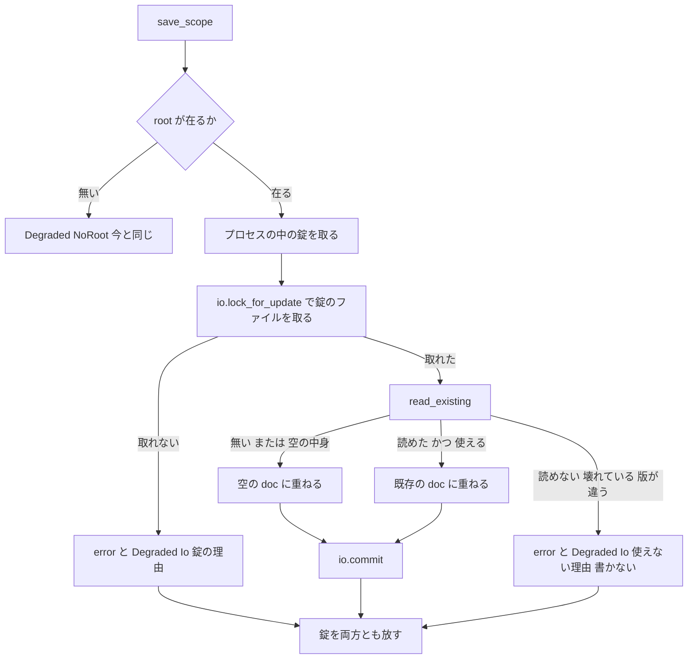

# 設計書: audit-sylphya-actor

## 概要

**目的**: プロパティの仕組み（`crates/areka-sylphya/`）・役者の土台（`crates/areka-actor/`）・トークの約束（`crates/areka-talk/`）の 3 つのクレートについて、ponytail の audit が出した 22 件（`research.md` §3 の #1〜#22）のうち、要件の討議で直すと決めた 18 件を直す。直した後に同じ範囲へ audit をかけ直して、新しい指摘を 0 件にする。

**使う人**: 開発者。直しの形は ponytail の「いちばん小さい完全な変更」に従う。消せるものは消し、写しは 1 か所にまとめ、呼び出し元・テストまで直し切る。新しい機能は足さない。

**変わること**: 本番の振る舞いが変わるのは次の 4 つだけ。⑴ 記憶のファイル（`sylphya.toml`）が在るのに使えない（読めない・TOML として壊れている・`format-version` が 1 でない）とき、保存はそのファイルを上書きせず `PersistOutcome::Degraded` を返す（#1）。⑵ 保存の「読んで重ねて書く」間を錠で 1 本ずつにする。同じプロセスの中でも、2 つの areka の間でも、同じファイルを同時に書かない（#3）。⑶ 期限つきの反映待ち `SylphyaPublisher::barrier_within` が増える（#4・呼び手の乗り換えは後の spec）。⑷ UI アクターの記録の区間が、待ちの間は入らなくなる（#2）。ほかはテストの直し・写しの寄せ・要らないコードの削除・小さな速さの直しで、外から見た振る舞いは変わらない。

### Goals

- 要件の討議で直すと決めた 18 件（#1〜#9・#11〜#15・#17・#19・#20・#22。#4 は口を足して説明を直すまで）を、3 つの組とも直す。
- 直したバグと危ない所の 1 件ごとに、壊れたら落ちるテストを 1 本ずつ持たせる（#1・#2・#3・#4・#5・#22 は新しいテスト。消す・寄せる指摘は今あるテストが同じ結果で通る）。
- 範囲の外のファイルは、`crates/log-capture-kit/tests/with_default_guard_test.rs` の例外の表に 1 行足すことのほかは変えない（C18 の約束・要件 6.2・6.7・設計の討議 議題 2）。
- タスクはファイルのまとまりで 11 本に束ねる（要件 2.6 の 20 以内）。
- 最後に同じ作法で audit をかけ直し、新しい指摘 0 件・全体テストの緑・既定の枝との差分の確かめを記録する。

### Non-Goals

- #18 は直さない（⑵・要件の討議の議題 6）。
- #10・#16・#21 と、#4 の呼び手（`crates/areka/src/install/desk.rs`）の乗り換えは後の spec へ回した（要件の討議の議題 3・4。回し先の brief に件として書き足し済み）。
- `barrier()` は消さない（公開の形を消さない・要件 6.1）。
- v0.2.0 の作り直し（`shiori4-api`・`sylphya-sqlite-kvs`・`talk-script-metadata`）の先取り。
- 依存の追加（`Cargo.lock` は変えない）。

## 境界の約束

### この spec が持つもの

- 3 つのクレートの全ファイル（本番・テスト・テストの道具・`Cargo.toml`）の直し。
- 記憶のファイルの保存の 2 つの守り（#1 の「使えないファイルを上書きしない」と #3 の「書き手の錠」）。どちらも `areka-sylphya` の `persist` の中に閉じる。
- `areka-sylphya` の公開の形への足し算 3 つ（`PersistIo::lock_for_update`・`SylphyaPublisher::barrier_within`・`KeyParseError::TextAfterParen`）。
- 範囲の外から使われていない公開の物の削除 3 つ（`MirrorImage::flat_global`・`FormatDoc::is_all_absent`・`SylphyaMsg::PersistPut` の `reply` 欄）。

### 範囲の外（持たないもの）

- 範囲の外のファイル全部。`crates/areka/` と、`placement-crate-split` が触るファイル（`crates/log-capture-kit` のテスト 2 つ・wintf の `ecs/window_proc/` の 2 つ・`tools/perf/fixtures/`・`tools/perf/fixtures-loop/`）には手を入れない（要件 6.2）。範囲の外で変えるのは、#2 の縛るテストのための `crates/log-capture-kit/tests/with_default_guard_test.rs` の例外の 1 行だけ（このファイルは要件 6.2 の 2 つに入らない・持ち主の `audit-test-kits` は走っていない。ただし表に `crates/areka/src/placement/` の 3 行があるので、`placement-crate-split` と申し合わせてから触る＝要件 6.6）。
- 書けなかったときの知らせの文面と、その後の処置（`crates/areka/src/alert.rs`・`write_failure.rs`）。この spec が決めるのは `PersistFailureCause::Io` に入れる理由の文だけ。
- `crates/areka` のテストにある、保存の口を包む写し（`SharedFakeIo` ほか 19）。本体の見直しの持ち物（要件 Boundary Context）。
- `vendors/` の下（要件 6.8）。
- `crates/areka-sylphya/src/vocab/dotted.rs` の `doc/COMPAT_ARCHITECTURE.md` を名指す 2 行（64 行目・80 行目）。#6 の直しは同じファイルの `mod tests` の中だけを触る（要件 5.7）。

### 使ってよい依存

- 今の依存だけ: `std`（`std::os::windows::fs::OpenOptionsExt` の `share_mode`・`custom_flags`・`std::sync::Mutex`・`std::time`）・`tracing`（`tracing::Instrument`）・`toml`・`thiserror`・`async-channel`・`wintf-winmsg-executor`。dev 側は `log-capture-kit`・`temp-path-kit`・`windows`（どれも既に各クレートの dev-dependencies にある）。
- 依存の向き（変えない）: `areka-talk`（依存 0）・`areka-actor` → `areka-sylphya`。範囲の外のクレートへの依存は作らない。`Cargo.toml` は変えない。

### 見直しが要る変化（Revalidation Triggers）

- `save_scope` が `Degraded` を返す場面が 2 つ増える（使えない既存のファイル・錠が取れない）。呼び手（`crates/areka/src/boot_resolve.rs`・`roots/edit.rs`・書き手のアクターの失敗の受け口）は署名も扱いも変わらない。`crates/areka` は `Degraded` を書けなかった知らせとして扱う（起動の前なら起動を止め、走っている間なら areka を終える）。下の「失敗の扱い」に、利用者から見た結果を書く。
- `PersistIo` に既定つきの口 `lock_for_update` が増える（必須の口は足さない）。範囲の外の実装（`crates/areka` のテストの写し 19＝`placement/*`・`boot_resolve_tests.rs`・`emo2_boot/*`・`input_events/drag_test_support.rs`・`main_persist_wiring_seam_tests.rs` ほか）は書き直さずにコンパイルが通る（既定は錠を持たない）。
- C18 で並走する `placement-crate-split`（`crates/areka/src/placement/` を新しいクレートへ動かし、`temp_path_guard_test.rs` を書き直す）が使う名前と署名＝`PersistIo`（`read`・`commit`・`withholds`）・`FakePersistIo`・`PersistKey`・`Axis`・`PersistScope`・`ScopeRoots`・`spawn_sylphya`・`load_scope`・`SylphyaPublisher`（既存の口）は、名前も署名も変えない。この spec の足し算は既定つきの口と新しい名前だけ。
- `SylphyaPublisher::barrier_within` が増える。後で `crates/areka/src/install/desk.rs` がこれへ乗り換える（`audit-areka-install-update` の件）。
- 記憶のフォルダ（`profile\areka`）に、保存の間だけ `sylphya.toml.lock` が在る（閉じると消える）。

## つくり

### 今の形と守るもの

- `areka-sylphya` は「掲示板」。書き手のアクター 1 本（`run_actor`）が写し（`MirrorImage`）を作り直して差し替え、読み手（`SylphyaReader`）は待たずに今の写しを読む。判断は純関数（`SylphyaCore::apply`）が `Vec<Effect>` で返し、受信のループはそれを実行するだけ。この分け方は変えない。
- 保存は `save_scope`（`persist/mod.rs`）が「読む → 重ねる → 書く」を行い、ファイルに触れるのは `persist/io.rs` の `FsPersistIo` だけ（完了した `areka-P0-sylphya` の要件 8.3）。#1 と #3 の直しもこの分け方に載せる（錠のファイルを開くのも `FsPersistIo`）。
- 読む側（`load_scope`）は今のまま寛容に「不在」へ倒れる（完了した `areka-P0-sylphya` の要件 6.3）。#1 が変えるのは書く側の「読めなかった分を空とみなして上書きする」所だけ。
- `areka-actor` の UI ブリッジ（`spawn_ui`）の受信のループの規約（`Continue`・`Break`・`Err` は続ける・全送り手が落ちたら終わる）は変えない。#2 は区間の入り方だけ、#5 はテストだけ。

### 依存の向き（変えない）

`std`・`tracing` → `areka-talk`・`areka-actor` → `areka-sylphya`。`areka-sylphya` の中は `vocab`・`key` → `mirror`・`reader` → `persist`（`format` → `io` → `mod`）→ `actor`。どの直しも左から右の向きだけで呼ぶ。

### 技術の層

| 層 | 使うもの | この spec での役目 | 注 |
|---|---|---|---|
| ファイルの錠 | `std::os::windows::fs::OpenOptionsExt`（`share_mode(0)`・`custom_flags(0x0400_0000)`＝`FILE_FLAG_DELETE_ON_CLOSE`） | #3 の `sylphya.toml.lock` | `areka-nar` の棚の錠（`audit-ghost-catalog` #1）と同じ形。依存は増えない |
| プロセスの中の錠 | `std::sync::Mutex<()>` | #3 の同じプロセスの中の書き手 | 控える走り（読み取りだけ）と試験の偽の IO にも効く |
| 記録の区間 | `tracing::Instrument` | #2 | `tracing` 0.1.44 で無条件に公開されている |
| 期限つきの待ち | `areka_actor::ReplyReceiver::recv_timeout` | #4 | 既存の口 |

## ファイルの構成

範囲の外で変えるファイルは 1 つ（例外の表の 1 行）。新しいファイルは 5 つ（どれもテスト）。消すファイルは 2 つ。

### 新しいファイル

```
crates/areka-sylphya/src/persist/persist_unreadable_tests.rs  # #1 の縛るテスト（使えない既存のファイルを上書きしない）
crates/areka-sylphya/src/persist/persist_lock_tests.rs        # #3 の縛るテスト（同じプロセスの 2 つの書き手・錠が取れないときの Degraded）
crates/areka-sylphya/src/actor_barrier_within_tests.rs        # #4 の縛るテスト（期限切れ・停止の後）
crates/areka-actor/tests/ui_pump_support/mod.rs               # 実走のポンプを回す道具 1 つ（toy_ui_pump_test と ui_span_test が使う）
crates/areka-actor/tests/ui_span_test.rs                      # #2 の縛るテスト（独り立ちのテストのバイナリ・テストは 1 本だけ）
```

- `persist_tests.rs`（879 行）と `actor.rs`（841 行）に足さないため、#1・#3・#4 のテストは兄弟のファイルへ置く（要件 5.1）。読み込みは `persist/mod.rs` と `actor.rs` に `#[cfg(test)] #[path = "…"] mod …;` を 1 つずつ足す。
- `ui_span_test.rs` を独り立ちにするのは、記録の受け手（`Subscriber`）をスレッドの既定に据えるテストが、同じバイナリの別のテストのせいで呼び出し地点の関心（interest）を「要らない」に焼き付けられないようにするため（`log-capture-kit` の crate doc の機序と同じ）。

### 消すファイル

- `crates/areka-sylphya/src/ledger_key_determinism_tests.rs`（#6）。
- `crates/areka-actor/tests/spike_ui_pump.rs`（#9）。

消す前に、ツリー全体（テスト・設定・台本・文字列）でファイル名と中の関数名が使われていないことを grep で確かめる（要件 3.3）。設計の時点の測り: `ledger_key_determinism_tests` を名指すのは `lib.rs` の `mod` の行だけ・`criterion_*` の関数名を名指す物はほかに無い・`spike_ui_pump` を名指すのは `toy_ui_pump_test.rs` の注 2 か所と完了した spec の文書だけ（文書は直さない）。

### 直すファイル

**`crates/areka-sylphya/src/`**
- `persist/mod.rs` — #1（`read_existing` が「無い」と「使えない」を分ける）・#3（プロセスの中の錠と `lock_for_update` の呼び出し）・新しいテストのファイル 2 つの `mod` の行。
- `persist/format.rs` — #1（`parse_toml_str` を足し、`read_toml_str` はそれを包む）・#19（`is_all_absent` を消す）・#8（`determinism_*` 2 本を消す）・#12（`e.message` を `e.message()` へ）。
- `persist/io.rs` — #3（`PersistIo::lock_for_update`・`FsPersistIo` の錠・`Arc` の委譲）・#8（`fake_is_deterministic_given_same_faults` を消す）・錠のテスト。
- `persist/persist_tests.rs` — #8（`load_is_deterministic` を消す）。
- `persist/persist_window_adjacent_tests.rs` — #19（`is_all_absent` を `FormatDoc::default()` との比べへ）。
- `actor.rs` — #4（`barrier_within`・`barrier` の説明）・#14（起動の組み立てを 1 つの関数へ）・#15（`PersistPut::reply` を消す）・#20（書き換えの無い知らせで写しを作らない）・新しいテストのファイルの `mod` の行。
- `actor_tests.rs` — #8（`classify_set_three_branches_all_reachable`・`apply_is_deterministic_across_variants`・`apply_persist_put_deterministic_same_ref`・`runtime_command_sink_trait_is_reserved` と道具の `NoopSink` を消す）・#15（`reply: None` の欄を消す）。
- `actor_failure_sink_tests.rs` — #15（返信つきの投函を、読み口の値で結果を見る形へ）。
- `actor_actor_criteria_cage.rs` — #14（`spawn_with_mirror_observer` を本番の組み立ての呼び出しへ）。
- `actor_actor_integration_tests.rs` — #13（`SharedFakeIo` を消し `Arc<FakePersistIo>` を直に渡す）。
- `mirror.rs` — #17（`flat_global` の欄と説明）・#8（`same_epoch_same_content_via_arc_clone`・`empty_image_has_all_partitions_empty` を消す）・`flat_global` を使うテストを `dotted_global` へ。
- `reader.rs` — #17（読みの 2 か所の引きを消す・`flat_global` を使うテストを直す）・#8（`determinism_same_epoch_same_result`・`reader_is_clone` を消す）。
- `pull_tests.rs` — #17（`flat_global` を per-asker の区画へ）。
- `key.rs` — #22（`parse_seg`・`KeyParseError::TextAfterParen`）・#8（`determinism_ok_repeatable`・`determinism_err_repeatable` を消す）。
- `asker.rs`・`value.rs`・`vocab/mod.rs` — #8（落ちようのないテストを消す。`mod tests` が空になればその塊ごと消す）。
- `vocab/dotted.rs` — #6（`ext_event_names_reserved_exact` に「どの解決の表にも入らない」の確かめを足す）。`mod tests` の中だけ。
- `test_log_capture.rs` — #12（自前の型を消し、`capture` と `assert_logged` を共有の型の上の薄い 2 つの関数にする）。
- `lib.rs` — #6（`mod ledger_key_determinism_tests` の行と注を消す）・#12（`test_log_capture` の注を今の形へ）。

**`crates/areka-actor/`**
- `src/ui.rs` — #2（`Instrument` で区間を付ける・`_enter` を消す）。
- `tests/toy_ui_pump_test.rs` — #5（2 本足す）・ポンプの道具を `ui_pump_support` へ出す・#9（スパイクを名指す注を直す）。
- `tests/toy_worker_test.rs` — #11（panic の受け手の付け外しを消す）。
- `src/spawn.rs` — #11（toy(a) と重なる単体テスト 4 本と、それだけが使う道具 `run_bounded` を消す）。

**範囲の外（1 つだけ）**
- `crates/log-capture-kit/tests/with_default_guard_test.rs` — #2（`ALLOWED_DIRECT_CALLS` に `("crates/areka-actor/tests/ui_span_test.rs", "UI アクターの区間が poll の間だけ入ることを、区間の出入りを数える受け手で見る。共有の捕捉の受け手は区間を数えないので素の set_default が要る（audit-sylphya-actor #2）")` を足し、`ALLOWED_DIRECT_CALLS_COUNT` を 5 → 6）。`placement-crate-split` が同じ表の placement の 3 行を書き換えるなら、その着地の後に main を取り込んでから足す。

**`crates/areka-talk/src/`**
- `tests.rs` — #7（`StartTalk::new` の既定を見る 3 本を残して消す）。

## 流れ

### #1・#3 保存の「読んで重ねて書く」



- 錠は「読む」の前に取り、「書く」の後に放す。2 つの書き手の読みと書きが交互に混ざらない（#3 の ⑴ 更新が消える ⑵ 一時のファイルを切り詰め合う、の両方が止まる）。
- 錠の取り方は 2 段: ⑴ プロセスの中の `static SAVE_GATE: Mutex<()>`（すべての `PersistIo`・控える走り・試験の偽の IO に効く）→ ⑵ `PersistIo::lock_for_update`（`FsPersistIo` だけが本物のファイルの錠を取る＝ほかのプロセスとの間）。プロセスの中の書き手は ⑴ で並ぶので、⑵ で自分のプロセスとぶつかることは無い。

## 新しい形を引く直し

### #1 使えない記憶のファイルを上書きしない（`persist/format.rs`・`persist/mod.rs`）

| 項目 | 中身 |
|---|---|
| 目的 | 読めない・壊れている・版の違う `sylphya.toml` を、読めた分だけで上書きして消さない |
| 要件 | 3.1・4.1・4.2・4.5・5.2 |

**`format.rs` の形**（crate の内側だけ）

```rust
/// 寛容でない読み。使えれば Ok(doc)、使えなければ Err(利用者へ見せる理由の文)。
/// 縮退の warn!（今の 2 つの文のまま）はこの関数が出す。
pub(crate) fn parse_toml_str(content: &str) -> Result<FormatDoc, String>;

/// 今までの入口（署名は変えない）＝ parse_toml_str(content).unwrap_or_default()。
pub fn read_toml_str(content: &str) -> FormatDoc;
```

- `parse_toml_str` の中身は今の `read_toml_str` の本文そのまま。`return FormatDoc::default()` の 2 か所が `return Err(理由)` になるだけ。warn! の target・文（`"persist TOML parse failed; degrading to all-absent (file preserved)"`・`"... unknown/absent format-version; ..."`）は変えない（読む側の記録は今と同じ。「file preserved」は直しの後に本当になる）。
- 理由の文（`PersistFailureCause::Io` に入り、書けなかった知らせの「理由: …」の行にそのまま出る・R3 の答え）:
  - TOML として壊れている: `記憶のファイル sylphya.toml が TOML として読めないので、中身を消さないように書くのをやめました（手で直したときの書き誤りなど）`
  - 版が違う・無い: `記憶のファイル sylphya.toml の format-version が {版}で、この areka が読める 1 と違うので、中身を消さないように書くのをやめました（新しい areka で書いたファイルなど）`。`{版}` は数ならその数、無い・数でなければ「書かれていない値」。
  - （`mod.rs` が作る）読めない: `記憶のファイル sylphya.toml を読めないので、中身を消さないように書くのをやめました（{OS の理由}）`

**`mod.rs` の形**

```rust
/// save のマージ土台。Ok(doc) なら重ねてよい・Err(理由) なら書かずに Degraded。
fn read_existing(scope: PersistScope, io: &dyn PersistIo, path: &Path) -> Result<FormatDoc, String>;
```

- `Ok(None)`（無い）→ `Ok(FormatDoc::default())`。
- `Ok(Some(c))` で `c.trim().is_empty()`（空のファイル）→ `Ok(FormatDoc::default())`。守る中身が無いので上書きしてよい（読む側は今どおり warn して不在）。
- `Ok(Some(c))` → `format::parse_toml_str(&c)`。
- `Err(e)` → 共有違反（`raw_os_error() == Some(32)`）と拒み（`Some(5)`）の間だけ、錠と同じく `LOCK_RETRY` ごとに最大 `LOCK_WAIT`（1 秒）読み直す（ウイルス対策などの一時の掴みで起動を止めない・設計の討議 議題 1）。それでも読めなければ、またはほかの失敗なら `Err(読めない理由の文)`。今の warn!「`persist read-before-write failed; merging onto empty base (tolerant)`」は消す（その道が無くなる）。
- `save_scope` は `Err(reason)` のとき `commit` を呼ばず、`error!(target: "areka_sylphya::persist", event = "persist_existing_unusable", ?scope, path, reason, keys, "persist existing file unusable; not overwriting, reporting Degraded")` を 1 回出し、`PersistOutcome::Degraded(PersistFailure { scope, dir: roots.root_of(scope).cloned(), keys, cause: PersistFailureCause::Io(reason) })` を返す。新しい variant は足さない（`PersistFailureCause` を網羅する `crates/areka` の match を壊さない）。
- 控える走り（読み取りだけ）でも同じ判定を通す（控えに入った中身は areka が書いた物なので、使えないことは無い）。

**縛るテスト**（`persist/persist_unreadable_tests.rs`・`FakePersistIo` の上・決定論）
- `a_newer_format_version_is_kept_and_the_save_degrades`: `format-version = 2` の中身を直に `commit` で置き → `save_scope(BootCount)` が `Degraded(Io(理由に "format-version"))`・中身はバイトで同じ・ERROR `persist_existing_unusable` が 1 件。**直しを外すと赤**（`Saved` になり中身が 1 件だけのファイルに替わる）。
- `a_broken_toml_is_kept_and_the_save_degrades`: `format-version = 1\n[window` → 同じ。
- `a_read_failure_keeps_the_file_and_the_save_degrades`: 有効なファイルを書いた後 `fail_next_read`（共有違反でない失敗）→ `Degraded`・`fail` の後の読みで元の中身。
- `a_transient_sharing_violation_is_retried`: 1 回目の読みだけ共有違反（os error 32）を返す偽の IO → 読み直して `Saved`・既存の key も残る。取り直しを外すと赤（`Degraded` になる）。
- `an_empty_file_is_overwritten`: 中身 `""` → `Saved`・保存した値が読める（空のファイルで止まらない）。
- `a_missing_file_is_still_created`: 無いファイル → `Saved`（今と同じ・退かないこと）。

### #3 書き手の錠（`persist/io.rs`・`persist/mod.rs`）

| 項目 | 中身 |
|---|---|
| 目的 | 同じ `sylphya.toml` を 2 つの書き手が同時に書いて、片方の更新が消えたり、一時のファイルを切り詰め合ったりしない |
| 要件 | 3.1・4.1・4.2・4.3・5.2・5.5・6.1・6.3 |

**`io.rs` の形**

```rust
pub trait PersistIo: Send {
    fn read(&self, path: &Path) -> std::io::Result<Option<String>>;
    fn commit(&self, path: &Path, content: &str) -> std::io::Result<()>;
    fn withholds(&self, _path: &Path) -> bool { false }
    /// `path` を読んで重ねて書く間、ほかのプロセスの書き手を締め出す錠を取る。
    /// 返した File を捨てると錠が放れる。既定は錠を持たない（Ok(None)・試験の偽の IO）。
    fn lock_for_update(&self, _path: &Path) -> std::io::Result<Option<std::fs::File>> { Ok(None) }
}
```

- `impl<T: PersistIo + Sync + ?Sized> PersistIo for Arc<T>` に `lock_for_update` の委譲を足す（4 つの口をすべて中身へ渡す）。
- `FsPersistIo::lock_for_update(path)`: `self.withholds(path)` なら `Ok(None)`（読み取りだけの走りはファイルに触れない）。ほかは `Self::lock_within(path, LOCK_WAIT).map(Some)`。
- `const LOCK_WAIT: Duration = Duration::from_secs(1);`・`const LOCK_RETRY: Duration = Duration::from_millis(10);`・`const FILE_FLAG_DELETE_ON_CLOSE: u32 = 0x0400_0000;`（`areka-sylphya` は `windows` に依存しないので値で書く）。
- `fn lock_path_for(path: &Path) -> PathBuf`: 宛先の名前に `.lock` を足す（`sylphya.toml.lock`・宛先と同じフォルダ）。`temp_path_for` と同じ組み方で、時刻・乱数・プロセス番号を混ぜない（完了した `areka-P0-sylphya` の要件 8.3）。
- `fn lock_within(path: &Path, wait: Duration) -> std::io::Result<File>`（非公開）: 親のフォルダを `create_dir_all`（`commit` と同じ）→ `OpenOptions::new().read(true).write(true).create(true).share_mode(0).custom_flags(FILE_FLAG_DELETE_ON_CLOSE).open(lock_path)` を、共有違反（`raw_os_error() == Some(32)`）と消える途中の拒み（`Some(5)`）の間だけ `LOCK_RETRY` ごとに `wait` まで繰り返す。期限を越えたとき、最後の失敗が共有違反なら `io::Error::new(ErrorKind::TimedOut, "記憶のファイル sylphya.toml の錠を 1 秒待っても取れないので、書くのをやめました（ほかの areka が同じ記憶を書いている）")`、拒み（5）なら最後の OS の失敗をそのまま返す（本当に書けないフォルダを「ほかの areka」と言い違えない）。ほかの失敗は待たずにそのまま返す。
- 一時のパスの入口には触れない: 錠のパスは宛先から組み、`temp_dir` の呼び出しも `TempPath` も使わない。`crates/log-capture-kit/tests/temp_path_guard_test.rs` の走査語（入口の 2 つの綴り）は `io.rs` に現れないまま（要件 6.3）。`temp_path_for` と一時の名前 `sylphya.toml.tmp` も変えない。テストの `TempPath` の 3 か所も変えない。

**`mod.rs` の形**
- `static SAVE_GATE: Mutex<()> = Mutex::new(());`（毒は `into_inner` で越える＝`withhold.rs` の `lock()` と同じ。中で落ちても壊れた中身は残らない）。
- `save_scope` は root の確かめの後、`let _gate = save_gate();` → `match io.lock_for_update(&path)`: `Err(e)` なら `error!(target, event = "persist_lock_failed", ?scope, path, error = %e, keys, "persist update lock not acquired; reporting Degraded")` と `Degraded(PersistFailure { cause: Io(e.to_string()), dir, keys, scope })`。`Ok(_lock)` なら持ったまま `read_existing` → 重ね → `commit` → 関数の終わりで両方とも放す。
- 待ちの上限: ファイルの錠の待ちは最大 `LOCK_WAIT`（1 秒）。プロセスの中の錠の待ちは、先の書き手の錠の待ち（最大 1 秒）に、その書き手の書き込み（`sync_all` を含み、上限は OS 次第）が足される。上限を付けるのはファイルの錠の待ちだけで、書き込みそのものの長さは今と変わらない（UI スレッドの直の `save_scope`＝`boot_resolve.rs`・`roots/edit.rs` も同じ）。

**前提と後の状態**
- `SAVE_GATE` はプロセスに 1 つなので、同じテストのバイナリの中では、門に止める偽の IO を持つテスト（#3・#4）が止めている間、ほかのテストの保存も待つ。門はどのテストでも必ずテストの中で開く（テストが落ちても門の送り手が捨てられて開く）。範囲の外に門に止める偽の IO は無い（設計の時点の grep）。
- 錠のファイルは保存の間だけ在る（閉じると OS が消す。異常終了でも消える）。保存の後に記憶のフォルダの木を比べるテストの期待は変わらない。消えることは縛るテストで確かめる。
- 1 つのプロセスの中の書き手は `SAVE_GATE` で並ぶ。ほかのプロセスとは錠のファイルで並ぶ。

**縛るテスト**
- `persist/persist_lock_tests.rs` `two_writers_in_one_process_do_not_lose_an_update`: 1 回目の `read` で門に止まる偽の IO（中は `Arc<FakePersistIo>`）。書き手 A（`BootCount`）を別スレッドで走らせ、A が `read` に入ったことを確かめてから書き手 B（`LastGhost`）を走らせる → B の終わりを 200 ms 待って来ない（錠で並んでいる）→ 門を開ける → 両方を join → ファイルに `boot.count` と `last.ghost` の両方。**錠を外すと赤**（B が先に空の上へ書いて終わり、A がその上を `boot.count` だけで上書きする）。錠があれば結果はいつも同じ。
- `persist/persist_lock_tests.rs` `a_lock_that_cannot_be_taken_degrades_the_save_and_writes_nothing`: `lock_for_update` がすぐ `Err` を返す偽の IO → `Degraded(Io(..))`・`commit` が呼ばれていない・ERROR `persist_lock_failed` が 1 件。`save_scope` から錠の呼び出しを外すと赤。
- `io.rs` の `mod tests` `the_update_lock_shuts_out_a_second_holder_until_dropped`: `TempPath` の下の宛先で `lock_within(&p, Duration::ZERO)` を持ったまま 2 本目 `lock_within(&p, 50 ms)` → `Err(TimedOut)` → 1 本目を捨てる → 3 本目が取れる → 捨てた後に `sylphya.toml.lock` が無い。共有なしの開き方を外すと赤（2 本目が取れる）。同じプロセスの中の 2 つの持ち手で、ほかのプロセスとぶつかる場面と同じ（共有の決まりは持ち手ごと）。
- `io.rs` の `mod tests` `a_withheld_path_takes_no_lock_file`: `WithholdGuard::under(root)` の下で `FsPersistIo.lock_for_update` が `Ok(None)`・錠のファイルもフォルダも作られない。
- `io.rs` の `mod tests` `an_arc_forwards_all_three_methods` を 4 つ目の口まで見る形に改め、名前を `an_arc_forwards_all_four_methods` にする（`lock_for_update` が `Some` を返す偽物を `Arc` で包んで `Some`）。

### #4 期限つきの反映待ち（`actor.rs`）

| 項目 | 中身 |
|---|---|
| 目的 | 書き手のアクターが遅い書き込みの最中でも、呼び手が待ちに上限を付けられる |
| 要件 | 3.1・4.1・4.2・5.2・6.1 |

```rust
impl SylphyaPublisher {
    /// 反映フェンス（期限なし）。期限が要る呼び手は barrier_within を使う。
    pub fn barrier(&self) -> Result<(), areka_actor::ReplyError>;
    /// 反映フェンス（期限つき）。期限を越えたら ReplyError::Timeout（error! を 1 件）。
    pub fn barrier_within(&self, timeout: Duration) -> Result<(), areka_actor::ReplyError>;
}
```

- 投函の部分を `fn post_barrier(&self) -> Result<ReplyReceiver<()>, ReplyError>` に 1 つにまとめる（死んだアクターへの warn! と `Dropped` は今の文のまま）。`barrier` は `post_barrier()?.recv()`、`barrier_within` は `post_barrier()?.recv_timeout(timeout)` で、`Timeout` のとき `error!(target: "areka_sylphya::actor", ?timeout, "sylphya barrier timed out; writer still busy")`。
- `barrier()` の説明の「有界: 呼び側がタイムアウトを課す」を「期限なし。期限が要るなら [`barrier_within`]」へ直す。`barrier()` は残す（範囲の外の 20 か所以上が使う・要件 6.1）。

**縛るテスト**（`actor_barrier_within_tests.rs`）
- `barrier_within_times_out_while_the_writer_is_busy`: `commit` が門に止まる IO で起動 → `persist_put` → `commit` に入ったことを確かめる → `barrier_within(10 ms)` を別のスレッドで呼び、その答えをテストのスレッドが 5 秒の期限で待つ → `Err(Timeout)`・ERROR が 1 件 → 門を開ける → `barrier_within(5 s)` が `Ok`。期限を外す（`recv` に戻す）と、呼んだスレッドが門の前で止まり、5 秒の待ちが切れて赤（テストは止まらずに赤で終わる。門は赤の後に開けて畳む）。門で止めているので、直しがあれば期限切れは必ず起きる（決定論）。
- `barrier_within_reports_dropped_after_close`: `close` → join → `barrier_within(1 s)` が `Err(Dropped)`。

### #2 UI アクターの記録の区間（`crates/areka-actor/src/ui.rs`）

| 項目 | 中身 |
|---|---|
| 目的 | UI スレッドのほかの記録が、待ちの間の UI アクターの区間の中に見えない |
| 要件 | 3.1・4.1・4.2・5.5 |

- 形: `let span = tracing::info_span!("actor", actor = %name);` を `spawn_local` の前に作り、`spawn_local(async move { loop { … } }.instrument(span))`（`use tracing::Instrument;`）。タスクの頭の `span.enter()`・`_enter`・`actor: String` を消す。区間は poll の間だけ入る（handler の `error!` は今どおり区間の中に出る）。
- 縛るテスト（`tests/ui_span_test.rs`・テストは 1 本だけのバイナリ）`the_ui_actor_span_is_entered_only_while_polled`:
  - 素の `set_default` を呼ぶので、`with_default_guard_test.rs` の例外の表に 1 行足す（「範囲の外（1 つだけ）」・設計の討議 議題 2）。
  - 自前の最小の受け手 `EnterDepth`（`tracing::Subscriber` を実装・`enter` で +1・`exit` で −1・`Arc<AtomicIsize>` を持つ。`spawn_log_capture_tests.rs` の `NotAWindow` と同じ型の自作・依存 0）を、ポンプのスレッド（テストのスレッド）の既定に `tracing::subscriber::set_default` で据えてから `spawn_ui` を呼ぶ。
  - handler の中で深さを記録する（1 であること＝区間が付いている較正。区間を消すと赤）。
  - 返信を受けた worker が `done` を立て、ポンプの filter が `done` を見た時点（タスクの poll の外・UI スレッドの上）の深さを記録して止める → 0 であること。**直しを外すと赤**（待ちの間も入ったままで 1）。
  - filter は poll の中で呼ばれないので、記録する時点は必ずタスクが `Pending` を返した後（決定論）。

### #5 UI アクターの 2 つの枝のテスト（`tests/toy_ui_pump_test.rs`）

- ポンプを回す道具を `tests/ui_pump_support/mod.rs` の 1 つの関数 `run_pump_until(done: &AtomicBool, deadline: Duration)`（今の心拍のスレッド＋`MessageLoop::run`＋filter の写し）へ出し、今の toy(b) と下の 2 本と `ui_span_test.rs` が使う。各テストのファイルは `mod ui_pump_support;` で読む。
- `a_handler_error_does_not_stop_the_ui_actor`: 1 件目（`Fail`）で handler が `Err` を返し、2 件目の `Echo` の返信が worker に届く。`Err` で止める直し間違いは返信が `Dropped` になって赤。
- `dropping_every_sender_ends_the_ui_actor`: ポンプを子のスレッドで回す（`spawn_ui` もそのスレッド）。`spawn_local(async move { drain.await; ended.store(true) })` で終わりを見張り、全 `UiSender` を落とす → `ended` が立ってポンプが止まり、子のスレッドから終わりの知らせが来る。テストのスレッドは知らせを 5 秒の期限で待つ。`Err(Closed)` で回り続ける直し間違いは、子のスレッドが回り続けて期限切れの赤（テストは止まらずに赤で終わる）。

## 指摘ごとの直し方（#1〜#22）

「束」はタスクのまとまり（次の節）。「縛るテスト」は、直したバグと危ない所が壊れたら落ちるテスト（要件 4.1）。「—」はテストの直しそのもの・写しの寄せ・削除・速さの直しで、今あるテストが同じ結果で通ることを確かめる（要件 4.5）。行番号は `research.md` §3 の時点のもの（実装で関数名から引き直す）。

### Must fix

| # | 直し方 | 縛るテスト | 束 |
|---|---|---|---|
| 1 | 使えない既存のファイルを上書きしない（上の節） | `a_newer_format_version_is_kept_and_the_save_degrades`・`a_broken_toml_is_kept_and_the_save_degrades`・`a_read_failure_keeps_the_file_and_the_save_degrades`・`an_empty_file_is_overwritten` | T2 |
| 2 | `Instrument` で区間を付ける（上の節） | `the_ui_actor_span_is_entered_only_while_polled` | T8 |

### Should fix

| # | 直し方 | 縛るテスト | 束 |
|---|---|---|---|
| 3 | 書き手の錠（上の節） | `two_writers_in_one_process_do_not_lose_an_update`・`a_lock_that_cannot_be_taken_degrades_the_save_and_writes_nothing`・`the_update_lock_shuts_out_a_second_holder_until_dropped`・`a_withheld_path_takes_no_lock_file` | T3 |
| 4 | `barrier_within` を足し、`barrier` の説明を直す（上の節）。呼び手の乗り換えは `audit-areka-install-update` | `barrier_within_times_out_while_the_writer_is_busy`・`barrier_within_reports_dropped_after_close` | T4 |
| 5 | toy(b) に 2 本足す（上の節） | `a_handler_error_does_not_stop_the_ui_actor`・`dropping_every_sender_ends_the_ui_actor` | T8 |
| 6 | `ledger_key_determinism_tests.rs` を消し、`lib.rs` の `mod` の行と注を消す。写しでない 1 件（`criterion_ext_event_names_reserved_only_not_resolution_vocab` の「`property.get`／`property.set` がフラットの表・根の枝・汎用名のどれにも入らない」）を、`vocab/dotted.rs` の `ext_event_names_reserved_exact` の中へ足す（`FLAT_VOCAB` は `crate::vocab::flat` から読む）。SET 有効群 25 件の手書きの並びは `dotted.rs` の 1 か所だけになる | —（残るテストが守る中身を縛る） | T1 |
| 7 | `areka-talk/src/tests.rs` は `start_talk_new_has_empty_epilogue`・`start_talk_new_origin_is_ghost`・`start_talk_new_is_not_strict` の 3 本だけを残し、ほかを消す（約 400 行）。使わなくなる `use` も消す | — | T10 |
| 8 | 落ちようのないテストを消す: `asker.rs` の 5 本（`mod tests` ごと）・`value.rs` の 3 本（同）・`vocab/mod.rs` の 4 本（同）・`key.rs` の `determinism_ok_repeatable`・`determinism_err_repeatable`・`reader.rs` の `determinism_same_epoch_same_result`・`reader_is_clone`・`mirror.rs` の `same_epoch_same_content_via_arc_clone`・`empty_image_has_all_partitions_empty`・`actor_tests.rs` の `classify_set_three_branches_all_reachable`・`apply_is_deterministic_across_variants`・`apply_persist_put_deterministic_same_ref`・`runtime_command_sink_trait_is_reserved`（と `NoopSink`）・`persist/format.rs` の `determinism_same_content_same_outcome`・`determinism_same_doc_same_serialization`・`persist/io.rs` の `fake_is_deterministic_given_same_faults`・`persist/persist_tests.rs` の `load_is_deterministic`。値の在る枝を見る `reader.rs` の `determinism_dotted_value_present_stable` は残す。消すテストの名を doc の対応表（`actor.rs` の `actor_criteria_cage` の注・`reader.rs` の檻の注ほか）が名指していれば、その行も直す | — | T1 |
| 9 | `tests/spike_ui_pump.rs` を消す。`toy_ui_pump_test.rs` の注の 2 か所（スパイクとの差分・「写経」）を今の形に直す | — | T8 |

### Nice to have

| # | 直し方 | 縛るテスト | 束 |
|---|---|---|---|
| 11 | `panicking_body_join_is_panicked` の panic の受け手の付け外しを消す。toy(a)（`toy_worker_test.rs`・公開の口だけで試す・完了した `areka-P0-actor-foundation` の要件 8.1 の役目）を残し、重なる `spawn.rs` の単体テスト 4 本（`join_returns_err_on_panic`・`run_inbox_breaks_immediately_on_break`・`run_inbox_returns_on_disconnect`・`run_inbox_continues_after_handler_err`）と、それだけが使う `run_bounded` を消す。`thread_name_equals_actor_name` は toy(a) に無い中身なので残す | — | T9 |
| 12 | `test_log_capture.rs` の自前の `CapturedEvent` と変換を消し、`pub(crate) fn capture<F: FnOnce()>(f: F) -> Vec<log_capture_kit::CapturedEvent>`（`log_capture_kit::capture(f).1`）と、共有の型の上の `assert_logged`（`e.message()` で比べる）の 2 つだけにする。ファイルと `assert_logged` の名は残す（`crates/log-capture-kit/src/event.rs` の注が「`areka-sylphya` の `assert_logged`」を名指すので、範囲の外の注を古びさせない）。`persist/format.rs` の `e.message.clone()` を `e.message().to_owned()` へ。`lib.rs` の注を今の形へ | — | T1 |
| 13 | `actor_actor_integration_tests.rs` の `SharedFakeIo` を消し、`let io = Arc::new(FakePersistIo::new());` を `Box::new(io.clone())` で渡す（`Arc` の `PersistIo` の実装がある） | — | T1 |
| 14 | `spawn_sylphya_with_failures` の中身を `pub(crate) fn spawn_parts(init: SylphyaInit, failures: Option<Sender<PersistFailure>>) -> (SylphyaParts, SharedMirror)` へ移し、`spawn_sylphya_with_failures` は `spawn_parts(..).0` を返す。檻の `spawn_with_mirror_observer` は `spawn_parts(SylphyaInit { roots: ScopeRoots::default(), io: Box::new(FakePersistIo::new()), runtime_sink: None }, None)` を呼んで `(shared, parts.publisher, parts.handle)` を返す（アクターの名は本番と同じ `sylphya` になる。名を見るテストは無い） | —（本番と檻が同じ組み立てを通る） | T5 |
| 15 | `SylphyaMsg::PersistPut` の `reply` 欄と、`run_actor` の返信の枝（`None` の `error!` を含む）と `persist_outcome` を消す。`apply` の `PersistPut { scope, entries, .. }` は `{ scope, entries }` に。`actor_tests.rs` の `reply: None` を消す。`actor_failure_sink_tests.rs` の `spawn_without_receiver_behaves_as_today` は、返信つきの投函の代わりに `persist_put(Ghost, BootCount "2")` → `barrier` → 読み口の `areka.boot.count` が `"2"`、失敗の投函（App）の後もアクターが生きている、で見る | —（`SylphyaMsg::PersistPut` は範囲の外で 0 か所） | T5 |
| 17 | `MirrorImage::flat_global` の欄・説明（`mirror.rs` 15 行目）・`successor` の複製を消し、`reader.rs` の `resolve_flat` の `.or_else(|| img.flat_global.get(name))` と `talk_snapshot` の土台（per-asker の写しだけを返す）を直す。`flat_global` を使うテスト（`mirror.rs` 3 本・`reader.rs` 4 か所・`pull_tests.rs` 1 か所）は、守る中身（差し替えの前の像が変わらない・複製が同じ錠を持つ・per-asker が大域を隠す）に合わせて `dotted_global` か per-asker の区画へ置き換え、大域のフラットの区画そのものを見るだけのテスト（`flat_global_found_when_per_asker_lacks` ほか）は消す | —（範囲の外で `flat_global` は 0 か所） | T6 |
| 19 | `FormatDoc::is_all_absent` を消す。`format.rs` のテストは `assert_eq!(doc, FormatDoc::default())`、`persist_window_adjacent_tests.rs` は `assert_ne!(doc, FormatDoc::default())` へ | —（範囲の外で 0 か所） | T1 |
| 20 | `run_actor` の後継の像を必要になるまで作らない: `let mut next: Option<MirrorImage> = None;`。書き換える 4 つの枝（`SetFlatPerAsker`・`RemoveFlatPerAsker`・`SetDottedGlobal`・`SetDottedPerAsker`）だけが `next.get_or_insert_with(\|\| shared.load().successor())` を通る。`if mutated && let Some(next) = next { shared.publish(Arc::new(next)) }`。反映の待ち・停止・書けない名前の SET・204 の記録・保存だけの知らせでは複製しない | —（epoch の檻 `epoch_increments_monotonically_through_actor_publishes` と統合の檻が同じ結果で通る） | T5 |
| 22 | `KeyParseError` に `TextAfterParen { at: usize }`（`#[error("text after closing paren at segment {at}")]`）を足す。`parse_seg` は末尾が `)` でないとき、`(` の後ろに `)` が在れば `TextAfterParen`、無ければ今どおり `UnclosedParen` | `key.rs` の `mod tests` `text_after_a_closed_paren_is_reported_as_such`（`scope(0)x` → `TextAfterParen { at: 0 }`・`a.scope(0` → `UnclosedParen { at: 1 }` のまま） | T7 |

### 直さない・回した指摘（要件 2.5・6.5 の記録）

| # | 扱い | 根拠 |
|---|---|---|
| 10 | `sylphya-sqlite-kvs` の brief の件 1 へ回した | C18 で止まる（`SylphyaInit::runtime_sink` を範囲の外の 32 か所が書く） |
| 16 | `audit-emo2-boot-spine` の brief へ回した | C18 で止まる（`spawn_ui` の署名を範囲の外が使う） |
| 18 | 直さずに残す（⑵） | 「正典の語彙は全部持ち、縮退の口と追跡で配線を追う」開発者の決まりで置いた追跡の台帳 |
| 21 | `sylphya-sqlite-kvs` の brief の件 2 へ回した | C18 で止まる（`SylphyaCore::new().apply` を `crates/areka` のテストが使う） |
| 4（呼び手） | `audit-areka-install-update` の brief へ回した | `crates/areka` は C18 で触れない |
| 1（知らせの決まった一文） | `audit-areka-app` の brief へ回した（設計の討議 議題 1） | 書けなかった知らせの「直し方: この置き場を書ける状態にしてください」（`crates/areka/src/alert.rs` の `MEMORY_WRITE_FIX`）は、置き場は書けて中身が使えない #1 の場面に合わない。`crates/areka` は C18 で触れない |

かけ直しの audit（T11）で同じ件が出ても数えない（要件 7.2）。

## タスクの束と順

ファイルのまとまりで 11 本に束ねる。順は「共有の道具と消す物を先に（行を減らしてから足す）」「同じ関数を触る直しは続けて」「仕上げは最後」。

| 束 | 中身（指摘） | 主なファイル | 先に要るもの |
|---|---|---|---|
| T1 | sylphya のテストの整理: #12 → #6・#8・#13・#19 | `test_log_capture.rs`・`lib.rs`・`ledger_key_determinism_tests.rs`（消す）・`vocab/dotted.rs`（tests）・`asker.rs`・`value.rs`・`vocab/mod.rs`・`key.rs`・`reader.rs`・`mirror.rs`・`actor_tests.rs`・`persist/format.rs`・`persist/io.rs`・`persist/persist_tests.rs`・`persist/persist_window_adjacent_tests.rs`・`actor_actor_integration_tests.rs` | — |
| T2 | 使えない記憶のファイル: #1 | `persist/format.rs`・`persist/mod.rs`・新 `persist/persist_unreadable_tests.rs` | T1 |
| T3 | 書き手の錠: #3 | `persist/io.rs`・`persist/mod.rs`・新 `persist/persist_lock_tests.rs` | T2 |
| T4 | 期限つきの反映待ち: #4 | `actor.rs`・新 `actor_barrier_within_tests.rs` | T1 |
| T5 | 書き手のアクターの整理: #14・#15・#20 | `actor.rs`・`actor_actor_criteria_cage.rs`・`actor_failure_sink_tests.rs`・`actor_tests.rs` | T4 |
| T6 | 大域のフラットの区画: #17 | `mirror.rs`・`reader.rs`・`pull_tests.rs` | T1 |
| T7 | 名前の読みの誤りの種類: #22 | `key.rs` | T1 |
| T8 | UI アクター: #9 → #2・#5 | `ui.rs`・`tests/spike_ui_pump.rs`（消す）・`tests/toy_ui_pump_test.rs`・新 `tests/ui_pump_support/mod.rs`・新 `tests/ui_span_test.rs`・範囲の外の `crates/log-capture-kit/tests/with_default_guard_test.rs`（例外の 1 行） | `placement-crate-split` との申し合わせ |
| T9 | 役者の土台の写しのテスト: #11 | `tests/toy_worker_test.rs`・`src/spawn.rs` | — |
| T10 | トークのテスト: #7 | `areka-talk/src/tests.rs` | — |
| T11 | 仕上げ（下の「仕上げの確かめ」） | 範囲の全部 | T1〜T10 |

- 並べて進められる組: sylphya の組（T1 → T2 → T3、T1 → T4 → T5、T1 → T6、T1 → T7）・`areka-actor` の組（T8・T9）・`areka-talk`（T10）。3 つの組は互いに独立。
- 見立て 11 タスク（20 以内なので 2 本目の spec は要らない・要件 2.6）。

## 1,000 行の番人

| ファイル | 今 | 直しの後の見立て | 守り方 |
|---|---|---|---|
| `crates/areka-sylphya/src/persist/persist_tests.rs` | 879 | 約 850 | 足さない（#1・#3 のテストは兄弟のファイルへ） |
| `crates/areka-sylphya/src/actor.rs` | 841 | 約 840（#4 +20・#14 +5・#15 −25・#20 ±0・`mod` の行 +3） | テストは兄弟のファイルへ |
| `crates/areka-sylphya/src/persist/format.rs` | 595 | 約 570 | — |
| `crates/areka-sylphya/src/persist/mod.rs` | 496 | 約 570 | — |
| `crates/areka-sylphya/src/persist/io.rs` | 374 | 約 460 | — |
| `crates/areka-actor/tests/toy_ui_pump_test.rs` | 198 | 約 260（ポンプの道具を出して 2 本足す） | — |

ほかのファイルは減るか、少し増えても 600 行を越えない。足す前に 950 行を越えそうなら新しい兄弟のファイルへ（要件 5.1）。

## 要件の対応

| 要件 | 中身 | 受け持つ所 |
|---|---|---|
| 1.1・1.2・1.3・1.4・1.5・1.6 | 洗い出し | 済み（`research.md` §1・§3）。T11 のかけ直しで同じ作法（3 つのクレートだけ・`main` を取り込んで測り直す・上限なし・全部読む・通し番号と組と場所・公開の形と範囲の外の欄） |
| 2.1・2.2・2.3・2.4・2.5・2.6 | 討議で確定 | 済み（requirements.md「要件の討議で確定した扱い」）。この設計の「直さない・回した指摘」の表（2.5 の記録）・「タスクの束と順」（2.6） |
| 3.1 | 全部直す | 「指摘ごとの直し方」の 18 行・T1〜T10 |
| 3.2 | 呼び出し元まで | 各行の直しに範囲の中の呼び手とテストまで書いた。範囲の外の呼び手は、どの直しでも書き換えが要らない（公開の形を消す 3 件は範囲の外で 0 か所・足す 3 件は既定つきか新しい名前） |
| 3.3 | 消す前に確かめる | 「消すファイル」の節・#6〜#9・#11・#15・#17・#19 は消す前にツリー全体を grep する（各タスクの完了の条件） |
| 3.4 | 新しい機能を足さない | 足すのは #1 の判定・#3 の錠・#4 の期限つきの口・#22 の誤りの種類だけ（どれも指摘の直し） |
| 4.1 | 1 件 1 本のテスト | 各行の「縛るテスト」（#1・#2・#3・#4・#5・#22） |
| 4.2 | 決定論 | #1 は偽の IO。#3・#4 は門で止めて順を作る（時間で待つのは「来ないこと」の確かめだけで、錠がある限り結果は同じ）。#2 は filter が poll の外で呼ばれることに依る。#5 は期限つきの待ちで、正しければいつも同じ |
| 4.3 | `target` の下 | #3 の錠のテストの根は `TempPath`（ワークツリーの `target` の下） |
| 4.4 | 実 GPU | 範囲に GPU を使うテストは無い |
| 4.5 | 古びたテストを改める | #15（`spawn_without_receiver_behaves_as_today`）・#17（大域のフラットの区画のテスト）・#3（`an_arc_forwards_all_four_methods`）・#19 を的を外さずに直す |
| 5.1 | 1,000 行 | 「1,000 行の番人」 |
| 5.2 | `error!`＋`Err` | 「失敗の扱い」 |
| 5.3 | 正規の終了 | 終了の道は変えない。#5 が「全送り手が落ちたら終わる」の正規の道を縛る。#15 で返信の枝を消しても `Close` と切断の 2 つの終わりは今のまま |
| 5.4 | 文字化け | 端末へ出す文を足さない。理由の文は書けなかった知らせ（窓）と記録の欄にだけ載る |
| 5.5・5.6 | 依存を足さない | 「使ってよい依存」。`Cargo.toml`・`Cargo.lock` は変えない |
| 5.7 | `doc/COMPAT_ARCHITECTURE.md` の行 | 「範囲の外」（`vocab/dotted.rs` の 64・80 行目は触らない） |
| 6.1 | 公開の形を変えない | 「この spec が持つもの」の足し算 3 つと、範囲の外で使われていない物の削除 3 つだけ。T11 で確かめる |
| 6.2 | `crates/areka/` ほかに触らない | 「範囲の外」。T11 で差分 0 を確かめる |
| 6.3 | `io.rs` の一時のパスの入口 | #3 の節（錠のパスは宛先から組む・入口の綴りを足さない・`TempPath` の 3 か所を変えない） |
| 6.4・6.5 | 約束を破らないと直せない指摘 | 「直さない・回した指摘」の表（回し先は要件の討議で実在を確かめ、brief に書き足し済み） |
| 6.6 | 走っている相手と申し合わせ | `with_default_guard_test.rs` の 1 行だけ。`placement-crate-split` と申し合わせてから触る（T8） |
| 6.7 | 要る変更だけ | 範囲の外の変更は `with_default_guard_test.rs` の例外の 1 行と件数だけ |
| 6.8 | `vendors/` | 触らない |
| 7.1・7.2・7.3 | かけ直し 0 件 | T11（「仕上げの確かめ」） |
| 7.4 | 全体テスト | T11 |
| 7.5 | 差分で約束を確かめる | T11 |

## 失敗の扱い

- **#1**: 使えない既存のファイルの保存は `error!`（`event = "persist_existing_unusable"`・欄に scope・path・reason・keys）＋ `Degraded(Io(理由))`。ファイルは触らない。読む側（`load_scope`）は今どおり warn! と不在。
- **#3**: 錠が取れない保存は `error!`（`event = "persist_lock_failed"`）＋ `Degraded(Io(理由))`。待ちは最大 1 秒（設計の討議 議題 3 で確定）。
- **空の記憶ファイル**: 空か空白だけのファイルは守る中身が無いので上書きする（設計の討議 議題 4 で確定）。
- **#4**: `barrier_within` の期限切れは `error!` ＋ `Err(ReplyError::Timeout)`。死んだアクターは今どおり warn! ＋ `Err(Dropped)`。
- **#22**: 新しい誤りの種類も今の道（`parse_dotted` の `Err` を受けた呼び手の warn!）を通る。新しい記録は足さない。
- **利用者から見た結果**（`crates/areka` の今の扱い・この spec は変えない）: `Degraded` は書けなかった知らせになる。起動の前の書き込み（起動中の印＝App スコープ）なら「記憶を書けないので、ゴーストを起こさずに起動を止めました。」、走っている間（窓の位置ほか＝Ghost スコープ）なら「記憶を書けなくなったので、areka を終了しました。」の窓が出て、「理由: …」の行に上の理由の文が載る。つまり、使えない記憶のファイルが在るときは、そのファイルを直すか退けるまで areka は記憶を書かず、起動を止める（または書く場面で終わる）。これは要件の討議で開発者が選んだ「書かずに残し、`Degraded` を返す」の帰結で、記憶を消す代わりに止まる。理由の文は「どのファイルが・なぜ使えないか・中身を消していないこと」を言う。完了した `areka-P0-sylphya` の要件 6.7（永続化の失敗でゴーストの起動・実行を止めない）とは字面でぶつかるが、書く側の失敗は後の裁定（完了した `areka-P0-write-failure-notice`・2026-10-16「書けない＝致命」）で上書きされている。止まることは設計の討議の議題 1 で開発者が承認した（2026-11-06）。決まった一文「直し方: この置き場を書ける状態にしてください」が合わない件は `audit-areka-app` へ回した。

## テストの方針

- **単体（`areka-sylphya` の保存）**: 使えない既存のファイル 3 種と空のファイルと無いファイル（#1）・同じプロセスの 2 つの書き手と錠が取れないとき（#3）・`FsPersistIo` の錠の締め出しと放し・控える走りで錠を作らない（#3）。どれも `FakePersistIo` か `TempPath` の下の実のファイル。
- **単体（`areka-sylphya` のアクター）**: `barrier_within` の期限切れと停止の後（#4）・後継の像を遅らせても epoch と統合の檻が同じ結果（#20）・本番と同じ組み立てを通る epoch の檻（#14）。
- **単体（`areka-sylphya` の名前の読み）**: 閉じた括弧の後ろの字（#22）。
- **結合（`areka-actor/tests`・実走のポンプ）**: 区間が poll の間だけ入る（#2）・handler の `Err` の後も続く・全送り手が落ちたら終わる（#5）・toy(b) の往復が今どおり。
- **消すテスト**: 残るテストが守る中身を縛っていることを、消す行ごとに確かめる（#6 の 1 件は `dotted.rs` へ移す・#8 の値の在る枝のテストは残す・#11 は toy(a) が同じ 4 つの規約を縛る）。
- **番人**: `crates/log-capture-kit/tests/temp_path_guard_test.rs`（一時のパスの入口・`io.rs` の当たりは 0 件のまま）と 1,000 行の番人が緑。
- **仕上げ**: 範囲へ audit をかけ直して新しい指摘 0 件・全体テストが緑・既定の枝との差分の確かめ（T11）。

## 仕上げの確かめ（T11・要件 7）

1. `main` を取り込み、範囲の 3 つのクレートのファイルの数と行数を測り直す（要件 1.2 と同じ作法）。
2. 範囲の 3 つのクレートだけへ `/ponytail:ponytail-audit` をかけ直す。上限 20 件は外し、全部のファイルを 1 行目から最後まで読む（要件 7.1）。出た指摘は、直しが生んだ物も含めて直し、0 件になるまで繰り返す。数えないのは「直さない・回した指摘」の表の 5 件だけ（要件 7.2）。かけ直しの回と結果を `research.md` の「かけ直しの結果」に残す（要件 7.3）。
3. `pwsh -NoProfile -File tools/test-all.ps1` が緑で終わる（要件 7.4）。
4. 既定の枝との差分で約束を確かめ、結果を `research.md` に残す（要件 7.5）:
   - `git diff --stat origin/main...HEAD -- crates/areka/ crates/log-capture-kit/tests/file_length_guard_test.rs crates/log-capture-kit/tests/temp_path_guard_test.rs crates/wintf/src/ecs/window_proc/ tools/perf/fixtures/ tools/perf/fixtures-loop/ vendors/ Cargo.lock` が空（要件 6.2・6.8・5.5）。
   - `git diff --name-only origin/main...HEAD` が範囲の 3 つのクレートと `.kiro/specs/audit-sylphya-actor/` の下と、`crates/log-capture-kit/tests/with_default_guard_test.rs` だけ。後者の差分は例外の 1 行と件数 5 → 6 だけ（要件 6.7）。
   - `git diff origin/main...HEAD -- crates/areka-sylphya/src/persist/io.rs` に、一時のパスの入口の綴りと `TempPath` の行の増減が無い（要件 6.3）。
   - 公開の形: 消した・変えた公開の物が `MirrorImage::flat_global`・`FormatDoc::is_all_absent`・`SylphyaMsg::PersistPut` の `reply` の 3 つだけで、どれも 3 つのクレートの外で 0 か所であることを grep で示す。足した物が `PersistIo::lock_for_update`・`SylphyaPublisher::barrier_within`・`KeyParseError::TextAfterParen` の 3 つであること（要件 6.1）。
   - `git diff origin/main...HEAD -- crates/areka-sylphya/src/vocab/dotted.rs` に 64 行目・80 行目の行（`doc/COMPAT_ARCHITECTURE.md` を名指す行）の増減が無い（要件 5.7）。
   - `doc/ukadoc-coverage/ledger/property.toml` が引く 2 つの記録の文（`"SET on non-settable canonical vocab: warn and drop (call still Ok, no write)"`〔target `areka_sylphya::actor`〕・`"dotted resolution not found"`〔target `areka_sylphya::reader`〕）が、同じ文と同じ target で残っている。

## 安全の考え

- 記憶のファイルは利用者が手で直すことがあり、版の違う areka が読むことがある＝信用しきれない入力。#1 は「読めない物を上書きしない」で、利用者のデータを守る側へ倒す（失敗の扱い）。
- #3 の錠のファイルは記憶のフォルダの中に保存の間だけ在り、異常終了でも OS が閉じて消す。錠の名前は宛先から決まり、ほかのプロセスが同じ名前で待ち合える。待ちは有界（1 秒）で、待ち合って止まり続けることは無い（錠は 1 つのファイルにつき 1 つで、2 つの錠を逆の順で取る道は無い）。
