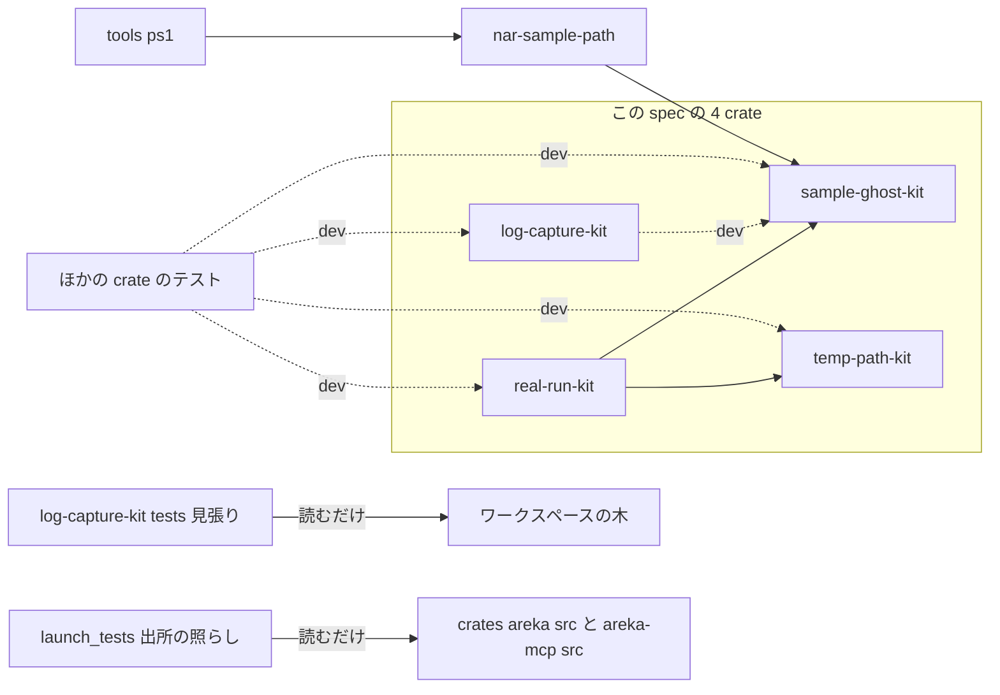
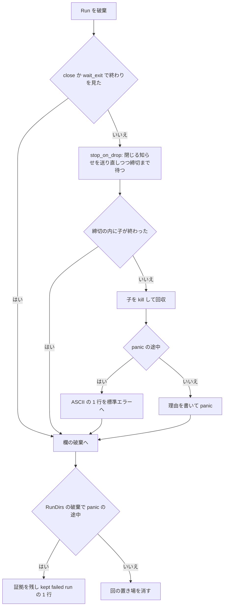
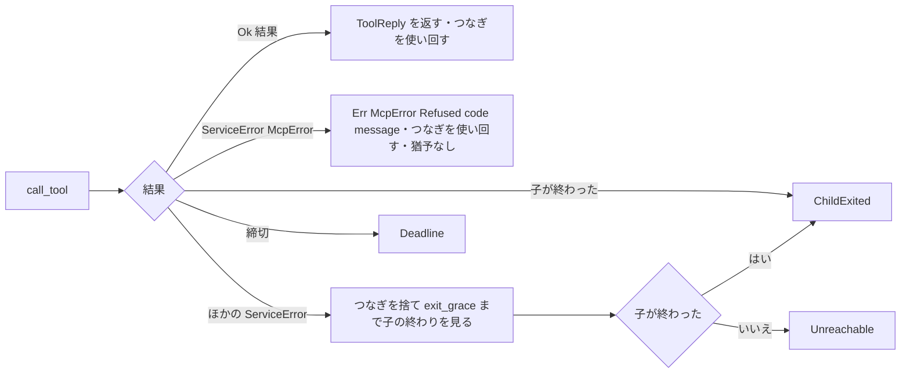

# 設計書: audit-test-kits

## 概要

**目的**: 試験の道具の 4 つのクレート（`real-run-kit`・`log-capture-kit`・`sample-ghost-kit`・`temp-path-kit`）に ponytail の audit をかけて出た 76 件の指摘を、3 つの組（必ず直す 1〜5・直したほうがよい 6〜37・できれば 38〜76）とも直す。直さずに残すのは指摘 75 の 1 件だけ（要件 2.7 の裁定）。直し方は「いちばん小さな完全な変更」に従い、消せるものは消し、写しは 1 か所に寄せ、直したバグと危ない所には壊れたら落ちる決定論のテストを 1 本ずつ持たせる。指摘の中身と番号は `research.md` の 3 節が正本で、この文書は同じ番号で指す。あわせて brief に預かった件 1（`expect_one`・`ExpectField` の写し）と件 2（消費する crate の数の文）を片づける。

**使う人**: ワークスペースのほかのクレートのテスト（`log-capture-kit` を 21 crate・`temp-path-kit` を 12 crate・`sample-ghost-kit` を 15 crate・`real-run-kit` を `areka`）と、開発の道具（`tools/sample-fetch.ps1`・`tools/package.ps1`・`tools/load-flake.ps1`・`tools/perf/`）。

**変わること**: 見張りは今まで見逃していた綴り（`\` 区切りの検体のパス・`env-filter` の 3 つの道・`(` 無しの一時フォルダの入口）を赤にする。実機の試験の窓口は、MCP の誤りの答えを「つながらない」と取り違えなくなり、閉じ忘れて子を力ずくで止めた破棄を赤にし、32bit の仲介を元が新しければ写し直す。一時パスと作業フォルダは、死んだプロセスが残した同じ名前のフォルダを配らない。端末へ出す行は英語の ASCII になる。使い手の無い公開の品と、別のテストをなぞるだけのテストが消える。

### Goals

- 75 件を直す。指摘 75 は裁定どおり直さずに残し、記録する（要件 2.5・2.7）。
- 直したバグと危ない所の 1 件ごとに、壊れたら落ちる決定論のテストを持たせ、常時の `cargo test --workspace`（全体テストの `x64 workspace tests` の段）で回す（要件 4.1〜4.3）。
- 外への約束は、下の「外への約束の変更と読み手」の表の分だけ変え、その読み手を同じ変更で直し切る（要件 7.6・7.7）。
- どのファイルも 1,000 行の番人の下に収める（要件 6.1）。

### Non-Goals

- 新しい窓口・新しい見張りの決まり・新しい実行体や引数（要件 3.4）。一時パスの見張りを環境変数の読み（`TEMP`・`TMP`）や `target\` の手組みへ広げることもしない（要件 2.7 の指摘 5 の裁定・決め D12）。
- 範囲の外のファイルの見直し。`vendors/` の下（`vendors/sample_ghost/README.md` を含む）。
- `TempPath::new` と `under_target` を 1 つに寄せること（指摘 75・裁定で残す）。
- 本物の areka を起こす実機の試験・検体を畳む通しの走り・負荷の走行で効き目を確かめること（要件 8.1。指摘 1・2・8 は次の機会に確かめる記録を残す＝要件 8.3）。

## Boundary Commitments

### This Spec Owns

- `crates/real-run-kit/`・`crates/log-capture-kit/`・`crates/sample-ghost-kit/`・`crates/temp-path-kit/` の全部（`src/`・`src/bin/`・`examples/`・`tests/`・`Cargo.toml`）の中身と振る舞い。
- 76 件の扱い（75 件の直し・指摘 75 を残す記録）と、件 1・件 2 の片づけ。
- `log-capture-kit/tests/file_length_guard_test.rs` の上限越えの表と件数の定数を C22 で触る唯一の spec であること（C22 の約束 ⑵）。表に載る 4 ファイルは割らない。
- 範囲の外で直す最小の行（下の「範囲の外で直すファイル」の表だけ）。

### Out of Boundary

- C22 のほかの 5 本の触るファイル（要件 7.3）。`crates/areka-runtime/src/`・`runtime_tests/`・`session/`・`crates/areka-placement/src/` の追従と移り変わり・`crates/areka-parsers/src/shell/`・`crates/areka-emo-compose/src/{hit,hit_import}.rs`・`crates/areka-emo-present/src/{presenter_test_support.rs,presenter/hit.rs}`・`crates/areka-emo-text/src/{actor,actor_test_support}.rs`・`crates/ukadoc-survey/`・`crates/pilot/`。
- `input-crate-split` の持つ行（`log-capture-kit/src/event.rs:150`・`event_tests.rs:18-19`・121 の `input_events/` のパス）と、`session-module-gather` の持つ `real-run-kit` の出所の名指し（`areka::app_exit` ほか）。この spec はその字面を 1 字も変えない（照らすテストを足すだけ＝決め D2）。
- `TempPath` の 2 つの入口の呼び手 634 か所（指摘 75）。
- `vendors/`・`Cargo.lock`・根の `Cargo.toml`・`tools/*.ps1`（読んで確かめるだけ）・`.claude/`（スキルの文は直さない＝要件 7.8 に当たる変更は 0）。
- `.kiro/specs/completed/` の文書（消す・改名するテストの名前を挙げていても直さない＝決め D10）。

### Allowed Dependencies

- 今ある依存だけ（要件 6.6・6.7）。新しいクレート・新しいワークスペースの中の依存の辺・新しい機能の指定を足さない。
  - `real-run-kit` → `sample-ghost-kit`（`ascii` を新しく呼ぶが、辺は既にある）・`temp-path-kit`・`areka-mcp-bridge`・`areka-mcp`・`areka-user-data`・`rmcp =3.9.0`（`ServiceError::McpError` と `ErrorData` を照らす）・`tokio`・`serde_json`・`windows`・`tracing`・`tracing-subscriber`。
  - `log-capture-kit` は `[dependencies]` に `tracing`（と任意の `tracing-subscriber`）だけ・`[dev-dependencies]` は `sample-ghost-kit` だけ（leaf のまま）。
  - `sample-ghost-kit` は `thiserror`・`areka-nar`・`miniz_oxide` だけ。
  - `temp-path-kit` は依存 0（std だけ）。
- std の部品: `std::sync::OnceLock`（決め D7）・`std::os::windows::fs::OpenOptionsExt::share_mode`（削除を拒む開き方・テストだけ）・`std::panic::catch_unwind`（テストだけ）。
- 読み込みの向き: 4 crate のどれも、ほかのクレートの `[dependencies]` に現れない（見張りが赤にする決まりのまま）。

### Revalidation Triggers

- 見張りの走査語・判定が変わるとき（指摘 1・4・5・17・18・72）→ ワークスペースの全部の spec の前提が動く。`structure.md` の log-capture-kit 節の説明を同じ変更で直す。
- `real-run-kit` の公開の品（`Launch`・`Run`・`McpError`・`ToolReply`・`Limits`）と破棄の振る舞い（指摘 9）が変わるとき → `crates/areka/tests/` の実機の試験と `doc/testing.md` を確かめ直す。
- `RELIED_TARGETS` と本物の areka の出所の対応（指摘 26 のテスト）が赤になったとき → `session-module-gather` の移しの側が `RELIED_TARGETS` を直す（その名指しはその spec の持ち物）。
- `nar-sample-path` の出す行・終了コード・`--fetch-list` の 5 列、`sample-ghost-kit:` で始まる後始末の行が変わるとき → `tools/sample-fetch.ps1`・`tools/package.ps1`・`tools/load-flake.ps1`・`tools/perf/perf-tool-base.ps1` を確かめ直す。

## Architecture

### 今の形の分析

- 4 crate はテスト専用で、areka の実行時のコードには入らない。外から見た「公開の形」は、公開の関数・型・機能、実行体と見本の名前・引数・終了コード・出す行、読む環境変数、置き場の名前、見張りの決まりと例外表である（要件の Introduction）。
- 同じ決まりが 2 か所に住む所が指摘の多くを生んでいる: 一時フォルダの一意性（`temp-path-kit` と `real-run-kit/evidence.rs` の取り直し・指摘 6）、後始末の失敗の知らせ方（`temp-path-kit` は黙る・`sample-ghost-kit` は知らせる・指摘 13）、ASCII の写し（`sample-ghost-kit` の取り寄せの誤りだけ・指摘 32）、見張りの手助け（3 か所の写し・指摘 33）、記録の捕まえの手助け（件 1）。
- 見張り（`log-capture-kit/tests/`）は 1 つの走査部品 `workspace_scan/mod.rs` を共有する。各見張りはテストの実行体が別（`tests/*.rs` 1 本ずつ）。

### 形と境界



- 方針: 既にある置き場と形の中で直す（ギャップ分析の案 C）。外への約束に触る直しは、読み手が 0 か少ないので同じ変更で読み手まで直す。指摘 75 だけを残す。
- 新しい部品は作らない。新しいファイルはテストの置き場だけ（`expect_tests.rs`・`real-run-kit/src/lib_test_support.rs`・`real-run-kit/tests/common/mod.rs`・`examples/fold-samples_tests.rs`）。
- steering に沿う: テストは兄弟の `*_tests.rs` に `#[path]` でつなぐ・1 ファイル 1,000 行・ログ無し失敗の禁止（テストの道具の失敗は理由を書いた panic＝要件 6.2 の裁定）・終了の道は正規の実装・道具が端末へ出す文は ASCII。

### 技術

| 層 | 選び | 役目 | 注記 |
|---|---|---|---|
| Rust の標準 | `std::sync::OnceLock`・`std::fs::create_dir`（`AlreadyExists`）・`OpenOptionsExt::share_mode` | 木の読みの置き場・一意の作り直し・削除を拒む開き方（テスト） | 新しい依存 0 |
| MCP の SDK | `rmcp =3.9.0`（既に固定） | `ServiceError::McpError(ErrorData { code: ErrorCode(i32), message, .. })` を照らす | `ServiceError` は `#[non_exhaustive]`＝1 つの腕だけ照らす |
| Cargo の設定 | `[package] autoexamples = false`・`[[example]] name = "fold-samples" path = "examples/fold-samples.rs" test = true` | 見本の単体テストを `cargo test --workspace` で回す | 見本の名前・置き場・呼び方は同じ（README 186 行の名指しのまま） |

### 設計の決め（`research.md` の 10・11 節の 11 項を閉じる）

| 決め | 項 | 選んだ形 | 理由 |
|---|---|---|---|
| D1 | 3 | JSON-RPC の誤り（`ServiceError::McpError`）は新しい変種 `McpError::Refused { code: i32, message: String }` の `Err` で返す。つなぎを使い回し、猶予を待たない（設計の討議の議題 1） | `Ok(ToolReply { is_error: true })` で返すと、`is_error` を見ずに `.text` を使う範囲の外の呼び手（`emo2_mcp_real_run.rs:185` ほか）が誤りの文をそのまま使って後の段で的外れに落ち、`call_until` は直らない誤りを締切まで呼び直す。`Err` なら `unwrap_or_else(panic!)` の呼び手はその場で正しい文で落ち、`call_until` もその場で返す。範囲の外に `McpError` の全部の変種を並べる `match` は 0（`common.rs:241` は何でも受ける腕・`emo2_mcp_real_run.rs:124` は `ChildExited` だけを照らす） |
| D2 | 26 | 範囲の中の静的なテスト（`launch_tests.rs`）。`RELIED_TARGETS` の各項 `<crate>::<mod 段…>` から `crates/<crate の _ を - に>/src/<段>.rs`（無ければ `<段>/mod.rs`）を引き、ファイルが在る・頼る行の語（`event = "app_exit"`・`"os_close_request"`・`"MCP: 待受を始めた"`）が在る・`target:` の上書きが無い、を確かめる | 本物の areka を起こさない。`session-module-gather` が `app_exit` を動かして `RELIED_TARGETS` を直し漏らせば赤になり、直せば新しい置き場を照らす＝名前を書き換えずに追いつく |
| D3 | 43 | 言い直しは `event_tests.rs:3-12`・14 の見出し・102、`event.rs:89-90`・136 だけで足りる。`event.rs:150`・`event_tests.rs:18-19`・121 は 1 字も変えない（見出しを「移した時点の出所。今はどれも `capture_lines` を呼ぶ」にすれば下の並びは出自の記録として正しい） | `input-crate-split` への申し送りは要らない |
| D4 | 15 | 設定値が相対なら、実行体の祖先のうち `Path::ends_with(値)` が真の最も近いものを使う。無ければ今の `std::path::absolute` | cargo は起こした場所で解き、テストの実行体はパッケージの場所で走る。どちらで起こしても実行体は `<target>\debug\…` の下にあるので祖先に必ず現れる。`tools/sample-fetch.ps1` は根で `cargo run` するので今と同じ答え＝README の書き方（`<CARGO_TARGET_DIR>\nar-samples\fetched\`）は古びない（要件の討議の 3） |
| D5 | 53 | 原本からの複写が落ち、かつ原本がもう無い（別のプロセスが刻印違いとして退けた）ときだけ、`sample_nar` からもう 1 度だけやり直す | 退け合いの元は 2 つのプロセスが違うバイトを読んだこと。やり直しは今のファイルのバイトを読むので、勝った側の原本に合流して終わる。「いちばん新しい印だけを残す」は退けられた側の落ちを止めない |
| D6 | 13 | `Drop` は `remove_or_report(&self.path, &mut std::io::stderr())` を呼ぶ。`std::io::stderr()` へ直に書く（`eprintln!` は libtest が通ったテストの分を捨てる）。テストは同じ関数を `Vec<u8>` へ向け、中のファイルを削除を拒む共有モードで開いたまま呼ぶ＝決定論で読める | 調べもの「標準エラーを決定論で読めるか」の答え: 書き先を引数で受ければ読める。破棄の配線は再テストしない（判断の分岐だけを縛る） |
| D7 | 30 | ⑴ `scan_tokens` は語の頭の文字の集合で先に篩う ⑵ `mod.rs` に `OnceLock<Vec<(String, String)>>`（相対パス・本文）を置き、`walk_workspace_sources`・`read_source`・`measure_workspace_sources` はそこから読む（実行体ごとに 1 度）。速さを測る走りは判定にしない（前後の `cargo test -p log-capture-kit` の時間を 1 度ずつ記録に書くだけ） | 静かな机でない測りは揺れる。どちらの直しも結果を変えないことは既存の較正が縛る。34 の削りで木の読みの回数も減る |
| D8 | 2・8 | 見本を `test = true` にし、兄弟の `examples/fold-samples_tests.rs` を `#[path]` でつなぐ（`autoexamples = false` で兄弟が別の見本と見なされない）。`fold_one` は追跡の一覧を引数で受け、畳んだ `.nar` を作業の置き場 `target\fold-samples\out\<名>.nar` に書いて往復を照らす。`vendors/` へは `main` が不一致 0 のときだけ写す | `vendors/` に触らない単体テストで、写しの式（2）と書き先の順（8）の両方を縛れる。見本のパスは変わらない＝README 186 行は古びない |
| D9 | 32 | 端末へ出す行を英語の ASCII に。`sample_ghost_kit::ascii`（今の `pub(crate)`）を `pub` にして `real-run-kit` も使う。`temp-path-kit` は leaf（要件 6.6）なので同じ規則の 6 行を私用で持つ（理由を 1 行のコメントに書く） | `u{XXXX}` を解いた grep（`tools/**/*.ps1`・`*.psm1`・`*.py`・`.claude/**/*.ps1`・`.github/**/*.yml` の 55 ファイル）の結果: 字面で読むのは `tools/load-flake.ps1:194`・196 の `sample-ghost-kit:` の頭と `os error 5` だけ（自己検査 245-246 の見本も英語の ASCII）。`package.ps1:473` は最後の行を throw の文へ入れるだけ・`sample-fetch.ps1` は `Show-Ascii` で逃がす。`real-run-kit` の行と `Io` の `what` を読む `.ps1` は 0。頭と `os error N` を保てば読み手は変わらない |
| D10 | 34 | 消すテスト・改名するテストの名前は、この spec の検証の記録に「名前・消した理由・名前を挙げている完了した spec の文書」を並べて残す。`completed/` は直さない | 完了した文書は歴史の記録。`the_measurement_is_not_vacuous_and_matches_the_allow_table` は 8 本の完了した文書が挙げる＝`the_measurement_is_not_vacuous` へ改名した旨を記録する |
| D11 | 1・2・8 | 決定論のテストで筋まで縛り、効き目は次の機会（`window_link_real_run` を環境変数で明示して回すとき・検体を畳むとき）に確かめるものとして番号ごとに記録する（要件 8.3） | 要件の討議の 5 |
| D12 | 37 の続き | 一時パスの見張りは `target\` の手組みを拾うよう広げない | 見張りの決まりは「OS の一時フォルダの入口を窓口の外で使わない」。手組みを拾うのは新しい決まり＝新しい機能（要件 3.4・2.7 の指摘 5 の裁定と同じ線）。37 自体は `WorkDir` に寄せて直す |
| D13 | 52 | `sample_nar` が `(パス, バイト)` を返し、`cached_root_in` は受けたバイトで刻印を作る。原本を据え付けるときは、同じバイトを作業の札の下の書き置き（`WorkDir` の中の `<名>.nar`）へ書いてから `NarArchive::open` する | `areka-nar` は書庫をパスからしか開けない（範囲の外は変えない）。確かめたバイトと据え付けるバイトが必ず同じになり、取得ごとの読みと SHA-256 が 1 回減る |

## File Structure Plan

### Directory Structure

```
crates/
├── temp-path-kit/src/
│   ├── lib.rs                 # 6 一意の作り直し・13 消せなかった知らせ・私用の ascii
│   └── lib_tests.rs           # 6・13 のテスト・76
├── real-run-kit/
│   ├── src/
│   │   ├── launch.rs          # 10・26 の対象・35・45・47
│   │   ├── launch_tests.rs    # 10・26 のテスト・35・50
│   │   ├── run.rs             # 9・12・35・45・46
│   │   ├── close.rs           # 9（stop_on_drop）・12・27・32・48
│   │   ├── mcp.rs             # 3・12・28・46
│   │   ├── output.rs          # 12（read_text・failure_text）
│   │   ├── evidence.rs        # 6（取り直しを消す）・32
│   │   ├── i686.rs            # 11・51
│   │   ├── lib.rs             # 35（Limits を私用に）
│   │   ├── lib_test_support.rs # 新規・49（cfg(test) の手助け）
│   │   └── bin/real-run-fake-areka.rs  # 27（sleep・window-linger）・29・35（err: を消す）
│   └── tests/
│       ├── common/mod.rs      # 新規・49（fake・alive・panic の文）
│       ├── fake_mcp_test.rs   # 3・10・29
│       ├── fake_wait_close_test.rs     # 9・27・50
│       └── fake_evidence_test.rs       # 32（KEPT_HEAD）
├── log-capture-kit/
│   ├── src/
│   │   ├── expect.rs          # 21・38
│   │   ├── expect_tests.rs    # 新規・21
│   │   ├── lib.rs             # 件 2・42
│   │   ├── event.rs           # 40・43（150 行は触らない）
│   │   ├── event_tests.rs     # 39・43（18-19・121 行は触らない）
│   │   ├── capture_tests.rs   # 40・41
│   │   ├── probe.rs / probe_tests.rs   # 41・42
│   │   └── filter_tests.rs    # 44
│   └── tests/
│       ├── workspace_scan/mod.rs       # 17・20・30・33・72・73
│       ├── workspace_scan_test.rs      # 17・19・20・72・73・74
│       ├── sample_path_guard_test.rs   # 1・33・34・74
│       ├── with_default_guard_test.rs  # 4・33・34・71・73・74
│       ├── temp_path_guard_test.rs     # 5・33・34・73
│       └── file_length_guard_test.rs   # 18・33・34・73
└── sample-ghost-kit/
    ├── Cargo.toml             # D8（autoexamples・[[example]] test）
    ├── examples/
    │   ├── fold-samples.rs    # 2・8・56
    │   └── fold-samples_tests.rs       # 新規・2・8
    ├── src/
    │   ├── lib.rs             # 16・32・36・55・57
    │   ├── devroot.rs         # 7・15・23・32・52・53・54・57・58・59
    │   ├── fetched.rs         # 32（ascii を pub）・52
    │   ├── bin/nar-sample-path.rs      # 32・55
    │   └── *_tests.rs         # 下の表
    └── tests/
        ├── nar_sample_path_test.rs     # 14・69
        └── pasta_inner_balloon_test.rs # 65
```

### 新しいファイル

| ファイル | 役目 |
|---|---|
| `crates/log-capture-kit/src/expect_tests.rs` | `expect_one`・`ExpectField` の失敗の道と通る道（21）。`expect.rs` が `#[cfg(test)] #[path = "expect_tests.rs"] mod tests;` でつなぐ |
| `crates/real-run-kit/src/lib_test_support.rs` | `#[cfg(test)]` の手助け（`living_child`・`KillOnDrop`・panic の文の取り出し・49）。`lib.rs` が `#[cfg(test)] #[path = "lib_test_support.rs"] mod test_support;` でつなぐ（家の名前の決まり `<stem>_test_support.rs`） |
| `crates/real-run-kit/tests/common/mod.rs` | 結合テストの手助け（`fake`・`alive`・panic の文の取り出し・49）。各 `tests/*.rs` が `mod common;` で読む |
| `crates/sample-ghost-kit/examples/fold-samples_tests.rs` | 見本の写しの式と書き先の順のテスト（2・8）。見本が `#[cfg(test)] #[path = "fold-samples_tests.rs"] mod tests;` でつなぐ |

### 直すファイル（範囲の中）

上の木の注記のとおり。sample-ghost-kit のテストは次のとおり: `devroot_tests.rs`（7・15・23・69・70）・`devroot_cache_tests.rs`（52・54・66・70）・`devroot_sweep_tests.rs`（31・53・59・63）・`devroot_fetched_tests.rs`（22・63・64・66・67）・`fetched_tests.rs`（63・64・67・69・70）・`lib_tests.rs`（16・32・61・62・66・68）・`nar_writer_tests.rs`（25・37・60）・`sha256_tests.rs`（24）。

### 範囲の外で直すファイル（直しに要る行だけ・要件 7.2）

| ファイル | 直す行 | 指摘 | C22 の 5 本に当たるか |
|---|---|---|---|
| `crates/areka/tests/window_link_real_run.rs` | 448-449（同梱バルーンの元を窓口 `sample.balloon("pasta_tategaki")` で引き、写し先は `root.join("balloon").join(<元の file_name>)`） | 1 | 当たらない（C23 の `input-crate-split` が触る 49 行とは別の行） |
| `crates/areka-nar/src/error_tests.rs` | 205 と同じ値の `name`（登記に無い名前 `kaku` の偽のパス） | 1 | 当たらない |
| `crates/areka-emo-present/src/scale_tests.rs` | 251-263 を消し、249 行で `expect_one` を取り込む | 件 1 | 当たらない |
| `crates/areka-emo-text/tests/attach_wiring_test.rs` | 133-166 を消し、33 行を `use log_capture_kit::{ExpectField, capture, expect_one};` に | 件 1 | 当たらない（新しいソースファイルは足さない＝要件 7.11） |
| `crates/wintf/src/ecs/test_support.rs` | 5（「96 箇所」の数を書かない文に） | 44 | 当たらない |
| `doc/testing.md` | 37（`Launch::Ghost` の行を消し「5 通り」を「4 通り」に）・45（`AREKA_MCP_PORT` を上書きしたときの振る舞い）・56〜64（訳の表を 4 つに＝`McpError::Refused { code, message }`「相手が JSON-RPC の誤りを答えた」）・71（閉じ忘れて止めた破棄は panic）・75・163（証拠の行と写しの失敗の行の新しい文）・93（隣が 32bit でも元が新しければ写し直す） | 3・9・10・11・32・35 | 当たらない |
| `.kiro/steering/structure.md` | log-capture-kit 節の Tests の段（見張りの本数を数で書かない言い方・4 形の綴りに `\` を含むこと）・Temp Path Kit 節の Consumers（12 crate の並びへ） | 1・73・要件の討議の 4 | steering の自分の行（要件 7.3 の例外） |
| `.kiro/steering/roadmap.md` | 60 行の「例外表 5 件」の数を外す。**実装の中では触らず**、この spec の `/kiro-complete` のロードマップの書き換えで `main` を取り込んだうえで直す（ウェーブ全体の行で並走の spec と `/kiro-next` も書く＝設計の討議の議題 3） | 73 | ウェーブ全体の行（完了のときに直す） |

### 確かめるだけで触らないファイル

`vendors/sample_ghost/README.md`（154・169・186・200・210 行は D4・D8 のあとも正しい）・`tools/sample-fetch.ps1`・`tools/package.ps1`・`tools/load-flake.ps1`・`tools/perf/perf-tool-base.ps1`・`tools/perf/invoke-perf-run.ps1`（D9 の grep）・`crates/areka/tests/emo2_real_run/common.rs`・`common_tests.rs`・`emo2_mcp_real_run.rs`（D1 で `McpError` の形が変わらない）・`crates/areka/tests/smoke_boot_loop_exit.rs`（`wait_exit` を呼ぶ＝9 の影響なし・`ensure_i686` の隣は新しい写し＝11 の影響なし）。

## System Flows

### 取っ手の破棄（9・29）



- 破棄の中の panic は、残りの欄（`RunDirs`）を unwind の中で破棄する＝閉じ忘れて止めた回は証拠が残る。二重の panic にはならない（panic の途中なら行を出すだけ）。
- 破棄の道で呼ぶ読み手（`failure_text`）は panic しない（読めないファイルは文へ埋め込む＝12）。

### MCP の呼び出しの答え（3・28）



## 直し方の一覧（指摘ごと）

「縛るテスト」は、その直しが壊れたら落ちるテストの名前（新しく足すものは新しい名前、改めるものは今の名前）。「—」は振る舞いを変えない削り・言い直しで、既存のテストとコンパイルが守る（要件 4.1 の「バグと危ない所」に当たらない）。行番号はギャップ分析の時点のもので、実装の時に字面で確かめ直す。束は下の「実装の順とタスクの束ね方」の記号。

### 必ず直す（1〜5）

| # | 直し方 | 主なファイル | 縛るテスト | 束 |
|---|---|---|---|---|
| 1 | ⑷ に `\` を前に置いた語（`\` ＋バルーン名）と後ろに置いた語（バルーン名＋`\`）を、⑵ に `vendors` と `sample_ghost` と検体名を `\` で繋いだ語（終わりが `\` と `"` の 2 つ・区切りが `\` と `\\` の 2 つ）を足す。赤になる 2 か所を直す（範囲の外の表） | `sample_path_guard_test.rs` | `a_backslash_spelled_bundled_balloon_path_is_detected`・`a_backslash_spelled_checked_in_tree_is_detected`（見本の文字で赤・較正の対）＋本物の木の走査が緑 | G2 |
| 2 | `installed_path` の同梱バルーンの写し先を `root/<store>/<manifest.directory>/balloon/<companion.directory>/<残り>` に（`areka-nar/src/plan.rs:291` と同じ置き方）。説明 37-38 行を直す | `examples/fold-samples.rs` | `a_ghost_with_a_companion_balloon_round_trips_without_mismatches`（`WorkDir` の下に組んだ同梱バルーンつきの小さな木を `fold_one` に通して不一致 0） | S3 |
| 3 | D1 | `mcp.rs` | `an_mcp_error_reply_is_refused_on_the_same_link`（偽の子 `listen;window` の `echo` に `{"text":5}`＝`Err(McpError::Refused { code: -32602, .. })`・`exit_grace` より速く返る・続く正しい呼び出しが成功） | R1 |
| 4 | 照らしを引用符なしの `env-filter` にする（`["…"]`・`['…']` の両方）。道具の自分の `Cargo.toml` の `[features]` の `default` と、根の `Cargo.toml` の `[workspace.dependencies]` の道具の項も読む | `with_default_guard_test.rs` | 判定の関数の較正 3 本 `single_quoted_env_filter_is_detected`・`env_filter_in_the_kit_default_features_is_detected`・`env_filter_in_workspace_dependencies_is_detected` ＋本物の 2 ファイルを読む `only_one_crate_declares_the_env_filter_feature` | G3 |
| 5 | 修飾つきの語から `(` を外す（`use … as` の行と `(` 無しの渡し方に当たる）。この見張り自身の説明 5・539 行の綴りを言い換える。環境変数の読みには広げない（裁定） | `temp_path_guard_test.rs` | `the_entry_point_passed_without_a_call_is_detected`・`an_aliased_import_of_the_entry_point_is_detected` | G4 |

### 直したほうがよい（6〜37）

| # | 直し方 | 主なファイル | 縛るテスト | 束 |
|---|---|---|---|---|
| 6 | 置き場は `create_dir_all`、葉は `create_dir` で作り、`AlreadyExists` なら次の連番で取り直す（連番の出どころを引数で受ける私用の `create_fresh`）。`real-run-kit/src/evidence.rs` の `CREATE_TRIES`・`create_with` と空かどうかの確かめを消し、`evidence_tests.rs` の 2 本（中身のあるフォルダ・16 回の上限）を消す | `temp-path-kit/src/lib.rs`・`evidence.rs` | `a_leftover_folder_with_the_same_name_is_never_handed_out`（連番 0・1 の名前を先に置き、2 の名前が空で配られる） | K1・R2 |
| 7 | 札とフォルダを作る所を、`AlreadyExists` なら次の連番へ進む輪に（連番の出どころを引数で受ける・他人の札は消さない・残りは掃除が拾う） | `devroot.rs` | `a_leftover_lease_or_folder_with_the_same_name_is_skipped` | S1 |
| 8 | D8（`fold_one` は `vendors/` へ書かない・`main` が不一致 0 のときだけ写す） | `examples/fold-samples.rs` | `fold_one_never_writes_the_vendored_archive`（偽の根の `vendors/sample_ghost/<名>.nar` に番兵のバイトを置き、`fold_one` の後も同じ） | S3 |
| 9 | `stop_quietly` を `stop_on_drop` に替える（上の流れ）。panic の文は今の `Stopped::failure` の文に「`close()` も `wait_exit()` も呼ばずに取っ手を捨てた」を添える | `close.rs`・`run.rs` | `dropping_a_run_whose_child_ignores_close_panics_and_keeps_the_evidence`（`window-deaf`・締切 2 秒・`catch_unwind` で破棄・置き場が残ったことを確かめてから消す） | R2 |
| 10 | `spawn` で最後に積まれた `AREKA_MCP_PORT` を u16 として読み、それを窓口が話す番号（`Run::mcp_port()` も同じ）にする。読めなければ `.mcp_port(n)` を案内して panic。`mcp.rs:18` の説明を直す | `launch.rs` | `an_env_override_of_the_mcp_port_is_the_port_the_kit_talks_to`（偽の子）・`an_unreadable_mcp_port_override_panics_with_the_mcp_port_hint` | R1 |
| 11 | 先に元を決め（環境変数 → debug → release・環境変数の panic は今のまま）、隣が無い・32bit でない・元と長さか更新時刻が違うときだけ写す（`std::fs::copy` は更新時刻を写す）。元がどこにも無く隣が 32bit ならそれを使う。どれも無ければ今の panic | `i686.rs` | `a_newer_source_replaces_a_stale_i686_neighbour`・`an_env_var_pointing_at_a_non_i686_file_panics_even_when_the_neighbour_is_i686`・`without_any_source_the_i686_neighbour_is_used`（`i686_tests.rs:135-143` を改める） | R3 |
| 12 | `output.rs` に `pub(crate) fn read_text(path: &Path) -> String`（読めなければパスと理由で panic）を置き、`Run::stdout`・`Run::stderr`・`close.rs` の `ended`・`mcp.rs` の `line_with` で使う。`failure_text` は読めない旨とパスを文へ埋め込む（破棄の道から呼ばれるので panic しない） | `output.rs` ほか | `read_text_panics_with_the_path_when_the_file_cannot_be_read`・`failure_text_names_an_unreadable_file`（フォルダのパスを渡す） | R4 |
| 13 | D6。行は `temp-path-kit: could not remove <path> (<理由>)`（パスと理由は私用の `ascii` に通す） | `temp-path-kit/src/lib.rs` | `a_directory_that_cannot_be_removed_is_reported_in_one_ascii_line` | K1 |
| 14 | 2 本とも既にある `run_in(private.path(), ..)` で回す。全検体の輪を 3 検体（`claudia`・`R_POST_and_KOMAINU`・`emo2-kakukaku-wplimit`）に絞る | `tests/nar_sample_path_test.rs` | 2 本に「印字した根が私用の `CARGO_TARGET_DIR` の下にある」主張を足す（引き継いだ置き場へ戻すと赤） | S5 |
| 15 | D4 | `devroot.rs` | `a_relative_target_dir_is_resolved_against_the_exe_ancestors`（`devroot_tests.rs:166-181` を改める・純関数） | S1 |
| 16 | 先に `shell.join(from).is_dir()` を確かめ、無ければフォルダを作らずに `Io`（`NotFound`）を返す | `lib.rs` | `copying_a_missing_shell_leaves_no_empty_folder` | S2 |
| 17 | 飛ばす決めを純関数 `skip_dir(name, parent_has_manifest)` に: `target` は親に `Cargo.toml` があるときだけ。`vendors`・`.git` は外す（走査は `crates/` から始まる） | `workspace_scan/mod.rs` | `only_a_target_next_to_a_manifest_is_skipped`（3 通り）＋ `workspace_scan_test.rs:352-367` を改める | G1 |
| 18 | 「上限越えが 1 件以上」を「いちばん長いファイルが上限の半分を越える」に（純関数 `measurement_is_plausible`）。較正で外す項は `OVER_LIMIT_ALLOWED.first()`（表が空なら実データの較正は何もせず、合成の較正 `workspace_scan_test.rs:287-300` が残る）。`CALIBRATION_DROPPED_ENTRY` を消す | `file_length_guard_test.rs` | `the_vacuity_check_needs_no_over_limit_file`（上限越えの無い合成の列で真）・`dropping_a_known_exception_turns_the_guard_red`（`first()` で） | G5 |
| 19 | 列挙の証人を `crates/areka/examples/emo-present/balloon.rs` に（実在を確かめた） | `workspace_scan_test.rs` | 既存 `walk_includes_examples_integration_tests_and_sibling_test_files` | G1 |
| 20 | 枝ごとの「走る行／隠れる行」の対: `#` 付きで中に `"` を含む生の文字列・`\"`・`b"…"`・`br#"…"#`・`'\''`・CRLF の入力 | `workspace_scan_test.rs` | `strip_comments_keeps_code_after_every_literal_kind`（表の形の 1 本・6 行） | G1 |
| 21 | 手で組んだ `CapturedEvent`（`event_tests.rs:244` と同じ形）で 0 件・2 件・欠けた項目の `#[should_panic]` と通る 1 本 | `expect_tests.rs` | `expect_one_rejects_zero_matches`・`expect_one_rejects_two_matches`・`expect_field_rejects_a_missing_field`・`expect_one_returns_the_single_match` | L1 |
| 22 | 自分の実行体を子で起こす形（`devroot_cache_tests.rs:487-536`）で、私用の `CARGO_TARGET_DIR` に食い違う棚を置き、子の中で `SampleRoot::acquire("pasta-in-windows")` が `FetchedNarMismatch` を返すことを確かめる。今の 2 本の名前を中身に合わせる | `devroot_fetched_tests.rs` | `acquire_refuses_a_tampered_fetched_archive` | S4 |
| 23 | 私用の名前空間で 1 度作り、中のファイルを削除を拒む共有モード（`FILE_SHARE_READ`）で開き、2 度目が手動用の根の作り直しの `Io` を返す（`what` は 32 の直しの後の英語の ASCII の文で照らす） | `devroot_tests.rs` | `manual_root_refuses_a_tree_it_cannot_remove` | S4 |
| 24 | 55 バイトと 64 バイトの既知の答えを足す（答えは `python -c "import hashlib"` で作って逐語で置き、作り方を説明に 1 行） | `sha256_tests.rs` | `digest_of_55_bytes_matches_the_known_answer`・`digest_of_64_bytes_matches_the_known_answer` | S4 |
| 25 | 局所ヘッダの時刻と日付（オフセット 10..14）が `0x0000`・`0x0021` であることを確かめる。畳み込みのテストに名前の対 `B.txt`・`a.txt` を足す | `nar_writer_tests.rs` | `every_local_header_carries_the_fixed_dos_time`・`folding_orders_entries_by_byte_order` | S4 |
| 26 | D2 | `launch_tests.rs` | `relied_targets_name_the_modules_that_emit_the_relied_lines` | R4 |
| 27 | 偽の子に `sleep:<ms>` と `window-linger:<ms>`（受け取りの行を出した後、タイマーで `<ms>` 待ってから終わり方の行を出して終わる・その間の閉じる知らせも受け取りの行を出す）の 2 つの一歩を足す | `bin/real-run-fake-areka.rs` | `a_close_sent_before_the_window_exists_is_resent`（`sleep:1500;window` が `UserClose`）・`no_close_is_resent_after_the_acknowledgement`（`window-linger:2500` で受け取りの行がちょうど 1 行） | R2 |
| 28 | `mcp_tests` の `serve()` で 1 度呼んでつなぎを持ち、受け口を落とし、`living_child()` でもう 1 度呼んで `Unreachable` を確かめる。`connect` の名乗りの判定の文を純関数 `not_found_reason(others: &[(u16, String)])` に割る | `mcp.rs`・`mcp_tests.rs` | `a_dropped_server_with_a_living_child_is_unreachable_within_the_grace`・`another_server_answering_is_named_in_the_reason` | R1 |
| 29 | `listen-drop` を `hang()` でなく次の一歩へ進める。テストを `fake("listen-drop;window")` と閉じて確かめる形にし、締切の指定を外す | `bin/real-run-fake-areka.rs`・`fake_mcp_test.rs` | 既存 `dropped_listener_is_unreachable`（9 の後は閉じない子を破棄に任せると赤になる＝この直しが要る） | R2 |
| 30 | D7 | `workspace_scan/mod.rs` | 振る舞いは既存の較正が縛る（速さは檻にしない） | G1 |
| 31 | `passes > 0` にする。`stop` を破棄の守り（立てる構造体）で立て、panic でも掃除のスレッドを止めて合流する | `devroot_sweep_tests.rs` | 既存の較正（`passes > 0`）と 8 スレッドのテスト 503-597 | S5 |
| 32 | D9。行の形: `real-run-kit: kept failed run: <path>`・`real-run-kit: could not copy the failed run's sample: <from> -> <to> (<err>)`・`real-run-kit: stopped child <pid> that did not close within <deadline> (dropped while panicking)`。`sample-ghost-kit` は `Io` の `what` を英語の ASCII にし、`Io` の表示はパスと元の失敗を `ascii` に通す・`report_cleanup` は `sample-ghost-kit: cleanup failed (<what>): <path> (<err>)`・`nar-sample-path` の書けない行も英語。panic の文は家の形のまま | `evidence.rs`・`close.rs`・`lib.rs`・`devroot.rs`・`fetched.rs`・`bin/nar-sample-path.rs` | `fake_evidence_test.rs` の `KEPT_HEAD` を新しい頭に（証拠を見つける道の檻）・`the_io_error_is_shown_in_ascii_only`（日本語の OS の文を入れた `Io` の表示が ASCII だけ） | S2・R2 |
| 33 | `raw_occurrences`・開発用に引くかの判定・`manifest_fixture`・`Hit`／`scan_sources`／`unlisted`／`allowed_paths(_without)`／`render` を `mod.rs` へ移す（判定の語と例外表は各見張りに残す） | `workspace_scan/mod.rs`・各見張り | 各見張りの既存の較正（移しで判定が変わらない） | G1 |
| 34 | 消す: `removing_the_exclusion_turns_the_guard_red`・`sample_path_guard_test.rs:369-373` の数の比べ・`the_guard_file_itself_is_not_a_hit`（temp・sample）・`the_guard_file_itself_is_not_a_hit_because_the_tokens_are_never_spelled_out`・`assert_eq!(found, listed)`（file_length・temp）・ファイルが在るかの輪。テストの名前を挙げる説明を直す。消した後も各見張りに較正の対が 1 本以上残ることを確かめる（要件 4.7） | 各見張り | 残る較正 | G2〜G5 |
| 35 | 消す／私用に: `Staged::run_dir`（消す）・`Run::stderr`（私用）・`pub use run::Limits`（`pub(crate)`）・`Launch::Ghost`（消す・`launch_tests.rs:164-176` も・完了した `areka-P0-real-run-mcp-kit` 要件 1.1⑵ を裁定で改める）・偽の子の `err:`（消す・説明 6 行も）。`RealRun::mcp_port(n)` は残す（10 の案内先） | `launch.rs`・`run.rs`・`lib.rs`・bin | コンパイル（範囲の外の呼び手 0 を grep で記録） | R4 |
| 36 | `fn body_folder(sample, root) -> PathBuf` を 1 つにし、`from_copy`・`manual_paths`・`companion_folder`・`declared_elements` で使う | `lib.rs` | 既存の往復（`lib_tests.rs:502-556`）と `nar_sample_path_test` | S2 |
| 37 | `scratch()` を消して `WorkDir::new()?` に。手の `remove_dir_all` を消す（D12） | `nar_writer_tests.rs` | —（後始末は `WorkDir` の破棄が持ち、panic でも消える） | S5 |

### できれば（38〜76）

| # | 直し方 | 主なファイル | 縛るテスト | 束 |
|---|---|---|---|---|
| 38 | `expect_one`・`expect_field` に `#[track_caller]`（件 1 で写しを消した後も失敗の場所が呼び手の行に出る） | `expect.rs` | — | L1 |
| 39 | 3 本を消す（`format_line_is_byte_identical_to_current_formatting_code`・`level_is_rendered_with_display_not_debug`・`capture_lines_does_not_leak_the_sentinel`）と、それに含まれる重なりの 1 本。`event_tests.rs:18-19`・121 は触らない | `event_tests.rs` | — | L2 |
| 40 | テストの購読者を `.push(CapturedEvent::from_event(event))` にし、`FieldCollector` を私用に | `capture_tests.rs`・`event.rs` | — | L2 |
| 41 | 赤になりえない自己テスト 3 つを消す | `probe_tests.rs`・`capture_tests.rs` | — | L2 |
| 42 | `interest_probes_enabled` を `pub(crate)` にし、再輸出と説明の行を消す | `probe.rs`・`lib.rs` | — | L2 |
| 43 | D3 | `event_tests.rs`・`event.rs` | — | L2 |
| 44 | 数を書かない文にする（`lib.rs:28`＝件 2・`filter_tests.rs:3`・5・191・範囲の外の `wintf/src/ecs/test_support.rs:5`） | 同左 | — | L2 |
| 45 | `McpChannel::new(port)` を `cmd.spawn()` の前に組み、`Run::new` に渡す | `launch.rs`・`run.rs` | —（配線の順で判断の分岐ではない＝檻にしない・設計の討議の議題 2） | R4 |
| 46 | `Waits` を消して `&Limits` を渡す | `mcp.rs`・`run.rs`・`mcp_tests.rs` | — | R1 |
| 47 | `cmd.env_remove("AREKA_USER_ROOT")` だけにする | `launch.rs` | 既存 `launch_tests` | R4 |
| 48 | `const ACK: [&str; 2] = ["event=\"os_close_request\"", EXIT_LINE];` | `close.rs` | — | R4 |
| 49 | 手助けを `src/lib_test_support.rs` と `tests/common/mod.rs` に寄せ、手書きの `child.kill(); child.wait();` を `KillOnDrop` に | 新しい 2 ファイル・各テスト | — | R4 |
| 50 | 消す: `launch_tests.rs:121-128`・217-220・`i686_tests.rs:245-250`・`fake_wait_close_test.rs:208` の「2 回の空きの番号が違う」の主張 | 同左 | — | R4 |
| 51 | `is_i686_pe` は先頭の 0x400 バイトだけ読む（`File::open` ＋ `take`） | `i686.rs` | 既存の偽の PE のテスト | R3 |
| 52 | D13 | `fetched.rs`・`devroot.rs` | `staging_uses_the_verified_bytes_not_a_second_read`（パスのファイルを違うバイトに替えてから、確かめたバイトを渡して原本を作り、原本の刻印と中身が確かめたバイトのもの） | S1 |
| 53 | D5（複写と 1 度のやり直しを私用の関数に割り、やり直しの出どころを引数で受ける） | `devroot.rs` | `a_master_reclaimed_during_the_copy_is_fetched_again_once`（無い原本を渡し、やり直しが 1 度だけ呼ばれて複写が通る） | S1 |
| 54 | 原本の棚を作る道で、`CACHE` でない兄弟の `cache*` を `discard_tree` で退ける。モジュールの説明を `cache-2/` に | `devroot.rs` | `an_older_generation_cache_shelf_is_discarded`（私用の名前空間に `cache\` を置き、原本を作った後に無い） | S1 |
| 55 | `pub fn fetched_shelf(sample) -> Result<Option<(PathBuf, PathBuf)>, SampleError>` に寄せ、`fetched_archive_path`・`fetched_checksum_path`・`on_shelf` と実行体の `unreachable!` の腕を消す | `lib.rs`・`bin/nar-sample-path.rs` | 既存 `nar_sample_path_test` の `--fetch-list` | S2 |
| 56 | `--from` の確かめを先にし（作業の置き場を消す前）、1 つを直に畳む（`Vec` と輪を消す） | `examples/fold-samples.rs` | — | S3 |
| 57 | `&'static Sample` を渡し、1 回の呼び出しで名前を 2 度引かない | `lib.rs`・`devroot.rs` | — | S1 |
| 58 | `WorkDir::lock_path` を `#[cfg(test)] pub(crate)` に（裁定） | `devroot.rs` | — | S1 |
| 59 | `owner_is_gone` を外し、説明をコメントに残す（裁定） | `devroot.rs`・`devroot_sweep_tests.rs` | — | S1 |
| 60 | `every_fixture_the_testing_strategy_lists_can_be_built` を消す | `nar_writer_tests.rs` | — | S5 |
| 61 | `registry_records_kind_and_bundled_balloons` を消す | `lib_tests.rs` | — | S5 |
| 62 | 名前の列を 1 つだけ残し、`known` を `SAMPLES` から作り、`== 11` を `!SAMPLES.is_empty()` に、テストの名前 `all_eleven` を改める | `lib_tests.rs` | — | S5 |
| 63 | 重なったテスト 3 本を消す | `devroot_sweep_tests.rs`・`devroot_fetched_tests.rs`・`fetched_tests.rs` | — | S5 |
| 64 | `fetched_shelf_is_outside_work_and_cache` を消し、代わりに `fresh_root_in` の後に棚のファイルが無事なことを確かめる | `fetched_tests.rs`・`devroot_fetched_tests.rs` | `a_sweep_leaves_the_fetched_shelf_alone` | S5 |
| 65 | 較正されない後半（37-60 行）を消し、4-5 行の説明を直す | `tests/pasta_inner_balloon_test.rs` | — | S5 |
| 66 | 古い数と主張を直す（数を外す） | 4 ファイル | — | S5 |
| 67 | 試料の `.nar` は `NarBuilder` のバイトを直に使う | `fetched_tests.rs`・`devroot_fetched_tests.rs` | — | S5 |
| 68 | `balloon()` の誤りは `dot_sakura` で確かめ、emily4 と dot_sakura の 2 度目の展開を往復へ寄せる（往復そのものは残す） | `lib_tests.rs` | — | S5 |
| 69 | 小さなテストを足す: `CARGO_TARGET_DIR` が空・空白なら祖先へ戻る・検査の値のパスがフォルダなら `Io`・UTF-16 の検査の値は `FetchedChecksumInvalid`・引数なしの `nar-sample-path` は終了 2。`target` の無い `--fetch-list` と標準出力の書き込みの失敗は `target\` の外で回さないと作れないので足さない（記録に書く） | `devroot_tests.rs`・`fetched_tests.rs`・`nar_sample_path_test.rs` | `a_blank_target_dir_falls_back_to_the_ancestor_search`・`a_checksum_path_that_is_a_folder_is_an_io_error`・`a_utf16_checksum_file_is_invalid`・`no_argument_exits_with_2` | S4 |
| 70 | 恒真の確かめ 3 つを消す | `devroot_tests.rs`・`devroot_cache_tests.rs`・`fetched_tests.rs` | — | S5 |
| 71 | 2 つの例外表に重複の確かめを足す | `with_default_guard_test.rs` | `the_direct_call_allow_table_has_no_duplicate_entries`・`the_all_thread_capture_table_has_no_duplicate_entries` | G3 |
| 72 | `strip_toml_comment` は開いた引用符の種類を覚え、`\"` を飛ばす | `workspace_scan/mod.rs` | `a_hash_inside_a_quoted_value_with_the_other_quote_is_not_a_comment`（`"https://x/it's#v"`） | G1 |
| 73 | 説明と失敗の文の古い数・行番号・消えた例（`test_offset_default`）を直す（数と行番号は書かない・`structure.md:176` は節の名前で指す）。steering の自分の行（範囲の外の表） | 見張り・`mod.rs`・steering | — | G1・G5 |
| 74 | 化けた行の継ぎと `\n` を戻す（`with_default_guard_test.rs:413-419`・同じ形の `workspace_scan_test.rs:427-428`・440-441・449-450・`sample_path_guard_test.rs:528-529`）。書いた後にバイトで確かめる | 同左 | — | G3 |
| 75 | **直さずに残す**（要件 2.7 の裁定・⑵ わざと置いた先送りの印。理由は `lib.rs` の説明にあり振る舞いの差は 0。呼び手 634 か所の多くが C22 のほかの 5 本の触るファイル） | — | — | 記録 |
| 76 | 説明の「主張は 3 本」の数を外す | `temp-path-kit/src/lib_tests.rs` | — | K1 |

### 件 1・件 2（brief の預かり）

| 件 | 直し方 | 縛るテスト | 束 |
|---|---|---|---|
| 件 1 | `scale_tests.rs` と `attach_wiring_test.rs` の写しを消して `log_capture_kit::{expect_one, ExpectField}` を使う（範囲の外の表）。主張の強さは同じ。欠けた項目のときに周りの項目が名前順の表で出る差は弱めたに当たらない（要件 5.2）。失敗の場所は 38 で呼び手の行 | 21 の 4 本（道具の側の失敗の道）＋両ファイルの既存のテスト | L1 |
| 件 2 | `lib.rs:27-29` を「消費する crate はいずれも…」の数を書かない文に | — | L2 |

## Components and Interfaces

| 部品 | crate | 役目 | 要件 | 約束 |
|---|---|---|---|---|
| `TempPath` | temp-path-kit | 一意の一時フォルダ・破棄で消す・消せなければ 1 行 | 3.1・4.1・6.2・6.5 | Service |
| `RealRun`／`Run` | real-run-kit | 子を立てる・MCP を呼ぶ・閉じる・証拠 | 3.1・4.1・6.3・7.6 | Service・State |
| `McpChannel` | real-run-kit | `call_tool` の答えの分け方 | 3.1・4.1 | Service |
| `i686::ensure` | real-run-kit | 32bit の仲介を揃える | 2.7・3.1・4.1 | Service |
| 見張りの走査部品 | log-capture-kit tests | 列挙・剥がし・走査・TOML の行・木の読みの置き場 | 3.1・4.7 | Service |
| `expect_one`／`ExpectField` | log-capture-kit | ちょうど 1 件の確かめ | 5.1・5.2 | Service |
| `WorkDir`・`SampleRoot` の内側 | sample-ghost-kit | 作業フォルダ・原本・複製 | 3.1・4.1 | Service・State |
| `fold-samples` | sample-ghost-kit examples | 畳む・往復を照らす | 3.1・8.3 | Batch |

### temp-path-kit（`lib.rs`）

```rust
impl TempPath {
    pub fn new(label: &str) -> Self;          // 変えない（指摘 75）
    pub fn under_target(label: &str) -> Self; // 変えない
}
// 私用
fn create_fresh(base: &Path, label: &str, next_serial: impl FnMut() -> u32) -> PathBuf;
fn remove_or_report(path: &Path, out: &mut dyn std::io::Write);
fn ascii(text: &str) -> String; // sample_ghost_kit::ascii と同じ規則（leaf のための私用の写し）
```
- 事後条件: `create_fresh` が返すフォルダは、この呼び出しが作ったもの（`create_dir` が成功したもの）で、中身は空。
- `remove_or_report`: 消せたとき・既に無いときは何も書かない。ほかの失敗は ASCII の 1 行だけを書き、書けなくても panic しない（破棄の中）。

### real-run-kit

```rust
// close.rs
pub(crate) fn stop_on_drop(child: &mut Child, files: [&Path; 2], limits: &Limits); // stop_quietly を置き換える
// output.rs
pub(crate) fn read_text(path: &Path) -> String; // 読めなければ panic（パスと理由）
pub(crate) fn failure_text(needles: &[&str], waited: Duration, files: [&Path; 2]) -> String; // panic しない
// mcp.rs
pub(crate) fn new(port: u16) -> McpChannel;  // spawn の前に組む（45）
fn not_found_reason(others: &[(u16, String)]) -> String; // 28
// run.rs
pub(crate) fn new(child: Child, dirs: RunDirs, mcp: McpChannel, port: u16, limits: Limits) -> Run;
```
- 公開の品（変更後）: `Launch`（`Sample`・`SampleRoot`・`Root`・`Empty`）・`RealRun`（`mcp_port(n)` を含む今の作り手）・`Staged`（`ghost_folder`・`root`・`ensure_i686`）・`Run`（`stderr()` を除く今の読み口）・`McpError`（今の 3 つの変種に `Refused { code, message }` を足す）・`ToolReply`・`Ended`・`EndedBy`・`ChildExited`。`Limits` は `pub(crate)`。
- 不変条件: 破棄で子を力ずくで止めたとき、panic の途中でなければ必ず panic する（9）。窓口が話す番号は子が受け取った `AREKA_MCP_PORT` と同じ（10）。
- 偽の子の手順（範囲の中だけの約束）: `err:` を消す・`sleep:<ms>`・`window-linger:<ms>` を足す・`listen-drop` は次の一歩へ進む。

### log-capture-kit

```rust
// src/expect.rs（形は今のまま・#[track_caller] を足す）
#[track_caller] pub fn expect_one<'a>(events: &'a [CapturedEvent], needle: &str) -> &'a CapturedEvent;
pub trait ExpectField { #[track_caller] fn expect_field(&self, name: &str) -> &str; }
// tests/workspace_scan/mod.rs（足す・移す）
pub fn skip_dir(name: &str, parent_has_manifest: bool) -> bool;     // 17
fn sources() -> &'static [(String, String)];                       // 30（OnceLock）
pub struct Hit { .. } pub fn scan_sources(..) -> Vec<Hit>; pub fn unlisted(..); pub fn render(..);
pub fn raw_occurrences(src: &str, tokens: &[&str]) -> Vec<(usize, String)>;
pub fn has_dev_dependency_on(src: &str, package: &str) -> bool;    // 33
pub fn manifest_fixture(..) -> ..;                                  // 33
```
- `interest_probes_enabled` は `pub(crate)`（42）。そのほかの公開の関数・型・機能 `env-filter` は変えない。

### sample-ghost-kit

```rust
pub fn ascii(text: &str) -> String;  // pub(crate) から pub（D9）
pub fn fetched_shelf(sample: &Sample) -> Result<Option<(PathBuf, PathBuf)>, SampleError>; // 55
// 私用
fn find_target_dir(configured: Option<&str>, exe: &Path) -> Result<PathBuf, SampleError>; // 15 の規則
fn body_folder(sample: &Sample, root: &Path) -> PathBuf;                                   // 36
pub(crate) fn sample_nar(name: &str) -> Result<(PathBuf, Vec<u8>), SampleError>;          // 52
fn cached_root_in(namespace: &Path, name: &str, nar: &Path, bytes: &[u8]) -> Result<PathBuf, SampleError>;
```
- `SampleError::Io { what, path, source }` の形は同じ。`what` は英語の ASCII、表示はパスと元の失敗を `ascii` に通す。
- `WorkDir::lock_path` は `#[cfg(test)] pub(crate)`（58）。`WorkDir::new`・`path` は変えない。
- `nar-sample-path` の名前・引数・終了コード（0・2・3）・`--fetch-list` の 5 列は変えない。

## 外への約束の変更と読み手

| # | 変わるもの | 範囲の外の読み手 | 直し |
|---|---|---|---|
| 1 | 検体の見張り ⑵⑷ が `\` の綴りも赤にする | `window_link_real_run.rs:448-449`・`areka-nar/src/error_tests.rs:205`・`structure.md` | 同じ変更で直す |
| 3 | MCP の誤りの答えが `Err(Unreachable)` から `Err(McpError::Refused { code, message })` へ | `doc/testing.md:56-64` の訳の表・`crates/areka/tests/emo2_real_run/common.rs:241`（何でも受ける腕＝書き換え不要）・`emo2_mcp_real_run.rs:124`（`ChildExited` だけを照らす＝書き換え不要） | 表に 1 行足す |
| 4 | `env-filter` の見張りが 3 つの道も赤にする | `structure.md`・`logging.md:128`（文は今のまま正しい） | 違反は 0 |
| 5 | 一時パスの見張りが `(` 無しと別名も赤にする | `structure.md` | 違反は 0 |
| 9 | 閉じ忘れて止めた破棄が赤になる | `doc/testing.md:71`・`close()`／`wait_exit()` を呼ばない範囲の外の呼び手（今は 0 本を grep で確かめた） | 文を直す |
| 10 | `.env("AREKA_MCP_PORT", ..)` の番号へ話しかける | `doc/testing.md:45`（呼び手 0） | 文を直す |
| 11 | 隣が 32bit でも元が新しければ写し直す・環境変数を必ず確かめる | `doc/testing.md:93`・`smoke_boot_loop_exit.rs:238`（影響なし） | 文を直す。完了した `areka-P0-real-run-mcp-kit` 要件 2.1・2.5 を裁定で改めた旨を記録 |
| 15 | 相対の `CARGO_TARGET_DIR` の解き方 | `vendors/sample_ghost/README.md:154`・169（古びない）・`tools/sample-fetch.ps1`（根で走る＝同じ答え） | 触らない |
| 18 | 1,000 行の番人が最後の項の削除で赤にならない・較正の項を表の先頭から取る | `roadmap.md:60` | 数を外す（完了のときに・議題 3） |
| 32 | 端末へ出す行が英語の ASCII | `doc/testing.md:75`・163・`tools/load-flake.ps1`（頭 `sample-ghost-kit:` と `os error N` を保つ） | 文を直す |
| 35 | `Launch::Ghost`・`Staged::run_dir`・`Run::stderr`・`Limits` の公開・偽の子の `err:` が消える | `doc/testing.md:37`（呼び手 0） | 文を直す。完了した同 spec の要件 1.1⑵ を裁定で改めた旨を記録 |
| 42 | `interest_probes_enabled` が公開でなくなる | 呼び手 0 | — |
| 55 | 取り寄せの棚のパスの関数が `fetched_shelf` 1 つに | 呼び手はこの crate の実行体だけ | — |
| 58 | `WorkDir::lock_path` が公開でなくなる | 呼び手 0 | — |

ほかの指摘は外への約束を変えない。指摘 75 は変えない（残す）。

## Error Handling

- 本番の形の失敗（`SampleError` を返す道）は今のまま理由つきの `Err`。新しい道（16 の無い元・7 の取り直し・53 のやり直しの後の失敗）も `SampleError::Io` で返す（要件 6.2）。
- テストの道具が試験を落とすときは、理由を書いた panic（要件 6.2 の裁定）: 10 の読めない番号・11 の環境変数の誤り・12 の読めないファイル・9 の閉じ忘れ。
- 破棄の中は panic しない形を保つ（`TempPath`・`RunDirs`・panic の途中の `Run`）。知らせは ASCII の 1 行（要件 6.5）。
- 後始末の失敗を黙って捨てる道を残さない（13・`report_cleanup` は今のまま知らせる）。

## Testing Strategy

### 置き場と回し方

- どのテストも常時の `cargo test --workspace`（全体テストの `x64 workspace tests` の段）で回る（要件 4.2）。見本のテストは `[[example]] test = true` で同じ段に入る（D8）。
- 偽の子 `real-run-fake-areka` を使う形・自分の実行体を子で起こす形・私用の名前空間・`WorkDir`・`TempPath` は既にある形（要件 4.4）。どれもネット・昇格・画面・本物の areka と SSP に頼らない。
- 一時の木はワークツリーの `target\` の下だけ（`TempPath`・`WorkDir`）（要件 4.5）。GPU を使うテストは無い（要件 4.6 は当たる所 0）。
- 削除を拒む共有モードで開いたファイルは、テストの中で閉じてから消す（13・23）。`catch_unwind` で破棄を確かめたテスト（9）は、残った置き場を消してから終わる。

### 見張りの較正（要件 4.7）

- 見張りの判定を直す 1・4・5・17・18・72 は、どれも「見本の文字（または合成の列）で赤」の較正を同じ変更で足す。
- 34 で消すテストの後も、各見張りに較正の対（違反を見つけて赤）が 1 本以上残る: 検体＝`a_backslash_spelled_*` と既存の 4 形の較正・with_default＝4 の 3 本と既存の直接呼びの較正・一時パス＝5 の 2 本と既存の `a_fixed_name_built_from_the_entry_point_is_detected`・1,000 行＝`dropping_a_known_exception_turns_the_guard_red` と合成の較正。
- 既存のテストや較正が直しで古びたら直しに合わせて改める（要件 4.8）: `evidence_tests.rs` の 2 本（6）・`i686_tests.rs:135-143`（11）・`devroot_tests.rs:166-181`（15）・`workspace_scan_test.rs:352-367`（17）・`fake_mcp_test.rs:92-102`（29）・`fake_evidence_test.rs:18`（32）・`launch_tests.rs:164-176`（35）。

### 消す前の確かめ（要件 3.3）

消す名前（`Staged::run_dir`・`Launch::Ghost`・`Limits` の再輸出・偽の子の `err:`・`stop_quietly`・`CREATE_TRIES`・`create_with`・`Waits`・`interest_probes_enabled` の再輸出・`fetched_archive_path`・`fetched_checksum_path`・`on_shelf`・`owner_is_gone`・`scratch`・`CALIBRATION_DROPPED_ENTRY`・34／39／41／50／60／61／63／64／65／70 のテストの名前）を、ツリー全体（`target`・`vendors` を除く `*.rs`・`*.toml`・`*.md`・`*.ps1`・`*.py`・`*.json`・`.claude/`）で grep し、残る参照が直すファイルの中か `completed/` の歴史の記録だけであることを確かめて、件数を検証の記録に書く（D10）。

### 次の機会に効き目を確かめるもの（要件 8.3・D11）

検証の記録に番号ごとに 1 行ずつ残す:

- 1: `window_link_real_run` を環境変数で明示して回したとき、窓口から引いた同梱バルーンが同じ置き場へ写り、試験が今までどおり通る。
- 2: 同梱バルーンを持つ検体を `fold-samples -- --check` に通したとき、終了 0 で不一致 0。
- 8: 検体を畳み直して往復が食い違ったとき、`vendors/` の `.nar` が書き換わっていない。

## Requirements Traceability

| 要件 | 要約 | 設計の要素 |
|---|---|---|
| 1.1・1.2・1.3・1.4 | 範囲だけに audit・測り直し・全件・全部読む | ギャップ分析で済み（`research.md` 1・3 節・76 件・読み残し 0・物差し 5.3.3） |
| 1.5 | 通し番号と組と場所 | 同上。この文書の「直し方の一覧」は同じ番号で指す |
| 1.6 | 外への約束に響く旨 | 同上 4.1 節・この文書の「外への約束の変更と読み手」 |
| 1.7 | 重い操作が要る旨 | 同上 4.2 節・Testing Strategy「次の機会に効き目を確かめるもの」 |
| 1.8 | 件 1・件 2 の事実 | 同上 5 節・「件 1・件 2」の表 |
| 2.1 | 全件を直す対象に | 「直し方の一覧」の 76 行 |
| 2.2・2.4 | 残すのは 3 種類だけ・裁定を覆さない | 残すのは 75 だけ（⑵）。11・35 は完了した spec の要件を裁定で改めた旨を記録 |
| 2.3 | ⑶ は ukadoc で確かめる | 当たる指摘 0（4 crate はテスト専用で SSP 互換の振る舞いを持たない＝`research.md` 4.3） |
| 2.5 | 残す指摘の記録 | 「直し方の一覧」75 の行・検証の記録 |
| 2.6 | 1 本のまま | 「実装の順とタスクの束ね方」（19 タスク） |
| 2.7 | 裁定どおり | 11（R3）・35（R4）・75（残す）・5（D12・広げない）・9（R2）・58・59（S1） |
| 3.1 | 全部直す | 「直し方の一覧」 |
| 3.2 | 呼び手・読み手まで直す | 「範囲の外で直すファイル」・「外への約束の変更と読み手」 |
| 3.3 | 消す前に確かめる | Testing Strategy「消す前の確かめ」 |
| 3.4 | 新しい機能を足さない | Non-Goals・D12（偽の子の 2 つの一歩は範囲の中のテストの道具で、27 の直しとして足す） |
| 4.1 | 1 件 1 本のテスト | 「縛るテスト」の欄 |
| 4.2・4.3 | 全体テストで回る・決定論 | Testing Strategy「置き場と回し方」（常時の `cargo test --workspace`・見本は `test = true`） |
| 4.4 | 重い操作に頼らない | 同上（偽の子・自分を子で起こす形・私用の名前空間） |
| 4.5 | `target` の下 | 同上（`TempPath`・`WorkDir`） |
| 4.6 | 実 GPU | 当たるテスト 0 |
| 4.7 | 見張りの較正を保つ | Testing Strategy「見張りの較正」 |
| 4.8 | 古びたテストを改める | 同上の改める一覧 |
| 5.1・5.2 | 件 1 | 「件 1・件 2」の表・21・38 |
| 5.3 | 件 2 と同じ形の数 | 44 |
| 5.4 | 件の名前で記録 | 検証の記録（「実装の順」の V2） |
| 6.1 | 1,000 行 | Risks「ファイルの行数」 |
| 6.2 | 記録の無い失敗を作らない | Error Handling |
| 6.3 | 終了の道を正規に | 9・27・29・45（System Flows「取っ手の破棄」） |
| 6.4・6.5 | 文字化けを読む側で・端末の文は ASCII | D9・13・32 |
| 6.6 | テスト専用・leaf | Allowed Dependencies（`ascii` の私用の写し＝D9） |
| 6.7・6.8 | 依存を足さない・足すなら議題 | Allowed Dependencies（足す依存 0＝6.8 の議題は無し） |
| 7.1・7.2 | 申し合わせ・要る変更だけ | 「範囲の外で直すファイル」（どれも走っている持ち主のセッションが無いことを着手の時に確かめる） |
| 7.3 | C22 の 5 本のファイル | Out of Boundary |
| 7.4 | 5 本のファイルに及ぶとき | 及ぶ直し 0（指摘 75 は残す・26 は読むだけ・43 は持ち主の行を避ける＝D3） |
| 7.5 | 上限越えの表 | This Spec Owns・18 |
| 7.6・7.7 | 外への約束の変更と読み手 | 「外への約束の変更と読み手」 |
| 7.8 | pasta と同じ文のスキル | 当たる変更 0（`.claude/` を触らない） |
| 7.9 | 後へ回す | 回す指摘 0 |
| 7.10・7.11 | `vendors/`・emo-text に新しいファイル | 触らない・足さない |
| 8.1・8.2 | 重い操作を回さない・全体テストの中の分は回す | Testing Strategy「置き場と回し方」 |
| 8.3 | 筋まで縛り効き目は後で | D11・Testing Strategy「次の機会に効き目を確かめるもの」（1・2・8） |
| 8.4 | 裁定で回すとき | 回す操作 0 |
| 9.1・9.2・9.3 | かけ直しの audit・0 件まで・記録 | 「検証」の 1 つ目 |
| 9.4 | 全体テスト | 「検証」の 2 つ目 |
| 9.5 | 差分で約束を確かめる | 「検証」の 3 つ目 |
| 9.6 | 5 回目の打ち切り | 「検証」の 1 つ目 |

## 実装の順とタスクの束ね方

束はファイルのまとまり。同じ crate の束は順に回す（並べない）。順は「土台 → 見張り → 窓口 → 検体 → 検証」。各束はテストを同じタスクの中で足す。

| 順 | 束 | 指摘 | 前に要る束 |
|---|---|---|---|
| 1 | K1 temp-path-kit | 6（temp 側）・13・76・75 の記録 | — |
| 2 | L1 記録の捕まえの判定 | 21・38・件 1 | — |
| 3 | L2 log-capture-kit の src の言い直しと削り | 39〜44・件 2 | L1 |
| 4 | G1 走査部品 | 17・19・20・30・33・72・73（`mod.rs`・`workspace_scan_test.rs` の分） | — |
| 5 | G2 検体の見張り | 1（範囲の外の 2 ファイルを含む）・34・74 の分 | G1 |
| 6 | G3 `with_default` の見張り | 4・71・74・34 の分 | G1 |
| 7 | G4 一時パスの見張り | 5・34 の分 | G1 |
| 8 | G5 1,000 行の番人と steering | 18・34・73 の残り・`structure.md`（`roadmap.md:60` は完了のとき） | G1〜G4 |
| 9 | S2 窓口の誤りの文と実行体 | 16・32（sample 側）・36・55 | — |
| 10 | S1 作業フォルダと原本 | 7・15・52・53・54・57・58・59 | S2 |
| 11 | S3 `fold-samples` | 2・8・56・`Cargo.toml` | S1 |
| 12 | S4 sample-ghost-kit のテストの足し | 22〜25・69 | S1 |
| 13 | S5 sample-ghost-kit のテストの削りと置き場 | 14・31・37・60〜68・70 | S4 |
| 14 | R4 読み手・公開の品・手助け | 12・26・35・45・47・48・49・50・`doc/testing.md:37` | K1・S2 |
| 15 | R1 MCP の呼び口 | 3・10・28・46・`doc/testing.md:45`・56 | R4 |
| 16 | R2 閉じ方・破棄・証拠 | 6（evidence 側）・9・27・29・32（real-run-kit 側）・`doc/testing.md:71`・75・163 | R1・K1・S2 |
| 17 | R3 32bit の仲介 | 11・51・`doc/testing.md:93` | R4 |
| 18 | V1 audit のかけ直し | 要件 9.1〜9.3・9.6 | 1〜17 |
| 19 | V2 全体テスト・差分・記録 | 要件 9.4・9.5・2.5・5.4・8.3 | V1 |

見立て: 19 タスク（要件 2.6 の裁定で 1 本のまま）。

## 検証（要件 9）

- 同じ範囲（4 crate の全部・この設計で足した 4 ファイルを含む）へ `/ponytail:ponytail-audit` を、上限なし・全部読む作法でかけ直す。直しが生んだ指摘も直し、新しい指摘が 0 件になるまで繰り返す（指摘 75 は数えない）。5 回目で要件 9.6 の打ち切りの決まりに従う。
- `pwsh -NoProfile -File tools/test-all.ps1` が緑。
- 既定のブランチとの差分で確かめて記録に残す: C22 のほかの 5 本の触るファイルに差分が無い・`file_length_guard_test.rs` の表に載る 4 ファイルに差分が無い・`vendors/` に差分が無い・範囲の外の差分が「範囲の外で直すファイル」の表の行だけ・`event.rs:150`・`event_tests.rs:18-19`・121 と `areka::app_exit` の名指しの字面が変わっていない・外への約束の変わった所が「外への約束の変更と読み手」の表の分だけ。
- 記録: 残す指摘 75（種類 ⑵・裁定 2026-11-17）・回す指摘 0・件 1 と件 2 を片づけた旨（brief の件の名前で）・消す前の grep の件数・消した／改名したテストの名前と挙げている完了した文書（D10）・次の機会に確かめる 1・2・8 の 3 行・完了した `areka-P0-real-run-mcp-kit` の要件 1.1⑵・2.1・2.5 を裁定で改めた旨・30 の前後の時間（参考）。

## 設計の討議で確定した決め（2026-11-17・全議題を推奨案で承認）

開発者「推奨どおり承認」。議案 8 件を全部推奨案で確定した。

1. **D1（指摘 3）**: MCP の誤りの答えは新しい変種 `McpError::Refused { code, message }` の `Err` で返す（`ToolReply { is_error: true }` の前提を改めた。検証の重い指摘 1）。読み手は `doc/testing.md` の訳の表だけ。
2. **指摘 45**: 器を子の前に組む順は配線で判断の分岐ではない＝檻にしない（検証の重い指摘 2）。
3. **`roadmap.md:60`**: 実装の中では触らず、この spec の完了でロードマップを書き換えるときに `main` を取り込んで直す（検証の重い指摘 3）。
4. **D9（指摘 32・13）**: `ascii` は `sample-ghost-kit` の公開の関数にして `real-run-kit` が使い、leaf の `temp-path-kit` だけが私用の 6 行の写しを持つ（理由を 1 行のコメントに）。
5. **D6（指摘 13）**: 消せなかった知らせは `std::io::stderr()` へ直に書く。テストは書き先を引数で受けて読む。
6. **D2（指摘 26）**: 出所の照らしが赤になったとき直すのは `app_exit` を動かす側。その brief へは書き足さず、赤の文に直す先（`RELIED_TARGETS`）の名前を出す。
7. **D10（指摘 34・18）**: 消す・改名するテストの名前は検証の記録に残し、`completed/` は直さない。
8. **D5（指摘 53）**: 原本が消えたときだけ 1 度やり直す。

## Risks

- **見張りを厳しくする（1・4・5）**: 全部の spec の前提が動く。今の違反は 1 の 2 か所だけで、同じ変更で直す。並走するほかの spec が新しい綴りを足していれば赤になるので、着地の前に `main` を取り込んで見張りを回し直す。
- **破棄が赤になる（9）**: 範囲の外で `close()` も `wait_exit()` も呼ばずに取っ手を捨て、子が閉じない試験があれば赤になる。今の呼び手は全部どちらかを呼ぶ（`smoke_boot_loop_exit`・`startup_install_real_run`・`emo2_real_run/common.rs` を確かめた）。範囲の中では 29 の直しが同じ束に要る。
- **`OnceLock` の置き場（30）**: 実行体ごとに木の本文を持つ（約 35 MB）。木を読む見張りの実行体は 6 本（`tests/` の 7 本のうち較正の 1 本を除く）で、同時に走っても全体テストの机で足りる。木を読んだ後にファイルを作るテストは無い（較正は文字の見本）。
- **見本を `test = true` にする（D8）**: `cargo test --workspace` が見本を単体テストとしても組む。見本の `main` は `git` を呼ぶが、テストは `main` を通らない（`fold_one` に追跡の一覧を渡す）。
- **`ascii` の 2 つの写し（D9）**: `temp-path-kit` は leaf の決まりで `sample-ghost-kit` を引けない。私用の 6 行に理由のコメントを付ける。かけ直しの audit がこれを指したら、残すかを議題にする。
- **ファイルの行数**: いちばん近い `sample_path_guard_test.rs`（926）は 1 で約 +8・33 と 34 で約 -100 になる。`fold-samples.rs`（299）はテストを兄弟へ出す。ほかは 800 行未満。どのタスクも終わりに `file_length_guard_test` を回す。
- **書き込みの道具が逃がしを化かす**: 74 の直し・走査語の `\` を含む文字列・`\u{XXXX}` の式は、書いた後に python でバイトを確かめる（記憶の決め）。
