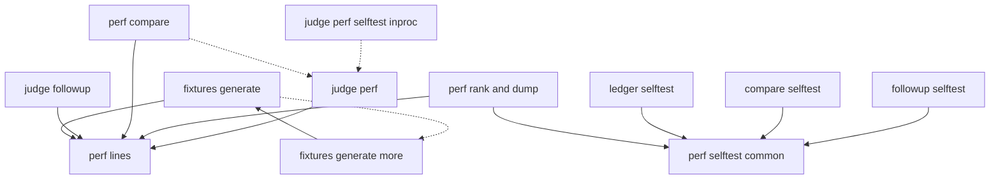
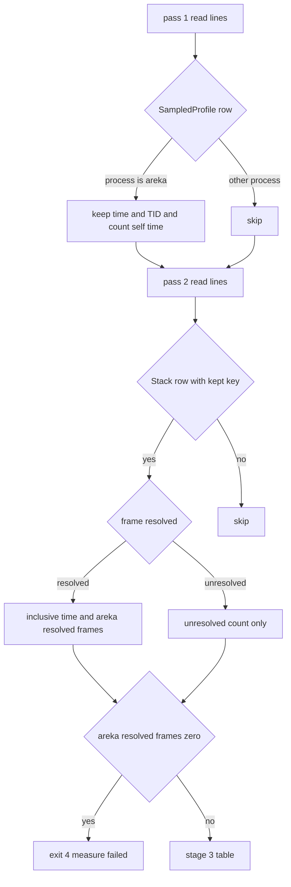

# 設計: audit-tools-perf-judge

## Overview

**Purpose**: 性能改善ループの判定と台帳の道具（`tools/perf/` のうち `.ps1` でない 284 ファイル）に ponytail の audit をかけて出た 81 件（Must fix #1〜#4・Should fix #5〜#41・Nice to have #42〜#81。`research.md` §3）を、全部直す。直さずに残す指摘は 0 件（要件の「確定した直す対象」）。

**Users**: 自走改善ループ（`perf-loop-iteration` スキルと係のエージェント）・PowerShell の道具（`audit-tools-perf-run` の持ち物。Python を引数と終了コードで呼ぶ）・順位表と台帳を読む開発者。

**Impact**: 本番の数が変わるのは 4 件＝#2（`talk_peak_cpu_pct` が起動の重い区間を含まなくなる）・#3（段③が areka 以外のプロセスを数えない）・#4（TID の使い回しで段②の名簿外の残りが膨らまない）・#21（順位表から `talk_peak_pct` が消える）。終了コードが変わるのは、手で作った入力や想定外の失敗のときだけ（#5・#6・#7・#8・#10・#11・#14・#15・#20・#55・#62）。読み方の写し（#40）と自己較正の支えの写し（#41）を兄弟のモジュールへ寄せ、消せるコードを消して、約 −500 行になる。過去の `results/` の数は書き替えない（要件の討議・研究 §8）。

### Goals
- 81 件を、§Components の「指摘ごとの直し」のとおりに直す（2.1・2.3）。
- 直したバグと危ない所（#1〜#27）の 1 件ずつに、壊れたら落ちるテストを、`perf-loop.ps1 selftest` が毎回回す所に置く（4.7・4.8）。
- 直しの後に同じ作法で audit をかけ直して新しい指摘を 0 件にし（5 回目の打ち切りの決まりつき）、自己較正と全体テストを緑にする（4.1〜4.6）。

### Non-Goals
- 新しい機能・引数・判定式・較正値の見直し（#2 の語彙は今の kanade に合わせる直しで、判定の閾値は変えない）。
- `tools/perf/*.ps1`・Rust（`crates/`）・`Cargo.toml`・`Cargo.lock`・`vendors/` の変更（6.2・6.4・6.6）。
- 範囲の外で観察した穴（研究 §4.2）の直し（5.6）。
- 過去の走行の記録（完了 spec の `results/`・`loop-ledger.md`）の書き替え。

## Boundary Commitments

### This Spec Owns
- `tools/perf/` の `.ps1` でないファイル全部（判定・順位表・比べ・台帳・自己較正・検体・目標定義・README）の、§File Structure Plan に挙げた直し。
- 新しく置く 4 本のモジュール: `tools/perf/perf_lines.py`（行の読み方）・`tools/perf/perf_selftest_common.py`（自己較正の支え）・`tools/perf/judge_perf_selftest_inproc.py`（judge-perf の、検体では作れない場面の較正）・`tools/perf/fixtures/generate_more.py`（新しい判定の検体の組み立て）。
- 直しの形が変わるために要る、範囲の外の 1 行ずつの直し: `.claude/agents/perf-measure.md`（#21・#66）・`.claude/agents/perf-analyze.md`（#66）・`.kiro/specs/talk-thread-count-growth/brief.md` への一言（議題 9）。どれも C20 で受け持つセッションが無い（C20 の 8 本＝roadmap「組済みのウェーブ」に、`.claude/agents/` と `talk-thread-count-growth` の持ち主は居ない）。
- `audit-tools-perf-run` から受けた直し: `goals/draw-load-parity.toml` の `[sampling]` の注釈の wpaexporter の行と README の説明（`[sampling]` の段と `backend` の鍵は残す）・README の段③の理由の語の一覧に `no_record` を足す・README の §11 と §14 の 3 か所（perf-run の文 ①〜③・§File Structure Plan の README の表）。あちらは README を書かない（2026-11-14 の 2 回目の申し合わせ）。
- 2 本とも手を入れる文書の申し合わせ（2026-11-14）: `.claude/skills/perf-loop-iteration/SKILL.md` はあちらが 37 行と 196 行の直後を直し、こちらは触らない。`.claude/agents/perf-measure.md`・`perf-analyze.md` はこちらだけが直す（理由の語を並べるときは、perf-loop が渡す語も並べるなら `no_record` を入れる）。

### Out of Boundary
- `tools/perf/*.ps1`（`audit-tools-perf-run`）。古い行番号の 2 か所（`perf-loop.common.ps1:188`・`perf-loop.ps1:510`）もあちらが直す（議題 2）。
- `crates/` の全部。`crates/areka/src/placement_tests/transition_judge.rs` の古い行番号は `audit-placement-follow` が直す（議題 2）。`crates/areka/src/perf_thread_report.rs` とテストは読むだけ（議題 9）。kanade（`crates/areka-kanade/src/schedule/`）は読むだけ（#2）。
- Rust の注記の「`judge-perf.py` の `parse_fields`」の文。`parse_fields` を共通モジュールへ移しても、judge-perf はその名前で読み込むので、名前で指す文はずれない（設計の決め D2）。
- `.claude/skills/perf-loop-iteration/SKILL.md`（#15 の後も「必ず渡す」の文は正しいので直さない）・`doc/COMPAT_ARCHITECTURE.md`（名前で指す・ずれない）。
- 完了した spec の文書（`.kiro/specs/completed/`）と過去の `results/`。

### Allowed Dependencies
- Python 3.11 以上の標準ライブラリだけ（`tomllib`・`unittest.mock`・`dataclasses`・`math`・`re`・`shutil`・`uuid`）。依存を足さない（6.4）。
- 層の向き: `perf_lines` ← 道具（`judge-perf.py`・`perf-rank.py`・`perf_rank_dump.py`・`perf-compare.py`・`judge-followup.py`・`fixtures/generate.py`）。`perf_selftest_common` ← 自己較正（`judge_followup_selftest.py`・`perf_compare_selftest.py`・`perf_ledger_selftest.py`・`perf-rank.py` の自己較正）。共通の 2 本は道具を読まない。`perf_lines` は判定式も較正値も持たない（`J_CPU_CSV_HEADER`・`PERCENTILE_METHOD`・`WARMUP_EXCLUDE_SEC`・エラーの終了コードと文は道具に残す）。`perf-compare.py`・`perf-rank.py` は今までどおり `judge-perf.py` を読まない（議題 4）。
- 兄弟の読み込みは今の形（`sys.path` へ自分のフォルダを入れて `import`）。`fixtures/generate.py` は親のフォルダを入れて `perf_lines` を読む。

### Revalidation Triggers
- `perf_lines` の関数の形（名前・引数・戻り値）を変えるとき: 4 本の道具と `generate.py` の自己較正を全部回す。`parse_fields` の名前と切り方（空白の直後の `名前=値`・同じ名前は後勝ち）を変えるときは、Rust の写しのテストを持つ見直しの spec へ知らせる（5.3）。
- judge-perf の `SCRIPT_VERSION` を上げるとき: 版を字面で持つファイルを全部、同じコミットで上げる（D10 の一覧・`perf-loop.ps1` の preflight と perf-compare の門と compare の逐語の期待出力が突き合わせる）。
- `perf_lines` の振る舞い（`parse_fields`・`read_cpu_csv`・`percentile` ほか、判定の数を決める読み方）を変えるとき: judge-perf の較正値を変えたのと同じに扱い、judge-perf の `SCRIPT_VERSION` と D10 の一覧を同じコミットで上げる（`percentile` は較正値 `PERCENTILE_METHOD` そのものの実装・`parse_fields` と `read_cpu_csv` は合否を直に決める）。版が上がらないと、比べと preflight の版の門が判定の変わったことを捕まえられない。
- 終了コード・`key=value` の語・最後の行の形・引数を変えるとき: `audit-tools-perf-run` と申し合わせる（6.1・C20 の約束 ⑷）。この設計の中で変わるのは、申し合わせ済みの #6・#55・#67 と、知らせ済みの #5・#24・#25・#26 だけ。
- kanade の `event=` の語を足す・消すとき: `J_TALK_START_EVENTS`・`J_TALK_END_EVENTS` を見直す（§設計の決め D4 の表）。

## Architecture

### Existing Architecture Analysis
- 道具は 1 本ずつ独立したスクリプトで、兄弟のモジュール（`judge_perf_catchup.py`・`perf_rank_dump.py`・`perf_ledger_goal.py`・`*_selftest.py`）を `sys.path` の先頭に自分のフォルダを入れて読む。本体の名前にハイフンがあるので、兄弟は本体を読まない（`perf_ledger_goal.bind(CORE)` と `SelftestEnv` で本体から渡す）。
- 自己較正は検体のフォルダを並べて、本体の `main(argv)` を同じプロセスで呼び、終了コードと出力を比べる。`perf-loop.ps1 selftest` が 5 本の Python の `--selftest` を順に回す（並べて回さない）。
- 判定の検体（`fixtures/`）は `generate.py` が作り、作り直してバイトが一致することを約束にしている。順位表・比べ・台帳の検体（`fixtures-loop/`）は手書き。
- 写し: 行の読み方（ANSI・時刻・`parse_fields`・`split_after_message`・`read_text_lines`・`read_cpu_csv`・`percentile`）が 4 本の道具と `generate.py` に、自己較正の支え（ケースの読み・`_invoke`・`_first_difference`・赤の下限・一時フォルダ）が 4 組にある（#40・#41）。

### Architecture Pattern & Boundary Map



- 実線は `import`。点線は「本体から渡される」（`generate.py` の `main()` が `generate_more.CASES` を読み込み時でなく実行時に読む・judge-perf の `--selftest` が本体の加群を `judge_perf_selftest_inproc` に渡す・perf-compare は judge-perf を別プロセスで呼ぶ）。
- 新しいモジュールは 4 本。理由は §設計の決め D1〜D3・D5。

### Technology Stack

| Layer | Choice / Version | Role in Feature | Notes |
|-------|------------------|-----------------|-------|
| CLI | Python 3.11 以上（この機械 3.13.17）・標準ライブラリだけ | 直す対象 | 依存の増減 0 |
| Data | `run.log`・`cpu.csv`・`run-meta.txt`・`dump.txt`・`loop-ledger.md`・`*.toml` | 読み方の直し（#2〜#4・#7・#13・#56） | 形は変えない |
| Runtime | `<リポジトリ>\target\perf-loop-tmp\` | 自己較正の一時フォルダ（#1） | `perf-loop.ps1` と分け合い、子のフォルダ名で分ける |

### 設計の決め（研究 §8・§8.1 を閉じる）

- **D1（#1 の一時フォルダ）**: 置き場は `<リポジトリ>\target\perf-loop-tmp\<接頭辞><uuid4 の 16 進>\`。リポジトリの根は `Path(__file__).resolve().parents[2]`（`tools/perf/perf_selftest_common.py` の 3 つ上＝`parents[0]` は `tools/perf`・`[1]` は `tools`）。読み込みのときに `REPO_ROOT / "Cargo.toml"` があることを確かめ、無ければ理由を stderr に出して exit 3（根を取り違えたまま `tools\target\` の下に作らない・`.gitignore` の `target` はどの深さにも当たるので、取り違えは git では見えない）。`perf-loop.ps1` も同じ根の下に `perf-loop-selftest-<GUID>` の子を作り、子だけを消す（`perf-loop-tmp` そのものは誰も消さない）ので、子の名前が違えばぶつからない。道具ごとの接頭辞は今の `TemporaryDirectory(prefix=…)` の値をそのまま使う（`judge-followup-selftest-` ほか 4 つ）。作るのも消すのも `perf_selftest_common.work_dir(prefix)` の 1 か所（`with` を抜けるとき子を `shutil.rmtree`。消せなかったら理由を stderr に 1 行出して、結果は変えない）。
- **D2（#40 の行の読み方の置き場）**: `tools/perf/perf_lines.py`。置くのは道具に依らない読み方だけで、判定式・較正値・道具の終了コード・道具に固有の文は置かない（読みの失敗の文の共通の部分は置き、道具ごとの末尾は呼び手が渡す）。失敗は呼び手が渡す作り手（`fail(message, details) -> Exception`）で起こす（`SelftestEnv.bad_input` と同じ型）。judge-perf は `from perf_lines import parse_fields, split_after_message, …` で同じ名前のまま読み込むので、`judge-perf.py` の `parse_fields` を名前で指す範囲の外の文（Rust の注記 10 ファイル・`judge-followup.py:125`）はずれない。名前が決まったので `audit-placement-follow` へ「置き場は `tools/perf/perf_lines.py` の `parse_fields`・judge-perf はその名前で読み込む」と知らせる（タスク 1 の完了条件）。
- **D3（#41 の自己較正の支え）**: `tools/perf/perf_selftest_common.py`。置くのは、ケースのフォルダの並べ方（`.` と `_` で始まるフォルダを飛ばす・`case.txt` の無いフォルダを素材置き場として名を出す）・ケースの鍵の読み（知っている鍵の外は exit 3）・本体の `main` を同じプロセスで呼ぶ `invoke`・最初の違いを出す `first_difference`（違う行は `ascii()` で出す＝#25）・赤の下限の確かめと `SELFTEST RESULT ok=N ng=M` の行・一時フォルダ（D1）・木全体の見張り `check_tree`（下の T1・T13・T27）。道具ごとの違い（鍵の一覧・`_run_case`・期待出力の突き合わせ・赤の値）は道具に残す。judge-perf の自己較正（その場の `fixtures/` を読む・一時フォルダを使わない・報告の形が違う）は寄せない（研究 §1 の #41 の受け持ちに入っていない）。
- **D4（#2 の語彙）**: kanade の `schedule/` が出す `event=` を全部読んで（`tracing::info!(target: "kanade", event = …)`）、次の 2 組にする。注記は行番号をやめて、ファイル名と語で指す（#74）。

  | 組 | 語（出所は `crates/areka-kanade/src/schedule/` のファイル） |
  |---|---|
  | 始まり（9） | `boot_talk`（boot.rs）・`steady_talk`・`steady_talk_replace`（steady.rs）・`sstp_send_started`・`sstp_notify_talk`（sstp.rs）・`choice_script_started`（steady_choice_script.rs）・`close_talk_start`（close.rs）・`change_talk_start`・`change_yielded_talk_start`（change.rs） |
  | 終わり（10） | `steady_talk_done`・`steady_talk_done_close`（steady.rs）・`boot_talk_done`（boot.rs）・`close_talk_done_quit`（close.rs）・`change_talk_done_unload`・`change_cancelled`・`change_pending_consumed`（change.rs）・`talk_done_quit`・`talk_done_break_quit`・`talk_done_interrupted_as_non_quit`（mod.rs） |

  - 消す語: `close_refused`（`crates/` のどこからも出ない）。
  - 足さない語: `talk_done_stale`・`unknown_talk_done`（古い・知らないトークの話）・`change_yield_to_close`（後に自分の終わりが続く）・終わりの印を出さない道（`force_quit`・`shiori_down`・`shiori_failed`・`close_deadline_exceeded`・`change_deadline_exceeded`）。終わりの印の無い道はどれもすぐ降ろしへ進み、区間はログの最後の行で閉じる（今の `talk_spans` の決め）ので、頂の値はほとんど変わらない。
  - `talk_spans` の決め（同じ時刻は終わりが先・開いている間の始まりは無視・開いていない終わりは無視・最後まで開いた区間は最後の行で閉じる）は変えない。`talk_done_interrupted_as_non_quit` の後に `steady_talk_done` が続く二重の終わりは、2 つ目が無視されるだけで害が無い。
  - `sstp_send_started` は翻訳の返事を待つ前に出るので、区間が翻訳の分だけ早く始まりうる。頂は区間の中の最大なので、早く始まる分は CPU の小さい時間を足すだけ（受け入れる）。
- **D5（判定の検体の置き場・議題 6・要件 7.1）**: 新しい判定の検体の組み立ては `tools/perf/fixtures/generate_more.py` に置く。`generate_more` は `import generate` で `Fixture`・行の組み立て・定数を読み、`CASES`（関数の組）を持つ。`generate.py` の `main()` は実行時に `import generate_more` して `CASES + generate_more.CASES` を作る（読み込み時に読むと `__main__` との循環になる）。作り直してバイトが一致することを確かめる約束は、新しい検体にもそのまま当たる。手書きの検体は足さない。
- **D6（#3・#23・#61 の dump の読み方）**: dump を 1 行ずつ 2 回読む（`open()` を 2 回・丸ごとは読まない）。1 回目は `SampledProfile` の行だけを見て、列 `Process Name ( PID)` が `areka.exe (` で始まるもの（PID の前の空白の数に依らない）の (時刻, TID) を集め、自己時間を数える。2 回目は `Stack` の行のうち (時刻, TID) が集めた組に当たるものだけを、包含時間と未解決・解決のフレームの数に入れる。2 回に分けるので、`Stack` の行が自分の `SampledProfile` の前に来ても後に来ても同じに数える（`sample_ok` の検体は後に来る形）。列は今どおり列名の行から引き、列の確かめは事象ごとにする（`SampledProfile` は `TimeStamp`・`Process Name ( PID)`・`ThreadID`・`Image!Function`、`Stack` は `TimeStamp`・`ThreadID`・`Image!Function`。`Stack` の列名の行には処理名の列が無い）。areka の解決フレームは、解決済みの枝の中でだけ数える（#23）。空の dump の確かめ（`:242`）は「空でない行を 1 本も見なかった」に置き換える。
  - 確かめたこと: 列名の行の綴りは、`invoke-cpu-sample.ps1` の注記が Windows Performance Toolkit の書式そのものとして写したもの（`SampledProfile, TimeStamp, Process Name ( PID), ThreadID, …`・`Stack, TimeStamp, ThreadID, No., Address, Image!Function`）と、検体 `sample_ok` の列名の行で一致する。採取（`xperf -on PROC_THREAD+LOADER+PROFILE -stackwalk Profile`）は処理を絞らない＝システム全体。
  - 確かめていないこと: 実物の dump の未解決フレームの綴り（`areka.exe!0x…` と読む）と、Idle の行の量。手元に実物の dump は無い（研究 §8・ツリーと `target\` を探して 0 件）。2 回読みは順序にも量にも依らないので、直しの正しさは綴りの 1 点だけに懸かる。実物での確かめは §Testing Strategy の「実機の確かめ（任意）」に置く。
- **D7（#4 の直し方・議題 9）**: perf-rank の中だけで、差の基準（basis=delta）で `perf(process)` の差が取れたときは、名簿外の残りの行の `cpu_us` を `max(プロセスの差 − 名簿の行の差の合計, 0)` に置き換える（行の差でなく）。役割別とスレッド別の表はその行の値を読むので、両方が直る。`perf(process)` の差が取れないとき（行が無い）は今どおり行の差（占有率はもともと出さない）。TID の照らし方（TID で照らす・新しい TID は全量・消えた TID は落とす・0 で止める）は Rust の `delta`（規則の正本）と同じまま変えない。だから使い回された TID の新しいスレッドは、その窓では 0 に見え、その CPU は名簿外の残りに入る（合計はプロセスの CPU を越えない）。README の「名簿は登録を消しません」（`thread_registry.rs` は同じ TID の登録を置き換える）を事実に合わせる。既存の期待出力（`full_ok`・`no_dump_unavailable`）は同じ値のまま（研究の照らし合わせ）。
- **D8（#22 の役割名の畳み方）**: 役割別の表を作るときだけ、`re.sub(r"^(actor:.+)-\d+$", r"\1-*", role)` で畳む（`actor:sakura-talk-5` → `actor:sakura-talk-*`）。スレッド別の表は元の役割のまま。今 `crates/` で `-<数字>` で終わる役割名はトークのスレッド（`areka-sakura` の `drive.rs` の `sakura-talk-{id}`）だけ。
- **D9（端末の文・議題 3）**: Python の道具の最後の行は ASCII の決まった形にする（`judge-perf.py`＝`SELFTEST RESULT ok=N ng=M`・失敗の締めは `JUDGE-PERF RESULT code=N`）。標準エラーへ出す失敗の文は、指摘が挙げた道具（`judge-perf.py` の枠の行と失敗の理由・`perf-rank.py` と `perf_rank_dump.py` の `RankError`・`judge-followup.py`・`perf-compare.py`・`fixtures/generate.py`）で英語の ASCII にする。報告の本文（`judge-followup.py` の標準出力の報告・`verdict.txt`・`rank.txt`・`compare.txt` の本文・`[selftest]` の行の題）は日本語のまま。`perf-ledger.py`・`perf_ledger_goal.py` の失敗の文は指摘に入っておらず、スキル（`SKILL.md` の「台帳が無い」の見分け）が日本語の語を読むので変えない。入口で `sys.stdout`・`sys.stderr` を `errors="backslashreplace"` に（今 `replace` の所も同じ形にそろえる）。
- **D10（`SCRIPT_VERSION`）**: judge-perf は「較正値を変えたら上げる」（バナーの決め）。#2 でバナーの `J_TALK_*` が変わるので `0.4.0` → `0.5.0` に上げ、版を字面で持つ次のファイルを同じコミットで `0.5.0` にする（どれか 1 つでも残すと、比べの自己較正の版の門か逐語の比べ、または `perf-loop.ps1 selftest` の `goal-text-vs-goal-md` が赤になる）: `goals/draw-load-parity.toml` の `judge_version`・`goals/draw-load-parity.goal.md`（56 行の条件文の版）・`fixtures-loop/compare/goal.toml` と `fixtures-loop/compare/na_secondary/goal.toml` の `judge_version`・`fixtures-loop/compare/*/expected_compare.txt` 8 本の「judge-perf.py 0.4.0」。`fixtures-loop/ledger/` の `goal.toml` と `judge-stub.py` の `0.4.0` は偽の判定スクリプトと対になって閉じているので変えない。注記の「0.4.0 で足した」の類（`generate.py`・`judge_perf_catchup.py`・`perf-loop.common.ps1:464` の例）は来歴なので変えない。この版上げはタスク 6 で 1 回だけ行い、`fixtures-loop/compare/` を触るタスク 7 と、`goals/draw-load-parity.toml` を触るタスク 10 はタスク 6 の後に置く。字面の形（`SCRIPT_VERSION = (` の次の行の最初の引用符の中の最初の語）は変えないので、`perf-loop.common.ps1` の読み方は変わらない（6.1 の口の形は不変・値だけ）。版の文の中身は 0.5.0 の変更点の一文に書き替え、行は増やさない。ほかの道具（perf-rank・perf-compare・judge-followup の `0.1.0`）は上げない（決まりが無く、期待出力の版の字面を全部直すことになる）。
- **D11（1,000 行の決まりの当て方・要件 7.1）**: `judge-perf.py`（4,159）と `fixtures/generate.py`（1,244）は、どのタスクの終わりでも着手のときの行数を越えない。新しい関数と新しい検体の組み立ては新しいファイル（D2・D3・D5・`judge_perf_selftest_inproc.py`）に置く。既存の関数の中の数行の書き換え・足しは、同じタスクの削りと差し引きで数える。1,000 行に近い `perf-ledger.py`（996）・`perf-compare.py`（969）・`perf-rank.py`（957）・`judge-followup.py`（931）も 1,000 行を越えない（`perf-ledger.py` は #59 の `SelftestEnv` の消しで相殺し、なお越えるなら #14・#20 の `entry.json` の検査を `perf_ledger_goal.py` へ置く）。
- **D12（#6・#8 の較正）**: 検体では作れない場面（想定外の例外・明示指定 2 系列）は、新しい `judge_perf_selftest_inproc.py` が、judge-perf の `--selftest` から渡された本体の加群の関数と定数を `unittest.mock.patch.object` で差し替えて `main(argv)` を呼んで確かめる。judge-perf の `--selftest` の終わりに呼び出しを 1 つ足すだけ（D11 の差し引き）。

## File Structure Plan

### Directory Structure
```
tools/perf/
├── perf_lines.py                    # 新規: 行の読み方（#40・#7・#13・#51）
├── perf_selftest_common.py          # 新規: 自己較正の支えと木全体の見張り（#41・#1・#13・#25・#27）
├── judge_perf_selftest_inproc.py    # 新規: judge-perf の差し替えの較正（#6・#8・#24）
├── judge-perf.py                    # 変更: 読み方を perf_lines へ・#2・#5〜#9・#24・#36〜#39・#42〜#46・#48〜#51・#74〜#77・版
├── judge_perf_catchup.py            # 変更: #39・#47・#81
├── perf-rank.py                     # 変更: 読み方と支えを共通へ・#4・#7・#21・#22・#25・#34・#35・#62・#63・#65・#67
├── perf_rank_dump.py                # 変更: #3・#23・#61・#64・#25
├── perf-compare.py                  # 変更: 読み方を perf_lines へ・#7・#10〜#12・#26・#56・#74
├── perf_compare_selftest.py         # 変更: 支えを共通へ・#1・#12 の確かめ
├── judge-followup.py                # 変更: 読み方を perf_lines へ・#13・#26・#52・#53・#74
├── judge_followup_selftest.py       # 変更: 支えを共通へ・#1・#31
├── perf-ledger.py                   # 変更: #14・#15・#19・#20・#54〜#57・#59・#81
├── perf_ledger_goal.py              # 変更: #16〜#18・#55・#59・#60・#81
├── perf_ledger_selftest.py          # 変更: 支えを共通へ・#1・#17・#33・#59
├── README.md                        # 変更: §Modified Files の README の行
├── goals/draw-load-parity.toml      # 変更: #60・#81・judge_version・wpaexporter の注釈
├── fixtures/
│   ├── generate.py                  # 変更: generate_more を呼ぶ・perf_lines を読む・#68〜#73
│   ├── generate_more.py             # 新規: 新しい判定の検体の組み立て（D5）
│   ├── H1b_unpinned_slow_series/    # 削除（#68）
│   └── <新しい検体のフォルダ>/       # 新規（generate_more が作る・§Testing Strategy の表）
└── fixtures-loop/{compare,followup,ledger,rank}/<新しいケース>/  # 新規（手書き・§Testing Strategy の表）
```

### Modified Files

| ファイル | 変わること | 指摘 |
|---|---|---|
| `perf_lines.py`（新規） | §Components の「行の読み方」の API。U+FEFF の字は書かず `decode("utf-8-sig")`。`read_cpu_csv` は `math.isfinite` でない値を壊れた行に・行番号を振ってから空行を飛ばす | #40・#7・#13・#51 |
| `perf_selftest_common.py`（新規） | §Components の「自己較正の支え」の API | #41・#1・#25 ほか |
| `judge_perf_selftest_inproc.py`（新規） | `run(judge) -> list[str]`（食い違いの理由の一覧）。T6・T8・T24 の 3 つの確かめ | #6・#8・#24 |
| `fixtures/generate_more.py`（新規） | §Testing Strategy の判定の検体の組み立て・`CASES` | #2・#5・#7・#9・#13・#28〜#30・#43 |
| `judge-perf.py` | 754-822・1116-1164・1209-1213 を `perf_lines` の読み込みへ（`_FIELD_KEY_RE`・`CpuSample` は同じ名前で読み込む・`read_cpu_csv` は `J_CPU_CSV_HEADER` と `inconclusive` と「要件 2.5」の文を渡す）。#2 の 2 組（D4）。`main` に `except Exception`（traceback を stderr・3）。関門 2473-2524 は未観測を集めるだけにして `if failures:` の後で判定不能。`render_metrics` は時刻の読めない catch-up があれば `catchup_count` を `-`。profile の関門を `(meta_profile or "").strip().lower() not in ("short", "long")`。#36〜#39 の消し・#48 の `partial`・#49・#50・#42〜#46・#74〜#77 の文。終わりの行（D9）。版（D10）。`--selftest` の終わりで `judge_perf_selftest_inproc.run(sys.modules[__name__])` | #2・#5〜#9・#13・#24・#36〜#46・#48〜#51・#74〜#77 |
| `judge_perf_catchup.py` | 定常の catch-up を呼び手から受ける（#39）・`_timedelta_seconds` を消す・頭書きの「3,500 行」 | #39・#47・#81 |
| `perf-rank.py` | 146-211・352-393 を `perf_lines` へ（`CPU_CSV_HEADER` と `measure_failed` を渡す）。727-884 の支えを `perf_selftest_common` へ。#4（D7）・#22（D8）。`talk_peak_pct` と窓の定数・注記を消す。`--sampling-available` から `true` を消す。`dump_present = dump_path.is_file()`。`perf(process)` の欄を `snap`・`cpu_us` だけに。`run=` は `run_dir.resolve().name`。`RankError` の文を英語に（D9） | #4・#7・#21・#22・#25・#34・#35・#40・#41・#62・#63・#65・#67 |
| `perf_rank_dump.py` | D6 の 2 回読み・事象ごとの列の確かめ・解決済みの枝の中で数える。`DumpScan.tids` を消す。文を英語に | #3・#23・#25・#61・#64 |
| `perf-compare.py` | 311-327 を `perf_lines` へ。床の検査（`bool` を拒み `not floor > 0` で拒む）。数の取れた走行のどれにも副指標の鍵が無ければ exit 3。`compare.json` の各走行に `judge_stderr`（計測失敗の stderr にも添える・`compare.txt` は変えない）。`to_number` は `math.isfinite`。`encoding="utf-8-sig"`。stderr の文を英語に。79・99・103 の行番号を名前に | #7・#10〜#12・#26・#40・#56・#74 |
| `perf_compare_selftest.py` | 支えを共通へ。`judge_stderr` の確かめ・`to_number("nan") is None` の 1 行 | #1・#12・#41 |
| `judge-followup.py` | 132-209 を `perf_lines` へ（`_BARE_TIMESTAMP_RE`・`parse_stamp_value`・`to_int`・`to_float` は残す）。`DRAG_DX_PX` を消して `probe.log` の `step=gesture` 行の `dx`・`dy` を期待値に（無ければ判定不能）。625・616 の使われない `or`。stderr の文を英語に。106〜112 の出所の注記（`clickthrough/controller.rs:212`・`registry.rs:18-23` ほか Rust の行番号）を、ファイル名と項目の名（例「`clickthrough/registry.rs` の `DesiredState`」）に（`audit-wintf-input` の直しで行が動く・2026-11-14 にあちらへ伝えた） | #13・#26・#40・#52・#53・#74 |
| `judge_followup_selftest.py` | 支えを共通へ。`followup-verdict.txt == 標準出力` の突き合わせ | #1・#31・#41 |
| `perf-ledger.py` | `load_entry_json` で verdict が空なら exit 3・山括弧の値（`<` で始まり `>` で終わる）なら exit 3。`append` の `--iteration` を必須にし既定の枝を消す。`cmd_final` で許さない字を `_` に。`set-phase --best` を `math.isfinite`。目標定義の値の型を確かめて exit 3。`encoding="utf-8-sig"`。`write_text` に flush → `os.fsync`。`SelftestEnv` を消して `bind`。132・181-182 の文 | #14・#15・#19・#20・#54〜#57・#59・#81 |
| `perf_ledger_goal.py` | 版の正規表現を `(?m)^SCRIPT_VERSION\s*=\s*\(?\s*"([^"\s]+)` に。goal-text の検査を `line.startswith((STATUS_PREFIX, FINAL_PREFIX))` に。`_final_release_idle_text` は拾えない・OSError のとき理由を stderr へ・`--goal` があれば `[goal].results_dir`・docstring を事実に。`formulas`・`main_model_recommended` を `GOAL_SCHEMA` から消す。型の確かめ（#55）。4,000 字の境目を「以内」に（`> 4000` で拒む）・223・117・555-556 の文 | #16〜#18・#55・#60・#81 |
| `perf_ledger_selftest.py` | 支えを共通へ。`bind(core)`。goal-text の検査の関数を直に呼ぶ確かめ（T17） | #1・#17・#41・#59 |
| `fixtures/generate.py` | `main()` が `generate_more.CASES` も作る。`strip_ansi`・`_ANSI_RE` を `perf_lines` から読む（色付けの `_TS_RE`・`_FIELD_RE` は残す）。`case_H1b` を消し、その docstring の「task 3.2 の裁定」の記録を `case_H11` の note へ移す。C1・C2・T2 の note を事実に。端末の文を英語に。作ったもの以外のフォルダ（`_`・`.` で始まらないもの）があれば名を出して exit 1。H12c は `case_H12()` から作って名前とフォルダと色付けだけ差し替える。`write()` の確かめを `rmtree` の前へ。195 行の行番号を名前に | #40・#68〜#74 |
| `goals/draw-load-parity.toml` | `formulas`・`main_model_recommended` とその注釈を消す。80 行の `max_iterations` の注釈の語を `iteration_cap` に。122 行の wpaexporter の注釈を消す（`[sampling]` と `backend` は残す）。`judge_version = "0.5.0"` | #60・#81・D10・申し合わせ |
| `fixtures-loop/ledger/*/goal.toml` | `formulas`・`main_model_recommended` を消す（5 本）。`judge-stub.py` 5 本と同じ中身の `goal.toml` 2 本を `fixtures-loop/ledger/_shared/` の 1 本ずつへ（ハーネスの `@SHARED@` の置き換え） | #58・#60 |
| `fixtures-loop/ledger/*/steps.txt` | 既定の周番号に頼る 5 本に `--iteration N` | #15 |
| `fixtures-loop/rank/*` | `talk_peak_pct` を消した期待出力 3 本（`full_ok`・`no_dump_unavailable`・`no_tick_lines`）。`no_dump_unavailable` に `--sampling-available false --unavailable-reason not_elevated`。`unresolved_dump` を `auto` に。`sample_ok_counts/case.txt` の ThreadID の注記。英語にした文に合わせた `stderr_substr` | #21・#25・#34・#64・#67 |
| `fixtures-loop/compare/*`・`followup/*` | 英語にした文に合わせた `stderr_substr` | #26 |
| `README.md` | §Modified の README の表（下） | 多数 |
| `.claude/agents/perf-measure.md` | 57 行の `talk_peak=` を消す（72 行の比べの `talk_peak` は judge の指標なので残す）・段①〜④の理由の語を 1 行 | #21・#66 |
| `.claude/agents/perf-analyze.md` | 68 行の付近に rank の理由の語を 1 行 | #66 |
| `.kiro/specs/talk-thread-count-growth/brief.md` | 「#4・#22・#63 は `audit-tools-perf-judge` が perf-rank の中で直した（D7・D8）」の一言 | 議題 9 |

README の直し（タスク 13 にまとめる）:

| 所 | 直し | 指摘 |
|---|---|---|
| 38・42・46・860・884-886・993・1117-1121 | 例の道筋を `<ワークツリー>\target\perf\…` の置き換え札に・§1 は `-OutDir` を省く | #27 |
| 138-140 | バルーンの窓口の文 | #79 |
| 194・1002-1003 | `-AutoQuiet` の 2・`check-quiet.ps1` の読み直し | #80 |
| 258 | 較正値の範囲の終わりを `J_DPI_SHOW_FIELDS` まで | #76 |
| 344・411・403-423（§9） | H1b を消して H11 へ向ける・「task 3.2 の裁定」の記録・C1・C2・T2 と新しい検体の行・`contains =`・`emit_metrics = yes` の 1 文 | #68・#78 |
| 394・397-399 | 4 つの終了コードを毎回再現する形に | #42 |
| §12 の 4 番 | 検体の名を書き足す | #29 |
| 830 | 段①の `talk_peak_pct` の説明を消す | #21 |
| 870-878 | 名簿外の残りの出し方（D7）・「名簿は登録を消しません」を事実に | #4 |
| 901-906 | rank が自分で出す理由の語（`no_perf_thread_lines`・`no_tick_lines`・`no_dump`・`declared_unavailable`）を 1 行・段③の理由の語に `no_record`・0 バイトの dump は計測失敗 | #62・#66・申し合わせ |
| 919-920 | 段③は areka の処理の行だけを数える | #3 |
| `[sampling]` の説明 | wpaexporter の道の説明を消す | 申し合わせ |
| 579-591（§11） | Python の道具の最後の行と失敗の文（D9） | #24〜#26 |
| 555（§11 の NOT_QUIET の項） | 関数名を `Test-MeasureQuietAfterOk` から `Test-MeasureRunComplete`（新しい `perf-loop.rundir.ps1`）に。文を「`-Resume` で使うのは `run.log`・`cpu.csv`・`run-meta.txt` が在り、`run-meta.txt` に `ended_utc` の行が在り、`quiet-after.txt` が QUIET の走行だけ。欠けた走行は `<走行>-INCOMPLETE-<時刻>`、静かでない走行は `<走行>-NOTQUIET-<時刻>` へ退ける（測ったものは消さない）」に | 申し合わせ（perf-run の文 ①） |
| 563-573（§11 の端末の文字コードと子の出力） | 「読む所は 2 つ」と「pwsh の子」の項を「読む所は `perf-tool-base.ps1` の `Invoke-Child` 1 つ（`perf-loop.common.ps1` が読み込む）。`perf-loop.ps1` とその部品・`invoke-perf-run.ps1`・`invoke-followup-checks.ps1`・`invoke-cpu-sample.ps1` はどれも `Invoke-Child`（pwsh の子は同じファイルの `Invoke-PwshChild`）を使い、`tools/utf8-child.ps1` の `Invoke-Utf8Child` は `tools/perf` からは使わない。`invoke-cpu-sample.ps1` が回す xperf の出力だけは端末の文字コードで読む」に | 申し合わせ（perf-run の文 ②） |
| 880-887（§14 の段③のコマンドの塊と項） | 塊に `-Cancel`（途中で止まった採取の取り消し・ランナーが使う）の 1 行。`-Probe` の注を「採れるか（必ず exit 0・1 行に available・reason・elevated・xperf_path）」、`-SelfTest` の注を「道具の点検（採取は試さない）」に。項「rank-run では、段③の採取はランナー（`invoke-perf-run.ps1 -SampleEtl`）が静かさの確かめの後、areka を起こす直前に始め、失敗したらランナーが取り消す。止めて記号を解くのは perf-loop（`-Stop`）。`-Stop` はまとめが通ったら元の ETL を消す」を足す | 申し合わせ（perf-run の文 ③） |

- perf-run の文 ①〜④ の中身は `audit-tools-perf-run` の設計の「範囲の外で直す文」の表が正本（行番号はあちらの HEAD `1521bfd5`）。④（902-903 行に `no_record` を足す）は上の 901-906 行の直しに入っている。あちらの `.ps1` の振る舞いに合わせる文なので、あちらの着地の後に、着地した形と食い違わないかを確かめてから入れる（あちらが先に着地しなければ、着地した方が取り込みで合わせる）。

- 触らないもの: `tools/perf/*.ps1`・`crates/`・`Cargo.*`・`vendors/`・`.claude/skills/`・`doc/`・完了した spec の文書と `results/`。

## System Flows

D6（#3・#23・#61）の dump の読み方:



- 列名の行が無い・知っている列が欠ける事象は、今どおり exit 4（理由つき）。2 回目は 1 回目と同じファイルを開き直す（読んでいる間にファイルが変わる場合は考えない＝採取が終わってから読む）。

## Requirements Traceability

| 要件 | 中身 | 設計で受ける所 |
|---|---|---|
| 1.1・1.2・1.3・1.4 | 範囲・上限なし・全部読む・番号と組 | 済み（`research.md` §1〜§4。81 件・284 ファイル） |
| 1.5 | 確定した一覧を要件へ | 済み（requirements.md「確定した直す対象」） |
| 2.1・2.2 | 3 つの組を全部直す・残すのは裁定だけ | §Components の「指摘ごとの直し」81 行（残す 0 件） |
| 2.3 | 消す・まとめる所の呼び出し元・テスト・検体まで | §File Structure Plan の表・各タスクの完了条件の grep |
| 3.1・3.2・3.3・3.4 | 裁定で残す | 残す指摘 0 件（議題 1〜9 は推奨案で確定）。⑶ に当たる指摘 0 件で ukadoc の確かめは要らない |
| 4.1・4.2・4.3・4.4 | かけ直しの audit・0 件まで・5 回目の打ち切り・記録 | タスク 14 |
| 4.5・4.6 | 全体テスト・自己較正 | タスク 15 |
| 4.7 | 直した 1 件ごとのテスト | §Testing Strategy の T1〜T27 |
| 4.8 | 決定論 | §Testing Strategy の決め（乱数・時計・並べ順に頼らない） |
| 5.1・5.4 | 呼び出し元と読み手を全部直す・指し先のずれ | §File Structure Plan の範囲の外の 3 ファイル・#74 の行番号を名前へ・D2（`parse_fields` は同じ名前で読める） |
| 5.2 | 走っているセッションと申し合わせ | `audit-tools-perf-run`（#6・#55・#67・#5・#24〜#26・行番号 2 か所・受けた直し 2 件）・`audit-placement-follow`（`transition_judge.rs`・`parse_fields` の置き場の知らせ）は申し合わせ済み。`.claude/agents/`・`talk-thread-count-growth` は C20 に持ち主のセッションが居ない |
| 5.3 | Rust が書く行の読み方 | `parse_fields` の切り方は変えない（D2）。#2 は kanade の語に合わせるだけ（D4）。Rust は触らない |
| 5.5 | 消す前に使われていないことを確かめる | #21・#36〜#38・#47・#50・#53・#60・#63・#64・#67・#68 の消す物ごとに、ツリー全体の grep をタスクの完了条件に置く |
| 5.6 | 範囲の外の要らない直しをしない | Out of Boundary・研究 §4.2 は直さない |
| 6.1・6.3 | perf-run の口 | §Boundary の Revalidation Triggers・D10（版の値だけ・形は不変） |
| 6.2 | `.ps1` に触らない | Out of Boundary・タスク 15 の差分の確かめ |
| 6.4・6.5・6.6 | 依存・`Cargo.lock`・`vendors/` | Allowed Dependencies（標準ライブラリだけ）・タスク 15 の差分の確かめ |
| 7.1 | 1,000 行 | D11 |
| 7.2 | 記録の無い失敗の道を作らない | #6（traceback を stderr・3）・#12（`judge_stderr`）・#18（理由を stderr）・#45・D1（一時フォルダを消せないときの 1 行） |
| 7.3 | 終了の道 | 早める小細工を入れない。`main` は今どおり終了コードを返す |
| 7.4 | 一時フォルダは `target` の下 | D1・T1 |
| 7.5 | GPU | 当たらない（GPU を使うテストは無い） |
| 7.6 | 文字化け | D9（読む側＝道具の出す文を直す・端末の文字コードは変えない） |
| 8.1 | 20 タスク | タスクは 15 本（§タスクの見取り図）。2 本目へ切らない |

## Components and Interfaces

### 指摘ごとの直し（要件 2.1・2.3）

テストの欄の T 番号は §Testing Strategy の表。「—」は Nice to have で、今ある検体・自己較正が守るもの（4.7 は #1〜#27 に求める）。

| # | 直し（決め） | テスト | タスク |
|---|---|---|---|
| 1 | D1。4 か所の `TemporaryDirectory` を `perf_selftest_common.work_dir` に | T1 | 2 |
| 2 | D4 の 2 組・注記を名前で | T2 | 5 |
| 3 | D6（areka の処理の行だけ） | T3 | 11 |
| 4 | D7 | T4 | 12 |
| 5 | profile の関門を `short`／`long` 以外で判定不能に | T5 | 6 |
| 6 | `main` に `except Exception`（traceback を stderr・終了コード 3）・#38 の消しで相殺 | T6 | 6 |
| 7 | `perf_lines.read_cpu_csv` が有限でない値を壊れた行に（judge-perf は 2・perf-rank は 4）・perf-compare の `to_number` も | T7 | 1 |
| 8 | 関門は未観測を集めるだけ・不合格の確かめの後で判定不能 | T8 | 6 |
| 9 | 時刻の読めない catch-up があれば `catchup_count` は `-` | T9 | 6 |
| 10 | 床は `bool` と `not floor > 0` を拒む（exit 3） | T10 | 7 |
| 11 | 数の取れた走行のどれにも副指標の鍵が無ければ exit 3 | T11 | 7 |
| 12 | `compare.json` の各走行に `judge_stderr`・計測失敗の stderr に添える | T12 | 7 |
| 13 | `decode("utf-8-sig")`（3 か所の U+FEFF の字を消す） | T13 | 1 |
| 14 | `load_entry_json` で verdict が空なら exit 3 | T14 | 9 |
| 15 | `append` の `--iteration` を必須・既定の枝を消す・`steps.txt` 5 本 | T15 | 9 |
| 16 | 版の正規表現を PS と同じに | T16 | 10 |
| 17 | goal-text の検査を前置きの一致に | T17 | 10 |
| 18 | 拾えない・開けないとき理由を stderr へ・`--goal` の `results_dir`・docstring | T18 | 10 |
| 19 | `cmd_final` で許さない字を `_` に | T19 | 9 |
| 20 | 山括弧の値をひな型のままとして exit 3 | T20 | 9 |
| 21 | rank の `talk_peak_pct` と窓の定数・注記を消す・期待出力 3 本・`perf-measure.md:57`・README 830 | T21 | 12 |
| 22 | D8 | T22 | 12 |
| 23 | D6（解決済みの枝の中で数える） | T23 | 11 |
| 24 | D9（judge-perf の最後の行・枠の行・失敗の理由） | T24 | 6 |
| 25 | D9（perf-rank・perf_rank_dump の文・`errors="backslashreplace"`・`first_difference` は `ascii()`） | T25 | 12 |
| 26 | D9（judge-followup・perf-compare の stderr の文。報告の本文は標準出力のまま日本語） | T26 | 7・8 |
| 27 | README の例を置き換え札に | T27 | 13 |
| 28 | long の 3 本と dev の 1 本（`generate_more`） | L1〜L3・V1 | 4 |
| 29 | 明示指定の 19 本と 20 本（`generate_more`） | S1・S2 | 4 |
| 30 | B1 と同じ入力を判定モードで（`generate_more`・`contains` で薄い定常の文を固定） | B2 | 4 |
| 31 | `drag_fail` ケース・`followup-verdict.txt` の突き合わせ | F1 | 8 |
| 32 | `no_diff_by_spread`・`judge_version_mismatch`（exit 4）のケース | compare のケース `no_diff_by_spread`・`judge_version_mismatch` | 7 |
| 33 | `write_fails` のケース（普通のファイルの下へ init・exit 4） | W1 | 9 |
| 34 | `no_dump_unavailable` に本番の 2 つの引数・期待の 1 行を `reason=not_elevated` | 既存の検体 | 12 |
| 35 | `cpu_us` の無い `perf(thread)` 行のケース（exit 4） | R1 | 12 |
| 36 | 自動選別の枝を消す・指定が空なら起動の時点で止める assert・バナーと README の文を縮める | 既存の検体 | 3 |
| 37 | `_STATUS_ORDER`・`worst_status` を消す | — | 3 |
| 38 | `PLANNED_MODES` を消す | — | 3 |
| 39 | `aggregate()` で `steady_cpu`・`steady_catchup` を 1 回作って `Aggregation` に持たせ、10 か所と `judge_perf_catchup.py:133` が読む | 既存の検体（数は変わらない） | 3 |
| 40 | D2 | 既存の検体全部 | 1 |
| 41 | D3 | 既存の自己較正全部 | 2 |
| 42 | 4 つの終了コードを全部求める・定数と assert を消す | — | 4 |
| 43 | `build = debug` のケース（argparse の誤りで 3・コード 0 行） | X3 | 4 |
| 44 | 注意書きを定常の点数と `CONVERGENCE_MIN_SAMPLES_PER_WINDOW * CONVERGENCE_WINDOW_COUNT` で比べる | — | 6 |
| 45 | 食い違いのとき子の stderr の最初の行も添える | — | 6 |
| 46 | `case.txt` の知らない鍵は exit 3 | — | 6 |
| 47 | `_timedelta_seconds` を消す | — | 3 |
| 48 | 判定式⑴の `FormulaResult` を `functools.partial` 1 つに | — | 3 |
| 49 | 観測集合の行を「外した系列 N 本（根拠に列挙）」に | — | 3 |
| 50 | `catchup_analysis` のキャッシュを外す（#39 の欄へ） | — | 3 |
| 51 | 行番号を振ってから空行を飛ばす（`perf_lines` の 1 か所） | — | 1 |
| 52 | `DRAG_DX_PX` を消し `probe.log` の `dx`・`dy` を期待値に | 既存の検体 | 8 |
| 53 | 使われない `or` の右を消す | — | 8 |
| 54 | `--best` を `math.isfinite` | — | 9 |
| 55 | 目標定義の値の型を確かめて exit 3（申し合わせ済み） | — | 9・10 |
| 56 | `encoding="utf-8-sig"`（perf-ledger・perf-compare） | — | 7・9 |
| 57 | flush → `os.fsync` → replace | — | 9 |
| 58 | `_shared/` へ 1 本ずつ・`@SHARED@` | 既存の自己較正 | 10 |
| 59 | selftest も `bind(core)`・`SelftestEnv` を消す | 既存の自己較正 | 9 |
| 60 | `formulas`・`main_model_recommended` を消す（`GOAL_SCHEMA`・toml・検体の `goal.toml` 5 本） | 既存の自己較正 | 10 |
| 61 | D6（1 行ずつ 2 回） | — | 11 |
| 62 | `dump_present = dump_path.is_file()` | R2 | 11 |
| 63 | `perf(process)` の欄を `snap`・`cpu_us` だけに | — | 12 |
| 64 | `DumpScan.tids` を消す・`sample_ok_counts/case.txt` の注記 | — | 11 |
| 65 | `run_dir.resolve().name` | — | 12 |
| 66 | rank の理由の語を README とエージェント定義 2 本へ | — | 12・13 |
| 67 | `true` の選択肢と分岐を消す・`unresolved_dump` を `auto` に（申し合わせ済み） | 既存の検体 | 12 |
| 68 | H1b を消す・記録を H11 の note と README へ（議題 5） | — | 4 |
| 69 | C1・C2・T2 の note を事実に | — | 4 |
| 70 | 端末の文を英語に | — | 4 |
| 71 | 作ったもの以外のフォルダがあれば名を出して止める | — | 4 |
| 72 | H12c を `case_H12()` から作る | 双子の突き合わせ | 4 |
| 73 | 確かめを `rmtree` の前へ | — | 4 |
| 74 | 範囲の中の行番号を、ファイル名と関数名・定数名・語に（範囲の外の 3 か所はあちらが直す） | — | 4（`generate.py:195`）・5・7・8・13 |
| 75 | `NO_COLOR` の説明を README と同じ趣旨に | — | 6 |
| 76 | 較正値の範囲の終わり | — | 13 |
| 77 | 538 行の見本のコメントを 2 行に | — | 6 |
| 78 | §9 の表に C1・C2・T2・新しい検体・`contains`・`emit_metrics` | — | 13 |
| 79 | バルーンの窓口の文 | — | 13 |
| 80 | `-AutoQuiet` の 2・読み直しの文 | — | 13 |
| 81 | toml:80 の語・perf-ledger 132・181-182・4,000 字の境目・perf_ledger_goal 223・117・555-556・catchup の頭書き（各 1 行） | — | 3・9・10 |

### 行の読み方（`perf_lines.py`）

| Field | Detail |
|-------|--------|
| Intent | 道具に依らないログの行と `cpu.csv` の読み方を 1 か所に置く（#40） |
| Requirements | 2.1・2.3・5.3・7.1 |

**Responsibilities & Constraints**
- 判定式・較正値・終了コード・道具に固有の文を持たない。道具を読まない。
- `parse_fields` の名前と切り方（`(?:^|\s)([A-Za-z_][A-Za-z0-9_]*)=`・同じ名前は後勝ち）は変えない。
- `read_text_lines` は 1 行ごとに `strip_ansi(line.rstrip("\r"))`（judge-perf の順。perf-rank の `strip_ansi(line).rstrip("\r")` はこの順にそろえる）。

**Contracts**: Service [x]

##### Service Interface
```python
ANSI_RE: re.Pattern[str]; TIMESTAMP_RE: re.Pattern[str]; FIELD_KEY_RE: re.Pattern[str]
Fail = Callable[[str, list[str]], Exception]   # 呼び手の bad_input / inconclusive / measure_failed

def strip_ansi(text: str) -> str: ...
def to_utc_datetime(raw: str) -> datetime | None: ...          # 小数を 6 桁へ・読めなければ None
def parse_timestamp(line: str) -> datetime | None: ...
def parse_fields(tail: str) -> dict[str, str]: ...
def split_after_message(line: str, message: str) -> str | None: ...
def read_text_lines(path: Path, what: str, fail: Fail) -> list[str]: ...   # utf-8-sig・errors="replace"

@dataclass(frozen=True)
class CpuSample: at: datetime; percent: float

def read_cpu_csv(path: Path, header: str, fail: Fail, *, broken_note: str = "") -> list[CpuSample]: ...
def percentile(values: Sequence[float], q: float) -> float: ...   # ceil(q·n)＝judge-perf の較正値 PERCENTILE_METHOD の実装（変えたら judge-perf の版を上げる）・空の列は呼び手が先に弾く
```
- Preconditions: `fail` は例外を返す（投げない）。`read_cpu_csv` の文は今の judge-perf の文と同じ字面で、末尾だけ `broken_note`（judge-perf は「部分集計は出しません（要件 2.5）。」）。D9 で judge-perf・perf-rank の文を英語にするのは、呼び手が渡す文と `perf_lines` の中の文の両方（タスク 6・12 で合わせる）。
- Postconditions: 行番号は空行を含めて 1 から数える（#51）。有限でない数の行は壊れた行（#7）。

### 自己較正の支え（`perf_selftest_common.py`）

| Field | Detail |
|-------|--------|
| Intent | 4 組の自己較正の写しを 1 か所に置き、一時フォルダを `target` の下にする（#41・#1） |
| Requirements | 2.1・4.7・4.8・7.4 |

**Contracts**: Service [x]

##### Service Interface
```python
REPO_ROOT: Path            # Path(__file__).resolve().parents[2]・REPO_ROOT/"Cargo.toml" が無ければ exit 3
WORK_ROOT: Path            # REPO_ROOT / "target" / "perf-loop-tmp"

def guard_console() -> None: ...       # stdout・stderr を errors="backslashreplace"
@contextmanager
def work_dir(prefix: str) -> Iterator[Path]: ...   # WORK_ROOT/<prefix><uuid4().hex>・抜けるとき子だけを消す
def list_case_dirs(root: Path, case_file: str, *, materials_allowed: bool) -> tuple[list[Path], list[str]]: ...
def read_case_fields(path: Path, allowed: frozenset[str], multi: frozenset[str], fail: Fail) -> tuple[dict[str, str], dict[str, list[str]]]: ...
def invoke(main: Callable[[list[str]], int], argv: list[str], exit_fallback: int) -> tuple[int, str, str]: ...
def first_difference(label: str, want: str, got: str) -> str: ...   # 違う行は ascii() で
def read_normalized(path: Path) -> str: ...                         # utf-8・CRLF を LF に
def check_tree(*, ascii_stderr: bool, stderr_texts: Iterable[str]) -> list[str]: ...
def finish(results: list[tuple[str, bool, list[str]]], reproduced: set[int], required_red: tuple[int, ...]) -> int: ...  # 最後の行 SELFTEST RESULT ok=N ng=M
```
- `check_tree` が見ること（食い違いの理由を返す・空なら合格）: ⑴ `tools/perf/` の `*.py` のどれも `tempfile` を読み込まない（#1）・`work_dir` が作った子が `WORK_ROOT` の下にある。⑵ `tools/perf/` の `*.py` のどれにも U+FEFF の字が無い（#13）。⑶ `ascii_stderr` が真の道具は、渡されたケースの stderr の全行が ASCII（#25・#26）。⑷ `first_difference("x", "µ", "—")` が ASCII（#25）。⑸ README の例の道筋（`-OutDir`・`-OutRoot`・`-EtlPath` などの値）が `<ワークツリー>\target\` か変数で始まる（#27。タスク 13 で足す）。⑶ は道具ごとに、その道具の文を英語にするタスク（perf-compare＝7・judge-followup＝8・perf-rank＝12）で真にする（それまで偽・perf-ledger はずっと偽＝D9）。
- 4 本の自己較正は、どれも最後に `check_tree` を呼び、理由があれば NG の 1 件として数える（同じ見張りが 4 回回る＝どれか 1 本を戻しても残りが赤になる）。
- 道具に残すもの: 知っている鍵の一覧・`_run_case`（JSON の確かめ・台帳の手順・`dump_path`・「失敗のとき rank.txt を書かない」）・赤の値（followup (1,2)・rank (4,) ほか）・`exit_fallback` の値。

### judge-perf の差し替えの較正（`judge_perf_selftest_inproc.py`）

| Field | Detail |
|-------|--------|
| Intent | 検体では作れない場面を、本体の関数と定数を差し替えて確かめる（D12） |
| Requirements | 4.7・4.8 |

```python
def run(judge: types.ModuleType) -> list[str]: ...   # 食い違いの理由の一覧（空なら合格）
```
- T6: `judge.scan_log` を `RuntimeError` を投げる関数に差し替え、`fixtures/H11_*` で `main([... "--mode", "verdict", ...])` → 3・stderr に `Traceback` と最後の行 `JUDGE-PERF RESULT code=3`。
- T8: `judge.FRAME_INTERVAL_JUDGED_SERIES` を 2 系列（今の系列と、検体に無い系列）に差し替え、明示指定の系列が上限を越える検体（`generate_more` の `S3_explicit_over_limit`）で `main` → 1（不合格が判定不能より先）。
- T24: 判定不能の検体（`E1_*`）で `main` → stderr の全行が ASCII・最後の行が `JUDGE-PERF RESULT code=2`。
- 差し替えは `with unittest.mock.patch.object(...)` の中だけ。出力は `io.StringIO` へ。乱数・時計・一時フォルダを使わない。

### 判定の検体の組み立て（`fixtures/generate_more.py`）

```python
import generate as g   # Fixture・行の組み立て・定数
CASES: tuple[Callable[[], g.Fixture], ...]
```
- 新しい行の組み立て（起動の発話の行・時刻の無い catch-up の行・BOM の付いた run.log）はこのファイルに置く（`generate.py` を増やさない）。
- 作る検体は §Testing Strategy の「判定の検体」の表。どれも乱数と実時刻を使わない（`g.T0` からの相対）。

## Data Models

- 変わる形: `compare.json` の各走行に `judge_stderr`（文字列・判定が 0 で終わったときは空）が増える（#12・スキルが写す 6 つの鍵は変わらない）。順位表の段①から `talk_peak_pct` の行が消え（#21）、段②の役割別にトークの役割が `actor:sakura-talk-*` の 1 行で出る（#22）。目標定義から `formulas`・`main_model_recommended` が消える（#60）。
- 変わらない形: `run.log`・`cpu.csv`・`run-meta.txt`・`dump.txt` の読む形・`loop-ledger.md`・`entry.json`・STATUS／FINAL 行・`metric=<名前> value=<値>` の行・`key=value` の語・`CHECK_ALL`・`SCRIPT_VERSION` の字面の形。

## Error Handling

- 新しい失敗の道は、どれも今ある終了コードを返し、理由を stderr に残す（7.2）: 想定外の例外は 3（#6・traceback つき）・入力の穴は道具ごとの入力不正（judge-perf 3・perf-compare 3・perf-ledger 3）か判定不能・計測失敗（judge-perf 2・perf-rank 4）。
- 一時フォルダを消せないとき（D1）は理由を stderr に 1 行出し、自己較正の結果は変えない（消し損ねは `target` の下に残るだけで、次の走行は別の名前の子を作る）。
- `perf_ledger_goal._final_release_idle_text` は拾えないとき 7 分の値へ黙って倒れず、理由を stderr に 1 行出してから 7 分の値を出す（#18・終了コードは変えない）。

## Testing Strategy

### 新しいテスト（#1〜#27 の 1 件ずつ・4.7）

どれも `perf-loop.ps1 selftest` が回す 5 本の `--selftest` のどれかで毎回回る。T1〜T27 はこの設計の中の呼び名で、今ある検体 `T2_tick_lines_absent` とは別。新しい判定の検体の名は、今ある検体の頭の字（B・C・E・H・P・T・X）と重ならないように付ける（C3・X3 は今ある組の続き番号）。判定の検体は `generate_more` が作り（作り直してバイトが一致）、`fixtures-loop/` のケースは手書き。

| T | 置き場所 | 見ること | 直しを戻すと |
|---|---|---|---|
| T1 | `perf_selftest_common.check_tree` ⑴（4 本の自己較正） | `tempfile` の読み込みが 0・作った子が `target\perf-loop-tmp\` の下。根は `WORK_ROOT` の定数と比べず、自分のファイルの位置から別に求めた根（`tools/perf/` の親の親で、`Cargo.toml` と `tools/perf/` があるフォルダ）の `target\perf-loop-tmp\` と比べる | 1 本でも `TemporaryDirectory` に戻すと赤・根を `parents[1]` に戻すと赤 |
| T2 | 判定の検体 `K1_boot_talk_excluded`（baseline・`emit_metrics = yes`） | `boot_talk`（2 秒）〜`boot_talk_done`（8 秒）・5 秒の CPU 9.00・後の発話 90〜95 秒・92.5 秒の CPU 4.20 → `contains = metric=talk_peak_cpu_pct value=4.20` | 終わりの組から `boot_talk_done` を外すと 9.00 で赤 |
| T3 | rank のケース `other_process_rows` | `sample_ok` の写しに `Idle (0)`・`notepad.exe ( 900)` の `SampledProfile` と `Stack` を混ぜても、期待出力は areka の分だけ | 処理名の絞りを外すと赤 |
| T4 | rank のケース `tid_reused` | 前回 5 s の TID を今回 1 s の別名のスレッドが使う・プロセスの差 3 s → 名簿外の残りの `share_pct` が 100 以下で期待どおり | 行の差に戻すと `200.00` で赤 |
| T5 | 判定の検体 `M1_profile_empty`・`M2_profile_unknown`（verdict・exit 2） | `profile =`・`profile = medium` | `is None` に戻すと 0 で赤 |
| T6 | `judge_perf_selftest_inproc`（D12） | 想定外の例外で 3 | `except Exception` を外すと 1 で赤 |
| T7 | 判定の検体 `N1_cpu_nan`（2）・rank のケース `cpu_nan`（4）・compare の自己較正の `to_number("nan") is None` | 有限でない値を壊れた行に | `isfinite` を外すと 1・0 で赤 |
| T8 | `judge_perf_selftest_inproc`（D12） | 明示指定 2 系列で A が上限越え・B が未観測 → 1 | 関門を元の順に戻すと 2 で赤 |
| T9 | 判定の検体 `C3_undated_catchup_metric`（baseline・`emit_metrics = yes`） | `contains = metric=catchup_count value=-` | 0 を出す形に戻すと赤 |
| T10 | compare のケース `floor_zero_rejected`・`floor_bool_rejected`（exit 3） | 床 0・`true` | 検査を戻すと ADOPTED で赤 |
| T11 | compare のケース `unknown_metric_name`（exit 3） | `frame_interval_p95` | 戻すと ADOPTED で赤 |
| T12 | compare のケース `measure_failed`（既存）に `compare.json` の `judge_stderr` の確かめ | 判定スクリプトの理由が残る | 欄を消すと赤 |
| T13 | `check_tree` ⑵・判定の検体 `U1_bom_run_log`（0） | U+FEFF の字が 0・BOM 付きの run.log を読む | 字の比べに戻すと ⑵ で赤 |
| T14 | ledger のケース `append_without_verdict`（exit 3） | | 戻すと 0 で赤 |
| T15 | ledger のケース `append_without_iteration`（入力不正） | | 既定の枝を戻すと 0 で赤 |
| T16 | ledger のケース `goal_check_version_suffix` | 偽の判定スクリプトの版 `0.5.0rc1 (…)` と目標定義 `0.5.0rc1` が一致 | Python の正規表現を戻すと赤 |
| T17 | `perf_ledger_selftest` の直の確かめ | 行頭が `PERF-LOOP FINAL: GOAL_MET run={token} が出たら達成` のひな型を検査が拒む | 完全一致に戻すと赤 |
| T18 | ledger のケース `summary_final_unreadable` | `results/final-*/release/verdict.txt` の文面が違う → stderr に理由・`--goal` の `results_dir` が別名でも拾う | 黙って倒れる形に戻すと赤 |
| T19 | ledger のケース `final_top_remaining_symbols`（0） | `function:alloc::vec::Vec<T>::push:12.3%` が `_` に置き換わって FINAL 行が出る | 戻すと 3 で赤 |
| T20 | ledger のケース `append_template_placeholder`（exit 3） | | 戻すと 0 で赤 |
| T21 | rank の期待出力 3 本 | `talk_peak_pct` の行が無い | 戻すと逐語の比べで赤 |
| T22 | rank のケース `talk_threads_folded` | 4 トーク×0.2 s が `actor:sakura-talk-*` 0.800 の 1 行 | 戻すと赤 |
| T23 | rank のケース `unresolved_areka_frames`（exit 4） | 全フレームが `areka.exe!0x…` | 数える所を戻すと 0 で赤 |
| T24 | `judge_perf_selftest_inproc`（D12）・judge-perf の自己較正の最後の行 | 最後の行が ASCII の決まった形 | 日本語に戻すと赤 |
| T25 | `check_tree` ⑶⑷（rank） | rank の stderr の全行が ASCII・`first_difference` が ASCII | 戻すと赤 |
| T26 | `check_tree` ⑶（followup・compare） | stderr の全行が ASCII | 戻すと赤 |
| T27 | `check_tree` ⑸ | README の例の道筋 | `C:\出力先` に戻すと赤 |

### 判定の検体（`generate_more` が作る・#28〜#30・#43 と上の T）

| 名 | 形（H11 の芯＝`boot()`＋`cycle_series(JUDGED_TARGET, JUDGED_SURFACE, MAIN_WAITS_MS, MAIN_CYCLES)`） | 期待 |
|---|---|---|
| L1_long_flat_pass | `run_meta(profile="long")`・`cpu_series(count=89)`（15 秒おき・1,320 秒・1.50%） | 0 |
| L2_long_rising_fail | 同じ・89 点を 1.0 → 2.8% へ直線（傾き 0.08 %/分 > 0.05・平均 < 3.0） | 1（⑷b だけ不合格） |
| L3_long_too_short | `profile="long"`・`cpu_series(count=25)`（360 秒） | 2 |
| V1_dev_not_applicable | `run_meta(build="dev")`・case `build = dev` | 0（⑷a・⑷b 適用外） |
| S1_explicit_19_intervals | `cycle_series(..., (150.0,), 19, cycle_period_ms=4000.0)` | 2 |
| S2_explicit_20_intervals | 同じ 20 本 | 0 |
| S3_explicit_over_limit | S2 の待ちを 200 ms（上限越え） | 1（T8 の材料にもする） |
| B2_thin_steady_verdict | `B1_baseline_ok` と同じ入力・`mode = verdict`・`contains` で「VERDICT_MIN_STEADY_SEC」の文 | 2 |
| M1・M2・N1・C3・K1・U1 | 上の T の表 | 上の T の表 |
| X3_build_debug_arg | case `build = debug`（argparse の誤り） | 3 |

- 境目の数は研究の実験（`target\` の下で回した）で確かめた値。`count=81`（ちょうど 1,200 秒）は 0、80 点は 2。

### 既存のテストの扱い
- 寄せ（#40・#41）の後も、5 本の自己較正の既存のケースが全部同じ結果で通る（`fixtures/` の 20 件から H1b を引いて新しい 15 件を足した 34 件・rank・compare・ledger・followup）。
- 消し（#36〜#38・#47・#50・#63・#64・#67・#68）は、消す前に同じ後退で落ちる別のテストが残ることを研究 §3 の根拠のとおり確かめる。
- 英語にした文（D9）に合わせて、`fixtures-loop/` の `stderr_substr`（20 ファイルのうち当たるもの）と、判定の検体の `contains` のうち stderr の文を見るものを直す（判定の検体は `generate.py`／`generate_more.py` の `declare` を直して作り直す）。

### 実機の確かめ（任意・タスク 11 の終わり）
- 実物の dump の未解決フレームの綴り（D6 の確かめていない 1 点）は、昇格した PowerShell での採取が要る（開発者の手＝管理者の操作）。開発者が昇格の窓を開けるときだけ、出力先をワークツリーの `target\perf-judge-dump-check\` にした採取 1 回と `perf-rank.py --stage function` を回し、列名の行・`areka.exe!0x` の綴り・exit を記録に残して、フォルダを消す。開けないときは「実機の dump での確かめは未」と検証の記録に書く（直しの正しさは 2 回読みで順序と量に依らない）。

### 決定論（4.8）
- 新しいテストは乱数・実時刻・並べ順・眠りに頼らない（検体は `T0` からの相対・ケースは `sorted`・差し替えは `with` の中だけ）。一時フォルダの名前は `uuid4` だが、出力の比べに名前は入らない（rank の `run=` はケースのフォルダ名＝#65 の `resolve().name`）。

## タスクの見取り図（`/kiro-spec-tasks` 向け・15 本）

| # | タスク | 指摘 | 触るファイル | 並べてよいか |
|---|---|---|---|---|
| 1 | 行の読み方 `perf_lines.py`・4 本の道具と `generate.py` の付け替え・NaN と BOM と行番号＋T7・T13 の検体（`generate_more.py` を作って N1・U1 だけ置く）・`audit-placement-follow` へ置き場を知らせる | #7・#13・#40・#51 | `perf_lines.py`（新）・`judge-perf.py`・`perf-rank.py`・`perf-compare.py`・`judge-followup.py`・`fixtures/generate.py`・`fixtures/generate_more.py`（新）・rank の `cpu_nan` | 最初 |
| 2 | 自己較正の支え `perf_selftest_common.py`・4 組の付け替え・一時フォルダ・`check_tree` ⑴⑵⑷＋T1 | #1・#41 | `perf_selftest_common.py`（新）・`*_selftest.py` 3 本・`perf-rank.py` | 1 の後 |
| 3 | judge-perf の要らないコード | #36〜#39・#47〜#50・#81（catchup の頭書き） | `judge-perf.py`・`judge_perf_catchup.py`・`README.md` は 14 | 1 の後（2 と並べてよい） |
| 4 | 判定の検体の手入れと long・dev・明示指定・薄い定常・build の検体 | #28〜#30・#42・#43・#68〜#73・#74（`generate.py:195`） | `fixtures/generate.py`・`fixtures/generate_more.py`・`fixtures/*`・`judge-perf.py`（#42 の数行） | 3 の後 |
| 5 | 発話の区切りの語彙＋T2 | #2・#74（judge-perf の範囲の中の行番号） | `judge-perf.py`・`generate_more.py`・検体 | 4 の後 |
| 6 | judge-perf の入力と終了コードと端末の文・`judge_perf_selftest_inproc.py`・版 0.5.0 と `judge_version`＋T5・T6・T8・T9・T24 | #5・#6・#8・#9・#24・#44〜#46・#75・#77・D10 | `judge-perf.py`・`judge_perf_selftest_inproc.py`（新）・`generate_more.py`・検体・版を字面で持つファイル（D10 の一覧＝`goals/draw-load-parity.toml` の `judge_version`・`goals/draw-load-parity.goal.md`・`fixtures-loop/compare/` の `goal.toml` 2 本と `expected_compare.txt` 8 本） | 5 の後 |
| 7 | perf-compare と自己較正＋T10〜T12・T26（compare） | #7（`to_number`）・#10〜#12・#26・#32・#56・#74 | `perf-compare.py`・`perf_compare_selftest.py`・`fixtures-loop/compare/` | 2 と 6 の後（6 の版上げが `fixtures-loop/compare/` を触るため） |
| 8 | judge-followup と自己較正＋T26（followup） | #26・#31・#52・#53・#74 | `judge-followup.py`・`judge_followup_selftest.py`・`fixtures-loop/followup/` | 2 の後（7 と並べてよい） |
| 9 | 台帳の本体＋T14・T15・T19・T20・W1 | #14・#15・#19・#20・#33・#54〜#57・#59・#81（perf-ledger） | `perf-ledger.py`・`perf_ledger_selftest.py`・`fixtures-loop/ledger/` | 2 の後（7・8 と並べてよい） |
| 10 | 台帳の判定面と目標定義＋T16〜T18 | #16〜#18・#55・#58・#60・#81（goal・toml:80）・wpaexporter の注釈 | `perf_ledger_goal.py`・`perf_ledger_selftest.py`・`goals/draw-load-parity.toml`・`fixtures-loop/ledger/` | 6 と 9 の後（6 の版上げが `goals/draw-load-parity.toml` を触るため） |
| 11 | 順位表の dump＋T3・T23・R2・実機の確かめ（任意） | #3・#23・#25（dump の文）・#61・#62・#64 | `perf_rank_dump.py`・`perf-rank.py`（読む所）・`fixtures-loop/rank/` | 2 の後（7〜9 と並べてよい） |
| 12 | 順位表のスレッドと引数と端末の文＋T4・T21・T22・T25・R1 | #4・#21・#22・#25・#34・#35・#63・#65・#66（エージェント定義）・#67 | `perf-rank.py`・`fixtures-loop/rank/`・`.claude/agents/perf-measure.md`・`perf-analyze.md`・`talk-thread-count-growth/brief.md` | 11 の後 |
| 13 | 文書: README の直し全部・`check_tree` ⑸＋T27 | #3・#4・#21・#24〜#27・#29・#42・#62・#66・#68・#74・#76・#78〜#80・申し合わせの 2 件・perf-run の文 ①〜④（あちらの着地の形と突き合わせて） | `README.md`・`perf_selftest_common.py` | 1〜12 の後 |
| 14 | かけ直しの audit（上限なし・全部読む）→ 出た指摘を直す → 0 件まで（5 回目の打ち切りの決まり）・回ごとの組ごとの件数を記録 | 4.1・4.2・4.3・4.4 | 範囲の全部・`research.md`（記録） | 13 の後 |
| 15 | 自己較正 `pwsh -NoProfile -File tools/perf/perf-loop.ps1 selftest` と全体テスト `pwsh -NoProfile -File tools/test-all.ps1` が緑・既定のブランチとの差分の確かめ（`.ps1`・`crates/`・`Cargo.*`・`vendors/`・`.claude/skills/` の差分 0・`judge-perf.py` と `generate.py` が着手のときの行数以下・どのファイルも 1,000 行の決まりを守る）・`audit-tools-perf-run` へ py の行が動いたことを知らせる（あちらの 2 か所の行番号の合わせ）・記録 | 4.5・4.6・6.2・6.4・6.6・7.1 | — | 14 の後 |

- 20 本を越えないので 2 本目へ切らない（要件 8.1・議題 8）。
- 各タスクの完了条件: 触った道具の `--selftest` が緑・`generate.py` を回して `git status` が汚れない（判定の検体を触ったタスク）・消した名前と移した名前がツリー全体の grep で残っていない（5.5）・触ったファイルが D11 を守る。
- 並べてよいかの欄は、触るファイルが重ならないことを根拠にする。README は 13 だけが触る（ほかのタスクは README の直しを 13 へ渡す）。
