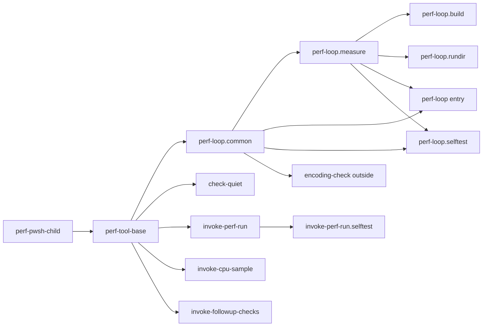
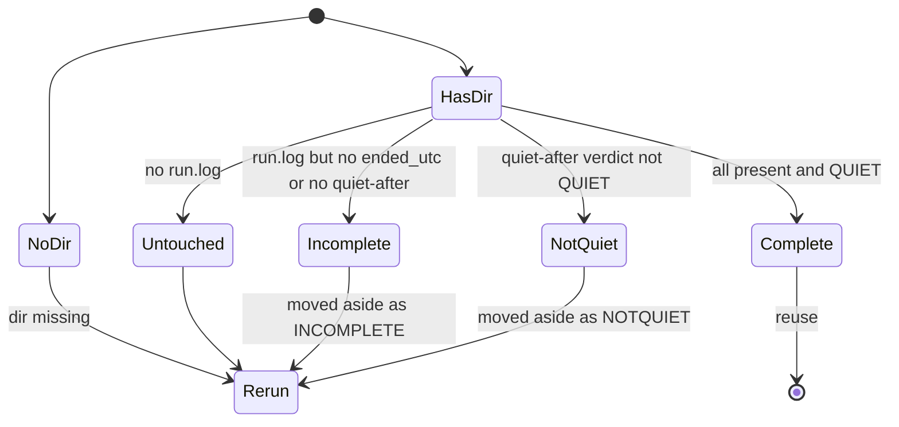

# 設計書: audit-tools-perf-run

## 概要

**目的**: 性能改善ループを走らせる PowerShell の道具（`tools/perf/*.ps1`）に ponytail の audit をかけて出た 36 件の指摘を、3 つの組（必ず直す 1〜6・直したほうがよい 7〜24・できれば 25〜36）とも全部直す。直し方は「いちばん小さな完全な変更」に従い、写しは 1 か所に寄せ、使えない道は消し、直したバグと危ない所には壊れたら落ちる決定論のテストを 1 本ずつ持たせる。指摘の中身と番号は `research.md` の 5 節が正本で、この文書は番号で指す。

**使う人**: ループを回すスキル `perf-loop-iteration` と役割別のエージェント（`perf-measure` ほか）が、入口 `perf-loop.ps1` のサブコマンドを背景の 1 本ずつとして呼ぶ。開発者は `perf-loop.ps1 selftest` で道具の自分の検査を回す。

**変わること**: 途中で止まった走行の後始末（段③の採取・強制終了した areka・想定外の失敗）が正規の道を通るようになり、`-Resume` は終わりまで済んだ走行だけを使う。写しになっていた部品（目標定義の読み・子のプロセスの起こし方・検体の在り処の問い合わせ・表示と時刻）は、新しい共通部品のファイル 1 本に寄せる。`perf-loop` 側と `invoke-perf-run.ps1` に自分の検査ができ、どちらも `perf-loop.ps1 selftest` から回る。

### Goals

- 36 件を全部直す（直さずに残す指摘は 0 件・2026-11-14 の裁定）。
- 直したバグと危ない所の 1 件ごとに、壊れたら落ちる決定論のテストを持たせ、`perf-loop.ps1 selftest`（`SELFTEST_TOOLS`）から回す。
- 外への約束（サブコマンド・引数・終了コード・RESULT 行・書き出すファイルと `key=value` の語・`CHECK_ALL`・`SCRIPT_VERSION`・`perf-loop.common.ps1` を単独で読み込める形と `Invoke-Child`／`Invoke-PwshChild` の名前と使い方）は、下の「外への約束の変更」の表に挙げた分のほかは変えない。
- どのファイルも 1,000 行の番人の下に収める。

### Non-Goals

- 新しいサブコマンド・新しい検査・新しい計測の段（指摘の直しとして足す止まる道・走る前の確かめ・後始末の道は除く＝要件 3.4）。
- 全体テスト（`tools/test-all.ps1`）に `selftest` の段を足すこと（`audit-tools-scripts` の brief の件 1）。
- 範囲の外のファイルの見直し（Python の道具・検体・`README.md`・`goals/` は `audit-tools-perf-judge`、`tools/*.ps1` は `audit-tools-scripts` の持ち物）。
- 実際の計測の走行（`measure-baseline`・`rank-run`・`measure-ab`・`followup`・`final`）を回して効き目を確かめること（要件 7）。

## Boundary Commitments

### This Spec Owns

- `tools/perf/` 直下の `*.ps1` の全部（今の 8 本と、この設計で足す 5 本）の中身と、その振る舞い。
- 36 件の直し・直しのテスト・直しの効き目を確かめた記録（実走でしか分からない分は「次の実走で確かめること」として番号ごとに）。
- 次の 2 つの自分の検査の中身と、それを `SELFTEST_TOOLS` に入れること:
  - `perf-loop.selftest.ps1`（`perf-loop` 側。下で T2 と呼ぶ）
  - `invoke-perf-run.ps1 -SelfTest`（中身は `invoke-perf-run.selftest.ps1`。下で T3 と呼ぶ）
- 既にある `-SelfTest`（`invoke-cpu-sample.ps1`・`check-quiet.ps1`・`invoke-followup-checks.ps1`。下で T1 と呼ぶ）へ足す検査。
- 範囲の外で直す 1 か所: スキル `perf-loop-iteration` の `SKILL.md` の 2 か所（終了コードの表の 4 の行・REMEASURE の `code=3` の扱い）。

### Out of Boundary

- `tools/perf/*.py`・`tools/perf/fixtures*/`・`tools/perf/goals/`・`tools/perf/README.md`（`audit-tools-perf-judge` の持ち物。触る行は下の「外への約束の変更」の表の申し合わせに従う＝この spec が README と `goals/` に書く行は 0 行）。
- `tools/test-all.ps1`・`tools/encoding-check.ps1`・`tools/utf8-child.ps1`・`tools/load-flake.ps1`・`tools/mouse-input.ps1`（`audit-tools-scripts` の持ち物）。
- `Cargo.lock`・根の `Cargo.toml`・`tools/crates-io.ps1`、ほか C20 の 6 本が触るファイル（要件 6.3）。
- `vendors/` の下（要件 6.8）。
- areka が出す性能の要約の行（Rust の記録側）。
- `%LOCALAPPDATA%\areka-diag\perf-loop\` の下の既にある走行の成果と、`goals/` の各ゴールが指す spec の台帳と結果（要件 7.2）。
- `.claude/agents/perf-*.md`・`templates/agent-prompts.md`・`templates/entry.json`・`CLAUDE.md`（読んで確かめた結果、直しで偽になる文が無い＝触らない）。

### Allowed Dependencies

- PowerShell 7 と .NET の標準（`ProcessStartInfo.ArgumentList`・`IO.File.ReadLines`・`Select-String`・PowerShell の構文木 `System.Management.Automation.Language.Parser`）。新しいモジュールもパッケージも足さない（要件 5.6）。
- 範囲の中の読み込みの向きは下の「読み込みの向き」の図だけ。上流（左）から下流（右）への読み込みを足さない。
- 範囲の外へは、今と同じ呼び先だけを使う: `python`（判定と台帳の道具・`judge-followup.py`）・`cargo`・`git`・`xperf.exe`・`invoke-cpu-sample.ps1` が呼ぶシンボルサーバ。`tools/utf8-child.ps1` は範囲の中から使わなくなる（ファイルはそのまま）。

### Revalidation Triggers

- `perf-loop.common.ps1` を単独で読み込む形、または `Invoke-Child`・`Invoke-PwshChild` の名前・引数・戻り値が変わるとき → `tools/encoding-check.ps1`（`audit-tools-scripts`）を確かめ直す。
- `PERF-LOOP RESULT` 行・終了コードの意味・サブコマンドの引数が変わるとき → スキル `perf-loop-iteration` と `.claude/agents/perf-*.md` を確かめ直す。
- `run-meta.txt`・`quiet-*.txt`・`sampling.txt`・`preflight.txt`・`BUILD.txt` の行や語が変わるとき → `audit-tools-perf-judge`（Python の道具）と申し合わせ直す。
- `--unavailable-reason` へ渡す語、`judge-followup.py` の終了コードの写し方が変わるとき → `audit-tools-perf-judge` と申し合わせ直す。

## Architecture

### 今の形の分析

- 入口 `perf-loop.ps1` は頭から引数の確かめ・振り分け・`exit` まで一続きで、読み込むだけで走る。測る 8 本の本体は `perf-loop.measure.ps1`（993 行）、共通の部分は `perf-loop.common.ps1`（678 行）。共通の部分の一部（`Get-NarSampleMap`・`Sync-Measure*`・`Test-MeasureQuietAfterOk`）は、入口にしか無い `$EXIT_*`・`$repoRoot` と、測る側にしか無い `$MEASURE_*`・`Invoke-MeasureCargo` に頼る（20）。
- 子の道具 4 本（`check-quiet.ps1`・`invoke-perf-run.ps1`・`invoke-cpu-sample.ps1`・`invoke-followup-checks.ps1`）は、それぞれが表示・時刻・目標定義の読み・子の起こし方の写しを持つ（17・18・19・35）。
- 想定外の失敗を捕まえる所がどこにも無い（3）。
- `perf-loop.ps1` 自身と `invoke-perf-run.ps1` の判断の分かれ目を試すテストが無い（21・22）。

### 形と境界（案 B＝仕事ごとに新しいファイルを足す）

研究の 9 節の 3 案のうち **案 B** を採る。理由: 案 A は `perf-loop.measure.ps1` が 1,000 行を越え、テストから関数を読み込めない。案 C は分け直しが後になり、先に入れた直しのテストを 2 度書くことになる。案 B は分け直し（20）を最初に済ませ、その上にすべての直しとテストを載せる。



矢印は「読み込まれる側 → 読み込む側」。`perf-loop.measure.ps1` は自分の較正値（`$MEASURE_*`）を置いた後で `perf-loop.build.ps1` と `perf-loop.rundir.ps1` を読み込む（読み込む順の所在を 1 か所にするため。入口とテストは `common` と `measure` の 2 本を読むだけでよい）。`invoke-perf-run.selftest.ps1` は `invoke-perf-run.ps1 -SelfTest` のときだけ、ランナーの中から読み込まれる。

**読み込みの向きの決まり**（違反はレビューで誤りとして扱う）:

- `perf-tool-base.ps1` は `perf-pwsh-child.ps1` だけを読み込む。呼び手の変数・関数に頼らず、`Set-StrictMode` を自分では呼ばず（呼び手の型のまま動く）、`StrictMode Latest` でも落ちない書き方にする。関数と定数を置くほかに副作用を持たない。
- `perf-loop.common.ps1` は `perf-tool-base.ps1` だけを読み込み、単独で読み込めて副作用が無い（`encoding check` が頼る形）。
- `perf-loop.build.ps1`・`perf-loop.rundir.ps1` は `common` と `measure` の定数に頼ってよいが、`perf-loop.ps1` の変数には頼らない。
- 子の道具 4 本は `perf-tool-base.ps1` だけを読み込む（`perf-loop.common.ps1` を読み込まない）。

### 技術

| 層 | 選ぶもの・版 | この spec での役目 | 注 |
|---|---|---|---|
| 道具の言語 | PowerShell 7（`#Requires -Version 7.0`） | 範囲の道具すべて | 変えない |
| 子のプロセス | .NET `System.Diagnostics.ProcessStartInfo`（`ArgumentList`） | 子の起こし方を 1 つに寄せる（5・19） | `Start-Process` は areka 本体を起こす 2 か所（ランナー・追随の検査）にだけ残す（標準出力をファイルへ落とし、待たずに PID を見るため） |
| 構文の検査 | `System.Management.Automation.Language.Parser` | T2 で各入口に `trap` があることを確かめる（3） | 標準の部品 |
| 採取 | Windows Performance Toolkit の `xperf.exe`（今の机の版） | 段③の採取 | `wpaexporter` の道は消す（16） |

新しい依存は 0（要件 5.6・5.7 の議題は無い）。

## File Structure Plan

### Directory Structure

```
tools/perf/
├── perf-tool-base.ps1          # 新: 道具どうしの共通部品（表示・時刻・子の起こし方・目標定義の読み・検体の在り処）
├── perf-pwsh-child.ps1         # 直す: 子の pwsh の前置きに想定外の失敗の受け止めを足す（7）
├── perf-loop.ps1               # 直す: 入口（引数の確かめ・振り分け・preflight・selftest）
├── perf-loop.common.ps1        # 直す: perf-loop の共通部品（終了・終了コードの定数・目標定義の引き口・出力先の配置・preflight の合否）
├── perf-loop.measure.ps1       # 直す: 測る 8 本の本体（段③の採取の流れ・A/B の確かめを含む）
├── perf-loop.build.ps1         # 新: 実行体の用意（作る・写す・確かめる・A と B の突き合わせ）
├── perf-loop.rundir.ps1        # 新: 走行の出力先の扱い（完了の見方・脇へ退ける・-DryRun の印と作り直し）
├── perf-loop.selftest.ps1      # 新: perf-loop 側の自分の検査（T2）
├── invoke-perf-run.ps1         # 直す: ランナー（採取の開始を受け持つ・強制終了の後に待つ・-SelfTest）
├── invoke-perf-run.selftest.ps1 # 新: ランナーの自分の検査の中身（T3。-SelfTest のときだけ読み込まれる）
├── invoke-cpu-sample.ps1       # 直す: 段③の採取（-Cancel・止める順・引数の渡し方・dump の読み方）
├── check-quiet.ps1             # 直す: 静かさの確かめ（共通の読み口・trap）
└── invoke-followup-checks.ps1  # 直す: 追随の検査（判定の 3 の写し・増えた分だけ読む・trap）
```

1 ファイルの見立て（番人 1,000 行の下）: `perf-tool-base.ps1` 約 300・`perf-loop.common.ps1` 約 470・`perf-loop.measure.ps1` 約 880・`perf-loop.build.ps1` 約 230・`perf-loop.rundir.ps1` 約 130・`perf-loop.selftest.ps1` 約 750・`invoke-perf-run.ps1` 約 940・`invoke-perf-run.selftest.ps1` 約 250・`invoke-cpu-sample.ps1` 約 650・`check-quiet.ps1` 約 620・`invoke-followup-checks.ps1` 約 900。`perf-loop.selftest.ps1` が 1,000 行に近づいたら、検査の束（下の Testing Strategy の束）ごとに 2 本目の `perf-loop.selftest2.ps1` へ分けて `SELFTEST_TOOLS` に足す（どの束を移すかは実装の段で決める）。

### 新しいファイル

- `tools/perf/perf-tool-base.ps1` — 道具どうしの共通部品。今の写しを 1 つにする（17・18・19・35・8 の待ち・36 の在り処は持たない）。中身は Components の「perf-tool-base」。
- `tools/perf/perf-loop.build.ps1` — `perf-loop.measure.ps1` と `perf-loop.common.ps1` から実行体の用意に関わる関数を移す（20）。直し 10・11・12・13・15 の置き場。
- `tools/perf/perf-loop.rundir.ps1` — 走行の出力先の完了の見方・脇へ退ける・`-DryRun` の印を移す（20）。直し 2・6 の置き場。
- `tools/perf/perf-loop.selftest.ps1` — T2。`SELFTEST_TOOLS` に足す（21）。
- `tools/perf/invoke-perf-run.selftest.ps1` — T3 の中身。`invoke-perf-run.ps1 -SelfTest` が読み込む（22）。

### 直すファイル（範囲の中）

- `tools/perf/perf-pwsh-child.ps1` — 前置きを `try`/`catch` で包む（7）。引数の組み方と戻り値の形は変えない。
- `tools/perf/perf-loop.ps1` — `trap`（3）・`$Sub`／`$Build` を小文字へ（4）・`-Goal` と `-GoalFile` の同時指定を 3 で拒む（26）・パスを入口で一度だけ絶対にする（27）・preflight が昇格と xperf を `-Probe` の 1 行から読む（36）・python の版を合否に使う（25）・使わない値と届かない枝を消す（25）・`sampling_backend=` の行を消す（16）・字数の確かめ（33）・`SELFTEST_TOOLS` に 2 本足す（21・22）・注釈の行番号の指し方を名前に替える（申し合わせ件 #74）。
- `tools/perf/perf-loop.common.ps1` — 表示・子の起こし方・目標定義の読みを `perf-tool-base.ps1` へ、実行体と出力先の関数を新しい 2 本へ移す（20）。終了コードの定数・`$BUILD_KINDS`・`$repoRoot` を入口から移す（20）。`Exit-OnUnexpectedError`（3）・`Resolve-LoopPath`（27）・`Get-SamplingProbe`（入口から移す・36）・`Get-PreflightCode`（25）・`Test-GoalTextCharCount`（33）を置く。`Test-Elevated`・`Find-XperfPath`・`SamplingBackend` を消す（16・36）。
- `tools/perf/perf-loop.measure.ps1` — 段③の流れを「ビルド → 可否 → ランナーが採取を始める → 走行 → 止める」へ（1・9・29・30）・`final -BinDir`（10）・実行体の確かめをビルドの後へ（11）・`followup` の順（13）・追随の 1 の採り直し（14）・A と B の突き合わせ（15）・`ab_sequence` の確かめ（34）・`rank` の理由の語（24）・静かでない証拠の案内（28）・走行の後の静かさの確かめの 3 の扱い（3 にそろえる）・注釈の行番号の指し方（申し合わせ件 #74）。
- `tools/perf/invoke-perf-run.ps1` — `-SampleEtl`（9・1）・`trap`（3 にそろえる）・強制終了の後に待つ（8）・退けた先の 1 行（28）・目印の読み方（31）・共通部品を使う（17・19・35）・カウンタの値を選ぶ所を純関数に（22）・`-SelfTest`（22）。
- `tools/perf/invoke-cpu-sample.ps1` — `-Cancel`（1）・`-Stop` の止める順（1）・`Invoke-Child` で xperf を呼ぶ（5・19）・まとめた後に元の ETL を消す（29）・dump を 1 行ずつ数える（23）・`-Probe` の 1 行に `elevated=`・`xperf_path=` を足す（36）・`-SelfTest` は採取を試さない（24）・引数なしは 3（3）・`trap`（3）・`wpaexporter` の道を消す（16）・失敗の文を標準エラーへ（35）。
- `tools/perf/check-quiet.ps1` — 共通の読み口を使う（17）・`trap`（3）・時刻と表示の写しを消す（35）。
- `tools/perf/invoke-followup-checks.ps1` — 判定の 3 を 1 に写す（14）・窓が消えたときの止め方（3）・`trap`（3）・強制終了の後に待つ（8）・ログを増えた分だけ読む（32）・検体の問い合わせと python 探しを共通部品へ（18）・子の起こし方（19）・表示（35）・`-SelfTest` に検査を足す（14・32）。

### 範囲の外で直すファイル

- `.claude/skills/perf-loop-iteration/SKILL.md` — 2 か所だけ（行は下の「範囲の外で直す文（申し合わせ用）」の S1・S2）:
  - 「使う道具」の終了コードの表の `4` の行に「想定外の失敗（道具の不具合）」を足す（3）。
  - 「REMEASURE」の節に `code=3` の扱いを 1 段足す（15・34）。中身は Components の「スキルの文」。
- `tools/perf/README.md` — この spec は書かない。要る直し（R1〜R4）を `audit-tools-perf-judge` に渡し、相手が書く。

### 範囲の外で確かめるだけのファイル（触らない）

- `tools/encoding-check.ps1` — `perf-loop.common.ps1` を単独で読み込み、`Invoke-Child -Exe -Arguments -Quiet` と `Invoke-PwshChild -ScriptPath -Arguments -Quiet` を呼ぶ形が、この設計の後も同じであることを確かめる（20・7・19）。新しいファイルも静的な規則 A〜D の対象になる。
- `.claude/agents/perf-*.md`・`templates/agent-prompts.md`・`CLAUDE.md` の `perf-loop-iteration` の行 — 終了コードを「0 かそれ以外か」でしか読まない・サブコマンドの名前と RESULT 行の形が変わらない＝直しで偽になる文が無いことを確かめた。
- `tools/perf/README.md`・`tools/perf/goals/*.toml` — 書き換えは `audit-tools-perf-judge` の持ち物（下の申し合わせ）。

## System Flows

### `rank-run` の段③（1・9・29・30 の後）

```mermaid
sequenceDiagram
    participant Loop as perf-loop rank-run
    participant Cargo as cargo
    participant Runner as invoke-perf-run
    participant Quiet as check-quiet
    participant Sample as invoke-cpu-sample
    participant Areka as areka

    Loop->>Cargo: build from the worktree when no BinDir
    Loop->>Loop: check the executable after the build
    Loop->>Sample: Probe
    Sample-->>Loop: available reason elevated xperf_path
    Loop->>Runner: run with SampleEtl when available
    Runner->>Quiet: before check with retries
    Runner->>Sample: Start
    Sample-->>Runner: started or reason
    Runner->>Areka: launch bounded run
    Areka-->>Runner: exit
    Runner-->>Loop: code and sampling start line
    alt runner failed after start
        Runner->>Sample: Cancel before exit
    end
    Loop->>Sample: Stop merge then resolve then gate
    Sample-->>Loop: code and reason
    Loop->>Quiet: after check
    Loop->>Loop: rank table
```

- 採取を始めるのは**ランナー**で、静かさの確かめが通った後、areka を起こす直前に 1 回だけ。ビルドと静かさの確かめは採取の窓の外になる（9）。
- 採取を始めた後でランナーが失敗の道（`Stop-Run`・`trap`）へ入ったら、ランナーが出る前に `-Cancel` で止める（1）。ランナーが 0 で返ったら、採取はまだ動いており、`perf-loop` が次の 1 手で必ず `-Stop` を呼ぶ。
- `-Stop` は最初に `xperf -d`（止めてまとめる）を回し、前提の確かめ（`-PdbDir`・記号の置き場）はその後に回す（1）。まとめが通ったら元の ETL を消す（29）。
- 採り直し（`MEASURE_RUN_RETRY`）の 2 回目でも、ランナーは同じ形で採取を始め直す（1 回目の ETL は `-Cancel` が消している）。

### `-Resume` の完了の見方（2）



- `run.log` の無い出力先（`-DryRun` の置き土産）は脇へ退けず、今までどおり `Clear-MeasureDryRunDir` の決まり（6 の後）に任せる。
- 退けた先は `<走行>-INCOMPLETE-<時刻>` と `<走行>-NOTQUIET-<時刻>`。測ったものは消さない。

## 直し方の一覧（指摘ごと）

「テスト」の欄の名前は下の Testing Strategy の検査の名前（T1＝既にある `-SelfTest`・T2＝`perf-loop.selftest.ps1`・T3＝`invoke-perf-run.ps1 -SelfTest`）。「実走」は、効き目を次の実際のループの走行で確かめるものとして検証の記録に番号ごとに残すもの（要件 7.3 の裁定）。

| # | 組 | 直し方（約束） | 主なファイル | テスト | 実走 |
|---|---|---|---|---|---|
| 1 | 必ず | 採取の開始をランナーへ移し、ランナーの失敗の道は必ず `-Cancel` を通る。`perf-loop` はランナーが 0 で返ったら次の 1 手で `-Stop`。`-Stop` は `xperf -d` を最初に回す。`-Stop` の子が起こせなかった（`Code -1`）ときは、手で打つ `xperf -stop` を書いた警告の 1 行を出す | measure・runner・cpu-sample | T2 `sampling-order`・`sampling-stop-after-run`、T3 `sampling-cancel-on-stop`、T1 `stop-merges-first`・`cancel-mode` | 一部（本物の xperf のセッションが残らないこと） |
| 2 | 必ず | 完了の印を「`run.log`・`cpu.csv`・`run-meta.txt` が在り、`run-meta.txt` に `ended_utc = ` の行が在り、`quiet-after.txt` の最後の `verdict=` が `QUIET`」にする。欠ければ `-INCOMPLETE-<時刻>`（静かでなければ `-NOTQUIET-<時刻>`）へ退けて採り直す | rundir | T2 `resume-incomplete` | いいえ |
| 3 | 必ず | 各入口の頭に `trap` を 1 つ置く。終了コードは下の Error Handling の表。届かない `default` の枝を消す（`invoke-cpu-sample.ps1` は引数なしを 3 で受ける形に替える）。走行の後の静かさの確かめが 3 を返したら 3 で止める | 5 本の入口・common・measure | T2 `exit-trap`・`trap-present`・`quiet-after-codes`、T1 `no-args` | いいえ |
| 4 | 必ず | 入口で `$Sub`・`$Build` を小文字にしてから確かめる。`[target] builds_final` の各語も小文字にそろえる | perf-loop・measure | T2 `case-normalize` | いいえ |
| 5 | 必ず | xperf を `Invoke-Child`（`ArgumentList` に 1 つずつ）で呼ぶ。読む文字コードだけは端末の文字コード（`-ReadEncoding`） | cpu-sample・base | T1 `args-with-spaces`、T2 `child-args-and-encoding` | いいえ |
| 6 | 必ず | `-DryRun` の出力先を作り直すのは、中身が `DRY-RUN.txt` と `run-meta.txt` だけ（下位のフォルダ無し）のときに限る。ほかが在れば 3 で止め、何も消さない | rundir | T2 `dryrun-clear` | いいえ |
| 7 | 直したほうが | 前置きでスクリプトの呼び出しを `try`/`catch` で包み、捕まえた失敗を `[Console]::Error`（UTF-8 の書き手）へ素の文で書いて 1 で終える。`Invoke-Child` は「最後の 1 行」を選ぶ前に色の符号を落とす | pwsh-child・base | T2 `pwsh-child-error` | いいえ |
| 8 | 直したほうが | areka を子孫まで強制終了し（`Kill($true)`）、終わるまで待ってから次へ進む（共通部品 `Stop-ChildProcess`。ランナーの 4 か所と追随の検査の 2 か所）。待ちが時間切れか退けに失敗したら、ランナーは理由の 1 行を出して 1 で終え（`moved to:` の行は出ない）、`perf-loop` は出力先が元の名前のまま残っているのを見て採り直さずに 4（「失敗した走行を退けられなかった」）で止める | base・runner・followup・measure | T2 `kill-wait`・`run-not-moved`、T3 `move-after-kill` | 一部（取り合いの起きやすさ） |
| 9 | 直したほうが | ビルドを採取より前へ。採取の開始はランナーが静かさの確かめの後に行う（上の流れ） | measure・runner | T2 `sampling-order` | はい（xperf の重さが静かさの確かめを倒さないこと） |
| 10 | 直したほうが | `final` でも `-BinDir` を実行体の確かめと走行へ渡す。`-BinDir` を渡すなら `-Build` も要る（無ければ 3。1 つの実行体を 2 つのビルドとして測らない） | measure・build | T2 `final-bindir` | いいえ |
| 11 | 直したほうが | `-BinDir` の無い走行では、作業ツリーからのビルドを先に回し、実行体の確かめをその後にする（ビルドは `Invoke-MeasureRun` から呼び手へ移す） | measure・build | T2 `exe-after-build` | いいえ |
| 12 | 直したほうが | 32bit ヘルパは、隣に無いときに加えて、元と SHA-256 が違うときも写す | build | T2 `helper-refresh` | いいえ |
| 13 | 直したほうが | `followup` は `-Resume` の済みを最初に見る。ビルドは `target\release` を使うとき（`-BinDir` も `bin-B` も無いとき）だけ | measure | T2 `followup-resume-first` | いいえ |
| 14 | 直したほうが | `invoke-followup-checks.ps1` は判定器の 3（読取不能）を 1（実走の失敗）に写して返す（申し合わせ済み）。`perf-loop` は今の決まりどおり 1 を 1 度だけ採り直す | followup | T1 `judge-exit-map`、T2 `followup-retry-on-1` | いいえ |
| 15 | 直したほうが | `measure-ab` は B を作った直後に `bin-A`・`bin-B` の `BUILD.txt` の `exe_sha256` を比べ、同じなら走る前に 3 で止める（`-DryRun` では比べない） | build・measure・SKILL.md | T2 `ab-same-exe` | いいえ |
| 16 | 直したほうが | `wpaexporter` の道を消す（`-Backend`・`-GoalFile`（`-Stop` の）・`Get-BackendFromGoalFile`・`Get-WpaExporterPath`・定数 2 つ・`backend=` の RESULT の鍵・`Get-GoalConfig` の `SamplingBackend`・`preflight` の `sampling_backend=` の行・`rank-run` が `-Stop` へ渡す `-GoalFile`）。`goals/*.toml` の `[sampling] backend` は残り、PowerShell は読まなくなる（申し合わせ済み） | cpu-sample・common・perf-loop・measure | 既にある T1 が緑・消す前のツリー全体の grep | いいえ |
| 17 | 直したほうが | 目標定義の読み口を `perf-tool-base.ps1` の 1 組にする（節の見出しの見方 1 通り・注釈は二重引用符と単引用符の外だけで落とす・単引用符の文字列・整数・小数・1 行の文字列の配列）。4 つの写しを消す | base・common・check-quiet・runner・cpu-sample | T2 `toml-reader`、T1（check-quiet の既にある TOML の検査が寄せた読み口を通る） | いいえ |
| 18 | 直したほうが | 検体の在り処の問い合わせ（`Get-NarSamplePath`）と `Get-PythonCommand` を共通部品の 1 つにする。止め方は呼び手が戻り値を見て決める | base・common・followup | T2 `keyvalue-parse` | いいえ |
| 19 | 直したほうが | 範囲の中の子の起こし方を `Invoke-Child` 1 つにする（`invoke-perf-run.ps1`・`invoke-followup-checks.ps1` も `Invoke-Utf8Child` から移る。areka 本体の起動の `Start-Process` 2 か所は残す）。`Invoke-Child` に任意の引数 `-ReadEncoding` を足すだけで、今の引数の形は崩さない | base・runner・followup・cpu-sample | T2 `child-args-and-encoding` | いいえ |
| 20 | 直したほうが | 案 B の分け直し（上の図）。終了コードの定数ほかを `common` へ。測る側だけの関数を `build`・`rundir` へ | common・build・rundir・measure | T2 `load-standalone`（と T2 全体が読み込めること） | いいえ |
| 21 | 直したほうが | T2 を足し `SELFTEST_TOOLS` に入れる。過去の穴（子の pwsh の引数の括り方・出力先の語彙・追随の判定まで届いたかの見方・子の終了コードの写し方・TOML の読み・`-Resume`・退け方）を試す | selftest・perf-loop | T2 `pwsh-child-args`・`loopdir-vocab`・`followup-verdict-shape`・`child-exit-map` ほか | いいえ |
| 22 | 直したほうが | カウンタの結果から値を選ぶ所を純関数 `Select-ProcessCpuValue` にし、T3 で偽の `CounterSamples` を与える。T3 を `SELFTEST_TOOLS` に入れる | runner・runner-selftest | T3 `counter-select`・`quiet-retry-settings` | いいえ |
| 23 | 直したほうが | `Measure-ArekaFrames` は行の列（`IEnumerable[string]`）を受ける。`-Stop` は `[IO.File]::ReadLines` を渡す | cpu-sample | T1 `stream-counts`（既にある厳密な数の検査を、ファイルを 1 行ずつ読む道で通す） | はい（大きな dump での重さ） |
| 24 | 直したほうが | `-SelfTest` の可否の確かめは採取を試さない（`Get-ProbeResult -SkipCapture`）＝`preflight` で本物の 5 秒の採取は 1 回だけ。`rank` は `sampling.txt` も dump も無いとき、試しを回さず `--sampling-available false --unavailable-reason no_record`（申し合わせ済み） | cpu-sample・measure | T2 `rank-no-record` | 一部（昇格した机での時間） |
| 25 | できれば | `pwshOk`・`$PWSH_MIN_MAJOR`・`$DEFAULT_GOAL`・`rank` の二重の `-Resume`・入口の `default` の枝を消す。`pythonOk` は合否に使う（3.11 未満か python が無ければ 4・`fail_reason` に書く）。`preflight.txt` の `pwsh=` の行は `pwsh=<版>` だけにする | perf-loop・common | T2 `preflight-code` | いいえ |
| 26 | できれば | `perf-loop` も `-Goal`（明示したとき）と `-GoalFile` の同時指定を 3 で拒む | perf-loop | T2 `goal-and-goalfile` | いいえ |
| 27 | できれば | `-OutRoot`・`-RunDir`・`-BinDir`・`-GhostRoot`・`-BalloonRoot`・`-GoalFile`・`-Ledger` を入口で一度だけ `Resolve-LoopPath`（PowerShell の今の場所につなぐ）で絶対にする | perf-loop・common | T2 `relative-paths` | いいえ |
| 28 | できれば | ランナーは退けた先を決まった形の 1 行 `[invoke-perf-run] moved to: <path>` で出す。`perf-loop` はそれを読んで証拠の場所を書く（読めなければ `<OutDir>-FAILED*`） | runner・measure | T3 `failed-dir-name`、T2 `not-quiet-evidence` | いいえ |
| 29 | できれば | `-Stop` はまとめが通ったら元の ETL を消す（まとめに失敗して元を読むときは消さない） | cpu-sample | T1 `stop-merges-first` | はい（大きさ） |
| 30 | できれば | 段③の理由の語を子の出力から読む（開始はランナーの採取の開始の行の `reason=`、停止は `-Stop` の RESULT 行の `reason=`） | measure・runner | T2 `sampling-reason` | いいえ |
| 31 | できれば | 目印は `Select-String -SimpleMatch -List` で最初の 1 件まで読む（純関数 `Test-SmokeMarker`） | runner | T3 `smoke-marker` | はい（大きな run.log での時間） |
| 32 | できれば | `Wait-RunLogPattern` は読んだ位置を覚えて増えた分だけ読む（書きかけの最後の 1 行は次に回す） | followup | T1 `incremental-log-reader` | 一部（効くかはログの大きさ次第） |
| 33 | できれば | `goal-text` 側の字数が読めないときは赤。写しの頭書に字数が無いときだけ飛ばす（純関数 `Test-GoalTextCharCount`） | common・perf-loop | T2 `goal-text-count` | いいえ |
| 34 | できれば | `ab_sequence` は A と B がちょうど 2 回ずつかを、B を作る前に確かめ、違えば 3 | measure | T2 `ab-sequence` | いいえ |
| 35 | できれば | 表示（`Write-Info`・`Write-Problem`）と時刻（`Get-UtcStamp`＝末尾に `Z`）を共通部品の 1 つにする。`invoke-cpu-sample.ps1` の失敗の文は標準エラーへ。`invoke-followup-checks.ps1` の 6 桁の時刻は run.log とそろえる別の役目なので `Get-ProbeStamp` と名を替えて残す | base・5 本 | T2 `utc-stamp` | いいえ |
| 36 | できれば | `-Probe` の 1 行に `elevated=<真偽> xperf_path=<パス|->` を足し（`xperf_path` は行の最後）、`preflight` の `elevated`・`xperf`・`xperf_path` をそこから出す。`perf-loop` 側の `Test-Elevated`・`Find-XperfPath`・`XPERF_DEFAULT_PATH` を消す。`capabilities=` の鍵と並びは変えない | cpu-sample・common・perf-loop | T2 `probe-parse` | いいえ |
| 申し合わせ件 #74 | — | 範囲の `*.ps1` の注釈で、ほかのファイルを行番号で指している所を、ファイル名と関数・定数の名前で指す形に替える（下の一覧） | common・perf-loop・measure | 検証の段の grep で 0 件 | いいえ |

**申し合わせ件 #74 の対象**（今の注釈。行番号は 2026-11-14 の `main`）:

- `perf-loop.common.ps1:188` 「perf-ledger.py:930-932」→「perf-ledger.py の main（標準出力を UTF-8 に切り替える所）」
- `perf-loop.common.ps1:465` 「judge-perf.py:150」→「judge-perf.py の SCRIPT_VERSION の定義」
- `perf-loop.ps1:510` 「perf_ledger_goal.py:430-447」→「perf_ledger_goal.py の goal-check（走行トークンを作る・変えない所）」
- `perf-loop.measure.ps1:33`・`:362` 「invoke-perf-run.ps1:709-710」→「invoke-perf-run.ps1 の shiori_helper_present の注記」
- `perf-loop.measure.ps1:836` 「invoke-followup-checks.ps1:222-231 の Stop-Run」→「invoke-followup-checks.ps1 の Stop-Run」
- `invoke-perf-run.ps1:164` 「fmt_layer.rs:739-755」は版を名指しした外のクレート（tracing-subscriber 0.3.23）の行で、こちらの直しでは動かないので残す。

## Components and Interfaces

### 一覧

| 部品 | 層 | 役目 | 要件 | 主な依存 | 約束 |
|---|---|---|---|---|---|
| perf-tool-base | 道具どうしの共通部品 | 表示・時刻・子の起こし方・目標定義の読み・検体の在り処・強制終了の待ち | 3.1, 3.2, 5.4, 5.5 | perf-pwsh-child (P0) | Service |
| perf-pwsh-child | 同上 | 子の pwsh の引数と前置き | 3.1, 5.2, 5.4 | なし | Service |
| perf-loop.common | perf-loop の共通部品 | 終了・終了コードの定数・目標定義の引き口・出力先の配置・preflight の合否・可否の 1 行の読み | 3.1, 5.2 | perf-tool-base (P0) | Service |
| perf-loop.build | perf-loop の測る側 | 実行体を作る・写す・確かめる・A と B の突き合わせ | 3.1 | common, measure の定数 (P0) | Service |
| perf-loop.rundir | perf-loop の測る側 | 出力先の完了の見方・退け方・`-DryRun` の印 | 3.1, 5.2 | common, measure の定数 (P0) | Service, State |
| perf-loop.measure | perf-loop の測る側 | 8 本の本体・段③の流れ | 3.1, 5.3 | build, rundir (P0), runner, cpu-sample (P0) | Batch |
| perf-loop entry | 入口 | 引数・振り分け・preflight・selftest | 3.1, 4.2 | common, measure (P0) | Batch |
| invoke-perf-run | 子の道具 | 走行・採取の開始と取り消し | 3.1, 5.3 | perf-tool-base, check-quiet, cpu-sample (P0) | Batch |
| invoke-cpu-sample | 子の道具 | 段③の可否・開始・停止・取り消し | 3.1, 5.3 | perf-tool-base, xperf (P0) | Batch |
| check-quiet | 子の道具 | 静かさの確かめ | 3.1 | perf-tool-base (P0) | Batch |
| invoke-followup-checks | 子の道具 | 追随の検査 | 3.1, 5.3 | perf-tool-base, judge-followup.py (P0) | Batch |
| perf-loop.selftest（T2） | 自分の検査 | perf-loop 側の判断の分かれ目を決定論に試す | 4.1〜4.5, 4.7 | common, measure (P0) | Batch |
| invoke-perf-run.selftest（T3） | 自分の検査 | ランナーの判断の分かれ目を試す | 4.1〜4.5 | invoke-perf-run (P0) | Batch |
| スキルの文 | 範囲の外の読み手 | 終了コードの意味と REMEASURE の 3 の扱い | 6.5, 6.6 | なし | — |

型は PowerShell の `param` の型注釈と `[pscustomobject]` の鍵で示す。

### 道具どうしの共通部品

#### perf-tool-base（`tools/perf/perf-tool-base.ps1`）

| 項目 | 内容 |
|---|---|
| Intent | 写しになっていた下回りを 1 つにする |
| Requirements | 3.1, 3.2, 5.4, 5.5 |

**Responsibilities & Constraints**
- 置くのは関数と定数だけ。読み込んでも何も走らない。`Set-StrictMode` を呼ばない。呼び手の変数に頼らない（`$PSScriptRoot` は自分の所在＝`tools/perf`）。
- 端末の文字コードを書き替えない。端末へ出す文の字句は ASCII だけ（`encoding check` の規則 A〜D）。
- 引数の名前に `$OutputEncoding` を使わない（`encoding check` の規則 C が代入と読む）。読む文字コードの引数は `-ReadEncoding`。

**Contracts**: Service [x]

```powershell
function Write-Info    { param([string]$Message) }   # 標準出力へ 1 行
function Write-Problem { param([string]$Message) }   # 標準エラーへ 1 行
function Get-UtcStamp  { }   # 'yyyy-MM-ddTHH:mm:ss.fffZ'（末尾に Z・不変の文化）

# 子を起こして出力と終了コードを持ち帰る。引数は ArgumentList に 1 つずつ（空白で割れない）。
# 戻り: [pscustomobject]@{ Code=[int]; Out=[string[]]; Err=[string[]]; Lines=[string[]]; LastLine=[string] }
# 起こせないとき Code=-1。LastLine は色の符号（ESC [ ... 終端字）を落としてから罫線でない最後の行。
function Invoke-Child {
    param([Parameter(Mandatory)][string]$Exe, [string[]]$Arguments = @(), [hashtable]$Environment,
          [switch]$Quiet, [System.Text.Encoding]$ReadEncoding)   # 既定は BOM 無しの UTF-8
}
function Get-PwshPath      { }   # 自分と同じ pwsh の在り処（無ければ $null）
function Get-PythonCommand { }   # [pscustomobject]@{ Exe; Prefix=[string[]] } または $null
function Invoke-PythonChild { param([Parameter(Mandatory)][pscustomobject]$Python, [Parameter(Mandatory)][string[]]$Arguments, [switch]$Quiet) }
function Invoke-PwshChild   { param([Parameter(Mandatory)][string]$ScriptPath, [string[]]$Arguments = @(), [switch]$Quiet) }

# 子孫まで強制終了して（Kill($true)＝32bit の SHIORI ヘルパが run.log を受け継いでいても止める）、終わるまで待つ（既定 10 秒）。戻り: 終わったら $true・時間切れなら $false
function Stop-ChildProcess { param([System.Diagnostics.Process]$Process, [int]$WaitMs = 10000) }

# 目標定義（1 行に収まった値と 1 行の配列だけ）。戻り: 節 → 鍵 → 値（引用符を外す前の字面）
function Read-TomlSections   { param([Parameter(Mandatory)][string]$Text) }
function Get-TomlString      { param([hashtable]$Toml, [string]$Section, [string]$Key) }   # 二重・単引用符を外す。無ければ $null
function Get-TomlInt         { param([hashtable]$Toml, [string]$Section, [string]$Key) }   # 読めなければ $null
function Get-TomlDouble      { param([hashtable]$Toml, [string]$Section, [string]$Key) }   # 読めなければ $null
function Get-TomlStringArray { param([hashtable]$Toml, [string]$Section, [string]$Key) }   # '[]' は空の配列・読めなければ $null

# 'key=value' の行を表へ（最初の '=' だけで割る）
function ConvertFrom-KeyValueLines { param([string[]]$Lines) }   # [hashtable]
# 検体の窓口を 1 検体 1 回だけ呼ぶ。止めない。
# 戻り: [pscustomobject]@{ Ok=[bool]; Value=[string]; Message=[string] }
function Get-NarSamplePath { param([Parameter(Mandatory)][string]$Sample, [Parameter(Mandatory)][string]$Key) }
```

- Preconditions: `Invoke-Child` の `-Exe` は在り処の解けた実行体（名前だけのときは呼び手が `Get-Command` で解く）。
- Postconditions: `Invoke-Child` は終了コードを握り潰さない。`Get-NarSamplePath` は鍵が無いとき `Ok=$false` と見つかった鍵の一覧を `Message` に入れる。
- Invariants: `Read-TomlSections` の節の見出しの見方は `^\[([^\]]+)\]\s*$` の 1 通り。注釈の `#` は二重引用符と単引用符の外だけで落とす。

**Implementation Notes**
- Integration: `perf-loop.common.ps1` がこれを読み込むので、`encoding check` から見た `Invoke-Child`・`Invoke-PwshChild` の名前と引数は今と同じに見える（`-ReadEncoding` は任意で、省けば今の振る舞い）。
- Validation: T2 `load-standalone`・`toml-reader`・`keyvalue-parse`・`child-args-and-encoding`・`kill-wait`・`utc-stamp`・`pwsh-child-error`。
- Risks: 子の道具 4 本が同じ名前の関数を持っていたら消す（残すと後から定義した方が勝ち、寄せた意味が無くなる）。消す前に各ファイルで同じ名前の定義が 0 件であることを grep で確かめる。

#### perf-pwsh-child（`tools/perf/perf-pwsh-child.ps1`）

**Contracts**: Service [x]

- `Get-PwshChildArguments -ScriptPath <string> [-Arguments <string[]>]` → `@('-NoProfile', '-NonInteractive', '-Command', <文>)`。形は今のまま。
- 変えるのは `-Command` の文だけ: `<前置き>; try { & '<ScriptPath>' <引数> } catch { [Console]::Error.WriteLine('[pwsh-child] uncaught error: ' + $_.Exception.Message + ' (' + <スクリプト名> + ':' + <行番号> + ')'); exit 1 }; exit $LASTEXITCODE`。
- Invariants: 端末の文字コードには触れない。正常の道では標準出力と標準エラーの行が今と 1 字も変わらない（`encoding check` の「perf real」が 3 行を字のとおりに受け取る）。

### perf-loop の共通部品

#### perf-loop.common（`tools/perf/perf-loop.common.ps1`）

**Responsibilities & Constraints**
- 単独で読み込めて、読み込んでも何も走らない。`Set-StrictMode -Version 3.0`。
- 終了の唯一の口は今のまま `Exit-WithResult`（標準出力の末尾に `PERF-LOOP RESULT <sub> code=<n> dir=<path>`）。
- 置き場を移した定数: `$EXIT_OK`=0・`$EXIT_RUN_FAILED`=1・`$EXIT_NOT_QUIET`=2・`$EXIT_BAD_ARGS`=3・`$EXIT_MEASURE_FAILED`=4・`$EXIT_UNAVAILABLE`=5・`$BUILD_KINDS`=`@('dev','release')`・`$repoRoot`（`$PSScriptRoot` の 2 つ上）。

**Contracts**: Service [x]

```powershell
function Exit-WithResult { param([Parameter(Mandatory)][int]$Code, [string]$Sub, [string]$Dir) }   # 今のまま
function Stop-Run        { param([Parameter(Mandatory)][int]$Code, [Parameter(Mandatory)][string]$Message, [string]$Sub, [string]$Dir) }   # 今のまま

# trap から呼ぶ。理由を 1 行（ASCII の冠＋例外の文＋スクリプト名と行番号）出し、4 で終える。
function Exit-OnUnexpectedError { param([Parameter(Mandatory)][System.Management.Automation.ErrorRecord]$ErrorRecord) }

# PowerShell の今の場所につないで絶対パスにする（空なら空を返す）
function Resolve-LoopPath { param([string]$Path) }

# invoke-cpu-sample.ps1 -Probe の 1 行を読む
# 戻り: [pscustomobject]@{ Available=[bool]; Reason=[string]; Elevated=[bool]; XperfPath=[string or $null]; Code=[int]; Lines=[string[]] }
function Get-SamplingProbe { }

# preflight の合否（純関数）。戻り: [pscustomobject]@{ Code=[int]; Reason=[string] }
# 順: 判定スクリプトの版 → python の版 → 自分の検査 → goal-check。最初に落ちたものを理由にする。
function Get-PreflightCode { param([bool]$JudgeMatch, [string]$JudgeNote, [bool]$PythonOk, [string]$PythonNote,
                                   [bool]$SelftestOk, [int]$SelftestNgCount, [string]$GoalCheck, [string]$GoalCheckNote) }

# goal-text の字数の突き合わせ（純関数）。戻り: [pscustomobject]@{ Ok=[bool]; Note=[string] }
# 写しの頭書に字数が無い → Ok（飛ばす）。頭書に在るのに goal-text の報告から読めない → 赤。
function Test-GoalTextCharCount { param([string]$ErrText, [string]$MdText) }
```

- 残る関数（中身は今のまま・`Get-UtcStamp` などの下回りは共通部品から）: `Resolve-OutRoot`・`Get-LoopDir`・`Get-LoopDateStamp`・`Resolve-RunDir`・`New-LoopDir`・`Test-ResumeArtifact`・`Resolve-GoalFile`・`Get-GoalConfig`（`SamplingBackend` を除く）・`Get-MeasureToml`／`-Int`／`-Array`（読み口は共通部品の `Get-TomlStringArray` に寄せる）・`Get-JudgeScriptVersion`・`Format-LoopBool`・`Format-LoopValue`。
- 消す関数: `Test-Elevated`・`Find-XperfPath`（36）。移す関数: 表示・子の起こし方・TOML の読み・検体の在り処（共通部品へ）、`Sync-MeasureShioriHelper`・`Sync-MeasureWorktreeBuild`（build へ）、`Test-MeasureQuietAfterOk`（rundir へ・`Test-MeasureRunComplete` に溶かす）。

**Implementation Notes**
- Validation: T2 `load-standalone` は、新しい pwsh で `Set-StrictMode -Version 3.0` の下にこのファイルだけを読み込み、`Invoke-Child -Exe <pwsh> -Arguments ... -Quiet` と `Invoke-PwshChild -ScriptPath ... -Quiet` が呼べて、読み込みで何も出力しないことを確かめる（`encoding check` と同じ使い方）。
- Risks: `encoding check` は C21 の `audit-tools-scripts` の持ち物。ここの形を崩すと全体テストの `encoding check` が赤になる（Revalidation Triggers）。

### perf-loop の測る側

#### perf-loop.build（`tools/perf/perf-loop.build.ps1`）

**Contracts**: Service [x]

```powershell
function Get-MeasureBinDir     { param([string]$BinDir, [Parameter(Mandatory)][string]$Build) }   # 今のまま
function Test-MeasureExeReady  { param([string]$BinDir, [Parameter(Mandatory)][string]$Build) }   # 今のまま（無ければ 3・-DryRun では $false）
function Invoke-MeasureCargo   { param([Parameter(Mandatory)][string[]]$Arguments, [Parameter(Mandatory)][string]$Label) }
function Sync-MeasureWorktreeBuild { param([Parameter(Mandatory)][string]$Build, [string]$BinDir) }   # -BinDir・-DryRun では何もしない
function Sync-MeasureShioriHelper  { param([string]$BinDir, [Parameter(Mandatory)][string]$Build) }   # 隣に無いときに写す。-BinDir の無い走行だけは SHA-256 が違うときも写す（A/B の bin-A を B のヘルパで上書きしない・12）
function Get-MeasureGitFacts   { }
function Get-MeasureSha256     { param([Parameter(Mandatory)][string]$Path) }
function Test-MeasureBinDirComplete { param([Parameter(Mandatory)][string]$Dir) }
function Invoke-MeasureBuildSide    { param([ValidateSet('A','B')][string]$Side, [Parameter(Mandatory)][string]$BinDir) }
# 15: bin-A と bin-B の BUILD.txt の exe_sha256 が同じなら 3 で止める（どちらかが '-' なら比べない）
function Assert-MeasureAbDistinct   { param([Parameter(Mandatory)][string]$BinA, [Parameter(Mandatory)][string]$BinB) }
```

- 呼び手の決まり（11）: `measure-baseline`・`rank-run`・`final` は `Sync-MeasureWorktreeBuild` → `Test-MeasureExeReady` の順に呼ぶ。`Invoke-MeasureRun` はビルドを呼ばない。

#### perf-loop.rundir（`tools/perf/perf-loop.rundir.ps1`）

**Contracts**: Service [x] / State [x]

```powershell
# 2: 完了の印。完了なら $true。run.log の在る未完了・静かでない走行は脇へ退けて $false。
#    run.log の無い出力先と、在らない出力先は触らずに $false。
function Test-MeasureRunComplete { param([Parameter(Mandatory)][string]$Dir) }
# 脇へ退ける唯一の口。'<Dir>-<Tag>-<UTC の数字だけの時刻>' へ Move-Item。戻り: 退けた先
function Move-MeasureRunAside    { param([Parameter(Mandatory)][string]$Dir, [ValidateSet('INCOMPLETE','NOTQUIET')][string]$Tag) }
# 6: 中身が DRY-RUN.txt と run-meta.txt だけ（下位のフォルダ無し）なら作り直す。ほかが在れば 3 で止める。
function Clear-MeasureDryRunDir  { param([Parameter(Mandatory)][string]$Dir) }
function Write-MeasureDryRunMark { param([Parameter(Mandatory)][string]$Dir, [Parameter(Mandatory)][string]$Reason) }   # 今のまま（時刻は Z 付き）
```

- State model: 出力先は「無い／`-DryRun` の印だけ／未完了／静かでない／完了」の 5 つ（上の状態図）。完了の判定に使う鍵は `run-meta.txt` の `[結果]` 節の `ended_utc = ` の行（ランナーが成功の最後にだけ書く。失敗した走行はランナーが `-FAILED` へ退けるので、出力先の名前のまま `ended_utc` が無いのは途中で消えた走行だけ）。

#### perf-loop.measure（`tools/perf/perf-loop.measure.ps1`）

**Contracts**: Batch [x]

- `Invoke-MeasureRun -OutDir -RunProfile -Build [-BinDir] [-RustLogExtra] [-SampleEtl] [-Label]` → 戻り `[pscustomobject]@{ SamplingStarted=[bool]; SamplingReason=[string] }`（`-SampleEtl` が無ければ `SamplingStarted=$false`・`SamplingReason='-'`）。
  - ランナーの出力から 2 つの決まった行を読む: `[invoke-perf-run] sampling start: code=<n> reason=<語>`（30）と `[invoke-perf-run] moved to: <path>`（28）。
  - ランナーの 2 → 2 で止める（証拠は読めた退け先の `quiet-before.txt`。読めなければ `<OutDir>-FAILED*`）。3 → 3。ほかの非ゼロ → 1 度だけ採り直し、なお失敗なら 4（今のまま）。ただし非ゼロで `moved to:` の行が無く、`-OutDir` が元の名前のまま残っているときは、採り直さずに 4（理由「失敗した走行を退けられなかった」と出力先のパス）で止める（8）。
- `Invoke-MeasureQuietAfter`: 子の 0 → 済み、4 → 4、3 → 3（3 の追加）、2 → 待って確かめ直し、ほか → 4。
- `Invoke-SubRankRun`（1・9・11・29・30）: ビルド → 実行体の確かめ → `Get-SamplingProbe` → `Invoke-MeasureRun -SampleEtl <ETL>`（可否が真のときだけ）→ 戻りが `SamplingStarted` なら直ちに `-Stop -Etl -Out -PdbDir`（`-GoalFile` は渡さない）→ `sampling.txt` → 走行の後の静かさ → 順位表。`-Stop` の 0 → `ok`、5 → 子の `reason=`（読めなければ `no_xperf`）、`Code -1`（子を起こせない）→ 警告の 1 行（手で打つ `xperf -stop`）を出して 4、ほか → 4。
- `Invoke-MeasureRank`（24）: dump が在れば `auto`。無ければ `sampling.txt` の理由、`sampling.txt` も無ければ `no_record`。可否の試しは回さない。
- `Invoke-SubMeasureAb`（15・34）: `ab_sequence` の確かめ（A と B がちょうど 2 回ずつ・ほかの語は 3）→ `bin-A` の在りか → B を作る → `Assert-MeasureAbDistinct` → 4 本。
- `Invoke-SubFollowup`（13・14）: `-Resume` の済み → `-DryRun` → 実行体の決定（`-BinDir`／`bin-B`／ビルドして `target\release`）→ 検体の在り処 → 検査。判定まで届いたかの見方は純関数 `Test-FollowupReachedVerdict -Lines -Dir` に出す（21）。子の 3 → 3、届いた → 0、ほか（1 を含む）→ 1 度だけ採り直し、なお駄目なら 4。
- `Invoke-SubFinal`（4・10）: `-BinDir` が在って `-Build` が無ければ 3。`builds_final` の各語は小文字にしてから確かめる。`-BinDir` を `Test-MeasureExeReady` と `Invoke-MeasureRun` へ渡す。

**Implementation Notes**
- Risks: `finally` を使わず、採取の取り消しはランナーの失敗の道に置く。`perf-loop` 側の取り消しが要るのは「ランナーが 0 で返ってから `-Stop` を呼ぶまで」だけで、そこは次の 1 手なので別の網は張らない（`-Stop` は必ず最初に採取を止める）。

### 入口

#### perf-loop entry（`tools/perf/perf-loop.ps1`）

**Contracts**: Batch [x]

- 頭（`param` の直後）に `trap { Exit-OnUnexpectedError $_ }`。共通部品を読み込む前に失敗したときは、`trap` が `Exit-OnUnexpectedError` の在りかを確かめ、無ければ自分で `PERF-LOOP RESULT - code=4 dir=-` の 1 行を出して 4 で終える。
- 引数の確かめの順: `$Sub`・`$Build` を小文字へ → 未知のサブコマンド（3・`<sub>` は `-`）→ `-Build` → `-Iter` → `-Date` → `-Goal`（明示）と `-GoalFile` の同時指定（3）→ パスの解決（`Resolve-LoopPath`）→ 出力先の根 → 目標定義。
- `$script:CurrentSub` は小文字にした後の語。
- `SELFTEST_TOOLS` に足す 2 行（Kind `ps`）: `perf-loop.selftest.ps1`（引数なし）と `invoke-perf-run.ps1`（`-SelfTest`）。`Task` の欄はこの spec の `tasks.md` の番号を入れ、頭書の注記を「どの spec の tasks.md か」が分かる形に直す。
- `preflight`（25・36）: `Get-SamplingProbe` の 1 回の結果から `elevated`・`xperf`・`xperf_path` と段③の可否を出す。台帳が在っても python が無ければ `goal-check` を呼ばず `goal_check=ng`（理由 `python not found`）。合否は `Get-PreflightCode`。

### 子の道具

#### invoke-perf-run（`tools/perf/invoke-perf-run.ps1`）

**Contracts**: Batch [x]

- 新しい任意の引数 `-SampleEtl <path>`（`-DryRun` とは一緒に使えない＝3）。静かさの確かめが通り、`run-meta.txt` の前半を書いた後、areka を起こす直前に `invoke-cpu-sample.ps1 -Start -Etl <path>` を 1 回呼び、結果を決まった形の 1 行 `[invoke-perf-run] sampling start: code=<n> reason=<語>` で標準出力へ出す（語は子の `reason=`・0 なら `ok`・読めなければ `start_failed`）。始められなくても走行は続ける（段③は欠けてよい）。
- 採取を始めた後の失敗の道（`Stop-Run`・`trap`）は、出力先を退ける前に `invoke-cpu-sample.ps1 -Cancel -Etl <path>` を呼ぶ（`Stop-RunSampling`）。0 で終わるときは呼ばない。
- `trap { Stop-Run $EXIT_RUN_FAILED "unexpected failure: ..." }`（1 の扱い＝`perf-loop` は採り直す）。
- 強制終了の 4 か所は `Stop-ChildProcess`（8）。`Stop-Run` の退けは `Move-FailedOutDir`（名前は純関数 `Get-FailedDirName -Parent -Leaf`・在れば時刻を足す）を通し、退けた先を `[invoke-perf-run] moved to: <path>` で出す（28）。
- 目印は `Test-SmokeMarker -Path`（`Select-String -SimpleMatch -List`）（31）。CPU の値は `Select-ProcessCpuValue -Samples -TargetProcessId`（純関数）で選ぶ（22）。
- `-SelfTest`: 静かさの関門より前で `invoke-perf-run.selftest.ps1` を読み込んで回し、`INVOKE-PERF-RUN RESULT selftest code=<0|1> ok=<n> ng=<m>` の 1 行で終える。`run-meta.txt` も出力先も作らない。
- 子の起こし方は `Invoke-Child`／`Invoke-PwshChild`（共通部品）。`tools/utf8-child.ps1` を読み込まない。

#### invoke-cpu-sample（`tools/perf/invoke-cpu-sample.ps1`）

**Contracts**: Batch [x]

- 引数の組（`DefaultParameterSetName = 'None'`）: `-Probe`・`-Start -Etl [-ProfIntervalUnits]`・`-Stop -Etl -Out -PdbDir [-SymCache]`・`-Cancel -Etl`（新）・`-SelfTest`・引数なし（`None`→ 3 と RESULT 行 `none`）。`-Backend` と `-Stop` の `-GoalFile` は消す。
- `-Probe` の 1 行: `available=<真偽> reason=<語> elevated=<真偽> xperf_path=<パス|->`（`xperf_path` は行の最後。RESULT 行の後ろの語も同じ並び）。常に 0。
- `-Stop` の順（1・29）: `xperf -d <merged>` → 失敗なら元の ETL を読む（元も無ければ 1）→ 通ったら元の ETL を消す → `-PdbDir`・記号の置き場の確かめ（3）→ 記号の解決 → dump の関門（`[IO.File]::ReadLines` で 1 行ずつ・23）。RESULT 行から `backend=` を消す。
- `-Cancel`（1）: xperf が無ければ 5。`xperf -stop` を回し、0 なら `-Etl` のファイルを消して 0、非ゼロなら 1（理由の文を標準エラーへ）。呼ぶのはランナーが自分で採取を始めたときだけ（ほかの道具のカーネルの採取を止めないため）。
- `-SelfTest`: 既にある検査に、偽の `xperf.cmd`（`target\perf-loop-tmp\` の下に作り、子の環境の `PATH` の先頭へ置く）で自分を子として起こす検査と、引数なしの検査を足す。可否の確かめは `Get-ProbeResult -SkipCapture`（24）。
- `Invoke-NativeCommand` と一時の受け皿のファイルを消し、`Invoke-Child -ReadEncoding ([Console]::OutputEncoding)` に替える（5・19）。
- `trap { Stop-Run -Mode <組の名> -Code 1 -Message "unexpected failure: ..." }`。

#### check-quiet（`tools/perf/check-quiet.ps1`）

- `Read-QuietSettingsFromToml` は共通部品の読み口の上の薄い引き口にする（鍵と型の検査は今のまま・`heavy_process_presence = []` は空の指定のまま）。
- `trap`: `-SelfTest` のときは `CHECK-QUIET RESULT stage=selftest verdict=SELFTEST_NG code=1 file=-` で 1、それ以外は `CHECK-QUIET RESULT stage=<段か -> verdict=MEASURE_FAILED code=4 file=-` で 4（読み手は 4 を計測失敗と読む）。
- `Write-Info`・`Write-Problem`・`Get-UtcStamp` の写しを消す。

#### invoke-followup-checks（`tools/perf/invoke-followup-checks.ps1`）

- 判定器の終了コードの写し方を純関数 `Convert-FollowupJudgeExit -Code` に出す: 0・1・2 はそのまま、3 は 1、ほかは 1（14）。`FOLLOWUP RESULT` 行の `code=` はこの値。
- 窓の矩形が取れない（窓が先に閉じた）ときは `Stop-Run 1 "the window closed before ..."`（3）。`trap { Stop-Run 1 "unexpected failure: ..." }`。`Stop-Run` は色を付けずに標準エラーへ書く（35）。
- `Wait-RunLogPattern` は読み手の状態（ファイルの位置と書きかけの 1 行）を持つ小さな読み手 `New-RunLogTail`／`Read-RunLogTail` を使う（32）。
- `Get-NarSampleMap`・`Get-NarSamplePath`・`Get-PythonCommand`・`Write-Info` の写しを消す。`Get-UtcStamp`（6 桁）は `Get-ProbeStamp` と名を替える。

### 自分の検査

#### perf-loop.selftest（`tools/perf/perf-loop.selftest.ps1`・T2）

**Contracts**: Batch [x]

- 呼び方: `pwsh -NoProfile -File tools/perf/perf-loop.selftest.ps1`（引数なし）。`perf-loop.ps1 selftest` が `Invoke-PwshChild` で回す。
- 出力: 赤の検査だけ 1 行ずつ `NG <検査の名前>: <理由>`、最後に `PERF-LOOP-SELFTEST RESULT ok=<n> ng=<m> code=<0|1>`。全部 ASCII・数行（要件 5.5）。終了コード 0（全部緑）／1（1 件でも赤）。
- 決まり（要件 4.3〜4.5・7）:
  - `perf-loop.common.ps1` と `perf-loop.measure.ps1` を読み込み、`$script:` の引数の変数を検査ごとに置く。
  - 偽物は、読み込んだ後で同じ名前の関数を定義し直して作る（`Invoke-PwshChild`・`Invoke-PythonChild`・`Invoke-MeasureCargo`・`Get-SamplingProbe` ほか）。呼ばれた順と引数を検査の中の表に残す。
  - `Exit-WithResult` を定義し直し、終了コードを持った例外を投げる形にする（本物の `exit` で検査が終わらないように）。本物の `exit` で `finally` と `trap` が働くことは、子の pwsh を 1 本起こす検査（`exit-trap`）で別に確かめる。
  - 作業のフォルダは `<リポジトリ>\target\perf-loop-tmp\selftest-<GUID>\` の下だけ。終わったら消す。`-OutRoot`・`-SymCache`・`$script:GoalConfig` の `SpecDir` は必ずその下へ向け、`%LOCALAPPDATA%` と spec の `results` に書かない。
  - `cargo`・`python`・`xperf` の本物を呼ばない。子として起こすのは pwsh（とその中の偽の `.cmd`）だけ。`perf-loop.ps1` を子として起こすのは `-DryRun` と引数の確かめで終わる呼び方だけで、`preflight`・`selftest` は決して呼ばない（自分の検査の中から自分の検査を呼ばない）。子として起こすときは必ず `-BinDir <中身の無い一時のフォルダ>` と `-OutRoot <一時>` を渡す（`-DryRun` でも実行体が在れば判定器や順位表の本物の python へ進むため、実行体の無い道で終わらせる＝ワークツリーにビルドが在るかで結果が変わらない）。

#### invoke-perf-run.selftest（`tools/perf/invoke-perf-run.selftest.ps1`・T3）

- `invoke-perf-run.ps1 -SelfTest` のときだけ、ランナーの中で読み込まれる（ランナーの関数がそのまま見える）。関数 `Invoke-PerfRunSelfTest` を置き、戻り値（赤の数）で終了コードを決める。
- 決まりは T2 と同じ（作業のフォルダは `target\perf-loop-tmp\` の下・本物の areka・カウンタ・xperf を使わない）。

#### スキルの文（`.claude/skills/perf-loop-iteration/SKILL.md`）

- 終了コードの表の `4` の行: 「計測失敗（MEASURE_FAILED）。想定外の失敗（道具の不具合）もここに入る」→ 扱いは今のまま「TOOLFIX へ」。
- REMEASURE の節に 1 段: 「`code=3` → `<iter>\bin-A\BUILD.txt` と `<iter>\bin-B\BUILD.txt` の `exe_sha256` が同じなら、A と B が同じ実行体（変更が実行体に届いていない、または `prepare-ab` を変更の後に回した）。走行は 1 本も回っていない。`next-phase --phase REMEASURE --event ok`（＝DECIDE）へ進め、DECIDE では `compare.json` を読まずに `measure_failed`（`reason: same_executable`）として RECORD へ。同じでなければ表の 3 の行のとおり」。`ab_sequence` の不正の 3 は表の 3 の行のとおり（直らなければ TOOLFIX）。

## 外への約束の変更と申し合わせ

| 件 | 変えること | 読み手 | 扱い |
|---|---|---|---|
| 16 | `wpaexporter` の道を消す。`preflight.txt` の `sampling_backend=` の行・`invoke-cpu-sample.ps1` の `-Backend`・`-Stop` の `-GoalFile`・RESULT の `backend=` を消す | `goals/*.toml`・`README.md`（Python は `[sampling] backend` を目標定義の必須の鍵として読むだけ） | **申し合わせ済み**: `goals/*.toml` の `[sampling]` 節と `backend` の鍵は残す（`perf_ledger_goal.py` の目標定義の形と検体が要る）。PowerShell が読まなくなるだけ。`goals/draw-load-parity.toml` の注釈と README の文は `audit-tools-perf-judge` が直す。この spec は `goals/` と README を触らない |
| 24 | `rank` が渡す理由の語に `no_record` を足す | `perf-rank.py`（`--unavailable-reason` は自由な文）・README の理由の語の一覧 | **申し合わせ済み**: Python の変更は要らない。README の一覧への追記は `audit-tools-perf-judge` |
| 35 | `preflight.txt`・`BUILD.txt`・`DRY-RUN.txt`・`sampling.txt` の時刻の末尾に `Z` | 解いて読む Python は無い | **申し合わせ済み** |
| 14 | `invoke-followup-checks.ps1` が判定器の 3 を 1 に写す | `perf-loop`（範囲の中）・スキル（`perf-loop` の写した後の語しか読まない） | **申し合わせ済み**: `judge-followup.py` は変えない |
| 10 | `final` が `-BinDir` を使う | README の「`-BinDir` を渡さない走行」の文（直した後の形に合う） | **申し合わせ済み**: README はそのまま |
| 3 | 想定外の失敗は RESULT 行を出して決まった終了コード（下の表）で終わる | スキル・エージェント | 要件の討議の裁定（スキルの表の 4 の行をそろえる） |
| 4 | RESULT 行の `<sub>` が必ず小文字 | スキル | 裁定（スキルは小文字でしか呼ばない＝文の直しは要らない） |
| 15・34 | `measure-ab` に走る前に 3 で止まる道が 2 つ | スキル | 裁定（スキルの REMEASURE の節に 1 段） |
| 26 | `-Goal` と `-GoalFile` の同時指定が 3 | スキル（`-Goal` しか渡さない） | 裁定（文の直しは要らない） |
| 2 | 退けた先の名前に `-INCOMPLETE-<時刻>` が増える | スキル（「完了済みの成果物は再利用され、無ければ走る」はそのまま正しい） | 裁定（文の直しは要らない） |
| 21・22 | `selftest` の `ok=` の数が 9 から 11 へ（語は同じ） | スキル（`selftest:ok` の語だけを写す） | 裁定（文の直しは要らない） |
| 25 | `preflight.txt` の `pwsh=` の行が `pwsh=<版>` だけになり、python の版が低いと 4 | 読む Python もスキルも無い（スキルは `capabilities=` だけを写す） | 知らせるだけ |
| 36 | `-Probe` の 1 行の後ろに `elevated=`・`xperf_path=`。`preflight` の 3 つの値の出どころ | `perf-loop` だけ（`capabilities=` の鍵と並びは同じ） | 知らせるだけ |
| 9・1 | ランナーに `-SampleEtl`、`invoke-cpu-sample.ps1` に `-Cancel`、ランナーの決まった形の 2 行 | `perf-loop` だけ（Python はランナーも `invoke-cpu-sample.ps1` も呼ばない） | 知らせるだけ（README §4・§14 の引数の一覧への追記は `audit-tools-perf-judge` の判断） |
| A（19 の README） | README §11「端末の文字コードと子の出力」の「読む所は 2 つ」の段（`Invoke-Child` の在りかと、`invoke-perf-run.ps1`・`invoke-followup-checks.ps1` が `Invoke-Utf8Child` を使うという文）が 19 の直しで古くなる | README（`audit-tools-perf-judge` の持ち物） | **申し合わせ済み**（2026-11-14）: この spec が渡した文案（下の R2）を相手が書く。`tools/perf` の中で `Invoke-Utf8Child` を使わなくなる点も相手に差し支えなし＝19 は 3 本とも寄せる |
| B（`SCRIPT_VERSION`） | 振る舞いの変わる 5 本（`perf-loop.ps1`・`invoke-perf-run.ps1`・`invoke-cpu-sample.ps1`・`check-quiet.ps1`・`invoke-followup-checks.ps1`）の `SCRIPT_VERSION` を上げる（小さい版の数を 1 つ） | `run-meta.txt` の `script_version`・`preflight.txt`・各 RESULT 行。範囲の外で値を読む Python は無い（相手が確かめた: `run-meta.txt` から読む鍵は `judge-perf.py` が `build`・`profile`、`perf-rank.py` が `build`・`logical_processors` だけ。字面で読む `SCRIPT_VERSION` は `judge-perf.py` 自身のもの） | **申し合わせ済み**（2026-11-14）: 上げる |

## 範囲の外で直す文（申し合わせ用）

`tools/perf/*.ps1` の外への直しの全部。行は 2026-11-14 の HEAD（`1521bfd5`）。「書く側」が「この spec」の行だけをこの spec が直し、「相手」の行は文案を `audit-tools-perf-judge` に渡して相手が書く（README は相手の持ち物で、この spec は書かない）。`.claude/agents/perf-measure.md`・`.claude/agents/perf-analyze.md`・`templates/agent-prompts.md`・`goals/*.toml` はこの spec では 1 行も直さない。

| 印 | ファイル | HEAD の行・節 | 指摘 | 変えること（1 行） | 書く側 | 相手の予定との重なり |
|---|---|---|---|---|---|---|
| S1 | `.claude/skills/perf-loop-iteration/SKILL.md` | 37 行（「使う道具」の終了コードの表の `4` の行） | 3 | 意味の欄を「計測失敗（MEASURE_FAILED）。想定外の失敗（道具の不具合）もここに入る」にする（扱い「TOOLFIX へ」は同じ） | この spec | なし（相手は 45〜46 行・238〜241 行） |
| S2 | `.claude/skills/perf-loop-iteration/SKILL.md` | 196 行（「REMEASURE」の節の `code=4` の行）の直後に 1 段 | 15・34 | 「`code=3` → `bin-A\BUILD.txt` と `bin-B\BUILD.txt` の `exe_sha256` が同じなら A と B が同じ実行体（走行は 0 本）。`next-phase --phase REMEASURE --event ok` で DECIDE へ進め、DECIDE では `compare.json` を読まずに `measure_failed`（`reason: same_executable`）として RECORD へ。同じでなければ表の 3 の行のとおり」を足す | この spec | なし |
| R1 | `tools/perf/README.md` | 555 行（§11 の「走行後の静寂確認が NOT_QUIET だった走行は…」の項） | 2 | 関数名 `Test-MeasureQuietAfterOk` を `Test-MeasureRunComplete`（`perf-loop.rundir.ps1`）に替え、「`-Resume` で使うのは `run.log`・`cpu.csv`・`run-meta.txt` が在り、`run-meta.txt` に `ended_utc` の行が在り、`quiet-after.txt` が `QUIET` の走行だけ。欠けた走行は `<走行>-INCOMPLETE-<時刻>`、静かでない走行は `<走行>-NOTQUIET-<時刻>` へ退ける（測ったものは消さない）」とする | 相手 | なし（相手の予定に無い行） |
| R2 | `tools/perf/README.md` | 563〜573 行（§11「端末の文字コードと子の出力」の「読む所は 2 つ」と「pwsh の子」の項） | 19（申し合わせ済み A） | 「読む所は `perf-tool-base.ps1` の `Invoke-Child` 1 つ（`perf-loop.common.ps1` が読み込む）。`perf-loop.ps1` とその部品・`invoke-perf-run.ps1`・`invoke-followup-checks.ps1`・`invoke-cpu-sample.ps1` はどれも `Invoke-Child`（pwsh の子は同じファイルの `Invoke-PwshChild`）を使い、`tools/utf8-child.ps1` の `Invoke-Utf8Child` は `tools/perf` からは使わない。`invoke-cpu-sample.ps1` が回す xperf の出力だけは端末の文字コードで読む」とする（申し合わせ済み） | 相手 | なし |
| R3 | `tools/perf/README.md` | 880〜887 行（§14「段③ 関数別（昇格が要る）」のコマンドの塊）と、その下の項の頭 | 1・9・24・36 | コマンドの塊に `pwsh -File tools/perf/invoke-cpu-sample.ps1 -Cancel -Etl C:\出力\cpu.etl  # 途中で止まった採取の取り消し（ランナーが使う）` を足し、`-Probe` の注を「採れるか（必ず exit 0・1 行に available・reason・elevated・xperf_path）」、`-SelfTest` の注を「道具の点検（採取は試さない）」にする。項に「`rank-run` では、段③の採取はランナー（`invoke-perf-run.ps1 -SampleEtl`）が静かさの確認の後、areka を起こす直前に始め、失敗したらランナーが取り消す。止めて記号を解くのは perf-loop（`-Stop`）。`-Stop` はまとめが通ったら元の ETL を消す」を 1 つ足す | 相手 | なし |
| R4 | `tools/perf/README.md` | 902〜903 行（§14 の段③の理由の語の一覧） | 24 | 理由の語に `no_record`（`rank` が `sampling.txt` も dump も無い走行から表を作るとき・可否は試さない）を足す | 相手 | **重なる**: 相手が #24 の申し合わせで同じ行に `no_record` を足す予定。相手の 1 回の直しで済ませ、この行はこの spec から別に頼まない |
| 注 | `.claude/agents/perf-measure.md`・`.claude/agents/perf-analyze.md` | 56〜58 行・68 行あたり（相手が理由の語の行を足す所） | 24 | この spec は触らない。相手が足す行に perf-loop が渡す語（`not_elevated`・`no_xperf`・`start_failed`・`no_pdb`・`probe_failed`・`dry_run`）も並べるなら `no_record` も入れてほしい（任意） | 相手 | 相手の行そのもの |

**相手の側の変更でこちらが読む口**（`audit-tools-perf-judge` が予定・こちらの変更は要らないことを確かめた）:

- Python の判定器の想定外の失敗が 1 から 3 へ。`judge-perf.py` の 3 は `Invoke-MeasureJudge` で「判定が付かない」＝4 になる（今は 1 を不合格と読み違えていた所が直る）。`perf-compare.py`・`perf-rank.py`・`perf-ledger.py` の 3 は `Convert-MeasureChildExit` で 3 になる。
- `perf-ledger.py goal-check` の型の誤りが 1 から 3 へ（`perf-loop` は 0 かそれ以外かしか見ない）。
- `perf-rank.py --sampling-available` から `true` が無くなる（`perf-loop` は `auto` と `false` しか渡さない＝この設計の後も同じ）。
- Python の最後の行・標準エラーの文が ASCII へ（`perf-loop` は Python の `LastLine` を解かない）。

## Requirements Traceability

| 要件 | 要約 | 部品 | 約束 | 流れ |
|---|---|---|---|---|
| 1.1 | 範囲だけに audit | （ギャップ分析で済み・`research.md` 1〜5 節） | — | — |
| 1.2 | 測り直しを報告 | 同上（2 節） | — | — |
| 1.3 | 全件を残す | 同上（36 件） | — | — |
| 1.4 | 全部読む | 同上（読まなかった所なし） | — | — |
| 1.5 | 通し番号と組と場所 | 同上・この文書の「直し方の一覧」は同じ番号で指す | — | — |
| 1.6 | 外への約束に響く旨 | 「外への約束の変更と申し合わせ」 | — | — |
| 1.7 | 実走でしか確かめられない旨 | 「直し方の一覧」の実走の欄 | — | — |
| 2.1 | 全件を直す対象に | 「直し方の一覧」36 行 | — | — |
| 2.2 | 残すのは 3 種類だけ | 残す指摘 0 件（裁定） | — | — |
| 2.3 | ⑶ は ukadoc で確かめる | 該当 0 件（開発の道具で SSP・ukadoc の互換に関わらない） | — | — |
| 2.4 | 裁定を覆さない | 「直し方の一覧」（完了した spec の requirements に無い形だけを変える＝裁定の読み） | — | — |
| 2.5 | 残す指摘の記録 | 0 件を検証の記録に明記 | — | — |
| 2.6 | 20 を越えるときの切り分け | 「実装の順とタスクの束ね方」（1 本のまま・20 以下） | — | — |
| 3.1 | 全部直す | 全部品 | 各 Service／Batch | 両図 |
| 3.2 | 壊れる読み手まで直す | `encoding check` の形を守る・スキルの文・申し合わせの表 | Revalidation Triggers | — |
| 3.3 | 消す前にツリー全体で確かめる | 16・25・36・写しの消し（Testing Strategy の「消す前の grep」） | — | — |
| 3.4 | 新しい機能を足さない | Non-Goals・`-Cancel`／`-SampleEtl`／3 で止まる道は直しの道 | — | — |
| 4.1 | 1 件 1 本のテスト | 「直し方の一覧」のテストの欄・Testing Strategy | T1〜T3 | — |
| 4.2 | `selftest` から回す | `SELFTEST_TOOLS` に 2 本 | perf-loop entry | — |
| 4.3 | 決定論 | T2・T3 の決まり（偽物・固定の入力） | — | — |
| 4.4 | 実走・静かな机・画面に頼らない | 同上 | — | — |
| 4.5 | 一時フォルダは `target` の下 | `target\perf-loop-tmp\` の下だけ | — | — |
| 4.6 | GPU は実 GPU | GPU を使うテストは無い（該当なし） | — | — |
| 4.7 | 古びた検査を改める | T1 の 3 本の改め（`invoke-cpu-sample` の可否の確かめ・`check-quiet` の TOML・追随の検査） | — | — |
| 5.1 | 1,000 行 | File Structure Plan の見立てと分ける決まり | — | — |
| 5.2 | 記録の無い失敗の道を作らない | 3（`trap`）・7・28・Error Handling | Exit-OnUnexpectedError | — |
| 5.3 | 終了の道を正規に | 1（取り消し）・8（待つ） | Stop-ChildProcess・-Cancel | rank-run の流れ |
| 5.4 | 文字コードを切り替えない | perf-tool-base・perf-pwsh-child の Invariants | — | — |
| 5.5 | ASCII・数行 | 決まった形の行・T2／T3 の出力 | — | — |
| 5.6 | 依存を足さない | 技術の表（新しい依存 0） | — | — |
| 5.7 | 依存が要るなら議題 | 該当なし | — | — |
| 6.1 | 持ち主と申し合わせてから触る | 申し合わせの表（README・`goals/` は 0 行） | — | — |
| 6.2 | 範囲の外は要る分だけ | `SKILL.md` の 2 か所だけ | — | — |
| 6.3 | C20 のほかの 6 本のファイルに触らない | Out of Boundary | — | — |
| 6.4 | 相手が読む口を申し合わせなしに変えない | 申し合わせの表 | — | — |
| 6.5 | 約束を変えずに直せないときの扱い | 外への約束を変える直しは全部、申し合わせ済みか要件の討議の裁定（「外への約束の変更と申し合わせ」の表） | — | — |
| 6.6 | 読み手を同じ変更で直す | スキルの文・申し合わせの分担 | — | — |
| 6.7 | 後の spec へ回すときの記録 | 回す指摘 0 件（全体テストの段は `audit-tools-scripts` の件 1 として裁定済み） | — | — |
| 6.8 | `vendors/` に触らない | Out of Boundary | — | — |
| 7.1 | 実走を回さない | T2 の決まり（`perf-loop.ps1` は `-DryRun` と引数の確かめだけ） | — | — |
| 7.2 | 既にある成果物を書き替えない | T2 の決まり（`-OutRoot`・`SpecDir` を `target` の下へ） | — | — |
| 7.3 | 実走でしか確かめられない直し | 実走の欄・検証の記録 | — | — |
| 8.1 | audit をかけ直す | 検証の段 | — | — |
| 8.2 | 0 件まで繰り返す | 同上 | — | — |
| 8.3 | 0 件を記録 | 同上 | — | — |
| 8.4 | 全体テストが緑 | 同上 | — | — |
| 8.5 | `selftest` が緑 | 同上 | — | — |
| 8.6 | 6.3・6.4 を差分で確かめる | 同上 | — | — |
| 8.7 | 5 回目で打ち切り | 同上 | — | — |

## Error Handling

### 想定外の失敗の終わり方（3）

| 道具 | 受け止める所 | 終了コード | 最後の行 | 読み手の扱い |
|---|---|---|---|---|
| `perf-loop.ps1` | 頭の `trap` → `Exit-OnUnexpectedError` | 4 | `PERF-LOOP RESULT <sub> code=4 dir=<path>` | スキル: TOOLFIX（表の 4） |
| `invoke-perf-run.ps1` | 頭の `trap` → `Stop-Run` | 1 | （RESULT 行を持たない道具。理由の 1 行・`moved to:` の 1 行） | `perf-loop`: 1 度だけ採り直し、なお失敗なら 4 |
| `invoke-cpu-sample.ps1` | 頭の `trap` → `Stop-Run` | 1 | `INVOKE-CPU-SAMPLE RESULT <mode> code=1 ...` | `perf-loop`: `-Start` は段③を欠いて続ける・`-Stop` は 4・`-Probe` は `probe_failed`・`-SelfTest` は赤 |
| `check-quiet.ps1` | 頭の `trap` | 4（`-SelfTest` は 1） | `CHECK-QUIET RESULT stage=... verdict=MEASURE_FAILED code=4 file=-` | ランナー: 4・`perf-loop`: 4 |
| `invoke-followup-checks.ps1` | 頭の `trap` → `Stop-Run` | 1 | `FOLLOWUP RESULT overall=INCONCLUSIVE ... code=1 dir=<path>`（中止の形） | `perf-loop`: 1 度だけ採り直し、なお駄目なら 4 |
| 子の pwsh 全般 | 前置きの `try`/`catch`（引数の結び付けの失敗など、スクリプトの `trap` より前の失敗） | 1 | `[pwsh-child] uncaught error: ...`（標準エラー） | 呼び手の決まりどおり（非ゼロ） |

`perf-loop.ps1` の 4 は、今の頭書の「4 … 計測失敗」と同じ枠の中（`subcommand returned no exit code (tool bug)` も既に 4）。新しい語は足さない。理由の 1 行は ASCII の冠（`[perf-loop] FAILED: unexpected failure (tool bug): `）に例外の文とスクリプト名・行番号を続ける。

### そのほかの止まる道

- 3（引数・前提の不正）で止まる道が増える: `-Goal` と `-GoalFile`（26）・`final -BinDir` に `-Build` が無い（10）・`ab_sequence` の不正（34）・A と B が同じ実行体（15）・`-DryRun` の出力先に他のファイルが在る（6）・`-SampleEtl` と `-DryRun`（ランナー）・走行の後の静かさの確かめの 3。
- 4 で止まる道が増える: python の版が 3.11 未満か無い（25・preflight）・`-Stop` の子を起こせない（1）。
- どの道も「理由の 1 行」と「0 でない終了コード」の両方で表す（要件 5.2）。

## Testing Strategy

### 置き場と回し方

- T1: 既にある `-SelfTest`（`invoke-cpu-sample.ps1`・`check-quiet.ps1`・`invoke-followup-checks.ps1`）。
- T2: `perf-loop.selftest.ps1`（新）。
- T3: `invoke-perf-run.ps1 -SelfTest`（新・中身は `invoke-perf-run.selftest.ps1`）。
- 全部を `pwsh -NoProfile -File tools/perf/perf-loop.ps1 selftest` から回す（`SELFTEST_TOOLS` は 10 本になる）。全体テストには足さない（`audit-tools-scripts` の件 1）。

### T2 の検査（束ごと）

- **土台**: `load-standalone`（20：新しい pwsh で `common` だけを読み込み `Invoke-Child`・`Invoke-PwshChild` が呼べる・何も出力しない）・`toml-reader`（17：単引用符・注釈・見出しの 2 つの書き方・配列・`[]`・小数・整数）・`keyvalue-parse`（18：値の中の `=`）・`child-args-and-encoding`（5・19：空白を含む引数が 1 つのまま届く・`-ReadEncoding` が効く）・`pwsh-child-args`（21：引数名の形は素で・ほかは単引用符で括る）・`pwsh-child-error`（7：わざと落ちる子の最後の 1 行が理由の文で、ESC を含まない）・`kill-wait`（8：ファイルを握って眠る子を `Stop-ChildProcess` した後、そのファイルの入ったフォルダの名前を替えられる）・`utc-stamp`（35）。
- **終わり方**: `exit-trap`（3：`common` と `trap { Exit-OnUnexpectedError $_ }` だけの小さなスクリプトを子として回し、RESULT 行と 4 を見る。同じ子で `finally` が本物の `exit` でも回ることを見る）・`trap-present`（3：構文木で 5 本の入口の頭に `trap` が在ること）・`quiet-after-codes`（3：偽の静かさの確かめが 3 → 3、4 → 4）・`child-exit-map`（21）。
- **入口**（`perf-loop.ps1` を子として、`-DryRun` か引数の確かめで終わる形で起こす）: `case-normalize`（4：`Rank-Run -Build Release -DryRun -BinDir <空の一時> -OutRoot <一時>` の RESULT 行の `<sub>` が `rank-run`、`measure-baseline -Build Release -DryRun -BinDir <空の一時> -OutRoot <一時>` の出力の build が `release`）・`goal-and-goalfile`（26）・`relative-paths`（27：`Resolve-LoopPath` を `Set-Location` の後に呼ぶ）・`preflight-code`（25）・`goal-text-count`（33）・`probe-parse`（36：`xperf_path` に空白と括弧を含む行）。
- **出力先と -Resume**: `resume-incomplete`（2：`ended_utc` の無い出力先と `quiet-after.txt` の無い出力先が `-INCOMPLETE-` へ・静かでない出力先が `-NOTQUIET-` へ・揃った出力先は使われる・`run.log` の無い出力先は触られない）・`dryrun-clear`（6：`DRY-RUN.txt` とほかのファイルを置いた出力先で 3・ファイルが残る／印だけなら作り直される）・`loopdir-vocab`（21）。
- **段③**: `sampling-order`（1・9：偽のビルド・可否・ランナー・停止で、呼ばれる順が「ビルド → 可否 → ランナー（`-SampleEtl` 付き）→ `-Stop`」で、`perf-loop` が `-Start` を呼ばない）・`sampling-stop-after-run`（1：ランナーが 0 で採取の開始を報告したら必ず `-Stop`・`-Stop` の子が `Code -1` なら `xperf -stop` を書いた警告と 4）・`sampling-reason`（30）・`rank-no-record`（24：`sampling.txt` も dump も無い走行で、偽の `Get-SamplingProbe` が呼ばれず、`--unavailable-reason no_record` が渡る）・`not-quiet-evidence`（28）・`run-not-moved`（8：偽のランナーが 1 で返り `moved to:` の行が無く出力先が残っているとき、採り直さずに 4・ランナーの呼び出し 1 回）。
- **実行体**: `exe-after-build`（11）・`helper-refresh`（12）・`final-bindir`（10）・`ab-same-exe`（15）・`ab-sequence`（34：`["A","B"]` で 3・偽のビルドもランナーも呼ばれない）・`followup-resume-first`（13：済んだ出力先と `-Resume` で、偽の `cargo` も検体の問い合わせも呼ばれない）・`followup-retry-on-1`（14：1 回目が 1 で判定なし、2 回目が判定ありで 0・呼び出し 2 回）・`followup-verdict-shape`（21）。

### T3 の検査

`counter-select`（22：同じ素の名前で枝番の違う 2 つのカウンタから PID で正しい方を選ぶ・見つからなければ `$null`）・`quiet-retry-settings`（22・17：寄せた読み口で `[quiet] retry_max`・`retry_wait_sec` を読む）・`smoke-marker`（31：目印が後ろの方に在る・無い）・`failed-dir-name`（28：`-FAILED` が既に在れば時刻を足す）・`sampling-cancel-on-stop`（1：採取を始めた印が立っていれば `Stop-RunSampling` が偽の `-Cancel` を呼び、立っていなければ呼ばない）・`move-after-kill`（8：ファイルを握って眠る子を強制終了して待った後、`Move-FailedOutDir` が名前を替えられる。子がさらに起こした孫がファイルを握る場合も同じく替えられる）。

### T1 に足す検査

- `invoke-cpu-sample.ps1 -SelfTest`（自分を子として起こす検査は、偽の `xperf.cmd` を `target\perf-loop-tmp\` の下に作って子の `PATH` の先頭へ置き、`-SymCache` も同じ下へ向ける＝`%LOCALAPPDATA%` の記号の置き場を作らない）: `stop-merges-first`（1・29：偽の `xperf.cmd` が受けた引数を書き残し、無い `-PdbDir` で `-Stop` を回すと `-d` が先に記録されてから 3。`-PdbDir` が在れば `-i ... -o` の後に dump が関門を通り、元の ETL が消えている）・`args-with-spaces`（5：空白を含む `-Out`・`-PdbDir` が 1 つの引数のまま届く）・`cancel-mode`（1：`-Cancel` で `-stop` が記録され、ETL が消える）・`stream-counts`（23：同梱の dump 断片を 1 行ずつ読む道で、既にある厳密な数と一致）・`no-args`（3：引数なしで 3 と `INVOKE-CPU-SAMPLE RESULT none code=3`）。可否の確かめは採取を試さない（24・昇格した机でも 5 秒の採取をしない）。
- `check-quiet.ps1 -SelfTest`: 既にある TOML の検査（単引用符を 1 件足す）が、寄せた読み口を通る（17）。
- `invoke-followup-checks.ps1 -SelfTest`: `judge-exit-map`（14：0・1・2・3・ほかの写し）・`incremental-log-reader`（32：一時のファイルへ行を 3 度に分けて足し、書きかけの最後の行が次の読みで 1 行として返る・同じ行を 2 度返さない）。そのあと今までどおり `judge-followup.py --selftest` を回し、どちらかが赤なら非ゼロ。

### 消す前の確かめ（要件 3.3）

16・25・36・写しの消しの前に、ツリー全体（`target`・`vendors` を除く・`*.ps1`・`*.py`・`*.md`・`*.toml`・`*.json`）で消す名前（`wpaexporter`・`WPA_PROFILE`・`Get-BackendFromGoalFile`・`SamplingBackend`・`sampling_backend`・`-Backend`・`Find-XperfPath`・`XPERF_DEFAULT_PATH`（perf-loop 側）・`Test-Elevated`（perf-loop 側）・`PWSH_MIN_MAJOR`・`DEFAULT_GOAL`・`Invoke-NativeCommand`・`Read-QuietRetrySettingsFromToml`・`Get-NarSampleMap`（写し側））を grep し、残る参照が直すファイルの中だけであることを確かめて、検証の記録に件数を書く。完了した spec の文書の中の言及は歴史の記録なので数えない。

### 効き目を次の実走で確かめるもの（要件 7.3 の裁定）

検証の記録に番号ごとに 1 行ずつ残す:

- 1: 昇格した机で `rank-run` が途中で止まった後、`xperf -loggers` に NT Kernel Logger が残っていない。
- 8: 時間切れで強制終了した走行が `-FAILED` へ退けられ、採り直しが「出力先が既に在る」で 3 にならない。
- 9: 昇格した机の `rank-run` で、静かさの確かめ（前）が採取の重さで倒れない。
- 23: 7 分の採取の dump で `-Stop` の関門がメモリ不足にならない・時間。
- 24: 昇格した机の `preflight` の時間が 5 秒の採取 1 回分短くなる。
- 29: 周の出力先に元の ETL が残らない。
- 31: 点灯した `rank-run` の走行の終わりの確かめの時間。
- 32: 追随の検査の待ちの間の CPU。

## 実装の順とタスクの束ね方

研究の 10 節の「まとまり」で切り、20 以下に収める。順は「土台 → テストの置き場 → 直しの束 → 検証」。各束はテストを同じタスクの中で足す。

1. 土台の分け直し（20・17・18・19・35・8 の共通部品・7）: `perf-tool-base.ps1`・`perf-pwsh-child.ps1`・`common` の分け・`build`／`rundir` の移し（中身はまだ変えない）。T2 の骨組み（`load-standalone` ほか土台の束）。
2. T3 の置き場（22）と `SELFTEST_TOOLS` の 2 行（21・22）。
3. 終わり方と終了コード（3・4・26・25・33・申し合わせ件 #74）。
4. 走行の出力先と `-Resume`（2・6・28）。
5. 段③の採取の始めと終わり（1・9・29・30・5・23・24・36・16）。量が多ければ「1・9・30」と「5・23・29・16・24・36」の 2 つに分ける。
6. 実行体の作り方と写し（10・11・12・13・15・34・27）とスキルの文。
7. 追随の検査（14・32・8 の追随の分）。
8. 検証（audit のかけ直し・`selftest`・全体テスト・既定のブランチとの差分・消す前の grep の記録・効き目の記録）。

見立て: 1〜7 で 9〜12 タスク・検証で 2〜3 タスク＝計 11〜15。

## 検証（要件 8）

- 同じ範囲（`tools/perf/` の下の `*.ps1`・`*.psm1`。この設計で足した 5 本を含む）へ `/ponytail:ponytail-audit` を、上限なし・全部読む作法でかけ直す。新しい指摘が 0 件になるまで繰り返し、5 回目で要件 8.7 の打ち切りの決まりに従う。
- `pwsh -NoProfile -File tools/perf/perf-loop.ps1 selftest` が緑（`ok=11 ng=0`）。
- `pwsh -NoProfile -File tools/test-all.ps1` が緑（`encoding check` が新しいファイルも含めて通る）。
- 既定のブランチとの差分で: 要件 6.3 のファイル（`tools/test-all.ps1`・`tools/encoding-check.ps1`・`Cargo.lock`・根の `Cargo.toml`・`tools/crates-io.ps1`・`tools/utf8-child.ps1`・C20 のほかの 6 本のファイル）に差分が無い。`tools/perf/*.py`・`fixtures*/`・`goals/`・`README.md` に差分が無い（この spec の側）。`.claude/` の差分は `SKILL.md` の 2 か所だけ。
- 範囲の `*.ps1` の注釈に、ほかのファイルを行番号で指す所が残っていない（申し合わせ件 #74・版を名指しした外のクレートの 1 か所を除く）。
- 相手が書く README の R1〜R4: `main` に入っているかを確かめる。まだなら、相手が引き受けた記録（共有の覚え書き `audit-tools-perf-judge-to-perf-run.md`・相手の設計）を確かめ、完了の報告に「README の R1〜R4 は `audit-tools-perf-judge` の着地待ち」と書く（相手の spec が取りやめになったと分かったときは、この spec の完了の前に開発者へ知らせ、相手の持ち物の README を書いてよいか仰ぐ）。
- 記録: 残す指摘 0 件・回す指摘 0 件・消す前の grep の件数・効き目を次の実走で確かめるもの 8 行・README の R1〜R4 の状態。

## Risks

- **ランナーが採取を始める形（9）**: ランナーと `invoke-cpu-sample.ps1` の間に新しいつなぎ（`-SampleEtl`・`-Cancel`）ができる。採取の持ち主は「始めたのはランナー・成功の後に止めるのは `perf-loop`・失敗の後に取り消すのはランナー」で、どの道でも 1 か所に決まる。背景の走行がプロセスごと消された場合だけは後始末ができず、次の `-Start` が `start_failed` になる（理由の文に、ほかの道具が採っていなければ `xperf -stop` を打つよう書く）。
- **`xperf -stop`（1）**: カーネルの採取のセッションは 1 つしか無いので、`-Cancel` はランナーが自分で始めた後にだけ呼ぶ。本物で確かめるのは昇格した机の次の実走（上の記録）。
- **`encoding check` の形（20・7・19）**: `common` を単独で読み込む形と 2 つの関数の名前・引数を崩さないことを T2 `load-standalone` で毎回試す。前置きの文は `encoding check` の規則 C で構文解析されるので、足す `try`/`catch` も pwsh として正しい文にする。
- **ファイルの行数**: `invoke-perf-run.ps1`（約 940）と `invoke-followup-checks.ps1`（約 900）は番人に近い。検査の中身は別ファイル（T3）か既存の `-SelfTest` の小さな関数にとどめ、越えそうなら検査の部分を兄弟のファイルへ出す。
- **申し合わせ**: A・B を含めて全部済んだ（2026-11-14）。README は相手が書くので、この spec が先に着地すると相手の着地までの間 README が古い。検証の段の R1〜R4 の確かめで記録に残す。
