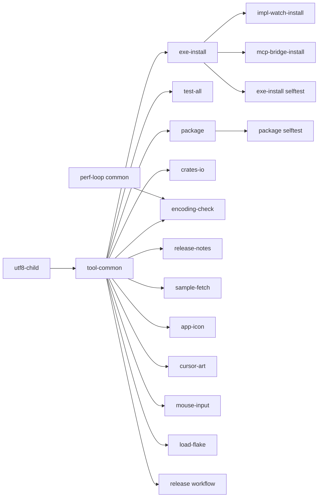
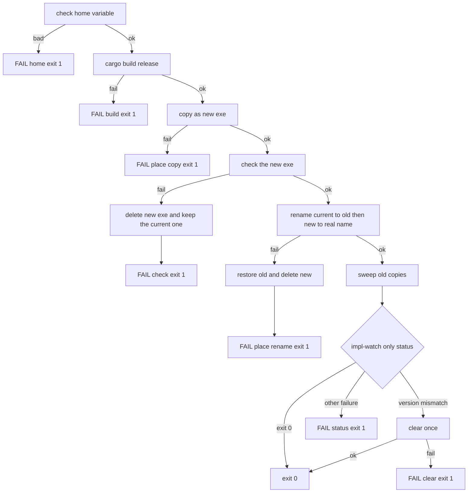

# 設計書: audit-tools-scripts

## 概要

**目的**: `tools/` のうち `tools/perf/` の外の開発の道具（直下の `*.ps1` 14 本・`release-notes.strings.json`・`release-notes-fixture/`）に ponytail の audit をかけて出た 19 件の指摘を、3 つの組（必ず直す 1〜3・直したほうがよい 4〜15・できれば 16〜19）とも全部直す。あわせて brief に預かった件 1（全体テストに `perf-loop.ps1 selftest` の段を足す）と件 2（`encoding check` が子の思わぬ失敗の表示を見ない＝指摘 4）を片づける。指摘の中身と番号は `research.md` の 5 節が正本で、この文書は番号で指す。直し方は「いちばん小さな完全な変更」に従い、写しは 1 か所に寄せ、直したバグと危ない所には壊れたら落ちる決定論のテストを 1 本ずつ持たせる。

**使う人**: 開発者と Claude のセッション（全体テスト・机へ置く道具・配布物・リリースノート・負荷の再現・入力の道具を呼ぶ）、リリースの workflow（`release.yml`・`crates-io.yml`）、スキル（`kiro-complete`・`kiro-impl`・`release`・`update`・`kiro-watch-clear`）。

**変わること**: リリースノートの道具が今の spec 名（接頭辞なし）を製品の変更として数える。机へ置く道具は、置き換える前に新しい exe を確かめ、壊れた exe を置かない。写しになっていた下回り（版の読み・`PATH` の手当て・字を ASCII へ直す関数・机へ置く手順）は 2 本の読み込み用のファイルに寄せる。テストの無かった道具（配布物・机へ置く道具・負荷の再現・入力の道具）に自分の検査ができ、絵の道具 2 本と性能改善ループの道具の自分の検査とあわせて、全体テストの段から回る。

### Goals

- 19 件を全部直す（直さずに残す指摘は 0 件・要件の討議の議題 1）。
- 直したバグと危ない所の 1 件ごとに、壊れたら落ちる決定論のテストを持たせ、全体テストの段から回す。
- 外への約束は、下の「外への約束の変更」の表に挙げた分（要件の討議で読み手ごと直すと決めた 10 件と件 1）のほかは変えない。変える分は、読み手を同じ変更の中で全部直す。
- どのファイルも 1,000 行の番人の下に収める。依存を足さない。

### Non-Goals

- 新しい道具・サブコマンド・配布物（指摘の直しとして足す止まる道・走る前の確かめ・自分の検査の口と、件 1・件 2 の段と検査は除く＝要件 3.4）。
- 範囲の外のファイルの見直し（`tools/perf/` は完了した `audit-tools-perf-run`・`audit-tools-perf-judge`、`crates/sample-ghost-kit` は `audit-test-kits`、`.claude/skills/kiro-next/overview/roadmap-overview.ps1` はスキルの持ち物）。
- 公開済みの v0.1.0 の詳しいリリースノートの作り直し（リリースの操作＝要件 8.1）。
- 要件 8.1 の操作（設置・`package.ps1 -Check`・負荷の再現の本番の走り・画面の操作・リリース）を回して効き目を確かめること。

## Boundary Commitments

### This Spec Owns

- `tools/` 直下の `*.ps1` の全部（今の 14 本と、この設計で足す 4 本）・`tools/release-notes.strings.json`・`tools/release-notes-fixture/` の中身と振る舞い。
- 19 件の直し・直しのテスト・件 1 の段・件 2 の検査・効き目を次の本当の操作で確かめるものの記録（番号ごと）。
- 全体テスト（`tools/test-all.ps1`）の段の並びと結果の一覧の形。
- 範囲の外で直すのは、直しのために要る次の所だけ（要件 3.2・7.2・7.8）:
  - `tools/perf/perf-loop.ps1`・`tools/perf/perf-loop.common.ps1`・`tools/perf/perf-loop.selftest2.ps1`（要件 5.4 の Python の版の名指し＝議題 3 の裁定）
  - `.github/workflows/release.yml` の段「版の検査」の本文（14）
  - 文書とスキルの読み手（`doc/impl-watch.md`・`doc/release-notes/README.md`・`.claude/skills/kiro-complete/SKILL.md`・`.claude/skills/release/procedure.md`・`.claude/skills/update/SKILL.md`・`.kiro/steering/tech.md`・`.kiro/steering/structure.md`）の、変わる約束を書いた行だけ

### Out of Boundary

- `tools/perf/` の上の 3 本のほかのファイルと、3 本の中の直しに要らない行（要件 7.2）。とくに `invoke-cpu-sample.ps1` の `-SkipCapture` の形と自分の検査 `probe-skip-capture` は崩さない（要件 5.3）。
- `Cargo.lock`・`Cargo.toml` の全部・`crates/` の全部・`crates/areka/src/runtime/`・`crates/areka-runtime/`・`doc/COMPAT_ARCHITECTURE.md`、ほか C21 のほかの 4 本が触るファイル（要件 6.6・7.3）。
- `vendors/` の下（読むだけ。`package.ps1` の自分の検査が `vendors/sample_ghost/emo2.nar` を読む・要件 7.11）。
- `.github/workflows/crates-io.yml`（16 は道具の側の 1 語で直す。workflow に `timeout-minutes` を足すかはこの spec の外）。
- `.claude/skills/kiro-next/overview/roadmap-overview.ps1` の `ConvertTo-Ascii`（同じ形の写しだが範囲の外。寄せない）。
- 開発者の机の本物の置き場（`AREKA_IMPL_WATCH_HOME`・`AREKA_MCP_HOME`）とコミット済みの資源（`crates/areka/icon/`・`crates/areka/cursor/`）を書き替える走り（要件 8.1）。

### Allowed Dependencies

- PowerShell 7 と .NET の標準（`ProcessStartInfo.ArgumentList`・`System.IO.File`・`System.IO.Compression.ZipFile`・構文木 `System.Management.Automation.Language.Parser`・`System.Drawing`〔絵の道具が今使う分だけ〕）。新しいモジュールもパッケージも外の道具も足さない（要件 6.6）。
- 外へは今と同じ呼び先だけ: `cargo`・`git`・`rustup`・`curl.exe`（`%SystemRoot%\System32`）・`python`（件 1 の段の中の `tools/perf` の道具だけ）・`taskkill.exe`。
- 範囲の中の読み込みの向きは下の「読み込みの向き」の図だけ。

### Revalidation Triggers

- `Invoke-Utf8Child`・`Show-Ascii`・`Get-ArekaVersion`・`Get-MsvcLinkPath` の名前・引数・戻り値・投げる文が変わるとき → `release.yml` と範囲の全部の道具、`encoding check` の規則 E の表を確かめ直す。
- 全体テストの段の名前・並び・結果の一覧の行・終了コードが変わるとき → `kiro-complete`（段の一覧・所要時間）・`release`・`update`（所要時間）・`tech.md` の Testing を確かめ直す。
- 机へ置く道具の出る行・順・終了コードが変わるとき → `doc/impl-watch.md` の 2 節と 3 節の表と例、スキル `kiro-impl`・`kiro-complete`・`kiro-watch-clear`・`release`・`update` を確かめ直す。
- リリースノートの分け方・`spec-name` の検査の範囲・spec のフォルダの置き場が変わるとき → `doc/release-notes/README.md`・`release/procedure.md`（見どころを選ぶ材料）・`release.yml` を確かめ直す。
- `tools/perf/` の側で `perf-loop.ps1 selftest` の終了コード・前提・`invoke-cpu-sample.ps1 -SelfTest` の採取を飛ばす形が変わるとき → 件 1 の段（昇格した机での振る舞い）を確かめ直す。
- `runtime-crate-split` の着地 → `load-flake.ps1` の `-Binary` の選び肢（要件 7.5・7.6）。

## Architecture

### 今の形の分析

- 道具はそれぞれが 1 本で完結し、共通の部品は子の出力の読み方 `utf8-child.ps1`（`Invoke-Utf8Child`）だけ。版の読み（3 か所）・`PATH` の手当て（3 か所）・字を ASCII へ直す関数（4 つと行の中の写し 4 つ）・机へ置く手 1〜5（2 本）が写しになっている（13・14・17・18）。
- 自分の検査の形は 2 つある: 道具の中の `-SelfTest`（`release-notes`・`sample-fetch`・`sync-i686-helper`・`app-icon`・`cursor-art`）と、本体の中の較正（`encoding-check`・`crates-io`）。全体テストはそのうち 5 本だけを段として回す。
- 配布物・机へ置く道具・負荷の再現・入力の道具には自分の検査が無い（9・10・11・6）。

### 形と境界（研究の 10 節の案 B）

研究の 10 節の 3 案のうち **案 B（共通の部品を足し、写しをそこへ寄せる）** を採る。共通の部品は仕事ごとに 2 本に分ける:

- `tools/tool-common.ps1` — 道具の下回り（字を ASCII へ直す・版の読み・`PATH` の手当て）。`utf8-child.ps1` を読み込む。
- `tools/exe-install.ps1` — 机へ置く道具 2 本の手順（環境変数の確かめ・release のビルド・写して確かめて置き換える・古い写しの掃除・状態の確かめの判断）。

理由: 案 A は寄せ先が無く、どれかの台本の中に置くとほかの台本がその台本を読み込むことになり、読み込むだけで走ってしまう。案 C（`utf8-child.ps1` へ足す）は `release.yml` の読み込みの行を変えずに済むが、「子の出力の読み方」という名前と仕事がずれ、14 の直しで `release.yml` の本文はどのみち変わるので得が小さい。机へ置く手順を `tool-common.ps1` に混ぜないのは、全体テストや配布物の道具が机の手順まで読み込む理由が無いため。



矢印は「読み込まれる側 → 読み込む側」。`package.selftest.ps1` は `package.ps1 -SelfTest` のときだけ、`package.ps1` の中から読み込まれる（関数の定義を済ませた後・段を回す前）。`exe-install.selftest.ps1` は全体テストから `pwsh -File` で回る独り立ちの検査で、`exe-install.ps1` を読み込む。`encoding-check.ps1` が `tools/perf/perf-loop.common.ps1` を自分の子の中でだけ読み込む形は今のまま。

**読み込みの向きの決まり**（違反はレビューで誤りとして扱う）:

- `tool-common.ps1` は `utf8-child.ps1` だけを読み込む。`param` を持たない（読み込んだ側の同じ名前の引数を消すため）。関数と定数を置くほかに副作用を持たない（端末へ出さない・場所を変えない・環境を変えない）。`Set-StrictMode` を自分では呼ばず、`Latest` の下でも落ちない書き方にする。
- `exe-install.ps1` は `tool-common.ps1` だけを読み込み、同じ決まりを守る。`param` を持たない。
- 道具は `tool-common.ps1` を読み込み、`utf8-child.ps1` を直には読み込まない（重ねて読み込んでも害は無いが、入口を 1 つにする）。机へ置く道具 2 本は `exe-install.ps1` だけを読み込む。
- 道具どうしは互いを読み込まない（`package.selftest.ps1` が `package.ps1` の関数を使うのは、`package.ps1` に読み込まれるときだけ）。

### 技術

| 層 | 選ぶもの・版 | この spec での役目 | 注 |
|---|---|---|---|
| 道具の言語 | PowerShell 7（`#Requires -Version 7`） | 範囲の道具すべて | 変えない |
| 子のプロセス | `Invoke-Utf8Child`（.NET `ProcessStartInfo`） | 子の出力を UTF-8 で読む | 変えない |
| 構文の検査 | `System.Management.Automation.Language.Parser` | 5・6・16 の形を縛る自分の検査 | 標準の部品（`encoding-check`・`tools/perf` と同じ） |
| zip | `System.IO.Compression.ZipFile` | 9 の自分の検査で小さな zip を組む | `package.ps1` が今使う部品 |
| 取り寄せ | `curl.exe` の `--proto`・`--proto-redir` | 8 の転送の先の縛り | Windows 同梱の curl（今の机は 8.x）が持つ旗 |

新しい依存は 0（要件 6.6・6.7 の議題は無い）。件 1 の段は Python 3.11 以上を要るが、これは `tools/perf` の道具が既に要る前提で、新しい依存ではない（`tech.md` の Required Tools に書く）。

## File Structure Plan

### Directory Structure

```
tools/
├── tool-common.ps1              # 新: 道具の下回り（Show-Ascii・Get-ArekaVersion・Get-MsvcLinkPath・版の形）
├── exe-install.ps1              # 新: 机へ置く道具の手順（確かめてから置く・掃除・状態の判断）
├── exe-install.selftest.ps1     # 新: 机へ置く手順の自分の検査（偽の置き場で分かれ道を回す）
├── package.selftest.ps1         # 新: 配布物の判定の自分の検査（package.ps1 -SelfTest が読み込む）
├── test-all.ps1                 # 直す: 段を 7 つ足す・PATH の手当てを共通部品へ
├── package.ps1                  # 直す: 全体を try/finally で包む・引数の確かめ・-SelfTest・ASCII・版の読み
├── encoding-check.ps1           # 直す: 子の確かめを 1 つずつ包む・わざと落ちる子の較正・規則 E の表
├── release-notes.ps1            # 直す: spec 名の見分けを spec のフォルダの一覧で
├── release-notes.strings.json   # 変えない（鍵は同じ）
├── release-notes-fixture/
│   ├── spec-names.txt           # 新: 自分の検査が使う spec 名の一覧（見本）
│   ├── subjects.txt             # 直す: 接頭辞なしの spec 名・旧名で後に改名された spec の題名を足す
│   ├── expected-notes.md        # 直す: 上に合わせる
│   ├── expected-notes-from-start.md # 直す: 上に合わせる
│   ├── expected-body.md         # 変えない
│   └── highlights-ok.md         # 変えない（spec 名を含まないことを確かめる）
├── impl-watch-install.ps1       # 直す: 手 1〜6 を exe-install へ・状態の確かめの失敗を出す
├── mcp-bridge-install.ps1       # 直す: 手 1〜6 を exe-install へ
├── load-flake.ps1               # 直す: 親が消えたら終わる負荷の子・-SelfTest・引数の組み立てを関数へ
├── mouse-input.ps1              # 直す: 離しを finally へ・-SelfTest
├── sample-fetch.ps1             # 直す: 本番の行で https だけを転送の先まで・ASCII の関数を共通部品へ
├── crates-io.ps1                # 直す: 失敗の行を ASCII へ・索引の読みに上限・PATH の手当てを共通部品へ
├── app-icon.ps1                 # 直す: 作ったものがコミット済みと同じかの判定・ASCII の関数を共通部品へ
├── cursor-art.ps1               # 直す: 同上
├── utf8-child.ps1               # 変えない
└── sync-i686-helper.ps1         # 変えない（指摘なし）
```

1 ファイルの見立て（番人 1,000 行の下）: `tool-common.ps1` 約 80・`exe-install.ps1` 約 150・`exe-install.selftest.ps1` 約 220・`package.ps1` 約 800・`package.selftest.ps1` 約 260・`encoding-check.ps1` 約 590・`release-notes.ps1` 約 370・`load-flake.ps1` 約 480・`mouse-input.ps1` 約 280・`impl-watch-install.ps1` 約 80・`mcp-bridge-install.ps1` 約 75・`sample-fetch.ps1` 約 370・`crates-io.ps1` 約 340・`app-icon.ps1` 約 335・`cursor-art.ps1` 約 345・`test-all.ps1` 約 115。範囲の外: `perf-loop.ps1` 約 680・`perf-loop.common.ps1` 約 460・`perf-loop.selftest2.ps1` 約 865。

### 範囲の外で直すファイル

- `tools/perf/perf-loop.common.ps1` — 純関数 `Get-PythonVerdict` を足す（`preflight` の版の判断を移す）。
- `tools/perf/perf-loop.ps1` — `preflight` は `Get-PythonVerdict` を使う。`Invoke-SelfTestAll` は Python を見つけた後に版を確かめ、足りなければ名指しの 1 行で赤にする（要件 5.4）。
- `tools/perf/perf-loop.selftest2.ps1` — 検査 `python-verdict` を 1 つ足す。
- `.github/workflows/release.yml` — 段「版の検査」の版の読み（54〜73 行）を `tool-common.ps1` の `Get-ArekaVersion` の 1 呼び出しにする（14）。読み込みの行は `. ./tools/tool-common.ps1`。
- `doc/impl-watch.md` — 2 節の手順 2 の出る行と表（`FAIL check` の意味・`FAIL check: cannot start`・`FAIL status`）、3 節の出る行の順（2・3）。
- `doc/release-notes/README.md` — 104 行・144 行の「spec 名」の説明を「`.kiro/specs/` と `.kiro/specs/completed/` のフォルダの名前（旧名の `areka-P0-` で始まるものを含む）」へ（1）。
- `.claude/skills/kiro-complete/SKILL.md` — 5-2 の段の一覧（437 行。今も抜けている `sample fetch`・`sample fetch check` と新しい 7 段を足す）と所要時間（48・82・436 行の「約 19 分」）。
- `.claude/skills/release/procedure.md`（254 行）・`.claude/skills/update/SKILL.md`（135 行）— 所要時間の「約 19 分」。
- `.kiro/steering/tech.md` — Testing の節（新しい 7 段の 1 行ずつ・件 1 の段の前提）と Required Tools（Python 3.11 以上）。
- `.kiro/steering/structure.md` — 19 行の `tools/` の説明に新しい 4 本を足す。

`tech.md` と `structure.md` は、C21 の `runtime-crate-split` も書き替える。行は重ならず、相手と申し合わせ済みで、この spec が自分の行を書く（2026-11-16 の設計の討議の議題 1・下の「C21 の約束の確かめ」）。

### 範囲の外で確かめるだけのファイル（触らない）

- `.claude/skills/kiro-impl/SKILL.md`・`.claude/skills/kiro-watch-clear/SKILL.md`・`.claude/skills/release/procedure.md` の机へ置く道具の行（161 行ほか）— 呼ぶ形（引数なし・絶対パス）だけを書き、出る行を書かない＝直しで偽にならない。
- `.claude/skills/release/procedure.md` の 129〜134 行・276 行・287 行 — `-Notes` の出力を読む・`package.ps1 -Check` を付けて呼ぶ＝形は同じ。
- `crates/areka-impl-watch/src/error.rs` の道具の名前の文 — 道具の名前と呼び方は変わらない。
- `crates/sample-ghost-kit`（取り寄せの置き場と `--fetch-list` の 5 列）・`crates/areka/build.rs`（`icons.res` を読む）— 形は変わらない。
- `tools/perf/perf-loop.common.ps1` の単独で読み込める形と `Invoke-Child`・`Invoke-PwshChild` — `encoding check` の使い方は変えない。

## System Flows

### 机へ置く道具の手順（2・3・13 の後）



- 確かめ（`--help`・標準入力を閉じた起動）は置き換える**前**に `.new.exe` に対して行う。落ちたら `.new.exe` を消し、今の exe と古い写しには触らない（2）。
- 古い写しの掃除は、確かめが通って置き換えた後だけ（2）。
- 状態の確かめ（`status`）は状態ファイルを読むので、置いた後の exe で行う。版の不一致でない失敗は、標準エラーの最後の行と `FAIL status: exit <n>` を出して 1 で終わる（3）。

### 全体テストの段の並び（件 1・9・10・11・12・6 の後）

今の段の並びは変えず、`sample fetch check` の後・`-License` の段の前に 7 段を足す:

```
sample fetch → add i686 target → build i686 artifacts → [cargo fmt (format)] → fmt --check
→ x64 workspace tests → dola toml feature tests → i686 tests (host-32)
→ crates.io pre-publish check (package only) → encoding check → release notes check
→ roadmap overview check → i686 helper sync check → sample fetch check
→ package check → exe install check → load flake check → mouse input check
→ app icon check → cursor art check → perf loop selftest            ← 新しい 7 段
→ [cargo deny check → cargo about generate] → i686 helper beside areka.exe
```

- 新しい段はどれも `Step`（取り寄せが赤でも回す）。検体の書庫を使うのは `package check` だけで、それはコミット済みの `vendors/sample_ghost/emo2.nar` を読むだけ（取り寄せの書庫に頼らない）。
- いちばん長い `perf loop selftest`（この机で 71.5 秒）を最後に置き、短い検査の赤を先に一覧で読めるようにする。
- 足す時間の見立ては約 100 秒（`perf loop selftest` 71.5 秒・`cursor art check` 11.5 秒・`app icon check` 2.0 秒＝この机の実測、ほかの 4 段は数秒ずつの見込み）。全体の所要時間の目安を「約 19 分」から「約 21 分」へ改める。

## 直し方の一覧（指摘ごと）

「テスト」の欄の名前は下の Testing Strategy の検査の名前。「次の操作」は、効き目を次の本当の操作で確かめるものとして検証の記録に番号ごとに残すもの（要件 8.3 の裁定）。「リリース」は、リリースの workflow に響くので記録に「次のリリースで確かめる」と書くもの（要件 7.7 の裁定）。

| # | 組 | 直し方（約束） | 主なファイル（範囲の外の読み手を含む） | テスト | 次の操作 |
|---|---|---|---|---|---|
| 1 | 必ず | 製品の変更の見分けを「スコープから旧い接頭辞 `areka-P0-` を外した名前が、`.kiro/specs/` か `.kiro/specs/completed/` のフォルダの名前（同じく接頭辞を外したもの）に在る」にする。見どころの `spec-name` は、同じ一覧の名前（前後が英数字・`-`・`_` でない所）か `areka-P0-` が現れる行を落とす。spec のフォルダが 1 つも無ければ `FAIL specs: no spec folders under .kiro/specs` で 1 | `release-notes.ps1`・`release-notes-fixture/`（`spec-names.txt` 新・`subjects.txt`・`expected-notes*.md`）・`doc/release-notes/README.md` | T1 `notes of the fixture subjects equal the expected notes`（改めた見本）・`spec names cover active and completed`・`highlights broken fixture fails with spec-name`（新しい名前と旧名の 2 通り） | はい・リリース（次の `-Notes` の実物の題名） |
| 2 | 必ず | 確かめを置き換えの前に `.new.exe` で行い、落ちたら `.new.exe` を消して今のものに触らない。掃除は置き換えの後だけ。確かめの scriptblock が投げたら `FAIL check: cannot start: <ASCII の理由>` | `exe-install.ps1`・`impl-watch-install.ps1`・`mcp-bridge-install.ps1`・`doc/impl-watch.md` | T3 `bad check keeps the current exe`・`good check places and sweeps`・`check throws` | はい（次の設置） |
| 3 | 必ず | `status` が 0 でなく版の不一致でもないときは、標準エラーの最後の行（ASCII）と `FAIL status: exit <n>` を出して 1。判断は純関数 `Get-StateStatusAction` | `exe-install.ps1`・`impl-watch-install.ps1`・`doc/impl-watch.md` | T3 `status action` | はい（次の設置） |
| 4 | 直したほうが | 子の確かめを 1 つずつ `Invoke-ChildCheck`（名前つきの `try`/`catch`）で包み、捕まえたら `FAIL cp932 child: <名前>: uncaught: <ASCII の理由>` を溜めて続ける。`tools/perf` の読み込みも 1 つの確かめ `perf load` にし、落ちたら後の `perf` の確かめを飛ばす。孫が 0 でなく終わった確かめは孫の標準エラーの最後の行を添える。子が 0 でなく `FAIL` の行が無いときは子の標準エラーの最後の行を添える。端末の文字コードは親でも子でも新しく替えない | `encoding-check.ps1` | T1 較正 `cp932 child injected failure`（内部の引数 `-FailCheck 'perf load'` でわざと落とした子が、名前と `\u7248` を含む `FAIL` の行と、その前の確かめの `PASS` の行と `version=` の行を出し、0 でなく終わる） | いいえ |
| 5 | 直したほうが | 段を並べる本体を `try { … } finally { Invoke-Cleanup $script:ExitCode }` で包む。後始末の口は `finally` の 1 か所だけにし、`Exit-Script` は終了コードを控えて理由を出して `exit` するだけにする。`Invoke-Cleanup` は 2 度呼んでも害が無い（消したものを並びから外す・子を握りから外す） | `package.ps1` | T2 `cleanup idempotent`・`steps inside try finally`（構文木） | はい（手で止めたとき） |
| 6 | 直したほうが | 押したボタンの離しを `catch` から `finally` へ移す（`$pressed` が 0 でなければ送る） | `mouse-input.ps1` | T2 `release-in-finally`（構文木） | はい（次の画面の操作） |
| 7 | 直したほうが | 負荷の子に親の番号を渡し、親が消えたら自分で終わる（`try { $p = Get-Process -Id <親> -ErrorAction Stop } catch { exit 0 }; while (-not $p.HasExited) { for (…100000…) { } }`）。`finally` の番号での止め方は今のまま（止め済みの子を止めても害は無い） | `load-flake.ps1` | T2 `burner ends with its parent`（すぐ終わる偽の親と負荷の子 1 本を約 1 秒だけ起こす＝議題 5 で負荷の再現の走行に数えない） | はい（次の負荷の再現） |
| 8 | 直したほうが | 本番の行では `curl` に `--proto =https --proto-redir =https` を渡す（`-AnyScheme` の自分の検査の行では渡さない） | `sample-fetch.ps1` | T1 `https only refuses a non-https url at curl`・`https only passes both proto flags` | はい（次の取り寄せ） |
| 9 | 直したほうが | 判定の関数（`Test-RunLog`・`Test-ZipContent`・`Read-PeInfo`・`Get-DeniedImports`・新しい `Test-PackageArgs`）を最初の段の前に定義し、`-SelfTest` から回す。全体テストに段 `package check` | `package.ps1`・`package.selftest.ps1`・`test-all.ps1`・`tech.md`・`kiro-complete` | T2 `run log`・`pe read`・`deny list`・`zip content`・`args` | はい・リリース（次の `-Check` と `-Arch all`） |
| 10 | 直したほうが | 机へ置く手順の分かれ道を偽の置き場（`target\exe-install-selftest\<pid>\`）と偽の作った exe（中身を決めた小さなファイル）と偽の確かめで回す自分の検査を足す。全体テストに段 `exe install check` | `exe-install.selftest.ps1`・`test-all.ps1`・`tech.md`・`kiro-complete` | T3 全部（下の表） | はい（次の設置） |
| 11 | 直したほうが | `-SelfTest` を足す（作った記録の文字列で `Read-Round`・`Get-Median`・引数の組み立て・`Stop-Tree`・7 の負荷の子）。負荷の子も cargo も起こさない（7 の 1 本と `Stop-Tree` の試しの 1 木だけ）。全体テストに段 `load flake check` | `load-flake.ps1`・`test-all.ps1`・`tech.md`・`kiro-complete` | T2 `read round`・`median`・`cargo args`・`stop tree` | はい（次の負荷の再現） |
| 12 | 直したほうが | 両方の `-SelfTest` に「コミット済みの入力を `target` の下の写しで組んだ結果が、コミット済みの出力とバイトで同じ」の判定を足す（今の `same bytes twice` の組んだ結果と比べる＝組む回数は増えない）。全体テストに段 `app icon check`・`cursor art check` | `app-icon.ps1`・`cursor-art.ps1`・`test-all.ps1`・`tech.md`・`kiro-complete` | T1 `committed outputs are current`（2 本） | いいえ |
| 13 | 直したほうが | 手 1〜6 を `exe-install.ps1` の関数にし、2 本は名前・環境変数の名前・確かめの scriptblock を渡すだけにする | `exe-install.ps1`・2 本 | T3（2 と同じ） | 2 と同じ |
| 14 | 直したほうが | 版の読みを `tool-common.ps1` の `Get-ArekaVersion` 1 つにし、版の形の正規表現を `$AREKA_VERSION_PATTERN` 1 つにする。`package.ps1`・`encoding-check.ps1`・`release.yml` はそれを呼ぶ。規則 E の表を直す（下の「規則 E の表」） | `tool-common.ps1`・`package.ps1`・`encoding-check.ps1`・`release.yml` | T1 `encoding check` の `real` と `version=` の突き合わせ（932 の端末の下で `Get-ArekaVersion` を通す） | はい・リリース（次の版の検査の段） |
| 15 | 直したほうが | `package.ps1` は `Exit-Script` の 1 か所で理由を `Show-Ascii $Message 0` にしてから出す（段の失敗の理由・前提の不正の文・引数の写し）。`crates-io.ps1` は `Fail` の 1 か所で同じにする（`Format-FailLine`）。子の出力をそのまま写す所は書き替えない（`tech.md` の決まり） | `package.ps1`・`crates-io.ps1` | T2 `ascii exit message`（子の `package.ps1 -Arch` に日本語の値を渡し、終了コード 3 と ASCII だけの行と `\u65E5` を確かめる）・T1 `fail line is ascii`（crates-io の較正） | はい・リリース（次の本物の失敗） |
| 16 | できれば | `Invoke-WebRequest` に `-TimeoutSec 60` | `crates-io.ps1` | T1 `index read has a timeout`（構文木: 全部の `Invoke-WebRequest` に `-TimeoutSec`） | はい・リリース（次の公開） |
| 17 | できれば | `link.exe` の手当てを `tool-common.ps1` の `Get-MsvcLinkPath` 1 つにし、3 本は `$env:PATH = Get-MsvcLinkPath $env:PATH` | `tool-common.ps1`・`test-all.ps1`・`package.ps1`・`crates-io.ps1` | 全体テストの `build i686 artifacts`（Git Bash から呼んでも i686 のリンクが通る）と既にある自分の検査 | はい（次の `-Verify` と配布物） |
| 18 | できれば | `Show-Ascii`（`\uXXXX`・長さで切る・既定 80）を `tool-common.ps1` へ移し、`ConvertTo-AsciiText`・`ConvertTo-Ascii` の 3 つと行の中の写し（`mouse-input`・`load-flake`・`release-notes` の 2 か所）を消して `Show-Ascii … 0` に替える。`?` にしていた所は `\uXXXX` になる（読み手は無い） | `tool-common.ps1`・`encoding-check`・`sample-fetch`・`app-icon`・`cursor-art`・`mouse-input`・`load-flake`・`release-notes` | 既にある各 `-SelfTest`・較正（消す前の grep で同じ名前の定義が 0 件） | いいえ |
| 19 | できれば | `-KeepExpanded`・`-SmokeExitMs`・`-CheckDir` のどれかが `-Check` なしで来たら、組み立ての前に終了コード 3 で 1 行（`-KeepExpanded, -SmokeExitMs and -CheckDir need -Check (got: <名前>)`） | `package.ps1`（`Test-PackageArgs`） | T2 `args` | いいえ |
| 件 1 | — | 全体テストに段 `perf loop selftest`（`pwsh -NoProfile -File tools/perf/perf-loop.ps1 selftest`）。Python の版が足りなければ `selftest python NG code=-1 \| python <版> (need 3.11 or later)` で赤（`tools/perf` の根本の 1 か所） | `test-all.ps1`・`tools/perf/perf-loop.ps1`・`perf-loop.common.ps1`・`perf-loop.selftest2.ps1`・`tech.md`・`kiro-complete`・`release`・`update` | 段そのもの・`tools/perf` の T `python-verdict` | いいえ |

**規則 E の表**（`encoding-check.ps1` の `$RequiredCalls`・14 の後）:

| ファイル | `Invoke-Utf8Child` で呼ぶ要素 | 今 |
|---|---|---|
| `tools/package.ps1` | `nar-sample-path` | `metadata`・`nar-sample-path`（`metadata` は `tool-common.ps1` へ移る） |
| `tools/crates-io.ps1` | `metadata` | 同じ（版でなく包みの一覧を読む別の読み） |
| `tools/tool-common.ps1` | `metadata` | 新 |
| `.github/workflows/release.yml` | （行を消す） | `metadata`（素の `cargo metadata` は規則 D が今までどおり落とす） |

規則 E から `release.yml` の行が消えると、`release.yml` の版の読みを縛るのは規則 D（素の `cargo metadata` を落とす）だけになり、守りは 1 段弱くなる。`release.yml` が `Get-ArekaVersion` を呼ばなくなっても版の検査の段そのものが消えるだけで字化けの道は生まれないので、受け入れる（設計の検証の重大でないもの 2）。

## Components and Interfaces

### 一覧

| 部品 | 層 | 役目 | 要件 | 主な依存 | 約束 |
|---|---|---|---|---|---|
| tool-common | 共通の下回り | ASCII へ直す・版の読み・`PATH` の手当て | 3.1, 3.2, 6.4, 6.5 | utf8-child (P0) | Service |
| exe-install | 共通の下回り | 机へ置く手順 | 3.1, 6.2, 6.3 | tool-common (P0) | Service |
| exe-install selftest（T3） | 自分の検査 | 机へ置く手順の分かれ道 | 4.1〜4.5 | exe-install (P0) | Batch |
| package と package selftest（T2） | 道具と自分の検査 | 配布物・判定の検査 | 3.1, 4.1〜4.5, 6.3 | tool-common (P0) | Batch |
| encoding-check | 道具 | 文字コードの判定・件 2 | 5.5, 4.7 | tool-common, perf-loop common (P0) | Batch |
| release-notes | 道具 | 見どころの検査・リリースノート | 3.1, 4.7 | tool-common (P0) | Batch |
| load-flake | 道具 | 負荷の再現・自分の検査 | 3.1, 6.3, 7.5, 7.6 | tool-common (P0) | Batch |
| mouse-input | 道具 | 入力・自分の検査 | 3.1, 6.3 | tool-common (P1) | Batch |
| sample-fetch・crates-io・app-icon・cursor-art | 道具 | 小さな直しと既にある自分の検査への足し | 3.1, 4.1 | tool-common (P1) | Batch |
| test-all | 全体テスト | 段の並びと一覧 | 4.2, 5.1, 9.4 | tool-common (P1) | Batch |
| perf の Python の版 | 範囲の外の直し | 件 1 の前提の名指し | 5.4, 7.2 | perf-loop common (P0) | Service |
| 文書とスキルの読み手 | 範囲の外の読み手 | 変わる約束の追随 | 3.2, 7.8, 7.9 | なし | — |

型は PowerShell の `param` の型注釈と `[pscustomobject]` の鍵で示す。

### 共通の下回り

#### tool-common（`tools/tool-common.ps1`）

| 項目 | 内容 |
|---|---|
| Intent | 写しになっていた下回りを 1 つにする（14・17・18） |
| Requirements | 3.1, 3.2, 6.4, 6.5 |

**Responsibilities & Constraints**
- 読み込み用（`.` で読む）。`utf8-child.ps1` を読み込む。`param` を持たない。関数と定数のほかに副作用を持たない。字句は ASCII だけ（`encoding check` の規則 A〜E の対象）。
- 端末の文字コードを読みも書きもしない。

**Contracts**: Service [x]

```powershell
# 受け付ける版の形（+ の付記は受けない）。package.ps1 の VERSION_PATTERN・encoding-check の $VersionPattern を置き換える
$AREKA_VERSION_PATTERN = '^\d+\.\d+\.\d+(-[0-9A-Za-z.-]+)?$'

# ASCII の外と制御の字を \uXXXX に、$Max を越えたら切って '...'（$Max 0 は切らない）。今の encoding-check の形のまま
function Show-Ascii { param([string]$s, [int]$Max = 80) }   # [string]

# areka の版。cargo metadata --no-deps --locked --format-version 1 --manifest-path <このファイルのリポジトリ>\Cargo.toml を
# Invoke-Utf8Child で読み、名前が areka の包みがちょうど 1 つで、版が $AREKA_VERSION_PATTERN に合えば返す。
# 合わなければ ASCII の文で throw:
#   'cargo metadata exited with code <n>: <最後の標準エラーの行>' / 'cargo metadata output is not JSON'
#   'expected exactly one areka package, got <n>' / 'areka version is not a version: <版> (accepted: <形>; no + suffix)'
function Get-ArekaVersion { }   # [string]

# PATH の文字列から「link.exe を持つが cl.exe を持たない」フォルダ（Git Bash の coreutils ほか）を外した文字列
function Get-MsvcLinkPath { param([string]$Path) }   # [string]
```

- Postconditions: `Get-ArekaVersion` の文は呼び手がそのまま理由として使える（`package.ps1` は `cannot read the version (<文>)` で 3、`release.yml` は同じ形で 1、`encoding check` は `FAIL cp932 child: real: <文>`）。
- Invariants: `Show-Ascii` の既定 80 は今の `encoding check` の出す行を変えないため。ほかの呼び手は `0` を渡す。

**Implementation Notes**
- Integration: `release.yml` の段「版の検査」は `. ./tools/tool-common.ps1` → `try { $version = Get-ArekaVersion } catch { Write-Host "cannot read the version ($($_.Exception.Message))"; exit 1 }` に替わり、タグとの突き合わせと `version=` の書き出しは今のまま。版の形の確かめが `release.yml` にも効くようになる（`+` の付記の版は、今は後の配布物の段で止まり、直した後はこの段で止まる）。
- Validation: 932 の端末の子の確かめ `real` と親の `version=` の突き合わせ（14）。`Show-Ascii` は各道具の既にある自分の検査が通す。
- Risks: 道具が同じ名前の関数を持ち続けると後から定義した方が勝つ。寄せた後に `rg -n "function (Show-Ascii|ConvertTo-AsciiText|ConvertTo-Ascii)" tools/*.ps1` が `tool-common.ps1` の 1 件だけであることを確かめる。

#### exe-install（`tools/exe-install.ps1`）

| 項目 | 内容 |
|---|---|
| Intent | 机へ置く道具 2 本の手順を 1 つにし、置き換える前に確かめる（2・3・13） |
| Requirements | 3.1, 6.2, 6.3 |

**Responsibilities & Constraints**
- 読み込み用。`tool-common.ps1` だけを読み込む。`param` を持たない。環境変数の値を出さない・設定しない（今の約束のまま）。
- 自分で触るのは置き場の `<名前>.exe`・`<名前>.new.exe`・`<名前>.old*.exe` だけ（今の約束のまま）。

**Contracts**: Service [x]

```powershell
# 手 1: 環境変数の値の確かめ。戻り: FAIL の行か $null（値は出さない）
#   'FAIL home: <VarName> is not set' / 'FAIL home: <VarName> is not an absolute path'
function Test-InstallHome { param([string]$VarName, [AllowNull()][string]$Value) }

# 手 2: cargo build --release -q -p <Name> --manifest-path <Root>\Cargo.toml --message-format=json-render-diagnostics。
# 戻り: [pscustomobject]@{ Path = [string]（失敗なら $null）; Lines = [string[]]（cargo の標準エラーの行と FAIL の行） }
#   'FAIL build: cargo exit <n>' / 'FAIL build: no executable in cargo output'
function Build-InstallExe { param([Parameter(Mandatory)][string]$Name, [Parameter(Mandatory)][string]$Root) }

# 手 3〜6: 写す → 確かめる → 置き換える → 掃除。戻り: [pscustomobject]@{ Code = [int]（0 か 1）; Lines = [string[]] }
# $Check: param([string]$ExePath) → [pscustomobject]@{ Ok = [bool]; Line = [string] }（Line は 'OK check: …' か 'FAIL check: …'）
#   $Check が時間切れで子を Kill したときは、終わるのを待ってから（WaitForExit 5 秒）返す。確かめが落ちて .new.exe を消せなかったら
#   'FAIL cleanup: cannot remove <名前>.new.exe: <理由>' を足して 1（前のものには触っていない）＝設計の検証の重大でないもの 1
function Install-ToolExe {
    param([Parameter(Mandatory)][string]$HomeDir, [Parameter(Mandatory)][string]$Name,
          [Parameter(Mandatory)][string]$Built, [Parameter(Mandatory)][scriptblock]$Check)
}

# impl-watch の手 7 の判断（純関数）。戻り: 'none'（0 で終わった）| 'clear'（版の不一致）| 'fail'（ほかの失敗）
function Get-StateStatusAction { param([int]$Code, [string[]]$ErrLines) }
```

`Install-ToolExe` の行（ASCII だけ）と順:

| 場合 | 行（この順） | Code |
|---|---|---|
| 写せない | `FAIL place: copy` | 1 |
| 確かめが落ちた | `$Check` の `FAIL check: …` の行（`.new.exe` は消す・今の exe と古い写しは元のまま） | 1 |
| 確かめが投げた | `FAIL check: cannot start: <Show-Ascii の理由>`（同上） | 1 |
| 置き換えられない | `FAIL place: rename`（2 つ目の改名で落ちたら古いものを元へ戻し、`.new.exe` を消してみる） | 1 |
| 通った | `$Check` の `OK check: …` → （前が在れば）`OK renamed previous to <名前>.old-<UTC>.exe` → `OK placed <名前>.exe` → 古い写しごとに `OK removed <名前>` か `KEEP <名前> (in use; run again later)` | 0 |

- Preconditions: `$HomeDir` は確かめ済みの絶対パス。`$Built` は在るファイル。
- Postconditions: Code 1 のとき `<名前>.exe` は呼ぶ前と同じバイト（2 つ目の改名の戻しが落ちたときを除く。そのときは `FAIL place: rename` の行に `; restore failed` を足す）。
- 今と変わる約束: `OK check` の行が `OK placed` より前に出る。`FAIL check` は「置いていない・前のものは元のまま」を意味する。`FAIL check: cannot start: …`・`FAIL status: exit <n>` の行が増える（読み手は `doc/impl-watch.md`）。

**Implementation Notes**
- Integration: `impl-watch-install.ps1` は `Test-InstallHome`・`Build-InstallExe`・`Install-ToolExe`（確かめ＝`Invoke-Utf8Child $exe @('--help')` が 0 なら `OK check: --help exit 0`、でなければ `FAIL check: --help exit <n>`）の後に、置いた exe で `status` を呼び、`Get-StateStatusAction` が `clear` なら今の `clear` の道、`fail` なら標準エラーの最後の行（`Show-Ascii … 0`）と `FAIL status: exit <n>` で 1。`mcp-bridge-install.ps1` の確かめは今の「標準入力を閉じて 15 秒」をそのまま scriptblock にする。
- Validation: T3（下の Testing Strategy）。本物の置き場での効き目は次の設置で（要件 8.3）。
- Risks: `--help` を `.new.exe` の名前で起こすので、exe が自分のファイル名に頼っていれば確かめが変わる。今の 2 本はどちらも名前に頼らない（`areka-impl-watch` の `--help` は状態に触らない・中継は引数を読まない）。

### 自分の検査

#### exe-install selftest（`tools/exe-install.selftest.ps1`・T3）

- `exe-install.ps1` を読み込み、`target\exe-install-selftest\<pid>\` の下に偽の置き場を作って分かれ道を回す。偽の作った exe は中身を決めた小さなファイル（`good`・`bad` の字）で、偽の確かめは中身を読んで `Ok` を決める（本物の exe を起こさない・cargo を呼ばない）。終わったら置き場を消す（`finally`）。握ったファイルの取っ手は `finally` で必ず放す。
- 判定ごとに `ok selftest <名前>` か `FAIL selftest <名前>` を出し、全部通れば 0・1 つでも落ちれば 1。

#### package selftest（`tools/package.selftest.ps1`・T2）

- `package.ps1 -SelfTest` が、関数の定義を済ませた後・`PATH` の手当てと段の前に読み込む。`-SelfTest` にほかの引数を添えたら終了コード 3（`-SelfTest takes no other parameter`）。ビルド・`cargo`・`git`・起動確認を回さない。書くのは `target\package-selftest\<pid>\` の下だけで、終わったら消す。
- 判定の出し方は T3 と同じ（`ok selftest <名前>`／`FAIL selftest <名前>`・終了コード 0／1）。

### 道具

#### package（`tools/package.ps1`）

**Contracts**: Batch [x]

- 引数: 今の `-Arch`・`-Check`・`-CheckDir`・`-KeepExpanded`・`-SmokeExitMs` に `-SelfTest` を足す。終了コード 0〜3 の意味は今のまま（19 で 3 の場合が 1 つ増える）。
- 本体の形（5 の後）:

```powershell
# 1. param・較正値（VERSION_PATTERN は tool-common の $AREKA_VERSION_PATTERN へ）・tool-common の読み込み・Set-Location（今のとおり）
# 2. 後始末の状態と関数（Set-EnvTemp・Restore-Env・Invoke-Cleanup・Exit-Script）・Get-ArtifactNames・Step
# 3. 判定の関数（Test-PackageArgs・Read-PeInfo・Get-DeniedImports・Get-ZipEntryMap・Read-ZipEntry・Test-ZipContent・Test-RunLog）と
#    子の読み（Invoke-Utf8Step・Read-SamplePaths）＝今は段の間に散っている定義をここへ集める（中身は変えない）
# 4. if ($SelfTest) { …ほかの引数なら 3…; . (Join-Path $PSScriptRoot 'package.selftest.ps1'); exit … }
# 5. $script:ExitCode = $EXIT_STAGE_FAILED
#    try { $env:PATH = Get-MsvcLinkPath $env:PATH; …今の段の並び…; $script:ExitCode = $EXIT_OK }
#    finally { Invoke-Cleanup $script:ExitCode }
#    Write-Host 'all steps green'; exit 0
```

```powershell
# 引数の確かめ（純関数・preflight の最初に呼ぶ）。戻り: [pscustomobject]@{ Error = [string]（通れば $null）; BuildArchs = [string[]]; SmokeMs = [int] }
# 順: -SmokeExitMs の数 → -Arch の値 → -Check と arm64 → -CheckDir の絶対パス → リポジトリの中なら target\ の下 → -Check の無い
#     -KeepExpanded・-SmokeExitMs・-CheckDir（19）。Error の文は今の文のまま（19 だけ新しい文）
function Test-PackageArgs {
    param([string]$Arch, [bool]$Check, [string]$CheckDir, [bool]$KeepExpanded, [bool]$SmokeExitMsGiven,
          [string]$SmokeExitMs, [Parameter(Mandatory)][string]$RepoRoot)
}
function Exit-Script { param([int]$Code, [string]$Message) }   # $script:ExitCode = $Code; 理由を Show-Ascii $Message 0 で出す; exit $Code
```

**Implementation Notes**
- Integration: 展開先の長さの確かめ（`EXPAND_DIR_MAX_CHARS`）は時刻を使うので preflight に残し、条件を `$Check` だけにする（19 の後は `-CheckDir` が `-Check` を伴う）。`Ctrl+C` では PowerShell は `catch` と後始末の関数を回さず `finally` だけを回すので、後始末の口を `finally` の 1 か所に置く（5）。`exit` でも `finally` は回る。
- Validation: T2（下の Testing Strategy）。
- Risks: 段の間に散っていた関数の定義を前へ集めるとき、定義の中身と `$script:` の値の読み方は変えない（`Test-ZipContent` は呼ばれたときに `$script:Version`・`$script:Commit`・`$script:Dirty`・`$script:Notices` を読む）。

#### encoding-check（`tools/encoding-check.ps1`）

**Contracts**: Batch [x]

- 引数: 今の内部の `-Cp932Child`・`-PerfSampleChild` に、内部の `-FailCheck <名前>` を足す（`-Cp932Child` と一緒のときだけ意味を持つ。手で回したときの断り方は今の 2 つと同じ 1 行と終了コード 1）。内部の引数で外への約束ではない（段の名前・`PASS`／`FAIL` の行の形・端末を替えない約束は変えない＝研究の旗 (a) の「守る」）。

```powershell
# 子（-Cp932Child）の中だけ。確かめ 1 つを名前つきで回す。投げたら FAIL の行を $bad に足して続ける。
# -FailCheck がこの名前なら、本体の前に 'injected failure for the calibration: <名前> <U+7248>' を投げる。
function Invoke-ChildCheck { param([Parameter(Mandatory)][string]$Name, [Parameter(Mandatory)][scriptblock]$Body) }
```

- 確かめの名前: `own console`・`calibration`・`production`・`real`・`perf load`・`perf calibration`・`perf real`・`perf console`。`perf load`（`perf-loop.common.ps1` の読み込み）が落ちたら、後の 3 つの `perf` の確かめは回さず、`FAIL cp932 child: perf load: …` の 1 行だけを残す。読み込みと 3 つの確かめは今と同じ 1 つの scope の中で行う（`StrictMode 3.0` を外へ漏らさない）。
- 子の出力の形: `PASS …`／`FAIL cp932 child: <名前>: …`／`version=<版>`。今の行の形は変えない（`FAIL cp932 child: production: …` などは名前の後の文が今と同じ）。
- 較正 `cp932 child injected failure`（親・3 節の子の確かめの後）: 親は `-Cp932Child -FailCheck 'perf load'` の子をもう 1 本起こし、⑴ 0 でない終了コード ⑵ `FAIL cp932 child: perf load: uncaught: ` で始まり `\u7248` を含む行 ⑶ `PASS cp932 child: production` で始まる行 ⑷ `version=` の行、の 4 つがそろえば `PASS cp932 child injected failure (…)`、欠ければ `FAIL cp932 child injected failure: <欠けた物>` を `$fails` に足す。
- 規則 E の表は上の「規則 E の表」。`Read-ArekaVersion`・`Show-Ascii`・`$VersionPattern` は消し、`tool-common.ps1` の物を使う。

**Implementation Notes**
- Integration: 子は自分の端末を 932 にしたまま、失敗の理由を `Show-Ascii` にして標準出力の `FAIL` の行で出す＝親の読み方（UTF-8）に依らず読める（研究の 11 節の 2）。
- Risks: 子をもう 1 本起こすので段の時間が少し延びる（わざと落とした子は `perf` の確かめを回さないので、`cargo metadata` の 1 回ぶん）。

#### release-notes（`tools/release-notes.ps1`）

**Contracts**: Batch [x]

```powershell
# spec の名前の一覧。<Root>\.kiro\specs\ の直下（completed を除く）と <Root>\.kiro\specs\completed\ の直下のフォルダの名前から、
# 頭の $SPEC_MARK（'areka-P0-'）を外したものを、重ねずに順序つきで返す
function Get-SpecNames { param([Parameter(Mandatory)][string]$Root) }   # [string[]]
function Read-SpecNamesFixture { }   # 自分の検査: release-notes-fixture/spec-names.txt の 1 行 1 名
function Test-Highlights { param([AllowNull()]$Text, [string[]]$SpecNames) }
function Format-ReleaseNotes { param([string[]]$Subjects, [string]$Version, [string]$PrevTag, [string]$Repository,
                                     [pscustomobject]$Strings, [string[]]$SpecNames) }
```

- 製品の変更の見分け: スコープから頭の `$SPEC_MARK` を外した名前が `$SpecNames` に在る（大文字と小文字を区別する）。題名の文から `$SPEC_MARK` を外す今の決まりはそのまま。
- `spec-name` の検査: 行に `$SPEC_MARK` が現れるか、`$SpecNames` のどれかが前後を `[0-9A-Za-z_-]` でない字に挟まれて現れる。説明の文は `the line contains a spec name`（名前は印字しない＝「見どころの行の中身を印字しない」約束のまま）。
- `-Check`・`-Notes`・`-Body` と、`-SelfTest` の本物の見どころの判定（`real highlights <名> passes`）は `Get-SpecNames $root`（本物の一覧）を使う。見本の `spec-names.txt` は、`-SelfTest` の整形の見本（`subjects.txt`・`expected-*.md`）と壊した見本の判定にだけ使う（全体テストと `-Check`・CI が同じ見どころを同じ一覧で見る＝`release/procedure.md:134` の前提を保つ・設計の検証の指摘 3）。本物の一覧が 0 件なら、どの口でも `FAIL specs: no spec folders under .kiro/specs` で 1（黙って全部を内部の作業にしない＝要件 6.2）。
- 較正値の説明: `SPEC_MARK` は「旧い spec 名の頭（2026-10-23 の改名の前の名前と、改名しない completed の名前に付く）」、新しい `SPECS_DIRS = '.kiro/specs', '.kiro/specs/completed'`。

**Implementation Notes**
- Integration: `release.yml` は `actions/checkout` で履歴ごと木全体を取る（`fetch-depth: 0`）ので、タグの木に `.kiro/specs/` が在る（研究の 11 節の 4）。`completed/` は改名しない決まりなので、古い範囲の `-Notes` でも旧名の題名を落とさない。2026-10-23 の改名の前に `areka-P0-<名>` で書かれ、後で `<名>` のフォルダになった spec も、頭を外して比べるので拾える。
- Validation: 見本を改める（下の Testing Strategy の T1）。`doc/release-notes/v*.md` の実物が全部通ることは今の自分の検査が本物の一覧で確かめる（本物の一覧で `spec-name` が誤って当たらないこと。2026-11-16 の設計の検証の測り＝本物の 495 の名前と今ある見どころの当たりは 0 件）。

#### load-flake（`tools/load-flake.ps1`）

**Contracts**: Batch [x]

- 引数: 引数の組を 2 つにする。`Run`（既定・今の引数のまま・`-Label` は必須）と `SelfTest`（`-SelfTest` だけ）。`-SelfTest` のときは出力のフォルダ（`target\load-flake\<Label>-…`）を作らない。

```powershell
function Get-CargoTestTarget { param([Parameter(Mandatory)][string]$Binary) }   # '-p areka --bin areka' ほか（今の switch のまま）
function Get-CargoTestArgs { param([string]$Target, [string[]]$Filter, [bool]$Ignored, [int]$TestThreads, [bool]$NoCapture) }   # [string]
# 負荷の子を 1 本起こす。子は親（$ParentId）が消えたら自分で終わる（親が既に居なければ直ちに 0 で終わる）
function Start-Burner { param([Parameter(Mandatory)][string]$PwshExe, [Parameter(Mandatory)][int]$ParentId) }   # [System.Diagnostics.Process]
```

- 7.5・7.6: `runtime-crate-split` は今は着地していない（2026-11-16 の `origin/main` に `completed/runtime-crate-split` が無い）。実装の終わりより先に着地したら、`-Binary` の選び肢に `areka-runtime-lib`（`-p areka-runtime --lib`）を足し、使い方の例 `-Filter runtime::frame` を新しいクレートの形へ直す。着地していなければ選び肢を足さず、`runtime-crate-split` の完了で拾う件として検証の記録に書き、そのセッションへ申し送る（同 spec の brief は同 spec の持ち物なので書き足さない＝要件 7.3・7.4）。

**Implementation Notes**
- Integration: 負荷の子の命令の文字列は較正値の 1 か所に置く。`finally` での番号での止め方・残りの数え方は今のまま（親が消えたら終わる形と二重に止めても害は無い＝研究の 11 節の 6）。
- Validation: T2（下の Testing Strategy）。
- Risks: 負荷の子は `HasExited` を内側の空回し 10 万回ごとに見るので、空回しの性質（PowerShell の解釈の繰り返し）は今の `while($true){}` と同じに保つ。

#### mouse-input（`tools/mouse-input.ps1`）

- 引数: `-SelfTest` を足す（引数の確かめと Win32 の型の読み込みの前に分かれる＝画面にも入力にも触らない）。
- `$pressed` の離しは、`switch ($Action)` を包む `try` の `finally` で送る。`catch` は理由の行を出して `exit 1` するだけ。`exit` の後にも `finally` が回り、押したままにしない。
- 自分の検査 `release-in-finally`: 自分のファイルを構文木で読み、`switch ($Action)` を包む `try` に `finally` が在り、その中に `SendInput` の呼び出しと `$pressed` の参照が在り、`catch` に `SendInput` が無いことを確かめる。

#### sample-fetch・crates-io・app-icon・cursor-art

- `sample-fetch.ps1`: `Invoke-Curl` に `-HttpsOnly` を足し、`Sync-FetchedSample` を通して `Invoke-FetchRows` が `-AnyScheme` でないときに渡す。`ConvertTo-AsciiText` を消して `Show-Ascii … 0`。
- `crates-io.ps1`: `Format-FailLine([string]$Message)` → `"FAIL $(Show-Ascii $Message 0)"` を `Fail` が使う。`Invoke-WebRequest … -TimeoutSec 60`。`Verify` の `PATH` の手当ては `Get-MsvcLinkPath`。較正に `fail line is ascii`・`index read has a timeout` を足す。
- `app-icon.ps1`・`cursor-art.ps1`: `same bytes twice` で組んだ結果をコミット済みの `IconDir`／`CursorDir` の出力（`app.ico`・`tray.ico`・`icons.res`／`hand.cur`・`grip.cur`）とバイトで比べる判定 `committed outputs are current` を足す。落ちたら `FAIL selftest committed outputs are current: <違うファイル> (source changed or rendering changed; run tools/<道具>.ps1 and commit)` の 1 行（`cursor-art` は GDI+ のなめらかな塗りに頼るので、絵の直しの回し忘れのほかに OS の更新で塗りが変わった場合もありうる＝`tech.md` の段の説明にも添える）。2026-11-16 の設計の討議で、この机で `-SelfTest` が `target\` の下に組んだ `hand.cur`・`grip.cur`・`app.ico`・`tray.ico`・`icons.res` がコミット済みのものとバイトで同じことを確かめた（`cmp`）。束 8 の頭でもう一度比べて記録し、違っていたら段を足さずに議題にする（作り直しは要件 8.1 の操作）。`ConvertTo-Ascii` を消して `Show-Ascii … 0`。

#### test-all（`tools/test-all.ps1`）

- `tool-common.ps1` を読み込み、`PATH` の手当てを `Get-MsvcLinkPath` にする。
- 段を 7 つ足す（上の System Flows の並び）。頭書の段の一覧（5〜21 行）を同じ並びに改める。
- 結果の一覧の行（`OK  `／`FAIL`／`SKIP  `・`==== results (commit …)`・`all steps green`・`red: N step(s)`）と終了コードは変えない。

#### perf の Python の版（範囲の外・`tools/perf/`）

```powershell
# perf-loop.common.ps1。Python の版の判断（純関数）。preflight と selftest の両方が使う（根本の 1 か所）
# 戻り: [pscustomobject]@{ Ok = [bool]; Note = [string] }
#   見つからない → 'python not found' / 版が読めない → 'cannot read the python version' / 足りない・足りる → 'python <版> (need <Min> or later)'
function Get-PythonVerdict { param([bool]$Found, [string]$VersionText, [Parameter(Mandatory)][Version]$Min) }
```

- `perf-loop.ps1` の `Invoke-SelfTestAll` は `Get-PythonCommand` の後に `Get-PythonVersionText` と `Get-PythonVerdict` を呼び、`Ok` でなければ `selftest python NG code=-1 | <Note>` の 1 行で赤（今の「見つからない」の道と同じ返し方）。`preflight` の 431〜436 行は同じ関数に替える（出す文は今と同じ）。
- `perf-loop.selftest2.ps1` に検査 `python-verdict`（見つからない・読めない・3.10.4・3.11.0・3.13.17 の 5 通り）を足す。
- `invoke-cpu-sample.ps1` には触らない＝昇格した机でも本物の採取をしない形（`-SkipCapture` と `probe-skip-capture`）はそのまま（要件 5.3）。

### 文書とスキルの読み手

| ファイル | 直す所 | 指摘 |
|---|---|---|
| `doc/impl-watch.md` | 2 節: 成功の行の例を `OK check: --help exit 0` → `OK placed …` の順に・表の `FAIL check` を「置いたものでなく、置く前の新しいものが動かなかった。置き場所は前のまま」に・`FAIL check: cannot start: …` と `FAIL status: exit <n>`（状態ファイルが読めない・握られている・書けない。`status` の標準エラーの最後の行がその前に出る）の行を足す。3 節: 出る行の例の順（`OK check` → `OK renamed` → `OK placed` → `OK removed`）と「確かめが通ってから置き換え、通らなければ前のものに触らない」の 1 文 | 2・3 |
| `doc/release-notes/README.md` | 104 行・144 行の spec 名の説明 | 1 |
| `.claude/skills/kiro-complete/SKILL.md` | 437 行の段の一覧（先頭に `sample fetch`、`i686 helper sync check` の後に `sample fetch check` と新しい 7 段）・48・82・436 行の「約 19 分」→「約 21 分」 | 件 1・9〜12・6 |
| `.claude/skills/release/procedure.md`・`.claude/skills/update/SKILL.md` | 「約 19 分」→「約 21 分」 | 同上 |
| `.kiro/steering/tech.md` | Testing の節に新しい 7 段を 1 行ずつ（件 1 の段は「Python 3.11 以上・昇格した机でも本物の採取をしない」）・Required Tools に「Python 3.11 以上（全体テストの段 `perf loop selftest`）」 | 件 1・9〜12・6 |
| `.kiro/steering/structure.md` | 19 行の `tools/` の説明に `tool-common.ps1`・`exe-install.ps1`・`exe-install.selftest.ps1`・`package.selftest.ps1` | 13・14・17・18・9・10 |

- 要件 7.9: `kiro-complete` の段の一覧と所要時間はリポジトリごとに違う部分なので、pasta への申し送りはしない（議題 6）。手順の文そのものは変えない。

## 外への約束の変更

要件の討議で「読み手を同じ変更で全部直す」と決めた 10 件（議題 4）と件 1。表に無い約束（台本の名前・既にある引数・既にある行・書き出すファイルの名前と置き場と形・環境変数の名前・`Invoke-Utf8Child`）は変えない。

| # | 変わる約束 | 読み手（同じ変更で直す） | リリースに響くか |
|---|---|---|---|
| 1 | 詳しいリリースノートの分け方・`spec-name` の検査の範囲・`FAIL specs` の行 | `doc/release-notes/README.md`・見本（`release.yml`・`release/procedure.md` は呼ぶだけで形は同じ） | はい（次のリリースの `-Notes`・`-Check`） |
| 2 | 机へ置く道具の出る行の順と `FAIL check` の意味・`FAIL check: cannot start` | `doc/impl-watch.md` | いいえ |
| 3 | `FAIL status: exit <n>` の行 | `doc/impl-watch.md` | いいえ |
| 9 | `package.ps1 -SelfTest`・全体テストの段 `package check` | `test-all.ps1`・`tech.md`・`kiro-complete` | はい（`-Arch all` は同じ段を通る＝次のリリース） |
| 10 | 全体テストの段 `exe install check` | 同上 | いいえ |
| 11 | `load-flake.ps1 -SelfTest`・段 `load flake check` | 同上 | いいえ |
| 12 | 段 `app icon check`・`cursor art check`・判定 `committed outputs are current` | 同上 | いいえ |
| 14 | `release.yml` の段「版の検査」の本文（版の形の確かめが増える）・規則 E の表 | `release.yml`・`encoding-check.ps1` | はい（次のリリースの版の検査） |
| 15 | 失敗の行の中の字が `\uXXXX` になる | なし（成功の行と形は同じ） | はい（次の本物の失敗） |
| 19 | `-Check` の無い 3 つの引数で終了コード 3 | `package.ps1` の頭書（`release/procedure.md:276` は `-Check` を付けて呼ぶ） | いいえ |
| 件 1 | 全体テストの段 `perf loop selftest`・前提 Python 3.11 以上 | `test-all.ps1`・`tech.md`・`kiro-complete`・`release`・`update` | いいえ |
| 6 | `mouse-input.ps1 -SelfTest`・段 `mouse input check` | 同上（件 1 の読み手） | いいえ |

6 は研究の旗では「なし」だが、自分の検査の口と段が増えるので、件 1 と同じ読み手を直す。

### C21 の約束の確かめ

- 7.3 のファイル（`Cargo.lock`・`Cargo.toml` の全部・`crates/areka/src/runtime/`・`crates/areka-runtime/`・`doc/COMPAT_ARCHITECTURE.md`）とほかの 3 本の触るファイル（`crates/areka-placement/src/{balloon_limit,resolver}.rs` ほか・wintf の `ecs/graphics/visual/` ほか・`crates/pilot/examples/pilot-windows-rs-next/`）には、この設計は 1 行も書かない。
- `tech.md`・`structure.md` は `runtime-crate-split` も書き替える（約束 ⑸ の字面ではファイルが重なる）。2026-11-16 に相手のセッションへ確かめた行: 相手は `tech.md` の 90 行（`spine_wait.rs` のパス）だけと、`structure.md` の 171 行・「Application Binary Crate」節（273〜295 行）・新しい節 `### Runtime Crate（areka-runtime）`・Log Capture Kit／Temp Path Kit／Sample Ghost Kit の Consumers の行（434〜452 行）を書き、全体テストの段の一覧（76〜88 行）・机の道具の行（120 行あたり）・19 行と `tools/` の節には触らない。こちらはその外の行だけ（`tech.md` の Testing の段の一覧・Python の前提・Required Tools・`structure.md` の 19 行と `tools/` の節）を書く。相手は「先に着地した側に合わせて取り込む」と答えた。設計の討議の議題 1 で開発者が承認＝この 2 本はこの spec が自分の行を書き、申し合わせを要件 7.1 の記録に残す。後から着地する側が行の位置のずれを取り込む。相手の書く行に及ぶ直しが出たら、触らずに申し送る（要件 7.4）。
- `tools/load-flake.ps1` の選び肢は上の load-flake の 7.5・7.6 のとおり。

## Requirements Traceability

| 要件 | 要約 | 部品・置き場 | 流れ・約束 |
|---|---|---|---|
| 1.1, 1.2, 1.3, 1.4, 1.5, 1.6, 1.7, 1.8 | 洗い出し | ギャップ分析（`research.md` 1〜9 節・済み） | 番号 1〜19 をこの文書の「直し方の一覧」で指す |
| 2.1, 2.2, 2.3, 2.4, 2.5, 2.6, 2.7 | 直す対象の確定 | 要件の討議（済み）・「直し方の一覧」 | 19 件を全部直す・残す指摘 0 件（2.5 の記録は検証の記録に「残す指摘なし」と書く）・1 本のまま（2.6） |
| 3.1 | 全部直す | 「直し方の一覧」の 19 行 | — |
| 3.2 | 読み手も直す | 「範囲の外で直すファイル」・「文書とスキルの読み手」 | 外への約束の変更の表 |
| 3.3 | 消す前の確かめ | Testing Strategy の「消す前の確かめ」 | 寄せて消す関数と行の grep |
| 3.4 | 新しい機能を足さない | Non-Goals・内部の口（`-FailCheck`・`-SelfTest`） | 止まる道と検査だけ |
| 4.1 | 1 件 1 テスト | 「直し方の一覧」のテストの欄 | Testing Strategy |
| 4.2 | 全体テストの段から回る | test-all（7 段） | 全体テストの段の並び |
| 4.3 | 決定論 | T1〜T3 の作り（作った文字列・偽の置き場・構文木） | — |
| 4.4 | ネット・昇格・画面・机・資源に頼らない | T1〜T3・件 1 の段 | `sample fetch` の取り寄せのほか |
| 4.5 | `target` の下 | `target\exe-install-selftest\`・`target\package-selftest\`・`target\load-flake-selftest\`・既にある `target\*-selftest\` | — |
| 4.6 | GPU は実 GPU | 該当なし（範囲の検査は GPU を使わない） | — |
| 4.7 | 古びた検査を改める | release-notes の見本・encoding-check の較正・sample-fetch・app-icon・cursor-art の自分の検査 | — |
| 5.1 | 件 1 の段 | test-all の `perf loop selftest` | 全体テストの段の並び |
| 5.2 | 昇格していない机で緑 | 件 1 の段（この机で 71.5 秒・緑を実測） | — |
| 5.3 | 昇格した机で採取しない | `invoke-cpu-sample.ps1` に触らない | Out of Boundary |
| 5.4 | 前提の名指し | perf の Python の版（`Get-PythonVerdict`）・`tech.md` | `selftest python NG code=-1 \| python <版> (need 3.11 or later)` |
| 5.5 | 件 2 | encoding-check（`Invoke-ChildCheck`・較正） | 指摘 4 |
| 5.6 | 件の番号で記録 | 検証の記録（件 1・件 2） | 検証 |
| 6.1 | 1,000 行 | File Structure Plan の見立て | — |
| 6.2 | 記録の無い失敗の道を作らない | `FAIL status`・`FAIL check: cannot start`・`FAIL specs`・`Invoke-ChildCheck` | Error Handling |
| 6.3 | 正規の終了の道 | package の `finally`・mouse-input の `finally`・負荷の子の自分で終わる形・自分の検査の `finally` | Error Handling |
| 6.4 | 文字コードを替えて逃げない | encoding-check（子の `FAIL` を ASCII で標準出力へ）・tool-common | — |
| 6.5 | ASCII・数行 | `Show-Ascii` の寄せ・15 | — |
| 6.6, 6.7 | 依存を足さない | Allowed Dependencies（新しい依存 0） | 議題なし |
| 7.1, 7.2 | 範囲の外の触り方 | 範囲の外で直すファイル（直しに要る行だけ） | `tools/perf` は今走っている spec が無い（両方とも completed） |
| 7.3, 7.4 | C21 のほかの 4 本 | C21 の約束の確かめ | `tech.md`・`structure.md` は行の申し合わせの範囲だけ（設計の討議の議題 1） |
| 7.5, 7.6 | `-Binary` の選び肢 | load-flake | 着地の順で分かれる |
| 7.7, 7.8 | 約束を変える 10 件 | 外への約束の変更の表 | 読み手を同じ変更で |
| 7.9 | pasta と同じ文のスキル | 文書とスキルの読み手（申し送らない） | 議題 6 |
| 7.10 | 後の spec へ回す | なし（回す指摘 0 件） | — |
| 7.11 | `vendors/` に触らない | Out of Boundary（読むだけ） | — |
| 8.1, 8.2 | 回さない操作 | Non-Goals・T1〜T3 の作り | 全体テストの段は回す |
| 8.3 | 次の操作で確かめる記録 | 「直し方の一覧」の次の操作の欄 | 検証の記録に番号ごと |
| 9.1, 9.2, 9.3, 9.6 | audit のかけ直し | 検証の段 | 5 回目で打ち切る道 |
| 9.4 | 全体テストが緑 | test-all | 件 1 の段を含めて |
| 9.5 | 既定のブランチとの差分 | 検証の段 | 7.3 のファイルの差分 0（`tech.md`・`structure.md` は申し合わせた行だけ）・約束の変わりは表の分（7.7 の 10 件＋6・18）だけ |

## Error Handling

| 道 | 出る行 | 終了コード | 指摘 |
|---|---|---|---|
| 机へ置く: 確かめが落ちた・投げた | `FAIL check: …`／`FAIL check: cannot start: <ASCII>`（置いていない） | 1 | 2 |
| 机へ置く: `status` のほかの失敗 | `<status の標準エラーの最後の行（ASCII）>`・`FAIL status: exit <n>` | 1 | 3 |
| `encoding check` の子の確かめが投げた | `FAIL cp932 child: <名前>: uncaught: <ASCII>`（ほかの確かめは続ける） | 1 | 4 |
| `encoding check` の子が `FAIL` 無しで 0 でない | `FAIL cp932 child: exit code <n> (last stderr: <ASCII>)` | 1 | 4 |
| `package.ps1` を途中で止めた | （止めた時点の出力のまま）`finally` が仮の名前の物・完成品・自分の子・環境変数・`PATH` を戻す | 止めた時点の値 | 5 |
| `package.ps1` の `-Check` の無い 3 つの引数 | `-KeepExpanded, -SmokeExitMs and -CheckDir need -Check (got: <名前>)` | 3 | 19 |
| `package.ps1 -SelfTest` にほかの引数 | `-SelfTest takes no other parameter` | 3 | 9 |
| `release-notes.ps1` の spec のフォルダが 0 | `FAIL specs: no spec folders under .kiro/specs` | 1 | 1 |
| 件 1 の Python の版が足りない | `selftest python NG code=-1 \| python <版> (need 3.11 or later)` → `PERF-LOOP RESULT selftest code=4` → 全体テストの一覧の `FAIL  perf loop selftest` | 4（段）→ 1（全体テスト） | 件 1 |
| `load-flake.ps1` を強く止めた | （負荷の子は親が消えたのを見て自分で終わる） | — | 7 |
| `mouse-input.ps1` を途中で止めた | （`finally` が押したボタンを離す） | — | 6 |

- 失敗は理由の行と 0 でない終了コードの両方で表す（要件 6.2）。理由に例外の文を入れる所は `Show-Ascii … 0` を通す（要件 6.5）。
- 自分の検査は、検査の中の例外を検査の名前つきの `FAIL selftest <名前>: <ASCII>` にして続け、最後に 1 回だけ終了コードを決める（今の `app-icon.ps1` と同じ形）。

## Testing Strategy

### 置き場と回し方

- **T1**＝その道具の既にある `-SelfTest`・較正へ足す（`release-notes`・`sample-fetch`・`app-icon`・`cursor-art`・`encoding-check`・`crates-io`）。
- **T2**＝その道具に新しく `-SelfTest` を持たせる（`package.ps1`〔中身は `package.selftest.ps1`〕・`load-flake.ps1`・`mouse-input.ps1`）。
- **T3**＝新しい自分の検査の台本 `exe-install.selftest.ps1`（机へ置く道具は 2 本で 1 つの手順を分け合うので、検査も 1 本にする）。
- 全部が全体テストの段から回る（上の段の並び）。どれも決定論で、ネット・昇格・画面の操作・静かな机・本物の置き場・コミット済みの資源の書き替えに頼らない。書くのはワークツリーの `target\` の下だけで、終わったら消す（絵の道具 2 本は今のとおり次の回の頭で作り直す）。

### T3 `exe-install.selftest.ps1` の検査

| 名前 | 何を | 縛る指摘 |
|---|---|---|
| `home checks` | `Test-InstallHome` が空・空白・相対・`/c/…`・`C:foo` で決まった `FAIL home` の行、絶対パスで `$null`。値を行に出さない | 13（手 1 の写しの寄せ） |
| `first place` | 前の exe が無い置き場へ置く: `OK check` → `OK placed`、`.new.exe` が残らない、Code 0 | 13 |
| `good check places and sweeps` | 前の exe と古い写し 2 つが在る: `OK check` → `OK renamed previous to …` → `OK placed` → `OK removed` ×3（今回の改名分を含む）の順、置いた exe の中身が新しいもの | 2・13 |
| `bad check keeps the current exe` | 確かめが落ちる: `FAIL check: …`・Code 1・今の exe が前と同じバイト・`.new.exe` が無い・古い写しが消えていない・`.old-<UTC>` が増えていない | 2 |
| `check throws` | 確かめの scriptblock が投げる: `FAIL check: cannot start: ` で始まり ASCII だけ（理由に `\u7248` を含める）・今の exe が元のまま | 2 |
| `rename fails and restores` | 確かめの中で `.new.exe` の取っ手を共有の削除なしで握ったまま返す: `FAIL place: rename`・今の exe が前と同じバイト（2 つ目の改名の失敗から古いものを戻す道） | 10 |
| `keep in use` | 古い写しの 1 つの取っ手を握る: その写しに `KEEP … (in use; run again later)`・ほかは `OK removed`・Code 0 | 10 |
| `copy fails` | 置き場の `.new.exe` をフォルダにして写せなくする: `FAIL place: copy`・Code 1・今の exe が元のまま | 10 |
| `status action` | `Get-StateStatusAction` が (0, *) → `none`・(1, `state file version mismatch: …`) → `clear`・(1, `state.json …`) → `fail`・(1, 空) → `fail` | 3 |

### T2 `package.selftest.ps1` の検査

| 名前 | 何を | 縛る指摘 |
|---|---|---|
| `run log` | `Test-RunLog` に `$LOG_MARKER_*` から組んだ記録を渡す: 全部そろえば 7 条件が全部 Ok／挨拶が自動終了の目印より後にだけ在る → `talk started` が否（完了 `alpha-package` の要件 3.3 の空振り）／番犬で止めた → 否／障りの目印 → 否／初回のバルーンが同梱でない → 否 | 9 |
| `pe read` | 小さな PE32 と PE32+ のバイト列（頭・1 つの区画・取り込み表に 2 つの DLL 名）を組み、`Read-PeInfo` が機種・窓の作り・DLL 名を読む／PE の印の無いバイト列で投げる | 9 |
| `deny list` | `Get-DeniedImports @('KERNEL32.dll', 'VCRUNTIME140.dll', 'api-ms-win-crt-runtime-l1-1-0.dll')` が後ろの 2 つだけ（大文字と小文字を区別しない） | 9 |
| `zip content` | `target` の下に小さな zip を組む（exe は上の PE のバイト列・説明書 2 本は `vendors/sample_ghost/emo2.nar` の中身の写し・`README.txt`・`LICENSE-MIT`・仮の謝辞・`BUILD-INFO.txt`）: `Test-ZipContent` が空を返す／必須の項目を 1 つ外す → `1 required entry missing`／`profile/` を足す → `3 …`／本体の機種を違える → `5 wrong machine` | 9 |
| `args` | `Test-PackageArgs` の各道（今の 5 つの 3 の文と、19 の 3 つの引数それぞれ）と、通る組（`-Arch all`・`-Check -KeepExpanded`・`-Check -CheckDir <target の下>`） | 9・19 |
| `ascii exit message` | 子の `pwsh -File tools/package.ps1 -Arch <U+65E5>` を `Invoke-Utf8Child` で読む: 終了コード 3・全部の行が ASCII・`\u65E5` を含む（ビルドの前で止まる） | 15 |
| `cleanup idempotent` | `Set-EnvTemp` で変数を 1 つ差し替え、仮の名前のファイルを 1 つ登録し、`Invoke-Cleanup 1` を 2 回呼ぶ: 投げない・変数と `PATH` が元のまま・ファイルが消えている | 5 |
| `steps inside try finally` | 自分（`package.ps1`）を構文木で読む: 関数の定義の外の `Step` の呼び出しが全部、`finally` で `Invoke-Cleanup` を呼ぶ 1 つの `try` の中に在り、`Exit-Script` の中に `Invoke-Cleanup` が無い | 5 |

### T2 `load-flake.ps1 -SelfTest` の検査

| 名前 | 何を | 縛る指摘 |
|---|---|---|
| `read round` | `target\load-flake-selftest\<pid>\round-1.log` に作った記録（`test result:` 2 行・`test x ... FAILED`・末尾の `failures:` の一覧・待ちの打ち切りの頭の行・行の途中の `AREKA-CRASH`・`sample-ghost-kit:` と `os error 5`）を書き、`Read-Round` の数と名前の並びが期待どおり | 11 |
| `median` | `Get-Median` が空 → 0・奇数・偶数 | 11 |
| `cargo args` | `Get-CargoTestTarget` の 3 つ（着地していれば 4 つ）と、`Get-CargoTestArgs` の絞り込みの複数・`--ignored --exact`・`--test-threads`・`--nocapture` の組み立て | 11 |
| `stop tree` | `cmd.exe /d /c "ping -n 30 127.0.0.1 >nul"` を起こし、`Stop-Tree` の後に cmd と ping が両方終わっている | 11 |
| `burner ends with its parent` | 偽の親（`Start-Sleep 30` の pwsh・空回ししない）と `Start-Burner` の負荷の子 1 本を起こし、1 秒後に子がまだ動いていて、偽の親を止めた後 10 秒の内に子が 0 で終わる。`finally` で両方を止める | 7 |

### T2 `mouse-input.ps1 -SelfTest`・T1 に足す検査

| 道具 | 名前 | 何を | 縛る指摘 |
|---|---|---|---|
| mouse-input | `release-in-finally` | 上の mouse-input の節の構文木の判定 | 6 |
| release-notes | `notes of the fixture subjects equal the expected notes`（見本を改める） | 見本の spec 名の一覧（`spec-names.txt`）に在る接頭辞なしの名前の `feat`・`fix` が製品の見出しに入る／一覧に無いスコープは内部の作業／旧名 `areka-P0-<名>` で書かれ、一覧に `<名>` だけが在る題名も製品に入る | 1 |
| release-notes | `highlights broken fixture fails with spec-name`（2 通り） | 見本に一覧の名前を足した文と、`areka-P0-` を足した文がどちらも `spec-name` だけで落ちる／名前の一部だけの語（前後に英数字が続く）は落ちない | 1 |
| release-notes | `spec names cover active and completed` | `Get-SpecNames` を本物の根で呼び、`audit-tools-scripts` と、completed の旧名の 1 つ（頭を外した形）を含む | 1 |
| encoding-check | `cp932 child injected failure` | 上の encoding-check の節 | 4 |
| sample-fetch | `https only refuses a non-https url at curl` | `-HttpsOnly` の `Sync-FetchedSample` に `file:///` の行を渡すと、本物の `curl.exe` が取り寄せずに落ち、`FAILED could not fetch the checksum file` の行と `failed` を返す | 8 |
| sample-fetch | `https only passes both proto flags` | `-HttpsOnly` のときの curl の引数に `--proto =https` と `--proto-redir =https` が在り、無いときは無い（引数の組み立てを純関数 `Get-CurlArguments` にする） | 8 |
| crates-io | `fail line is ascii` | `Format-FailLine "<U+65E5>"` が ASCII だけで `\u65E5` を含む | 15 |
| crates-io | `index read has a timeout` | 自分を構文木で読み、`Invoke-WebRequest` の呼び出しが全部 `-TimeoutSec` を持つ | 16 |
| app-icon・cursor-art | `committed outputs are current` | 上の節 | 12 |
| tools/perf | `python-verdict` | 上の perf の節 | 件 1（5.4） |

### 消す前の確かめ（要件 3.3）

- 消す関数と写し: `Show-Ascii`（`encoding-check`）・`ConvertTo-AsciiText`（`sample-fetch`）・`ConvertTo-Ascii`（`app-icon`・`cursor-art`）・行の中の `-replace '[^\x20-\x7E]', '?'`（`mouse-input:52`・`load-flake:103`・`release-notes:255`・`:293`）・`Read-ArekaVersion`・`$VersionPattern`（`encoding-check`）・`$VERSION_PATTERN`（`package`）・机へ置く 2 本の手 1〜6 の写し・`link.exe` の 3 行の写し 3 つ。
- 消す前に、ツリー全体（`vendors/` と `.kiro/specs/completed/` を除く）で名前を grep し、範囲の外の参照が `roadmap-overview.ps1` の自分の `ConvertTo-Ascii`（別物・残す）だけであることを確かめる。消した後に同じ grep で、定義が `tool-common.ps1` の 1 件だけになったことを確かめる。

### 効き目を次の本当の操作で確かめるもの（要件 8.3 の裁定）

検証の記録に、番号ごとに「何を・次のどの操作で」を書く: 1（次のリリースの `-Notes`・`-Check`）・2・3・10・13（次の机への設置）・5（`package.ps1` を手で止めたとき）・6（次の `mouse-input.ps1` の操作）・7・11（次の負荷の再現の走り）・8（次の取り寄せで本番の行が通ること）・9・17（次の `-Check` とリリースの `-Arch all`・`-Verify`）・14（次のリリースの版の検査の段）・15（次の本物の失敗の行）・16（次の crates.io の公開）。このうちリリースの workflow に響く 1・9・14・15・16・17 には「次のリリースで確かめる」と書く（要件 7.7 の裁定）。

## 実装の順とタスクの束ね方

1. `tool-common.ps1` と寄せ（14・17・18）: 新しいファイル・各道具の読み込みと呼び出しの置き替え・消す前と後の grep。ほかの束がこの関数を使うので最初。
2. `encoding-check.ps1`（4・14 の規則 E の表・`Get-ArekaVersion`）と `release.yml`（14）。
3. `release-notes.ps1` と見本と `doc/release-notes/README.md`（1）。
4. `exe-install.ps1`・机へ置く 2 本・`exe-install.selftest.ps1`・`doc/impl-watch.md`（2・3・10・13）。
5. `package.ps1` と `package.selftest.ps1`（5・9・15 の半分・19）。
6. `load-flake.ps1`（7・11・7.5／7.6）。
7. 小さな直し: `mouse-input.ps1`（6）・`sample-fetch.ps1`（8）・`crates-io.ps1`（15 の半分・16）。
8. `app-icon.ps1`・`cursor-art.ps1`（12）。
9. `tools/perf` の Python の版（件 1 の 5.4）。
10. `test-all.ps1` の 7 段と読み手の文書（件 1・`kiro-complete`・`release`・`update`・`tech.md`・`structure.md`・`tech.md`・`structure.md` は申し合わせた行だけ）。
11. 検証（下）。

- 束 2〜9 は 1 の後なら互いに触るファイルが重ならない（`test-all.ps1` に書くのは 1 の `PATH` の行と 10 の段だけ）。束 10 は 4〜9 の自分の検査が在ってから。
- 見立て: 15〜18 タスク（研究の 10 節のとおり・20 に収まる）。

## 検証（要件 9）

1. 同じ範囲へ `/ponytail:ponytail-audit` を、要件 1 と同じ作法（上限なし・全部読む）でかけ直し、新しい指摘を直して 0 件まで繰り返す（5 回目の打ち切りの道は要件 9.6）。結果を検証の記録に残す。
2. 全体テスト `pwsh -NoProfile -File tools/test-all.ps1` が件 1 の段を含めて緑。
3. 既定のブランチとの差分で、要件 7.3 のファイルに差分が無いことと、外への約束の変わりが上の表の分だけであることを確かめる。
4. 記録: 件 1・件 2 を片づけたこと（brief の件の番号で・要件 5.6）・残す指摘 0 件（要件 2.5）・次の操作で確かめるもの（要件 8.3）・7.6 の申し送り（着地の順しだい）・7.4 の申し送り（`tech.md`・`structure.md` が重なったとき）。

## Risks

- `package.ps1` の段の間に散っていた関数の定義を前へ集める変更は行数が大きく見える。定義の中身を変えない純粋な移しと、直し（`try`/`finally`・`Test-PackageArgs`・`Exit-Script`）をタスクの中でコミットを分けて、レビューで見分けられるようにする。
- `release.yml` は手元で回せない。版の検査の段の本文は `encoding check` の規則 A〜E が構文と字を見るだけで、振る舞いは次のリリースで確かめる（外への約束の変更の表）。
- 件 1 の段は Python 3.11 以上の無い机で全体テストを赤にする（要件 5.4 の決め）。今の机は 3.13.17。
- 負荷の子の形を変えるので、`tech.md` の「許す赤」の条件（`-Burners 44` の空回し）の負荷の性質が変わらないよう、空回しの中身は PowerShell の解釈の繰り返しに保つ。

## 設計の討議の確定（2026-11-16・開発者「推奨どおり承認」）

1. **`tech.md`・`structure.md` を `runtime-crate-split` と一緒に書き替える（要件 7.1・7.3・7.4）**: 行が重ならないことを相手のセッションに確かめ、相手も「先に着地した側に合わせて取り込む」と答えたので、この spec が自分の行を書く（「C21 の約束の確かめ」）。約束 ⑸ の字面（ファイルが重ならない）からは外れるが、道具の直しと文書の直しを同じ変更で着地させ、文書が古いままの時間を作らないことを取った。申し合わせは要件 7.1 の記録に、確かめは要件 9.5 の記録に残す。
2. **7.7 の 10 件の外で外から見える形が少し変わる 6・18（要件 7.7・9.5）**: 変える。6 は `mouse-input.ps1 -SelfTest` と全体テストの段 `mouse input check` が増え、18 は失敗の行の中の `?` が `\uXXXX` になる。読み手は件 1 と同じか、無い。要件 9.5 の確かめの記録に、7.7 の 10 件と並べて書く。

Open Questions は無い（上の 2 件で閉じた）。
