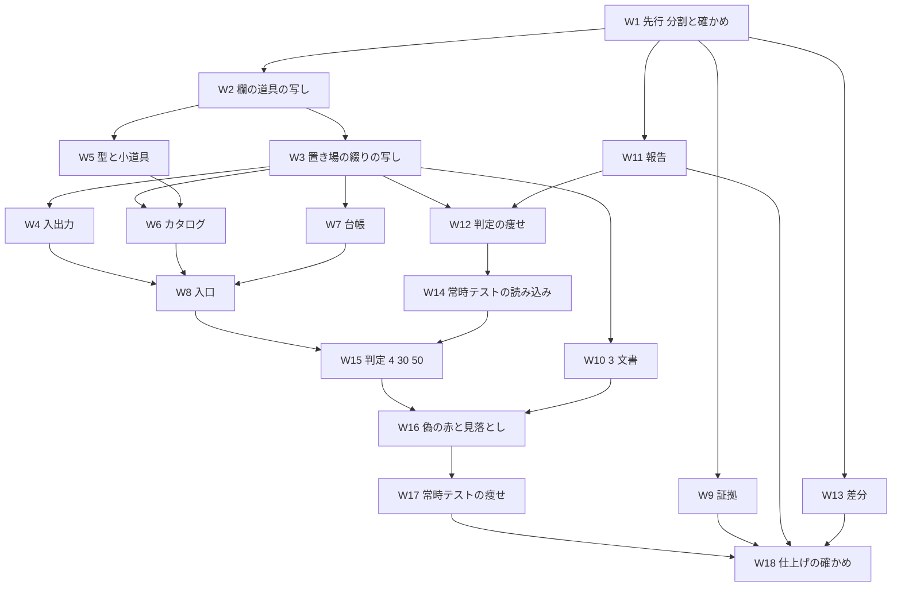
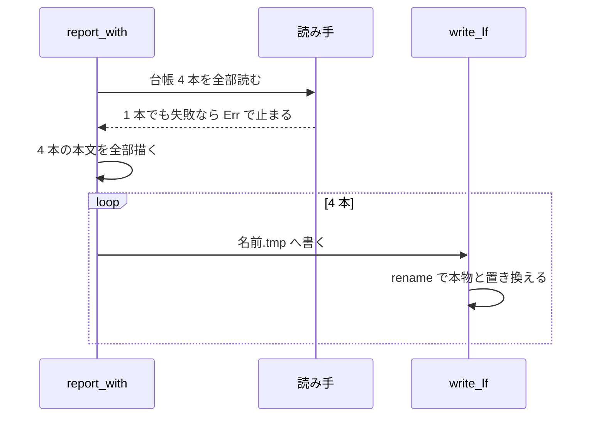

# 設計: audit-ukadoc-survey

## Overview

**Purpose**: ukadoc の網羅の調べの道具 `ukadoc-survey`（`crates/ukadoc-survey/`）に ponytail の audit をかけて出た 79 件（必ず直す 4・直したほうがよい 64・できれば 11）を、ponytail の「いちばん小さな完全な変更」で全部直す。指摘の番号・中身・場所の正本はギャップ分析（research.md 5 節）で、この設計は 1 件ごとに「何を消すか・どこにまとめるか・範囲の外の読み手に何が及ぶか・どのテストで縛るか」を決める。

**Users**: 開発者と、この道具を呼ぶ・前提にする読み手（手引き `doc/ukadoc-coverage/README.md`、スキル `kiro-next`・`kiro-complete`、`cargo test -p ukadoc-survey` を回す全体テスト）。

**Impact**: 今の `doc/ukadoc-coverage/` の入力から副手続きが書き出すファイルの中身は 1 バイトも変えない（6.4）。変わるのは、形の崩れた入力の断り方（22 件）・整合テストの偽の赤の除去（1・10・11）・今のデータでの標準出力と終了コード（3＝`candidates`・4＝`check`・22＝パイプが閉じたとき）だけで、読み手は同じ変更で直す（要件の討議の裁定 1）。テストのコードはおよそ 2,000 行減り、本番のコードは数百行減る。

### Goals
- 79 件を全部直す。直さずに残す指摘は 0 件（要件の討議の裁定・2.5 の記録）。
- 直したバグと危ない所（1〜30・35）の 1 件ごとに、壊れたら落ちるテストを 1 本持たせる（4.1）。
- 消すテスト（60〜63・66）は、同じ壊れ方を捕まえる残るテストを 1 本ずつ名指してから消す（裁定 7）。
- 直した後の audit のかけ直しで新しい指摘 0 件・全体テスト緑・6.3／6.4／6.6 の突き合わせを記録に残す（7.1〜7.6）。

### Non-Goals
- 新しい副手続き・新しい検査・台帳の新しい欄（3.4）。指摘の直しで増える断り（形の崩れた入力を拒む）は新しい機能に当たらない。
- カタログの作り直し・台帳の中身の更新（`ukadoc-catalog-refresh` の持ち物）。
- 範囲の外のファイルの見直し（`crates/log-capture-kit/tests/workspace_scan/mod.rs` の同じ除外の決まりなど・21 の注）。
- clippy の機械的な直し（`clippy-199-lints`）。

## Boundary Commitments

### This Spec Owns
- `crates/ukadoc-survey/` の全ファイル（本番・在中テスト・`tests/`・テストの道具）。新しく足すファイルは `src/cli/generate_priority_tests.rs` の 1 本と、`src/check/content_test_support.rs` の改名先 `src/check/test_support.rs` の 1 本だけ。
- 範囲の外で裁定が名指した読み手の直し: `doc/ukadoc-coverage/README.md`（565 行の「15 種」と 574 行の表の 1 行＝50、437-438 行と 584 行＝4）、`.claude/skills/kiro-complete/SKILL.md`（243・457・651 行＝1）。
- 道具の外への約束のうち、確定した指摘の直しで変わる分（下の「外への約束の変わり方」の表）。

### Out of Boundary
- `doc/ukadoc-coverage/` の下のデータ（カタログ・台帳 4 本・報告 5 本・3 文書・`values.md`）の中身。1 バイトも書き替えない（6.4）。35 の確かめでカタログが読み直しで変わると分かっても、作り直さない（Error Handling の「35 が崩れていたとき」）。
- C22 の約束のファイル: `crates/log-capture-kit/tests/file_length_guard_test.rs`・`Cargo.lock`・`doc/ukadoc-coverage/ledger/assets.toml`、ほかの 5 本の触るファイル（6.3）。
- `vendors/`（6.8）。`crates/ukadoc-survey/Cargo.toml` の依存の欄（5.5）。
- `kiro-next` の `SKILL.md:114`（「New spec folders are safe」）は 1 の直しで記述どおりになるので触らない。steering の `structure.md`・`workflow.md` の ukadoc Survey Toolkit の節は、副手続きの名前・層の形が変わらないので触らない。
- `candidates.rs` の説明の中のパスの移し替え（`input-crate-split` が自分の移動のときに直す）。

### Allowed Dependencies
- 今の依存だけ: `toml`・`thiserror`・`serde_json` と標準ライブラリ（`std::sync::LazyLock`・`OnceLock`・`std::fs::rename` を含む）。dev の依存は足さない（足すと `Cargo.lock` が変わる）。
- テストが書くファイルは `paths::workspace_root()` の下の `target\ukadoc-survey-tests\<テスト名>\` だけ（4.3）。`std::env::temp_dir` は使わない（`log-capture-kit` の `temp_path_guard_test.rs` の例外表に触らないため）。
- クレートの中の依存の向き: `model`・`error` → `assignment`・`catalog`・`ledger`・`documents`・`evidence`・`report`・`diff` → `check` → `cli`。`io` は入出力の層で、純粋層が借りてよいのはファイルに触らない関数と綴りの定数だけ（今の `files::strip_cr` と同じ扱い・41 の `COVERAGE_DIR`）。

### Revalidation Triggers
- `check` の終了コードと標準出力（4）・`candidates` の標準出力（3・23）・パイプが閉じたときの終了コード（22）・所見の種類の数（50＝15 種→14 種）が変わる。README の表と使い方を同じ変更で直す。
- 整合テストの落ちる条件が変わる: 偽の赤が 3 つ消え（1・10・11）、形の崩れた入力で落ちる条件が増える（12・14・16〜20・30・35）。`kiro-next` Step 8 と `kiro-complete` の全体テストはこの合否を読む。
- `tests/consistency/` のファイルの行数と関数の名前が大きく変わる。未着手の `coverage-roadmap-refresh` の brief はこのフォルダのファイルを行数つきで名指している（`documents_non_vacuity.rs`・`spec_checks.rs`・`documents.rs`）ので、その spec は着手のときに測り直す。
- `RepoData::load()`・`Documents::load()` の戻り値が `&'static` になる（5）。整合テストに判定を足す後の spec はこの形で書く。

## Architecture

### Existing Architecture Analysis
- 2 層（純粋層＝文字列と値だけ・入出力層 `io`＝判断を持たない）と入口 2 つ（実行ファイル `cli`・常時テスト `tests/consistency`）。判定の実体は純粋層に 1 つで、整合テストは `check::run` を呼ぶ。この形は崩さない。
- 写しの統合先は、すでにある親に置く（research.md 8 節の案 C）。新しいファイルは仕事で分ける必要がある 2 本だけ。
- 書き出しは「全部読んで、全部決めてから書く」が `catalog`・`ledger-init`・`priority-apply`・`report-summary` の形で、`report` だけが外れている（6）。`report` もこの形（読み手と書き手を引数で受ける `*_with`）にそろえる。

### Architecture Pattern & Boundary Map



- 矢印は「先に済ませる」。同じファイルを 2 つのまとまりが触るときは必ず矢印でつなぎ、矢印の無いまとまりどうしは触るファイルが重ならない（File Structure Plan の表）。
- W1 を最初に置くのは、`generate_tests.rs`（948 行）を先に分けないと W8 のテストが 1,000 行を越えるため（34）と、35 の確かめの答えで W1 の中の直し方が分かれるため。
- タスクの切り方はこの 18 のまとまりを目安にする（1 spec 20 タスクは目安で上限ではない・2026-11-16 の決め・分けない）。

### Technology Stack

| 層 | 選んだもの | この spec での役目 | 注 |
|---|---|---|---|
| 言語 | Rust（ワークスペースの edition） | 直しのすべて | 新しい依存なし |
| 標準ライブラリ | `std::sync::LazyLock`・`OnceLock` | 実データの読み込みを 1 回に（5・69） | 依存を足さない |
| 標準ライブラリ | `std::fs::rename` | 台帳の置き換え書き（2） | Windows では既存のファイルを置き換える |
| 既存の依存 | `toml`（読むだけ）・`thiserror`・`serde_json` | 変えない | `Cargo.lock` に触らない |

## File Structure Plan

### Directory Structure
```
crates/ukadoc-survey/
├── src/
│   ├── cli/
│   │   ├── mod.rs                    # 足す: write_stdout（22）・load_catalog／load_ledgers（38）
│   │   ├── generate.rs               # report_with（6）・unassigned の共用（37）・prologue_pages を消す（71）
│   │   ├── generate_tests.rs         # 台帳の初期化のテストだけ残す（34）
│   │   ├── generate_priority_tests.rs  # 新規: priority-apply と report_with のテスト（34・6）
│   │   └── inspect.rs                # check が全体報告を読む（4）・print! を write_stdout へ（22）
│   ├── check/
│   │   ├── mod.rs                    # run を 3 行に・ScanStats／JUDGEMENTS／run_with を消す（51・52）・CheckInput に summary_report（4）
│   │   ├── freshness.rs              # summary.md の古さも見る（4）
│   │   ├── test_support.rs           # 改名: content_test_support.rs から（49）
│   │   └── finding.rs                # LedgerDomainMismatch を消す（50）
│   └── evidence/
│       ├── candidates.rs             # Rust の本文の読み手の持ち主（9・23）・テストのパスを除く（3）
│       └── resolve.rs                # 読み手を candidates から借りる（9）・表の目印の範囲（8）
└── tests/consistency/
    ├── mod.rs                        # static REPO: LazyLock（5）・summary_report の欄（4）
    └── documents.rs                  # static DOCUMENTS: LazyLock（5）・共有の helper（48）
```
ほかのディレクトリ（`io/`・`ledger/`・`documents/`・`catalog/`・`report/`）はファイルの増減なしで、中身だけ直す。

### Modified Files（まとまりごと・触るファイルの境）

| まとまり | 指摘 | 触るファイル |
|---|---|---|
| W1 先行 | 34・35・66(A18) | `src/cli/generate_tests.rs`・新 `src/cli/generate_priority_tests.rs`・`tests/consistency/checks.rs`（35 の 1 本） |
| W2 欄の道具の写し | 39・40・74・75 | `src/documents/{fields,parse,derive}.rs`・`src/catalog/{mod,read,write}.rs`・`src/ledger/read.rs`・`src/model.rs` |
| W3 置き場の綴り | 41 | `src/io/paths.rs`・`src/ledger/{mod,read,write,blocks,patch}.rs`・`src/check/{structure,content}.rs`・`src/documents/{derive,parse}.rs`・`src/catalog/read.rs`・`tests/consistency/briefing_arms.rs`（177 行） |
| W4 入出力 | 2・21・27・32・36・57・69・73・66(io)・79(io) | `src/io/{files,snapshot,sources,paths}.rs` と各 `_tests.rs` |
| W5 型と小道具 | 20・53・72・66(hash・tomlout・assignment)・79(tomlout) | `src/model.rs`・`src/model_tests.rs`・`src/catalog/build_tests.rs`（53 の assert）・`src/tomlout{,_tests}.rs`・`src/hash_tests.rs`・`src/assignment{,_tests}.rs` |
| W6 カタログ | 15・19・37・66(write_tests)・79(write_tests) | `src/catalog/{build,read}.rs` と `_tests.rs`・`src/catalog/write_tests.rs`・`src/cli/generate.rs`（`select_ids_by_domain` だけ） |
| W7 台帳 | 7・24・25・26・29・70・68(blocks) | `src/ledger/{patch,write,blocks,read}.rs` と `_tests.rs` |
| W8 入口 | 6・22・31・38・71・66(cli・inspect)・68(generate)・79(cli) | `src/cli/{mod,generate,inspect}.rs`・`src/cli/{cli,inspect,generate,generate_priority}_tests.rs` |
| W9 証拠 | 3・8・9・23・79(evidence) | `src/evidence/{candidates,resolve}.rs`・`src/evidence/{candidates,resolve,extract}_tests.rs` |
| W10 3 文書 | 13・14・16・17・18・28・33・42・55・66(derive・parse) | `src/documents/{parse,fields,derive,mod}.rs`・`src/documents/{parse,derive}_tests.rs` |
| W11 報告 | 45・46・62・76・77・68(report) | `src/report/{tally,domain,summary,mod}.rs`・`src/report/{tally,domain,summary}_tests.rs`・`src/check/content_link_tests.rs`（45 の 709-721 行の主張だけ） |
| W12 判定の痩せ | 49・51・52・60・66(check)・68(check)・79(freshness_tests) | `src/check/{mod,content}.rs`・`src/check/*_tests.rs`・`src/check/test_support.rs`・`tests/consistency/checks.rs`（160-164 行） |
| W13 差分 | 63 | `src/diff_tests.rs` |
| W14 常時テストの読み込み | 5・47・48・79(documents.rs・consistency.rs) | `tests/consistency.rs`・`tests/consistency/{mod,documents,perturb,examples,spec_checks}.rs` と helper を引く各ファイル |
| W15 判定 4・30・50 | 4・30・50 | `src/check/{mod,freshness,structure,finding}.rs` と `_tests.rs`・`src/lib_test_support.rs`・`src/cli/inspect.rs`・`CheckInput` を組む全か所・`tests/consistency/{mod,documents,documents_checks,documents_non_vacuity,documents_tools,linkage_checks,checks,perturb}.rs`・`doc/ukadoc-coverage/README.md`（437-438・565・574・584 行） |
| W16 偽の赤と見落とし | 1・10・11・12 | `tests/consistency/{documents_non_vacuity,documents,documents_tools,spec_checks,linkage_checks,briefing_arms}.rs`・`.claude/skills/kiro-complete/SKILL.md` |
| W17 常時テストの痩せ | 43・44・54・56・58・59・61・64・65・66(consistency)・67・78・68(cli_streams)・79(consistency) | `tests/cli_streams.rs`・`tests/consistency/*.rs` |
| W18 仕上げ | 7.1〜7.6 | 直しは出た指摘に応じて。記録は `.kiro/specs/audit-ukadoc-survey/` の下 |

## System Flows

### 書き出し（2・6）



- 読む段と描く段で失敗したら 1 本も書かない（6）。1 本の書き出しの途中で止まっても、本物のファイルは前の本文のまま残る（2）。
- `.tmp` が残るのは、書いた後・置き換える前に止まったときだけ。置き換えに失敗したときは `.tmp` を消してから、置き場を添えた `Err` を返す。

## Requirements Traceability

| 要件 | 中身 | 設計の要素 |
|---|---|---|
| 1.1・1.2・1.3・1.4・1.5・1.6 | 洗い出し（範囲・測り直し・上限なし・全部読む・番号・外への約束の旗） | ギャップ分析で済み（research.md 2・5・12 節）。この設計は番号 1〜79 をそのまま使い、外への約束の旗を「外への約束の変わり方」の表に引き継ぐ |
| 2.1 | 全件を直す対象に | 「指摘ごとの直し方」の表に 79 行 |
| 2.2・2.3・2.4・2.5 | 残す 3 種類・ukadoc で確かめる・裁定を覆さない・記録 | 要件の討議の裁定で残す指摘 0 件。15・20 は ⑶ に当たらないと裁定済み。2.5 の記録は requirements.md の最後の節 |
| 3.1 | 1 本の spec で全部直す | 18 のまとまり（W1〜W18）で 79 件を割り切る |
| 3.2 | 呼び出し元まで直す | 表の「触るファイル」と、README・`kiro-complete` の直し（W15・W16） |
| 3.3 | 消す前にツリー全体で確かめる | 「消すテストと残るテスト」の表・消す関数ごとの `git grep`（Testing Strategy） |
| 3.4 | 新しい機能を足さない | Non-Goals・足すのは断りとテストだけ |
| 4.1 | 直したバグと危ない所に 1 本ずつテスト | 表の「縛るテスト」の欄（1〜30・35） |
| 4.2 | 決定論 | 65 を消す（更新時刻の比べ）・5 の 1 回読み・2 のテストはテストごとに別のフォルダ |
| 4.3 | 一時フォルダは `target` の下 | ファイルを書くのは 2 のテストと `io/snapshot_tests.rs` の 1 本（`load_with_passes_the_package_name_and_version_through`）だけで、どれも `target\ukadoc-survey-tests\<テスト名>\` に置く |
| 4.4 | GPU は実 GPU | GPU を使うテストは無い（変えない） |
| 4.5 | 古びたテストは直しに合わせて改める | 4（行番号の主張を外し所見の種類で見る）・45・50・51・52 の該当テストの改め方を表に書く |
| 5.1 | 1,000 行 | W1 で `generate_tests.rs` を分ける・足す先の表（Testing Strategy） |
| 5.2 | 記録の無い失敗の道を作らない | 2・22 の失敗は置き場を添えた `SurveyError::Io`→終了コード 1・標準エラー。5 の読み込みの失敗は全部のテストが同じ理由で落ちる |
| 5.3 | 終了の道は正規 | 22 は panic でなく `Err` で `main` の写しへ戻す |
| 5.4 | 文字化け | コンソールの文字コードに触る直しは 0 件 |
| 5.5・5.6 | 依存を足さない | Allowed Dependencies。新しい依存が要る直しは 0 件 |
| 6.1・6.2 | 範囲の外は申し合わせて・要るものだけ | 範囲の外は README と `kiro-complete/SKILL.md` の 2 本だけ。C22 のほかの 5 本はどちらも触らない（W15・W16 の着手の前にロードマップの C22 の行で確かめ直す） |
| 6.3 | C22 の約束のファイルに触らない | Out of Boundary・W18 の差分の確かめ |
| 6.4 | 書き出す中身を変えない | 「外への約束の変わり方」の表（書き出す中身の欄が全部「同じ」）・W18 の突き合わせ |
| 6.5 | 中身を変えずに直せないとき | 該当 0 件。35 が崩れていたときだけ起きうる＝Error Handling |
| 6.6 | 外への約束を変えたら読み手も直す | README（3・4・22・50）・`kiro-complete`（1） |
| 6.7 | 後へ回す | 回す指摘 0 件 |
| 6.8 | `vendors/` に触らない | Out of Boundary |
| 7.1・7.2・7.3 | かけ直しと 0 件の記録 | W18 の手順 ⑴ |
| 7.4 | 全体テスト緑 | W18 の手順 ⑷ |
| 7.5 | 6.3／6.4／6.6 の突き合わせ | W18 の手順 ⑵⑶（`main` の道具と同じ入力で 9 つの副手続きを回して比べる） |
| 7.6 | 5 回目での打ち切り | W18 の手順 ⑴ |

## Components and Interfaces

### 外への約束の変わり方（6.4・6.6）

| 指摘 | 変わるもの | 今の入力からの出力 | 読み手の直し |
|---|---|---|---|
| 3・23 | `candidates` の標準出力からテストのファイルの行が減る | 書き出すファイルは無い（標準出力だけ） | README は候補の中身を書いていない＝直しなし |
| 4 | `check` が `summary.md` の古さを見る。古いと所見 `DomainReportStale`（場所 `doc/ukadoc-coverage/report/summary.md`）と終了コード 1 | 今の `summary.md` は新しい（整合テストが緑）＝今は所見 0・終了コード 0 のまま | README 53 行「同じ検査は標準のテスト実行にも入っている」が事実になる。437-438 行（ドメイン別報告 4 本だけの一致の説明）に全体報告を足し、584 行の直し方に `report-summary` を足す |
| 22 | パイプが閉じたときの終了コード 101→1、panic の文→`<標準出力>` の書けなかった 1 行 | パイプを閉じない限り同じ | README の終了コードの決まり（0／1／2）に合うようになる＝直しなし |
| 50 | 所見の種類が 15 種→14 種 | 出る所見は同じ | README 565 行「15 種」→「14 種」・574 行の行を消す |
| 1・10・11 | 整合テストの偽の赤が消える | 同じ | `kiro-complete/SKILL.md` 243・457・651 行（1） |
| 7・8・12〜21・24〜28・30・35・59 | 形の崩れた入力で落ちる条件・文言が変わる | 同じ（今のデータに該当の形は 0 件＝research.md 5 節の各「確かめた」） | なし |
| ほかの 51 件 | 変えない | 同じ | なし |

### 共有の形（新しい・変わる関数の形）

```rust
// src/io/files.rs（2・57）
pub fn write_lf(path: &Path, body: &str) -> Result<(), SurveyError>;   // 形は同じ。中身を「隣の <名前>.tmp に書いて rename」に
fn temp_sibling(path: &Path) -> PathBuf;                                // <名前>.tmp（同じディレクトリ）
// lf_body は消す（strip_cr を呼ぶ）

// src/cli/mod.rs（22・38）
fn write_stdout<W: Write>(out: &mut W, body: &str) -> Result<(), SurveyError>; // 失敗は SurveyError::Io { path: "<標準出力>" }
pub(super) fn load_catalog() -> Result<Catalog, SurveyError>;
pub(super) fn load_ledgers_with(
    read: &dyn Fn(&Path) -> Result<String, SurveyError>,
) -> Result<Vec<Ledger>, SurveyError>;                                // Domain::ALL の順・1 本でも失敗なら Err
pub(super) fn load_ledgers() -> Result<Vec<Ledger>, SurveyError>;    // load_ledgers_with(&files::read_normalized) の 1 行

// src/cli/generate.rs（6）
pub(crate) fn report_with(
    read: &dyn Fn(&Path) -> Result<String, SurveyError>,
    write: &mut dyn FnMut(&Path, &str, usize) -> Result<(), SurveyError>,
) -> Result<(), SurveyError>;                                         // priority_apply_with と同じ形

// src/check/mod.rs（4・51・52）
pub struct CheckInput<'a> { /* 今の 6 欄 */ pub summary_report: &'a str }
pub struct CheckOutcome { pub findings: Vec<Finding> }               // stats を消す
pub fn run(input: &CheckInput) -> CheckOutcome;                       // structure → content → freshness を順に呼んで足す

// tests/consistency/mod.rs・documents.rs（5）
static REPO: LazyLock<Result<RepoData, String>>;
impl RepoData { pub fn load() -> &'static RepoData; fn read() -> Result<RepoData, String>; }
static DOCUMENTS: LazyLock<Result<Documents, String>>;
impl Documents { pub(super) fn load() -> &'static Documents; fn read() -> Result<Documents, String>; }
```

- `write_lf` の事後条件: 成功すれば `path` の中身は `strip_cr(body)` のバイト列。失敗すれば `path` の中身は呼ぶ前と 1 バイトも同じ（一時ファイルを書けなかった場合）か、置き換えが済んでいない（置き換えに失敗した場合）。
- `RepoData::load()` の事前条件は無い。最初の呼び出しで 1 度だけ読み、読めなければ**どの呼び出しも**同じ文（探した絶対パスと理由）で panic する。`LazyLock` の中で panic させないので「poisoned」は起きない（research.md 10 節の議題 12 の答え）。
- `CheckInput::summary_report` は復帰文字を落とした `summary.md` の本文。freshness は `strip_cr(summary_report) == render_summary(catalog, ledgers, themes)` で比べる（保存側だけ落とす決まりはドメイン別と同じ）。

### 指摘ごとの直し方（79 件）

組: 必＝必ず直す・直＝直したほうがよい・で＝できれば。「縛るテスト」は足す（＋）か、改める（改）か、今あるもので足りる（既）か。

| # | 組 | 直し方（決め） | 縛るテスト | W |
|---|---|---|---|---|
| 1 | 必 | `documents_non_vacuity.rs:330-368` の組み直し・brief 無し 0 件・completed の brief の確かめを消す。下限 2 つと `live ^ completed` は残す。`kiro-complete/SKILL.md` の 243 行の項目・457 行の項目・651〜653 行の症状の塊を消す（理由はこのテストだけ＝消すと症状が起きない） | ＋ `documents.rs` の一覧の絞り（名前と「brief.md があるか」の組から、`completed`・本 spec・brief 無しを除いた名前を返す）を `fn spec_dir_names(entries: impl IntoIterator<Item = (String, bool)>) -> BTreeSet<String>` の純粋な形に切り出し、`documents_tools.rs` に「brief 無しの名前は赤にせず一覧から落ちる」例を 1 本。本物の `.kiro/specs` にフォルダを作るテストは置かない（並ぶテストを揺らすため・4.2） | W16 |
| 2 | 必 | `write_lf` を「`<名前>.tmp` に書いて `std::fs::rename`」に。置き換えに失敗したら `.tmp` を消して置き場つきの `Err` | ＋ `target\ukadoc-survey-tests\<テスト名>\` に元の本文のファイルを置き、`<名前>.tmp` の場所に同じ名前のディレクトリを作って書けなくし、`write_lf` が `Err` を返し元の本文が 1 バイトも変わらないこと（今の `std::fs::write` なら上書きされて赤）。成功の側の 1 本も | W4 |
| 3 | 必 | `is_test_path` に `path.contains("_tests/") \|\| path.ends_with("/tests.rs")` を足す | ＋ `candidates_tests.rs` に `crates/x/src/placement_tests/a.rs` と `crates/x/src/tests.rs` の 2 本が除かれる例 | W9 |
| 4 | 必 | `CheckInput` に `summary_report` を足し、freshness が `summary.md` も比べて `DomainReportStale`（場所 `doc/ukadoc-coverage/report/summary.md`）を出す。`cli::inspect::check` は `paths::summary_report_path()` を読んで渡す。整合テストの `summary_findings` と `the_summary_report_is_as_fresh_as_the_ledgers` を消して `check::run` に任せる（`real_repo_data_produces_no_findings` が同じ合否を持つ）。`summary.md` の本文は `RepoData` が持ち（`Documents::summary_text` を移す・読みは 1 回）、`documents.summary_text` の読み手 12 か所（同じ 4 ファイル）を `repo.summary_report` に。`Perturbed` に自分の `summary_report: String` の欄を持たせ（`domain_reports` と同じ扱い・47 の `input()` もこの欄を渡す）、`lib_test_support::refresh_reports` は全体報告も描き直す。台帳の中身を変える `checks.rs` の摂動（`an_id_in_two_ledgers_turns_red`・`an_alias_chain_turns_red`・導入の版の摂動・`a_misspelled_theme_turns_red` ほか、今ドメイン別報告の `DomainReportStale` を期待に持つもの全部）は、期待に `report/summary.md` の `DomainReportStale` の行を 1 つ足す（「ちょうど」の決まりは保つ）。所見の文は `report/summary.md` のとき `report-summary` を名指す。README 437-438 行（全体報告も同じ一致を求める）と 584 行（直し方に `report-summary` を足す）を同じ変更で直す（6.6）。freshness の注記 19-26 と `mod.rs:20-28` を今の事実に | ＋ `freshness_tests.rs` に全体報告を 1 文字変えると `summary.md` の場所の所見が 1 件出る例・CR つきでも緑の例。改 `shifting_one_number_in_the_summary_turns_the_freshness_check_red` は `Perturbed` の `summary_report` の欄を壊して `expect_exactly` で見る形へ（行番号の主張は外す＝research.md の指摘 4 の見立てどおり・落ちる条件は同じ）。改 上の `checks.rs` の摂動（期待の行を足す） | W15 |
| 5 | 直 | `RepoData`・`Documents` を `static … : LazyLock<Result<_, String>>` で 1 度だけ読む。`load()` は `&'static` を返し、`Err` なら毎回同じ文で panic。今の `load` の本体を `read() -> Result<_, String>` へ（`panic!` の 4 か所と `read_text`・`child_dirs` を `Err(format!(…))` に）。`spec_checks.rs:340` の `repo: RepoData` と `:341` の `documents: Documents` は `&'static` に、`examples.rs` の `RepoData::load().catalog` 3 か所は `&RepoData::load().catalog` | 既（合否の条件は同じ・全部の整合テストが通る）。＋ `read` の失敗の文に絶対パスが載ることは今の在中テスト（`files_tests` の読み込みの失敗）が持つ | W14 |
| 6 | 直 | `report` を `report_with(read, write)` にし、台帳 4 本を `load_ledgers_with(read)`（38）で全部読み・4 本を描いてから書く。`report()` は実の読み手と書き手を渡す 1 行 | ＋ `generate_priority_tests.rs` に「3 本目の台帳が読めないと 1 本も書かない」（書き手を控えるだけに差し替え） | W8 |
| 7 | 直 | `replace_priority` は当たった行が `priority = ` ＋ `basic_string(今の値)` と同じかを確かめ、違えば `undecidable`。組んだ本文を `toml` で読み直し、各 id の `priority` が求めた値かを見る | ＋ `patch_tests.rs` に備考の中の行頭 `priority = "…"` の例・行末コメントの例の 2 本（どちらも `Err`） | W7 |
| 8 | 直 | `find_slice_start` は文字列とコメントの外で `;` か `{` に出会ったら `None` | ＋ `resolve_tests.rs` に「目印→関数→スライス」が `TableMissing` になる例 | W9 |
| 9 | 直 | `line_offsets`・`read_string`・`skip_line_comment`・`slice_element_names`・`SLICE_START` は `candidates.rs` 側を残して `pub(super)`、`slice_element_names` は `Option` を返す形に。`resolve.rs` の写しを消して借りる | ＋ `resolve_tests.rs` に `/* , */` と `']'` を含む表が候補と同じ要素に割れる例 | W9 |
| 10 | 直 | 書き換える項目を選ぶ条件に「宛先が `fixture.documents.roadmap.specs` の名前にある」を足す | 改（摂動のテストそのものが縛る）。＋ 選び方の前提を assert で（選べる項目が 1 件以上） | W16 |
| 11 | 直 | `linkage_checks.rs:766-773` の assert を消し、注記 31-39 を短く | 既（較正は `a_bundle_with_an_unfinished_member` が実装済みでない id の束を選ぶ） | W16 |
| 12 | 直 | `distribution_findings` で `after.domain` の集合が `Domain::ALL` と違えば所見 1 件。⑷ の下限に `briefing.barriers.len() >= 1` | ＋ `[[after]]` の 1 ドメインを落とした写しで ⑷ が 1 件赤・下限の行 | W16 |
| 13 | 直 | 「囲みの中か・toml か」を持つ走査を `parse.rs` に 1 本（開く＝行頭の空白を削った行が ``` で始まる・閉じる＝前後の空白を削った行がちょうど ```）。`toml_blocks` と `prose_lines` が両方使う | ＋ `parse_tests.rs` に字下げの囲みと入れ子の例の 2 本 | W10 |
| 14 | 直 | つなぐ前に、囲みごとに「空行と `#` の行を除いた最初の行が `[` で始まらない」ものを `malformed` | ＋ 見出しの無い囲みが落ちる例 | W10 |
| 15 | 直 | `build` で URL を `BTreeMap<&str, &EntryId>` に入れ、2 度目で 2 つの id を挙げて `SnapshotShape`。`by_url` の注記を消す | ＋ `build_tests.rs` に同じ URL の 2 項目が落ちる例 | W6 |
| 16 | 直 | `single` の枝で `members[0] != name` なら両方の綴りで `malformed` | ＋ 名前と中身の食い違う単独項目が落ちる例 | W10 |
| 17 | 直 | `read_bundle` で `members`・`hand`・`machine` の重複を id つきで `malformed`。`derive.rs:60-61` の畳みと注記を消す | ＋ 重複の例 | W10 |
| 18 | 直 | `read_rank` の `Singles` が空なら `malformed` | ＋ `singles = []` の例 | W10 |
| 19 | 直 | `read` の頭で `reject_unknown_keys(&root, &[SNAPSHOT_TABLE, ENTRY_TABLE], "根")?`（W2 で共有した道具） | ＋ `read_tests.rs` に根の `note = "…"` が落ちる例 | W6 |
| 20 | 直 | 4 欄目を `seq.bytes().all(\|b\| b.is_ascii_digit())` に（裁定 6） | ＋ `model_tests.rs` に `…:OnBoot:l` が落ちる例 | W5 |
| 21 | 直 | 除外の名前の当たりをクレートの直下（`rel` が `crates/<名前>/<除外>` のとき）だけに絞る | 改 `walk_excludes_build_output_and_vendored_and_git_dirs` を「深い所の `target` という名のモジュールは拾う」側も見る形に | W4 |
| 22 | 直 | `cli/mod.rs` に `write_stdout`（`write_notice` と同じ形）を置き、`inspect.rs:85,114,124,139` と `generate.rs` の `announce` を替える（`announce` は `Result` を返す） | ＋ `cli_tests.rs` に `BrokenPipe` を返す書き手で `SurveyError::Io { path: "<標準出力>" }` になる例 | W8 |
| 23 | 直 | 9 でまとめた読み手に `r#*"` の生文字列を対応する `"#*` まで飛ばす腕を 1 本 | ＋ `candidates_tests.rs` に引用符を奇数個持つ生文字列の後ろが `cfg(test)` の範囲に入る例 | W9 |
| 24 | 直 | `write::check_strictly_ascending` を `pub(super)` にし、`replace_priority` の頭で呼ぶ | ＋ 備考に隠れた見出しの台帳で `LedgerOutOfOrder` になる例 | W7 |
| 25 | 直 | 差し込む位置を、前の塊の末尾に続く行頭 `#` の連続した行の前へずらす（`splice` の中） | ＋ `write_tests.rs` に「コメント → B」の間に X を差すと「X → コメント → B」になる例 | W7 |
| 26 | 直 | `read` の中で `split` の `TomlParse` の `path` を台帳のファイルに差し替え、`LedgerSplitMismatch` の `detail` の頭に置き場を付ける | ＋ `read_tests.rs` に失敗の文が台帳のパスを名指す例 | W7 |
| 27 | 直 | `snapshot.rs:120` を `package_info(Path::new(&shown))` に | ＋ `snapshot_tests.rs` に相対パスを渡しても警告の行が絶対パスを名指す例 | W4 |
| 28 | 直 | 先に `item.contains_key("bundle")` を見て、無いときだけ今の文面、あるときは `string_field` の誤りをそのまま | ＋ `bundle = ["…"]` の文面の例 | W10 |
| 29 | 直 | **`ledger::read` で拒む**（同じ項目の `values` に同じテーマが 2 度あれば id とテーマを挙げて `malformed`）。tally は変えない（拒むので数える側に重複は届かない） | ＋ `read_tests.rs` に重複の例 | W7 |
| 30 | 直 | `structure.rs` で `declared.len() != ledger.pages.len()` を「余分」と同じ形の `LedgerPagesMismatch` に | ＋ `structure_tests.rs` に `pages` の重複の例 | W15 |
| 31 | 直 | 当てる文字列を `"現行 1"` と `"新しい方 2"` に | 改（その 1 本） | W8 |
| 32 | 直 | `fn resolve(given: Option<OsString>, appdata: Option<OsString>) -> Result<PathBuf, SurveyError>` に切り出し、`default_path` はそれを呼ぶ | ＋ 4 通り（空でない・空・無い＋APPDATA あり・どちらも無い）を 1 本 | W4 |
| 33 | 直 | 見本を 1 か所ずつ書き換えた写しを並べて回すテストを 1 本（落ちることと本文に欄の名前が載ること） | ＋（そのテスト） | W10 |
| 34 | 直 | `priority-apply` の節（681-948 行）を `generate_priority_tests.rs` へ。`generate_tests.rs` の中に `#[path = "generate_priority_tests.rs"] mod priority;` を置き、`LEDGER_FILES`・`under_coverage`・`spelled_path` を `pub(super)` で共有 | 既（移すだけ・同じテストが同じ数だけ走る） | W1 |
| 35 | 直 | 整合テストに `assert_eq!(catalog::write::write(&data.catalog), 読んだ本文)` を 1 本（`checks.rs`）。W1 の最初にこの 1 本を回して確かめる | ＋（その 1 本） | W1 |
| 36 | 直 | `files_tests` の較正はこのクレートの `Cargo.toml`・`src/lib.rs` を使う。`sources_tests` の `KNOWN_FILES` から log-capture-kit の 1 本を外す（sylphya の 2 本は残す） | 改 | W4 |
| 37 | 直 | `catalog/build.rs` に `pub(crate) fn page_not_assigned(pages) -> SurveyError` を 1 つ置き、`select_ids_by_domain` は `assignment.unassigned(...)` とそれを使う。`generate.rs` の `PAGE_SEPARATOR` を消す | 既（`an_entry_whose_page_belongs_to_no_ledger_is_named_and_refused` が綴りを持つ） | W6 |
| 38 | 直 | `cli/mod.rs` に `load_catalog`・`load_ledgers_with(read)`（読み手を引数で受ける・`Domain::ALL` の順）と、実の読み手を渡す 1 行の `load_ledgers()` を置き、`inspect`・`generate` の 5 か所と 3 か所から呼ぶ。`priority_apply_with`（250-255 行）と `report_with`（6）の 4 本の読みの繰り返しも `load_ledgers_with(read)` に寄せる。`generate::load_ledger` と `inspect::load_ledgers` を消す | 既 | W8 |
| 39 | 直 | `fields.rs` の `malformed`・`reject_unknown_keys`・`field`・`string_field`・`string_array_field`・`sub_table` を `pub(crate)` にし、`catalog/read.rs`・`ledger/read.rs` の写しを消して場所を渡して呼ぶ。失敗の本文は今と同じ綴り | 既（各読み手の在中テストが文面を持つ） | W2 |
| 40 | 直 | `catalog/mod.rs` に `pub(super) const ENTRY_COLUMNS` と `SNAPSHOT_FIELDS` を 1 つずつ | 既（往復のテスト） | W2 |
| 41 | 直 | `ledger/mod.rs` に `pub(crate) fn ledger_file(domain) -> String` と `ENTRY_TABLE`。`io/paths.rs` の `COVERAGE_DIR` を `pub` にし相対の綴りを返す関数を置く。全部をそれに寄せる。綴りは変えない | 既（所見の場所を持つ在中テスト） | W3 |
| 42 | 直 | `breakage_weight` を `Breakage::ALL` の中の位置から作り、手書きの match を消す | 既（`the_axis_key_ranks_breakage_over_themes_over_assets_over_shared`） | W10 |
| 43 | 直 | `documents_checks.rs:238` を `ids.extend(cited_ids(cell))` にし、`ids_in_cell`・`is_id_char` を消す | 既 | W17 |
| 44 | 直 | `items_of(stage, keep_domain)` の 1 つにまとめ、613 行目から呼ぶ | 既 | W17 |
| 45 | 直 | `tally.rs:133-137` の 0 件の用意をやめ、並べるのは `theme_names` だけ。`tally_tests.rs` の 3 本（318-338・384-405・410-420）と `content_link_tests.rs:709-721` の主張を改める | 改 | W11 |
| 46 | 直 | `theme_names`・`push_status_header`・`push_status_row` を `tally.rs` に `pub(super)` で 1 つ、`domain.rs`・`summary.rs` から引く | 既（全文一致のテスト 2 本） | W11 |
| 47 | 直 | `Perturbed::input` を `CheckInput { catalog: &self.catalog, ledgers: &self.ledgers, evidence: &self.evidence, domain_reports: &self.domain_reports, summary_report: &self.summary_report, ..self.data.input() }` に（4 の欄は `Perturbed` 自身の写しから渡す＝4 の摂動が壊せる） | 既 | W14 |
| 48 | 直 | `assert_no_findings`・`assert_single_finding` と綴りの定数（`LINKAGE_MD`・`ROADMAP_MD`・sylphya のパス）を `documents.rs` に `pub(super)` で 1 つずつ、各ファイルは `use`。`documents.rs` の `read_text` は `super::read_text` を呼ぶ | 既 | W14 |
| 49 | 直 | `content_test_support.rs` を `check/test_support.rs` に改名し `check/mod.rs` に `#[cfg(test)] mod test_support;`。structure・freshness・finding の写しを消して引く | 既 | W12 |
| 50 | 直 | `LedgerDomainMismatch` を種類・綴り・`ALL` から消す。`finding_tests` の逐語の並び 2 つと 15 の数を改め、README 565 行を「14 種」に・574 行を消す（裁定 4） | 改 | W15 |
| 51 | 直 | `ScanStats` と `CheckOutcome::stats` を消し、`finding_tests.rs:416-477` の 2 本と `freshness_tests.rs:141-142,554-558` の件数の主張を消す | 既（下の「消すテストと残るテスト」） | W12 |
| 52 | 直 | `run` を「3 つを順に呼んで足す」3 行に。`JUDGEMENTS`・`Judgement`・`run_with`・3 本のテスト・`checks.rs:160-164` の主張を消す | 既（各判定の所見を見るテストは全部 `run` を通す＝呼び忘れれば赤） | W12 |
| 53 | 直 | `EntryId::has_anchor` と `model_tests.rs`・`build_tests.rs` の assert を消す（裁定 4）。完了 spec の design.md の名前の行は記録なので触らない | — | W5 |
| 54 | 直 | `Subjects` の列挙・`expected` の欄・`Zero` の腕を消し、`count > 0` だけを主張（裁定 5） | 改 | W17 |
| 55 | 直 | `Template` の 6 欄・`SpecRow::wave`・`NamedBundle::name` を型から消し、読み手は `string_field(...)?;` で確かめて捨てる（落とす条件は同じ） | 改 `derive_tests.rs:69` | W10 |
| 56 | 直 | `drop_bundle_name` と確かめ 2 本と 357 行、`briefing_checks.rs:95` の注釈を消し、冒頭の「道具 5 つ」を「4 つ」に | — | W17 |
| 57 | 直 | `lf_body` を消して `strip_cr` を呼ぶ。テスト 2 本を消し `files.rs:8` の説明を直す | — | W4 |
| 58 | 直 | 腕 c と腕 f の届かない 2 つの枝を消し、`None` の腕は `expect`（読み手が先に止める旨を文に） | — | W17 |
| 59 | 直 | 腕 d と較正（`smuggling_one_excluded_id_…`・`an_excluded_id`・`EXCLUDED_STATUSES`）を消し、要件 4.3 を指す文言は腕 b の本文へ（裁定 4） | 既（腕 b の摂動） | W17 |
| 60 | 直 | `finding_tests.rs:479-850` を消す。605-612・624-649 の 2 本も移さず消す（残るテストが持つ）。冒頭 1-21 の注記を直す | 既（下の表） | W12 |
| 61 | 直 | 6 本と `EMPTY_*` 3 つを消し、先に `the_floor_container_stays_quiet_when_every_row_is_met` に `.at_least("ちょうど", 1, 1)` を足す。冒頭 9-16 の注記を直す | ＋（その 1 行）・既（下の表） | W17 |
| 62 | 直 | `sample()`（summary は `sample_body()`）だけを渡して本文の一部を見るテストを消す。逐語のテスト・別の見本のテストは残す。時刻の検出器と `contains_line` とその較正も消す。`summary_tests` の「台帳が順不同で来る」の前提は逐語のテストの頭へ移す | 既（下の表） | W11 |
| 63 | 直 | 11 本を消し、見本の形の前提（16 桁のうち先頭 15 桁が同じ・ハッシュだけ違う行・ハッシュだけ同じ行・全欄が動いた行・各一覧が 2 件以上）を 1 本の「見本の形」テストに。453-469 の実測の注記は新しい数で書き直し、冒頭 14-16 を短く | ＋（見本の形）・既 | W13 |
| 64 | 直 | `the_real_perturbation_target_appears_only_as_itself` と `BTreeMap` の import を消す | 既（`twist_id` の確かめ・「赤がちょうど 1 件」） | W17 |
| 65 | 直 | 「壊す道具は repo のファイルに触れない」テストと `fingerprint` と import を消す | 既（道具は `&str`→`String` で型が触れないと決める） | W17 |
| 66 | 直 | 下の表のテストを消す。ただし `the_usage_text_lists_every_name_in_the_dispatch_table`（`cli_tests.rs:203`）は**残す**（確かめで同じ壊れ方を捕まえる別のテストが無かった＝裁定 7 の条件を満たさない）。`assignment.rs:96` の説明の中のテスト名を直す。A18＝`generate_tests.rs:461` を `.chars().take(80).collect::<String>()` に | 既（下の表） | W1・W4・W5・W6・W8・W10・W12・W17 |
| 67 | 直 | 2 本を 1 本にまとめ、1 回の走行で終了コード・標準出力・標準エラー・木の前後の 3 つを確かめる | 改 | W17 |
| 68 | 直 | 挙がった注記を今の事実に直すか消す（`cli_streams.rs:22-31,101-103,142-144`・`generate.rs:131-134`・`blocks.rs:34-37`・`content.rs:170-172`・`finding_tests.rs:5-8,16-21,335-337,367-369`・`check/mod.rs:145-147`・`report/mod.rs:2-3`）。各ファイルを触るまとまりで直す | — | W7・W8・W11・W12・W17 |
| 69 | で | `sources_tests.rs` に `static WALKED: OnceLock<Vec<(String, String)>>` | 既 | W4 |
| 70 | で | `blocks::split` に読んだ表を渡す形に分け、`read` が 1 度だけ読む | 既 | W7 |
| 71 | で | `generate.rs:105` を `assignment.pages_of(domain)` にし、理由を 1 行の注釈に。`prologue_pages` とテスト 3 本（191・219・237）を直す（名前順はバイト比較が守る） | 改 | W8 |
| 72 | で | `write!(out, "\\u{:04X}", u32::from(ch))` の 1 行にして 2 関数を消す | 既（`tomlout_tests.rs:135-144` の逐語） | W5 |
| 73 | で | `sources.rs:53` の `dedup` を消す | 既 | W4 |
| 74 | で | `DOCUMENT_DIR`・`LINKAGE_FILE`・`BRIEFING_FILE` を `fields.rs` へ移し、`derive.rs` は `super::fields::document_file` を引く | 既 | W2 |
| 75 | で | `ID_MARK` を `model.rs` に置いて共有し、`quoted_ids` は `format!("\"{ID_MARK}")` | 既 | W2 |
| 76 | で | `StatusCounts::merge` を足し、三重の繰り返しを 1 行に | 既（全文一致） | W11 |
| 77 | で | 列名を `Status::Unclassified.as_japanese()` から埋め込み、注意書きを消す | 既（全文一致） | W11 |
| 78 | で | 比べる相手を `data.catalog.entries.len()` にし、定数と最初の assert を消す | 既（`non_vacuity.rs` の件数の釘） | W17 |
| 79 | で | 日付つきの実測の段落を今の事実の 1 行に・行番号つきのパスから行番号を消す（各ファイルを触るまとまりで）。`candidates.rs` の件数の段落は数を書かない形に（申し送り）。`registration_names` は今の当て推量のまま広げず、doc に「表の行の形（`("move", None, …)`）は拾わない」と 1 行足す。`inspect.rs:36-37` の先送りの文を消す（裁定 5）。`documents.rs:68-76` の読む順は**入れ替えない**（下の「決めの補足」）。`tests/consistency.rs:8-13` は兄弟 13 本を挙げずに「このディレクトリの兄弟」と書く | — | 各まとまり |

#### 決めの補足

- **79 の読む順（`documents.rs:68-76`）**: research.md は「completed を先に読む」と書くが、それでは移す途中の spec がどちらにも見えない隙間が生まれる。移しは「直下→`completed/`」の 1 方向の名前の付け替えなので、今の順（直下を先・`completed/` を後）なら、移しが 2 つの読みのどの時点に入っても、その spec は少なくとも一方に見える（直下を読む前に移れば `completed/` に、読んだ後に移れば直下に）。入れ替えず、この理由を 1 行の注記にする（2026-11-17 設計の討議 議題 3 で確定）。
- **29**: 数え方で畳むと書き間違いが黙って消える。17（束の `members` の重複を拒む）と同じく読み手で拒む（2026-11-17 設計の討議 議題 1 で確定）。
- **registration_names**: `audit-emo2-boot-spine` の指摘 57 が着地すると `consumer_ledger.rs` の登録名は拾われなくなる。当て推量を表の行の形へ広げると、ほかの 3 つ組のタプルまで拾って候補が濁る。`candidates` は人へ渡す手掛かりで整合テストは見ないので、広げず、拾わない形を doc に書く（2026-11-17 設計の討議 議題 2 で確定）。

### 消すテストと、同じ壊れ方を捕まえる残るテスト（裁定 7・3.3）

設計の段で 1 本ずつ読んで確かめた（cargo は回していない＝「赤になる」は読んだ結果）。消す関数の名前は、範囲の外では完了 spec の記録（`completed/runtime-module-untangle/test-name-tails-*.txt`・`completed/areka-P0-emo-text-file-split/verification/*`・`completed/areka-P0-ukadoc-survey-{shiori,sakura-script}/tasks.md`）にだけ現れる。どれも記録で、直さない。スキル・手引き・steering には 0 件。

| 指摘 | 消す | 残って同じ壊れ方を捕まえる |
|---|---|---|
| 60 | `finding_tests.rs` の 10 の決まりの写し（`every_ledger_id_is_in_the_catalog_…`・`every_catalog_id_appears_in_exactly_one_ledger_once`・`each_ledger_declares_the_assigned_pages_…`・`every_catalog_page_is_assigned`・`every_ledger_is_in_strictly_ascending_id_order_…`・`every_implemented_row_has_evidence_…`・`no_source_url_is_left_unresolved_…`・`the_sample_sources_carry_three_evidence_lines_…`・`every_link_endpoint_exists_in_the_catalog`・`the_alias_row_points_at_a_row_that_is_not_an_alias`・`every_recorded_version_is_one_of_the_catalog_versions`・`every_theme_written_in_the_ledgers_is_one_of_the_eight`） | `structure_tests::the_untouched_sample_world_has_no_findings`（本物の `run` を通す）・`structure_tests::the_sample_world_actually_holds_something_to_judge`・`content_tests::the_sample_world_holds_material_for_every_content_judgement`、各決まりの摂動のテスト（`a_ledger_id_absent_from_the_catalog_is_a_finding` ほか）。605-612 は `content_tests::breaking_the_vocabulary_marker_url_costs_the_implemented_entry_its_evidence`、624-649 は `extract_tests::a_ukadoc_word_without_a_url_is_never_evidence_but_a_url_line_is` |
| 60 | `the_four_domain_reports_match_what_the_ledgers_produce`（同じ関数どうしの比べ）・`refreshing_the_reports_follows_the_ledgers`・`refreshing_the_evidence_follows_the_sources`・`the_report_can_be_edited_without_touching_the_ledger`・`the_sample_world_has_no_findings` | `freshness_tests::the_sample_world_holds_four_non_empty_domain_reports`・`refresh_reports()` を呼んで所見の種類の集合を見る約 20 本・`a_one_character_change_in_a_source_url_is_a_finding`・`rewriting_one_line_of_one_report…`・`structure_tests::the_untouched…` |
| 61 | `documents_non_vacuity.rs` の「空にすると赤」6 本・`EMPTY_*` 3 つ | 各 `*_has_something_to_judge` 6 本（下限 0 は `Floors::short` が拒む）・`documents_tools.rs` の器の 3 本＋足す `at_least("ちょうど", 1, 1)`（等しければ緑） |
| 62 | `domain_tests.rs`: `rendering_the_same_ledger_twice…`・`the_body_writes_only_line_feeds`・`the_body_carries_no_wall_clock`・`the_page_table_says_how_many_…`・`the_five_items_appear_in_the_order…`・`the_heading_names_this_ledgers_domain` の property の半分（shiori の半分は残す）・`the_overall_distribution_uses_…`・`the_wide_tables_head_…`・`the_overall_distribution_keeps_the_zero_rows`・`the_generation_table_names_…`・`the_alias_list_shows_…`・`the_theme_table_lists_all_eight_themes…`・`a_bundle_whose_members_all_belong…`・`a_bundle_reaching_an_id_outside…` | `domain_tests::the_body_is_pinned_verbatim`（同じ `render_domain(&sample(), &THEMES)` を全文で固定）。**残す**: `a_theme_name_that_only_the_argument_carries_still_gets_a_row`（入力が違う）・a/a0 の並び・別名の 2 本・束の 3 本 |
| 62 | `summary_tests.rs`: `looks_like_a_time` と `the_time_detector_notices_a_wall_clock`・`rendering_the_same_input_twice…`・`the_body_writes_only_line_feeds`・`the_only_line_carrying_a_time…`・`the_head_gives_each_ledgers_item_count…`・`the_sections_appear_in_the_order…`・`the_overall_distribution_uses_…`・`the_domain_tables_are_in_name_order…`（前提の assert は逐語のテストへ）・`the_per_domain_distribution_…`・`a_bundle_spanning_several_domains…`・`a_bundle_closed_inside_one_domain…`・`a_bundle_member_missing_from_every_ledger…`・`the_theme_table_lists_all_eight_themes…`・`contains_line` と `the_line_detector_is_calibrated_both_ways`・`the_body_has_no_evidence_table`・`the_second_line_says_…` | `summary_tests::the_body_is_pinned_verbatim`（同じ `sample_body()`）。**残す**: `several_links_leaving_the_same_id_all_become_edges`（hub の見本）・`the_snapshot_time_comes_from_the_catalog…`・`an_empty_cross_domain_bundle_list…`・`a_theme_name_that_only_the_argument_carries…` |
| 63 | `diff_tests.rs`: `every_added_id_is_listed…`・`every_removed_id_is_listed…`・`every_changed_id_is_listed…`・`an_entry_whose_hash_alone_differs_is_changed`・`an_entry_whose_hash_is_unchanged_is_never_changed`・`an_entry_whose_hash_differs_is_changed_even_when…`・`hashes_that_agree_on_a_long_prefix…`・`only_removed_ids_present_in_a_ledger_need_review`・`an_id_needing_review_stays_in_the_removed_list_too`・`a_ledger_id_that_was_not_removed_never_needs_review`・`all_four_lists_are_sorted_by_id` | `two_sample_catalogs_split_into_four_separate_lists`（同じ入力で 4 つの一覧を丸ごと等式）＋ 足す「見本の形」テスト。入力の違う 5 本（同じカタログどうし・大文字小文字だけ違う行・台帳 2 本・台帳なし・逆順の台帳）は残す |
| 66 | `hash_tests::same_input_gives_same_hash`・`tomlout_tests::every_function_is_byte_identical_on_a_second_call` | 公開の見本と多バイトの見本（`hash_tests.rs:19-58`）・逐語の `basic_string_renders_*` ほか |
| 66 | `files_tests::strip_cr_leaves_no_carriage_return_behind`・`strip_cr_is_idempotent` | `strip_cr_turns_crlf_into_lf`・`strip_cr_drops_a_lone_carriage_return`・`strip_cr_leaves_lf_only_text_untouched` |
| 66 | `paths_tests::every_domain_gets_its_own_files`・`summary_report_is_not_a_domain_report`・`every_path_lives_under_the_coverage_dir` | `*_is_verbatim` の各テスト（`rel()` は根の外のパスで panic する） |
| 66 | `snapshot_tests::unreadable_carries_both_the_path_and_the_reason` | `parse_reports_broken_json_with_the_absolute_path`・`error_tests::snapshot_unreadable_carries_the_absolute_path_and_the_reason` |
| 66 | `cli_tests::each_of_the_nine_subcommand_names_is_accepted_verbatim` | `the_accepted_names_are_exactly_these_nine`。**`the_usage_text_lists_every_name_in_the_dispatch_table` は残す**（使い方の文は手書きで、ほかに表と文をつなぐテストが無い） |
| 66 | `inspect_tests::the_evidence_listing_names_every_file_of_every_id` | `the_evidence_listing_is_written_out_word_for_word` |
| 66 | `assignment_tests::pages_of_returns_names_in_sorted_order`・`canonical_assigns_exactly_thirty_eight_pages`・`canonical_split_is_twelve_twenty_four_one_and_one`・`folding_the_table_loses_no_page`・`domains_share_no_page` | 4 本の `*_pages_are_…_requirement_3_1`（並んだ一覧の逐語）・`source_table_has_thirty_eight_pairwise_distinct_page_names`。`assignment.rs:96` の説明の中の名前を直す |
| 66 | `write_tests::table_key_and_page_column_agree_with_the_id`・`page_column_comes_from_the_id` | `design_sample_body_is_reproduced_byte_for_byte`・`the_written_key_is_the_table_key_not_the_entry_id`・`model_tests` の `EntryId::page` |
| 66 | `derive_tests::four_equal_grounds_give_an_equal_key`・`parse_tests::reading_the_same_text_twice_gives_the_same_value` | `the_axis_key_ranks_breakage_over_themes_over_assets_over_shared`・文字どおりの読みのテスト群 |
| 66 | `content_tests::the_untouched_sample_world_has_no_content_findings`・`freshness_tests::the_untouched_sample_world_has_no_findings`（`finding_tests` の同名は 60 で消える） | `structure_tests::the_untouched_sample_world_has_no_findings` |
| 66 | `checks.rs::every_kind_of_finding_is_absent_from_real_data`・`checks.rs:176-197` の塊・`checks.rs:887-892` の塊 | `real_repo_data_produces_no_findings`（所見 0 件）・`non_vacuity` の台帳 4 本の行数のテストと報告 4 本のテスト・`a_ledger_id_that_left_the_catalog_turns_red` |
| 51 | `finding_tests` の件数の 2 本（`the_stats_of_the_sample_world_are_pinned` ほか）・`freshness_tests` の件数の主張 | 見本の中身の数は `structure_tests::the_sample_world_actually_holds_something_to_judge`・`content_tests::…material…` が持つ。台帳 1 本あたり 3 項目の釘は失う（見本の形の釘で、本番の振る舞いではない） |

## Data Models

データの形は変えない（台帳の項目形式・状態の語彙・ドメインの分割は完了 `areka-P0-ukadoc-survey-toolkit` の要件 2.1・2.2・2.6 と付録 A で凍結のまま）。変わるのは道具の中の型だけ。

- `CheckInput` に `summary_report: &str` が増え、`CheckOutcome` から `stats` が消える（4・51）。
- `FindingKind` から `LedgerDomainMismatch` が消える（50）。
- `Template`・`SpecRow`・`NamedBundle` から読むだけの欄が消える（55）。読み手が確かめる欄の一覧は変わらない。
- 整合テストの `RepoData` に `summary_report: String` が増え、`Documents` から `summary_text` が消える（4）。

## Error Handling

- **台帳の置き換え書き（2）**: 一時ファイルが書けない・置き換えが失敗した、のどちらも `files::io_error(置き場, 理由)` で `Err`。副手続きは終了コード 1 と標準エラーの 1 行（今の決まりのまま）。
- **パイプが閉じたとき（22）**: `write_stdout` が `SurveyError::Io { path: "<標準出力>" }` を返し、`main.rs` の写しで終了コード 1。panic しない。
- **整合テストの読み込みの失敗（5）**: どのテストも同じ文（探した絶対パスと理由）で落ちる。
- **形の崩れた入力（7・8・12〜20・24・26・28〜30）**: 今の読み手の作法どおり、場所と欄の名前を添えた `malformed`／所見。1 件目で止めない検査（所見）と、読めなければ止まる読み手の区別は今のまま。
- **35 が崩れていたとき（W1 の最初で確かめる）**: 今の `catalog.toml` が `write(read(t)) == t` を満たさなければ、`catalog.toml` を作り直さず（6.4・`ukadoc-catalog-refresh` の持ち物）、その差をバイトで記録して 35 の直しを止め、6.5 の議題として開発者に示す（扱いは開発者の裁定）。ほかのまとまりはそのまま進める。満たしていれば、その 1 本をそのまま置く。

## Testing Strategy

### 足すテスト（直したバグと危ない所・4.1）
- 単体（在中）: 2・3・6〜9・12〜20・22〜30・32・33 の各「＋」（上の表）。どれも決まった文字列か値を入れて、決まった `Err`・所見・出力を見る。
- 整合テスト: 35（カタログの読み直しの 1 バイトの安定）・4（`summary.md` を壊した写しで `DomainReportStale` が 1 件）・12（`[[after]]` の欠け）・10（選ぶ条件の前提）。
- ファイルを書くのは 2 のテストと `io/snapshot_tests.rs` の 1 本（`load_with_passes_the_package_name_and_version_through`。かけ直し 4 回目の G1-5 で足した）だけで、置き場はどれも `target\ukadoc-survey-tests\<テスト名>\`（テストごとに別のフォルダ・始めに消して作る）。

### 1,000 行の番人（5.1）
- W1 の後の `generate_tests.rs` は約 680 行、`generate_priority_tests.rs` は約 290 行（W8 の 6 のテストを足しても 400 行に届かない）。
- テストを足す先で 900 行を越えるファイルは無い（`linkage_checks.rs` 944 行・`checks.rs` 893 行は 48・58・59・66 で減る。35 の 1 本を `checks.rs` に足すのは W1 で、そのときの `checks.rs` は 900 行を少し越えるが 1,000 行には届かない。W12 の 52 で減る）。各まとまりの終わりに `wc -l` で 1,000 未満を確かめる。

### 消す前の確かめ（3.3）
- 消す関数・型・定数ごとに `git grep -n "<名前>" -- . ':!target'` を回し、上の「消すテストと残るテスト」の表と食い違わないことを確かめてから消す。

### 決定論（4.2）
- 65 を消すと、更新時刻を比べるテストは範囲に 0 件。5 の後も、実データの読みは 1 回で、テストの並びに依らない。2 のテストはテスト名ごとに別のフォルダ。

### 仕上げの確かめ（W18・7.1〜7.6）
1. **かけ直し（7.1〜7.3・7.6）**: `crates/ukadoc-survey/` 全部に `/ponytail:ponytail-audit` を要件 1 と同じ作法（上限なし・全部読む）でかけ、出た指摘を直して 0 件まで繰り返す。5 回目で 0 件に収まらず、5 回目に「必ず直す」と道具の振る舞いに関わるものが 0 件なら、開発者に一言知らせて 5 回目の指摘を直して打ち切る。結果は `.kiro/specs/audit-ukadoc-survey/` の検証の記録に。
2. **差分（6.3・6.6）**: `git diff --stat origin/main...HEAD` の範囲の外の行が、`doc/ukadoc-coverage/README.md`・`.claude/skills/kiro-complete/SKILL.md`・`.kiro/specs/audit-ukadoc-survey/` だけであること。`Cargo.lock`・`crates/log-capture-kit/tests/file_length_guard_test.rs`・`doc/ukadoc-coverage/ledger/assets.toml`・C22 のほかの 5 本の触るファイルの差分が 0 行であること。
3. **出力の突き合わせ（6.4）**: `git worktree add --detach <ワークツリー>\target\verify-main origin/main` で `main` の道具を作り、両方の木で同じ順に 9 つの副手続きを回す（`report`・`report-summary`・`ledger-init`・`priority-apply`・`check`・`evidence`・`candidates` は両方で。`catalog`・`diff` はスナップショットがある機械でだけ、同じ `AREKA_UKADOC_SNAPSHOT` で）。比べるのは ⑴ 終了コード ⑵ 標準出力（書き出した先の絶対パスは木の根を同じ印に置き換えてから）⑶ 回した後の `doc/ukadoc-coverage/` の木（README を除いてバイトで同じ・両方とも `git status` で差分 0）。違ってよいのは `candidates` の標準出力のテストのファイルの行だけ（3・23）で、それ以外の違いは 1 件ずつ直すか議題にする。終わったら `git worktree remove` で片付ける。スナップショットが無くて回せなかった副手続きは「回していない」と記録する。
4. **全体テスト（7.4）**: 排他テストの机を取って `pwsh -NoProfile -File tools/test-all.ps1` を 1 回。

## Performance & Scalability
- 5 で 1 回の `cargo test -p ukadoc-survey` の実データの読みが約 65 回→1 回（`crates/**/*.rs` 約 33 MB を 1 回）、`Documents` も約 45 回→1 回。69 で走査のテスト 6 本の読み直しが 1 回に。70 で台帳の TOML の読みが 2 回→1 回。
- 所要時間は直しの前（W1）と後（W18）に 1 回ずつ測って記録に書く（排他テストの机で）。目標の数は置かない（合否は緑かどうかだけ）。

## 設計の討議で確定したこと（2026-11-17・全 6 議題を推奨案で一括承認）

1. **29 のテーマの重複**: `ledger::read` で拒む（17 の束の重複と同じ扱い・今の台帳に重複は 0 件）。tally で畳む案は取らない。
2. **registration_names**: 広げない。doc に「表の行の形（`("move", None, …)`）は拾わない」と 1 行足す（`audit-emo2-boot-spine` の指摘 57 の着地で 43 件を拾わなくなるのは受け入れる）。
3. **79 の `documents.rs` の読む順**: 入れ替えない（直下を先・`completed/` を後のままなら、移す途中の spec も必ず一方に見える）。理由を 1 行の注記に書く。
4. **66 の `cli_tests::the_usage_text_lists_every_name_in_the_dispatch_table`**: 残す（代わりのテストが無い＝要件の討議の裁定 7 の条件を満たさない）。
5. **1 の `kiro-complete/SKILL.md`**: 243 行と 457 行の項目と 651〜653 行の症状の塊を丸ごと消す。
6. **35 が崩れていたとき**: W1 の最初に確かめる。崩れていれば `catalog.toml` を作り直さず、差をバイトで記録して 6.5 の議題にする。ほかのまとまりは止めずに進める。