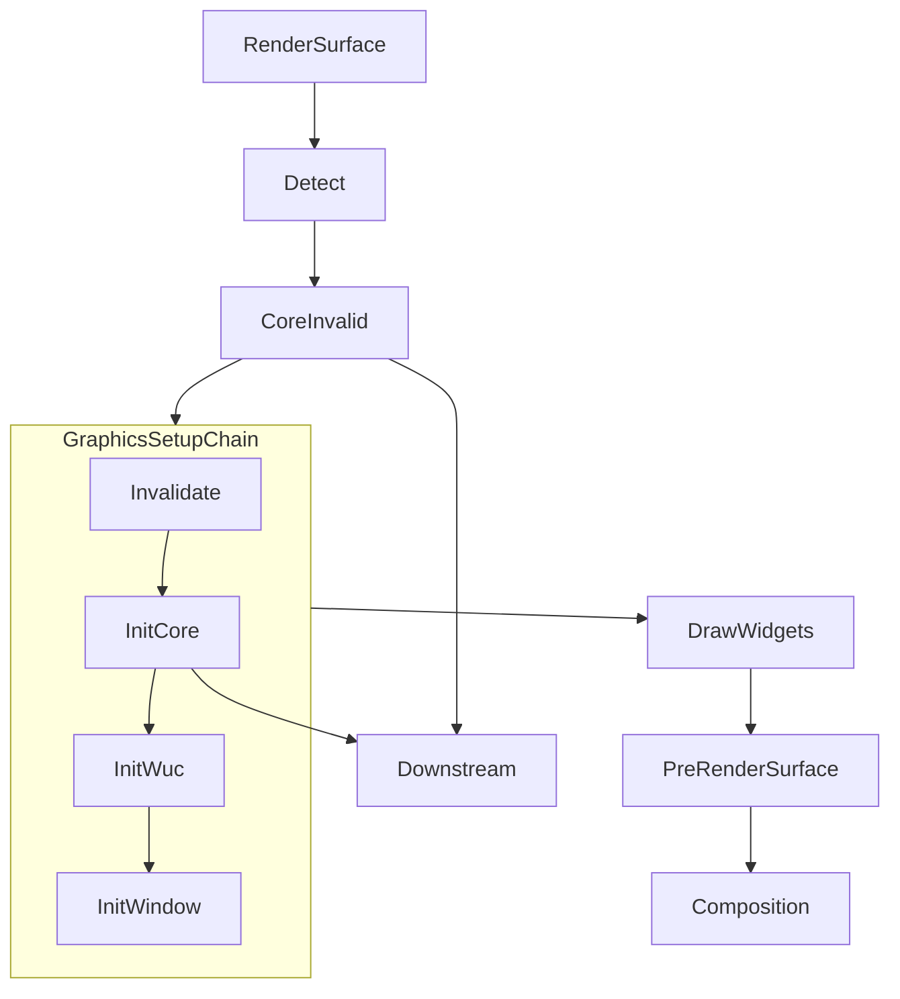
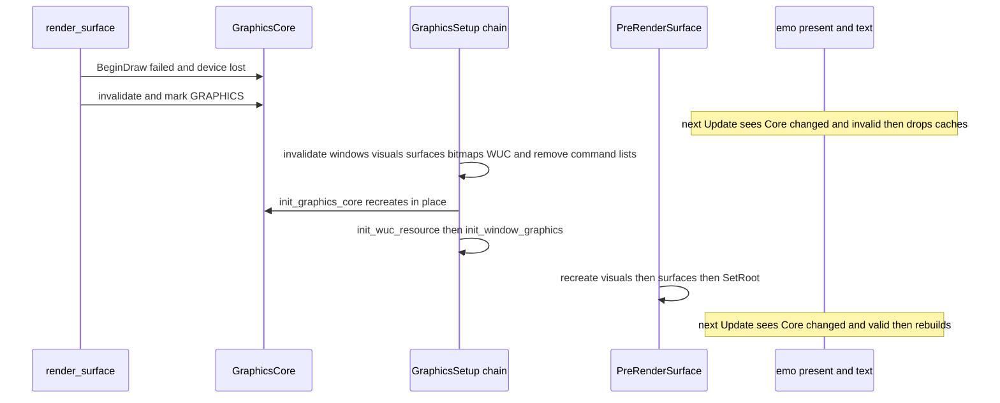
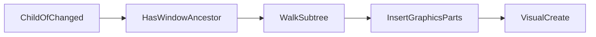

# 設計: audit-wintf-graphics-world

## Overview

**目的**: wintf の描画・World・見た目の木・共通の型（`crates/wintf/src/ecs/` の残り）に audit をかけて出た指摘のうち、要件の「指摘の扱い」で直すと決めた 1〜21・31〜35 番と 30 番の「残す理由の説明」を、いちばん小さな完全な変更で直す。直し終わりは、同じ範囲への 2 度目の audit の 0 件と全体テストの緑で確かめる。

**使い手**: areka の開発者と、wintf を使う areka の各クレート（`areka-emo-present`・`areka-emo-text`・`areka` 本体）。

**変わること**: 起動の最初の回に描画の装置が作れなくても落ちなくなる。描画の装置が失われたら（ドライバの更新・GPU のリセット）見つけて、窓・見た目・描画面・命令の列まで作り直す。見た目の木の付け替え、後から窓へつないだ部品、同じ回に作った親子の色の受け継ぎが、作る順・つなぐ順に依らず正しくなる。窓を動かすだけで描画面を描き直さなくなる。使われない欄・関数・数え・テスト・古い説明が消え、`world/mod.rs` は約 770 行になる。

### Goals
- 要件の「指摘の扱い」で「直す」とした指摘を、3 つの組とも全部直す（3.1）。
- バグと危ない所の直しには、元に戻すと落ちるテストを 1 件につき 1 本以上置く（3.2）。
- 最後の audit で新しい指摘 0 件を、0 件と書いて記録に残す（6.3）。全体テストが緑（6.4）。

### Non-Goals
- 22〜29 番と 30 番の README の写し（`wintf-visual-tree` へ申し送り済み）。`visual/` の作りには触らない（30 番の説明の 2 行を除く）。
- 新しい機能。デバイスロストの立ち直りは、在る仕組み（`invalidate()`・`is_valid()`・`HasGraphicsResources`・世代の番号）の仕上げとして扱う（要件の討議 議題 1）。
- WUC の `SetRenderingDevice` で合成器を残したまま装置だけ差し替える道（調べたが、討議の決め「無効化を窓と見た目と描画面の部品まで届ける」に合わせて採らない。research.md 9.2）。
- 依存の追加（同じウェーブの約束）。

## Boundary Commitments

### This Spec Owns
- `crates/wintf/src/ecs/` のうち `graphics/`・`world/`・`visual/`（説明 2 行だけ）・`common/`・`dola/`・`cursor/`・`types.rs`・`app.rs`・`mod.rs`・`test_support.rs` の直し。
- 描画の装置の生き死にの約束（いつ無効になり、いつ誰が作り直し、下流は何を合図に控えを捨てるか）。
- 単一スレッドで回すスケジュールの一覧と、13 本のスケジュールの説明。
- 下の「範囲の外で直すファイル」に挙げた、直しのために要る範囲の外の書き換え。

### Out of Boundary
- `visual/` の作りの傷（22〜29 番）と `visual/draw/README.md`（`wintf-visual-tree`）。
- `crates/wintf/src/runtime/tick_bridge.rs` の説明の行（`audit-wintf-runtime` が着地の後に合わせる）。
- `crates/wintf/src/com/` の形（8 番は `core.rs` 側だけで直す。`com/d2d` の `d2d_create_device` は呼び出し元を 1 つ失うだけで形は変えない）。
- `window_proc/window_pos.rs` の 2 度目の書き込みの流し（13 番の直しの後に重なって見える ③ の行）。持ち主の `audit-wintf-window` へ申し送る。
- emo-present・emo-text・areka 本体の、装置の立ち直り以外の振る舞い。

### Allowed Dependencies
- bevy_ecs 0.19.1（スケジュール・実行の条件 `run_if`・変化の印）・windows 0.62 系・dola。今の `Cargo.toml` のまま。
- 層の向き: `common/`（祖先の走査）→ `graphics/`（部品と係）→ `world/`（スケジュールへの登録）。`graphics/` は `world/` の `tick_wake`・`FrameCount` だけを読む（今と同じ）。下流（emo-present・emo-text・areka）は wintf の公開の型だけを読む。

### Revalidation Triggers
- `GraphicsCore` の作り直しの合図（`Res<GraphicsCore>` の変化の印）と、無効化が届く部品の一覧が変わるとき → emo-present・emo-text・areka の立ち直りの手当てを確かめ直す。
- 単一スレッドのスケジュールの一覧が変わるとき → WUC に触る係の置き場を確かめ直す。
- `DolaAnimator` の読む口の形（`&mut self`）が変わるとき → `element-animation-easing` が確かめ直す。
- `GraphicsCommandList` を作り直しで外す約束が変わるとき → 命令の列を作る係（wintf の部品・emo-present）が確かめ直す。

## Architecture

### Existing Architecture Analysis
- 1 回の画面更新は 13 本のスケジュールを固定の順に回す（`Input → Update → PreLayout → Layout → PostLayout → UISetup → GraphicsSetup → Draw → PreRenderSurface → RenderSurface → Composition → CommitComposition → FrameFinalize`）。単一スレッドは `UISetup`・`GraphicsSetup`・`PreRenderSurface`・`RenderSurface`・`Composition`・`CommitComposition` の 6 本で、WUC に触る係はここに置く決まり（`world/mod.rs` の 2026-07-02 の実測）。
- 装置に結びつく部品は `Option<Inner>` と `invalidate()`／`is_valid()` を持ち、作る係は「無効なら作る」で動く。けれども今は、無効にする所が本番に無く、無効化の係 `invalidate_dependent_components` は複数スレッドの `Update` に居て、作る係は変化の印を見て早く戻るので、作れない回に印を食べてしまう。
- 作り直しの合図 `HasGraphicsResources` は窓にしか付いていない。

### Architecture Pattern & Boundary Map

選んだ形は「今の作りの形のまま、穴を塞ぐ」。新しい層は足さない。足すのは、祖先をたどる小さな関数 1 つ（9 番の 3 か所の共通化）、作る係の実行の条件 2 つ（6 番）、後から窓へつないだ部品に見た目の部品を入れる係 1 つ（4 番）、WUC の資源を作る係の切り出し 1 つ（6 番）だけ。



- `Detect` は `render_surface` の中の装置の失いの判定。`Invalidate` は `invalidate_dependent_components`、`InitCore` は `init_graphics_core`、`InitWuc` は新しく切り出す `init_wuc_resource`、`InitWindow` は `init_window_graphics`。どれも単一スレッドの `GraphicsSetup` に順に並べる。
- `Downstream` は emo-present・emo-text。`Res<GraphicsCore>` の変化の印を合図に、装置に結びつく控えを捨てる。

### Technology Stack

| 層 | 選ぶもの・版 | この spec での役目 | 備考 |
|---|---|---|---|
| ECS | bevy_ecs 0.19.1 | スケジュール・`run_if`・`Changed`・`Res::is_changed` | 依存は足さない。`run_if` が偽の回は係の `last_run` が進まず、変化の印が残る（`schedule/executor/single_threaded.rs` で確かめた） |
| 描画 | windows 0.62 系（D3D11・D2D・DXGI・WUC） | 装置・工場・描画面・合成 | `ID2D1Factory1::CreateDevice` を使う（同じ crate の中の型） |
| テスト | 標準のテストと rustdoc の `compile_fail` | 決定論のテスト・型の約束の固定 | `compile_fail` は `crates/sample-ghost-kit/src/lib.rs` に前例がある |

## File Structure Plan

### Directory Structure
```
crates/wintf/src/ecs/
├── common/
│   ├── mod.rs                 # 祖先の走査の mod 宣言と再公開を足す
│   ├── ancestors.rs           # 新: 上限つきの祖先の走査（9 番の 3 か所が共用）
│   └── ancestors_tests.rs     # 新: 輪・上限・根で止まることのテスト
├── graphics/
│   ├── core.rs                # 7・8・19 番・装置の失いの判定（6 番）・下流への合図の説明
│   ├── core_tests.rs          # 新: 7・8 番・判定（6 番）のテスト
│   ├── components.rs          # 16・18・10 番・切り抜きの控え（11 番）・SurfaceGraphicsDirty の拡大率（11 番）
│   ├── command_list.rs        # 8 番の注記
│   ├── visual.rs              # 9 番の置き換え・4 番の係
│   ├── visual_manager.rs      # 1・10・17・19 番・作る係の条件（6 番）
│   ├── clip.rs                # 34 番のテスト 2 本を消す
│   ├── tests.rs               # 34 番のテストを消す
│   └── systems/
│       ├── init.rs            # 1・16・18 番・6 番（作り直しの合図・WUC の係の切り出し・実行の条件）
│       ├── window_pos.rs      # 6 番（無効化を全部に届ける）
│       ├── surface.rs         # 1・10・11・17 番・6 番（見た目の作り直しで描画面も作る）
│       ├── render.rs          # 6 番（失いを見つけて無効にする）・17 番
│       ├── visual_sync.rs     # 3・9・10 番・6 番（新しい見た目へ位置と不透明度を写す）
│       ├── clip_sync.rs       # 11・31 番・6 番（新しい見た目へ切り抜きを写す）
│       └── brushes.rs         # 5・9 番
├── world/
│   ├── mod.rs                 # 12・14・15・35 番・6 番と 4 番の登録
│   ├── world_schedule_tests.rs # 新: 単一スレッドの一覧のテスト（35 番）
│   ├── schedule_labels.rs     # 12・34 番
│   ├── vsync.rs               # 13・33 番
│   ├── tick_gate_tests.rs     # 6 番（名簿 WINTF_PRODUCERS に graphics/core.rs を足す）
│   ├── tick_wake.rs           # 21 番
│   └── tick_wake_tests.rs     # 21 番（両向きのテストの片方を消す）
├── dola/mod.rs                # 2 番
├── cursor/answer.rs           # 32 番（窓 1 つ分の控えを消す口）
├── cursor/answer_tests.rs     # 32 番のテスト
├── visual/draw/builder.rs     # 30 番（allow に残す理由の説明 1 行）
├── visual/draw/command.rs     # 30 番（同上）
├── types.rs                   # 19 番（Size::validate を消す）
└── mod.rs                     # 19 番（重なる再公開 2 行を消す）
```

### 範囲の外で直すファイル（要件 3.4・3.5）
- `crates/wintf/src/ecs/window_proc/window_pos.rs` — 13 番の呼び出し元 1 か所（`audit-wintf-window`・今は走っていない）。
- `crates/wintf/src/ecs/window/window_handle.rs` — 32 番。`on_window_handle_remove` から窓 1 つ分の控えを消す 1 行（`audit-wintf-window`）。
- `crates/wintf/src/ecs/widget/shapes/rectangle.rs`・`crates/wintf/src/ecs/widget/bitmap_source/systems.rs` — 6 番。命令の列が無いときにも描き直す条件を `Or` に 1 つ足す（`audit-wintf-layout-widget`・C18 で今は走っていない）。
- `crates/wintf/tests/` と `crates/wintf/examples/` の次のもの（2026-11-05 の開発者の裁定で書き換えてよい）: `visual/hierarchy_reparent_gap_test.rs`・`graphics/brushes_system_test.rs`・`graphics/window_pos_systems_test.rs`・`graphics/reinit_unit_test.rs`・`graphics/components_test.rs`・`ecs/world_lifecycle_test.rs`・`ecs/dola_animator_test.rs`・`visual/insert_visual_test.rs`（消す）・`visual.rs`（その `mod` の 2 行）・`window/owner_window_exists_test.rs`・`examples/graphics_reinit_test.rs`。`ecs/lazy_reinit_pattern_test.rs` は wintf の型を使わない写しなので触らない（ギャップ分析の見込みと違った・research.md 9.5）。
- 裁定の一覧に無い `crates/wintf/tests/` の書き換えと足し（設計の調べで要ると分かった・`audit-wintf-runtime` の持ち物・要件 3.5 に従いタスクの先頭でまとめて申し合わせる・判断 6）: 新しいファイル `graphics/device_lost_recovery_test.rs` と `visual/window_join_test.rs`、それをつなぐ `graphics.rs` の `mod` の 1 行と `visual.rs` の 1 行、`graphics/init_window_graphics_test.rs`（WUC の資源を作るテスト 2 本を、切り出した `init_wuc_resource` を回す形へ）、`graphics/surface_systems_test.rs`（11 番のテストを足す）、`graphics/dcomp_integration_test.rs`（無効化のテストが WUC の無効だけを見ているなら緑のまま・赤になったときだけ直す）。
- 下流の立ち直りの手当て（6 番・判断 1）: `crates/areka-emo-present/src/presenter/refresh.rs`（同じウェーブの `audit-emo-present` と申し合わせてから）・`crates/areka-emo-text/src/actor_present.rs`（ファイルは足さない）・`crates/areka/src/emo2_boot/frame/attach.rs`。
- steering の追随: `.kiro/steering/structure.md`（Dola Animator の節の読み方・デバイスロスト対応の書き方）・`.kiro/steering/tech.md`（103 行目の「デバッグビルドの `GraphicsCore::new()` は D3D11 デバッグ層を必ず要求する」は 7 番の後は事実でなくなる）。

## System Flows

### デバイスロストからの立ち直り



決めたこと:
- **見つける所は 2 つ**（設計の討議 議題 1 で確定）。
  - **OS の知らせ（プッシュ・ゴーストがじっとしている間も気づく）**: 装置を作るときに `ID3D11Device4::RegisterDeviceRemovedEvent` へイベントを預け、`RegisterWaitForSingleObject` でその待ちをスレッドプールに置く。鳴ったときの係は `tick_wake::mark(GRAPHICS)`（どのスレッドからでも安全な原子の旗）を 1 回呼ぶだけで、WUC にも D3D にも触らない。起こされた UI スレッドは、`GraphicsSetup` の先頭の確かめ（`check_device_removed`）で `GetDeviceRemovedReason()` を問い、失いなら `GraphicsCore::invalidate()` を呼ぶ。確かめは `GRAPHICS` の旗で回った回にだけ問えば足りるが、問うのは安いので、装置が有効な回は毎回問ってよい（設計の細部は実装で決める）。開発者の決め「変わった時点が分かるならプッシュ」に当たる。要る windows の機能のうち `Win32_Graphics_Direct3D11`・`Win32_System_Threading` は根の `Cargo.toml` で既に有効。ただしイベントを作る `CreateEventW` は windows 0.62 で `Win32_Security` の印が付いていて、wintf の本体ではこの機能が有効でない（テストのビルドでは開発用の依存 `human-panic` → `sysinfo` 経由で入るだけ）。そこで `crates/wintf/Cargo.toml` の `windows` に、`shiori-host32-host` と同じ形で `features = ["Win32_Security"]` を 1 つ足す（2026-11-05 実装の段で判明・audit 系の議題は推奨案で決めてよいの決めで確定）。依存は足さない。
  - **描画の失敗（今の道の仕上げ）**: Microsoft の説明では、装置が失われると `BeginDraw` が `DXGI_ERROR_DEVICE_REMOVED` を返し、`EndDraw` は装置の失いを返さない。失敗したら D3D の装置の `GetDeviceRemovedReason()`（`com/d3d11.rs` の包みが在る）を問い、失いと判じたときだけ `GraphicsCore::invalidate()` を呼ぶ。
  - **待ちの後始末**: 待ちとイベントの登録は `GraphicsCore` の作り直しと捨てるときに外す（`UnregisterWaitEx` を「終わるまで待つ」で呼んでから `UnregisterDeviceRemoved`、最後にイベントの handle を閉じる）。終了の道の順は正規のまま保つ（要件 5.4）。登録の失敗は `error!` を残し、描画の失敗で気づく道だけで動き続ける（`ID3D11Device4` が取れない古い OS も同じ）。
  - `RenderingDeviceReplaced` は `SetRenderingDevice` を呼んだ後に来る知らせで、見つける役には立たない。
- **無効化は作り直しより先に、同じ単一スレッドのスケジュールで**。`init_graphics_core` を `PreLayout`（複数スレッド）から `GraphicsSetup` へ移し、`invalidate_dependent_components` の直後に並べる。先に作り直されると、無効化の係が「有効」と見て何も倒さなくなるため。無効化は装置が無効な回に毎回走るが、有効な部品だけを倒すので、同じ印を何度も立てない。
- **作る係は作れる回にだけ回す**。`init_window_graphics`・`visual_resource_management_system`・`deferred_surface_creation_system` を `run_if` で包み、装置か WUC が使えない回は係そのものを回さない。bevy は回さなかった係の `last_run` を進めないので、無効の間についた変化の印は、使えるようになった回にまとめて見える。係の中の早い戻り（`Option<Res<GraphicsCore>>` と `is_valid()`）は、wintf を使う人が係を自分で登録したときの守りとして残す（1 番）。
- **WUC の資源を作る所を係に切り出す**（`init_wuc_resource`）。今は `init_window_graphics` の中で作り、作った回は早く戻るので、作り直しの回に `Changed<HasGraphicsResources>` を食べて窓が二度と作り直されない（設計の調べで見つけた）。切り出した係は、資源が在って無効なら同じ場所で入れ替え、無ければ命令で入れる。窓の係はその後に `run_if(wuc_ready)` で回る。
- **命令の列は作り直しで外す**。命令の列（`ID2D1CommandList`）は古い装置に属する。無効化の係が `GraphicsCommandList` を全部外し、命令の列を作る係は「命令の列が無い」でも描き直す（文字・空トークの背景は今もこの形。四角と画像の係に `Without<GraphicsCommandList>` を足す）。
- **命令の列を外した回に、作ったばかりの描画面を空にしない**（設計の確かめで見つけた）。無効化で `GraphicsCommandList` を外すと、同じ回の `PreRenderSurface` で `cleanup_surface_on_commandlist_removed`（`surface.rs:280`）がその「外した」を読み、`deferred_surface_creation_system` が作り直したばかりの描画面に `SetBrush(None)` と `clear()` をかけてしまう。その係の問い合わせに `Without<GraphicsCommandList>` を足し、命令の列がまだ無い部品だけを片づける。作り直しの後に命令の列が付き直せば、その部品は対象から外れる。
- **描画面は見た目の作り直しで作り直す**。`deferred_surface_creation_system` の条件に `Changed<VisualGraphics>` を足す。新しい見た目には絵が付いていないので、大きさが同じでも作り直して `SetBrush` する（無効化で描画面も無効になっているので「同じ大きさなら飛ばす」には当たらない）。
- **新しい見た目へ位置・不透明度・切り抜きを写す**。`visual_property_sync_system` と `clip_sync_system` の条件に `Changed<VisualGraphics>` を足す。木のつなぎは、無効化で親の控えが消えるので今の検出で直る（3 番の直しの後も同じ）。
- **下流への合図は `Res<GraphicsCore>` の変化の印**。`init_graphics_core` は作り直しで資源を同じ場所で入れ替え（`*gc = new`）、`render_surface` は失いで `invalidate()` を呼ぶ。どちらも資源の変化の印を立てる。下流は「変わった・無効」なら控えを捨て、「変わった・有効」なら捨てて作り直す。`HasGraphicsResources` の変化を合図にしない（新しい窓が出るたびにも立つので、バルーンの窓が出るたびに全部を作り直してしまう）。

### 窓へ後からつないだ部品（4 番）



- `ChildOf` が変わった entity から、祖先に窓が在るかを `owner_window_exists` と同じ判定で見る。在れば、その entity と子孫のうち `Visual` を持ち `VisualGraphics` を持たないものに、`VisualGraphics`・`SurfaceGraphics`・`SurfaceGraphicsDirty` を入れる（`on_visual_add` と同じ 3 つ・既に在るものは入れない）。窓に属さない部品に入れないのは今のまま（議題 3）。
- `PreRenderSurface` の先頭に置く。入れた `VisualGraphics::default()` は同じ回の `visual_resource_management_system` が作る。

## Requirements Traceability

| 要件 | 中身 | 受け持つ所 | 流れ |
|---|---|---|---|
| 1.1 | 範囲のファイルを列挙して数を記録 | research.md 1 節（済み）・最後の audit の記録 | − |
| 1.2 | 後から足されたファイルも範囲に入れる | 最後の audit の前に `ecs/` を測り直す（タスク「2 度目の audit」） | − |
| 1.3 | 範囲を全部読む | research.md 1 節（済み）・2 度目の audit も全部読む | − |
| 1.4 | 範囲の外を見直さない | Boundary Commitments | − |
| 2.1 | 範囲だけに audit | research.md（済み）・2 度目の audit | − |
| 2.2 | 上限なしで全件 | research.md（済み）・2 度目の audit | − |
| 2.3 | 番号と組をそのまま | 本書の「指摘ごとの直し方」は audit の番号で書く | − |
| 2.4 | 討議で直す対象を確定 | requirements.md「指摘の扱い」（済み） | − |
| 3.1 | 3 つの組とも全部直す | 「指摘ごとの直し方」の全行 | − |
| 3.2 | バグと危ない所に元に戻すと落ちるテスト | Testing Strategy の表（1〜9・11・32・35 番） | − |
| 3.3 | 消す前にツリー全体で確かめる | 「消すものの確かめ」（research.md 9.5 の結果を本書に写した） | − |
| 3.4 | 形が変わる関数の呼び出し元を全部直す | 「範囲の外で直すファイル」と各行の「呼び出し元」 | − |
| 3.5 | 走っている spec の持ち物は申し合わせてから | emo-present（`audit-emo-present`）だけが該当。タスクの先頭で申し合わせる | − |
| 3.6 | 新しい機能を足さない | Non-Goals・6 番は在る仕組みの仕上げ（議題 1） | − |
| 3.7 | `wintf-visual-tree` の傷との重なりを記録 | 「傷との重なり」 | − |
| 4.1 | 残してよいのは 3 種類だけ | 22〜29 番（⑵・裁定済み）・30 番の README（申し送り済み） | − |
| 4.2 | 残す指摘は議題にして裁定 | requirements.md「指摘の扱い」（済み）・2 度目の audit で新しく出たら議題へ | − |
| 4.3 | SSP・ukadoc に関わるなら ukadoc で確かめる | 該当なし（描画の下まわり・research.md 2 節） | − |
| 4.4 | `visual/` の未使用は消さずに申し送る | 30 番は説明を足すだけ・`visual/` の他は触らない | − |
| 4.5 | 残す指摘を理由と裁定ごと記録 | research.md 9.6（22〜30 番の README・13 番の ③ の行） | − |
| 5.1 | 1,000 行を越えない | 「行数の見込み」 | − |
| 5.2 | 決定論のテスト | Testing Strategy（時刻・偶然に依らない） | − |
| 5.3 | 失敗はエラーのログと呼び出し元への失敗 | Error Handling | − |
| 5.4 | 終了の道は正規のまま | 終了の道には触らない（`WucGraphicsResource` の捨てる順は今のまま） | − |
| 5.5 | 実機の根と一時フォルダは `target` の下 | 新しいテストはファイルを置かない（HWND と GPU だけ） | − |
| 5.6 | GPU のテストは実 GPU | GPU を使うテストは実のハードウェアの装置と `on_gpu_owner_thread` | − |
| 5.7 | 文字化けはコンソールで逃げない | 道具の出力に触らない | − |
| 5.8 | 依存を足さない | Technology Stack | − |
| 5.9 | `doc/`・`docs/` を名指す行を足さない・変えない | 範囲の中は 0 行のまま。steering の書き換えも `doc/` を名指さない | − |
| 6.1 | 直し終えたら 2 度目の audit | タスク「2 度目の audit」 | − |
| 6.2 | 新しい指摘も直すか裁定へ | 同上 | − |
| 6.3 | 0 件を明記 | 同上（research.md に「新しい指摘 0 件」と書く） | − |
| 6.4 | 全体テストが緑 | タスク「全体テスト」 | − |
| 6.5 | 20 を越えそうなら 2 本目の案 | 討議で示して退けた（議題 9）。本書の見立ては 21 タスク | − |

## Components and Interfaces

### 一覧

| 部品 | 層 | 役目 | 要件 | 主な相手 |
|---|---|---|---|---|
| 祖先の走査 `ancestors` | common | 親をたどる 3 か所を上限つきの 1 つに | 3.1・3.2・5.3 | visual.rs・brushes.rs・visual_sync.rs |
| 装置の失いの判定 | graphics/core | `BeginDraw` の失敗を「失い」か判じて無効にする | 3.1・3.2・5.3 | render.rs |
| 作り直しの順 | graphics/systems・world | 無効化 → 装置 → WUC → 窓 → 見た目 → 描画面 | 3.1・3.2 | world/mod.rs |
| 作る係の条件 | graphics/systems/init.rs | `graphics_core_ready`・`wuc_ready` | 3.1・3.2 | world/mod.rs |
| 後から窓へつないだ部品の係 | graphics/visual.rs | 4 番 | 3.1・3.2 | world/mod.rs |
| 単一スレッドの一覧 | world/mod.rs | 35 番 | 3.1・3.2 | world_schedule_tests.rs |
| 下流の手当て | emo-present・emo-text・areka | 合図で控えを捨てる | 3.1・3.4・3.5 | `Res<GraphicsCore>` |

### common

#### 祖先の走査 `ancestors`

| 項目 | 中身 |
|---|---|
| 役目 | entity から親を順にたどる。上限（1,024 段）を越えたら `error!` を 1 行残して止まる |
| 要件 | 3.1・3.2・5.3 |

```rust
/// 親を順にたどる。根に着くか、上限を越えたら終わる。
pub(crate) const MAX_ANCESTOR_DEPTH: usize = 1024;
pub(crate) fn ancestors<F>(start: Entity, parent_of: F) -> Ancestors<F>
where
    F: FnMut(Entity) -> Option<Entity>;
pub(crate) struct Ancestors<F> { /* current, steps, parent_of */ }
impl<F: FnMut(Entity) -> Option<Entity>> Iterator for Ancestors<F> {
    type Item = Entity; // start は含まない。親・祖父母…の順
}
```
- 事前の条件: なし。`parent_of` は `ChildOf` を読む閉包（`DeferredWorld`・`Query<&ChildOf>` のどちらでも渡せる）。
- 事後の条件: 有限回で終わる。上限で止まったときは `error!`（`start` と上限を載せる）を残す。輪の見分けは上限で足りる（数十段の木で 1,024 段は輪のときだけ）。
- 使う所: `owner_window_exists`（`.any(窓か)`）・`find_parent_brushes` の置き換え（色ごとの最初の決まった祖先）・`visual_hierarchy_sync_system` の深さ（`.count()`）。4 番の係も同じ判定を通す。

### graphics

#### 装置の失いの判定（`core.rs`）

```rust
impl GraphicsCore {
    /// 描画の失敗を受け、装置が失われていれば自分を無効にして true を返す。
    pub(crate) fn note_draw_failure(&mut self, error: &windows::core::Error) -> bool;
}
/// 失いかを判じる純関数（テスト用に分けた）。
pub(crate) fn is_device_lost(draw_error: HRESULT, removed_reason: HRESULT) -> bool;
```
- `is_device_lost` は `removed_reason` が失敗か、`draw_error` が `DXGI_ERROR_DEVICE_REMOVED`・`DXGI_ERROR_DEVICE_RESET`・`DXGI_ERROR_DEVICE_HUNG`・`D2DERR_RECREATE_TARGET` のどれかなら真。
- `note_draw_failure` は既に無効なら偽を返す（2 度目の記録を出さない）。真のときは `error!`（HRESULT と removed reason を載せる）を 1 行残し、`tick_wake::GRAPHICS` を立てる。
- `core.rs` が `GRAPHICS` を立てる本番のファイルに加わるので、`world/tick_gate_tests.rs` の名簿 `WINTF_PRODUCERS`（名簿の完全性の検査が木の中の旗の生産者を全部載せることを求める）に `graphics/core.rs` の行を足す（配列の長さ 9 → 10）。
- `GraphicsCore` の説明に下流への約束を書く: 「作り直しと失いのとき、この資源の変化の印が立つ。装置に結びつく控えを持つ側は、変化を見たら控えを捨て、`is_valid()` の間だけ作り直す」。

#### 作り直しの順（`systems/window_pos.rs`・`systems/init.rs`・`world/mod.rs`）

- `invalidate_dependent_components`（`GraphicsSetup` の先頭）: 装置が在って無効なとき、有効な `WindowGraphics`・`VisualGraphics`・`SurfaceGraphics`・`BitmapSourceGraphics` を倒し、`GraphicsCommandList` を全部外し（命令で）、最後に `WucGraphicsResource` を倒す（合成の木の部品を先に捨て、合成器を最後に捨てる）。今の「古いまま有効」の注記（W3b-V）は消す。
- `init_graphics_core`（次）: 2 つの枝を 1 本にする（18 番）。作れたら、資源が在れば入れ替え、無ければ命令で入れる。どちらでも全部の `HasGraphicsResources` に印を立てる。装置が無効か無い間は `GRAPHICS` を立てる（今のまま）。
- `init_wuc_resource`（新・次）: `run_if(graphics_core_ready)`。窓が 1 つでも在り、WUC の資源が無いか無効なら作る。在れば入れ替え、無ければ命令で入れる。失敗は `error!`。今の `init_window_graphics` の中の塊を移すだけ。
- `init_window_graphics`（次）: `run_if(wuc_ready)`。引数は `Option<Res<GraphicsCore>>`（1 番）。中の WUC の塊と `unwrap` は消える。
- 4 本は `.chain()` で並べる（命令の後の反映を bevy が間に挟む）。
- 無効化の係は、部品ごとに `is_valid()` を読んでから、有効なものだけを可変で触る（可変で触るだけで変化の印が立つため）。
- `Update` に残る `update_typewriters` の `.after(invalidate_dependent_components)`（`world/mod.rs:248-249`）は、無効化の係が `Update` から抜けるので `.after(update_monitor_layout_system)` へ付け替える（`Update` の中の順は今と同じ）。

```rust
pub(crate) fn graphics_core_ready(gc: Option<Res<GraphicsCore>>) -> bool;
pub(crate) fn wuc_ready(gc: Option<Res<GraphicsCore>>, wuc: Option<Res<WucGraphicsResource>>) -> bool;
```

#### `render_surface`（`systems/render.rs`）
- 引数の `_graphics_core` を `Option<ResMut<GraphicsCore>>` にし、`_frame_count` を消す（17 番）。可変で触るのは失いのとき（`note_draw_failure` を呼ぶとき）だけにする。ふだんの描画で可変の借りを取ると、資源の変化の印が毎回立ち、下流が毎回の描画で控えを全部捨ててしまう。装置が無効なら何も描かずに戻る（描画面は作り直しで全部作り直されるので、ここで食べる印は要らない）。
- `begin_draw` の失敗で `note_draw_failure` が真なら、その回の残りを描かずに抜ける。偽なら今のとおり記録して次へ。
- 名前の文字列は失敗のときだけ作る。コメントアウトの 5 行を消す（17 番）。

#### 後から窓へつないだ部品の係（`visual.rs`）

```rust
pub fn insert_graphics_parts_on_window_join(
    mut commands: Commands,
    changed: Query<Entity, Changed<ChildOf>>,
    parents: Query<&ChildOf>,
    windows: Query<(), With<Window>>,
    children: Query<&Children>,
    pending: Query<(), (With<Visual>, Without<VisualGraphics>)>,
);
```
- 祖先の判定は `ancestors` と「自分が窓か」で、`owner_window_exists` と同じ規則。子孫の走査も上限つき（同じ上限）。
- `on_visual_add` の判定（入れる 3 つと「既に在れば入れない」）は小さな関数に分け、フックと係が共用する。
- emo-text が自前で `VisualGraphics` を入れる部品には、`Without<VisualGraphics>` なので入れない。

### world

#### 単一スレッドの一覧（`world/mod.rs`）

```rust
/// 単一スレッドで回すスケジュール（WUC に触る係はここに置く）。
/// `intern()` が const でないため、定数の代わりに固定の配列を返す関数にする。
pub(crate) fn single_threaded_schedules() -> [InternedScheduleLabel; 6];
```
- `EcsWorld::new` は 13 本を `Schedule::new` で入れた後、この一覧の分だけ `set_executor(SingleThreadedExecutor::new())` を呼ぶ。個別の 6 つの塊は消える。
- 順の説明の正本は `tick_diag::SCHEDULE_LABELS`（今のまま）。

### 下流の手当て（6 番・判断 1）

| 場所 | 今 | 直し |
|---|---|---|
| `areka-emo-present` の `presenter/refresh.rs` | 控え（閉じた命令の列）が古い装置のまま残り、同じ列なら入れ直さない | `GraphicsCore` の変化を見たら全部の対象の控えを捨て（在る `invalidate_all`）、有効なら見えている対象の `last_show` を出し直す（在る `refresh_scale` の出し直しの道を倍率の門なしで使う） |
| `areka-emo-text` の `actor_present.rs` | `ActorRender`（swap chain・文脈）を「無ければ作る」だけで、資源の有無しか見ない | `GraphicsCore` の変化を見たら全部の `ActorRender` と印の面を捨てる（在る `TextSurface::release`）。作る門を `is_valid()` にする |
| `areka` の `emo2_boot/frame/attach.rs` | 装着の門が `GraphicsCore` の有無だけを見る | `is_valid()` を見る |

- どれも在る関数を呼ぶだけで、新しい型や合図は作らない。emo-present は同じウェーブの `audit-emo-present` の持ち物なので、触る前にそのセッションと申し合わせる（要件 3.5）。emo-text と areka 本体の見直しは今は走っていない。
- **`audit-emo-present` との申し合わせ（2026-11-05・済み）**: `presenter/refresh.rs` の出し直しの数行はこの spec が引き受ける（あちらは「新しい機能を足さない」の外として引き受けない）。条件は、新しい公開の型を作らず、emo-present のほかのファイルの形を変えないこと。あちらの設計（`d7ed6665`）は `apply_show` の応答の口をやめ、`apply_show(&mut self, world, target_id, surface_id, binds, pattern, reveal) -> PresentOutcome` を返す形に変える（`reply` の引数は消える）。`refresh_scale` も戻り値で成否を読む形に変わる。こちらの出し直しは、その新しい形で書く。着地は「後に着地する方が先の形へ合わせる」（あちらが先になる見込み）。`ComposeCache::invalidate_all` の形はあちらでも変えない。あちらの `apply_visibility` は「同じ値なら書かない」になるので、出し直しで `set_visible` を呼んでも、値が同じなら変化の印は立たない。

## 指摘ごとの直し方

| 番号 | 直し方（消すもの・まとめる所） | 呼び出し元・範囲の外 |
|---|---|---|
| 1 | `init_window_graphics`・`visual_resource_management_system`・`deferred_surface_creation_system` の引数を `Option<Res<GraphicsCore>>` にし、無いか無効なら戻る。本番の登録は 6 番の `run_if` で包む | 係の引数は bevy が埋めるので呼び出し元なし。直に登録するテストは装置を入れているので形は変わらない |
| 2 | `last_result`・`runtime` を `&mut self` にする。`&self` から中身に触る口を無くし（`Debug` は定数だけ）、SAFETY の注記を「`&self` から触れないので `Sync` は健全・`&mut` は bevy の排他で 1 スレッド」に書き直す。返す値の中の `Rc` を複製して外へ持ち出さない、を限界として注記に書く。消費者の例も `Query<&mut DolaAnimator>` に | `crates/wintf/tests/ecs/dola_animator_test.rs` の読む所を `get_mut` に。`dola/mod.rs` の中のテストも同じ。`structure.md` の「消費パターン」の行 |
| 3 | 未同期の見分けを「控えの親が、いま居るべき親と違う」にする。居るべき親＝親が `VisualGraphics` を持てばその見た目（まだ作られていなければ保留して何もしない）、持たなければ根（自分自身）。付け替えでは、古い親の `Children` から自分を外してから新しい親を同期し直す（失敗は `debug!`・古い親が先に消えた場合がある）。親が後から見た目を持てば、根の印と違うので同期し直される | `crates/wintf/tests/visual/hierarchy_reparent_gap_test.rs` を正しい振る舞いのテストへ書き換える（付け替え・親が後から） |
| 4 | `insert_graphics_parts_on_window_join` を足し、`PreRenderSurface` の先頭に登録する（上の節） | emo-text の自前の `VisualGraphics` には入れない |
| 5 | 解決を待つ部品を深さの浅い順に並べ、この回に解決した色を `HashMap<Entity, Brushes>` に置く。色ごとに（前景・背景を別々に）、祖先を近い順に見て、決まった色を持つ最初の祖先から取る（その回の表を先に見る）。決まった祖先が無ければ既定の色。印の付いた部品だけを一度だけ解決するのは今のまま（`brush-component-separation` の決め） | `crates/wintf/tests/graphics/brushes_system_test.rs` の 149 行・185 行のテストを新しい答え（前景は親の赤、背景は祖父母か既定）へ書き換え、同じ回に作った親子のテストを足す |
| 6 | 上の「デバイスロストからの立ち直り」の全部 | `crates/wintf/tests/graphics/window_pos_systems_test.rs` の「古いまま有効」の特性化を「全部無効になる」へ書き換える。`dcomp_integration_test.rs` の無効化のテストを同じに。`examples/graphics_reinit_test.rs` の判定は世代の番号のまま動く。下流 3 か所 |
| 7 | `create_device_3d` を、作る関数を受け取る形に分ける。開発用の旗で作れず、失敗の値が `DXGI_ERROR_SDK_COMPONENT_MISSING` なら、旗を外して作り直し `warn!` を 1 行残す | なし。`tech.md` 103 行目の一文を直す |
| 8 | 工場を `D2D1CreateFactory::<ID2D1Factory1>` で作り、装置をその工場の `CreateDevice(&dxgi)` で作る。欄の型は `ID2D1Factory1` にし、`d2d_factory()` は今の戻りの型（`&ID2D1Factory`）のまま返す。注記 3 か所（`core.rs`・`command_list.rs`・`components.rs`）を事実に合わせる | `com/d2d` の `d2d_create_device` は wintf の中の呼び出しを失う（公開の関数なので警告は出ない・`audit-wintf-runtime` へ伝える）。`wintf-visual-tree` へ「手本の注記を直した」と伝える |
| 9 | `ancestors` を足し、3 か所を置き換える。各所の「巡回ガードは P48」の注記を消す | なし |
| 10 | `SetRoot` と `RemoveAll` と `SetBrush(None)` の失敗は `error!`。外すときの `Remove` は `debug!`（親が先に消えた場合がある）。係やフックには `Err` を返す先が無いので記録だけ、と 1 行書く | なし |
| 11 | 描き直しの印: `SurfaceGraphicsDirty` に最後に描いた拡大率 `drawn_scale: (f32, f32)` を足し、`mark_dirty_surfaces` は `Changed<GlobalArrangement>` だけで来た部品を、拡大率が変わったときだけ印を立てる（大きさの変化は描画面の作り直しが `Changed<SurfaceGraphics>` で印を立てる）。切り抜き: `VisualGraphics` に最後に当てた切り抜きの鍵（物理の幅・高さ・拡大率・`Option<ClipShape>`）を持たせ、同じなら作り直さない。鍵の書き込みは変化の印を立てない（`bypass_change_detection`）。見た目を作り直すと鍵は空に戻る | なし |
| 12 | `schedule_labels.rs` の 13 本の説明を、今の実行の仕方（どれが単一スレッドか・WUC の言葉）へ書き直す。`UISetup` の「PostLayout か Draw へ置け」を消す。`world/mod.rs` の「DComp」の注記 4 か所を直す | なし |
| 13 | `VSYNC_TICK_COUNT`・`LAST_VSYNC_TICK`・`DEBUG_WNDPROC_TICK_COUNT`・`EcsWorld::try_tick_on_vsync` を消す。トレイト `VsyncTick` は中身が「錠を取って窓の書き込みを流す」だけになり、`self` を使わないので、自由な関数 `flush_window_pos_commands_guarded()` に替える（判断 2） | `window_proc/window_pos.rs` の ② の 1 か所。`tests/ecs/world_lifecycle_test.rs` の説明 1 行。`tick_bridge.rs` の説明の行は触らない |
| 14 | `has_systems`（欄と分岐）・`message_window`／`set_message_window`／`message_window()`・`frame_count`／`last_log_time`／`measure_and_log_framerate`・呼び出し 0 の `schedules_mut` を消す。使わなくなる `use`（`HWND`・`trace`）も消す | `tests/ecs/world_lifecycle_test.rs` の 2 本を消し 1 行を消す・説明を直す。`window/transition_diag_tests.rs:887` の説明は持ち主の範囲なので触らない（説明だけで動きに関わらない） |
| 15 | `tick_order_tests` を消す（`world_tick_gate_tests.rs` の順のテストが 2 周の順まで見ている）。`try_tick_world` は `mod.rs` に残す | なし |
| 16 | `WindowGraphics` の描く文脈の欄・`get_dc`・作る行を消す。世代の番号は残し、`WindowGraphics::new(target, generation)` にして作り直しで `前の番号 + 1` を渡す。`increment_generation` と数だけ回す繰り返しを消す。`Sync` の注記を直す | 呼び出し元は `init.rs` だけ。`examples/graphics_reinit_test.rs` は `generation()` を読むだけで形は変わらない |
| 17 | 使わない引数・コメントアウト・捨てる文字列を消す（`render.rs`・`surface.rs`・`visual_manager.rs` の `_commands`） | なし |
| 18 | `init_graphics_core` の枝を 1 本に。`SurfaceGraphics::invalidate` を消して `clear` に寄せる。`set_surface` の嘘の説明と、`SurfaceCreationStats::skipped_count` の「CommandList不在等」の説明を直す | `tests/graphics/reinit_unit_test.rs:128` を `clear()` に |
| 19 | `insert_visual`・`insert_visual_with`・`Size::validate`・`ecs/mod.rs` の重なる再公開 2 行・`core.rs` の `allow(unused_imports)` と使わない `use` を消す | `tests/visual/insert_visual_test.rs` を消し、`tests/visual.rs` の `mod` の 2 行を消す。`wintf::ecs::FrameTime` などは `pub use graphics::*` で引き続き引ける |
| 20 | `owner_window_exists_test.rs` を、写しでなく本物を通す形にする（窓の下に `Visual` を足してフックを走らせ、見た目の部品が入るかを見る。窓の外なら入らない）。輪の場合も足す | 範囲の外のテスト（裁定済み） |
| 21 | `wake_bits_for_message` を `KNOWN_MESSAGE_TABLE` の引き当てにし、`match` を消す。表に無ければ `FORCE` は今のまま | `tick_wake_tests.rs` の両向きのテストの片方を消す |
| 30 | `visual/draw/builder.rs:57` と `visual/draw/command.rs:1` の `allow(dead_code)` に「`wintf-visual-tree` が本番へ上げるまで使い手が無い」の説明を 1 行ずつ付ける | なし |
| 31 | `clip_sync.rs` の頭と 127 行の説明を中身（角丸 0 の図形の切り抜き）に合わせる | なし |
| 32 | `cursor/answer.rs` に `forget_last_shown(hwnd)` を足し、`WindowHandle` の外すときのフックから呼ぶ | `window/window_handle.rs` に 1 行 |
| 33 | `is_tick_flush_in_progress` を `#[cfg(test)]` にし、`allow` を消す | `tick_bridge.rs` のテストはそのまま通る |
| 34 | `schedule_labels.rs` の derive を試すテスト 5 本、`graphics/tests.rs` の空の印の複製・既定値のテスト、`graphics/clip.rs` の `clip_shape_clone`・`clip_shape_debug` を消す | なし |
| 35 | `single_threaded_schedules()` を足し、`set_executor` はその一覧から回す（上の節）。一覧を固定するテストを `world_schedule_tests.rs` に置く | `tests/ecs/world_lifecycle_test.rs` の名前と中身が合っていないテスト（スケジュールが在るかだけを見る）は、`audit-wintf-runtime` が消すと申し送られている（research.md 8 節）ので触らない |

### 消すものの確かめ（要件 3.3）
ツリー全体（テスト・例・fixture・設定・文字列の参照）で確かめた結果（research.md 9.5）:
- 呼び出し 0: `get_dc`・`WindowGraphics::invalidate`・`Size::validate`・`schedules_mut`・`message_window`（本番）・`DEBUG_WNDPROC_TICK_COUNT` の読み手・`VSYNC_TICK_COUNT` の書き手。
- テストだけ: `insert_visual(_with)`（`insert_visual_test.rs`）・`set_message_window`（`world_lifecycle_test.rs`）・`SurfaceGraphics::invalidate`（`reinit_unit_test.rs`）。
- 再公開 2 行: 同じ名前を出す glob は `graphics::*` だけなので、`wintf::ecs::FrameTime` と `wintf::ecs::calculate_surface_size_from_global_arrangement` の使い手（areka・emo-present・テスト）はそのまま引ける。
- `doc/roadmap-overview-2026-10-16.html` に関数名が 1 つ出るが文章で、消す関数ではない。

### 行数の見込み（要件 5.1）
- `world/mod.rs` 944 → 約 770（消す: 順のテスト約 130・計測約 30・`try_tick_on_vsync` 約 28・`message_window` 約 15・6 つの塊約 30。足す: 一覧と回す所約 20・登録の変更約 10）。
- `graphics/systems/init.rs` 322 → 約 290。`graphics/components.rs` 317 → 約 315。`graphics/visual.rs` 154 → 約 215。`graphics/systems/visual_sync.rs` 278 → 約 290。どれも 1,000 行から遠い。
- 新しいファイルはどれも 200 行未満の見込み。

## 傷との重なり（要件 3.7）

| この spec の番号 | `wintf-visual-tree` の「直すべき傷」 | 記録 |
|---|---|---|
| 8 | 傷 7（`Send`/`Sync` の根拠の注記）に近い | 手本にされる `GraphicsCommandList` の注記を、この spec で事実に合わせた。あちらは直った注記を手本にできる |
| 9 | 傷 6（`visit` の深さの番兵）に近い | 上限つきの祖先の走査を `common/ancestors.rs` に置いた。あちらの再帰の番兵は別物（下へ向かう再帰）だが、上限の値は同じ 1,024 に揃えられる |
| 22〜29 | 傷 1〜8（一対一） | 直さずに申し送り済み（requirements.md） |

## Error Handling

- **失いの判定**: 失いのときは `error!` 1 行と無効化。失いでない描画の失敗は今のとおり `error!` で次の描画面へ。
- **作り直しの失敗**: `GraphicsCore::new()`・`WucGraphicsResource::new()`・窓の作成の失敗は `error!` で、次の回にまた試す（`GRAPHICS` の旗で回が続く）。作る係は条件で回らないので、変化の印は残る。
- **7 番の作り直し**: 旗を外して作り直したときは `warn!`。作り直しも失敗したら、その失敗を `Err` で返す（`init_graphics_core` が `error!` を残す）。
- **祖先の上限**: `error!` を残して「見つからない」として扱う（窓に属さない・既定の色・深さは上限まで）。
- **10 番**: 係とフックには `Err` を返す先が無いので、記録だけにする（要件 5.3 の「呼び出し元へ失敗として返す」は返す先の在る関数に当てる。理由を 1 行書く）。
- **下流**: 装置が無効な間に描く呼び出しは、今のとおり `Device` の失敗を記録して返す。合図を受けた後は、作る門が `is_valid()` を見るので、無効な装置で作ろうとしない。

## Testing Strategy

元に戻すと落ちるテスト（要件 3.2）。どれも決定論（時刻や偶然に依らない）。GPU を使うものは実のハードウェアの装置で、WUC を作るものは `crates/wintf/tests/graphics/common/mod.rs` の `on_gpu_owner_thread` の上で回す。

| 番号 | テスト | 置き場 | 元に戻すと |
|---|---|---|---|
| 1 | 装置を入れない World で 3 つの係を直に回し、落ちない | `crates/wintf/tests/graphics/device_lost_recovery_test.rs` | `Res` の検査で panic |
| 2 | `Query<&DolaAnimator>` で `last_result()` を呼ぶ係は組み立てに失敗する（rustdoc の `compile_fail`）。対になる `Query<&mut>` の形は通る（今のテストを `get_mut` に直したもの） | `dola/mod.rs` の説明の例 | `&self` に戻すと `compile_fail` が組み立ってしまい赤 |
| 3 | 付け替えた子が新しい親の WUC の子に入り、古い親から外れる。子を先に作り、次の回に親へ `Visual` を足すと子がつながる | `crates/wintf/tests/visual/hierarchy_reparent_gap_test.rs`（書き換え） | 古い親に残る・つながらない |
| 4 | 窓の外で作った部品の木を、後から窓の下へ付けると、根と子孫に見た目の部品が入る。窓の外へ付けたままなら入らない | `crates/wintf/tests/visual/window_join_test.rs`（新・`visual.rs` へつなぐ） | 入らない |
| 5 | 同じ回に作った親（背景だけ青）と子（未指定）で、子の背景が青。片方だけ決まった親の前景を子が取る | `crates/wintf/tests/graphics/brushes_system_test.rs` | 既定の色・祖父母の色になる |
| 6 | 知らせ: 預けたイベントを手で鳴らすと（`SetEvent`）、`tick_wake` に `GRAPHICS` が立つ。`GraphicsCore` を捨てると待ちとイベントの登録が外れ、その後に鳴らしても旗は立たない | `graphics/core_tests.rs` | 旗が立たない・捨てた後も鳴る |
| 6 | 判定: `is_device_lost` の真偽表。`note_draw_failure` に `DXGI_ERROR_DEVICE_REMOVED` を渡すと無効になり、`E_INVALIDARG` なら有効のまま（健全な実の装置） | `graphics/core_tests.rs` | 判定が外れる |
| 6 | 立ち直り: 隠した実の HWND の窓・その下の四角の部品で `EcsWorld` を回し、全部が有効になってから `GraphicsCore::invalidate()`。3 回以内に回すと、窓・見た目・描画面・命令の列・WUC の合成器が全部作り直され（ポインタが前と違う）、`WindowGraphics::generation()` が 1 | `device_lost_recovery_test.rs` | 古いまま有効・作られない |
| 6 | 印を食べない: 窓の無い `EcsWorld` に `Visual` と空の `VisualGraphics` を置いて 1 回回し（WUC が無いので作る係は回らない）、WUC の資源を入れてもう 1 回回すと見た目が作られる | `device_lost_recovery_test.rs` | 1 回目に印を食べて作られない |
| 6 | 無効化: `invalidate_dependent_components` で窓・見た目・描画面・画像・WUC が全部無効になり、命令の列が外れる | `crates/wintf/tests/graphics/window_pos_systems_test.rs`（書き換え） | 見た目と描画面が有効のまま |
| 6 | 空にしない: 立ち直りの後にさらに 2 回回しても、四角の部品の描画面が有効で、筆が付いたまま | `device_lost_recovery_test.rs` | 作り直した描画面が `cleanup_surface_on_commandlist_removed` で空になる |
| 7 | 作る関数に「開発用の旗なら `SDK_COMPONENT_MISSING` で失敗」を渡すと、旗を外した 2 度目で作れる。ほかの失敗では作り直さない | `graphics/core_tests.rs` | 1 度目の失敗がそのまま返る |
| 8 | `device_context()` の工場が `d2d_factory()` と同じ物（COM の同一性） | `graphics/core_tests.rs` | 別の工場 |
| 9 | 輪の親（閉包で作る）で `ancestors` が上限で止まる・根で止まる。輪の World で `Visual` を足しても、色の受け継ぎと木の同期の係を回しても終わる（別スレッドで回し、30 秒で返らなければ落とす） | `common/ancestors_tests.rs`・`window/owner_window_exists_test.rs` | 止まらない（時間切れで赤） |
| 11 | 位置だけ変えても描き直しの印が立たず、切り抜きも同じ物のまま。拡大率を変えると立つ | `crates/wintf/tests/graphics/surface_systems_test.rs` に足す | 位置だけで印が立つ |
| 20 | 本物の `owner_window_exists` を通す（上の 20 番の行） | `window/owner_window_exists_test.rs` | 写しは本物の破損を見逃していた |
| 32 | 控えを入れてから `WindowHandle` を外すと、その窓の控えだけが消える | `cursor/answer_tests.rs` | 残る |
| 35 | 一覧が 6 本（`UISetup`・`GraphicsSetup`・`PreRenderSurface`・`RenderSurface`・`Composition`・`CommitComposition`）であること。`EcsWorld::new` の本文が一覧から `set_executor` を回していること（本文を読む構造の検査・`tick_diag_tests.rs` と同じやり方） | `world/world_schedule_tests.rs` | 一覧が崩れる・個別の呼び出しへ戻る |

- 下流（判断 1）: emo-present は「控えを捨てて出し直す」を、在る `presenter_test_support.rs` の足場で、`GraphicsCore` を作り直した後に面の命令の列が新しい物になることで確かめる。emo-text は合図の後に `ActorRender` が空になり、次の描画で作り直されることを、在る `actor_test_support.rs` の足場で確かめる。areka の門は `is_valid()` が偽のとき装着しないことを確かめる。
- 消すテスト（34 番・15 番・19 番）は、消した後に残るテストが同じ振る舞いを見ていることを、消すタスクの中で確かめる。
- 画素の前後の確かめ: 3・4・5・11 番は見た目の振る舞いが変わる（正しくなる方へ）ので、`areka-emo-present`・`areka-emo-text` の画素のテストが緑のままであることを全体テストで見る。

## Performance & Scalability
- 11 番で、窓を動かす間の描画面の描き直しと切り抜きの作り直しが無くなる（今は動く間ずっと毎回・測ってはいない）。
- 3 番の見分けは今と同じく、毎回、子を 1 度ずつ見る（比べるのはポインタ 1 つ）。
- 5 番の表は、解決を待つ部品がある回にだけ作る。
- 21 番は約 55 件の表を順に引く。メッセージ 1 通につき比べるだけで、測れるほどの差は無い見込み。

## 設計で決めたこと（開発者が確かめたい所）

2026-11-05 の設計の討議で、下の 1・2 と「OS の知らせで装置の失いに気づく（プッシュ）」を、開発者が推奨案のまま承認した（開発者「承認」）。3〜8 は技術の都合で決めたもので、討議で異論は出なかった。

1. **下流の立ち直りの手当てをこの spec で行う**（6 番）。設計の調べで、wintf の部品を作り直すだけでは areka の画面は戻らないと分かった（emo-present は古い装置の命令の列を控えに残し、emo-text は古い装置の swap chain を持ち続ける）。討議の「アプリを起動し直すまで戻らない」を直すには下流 3 か所の手当てが要る。在る関数を呼ぶだけで、2 タスクに収まる。emo-present は同じウェーブの `audit-emo-present` と申し合わせてから触る。
2. **`VsyncTick` トレイトを自由な関数 `flush_window_pos_commands_guarded()` に替える**（13 番）。討議では「トレイトの関数の名前を変える」だったが、数えを消すとトレイトの中身は `self` を使わなくなり、名前だけ変えても 2 度目の audit で指される形が残る。呼び出し元の直しは同じ 1 か所。
3. **単一スレッドの一覧は「定数」でなく、固定の配列を返す関数にする**（35 番）。bevy の `intern()` が const でないため。中身を固定するテストは討議のとおり。
4. **`init_graphics_core` を `PreLayout` から `GraphicsSetup` へ移す**（6 番）。無効化を作り直しより先に、単一スレッドで行うため。areka の装置を使う係は `Update` に居るので、見える時点は変わらない。初めの起動では窓の部品が 1 回早くできる。
5. **作る係を `run_if` で包む**（6 番）。「無効な回に変化の印を取りこぼさない」を、係を回さないことで満たす。係の中の早い戻りは、外から係を登録する人のための守りとして残す。
6. **裁定の一覧に無い wintf のテストのファイルにも触る**（新しいファイル 2 つ・つなぐ行 2 行・`init_window_graphics_test.rs`・`surface_systems_test.rs`、要るなら `dcomp_integration_test.rs`）。`audit-wintf-runtime` とまとめて申し合わせる（要件 3.5）。
7. **世代の番号は残し、`WindowGraphics::new(target, generation)` で渡す**（16 番）。立ち直りのテストと例が「作り直された」を確かめる物差しに使う。`structure.md` の「`invalidate()` と `generation` を実装」の約束とも合う。
8. **切り抜きの控えを `VisualGraphics` に置く**（11 番）。見た目を作り直すと控えも空になり、新しい見た目へ切り抜きを当て直す道と同じになる。

## タスクの切り方の見立て（21）

同じファイルに閉じる直しは 1 つにまとめる。`world/mod.rs` に触るタスク（3・8・13）は順に行う。

1. 申し合わせ: `audit-wintf-runtime`（判断 6 の wintf のテスト）と `audit-emo-present`（判断 1）へ、触るファイルと中身を伝える
2. 祖先の走査（9 番）と `owner_window_exists` の置き換え・本物を通すテスト（20 番）
3. 後から窓へつないだ部品の係（4 番）と登録
4. 色の受け継ぎ（5 番・9 番の 1 か所）
5. 見た目の木の親子（3 番・9 番の 1 か所・10 番の `RemoveAll`）と、新しい見た目への位置と不透明度（6 番の一部）
6. 描画の装置: 開発用の旗・工場・使わない `use`・失いの判定・OS の知らせの待ちと後始末（7・8・19 番の一部・6 番の一部）
7. `DolaAnimator`（2 番）と `structure.md` の読み方の行
8. 作り直しの順: 無効化の拡張・`init_graphics_core` の 1 本化と移し・`init_wuc_resource`・作る係の条件・登録（6・18 番・1 番の窓の係）
9. 窓の部品の整理（16 番）と `examples/graphics_reinit_test.rs`
10. 見た目の資源の係（1・10・17・19 番の `visual_manager.rs`）と `insert_visual` のテストを消す
11. 描画面の係（1・10・11・17・18 番の `surface.rs` と `components.rs` の描画面）と 6 番の描画面の作り直し
12. 描く係の失いの見つけ（6 番の `render.rs`・17 番）
13. 切り抜き（11・31 番・6 番の当て直し）
14. 命令の列を作る係の描き直しの条件（6 番・`rectangle.rs`・`bitmap_source/systems.rs`）と立ち直りの総合のテスト
15. 下流の手当て: emo-present（申し合わせの後）
16. 下流の手当て: emo-text と areka の装着の門
17. `EcsWorld` の整理（12 番の注記・14・15・35 番）と `world_lifecycle_test.rs`
18. VSYNC の数え（13・33 番）と呼び出し元 1 か所
19. 小物: スケジュールの説明と型のテスト（12・34 番）・表の 1 本化（21 番）・カーソルの控え（32 番）・`Size::validate` と再公開（19 番）・`visual/draw` の説明（30 番）・`graphics/tests.rs` と `clip.rs` のテスト（34 番）・`components.rs` の外すときの記録（10 番）・`tech.md` の一文
20. 2 度目の audit（範囲を測り直し・全部読む・新しい指摘 0 件を明記）
21. 全体テスト（`pwsh -NoProfile -File tools/test-all.ps1`）

## Risks
- **同じ HWND に合成の的を作り直す**: 古い `DesktopWindowTarget` を捨てる前に新しいのを作ると失敗しうる。無効化で窓の部品を先に捨て、合成器を最後に捨てる順にした。実の HWND の立ち直りのテストで確かめる。
- **初めの起動の回の数が 1 回早まる**: 窓の部品が 1 回目の画面更新でできるようになる。回の数を決め打ちするテストがあれば全体テストで赤になるので、そのとき合わせる。
- **下流の手当ては他の spec の持ち物**: 申し合わせが付かなければ、その分だけ `/kiro-discovery` で起票し、この spec の記録に「立ち直りは wintf の部品まで」と書いて裁定に回す。

## Supporting References
- 立ち直りの流れと HRESULT の出典、bevy の `run_if` の確かめ、下流の調べ、テストの調べは research.md の 9 節。
