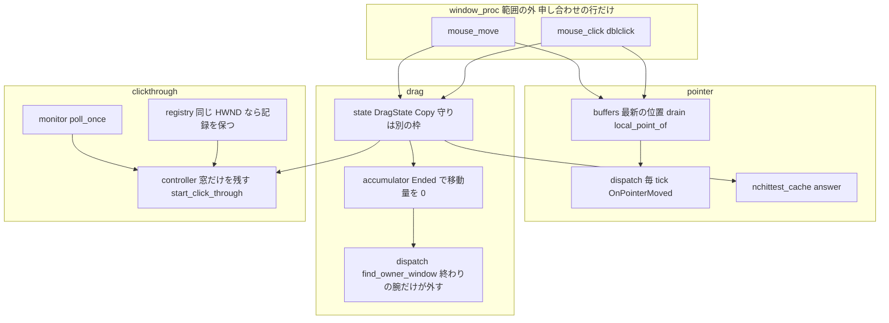
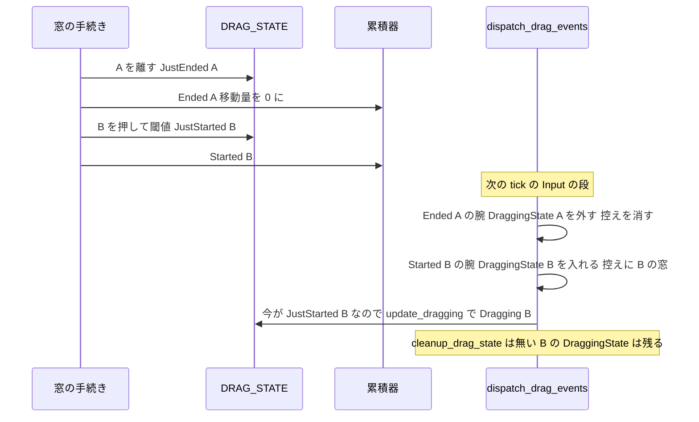

# 設計: audit-wintf-input（wintf のドラッグ・ポインタ・クリック透過の見直し）

## Overview

**目的**: wintf のドラッグ・ポインタ・クリック透過（`crates/wintf/src/ecs/` の `drag/`・`pointer/`・`clickthrough/` の 24 ファイル）に `/ponytail:ponytail-audit` をかけて出た 23 件の指摘を、要件の討議の結論（`requirements.md` の「確定した指摘の一覧」と議題 1〜10）どおり全部直す。残すと裁定した指摘は 0 件、ほかの spec へ回した指摘も 0 件。直し方はどれも「いちばん小さい完全な直し」で、消せるものは消し、使うテスト・検体・呼び出し元まで直し切る。

**使う人**: 開発者。速い掴み直しでもシェルが指に付いてくること、位置の決まっていない窓を掴んでも窓が画面の左上へ飛ばないこと、登録し直した窓のクリック透過が外れなくならないこと、`cargo test` が開発者のカーソルを動かさないこと、テストが守っているつもりの分岐を本当に守っていることを得る。

**変わること**: 外から見た振る舞いの変化は次の 6 点。⑴ 1 回の画面更新の間にドラッグの終わりと次の始まりが重なっても、次のドラッグに `DraggingState` が残り、ドラッグの状態は正しい窓の控えで進み、前のドラッグの移動量が次のドラッグへ配られない（指摘 1）。⑵ 始めの窓の位置が取れないとき、wintf は窓を動かさず `warn!` を 1 行出す（指摘 3）。⑶ 同じ窓を同じ HWND で登録し直しても透過の記録が崩れない（指摘 4）。⑷ `Window` を外した窓・HWND の違う対象はクリック透過の対象から外れる（指摘 21）。⑸ `PointerState.local_point` が当たった entity の左上からの座標になる（指摘 11）。⑹ 押す・離す・ドラッグの始まりと終わりの記録が `info!` から `debug!` になる（指摘 14）。wintf の公開の形は減る（議題 6 で承認済み）: `DragConfig.right_button`・`middle_button`、ドラッグの知らせ 3 つの `is_primary`、`DragStateSnapshot`・`cleanup_drag_state`・`CaptureGuard` の再公開、`CursorVelocity`・`PositionSample`・`PointerBuffer`・`PointerState.velocity`・`timestamp`、仮の当たり判定 2 つ。`DraggingState.initial_inset` は `initial_window_pos` へ改める。足す公開の欄は 0（`OnPointerMoved` の配り方は変えない＝指摘 19 は説明と檻）。

### Goals

- 確定した 23 件を全部直す。直したバグと危ない所（1・2・3・4・11・21）の 1 件ずつに、壊れたら落ちる決定論のテストを置く。テストの抜けの指摘（6・8）はテストそのものが直し。
- 範囲の外へは、直しに要る呼び出し元だけに触る（File Structure Plan の「範囲の外」）。走っている spec の持ち物は申し合わせのとおりに扱う。
- 直し終えたら同じ作法で audit をかけ直して新しい指摘 0 件・全体テスト緑。
- タスクは 17 前後（1 本の spec のまま・要件 8.1・議題 1）。

### Non-Goals

- 新しい機能（右・中ボタンのドラッグ・ポインタの速さ）・依存の追加・`Cargo.lock` の変更・clippy の機械的な直し。
- 窓の手続き（`ecs/window_proc/`）の指摘の直し。閾値の計算の写し（`mouse_move.rs:228-233`）と押すたびの `info!`（`mouse_click.rs:150-156`）は `audit-wintf-window` の持ち物（要件 5.4）。
- `DraggingState.initial_window_pos` の型（`(f32, f32)`）の変更。議題 7 で決まったのは名前と説明だけ（「設計の段で決めた事項」の 6）。
- ドラッグの知らせの `timestamp` と `DragTransition::Started.timestamp`（議題 3 で消すのは `PointerState` の速さと時刻だけ）。
- `MonitorRecord`・`Monitor` の `is_primary`（C20 の約束 ⑶・議題 2）。
- `crates/wintf/src/ecs/tooltip/`（要件 5.5・触る用事が無い）。

## Boundary Commitments

### This Spec Owns

- 範囲の 24 ファイルの、確定した 23 件の直し。
- ドラッグの状態の形（`DragState` を `Copy` にし、捕捉の守りを専用の `thread_local!` の 1 枠に置く）と、その読み手の直し（指摘 18）。
- ドラッグの配りの順序の約束（`DraggingState` を外すのは終わりの腕だけ・始まりの腕は今のドラッグにだけ `update_dragging` を呼ぶ・終わりを積むと移動量を 0 に戻す）（指摘 1）。
- ポインタの溜めの形（entity ごとの最新の位置 1 つ・毎 tick 取り出して空にする）と `PointerState` の欄（`velocity`・`timestamp` を消す）（指摘 2・10）。
- `local_point` の求め方の 1 か所（`pointer/buffers.rs` の `local_point_of`）と、それを tick の頭で全部の `PointerState` へ書く所（`transfer_buffers_to_world`）（指摘 11）。窓の手続きが `PointerState` を作る所は変えない（議題 11）。
- クリック透過の対象の刈り方（`Window` と、同じ HWND の `WindowHandle` を持つ窓だけを残す）と再登録の扱い（指摘 4・21）。
- 範囲の外の、直しに要る最小の箇所（File Structure Plan の「範囲の外」の表のとおり）。

### Out of Boundary

- 窓の手続き（`ecs/window_proc/`）の指摘の直しと `mouse_*` の作りの直し（`audit-wintf-window`・議題 11）。この spec が触るのは、型の形を変えたことへの機械的な追従の行だけ（「並走の兄弟との申し合わせ」の表）。
- `WindowPointerTracking` 型を消すこと（範囲の中のファイルだが `audit-wintf-window` が消す・議題 11）。2026-11-14 に #461 で型・テスト・再公開ごと消えた。
- `crates/areka-placement/` の指摘の直し（`audit-placement-core`・`audit-placement-follow`）。この spec が触るのは `is_primary` と `initial_inset` の読み手の行だけ。
- `tools/perf/` の道具（`audit-tools-perf-run`・`audit-tools-perf-judge`）。クリック透過の記録の文言 `clickthrough: ex-style トグル適用` と欄 `desired`、`DesiredState` の綴り `Transparent`・`Opaque` は道具が読むので変えない。
- `crates/wintf/src/ecs/tooltip/`・`ecs/graphics/visual/draw/`・`ecs/graphics/composite.rs`・`ecs/graphics/systems/render.rs`・`numerics/matrix3x2.rs`（0 ファイル）。
- `MonitorRecord`・`Monitor`・`DESPAWNED_SKIP_TAG`・記録の的 `areka_placement::diag`（C20 の約束 ⑶・0 行）。
- 根と各クレートの `Cargo.toml`・`Cargo.lock`・`vendors/`（要件 6.2・6.4）。

### Allowed Dependencies

- 今の依存だけ: `bevy_ecs`・`windows`・`event_listener`・`tracing`、テストは `log-capture-kit`（wintf の dev 依存に既にある）。
- wintf の中の既存の関数: `crate::ecs::find_owner_window`（`ecs/window/command.rs:850`）・`hit_test_in_window`・`GlobalArrangement`・`WindowHandle`・`WindowPos`・`EcsWorld::new` と `Input` の段（テストで本番の登録どおりに回す）。
- 依存の向きは今のまま: `pointer` ← `drag` ← `clickthrough`（`clickthrough` は `drag` の状態を読む・`drag` は `pointer` の配りを使う）。逆向きの `use` を足さない。
- 新しい依存は足さない。要ると分かったら直さずに議題にする（要件 6.3）。

### Revalidation Triggers

- **ドラッグの状態の形（指摘 18）**: `DragStateSnapshot` と `DragState::snapshot` が消え、`snapshot_drag_state()` は `DragState`（`Copy`）を返す。`DragState` の腕から `capture_guard` の欄が消える。読み手は `DragStateSnapshot::X` を `DragState::X` に読み替える（File Structure Plan の表）。`update_drag_state(|s| *s = DragState::Idle)` で状態を戻すテストは、そのまま書ける（残った守りは次の `start_preparing` が先に落とす）。
- **ドラッグの知らせと設定の欄（指摘 9 ⑸ ⑹）**: `DragStartEvent`・`DragEvent`・`DragEndEvent` の `is_primary` と `DragConfig.right_button`・`middle_button` が消える。構造体の式でこれらを書く所（ツリー全体で 15 か所・File Structure Plan）は 1 行ずつ消す。
- **改名（指摘 15）**: `DraggingState.initial_inset` → `initial_window_pos`（型は `(f32, f32)` のまま）。読み手は 3 クレート 15 ファイル（File Structure Plan）。
- **`PointerState` の欄（指摘 10）**: `velocity`・`timestamp` が消える。ツリーの中の構造体の式は全部 `..Default::default()` か `..pointer(…)` で組む（2026-11-14 に 55 か所を確かめた）ので、欄を消してもビルドは通る。
- **`OnPointerMoved` の回数（指摘 19）**: 本番の受け手は 3 つ（シェルの箱の受け手はキャラの窓の受け手の中から呼ばれる）。キャラの窓の `on_char_pointer_moved` は `plan_mouse_move`（`crates/areka/src/input_events/throttle.rs:54-66`）が位置の同じ呼び出しで送らないので、SHIORI へ送る `OnMouseMove` は変わらない（議題 9）。バルーンの窓の `on_balloon_pointer_moved`（`balloon_moved.rs`）とシェルの箱の `on_box_pointer_moved` は、毎 tick 配られることを当てにして、止まったカーソルの下のバルーン滞在と強調を立て直す。そのため配り方は変えず、理由を説明に書いて檻に入れる（設計の討議 議題 1）。配り方を変える直しが後で出たら、この 3 つの受け手を確かめ直す。
- **クリック透過の対象（指摘 21）**: `Window` を持たない entity と、`WindowHandle` の HWND が登録の HWND と違う対象は、評価の前に刈られる。本番の登録（`areka-placement` の `register_ghost_windows_click_through`・`Added<WindowHandle>` で登録）は wintf の窓だけなので変わらない。
- **記録の段（指摘 14）**: `[DragStartEvent] Dispatching` ほか 5 か所が `debug!` になる。この文言を読む範囲の外のテストは `crates/areka/tests/window_link_real_run.rs:508,531` だけで、その `RUST_LOG`（`:49-50`）に `wintf::ecs::drag::dispatch=debug` を足す。
- **始めの位置が取れないドラッグ（指摘 3）**: 控え（`WindowDragContext`）の `initial_window_pos` が `None` になり（`move_window` は `DragConfig` のまま）、`warn!` が 1 行出る。偽の HWND で `client_to_window_coords` が失敗するテスト（`WindowDragContextResource` を読むのは `crates/areka/src/input_events/drag_test_support.rs`・`crates/areka-placement/src/balloon_lock.rs`・`balloon_lock_drag_tests.rs`・`follow_drag_end_gate_tests.rs`）は、`initial_window_pos` と `WARN` の行の数を確かめ直す（実装の頭で grep し、`areka-placement` の側で直しが要るなら申し合わせる）。
- **行の番号の参照**: `tools/perf/judge-followup.py:106,111` が `controller.rs:212`・`registry.rs:18-23` の行の番号を書いている。文言と綴りは変えないが行はずれる＝`audit-tools-perf-judge` へ知らせる（直すのは向こう）。

## Architecture

### Existing Architecture Analysis

- 窓の手続き（`ecs/window_proc/`）がマウスの知らせを受け、⑴ ポインタの溜め（`pointer/buffers.rs` の `thread_local!`）へ積む、⑵ ドラッグの状態（`drag/state/mod.rs` の `DRAG_STATE`）を進めて累積器（`drag/accumulator.rs`）へ遷移と移動量を積む。
- tick の頭で `transfer_buffers_to_world` が溜めを `PointerState` へ移し、`Input` の段で `dispatch_pointer_events` → `dispatch_drag_events` →（今は）`cleanup_drag_state` の順に回る（`ecs/world/mod.rs:184-216`）。
- `GlobalArrangement.bounds` はスクリーン座標。窓の entity の `Arrangement.offset` は `WindowPos.position` から写すが、ドラッグ中（`WindowDragging`）は写さない（`sync_window_arrangement_from_window_pos` の `Without<WindowDragging>`）。当たり判定はクライアント座標＋`WindowPos.position` を `bounds` と比べる（`hit_test_in_window_ex`）。
- クリック透過は別スレッドのカーソルの見張り（`clickthrough/monitor.rs`）が起こし、UI スレッドの非同期のループが `evaluate_targets` を回す（`clickthrough/controller.rs`）。対象の表は `ClickThroughRegistry`（`registry.rs`）。

### Architecture Pattern & Boundary Map



- **選んだ形**: ギャップ分析 5 節の案 B（ドラッグの状態を作り直してから直す）に当たる。議題 8 で指摘 18 をこの spec で直すと決まったので、先に `DragState` を `Copy` にしてから指摘 1 の比べと指摘 3 の警告を新しい形の上で書く（`mem::replace` の繰り返しが消え、比べが `matches!` 1 つで済む）。
- **守る形**: `Input` の段の系の順（`dispatch_pointer_events` → `dispatch_drag_events`）・`thread_local!` の控え・捕捉の守りを借用の外で落とす約束・クリック透過の 3 層（純関数・同期の評価・非同期のループ）・差分の守り。
- **新しく足すもの**: `pointer/buffers.rs` の `local_point_of`（私的）・`nchittest_cache::answer`（私的）・`monitor::poll_once`（私的）・`drag::dispatch::drag_origin`（私的）・`CAPTURE_GUARD`（私的な `thread_local!`）・`start_click_through`（`ClickThroughController::start` を自由な関数にしたもの）。どれも直しに要る最小のもの。

### Technology Stack

| 層 | 選ぶもの | 役目 | 備考 |
|---|---|---|---|
| 言語 | Rust（ワークスペースの版） | 全部 | 新しい依存なし・`Cargo.lock` 不変 |
| ECS | `bevy_ecs`（今の版） | `Input` の段・`World` | 系の登録から `cleanup_drag_state` の 1 つを外すだけ |
| Win32 | `windows`（今の版） | `HTCLIENT`・`HTTRANSPARENT` の定数を使う（指摘 20） | 自前の定数を消す。`HTTRANSPARENT` は `i32`・`HTCLIENT` は `u32`（`ecs/cursor/answer_tests.rs:41,58` と同じ扱い） |
| 起床 | `event_listener` | 変えない | `poll_once` は知らせを関数で受ける |
| 記録 | `tracing` | 文言を変えない（段だけ `info!` → `debug!`・新しい `warn!` 2 つ） | 的は今のモジュールのパス |
| テスト | `log-capture-kit`・`EcsWorld::new` | 記録の捕まえ・本番どおりの `Input` の段 | 決定論 |

## File Structure Plan

### Directory Structure

```
crates/wintf/src/ecs/drag/
└── dispatch_order_tests.rs   # 新: 1 回の配りに終わりと始まりが重なる並びのテスト（指摘 1 の ⑴⑵⑶）と
                              #     始めの位置が取れない窓のテスト（指摘 3）。dispatch.rs から
                              #     #[cfg(test)] #[path = "dispatch_order_tests.rs"] mod order_tests; で読む
```

新しいファイルはこの 1 本だけ。ほかのテストは今のファイルの中へ置く（どれも直した後に 1,000 行を十分下回る・「1,000 行の見通し」）。`drag/state/tests.rs`（848 行）には足さない。

消すファイル: なし（`drag/systems.rs` は `rearm_tick_while_dragging` が残る）。

### Modified Files（範囲の中）

`crates/wintf/src/ecs/drag/`:
- `mod.rs` — `DragConfig` から `right_button`・`middle_button` を消す（9⑸）。`DraggingState.initial_inset` を `initial_window_pos` に改め、説明を「ドラッグを始めたときの窓の位置（枠を含むスクリーン座標・物理ピクセル・整数の値）」に（15）。再公開から `CaptureGuard`・`DragStateSnapshot`・`cleanup_drag_state` を外す（18・1）。`check_threshold` の再公開は残す（議題 11）。`mod dispatch_order_tests` は `dispatch.rs` 側に置く。テスト `test_drag_config_default_values` の 2 行を消す。
- `state/mod.rs` — `DragState` を `#[derive(Debug, Clone, Copy)]` にし、各腕の `capture_guard` を消す。`CAPTURE_GUARD: RefCell<Option<CaptureGuard>>` を `thread_local!` に足す。`DragStateSnapshot`・`snapshot`・写しの `is_button_held` を消し、`snapshot_drag_state()` は `read_drag_state(|s| *s)` を返す（18）。`start_dragging`・`update_dragging` を `*state = …` の形に（`mem::replace` を消す）。`update_dragging` の控えが無い枝に `warn!`（3）。`check_threshold` は残し、説明の「本番呼び出しがゼロ」「W7a 境界」「本ループ」「P62 に記録」の行を消して、関数の仕事と整数の境界の注意だけにする（議題 11・16）。説明 87 行・358-360 行（16）。
- `state/tests.rs` — `DragStateSnapshot` を `DragState` に読み替え、`force_idle` を 1 行に。写しの対応の 1 本（446-470 行）を消す。`check_threshold` の 5 本（380-442 行）は残し、`force_idle` の形だけ合わせる（議題 11）。
- `capture_guard.rs` — `is_released` とテスト 3 本を消す（9⑷・7）。`pub` を `pub(crate)` に。
- `dispatch.rs` — 始まりの腕・終わりの腕の窓探しを `find_owner_window` に（12）。始めの位置を `drag_origin` に切り、取れなければ `warn!`＋控えの `initial_window_pos = None`（`move_window` は変えない・3）。始まりの腕は今の状態が同じ entity の `JustStarted` のときだけ `update_dragging` を呼ぶ（1⑵）。3 つの知らせから `is_primary` を消す（9⑹）。`info!` 3 つを `debug!` に（14）。`DraggingState` の欄名（15）。`mod order_tests` の宣言。
- `accumulator.rs` — `set_transition` の `Ended` を積むとき `accumulated_delta` を 0 に戻す（1⑶）。説明 126 行（16）。
- `accumulator_tests.rs` — 121-135 行を消す（7）。「終わりを積むと移動量が 0」の 1 本を足す（1⑶）。
- `context.rs` — `clear` を `*self = Self::default()` に（23）。説明 1-4・18・44-46 行（16）。163-177 行のテストを消す（7）。
- `systems.rs` — `cleanup_drag_state` を消す（1）。モジュールの説明を直す。テストの `DraggingState` の欄名（15）。
- `reentry.rs` — 変えない（読み手でない）。`reentry_tests.rs` — `DragStateSnapshot` を `DragState` に、`force_idle` を 1 行に（18）。

`crates/wintf/src/ecs/pointer/`:
- `buffers.rs` — `POINTER_BUFFERS` を `HashMap<Entity, PhysicalPoint>` に、`push_pointer_sample(entity, point: PhysicalPoint)` に（10）。`DOUBLE_CLICK_BUFFERS` を消す（9⑵）。`transfer_buffers_to_world` の 3 つの表を `drain` で取り出す（2）。押下の記録の「離した」の枝と古い説明を消す（13）。`info!` 2 つを `debug!` に（14）。`local_point_of` を足し、移し終えたら `PointerState` を持つ全部の entity の `local_point` を書き直す（164 行の `local_point = client_point` は消す）（11）。説明 38 行（16）。テスト: 速さと飽和の 3 本（519-569 行ほか）を消し、417-446 行を直す（10・13）。2・11 の確かめを足す。
- `types/mod.rs` — `CursorVelocity`・`PositionSample`・`PointerBuffer`・`hit_test_placeholder`・`hit_test_with_local_coords` を消す（10・9⑶）。`PointerState` から `velocity`・`timestamp` を消して `#[derive(Default)]` に（10）。`ButtonBuffer`・`WheelBuffer` を `pub(crate)` に（22）。`local_point` の説明（11）。
- `types/tests.rs` — 速さと溜めの 9 本・仮の当たり判定の 2 本（300-326 行）・偽の安心の 112-164 行を消す（10・9⑶・7）。
- `dispatch/mod.rs` — 配り方は変えず、説明「常に発火」に毎 tick 配る理由を書く（19）。
- `dispatch/tests.rs` — 3-38・164-171 行を消す（7）。19 の檻の 1 本を足す。
- `systems.rs` — 見張りのダブルクリックの枝と `clear_transient_pointer_state` の `double_click` の 1 行を消す（17）。説明 65-68 行（16）。113-139 行のテストを直す（13）。
- `nchittest_cache.rs` — 自前の `HTCLIENT`・`HTTRANSPARENT` と説明 22-28 行を消して `windows` の定数を使う（20・16）。判定を `fn answer(hit: bool, held: bool) -> LRESULT` に切り、4 つの組み合わせの 1 本を足す（8）。説明 142-144 行（16）。

`crates/wintf/src/ecs/clickthrough/`:
- `mod.rs` — `#![allow(dead_code, unused_imports)]` と NOTE（10-14 行）を消す。再公開から使われない名を外す（5）。
- `registry.rs` — `register` は HWND が変わったときだけ `last_applied`・`layered_applied` を戻す（4）。`DesiredState` の `Default` を `#[derive(Default)]`＋`#[default]` に（23・綴りは変えない）。`last_applied` を `#[cfg(test)]` に（5）。説明（4・21「登録するのは wintf の窓」）。テストに 4 の 1 本。
- `controller.rs` — `resolve_transition` の引数を `&DragState` に（18）。`prune_dead_targets` を「`Window` と、HWND の同じ `WindowHandle` を持つ対象だけを残す」に（21）。`ClickThroughController` を自由な関数 `start_click_through` に（23）。`ClickThroughHandle` の使われない口と欄を消す（5）。説明 55-57・100-104・150-152・253-266・276-279・427-429 行（16・21）。
- `controller_tests.rs` — `DragStateSnapshot` を `DragState` に（18）。評価のテストの窓に `Window` と `WindowHandle { hwnd, .. }` を足す（21）。513-525 行を逆向きに（21）。632-644 行を消す（7）。4 の 1 本を足す。`ClickThroughController::start` を `start_click_through` に（23）。`handle.register`・`remove` を共有の表を直に触る形に（5）。
- `monitor.rs` — ループの 1 回分を `poll_once` に切る（6）。`event` を消す（5）。`notify_on_move_and_ui_reads_latest`・`latest_cursor_reads_stored_position` を消し、`poll_once` の 2 本を足す（6）。

### Modified Files（範囲の外）

| ファイル | 持ち主（走っているか） | 変える行 | 指摘 |
|---|---|---|---|
| `crates/wintf/src/ecs/world/mod.rs` | 完了 | 202-206 行の `cleanup_drag_state` の登録を消す | 1 |
| `crates/wintf/src/ecs/mod.rs` | 完了 | 28 行の `cleanup_drag_state`・33 行の `CursorVelocity` を再公開から外す | 1・10 |
| `crates/wintf/src/runtime/mod.rs` | 完了（`audit-wintf-runtime`） | 21 行の `use`・291 行の説明・324 行の呼び出しを `start_click_through` に | 23 |
| `crates/wintf/src/runtime/wndproc_bridge_drag_cancel_tests.rs`・`wndproc_bridge_drag_release_tests.rs`・`wndproc_bridge_drag_test_support.rs` | 完了 | `DragStateSnapshot` を `DragState` に（release 24・45-46・527 行、support 35・160・170・183・284-285 行ほか） | 18 |
| `crates/wintf/tests/drag/dispatch_test.rs` | 完了 | 17 行の `use` から `cleanup_drag_state`・492-545 行の 2 本を消す（1）。86-87・414・455・502・534 行の欄名（15）。106・513 行の `is_primary`（9⑹）。冒頭の説明 3 行 | 1・9⑹・15 |
| `crates/wintf/src/ecs/window_proc/mouse_move.rs` | **`audit-wintf-window`（完了・#461）** | 機械的な追従だけ（議題 11）: 210・246 行（`DragStateSnapshot` → `DragState`）・359 行（`push_pointer_sample` の引数の型・#461 で 1 か所に）・396・405-406 行（欄名） | 18・10・15 |
| `crates/wintf/src/ecs/window_proc/mouse_move_dispatch_tests.rs`（#461 で新設） | **同上** | 17・139 行（`DragStateSnapshot`） | 18 |
| `crates/wintf/src/ecs/window_proc/mouse_dblclick_wheel_tests.rs` | **同上** | 22・109・122・165 行（`DragStateSnapshot`）・214 行（`right_button`） | 18・9⑸ |
| `crates/wintf/src/ecs/window_proc/keyboard_tests.rs` | **同上** | 20・48・69・103・135・382 行 | 18 |
| `crates/wintf/src/ecs/window_proc/mouse_click_tests.rs` | **同上** | 16・81・123 行 | 18 |
| `crates/wintf/src/ecs/window_proc/mouse_move_drag_origin_tests.rs` | **同上** | 14 行（欄名） | 15 |
| `crates/areka-placement/src/follow/drag_follow.rs` | **`audit-placement-follow`（完了・#460）** | 270-272 行の説明（「歴史的経緯」の注記を消す）・293-294 行 | 15 |
| `crates/areka-placement/src/follow_test_support.rs` | **同上** | 50・104・115 行（`is_primary`）・89・94 行（欄名） | 9⑹・15 |
| `crates/areka-placement/src/follow_drag_end_gate_tests.rs`・`follow_drag_tests.rs` | **同上** | 208・211 行・489 行（説明の欄名） | 15 |
| `crates/areka-placement/src/spawn_follow_pipeline_tests.rs`・`persist_finalize_save_tests.rs` | **`audit-placement-core`**（`audit-placement-follow` は着地済み・実装の頭に `audit-placement-core` へ確かめる） | 40 行・389 行（`is_primary`） | 9⑹ |
| `crates/areka-placement/src/balloon_lock_drag_tests.rs`・`balloon_limit_flip_tests.rs` | **`audit-placement-core`（走っている）** | 243 行・314 行（`is_primary`） | 9⑹ |
| `crates/areka/src/runtime/frame/dpi.rs` | 走っていない | 179-230 行（引数名・欄名・説明） | 15 |
| `crates/areka/src/runtime/frame_chain_finalize_persist_restart_tests.rs` | 走っていない | 73 行（欄名）・79 行（`is_primary`） | 15・9⑹ |
| `crates/areka/src/runtime/frame_chain_realign_exclusion_tests.rs` | 走っていない | 248 行 | 15 |
| `crates/areka/src/runtime/frame_dpi_drag_grab_tests.rs` | 走っていない | 34-35・62・78・137-138・187 行 | 15 |
| `crates/areka/src/runtime/frame_balloon_offset_follow_tests.rs` | 走っていない | 830 行 | 9⑹ |
| `crates/areka/src/input_events/drag_test_support.rs`・`drag_tests.rs`・`drag_sticky_tests.rs` | 走っていない | 246-253 行（`set_initial_inset` を `set_initial_window_pos` に）・9・212・221・430 行・55・62 行 | 15・9⑹ |
| `crates/areka/examples/mock-shell.rs` | 走っていない | 794 行 | 9⑹ |
| `crates/areka/tests/window_link_real_run.rs` | 走っていない | 49-50 行の `RUST_LOG` に `wintf::ecs::drag::dispatch=debug` | 14 |
| `doc/click-through.md` | 走っていない | 20・32・98・107 行（`ClickThroughController`・`snapshot_drag_state` の写し）・147 行（刈る条件） | 18・21・23 |

- `crates/areka/src/menu/trigger.rs:209`（`snapshot_drag_state().is_button_held()`）と `menu/trigger_flow_tests.rs:335` は形が変わっても書き換えずにビルドできる（`DragState` も `is_button_held` を持つ）。
- `crates/areka/examples/emo-present/input.rs`・`crates/wintf/examples/taffy_flex_demo/` は `local_point` を記録に出すだけ＝値が説明どおりになり、書き換えは要らない。
- 窓の手続きの `PointerState` を作る 2 か所（`mouse_move.rs:335`・`mouse_click.rs:119`・#461 の指摘 45 で 4 か所から減った）の `local_point: PhysicalPoint::new(x, y)` は触らない（議題 11）。作った値は次の tick の頭で `transfer_buffers_to_world` が書き直すので、`Input` の段の系と受け手は本当のローカル座標だけを見る。作る所が減っても同じ。
- `WindowPointerTracking` は `audit-wintf-window` の指摘 6 の直しで型・テスト・再公開ごと消えた（#461・議題 11 の分け方どおり）。この spec は触らない。
- `crates/areka/tests/emo2_real_run/common.rs:106` の `is_primary=true` はモニタの記録で、変わらない。
- `ecs/window_proc/keyboard.rs`・`mouse_click.rs:175` の「旧状態の CaptureGuard が Drop され」の説明は、守りが別の枠に移っても事実のまま（落ちるのは同じ）＝触らない（要件 5.4）。

### 1,000 行の見通し（要件 7.1）

| ファイル | 今 | 直した後の見込み |
|---|---|---|
| `drag/state/tests.rs` | 848 | 約 810（消すのが 30 行ほど・足さない） |
| `drag/state/mod.rs` | 650 | 約 510（写しの列挙と関数が消える・`check_threshold` は残る） |
| `clickthrough/controller_tests.rs` | 702 | 約 720（窓の組み立てに 2 行ずつ・4 の 1 本・1 本消す） |
| `pointer/buffers.rs` | 682 | 約 600 |
| `drag/dispatch_order_tests.rs` | 新 | 約 220 |

番人の例外表へは足さない。

## System Flows

### 1 回の配りに終わりと始まりが重なる（指摘 1）



- 並び「A の始まり → A の終わり → B の始まり」では、A の始まりの腕は今の状態が `JustStarted { entity: A }` でないので `update_dragging` を呼ばない。B の腕が B の控えで `Dragging` へ進める。
- 終わりを積んだ時点で移動量を 0 に戻すので、`flush` の後の `DragEvent` は B の始まりの後に B が動いた分だけ（B は配りまで `JustStarted` で、窓の手続きは移動量を積まない＝0）。
- 最後の区間の `OnDrag` が来ないのは今と同じ（下流は `OnDragEnd` の位置で埋める・`drag_follow.rs:111-116`）。

### 捕捉の守りの出し入れ（指摘 18）

1. `start_preparing`: 押している間なら何もしない（今と同じ）。そうでなければ、枠に残った守りを取り出して落とし（`ReleaseCapture`）、それから `CaptureGuard::acquire`（`SetCapture`）して枠へ入れ、状態を `Preparing` に。古い守りを新しい捕捉の後に落とすと新しい捕捉を外してしまうので、順は「落とす → 取る」。本番では押していない間は枠が空（残るのはテストが状態を直に戻したときだけ）。
2. `close_drag`: 状態を `JustEnded` へ移して借用を返した後、枠から守りを取り出し（枠の借用も返す）、借用の外で落とす。`ReleaseCapture` が同期で送る `WM_CAPTURECHANGED` の手続きが状態と枠を借りに来ても入れ子にならない（今の約束と同じ）。
3. `cancel_dragging_on_capture_lost`: 枠の守りに `mark_released` を付けてから 2 と同じ。
4. `end_dragging_on_release`: 枠の守りの `hwnd()` と比べる（守りが無ければ `OtherWindow`）。

## Requirements Traceability

| 要件 | 中身 | 実現する所 |
|---|---|---|
| 1.1 | 範囲だけに audit | ギャップ分析で済み（`research.md` 1〜3 節） |
| 1.2 | 件数の上限なし | 同上（23 件・省いた件なし） |
| 1.3 | 全部読む | 同上（24 ファイル）。設計の段でも直す行を開き直した（`research.md` 13 節） |
| 1.4 | 番号と組を付けて残す | `research.md` 3 節 |
| 1.5 | 確定した一覧を要件へ | `requirements.md` の「確定した指摘の一覧」 |
| 2.1 | 3 つの組とも全部直す | 「Components and Interfaces」の 23 件 |
| 2.2 | 裁定のほかは残さない | 残す 0 件・回す 0 件（18・15 も後へ回さない） |
| 2.3 | 使う所まで直し切る | File Structure Plan の範囲の中と範囲の外の表 |
| 3.1 | 3 種類は議題に | 議題 2・3・9 は討議で確定。設計で見つけた 19 の副作用は「未解決の危うさ」の 1 |
| 3.2 | ukadoc で確かめてから | 指摘 19 の ukadoc の原文（議題 9・`requirements.md`） |
| 3.3 | 3 種類でなければ直す | 23 件とも直す |
| 3.4 | 裁定と理由を残す | 残す指摘が 0 件 |
| 4.1 | もう一度 audit | 確かめの段（タスク 16） |
| 4.2 | 0 件まで直す | 同上 |
| 4.3 | 5 回目で打ち切ってよい | 同上（打ち切ったら記録に書く） |
| 4.4 | かけ直しの記録 | 同上（`research.md` に回ごとの組ごとの件数） |
| 4.5 | 全体テスト緑 | `pwsh -NoProfile -File tools/test-all.ps1` |
| 4.6 | 1 件ずつに壊れたら落ちるテスト | Testing Strategy の表 |
| 4.7 | 決定論 | Testing Strategy（偽のカーソル・偽の HWND・本番どおりの段・時間に依らない） |
| 5.1 | 形を変えたら呼び手を全部 | Revalidation Triggers・範囲の外の表（2026-11-14 に grep・実装でもう一度） |
| 5.2 | 走っている spec と申し合わせ | 「並走の兄弟との申し合わせ」 |
| 5.3 | 消す前に使われていないか | 消す名の grep（`research.md` 3 節・13 節・実装でもう一度） |
| 5.4 | 要らない所を直さない | 範囲の外は表の行だけ |
| 5.5 | `tooltip/` を変えない | 0 ファイル |
| 6.1 | C20 の約束 ⑶ の名 | 0 行（Out of Boundary） |
| 6.2 | 依存を足さない | Allowed Dependencies・どの `Cargo.toml` も変えない |
| 6.3 | 要る依存は議題に | 要る依存は無い |
| 6.4 | `vendors/` に触らない | 0 ファイル |
| 7.1 | 1,000 行の番人 | 「1,000 行の見通し」 |
| 7.2 | 記録の無い失敗を作らない | Error Handling（指摘 3 の `warn!`・`local_point_of` の縮退の `debug!`） |
| 7.3 | 終了の道は正規 | 終了の道に触らない（`ClickThroughHandle` の RAII は保つ） |
| 7.4 | 実機の根は `target` の下 | 実機の根を作るテストを足さない |
| 7.5 | GPU のテストは実 GPU | GPU のテストを足さない |
| 7.6 | 文字化けは読む側を直す | 道具の出力に触らない |
| 8.1 | 20 タスクを越えそうなら議題 | 見込み 17（「タスクの見込み」） |

## Components and Interfaces

### 一覧

| 部品 | 層 | 役目 | 指摘 | 契約 |
|---|---|---|---|---|
| ドラッグの状態（`drag/state/mod.rs`・`capture_guard.rs`） | drag | 状態を `Copy` に・守りは別の枠 | 18・9⑷・16 | State |
| ドラッグの配り（`drag/dispatch.rs`・`accumulator.rs`・`systems.rs`） | drag | 重なる並びを正しく・始めの位置の警告・窓探しを 1 つに | 1・3・12・14 | Event |
| ドラッグの公開の形（`drag/mod.rs`・`dispatch.rs`） | drag | 使われない欄を消す・改名 | 9⑸⑹・15 | 公開 API（減らす・改める） |
| ポインタの溜めと型（`pointer/buffers.rs`・`types/mod.rs`） | pointer | 最新の位置だけ・毎 tick 空に・本当のローカル座標 | 2・9⑵⑶・10・11・13・22 | State |
| ポインタの配り（`pointer/dispatch/mod.rs`・`systems.rs`） | pointer | 毎 tick 配る理由を書いて檻に・決して出ない枝を消す | 17・19 | Event |
| NCHITTEST（`pointer/nchittest_cache.rs`） | pointer | 判定を関数に切る・`windows` の定数 | 8・20 | — |
| クリック透過（`clickthrough/`） | clickthrough | 再登録・刈り方・使われない口・空の型 | 4・5・21・23 | Service |
| カーソルの見張り（`clickthrough/monitor.rs`） | clickthrough | 1 回分を関数に切ってテスト | 6 | — |
| テストと説明 | 全体 | 偽の安心を消す・古い説明 | 7・16・23 | — |

### 必ず直す

#### 指摘 1: 1 回の配りに終わりと次の始まりが重なると取り違える

| 欄 | 中身 |
|---|---|
| 役目 | 素早い掴み直しで新しいドラッグに `DraggingState` が無くなる・違う窓の控えで進む・前の移動量が配られる、の 3 つを直す |
| 要件 | 2.1, 2.3, 4.6 |

- ⑴ `drag/systems.rs` の `cleanup_drag_state` を消す（議題 5・終わりの腕が既に外している）。登録（`ecs/world/mod.rs:202-206`）・再公開（`ecs/mod.rs:28`・`drag/mod.rs:29`）・テスト（`crates/wintf/tests/drag/dispatch_test.rs:492-545` の 2 本と 17 行の `use`）も消す。
- ⑵ 始まりの腕の最後（`dispatch.rs:210-212`）を、今の状態が同じ entity の `JustStarted` のときだけ呼ぶ形にする:

  ```rust
  // 前のドラッグの始まりの腕が、次のドラッグの状態を前の控えで進めない（指摘 1 ⑵）。
  if read_drag_state(|s| matches!(s, DragState::JustStarted { entity: e, .. } if *e == entity)) {
      update_dragging(start_pos, world.get_resource::<WindowDragContextResource>());
  }
  ```

  `update_dragging` の形は変えない（窓の手続き `mouse_move.rs` の呼び出しはそのまま）。
- ⑶ `accumulator.rs` の `set_transition` の `Ended`（積む側の枝）で `self.accumulated_delta = PhysicalPoint::new(0, 0)`。Started を積んでいない Ended は今どおり捨てる（そのときは 0 に戻さない＝何も起きていない）。
- **波及**: `OnDragEnd` の受け手が `DraggingState` を読めること（`drag_follow.rs:114-116`）は保つ（外すのは受け手へ配った後）。

### 直したほうがよい

#### 指摘 2: ポインタの溜め 3 つの鍵が消えない

- `transfer_buffers_to_world` の `POINTER_BUFFERS`・`BUTTON_BUFFERS`・`MODIFIER_STATE` を、`WHEEL_BUFFERS` と同じく `borrow_mut().drain().collect::<Vec<_>>()` で取り出してから移す。1 tick 分だけ渡すのは今と同じ（`PointerState` の修飾キーの欄は残るので、届かない tick は前の値のまま）。
- `BUTTON_BUFFERS` のリセットの回し方（241-247 行）は要らなくなるので消す。
- **テスト**: 3 つの表へ積んで移した後、3 つとも空（`buffers.rs` のテスト）。直す前は鍵が残って赤。

#### 指摘 3: 窓の位置が取れないと黙って (0,0) から窓を動かす

**`dispatch.rs` の私的な関数**

```rust
/// ドラッグを始めたときの窓の HWND と位置（枠を含むスクリーン座標）。
/// WindowHandle があれば WindowPos.position を client_to_window_coords で枠込みへ直す。
/// WindowHandle が無ければ WindowPos.position をそのまま使う（今のテストの道）。
/// 位置が無い・変換が Err なら Err（理由の文）。
fn drag_origin(world: &World, window: Entity) -> Result<Point, String>; // HWND は位置と別に WindowHandle から控える（位置が無くても控えの hwnd を残す＝balloon_drag_held の読みを変えない・実装 2.2）
```

- 始まりの腕は `find_owner_window(world, entity)` で窓を引き、`None`（窓が無い）か `drag_origin` の `Err` なら `warn!(?entity, ?window, reason, "[dispatch_drag_events] ドラッグを始めた窓の位置が取れない: 窓は動かさない")` を 1 行出し、控えの `initial_window_pos` を `None` にする（今は `Some((0,0))`）。**控えの `move_window` は `DragConfig` の値のまま変えない**: `areka-placement` の本番のコード `balloon_drag_held`（`balloon_lock.rs:103-114`）が控えの `!move_window` を「このドラッグは止めている」の印として読むので、偽にすると `move_window: true` のバルーンが止めたドラッグに化ける（設計の検証の重い指摘 1）。受け手へのドラッグの知らせ・`DraggingState`（始めの位置は (0,0)）・`WindowDragging` は今どおり入れる（下流の約束「ドラッグの間は `DraggingState` が在る」を崩さない）。
- `update_dragging` は `Dragging.move_window = ctx.move_window && ctx.initial_window_pos.is_some()` にする（位置の取れない窓は wintf が動かさない）。「控えが無い」の 2 つの枝（`state/mod.rs:388-393`）は 1 つにまとめ、`warn!(?entity, "[update_dragging] 窓の控えが無い: 窓は動かさない")` を 1 行出す（`move_window = false` は今と同じ）。
- **残る限界**: 位置の取れない窓が `move_window = false`（areka が自分で動かす吸着の窓）なら、`areka-placement` の追従は (0,0) から求める。記録が残るので黙った失敗ではない。位置の無い窓は表示も当たり判定もできない（`hit_test_in_window_ex` が `None`）ので、本番で掴むことは無い。
- **テスト**: `dispatch_order_tests.rs` に「`Window` はあるが `WindowPos.position` の無い窓の子で始まりを配ると、`WARN` が 1 行・控えの `initial_window_pos` が `None`・控えの `move_window` は `DragConfig` のまま真・`DragStartEvent` は 1 件」（`DragConfig { move_window: true }` を付けて）。直す前は `WARN` が 0 行で `initial_window_pos` が `Some((0,0))` で赤。`update_dragging` の側も同じ `dispatch_order_tests.rs` で「`initial_window_pos: None` の控えでは `Dragging.move_window` が偽」。`balloon_lock_drag_tests.rs`（偽の HWND で変換が失敗する道）の期待は変わらない。

#### 指摘 4: 同じ HWND で登録し直すと透過が外れなくなる

- `ClickThroughRegistry::register` の既存の腕を `if target.hwnd != hwnd { target.hwnd = hwnd; target.last_applied = DesiredState::default(); target.layered_applied = false; }` にする（同じ HWND なら何もしない）。説明「冪等」が事実になる（`ClickThroughRegistryHandle::register` の説明 395-400 行も「HWND が変わったときだけ記録を戻す」に）。
- **テスト**: `controller_tests.rs` に、本物の HWND で透過を適用して `last_applied = Transparent` にした後、同じ HWND で登録し直し、当たりの上（screen (150,250)）で評価すると `WS_EX_TRANSPARENT` が外れる 1 本。`registry.rs` に「同じ HWND の再登録で `last_applied`・`layered_applied` が変わらない／違う HWND で戻る」の 1 本（今の `re_registering_same_entity_does_not_duplicate` を 2 つの場合に直す）。直す前は記録が `Opaque` に戻って差分の守りが何もせず赤。

#### 指摘 5: クリック透過のモジュール全体の dead_code の許し

- `clickthrough/mod.rs` の `#![allow(dead_code, unused_imports)]` と NOTE を消し、コンパイラが指すものを、製品から使われなければ消す・テストだけが使うなら `#[cfg(test)]` にする（`#[allow(dead_code)]` は置かない）。規則はこれだけで、実装の段でビルドして全部を確かめる（ギャップ分析 10 節の 2）。
- 見込みの一覧（ギャップ分析 3 節の 5）: `ClickThroughHandle` の `register`・`remove`・`registry`・`wake_event`・`wake`・`latest_cursor` と、口が消えて使われなくなる欄 `registry`・`wake_event`（残るのは `monitor` と `_join`）／`CursorMonitorBridge::event`／`ClickThroughRegistry::last_applied`（`#[cfg(test)]`）／`mod.rs` の再公開 `evaluate_targets`・`prune_dead_targets`・`resolve_transition`・`ClickThroughTarget`。
- `controller_tests.rs` の `handle.register`・`handle.remove`（598-640 行付近）は、テストが持つ共有の表 `registry.borrow_mut()` を直に触る形にする。
- 公開の `ClickThroughRegistryHandle` は使い手が多いので残す。

#### 指摘 6: 普通のテストが利用者のカーソルを動かし、しかも落ちえない

**`monitor.rs` の私的な関数**

```rust
/// カーソルを 1 回読み、前と違うときだけ最新の位置へ書いてから notify を呼ぶ。知らせたら true。
/// read が None（GetCursorPos の失敗）なら何もしない。
fn poll_once(
    read: impl FnOnce() -> Option<(i32, i32)>,
    prev: &mut Option<(i32, i32)>,
    latest: &AtomicI64,
    notify: impl FnOnce(),
) -> bool;
```

- `cursor_loop` は `poll_once(|| GetCursorPos の答え, &mut prev, &latest, || event.notify(usize::MAX))` を回すだけにする（失敗の `trace!` は `read` の中に残す）。
- **テスト**（`monitor.rs` の中）: ⑴ 偽のカーソルが同じ位置を 2 回返すと、知らせは 1 回（2 回目は `false`）。⑵ `notify` の中で `latest` を読むと、もう新しい位置が入っている（書いてから知らせる順）。`notify_on_move_and_ui_reads_latest`（`SetCursorPos` を使う）と `latest_cursor_reads_stored_position`（同じ式の比べ）は消す。差分の守りを外すと ⑴ が、順を逆にすると ⑵ が赤。

#### 指摘 7: 落ちえない・名前と違うことを確かめるテスト

- ギャップ分析 3 節の 7 の 6 か所を消す（`controller_tests.rs:632-644`・`accumulator_tests.rs:121-135`・`context.rs:163-177`・`capture_guard.rs:83-108`・`pointer/dispatch/tests.rs:3-38,164-171`・`pointer/types/tests.rs:112-155`・#461 後の行）。残る本物のテストがそれぞれの仕組みを覆う（同節の各行の後半）。同節の 7 に挙げた `drag/state/tests.rs:380-442`（`check_threshold` の 5 本）は、関数を残すので消さない（議題 11）。

#### 指摘 8・20: `WM_NCHITTEST` の答えの判定

```rust
/// 当たりがある・または左を押している間は HTCLIENT、どちらでもなければ HTTRANSPARENT。
fn answer(hit: bool, held: bool) -> LRESULT {
    if hit || held { LRESULT(HTCLIENT as isize) } else { LRESULT(HTTRANSPARENT as isize) }
}
```

- `cached_nchittest` の 145-149 行をこの呼び出しにする。定数は `windows::Win32::UI::WindowsAndMessaging::{HTCLIENT, HTTRANSPARENT}`（自前の 22-28 行と説明を消す）。
- **テスト**: 4 つの組み合わせ（`(false,false)` だけ `HTTRANSPARENT`・ほかは `HTCLIENT`）を 1 本で（`nchittest_cache.rs` の中）。

#### 指摘 9: 使われないコード

- ⑴ `check_threshold`（`state/mod.rs:611-647`）は消さずに残す（議題 11）。`audit-wintf-window` の指摘 62 が、窓の手続きの閾値の計算の写しをこの関数の呼び出し（`mouse_move.rs:223`）に替えた（#461）。こちらは関数・5 本のテスト・再公開を残し、行き先の無い説明（「P62 に記録」「W7a 境界」「本ループ」「本番呼び出しがゼロ」）だけを直す（指摘 16）。本番の呼び出しができたので「本番呼び出しがゼロ」は偽になった。
- ⑵ `DOUBLE_CLICK_BUFFERS`（`buffers.rs:30-31`）とテストの片付けの 1 行（`:311`）を消す。
- ⑶ `hit_test_placeholder`・`hit_test_with_local_coords`（`types/mod.rs:363-397`）とテスト 2 本を消す。
- ⑷ `CaptureGuard::is_released` と、それを使うテストを消す（指摘 7 と同じ）。
- ⑸ `DragConfig.right_button`・`middle_button` を消す（議題 2）。`Default` の 2 行・`mod.rs` のテストの 2 行・`window_proc/mouse_dblclick_wheel_tests.rs:213`。`left_button` は読み手（`mouse_click.rs:149`・#461 でダブルクリックの側の読み手は無くなった）があるので残す。
- ⑹ 3 つのドラッグの知らせの `is_primary`（`dispatch.rs:17-18,32-33,47-48`）と、書く所 3 つ（186・225・353 行）を消す（議題 2）。範囲の外の書き手はツリー全体で 13 か所（File Structure Plan の表・要件の討議で数えた「5 か所」は `areka-placement` の中の 2 ファイルだけを見た数で、2026-11-14 の設計の段の grep で `areka-placement` 7・`areka` 4・wintf のテスト 2 を確かめた）。

#### 指摘 10・22: ポインタの速さと時刻・中の溜めの型

- `POINTER_BUFFERS: RefCell<HashMap<Entity, PhysicalPoint>>`（最新の位置だけ）。`push_pointer_sample(entity: Entity, point: PhysicalPoint)` は `insert` するだけ（`wake_pointer` と `trace!` は残す）。窓の手続きの 2 か所（`mouse_move.rs:383,436`）を `push_pointer_sample(target_entity, PhysicalPoint::new(x, y))` に。
- `PositionSample`・`PointerBuffer`（`calculate_velocity` ごと）・`CursorVelocity`・`PointerState.velocity`・`timestamp` を消す。`PointerState` の手書きの `Default` を `#[derive(Default)]` に。`ecs/mod.rs:33` の `CursorVelocity` を外す。文字列での参照（要件 5.3）として、夢の段の `.kiro/specs/window-snap/brief.md:33` が「`CursorVelocity` はポインタの速さ」と名指しするので、その 1 文を「速さの型は 2026-11 の見直しで消した・要るときはドラッグの知らせの位置から求める」に直す（その spec は未着手で走っていない＝申し合わせは要らない）。移すときの飽和の説明（`buffers.rs:156-161`）とテストも消える（i32 のまま運ぶ）。
- `ButtonBuffer`・`WheelBuffer` を `pub(crate)` に（範囲の外の使い手 0）。`pub use types::*` はそのまま（`pub(crate)` の名は外へ出なくなる）。

#### 指摘 11: `local_point` を本当のローカル座標にする

**`pointer/buffers.rs` の私的な関数**

```rust
/// クライアント座標を、entity の左上からの座標にする（物理ピクセル）。
/// local = client + (持ち主の窓の GlobalArrangement.bounds の左上 − entity の GlobalArrangement.bounds の左上)
/// （差を四捨五入して i32）。entity が窓そのものなら client のまま。
/// どちらかの GlobalArrangement が無い（配置の前）なら client を返し debug! を 1 行出す。
fn local_point_of(world: &World, entity: Entity, client: PhysicalPoint) -> PhysicalPoint;
```

- 完了した `event-mouse-basic` 要件 4 の式（`local = screen − bounds.left/top`）と同じ値。スクリーン座標を `client + WindowPos.position` でなく `client + 窓の bounds の左上` で作るのは、ドラッグ中は窓の `Arrangement.offset` を写さない（`Without<WindowDragging>`）ので `WindowPos.position` が `bounds` より先へ進むから。両方の項を同じ配置から取れば、窓が動いても差は変わらない。
- **引く時点**（ギャップ分析 10 節の 3）: 移すのは tick の頭（レイアウトの前）なので、`bounds` は前の tick の配置になる。当たり判定（窓の手続きの `hit_test_in_window`）も知らせを受けた時に同じ前の配置で当たった entity を選んでいるので、選んだ配置と引く配置が同じになる＝表示と合う。
- 使う所は 1 か所（議題 11・窓の手続きの作る所は変えない）: `transfer_buffers_to_world` の最後で、`PointerState` を持つ全部の entity について `local_point = local_point_of(world, entity, client_point)` を書き直す（`buffers.rs:164` の `local_point = client_point` は消す）。位置が届かなかった entity（クリック・ダブルクリックの道で窓の手続きが直に入れた `PointerState` を含む）も、ここで書き直される。`transfer_buffers_to_world` は `Input` の段より前（`try_tick_world` の頭）に回るので、配りの前の系（`areka` の `char_watch`・`balloon_wheel`）も受け手も本当のローカル座標を見る。手間は `PointerState` を持つ entity（窓ごとに高々 1 つ）の数だけ。
- **テスト**（`buffers.rs`）: 窓（bounds 左上 (100,200)）の子（bounds 左上 (150,250)）に client (60,70) を移すと `local_point` が (10,20)・`client_point` は (60,70)。位置を積まずに子へ `PointerState { client_point: (60,70), local_point: (60,70), .. }` を直に入れて移しても (10,20)（ダブルクリックの道）。窓そのものは `local_point == client_point`。直す前は (60,70) で赤。

#### 指摘 12: 窓探しを `find_owner_window` に

- 始まりの腕（`dispatch.rs:89-133`）と終わりの腕（`:260-327`）の `ChildOf` のループを `crate::ecs::find_owner_window(world, entity)` の 1 行にする（指摘 3 の `drag_origin` と一緒に）。振る舞いは同じ（どちらも `Window` を持つ最初の祖先・自分自身を含む）。
- **テスト**: 足さない。`dispatch_test.rs` の今の 6 本と `dispatch_order_tests.rs` が窓の子で始まり・終わりを配る。

#### 指摘 13: 押下の記録の「離した」の枝

- `transfer_buffers_to_world` の `else if buf.up_received` の枝（220-237 行）と「エッジ検出・既存の状態を維持」の説明（182-184 行）を消す。`*_down` は「この tick に押された」の旗で、配りの後に下ろす（`types/mod.rs:125` の説明どおり）。
- **テスト**: `buffers.rs:417-446` を「押下を移すとその tick だけ真・`dispatch_pointer_events` の後は偽」に、`systems.rs:113-139` を「ボタンの旗は配りの後に下りる」に直す。

### できれば

#### 指摘 14: 1 クリック・1 ドラッグごとの `info!`

- `buffers.rs:75-80,92-97` と「デバッグ用に info レベルで出力」の説明、`dispatch.rs:190-195,229-235,301-306` を `debug!` に（文言と欄は変えない）。
- 範囲の外の読み手 `crates/areka/tests/window_link_real_run.rs:508,531` のために、同じファイルの `RUST_LOG`（49-50 行）へ `,wintf::ecs::drag::dispatch=debug` を足す。

#### 指摘 15: `initial_inset` の説明と名前

- `DraggingState.initial_inset` を `initial_window_pos` に改め（型 `(f32, f32)` は変えない）、説明を「ドラッグを始めたときの窓の位置（枠を含むスクリーン座標・物理ピクセル・整数の値を入れる）」にする。`dispatch.rs:155` の「initial_inset は initial_window_pos に置き換え」の説明も消える。
- 範囲の外の読み手は File Structure Plan の表のとおり（`areka-placement` 4 ファイル・`areka` 7 ファイル・wintf の窓の手続き 2 ファイルとテスト 1 ファイル）。`drag_follow.rs:271-273` の「フィールド名は歴史的経緯」の注記と、`areka` のテストの部品 `set_initial_inset` の名も一緒に改める（名が欄を名指すため）。`dpi.rs` の `rescale_drag_grab` の引数名 `initial_inset` も `initial_window_pos` に。

#### 指摘 16: 古くなった説明・行き先の無い参照

- ギャップ分析 3 節の 16 の行を全部、事実に合わせるか消す。指摘 9⑴（P62 ほか・関数は残す）・20（handlers.rs の 1 か所目）・21（`controller.rs:100-104,150-152`）・5（`mod.rs:10-13`）・23（`controller.rs:253-266,276-279`）の直しで消える行は、その直しと同じタスクで直す。

#### 指摘 17: 決して出ないダブルクリックの枝

- `debug_pointer_state_changes` のダブルクリックの枝（`systems.rs:70-77`）と、`clear_transient_pointer_state` の `double_click` の 1 行（24 行）を消す（ホイールの 1 行は残す）。`ecs/world/mod.rs` の系の順は変えない。

#### 指摘 18: `DragStateSnapshot` の写し

**`state/mod.rs` の形**

```rust
#[derive(Debug, Clone, Copy)]
pub enum DragState {
    Idle,
    Preparing { entity: Entity, start_pos: PhysicalPoint, start_time: Instant },
    JustStarted { entity: Entity, start_pos: PhysicalPoint, current_pos: PhysicalPoint, start_time: Instant },
    Dragging {
        entity: Entity, start_pos: PhysicalPoint, current_pos: PhysicalPoint, prev_pos: PhysicalPoint,
        start_time: Instant, hwnd: HWND, initial_window_pos: Point, move_window: bool,
        constraint: Option<DragConstraint>,
    },
    JustEnded { entity: Entity, position: PhysicalPoint, cancelled: bool },
}

thread_local! {
    static DRAG_STATE: RefCell<DragState> = const { RefCell::new(DragState::Idle) };
    /// 押している間（Preparing・JustStarted・Dragging）のマウスの捕捉の守り。押していない間は空。
    static CAPTURE_GUARD: RefCell<Option<CaptureGuard>> = const { RefCell::new(None) };
    static LAST_RELEASE_WAS_DRAG: Cell<bool> = const { Cell::new(false) };
}

/// 今のドラッグの状態の写し（Copy）。
pub fn snapshot_drag_state() -> DragState;
```

- 出し入れの順は System Flows の「捕捉の守りの出し入れ」。`held_parts` は守りを返さない形（押した位置と最後の位置だけ）にする。`DragState` の各腕の説明（入る・出る）は今のまま残す。
- `resolve_transition(hit, drag: &DragState, last_applied)`（`controller.rs`）と、読み手のテスト（File Structure Plan の表）を `DragState::X` に読み替える。
- **テスト**: 足さない（バグでない）。捕捉を落とす順と `ReleaseCapture` の有無は `state/tests.rs:780-812` が記録で確かめ続ける。

#### 指摘 19: `OnPointerMoved` を毎 tick 配る理由を書き、檻に入れる（設計の討議 議題 1・2026-11-14）

- **配り方は変えない**（毎 tick、`PointerState` を持つ全部の entity へ配る）。設計の段の調べで、毎 tick 配ることが下流の約束になっていると分かった: バルーンの窓の `on_balloon_pointer_moved`（`balloon_moved.rs:114-116`）はこの知らせで `BalloonHover::set_balloon_hover` を立て、バルーン可視性の相（`balloon_visibility_phase`）がそれを毎フレーム読んで、カーソルがバルーンの上にある間の自動で閉じるのを抑える。滞在は非表示へ移るときに消される（`clear_balloon_hover`）ので、止めたカーソルの下でバルーンが出直したとき、立て直すのは毎 tick の配りだけ。選択肢の強調も同じ（止めたカーソルの下で選択肢が出たとき）。動いた tick だけにすると、カーソルを動かすまでバルーンが閉じうる＝外から見える振る舞いが変わる（設計の検証の重い指摘 2）。
- 直すのは説明: `dispatch/mod.rs:221-228` の「常に発火」に、理由（止まったカーソルの下の滞在と強調の観測・下流 `balloon_moved.rs`／`balloon_visibility_phase`）と、手間の見立て（受け手は 3 つ・位置の同じ呼び出しは下流の間引きが送らない＝`throttle.rs:54-66`）を 1〜2 行で書く。`PointerState.moved` は足さない。
- **テスト**（`pointer/dispatch/tests.rs`・決定論）: 位置の知らせが 1 件も届かない tick を 2 回回しても、`OnPointerMoved` の受け手が tick ごとに 1 回ずつ呼ばれる（「動いた tick だけ」に変えると赤になる檻）。

#### 指摘 21: `Window` を外した窓が対象に残る

```rust
/// 対象のうち、Window と、登録の HWND と同じ WindowHandle を持つ窓だけを残す（窓の破棄と付け替えに追随）。
pub(crate) fn prune_dead_targets(world: &World, registry: &mut ClickThroughRegistry) -> usize {
    registry.retain(|t| {
        world.get::<Window>(t.window).is_some()
            && world.get::<WindowHandle>(t.window).is_some_and(|h| h.hwnd == t.hwnd)
    })
}
```

- `Window` を外しても `WindowHandle` は外れない（`Window` に `on_remove` のフックが無い・`ecs/window/components.rs:99`）ので、`Window` も見る。「`Window` を持たない汎用の対象」はやめる（議題 10）。`registry.rs` と `controller.rs` の説明の「汎用」を「wintf の窓だけ」に。
- **テスト**（`controller_tests.rs`）: `prune_keeps_live_entity_without_window_component`（513-525 行）を「`Window` の無い entity は刈る」に直す。「`Window` を外した窓は刈る」「`WindowHandle` の HWND が違う対象は刈る」「`Window` と同じ HWND の `WindowHandle` を持つ窓は残す」を足す（`WindowHandle { hwnd }`（今の型は `hwnd` の欄だけ・実装 5.1） を直に入れる・`HWND` は整数から作る偽の値）。評価のテストの組み立て（`world_with_hittable_window`・`spawn_live_window`）に `Window` と `WindowHandle` を足す。直す前は `Window` を外した窓が残って赤。

#### 指摘 23: 小さな形

- `WindowDragContext::clear` を `*self = Self::default()` に。
- `DesiredState` の手書きの `Default` を `#[derive(Default)]`＋`#[default] Opaque` に（綴りは変えない）。
- `ClickThroughController`（関数 1 つの空の型）を消し、`pub(crate) fn start_click_through(world, registry, wake_event, running) -> ClickThroughHandle` にする。呼び手は `runtime/mod.rs:324` と `controller_tests.rs`。起動の `debug!` の文言は「click-through started (UI-thread eval loop + cursor worker)」に（型の名を出さない。`tools/perf/fixtures-loop/` の記録はこの行を読まない＝2026-11-14 に道具の grep で確かめた）。`doc/click-through.md` の 20・98・107 行も直す。

## Data Models

| 型 | 今 | 直した後 | 指摘 |
|---|---|---|---|
| `DragState` | `Debug`・腕ごとに `capture_guard` | `Debug, Clone, Copy`・守りは `CAPTURE_GUARD` | 18 |
| `DragStateSnapshot` | `DragState` の写し | 消す | 18 |
| `DragConfig` | `right_button`・`middle_button` あり | 消す | 9⑸ |
| `DragStartEvent`・`DragEvent`・`DragEndEvent` | `is_primary` あり | 消す（`timestamp` は残す） | 9⑹ |
| `DraggingState` | `initial_inset: (f32, f32)` | `initial_window_pos: (f32, f32)` | 15 |
| `PointerState` | `velocity`・`timestamp`・手書きの `Default` | `#[derive(Default)]` | 10 |
| `POINTER_BUFFERS` | `HashMap<Entity, PointerBuffer>` | `HashMap<Entity, PhysicalPoint>` | 10 |
| `ClickThroughHandle` | `monitor`・`registry`・`wake_event`・`_join` | `monitor`・`_join` | 5 |

## Error Handling

| 起きること | 記録 | 振る舞い |
|---|---|---|
| ドラッグを始めた窓が無い・位置が無い・枠への変換が `Err` | `warn!`（entity・窓・理由）1 行 | 控えの `initial_window_pos = None`（`move_window` は `DragConfig` のまま・`update_dragging` が `Dragging.move_window` を偽にして wintf は窓を動かさない）・知らせと `DraggingState` は配る |
| `update_dragging` で窓の控えが無い | `warn!` 1 行 | 今どおり `move_window = false` で `Dragging` へ |
| `local_point_of` で配置が無い | `debug!` 1 行 | `client_point` を返す（当たり判定は配置の無い entity に当たらないので、届くのは窓が配置の前のときだけ） |
| クリック透過の対象の窓が閉じられた・付け替えられた | 今の `trace!` は出なくなる（評価の前に刈る） | 刈る（壊れた HWND へ `ScreenToClient` を撃たない） |

- どの直しも panic の道を足さない。`close_drag` の届かない枝の `error!`＋`debug_assert!` は今のまま。
- 記録の文言は変えない（段だけ変える指摘 14・起動の `debug!` の文言を変える指摘 23 は道具が読まないことを確かめた）。

## Testing Strategy

### 壊れたら落ちるテスト（要件 4.6）

| 指摘 | テスト（置き場） | 直す前の結果 |
|---|---|---|
| 1 ⑴ | `EcsWorld::new()` の窓の子 A に `Started A` を配った後、1 回の配りに `Ended A`・`Started A` を積み、`run_schedule(Input)` を回すと A に `DraggingState` が在る（`dispatch_order_tests.rs`） | `cleanup_drag_state` が外して赤 |
| 1 ⑵ | 位置の違う 2 つの窓の子 A・B。状態を `JustStarted { entity: B }` にして `Started A`・`Ended A`・`Started B` を 1 回で配ると、状態は `Dragging { entity: B, initial_window_pos: B の窓の位置 }`（同） | A の腕が A の位置で進めて赤 |
| 1 ⑶ | 累積器に `Started A`・移動量・`Ended A`・`Started B` を積んで配ると `DragEvent` が 0 件（同）。累積器の単体でも「終わりを積むと `flush` の移動量が 0」（`accumulator_tests.rs`） | A の移動量で 1 件来て赤 |
| 2 | 3 つの表へ積んで移した後、3 つとも空（`buffers.rs`） | 鍵が残って赤 |
| 3 | 位置の無い窓の子で始まりを配ると `WARN` が 1 行・控えの `initial_window_pos` が `None`・`move_window` は真のまま。`initial_window_pos: None` の控えで `update_dragging` すると `Dragging.move_window` が偽（`dispatch_order_tests.rs`） | 0 行・`Some((0,0))` で赤 |
| 4 | 透過を適用した後に同じ HWND で登録し直し、当たりの上で評価すると `WS_EX_TRANSPARENT` が外れる（`controller_tests.rs`・本物の HWND）。同じ HWND の再登録で記録が変わらない（`registry.rs`） | 記録が戻って差分の守りが何もせず赤 |
| 6 | 偽のカーソルで同じ位置 2 回 → 知らせ 1 回・知らせの中で新しい位置が読める（`monitor.rs`） | —（テストそのものが直し） |
| 8 | `answer` の 4 つの組み合わせ（`nchittest_cache.rs`） | —（同） |
| 11 | 子に移すと `local_point` が子の左上からの座標・位置を積まずに直に入れた状態も書き直される・窓そのものは `client_point` と同じ（`buffers.rs`） | 窓の中の座標で赤 |
| 19 | 位置の知らせが届かない tick を 2 回回しても、`OnPointerMoved` の受け手が tick ごとに 1 回ずつ呼ばれる（`pointer/dispatch/tests.rs`） | 「動いた tick だけ」に変えると赤 |
| 21 | `Window` を外した窓・HWND の違う対象・`Window` の無い entity が刈られる（`controller_tests.rs`） | 残って赤 |

- テストを足さない指摘とその理由: 5（使われないコードを消すだけ・ビルドが確かめる）・7・9（消すだけ）・10・22（消す・下げるだけ。速さと時刻の読み手は 0）・12（振る舞いが同じ・今のテストが覆う）・13（2 本を事実に直すのが直し）・14・15・16・23（記録の段・名前・説明・形）・17（決して出ない枝を消すだけ）・18（バグでない・今のテストが守りの順を覆う）・20（8 のテストが同じ定数を通る）。

### 振る舞いが変わらないことの確かめ

- `crates/wintf/tests/drag/dispatch_test.rs` の残る 10 本、`runtime/wndproc_bridge_drag_*`・`ecs/window_proc/*_tests.rs` のドラッグのテスト、`areka-placement` の追従とバルーンの止めのテスト、`areka` の `input_events` のテストがどのタスクの後も緑。
- クリック透過の今の評価のテスト（差分の守り・ドラッグの抑止・同伴の旗・位置の無い窓）が緑。

### 決定論（要件 4.7）

- 時間・乱数・画面・本物のカーソルに依らない。カーソルは `poll_once` に渡す偽の読み手、HWND は整数から作る偽の値か `create_test_hwnd`（今の部品）。
- `Input` の段は `EcsWorld::new()` の本番の登録どおりに回す（ギャップ分析 10 節の 4 の答え・「設計の段で決めた事項」の 3）。ドラッグの状態は `thread_local!` なので各テストの頭で `Idle` へ戻す。
- 記録の確かめは `log_capture_kit::capture`。

### 確かめの段（要件 4.1〜4.5）

- 確定した直しを全部入れた後、同じ範囲（24 ファイル・`dispatch_order_tests.rs` を足して 25）に、件数の上限なし・全部読む作法で `/ponytail:ponytail-audit` をかけ直す。新しい指摘が出たら直してかけ直す。5 回目で 0 件に収まらず、5 回目の指摘に「必ず直す」と本番の振る舞いに関わるものが 1 件も無ければ、開発者に一言知らせて 5 回目の指摘を直したところで打ち切る（要件 4.3）。回ごとの組ごとの件数と判定を `research.md` に書く。
- 最後に `pwsh -NoProfile -File tools/test-all.ps1` を 1 回。触っていないクレートだけが赤なら、そのクレートだけを 1 回回し直す（開発の決まり）。

## 並走の兄弟との申し合わせ（要件 5.2）

このセッションからは相手のファイルに触れない。実装の段で次を行う。

| 相手 | 何を | いつ |
|---|---|---|
| `audit-wintf-window`（`ecs/window*`・ギャップ分析の途中） | **2026-11-14 に分け方を申し合わせた（議題 11・あちらの開発者が承認）**: ⑴ `ecs/window_proc/mouse_*` の作りの直しはあちら（あちらの 45・46・61〜63）。こちらがあちらのファイルに入れるのは型の形の変化への機械的な追従だけ＝`mouse_move.rs` の 214・217・258 行（`DragState`）・383・436 行（`push_pointer_sample` の引数の型）・463・472-473 行（欄名）、テスト 4 ファイルの `DragStateSnapshot` の行と `mouse_dblclick_wheel_tests.rs:213`（`right_button`）、`mouse_move_drag_origin_tests.rs:14`（欄名）。`PointerState` を作る所（`local_point`）には触らない。⑵ `check_threshold` は残し、あちらの 62 が呼び出しに替える。⑶ `WindowPointerTracking` はあちらが消す。⑷ 着地は先に着いた方がそのまま入れ、後の方が rebase して追従する。実装の頭に、上の行の番号を着地の後の `main` で引き直してもう一度伝える（要件 5.2）。こちらからの気づき 2 つ（閾値の計算の写し・押すたびの `info!`）は 2026-11-14 に伝え済み（⑵ と あちらの持ち物） | 実装の頭（指摘 18 のタスクの前） |
| `audit-placement-core`（`balloon_lock_drag_tests.rs`・`balloon_limit_flip_tests.rs`） | **2026-11-14 に順を申し合わせた**: この spec が先に実装して着地し、`balloon_lock_drag_tests.rs:244`・`balloon_limit_flip_tests.rs:315` の `is_primary: true` の行も消す。`audit-placement-core` はその後に、消した後の形の上でテストの部品（向こうの指摘 80・`DragStartEvent` ほかを組む部品）をまとめる。**予備の決め**: もし向こうが先に着地したら、前の決め「後から着地する側が読み手を直す」どおりこの spec が直す | 9⑹ のタスク |
| `audit-placement-follow`（`follow/drag_follow.rs`・`follow_test_support.rs` ほか） | 「後から着地する側が読み手を直す」（2026-11-14 合意）。この spec が触るのは `is_primary` の 3 行と `initial_inset` の 7 行（説明を含む）だけ。`spawn_follow_pipeline_tests.rs`・`persist_finalize_save_tests.rs` はどちらの持ち物かを実装の頭に両方へ確かめる | 9⑹ と 15 のタスクの頭 |
| `audit-tools-perf-judge`（`tools/perf/judge-followup.py`） | **2026-11-14 に知らせて答えを得た**: 行の番号のずれは向こうの指摘 #74 として、行の番号をやめてファイル名と項目の名で指す形に直す（着地の順は問わない）。こちらの約束は、クリック透過のファイル名と、`DesiredState`・`MSG_TOGGLE` が写す記録の文言の綴りを変えないこと（変えるときだけ知らせる）。今の設計はどちらも変えない（指摘 23 で消すのは `ClickThroughController` の型だけ） | 済み |
| `areka棚卸`（C20 の段の割り当て・2026-11-14） | C20 を 2 段に分けた。この spec は**後の段**（`audit-tools-perf-run`・`audit-tools-perf-judge`・`audit-placement-core` と同じ段）。**実装（`/kiro-impl`）は先の段の 4 本（`wintf-visual-damage-redraw`・`wintf-winmsg-executor-import`・`audit-wintf-window`・`audit-placement-follow`）が着地してから始める**（2026-11-14 に 4 本とも着地＝#458〜#461・main `71594918`）。後の段の中では、この spec が `audit-placement-core` より先に着地する。先の段が早まった・遅れたときの入れ替えは `areka棚卸` へ知らせる | 実装の頭 |
| `wintf-visual-damage-redraw`・`wintf-winmsg-executor-import`・`audit-tools-perf-run` | 知らせることは無い（触るファイルが重ならない・依存も `Cargo.toml` も変えない） | — |
| SSP の測り | 要らない（議題 9 は下流の間引きで閉じた） | — |

## タスクの見込み（要件 8.1）

| # | 中身 | 指摘 |
|---|---|---|
| 1 | ドラッグの状態を `Copy` に（守りを別の枠へ・写しを消す・読み手を全部・`is_released`） | 18・9⑷・7 の一部 |
| 2 | ドラッグの配りの重なり（`cleanup_drag_state` を消す・始まりの腕の比べ・累積器）と窓探し・始めの位置の警告（新しいテストのファイル） | 1・3・12 |
| 3 | ドラッグの設定と知らせの欄を消す（範囲の外の 15 か所） | 9⑸⑹ |
| 4 | `initial_inset` の改名（範囲の外の 15 ファイル） | 15 |
| 5 | `check_threshold` の古い説明・ドラッグの記録の段と説明 | 9⑴（説明だけ）・14 の drag・16 の drag |
| 6 | ポインタの溜めと型（最新の位置・速さと時刻・仮の当たり判定・`pub(crate)`・`DOUBLE_CLICK_BUFFERS`） | 10・22・9⑵⑶ |
| 7 | ポインタの溜めの `drain`・押下の枝・見張りの枝・押下の記録の段 | 2・13・17・14 の pointer |
| 8 | 本当のローカル座標（範囲の中の `transfer_buffers_to_world` で引く・窓の手続きの作る所は触らない＝議題 11） | 11 |
| 9 | `OnPointerMoved` を毎 tick 配る理由の説明と檻 | 19 |
| 10 | NCHITTEST の答えと定数 | 8・20 |
| 11 | クリック透過の再登録と刈り方・`DesiredState` の `Default` | 4・21・23 の一部 |
| 12 | クリック透過の許しを外す・空の型を関数に・`doc/click-through.md` | 5・23 の一部 |
| 13 | カーソルの見張りの 1 回分 | 6 |
| 14 | 偽の安心のテストの残り | 7 |
| 15 | 古い説明の残り・`WindowDragContext::clear` | 16・23 の一部 |
| 16 | audit のかけ直し | — |
| 17 | 全体テスト | — |

計 **17**。並べる順は上の番号のとおり。1 を先に置くと、2 の比べと 11 の `resolve_transition` が新しい形の上で書ける。3・4 は範囲の外のファイルが多いので、申し合わせ（上の表）を済ませてから。6 を 7・8・9 の前に置くと、溜めの形を 1 度だけ変えれば済む。

## 未解決の危うさ

1. **（閉じた・2026-11-14 設計の討議 議題 1）** 配り方を変えず、毎 tick 配る理由を説明に書いて檻に入れることにした（指摘 19 の節）。下は閉じる前の記録。**指摘 19 の副作用（設計の討議で確かめる）**: 議題 9 は SHIORI へ送る `OnMouseMove` の数（キャラの窓）で閉じたが、もう 1 つの本番の受け手 `on_balloon_pointer_moved`（`crates/areka/src/input_events/balloon_moved.rs`）とシェルの箱の `on_box_pointer_moved` も今は毎 tick 呼ばれている。直した後は、カーソルを止めたままバルーンの中身が替わったとき（選択肢が出た・非表示から戻った）の選択肢の強調とバルーン滞在の記録（`BalloonHover::set_balloon_hover`）が、次にカーソルが動くまで更新されない。キャラの窓の見張りは既に「止まったまま当たり判定が替わっても、動くまで出ない」（`char_watch_tests.rs:173`・mouse-click-wheel-events 要件 7.9）の形なので向きは揃うが、バルーン滞在がバルーンの自動で閉じる抑止に使われる（`balloon_visibility_phase`）ので、止めたカーソルの下でバルーンが出直した場合に閉じる時刻が変わりうる。設計はこの直しを議題 9 どおりに書いた。設計の討議で、⑴ このまま進める、⑵ 指摘 19 の直しを「動いた tick」に加えて「その entity の配置が変わった tick」にも配る形へ広げる、のどちらにするかを決める（推す＝⑴・Windows は窓が出る・動くときにカーソルの下の窓へ移動の知らせを送るので、出直しの大半は「届いた」に数えられる）。
2. **指摘 3 の残る限界**: 位置の取れない吸着の窓では `areka-placement` の追従が (0,0) から求める（`warn!` が残る）。本番で掴めない窓なので、この spec では `DraggingState` を入れる約束の側を保つ。

## 設計の段で決めた事項

1. **指摘 18 の形**: 守りを `thread_local!` の別の 1 枠（`CAPTURE_GUARD`）へ出し、`DragState` を `Copy` にする。`start_preparing` は残った守りを先に落としてから捕捉を取る（テストが状態を直に戻しても新しい捕捉を外さない）。`snapshot_drag_state()` の名は残し `DragState` を返す（読み手の書き換えを型の名だけにする）。
2. **指摘 1 ⑵ の比べの置き場**: `update_dragging` の形を変えず、配りの始まりの腕で `matches!` で比べる（窓の手続きの呼び出しに触らない）。
3. **指摘 1 のテストの組み方（ギャップ分析 10 節の 4）**: `crates/wintf/tests/drag/dispatch_test.rs` の `make_world` は本番の系の登録を持たないので使わない。wintf の中のテストで `EcsWorld::new()`（`keyboard_tests.rs` ほか 20 本のテストが既に使う）を作り、`world_mut().run_schedule(Input)` で本番の登録どおりに回す。直す前は登録に `cleanup_drag_state` が在るので ⑴ が赤になる。置き場は範囲の中の新しいファイル `drag/dispatch_order_tests.rs`（`state/tests.rs` は 848 行）。
4. **指摘 11 の引き方（ギャップ分析 10 節の 3）**: スクリーン座標の原点に `WindowPos.position` でなく窓の entity の `GlobalArrangement.bounds` の左上を使う（ドラッグ中は窓の配置を写さないため）。引くのは tick の頭で、当たり判定が選んだのと同じ前の tick の配置になる。
5. **指摘 3 の扱い**: 窓を動かさないのは wintf の側（控えの `initial_window_pos = None` を見て `update_dragging` が `Dragging.move_window` を偽にする）だけにし、`DraggingState` は今どおり入れる。入れないと、偽の HWND で変換が失敗する範囲の外のテスト（`areka-placement` の `follow_drag_end_gate_tests.rs:248-251` ほか）が `DraggingState` を失い、下流の約束も崩れる。
6. **指摘 15 の型**: 名前と説明だけを改め、`(f32, f32)` は変えない（議題 7 の範囲・`dpi.rs` の置き直しは端数を持たない値を返す決めを持つ）。かけ直しの audit が型を指したら、そのときの指摘として直す。
7. **指摘 19 の扱い（設計の討議 議題 1 で改めた）**: 配り方は変えず、毎 tick 配る理由（止まったカーソルの下のバルーン滞在と選択肢の強調の観測）を説明に書き、檻のテストを置く。`PointerState.moved` は足さない（足す公開の欄は 0 になった）。
8. **指摘 21 の刈り方**: `Window` と、登録の HWND と同じ `WindowHandle` の両方を見る（`Window` を外しても `WindowHandle` は外れないため）。
9. **指摘 9⑹ の数**: 範囲の外の `is_primary` の書き手は 13 か所（要件の討議の「5 か所」を設計の段の grep で数え直した）。どれも構造体の式の 1 行を消すだけ。
10. **議題 11（2026-11-14・`audit-wintf-window` との分け方）の反映**: `check_threshold` は残して説明だけ直す（指摘 9⑴・7 から外す）。ローカル座標は窓の手続きの作る所を変えず、`transfer_buffers_to_world` の最後で全部の `PointerState` に書き直す（指摘 11）。窓の手続きのファイルへは機械的な追従の行だけを入れる。`WindowPointerTracking` は触らない。
11. **指摘 5 の一覧（ギャップ分析 10 節の 2）**: 規則は「許しを外し、コンパイラが指すものを消すか `#[cfg(test)]` にする」。見込みの一覧は指摘 5 の節。コードを変えない段なのでビルドでは確かめていない＝実装の段で確かめる。
