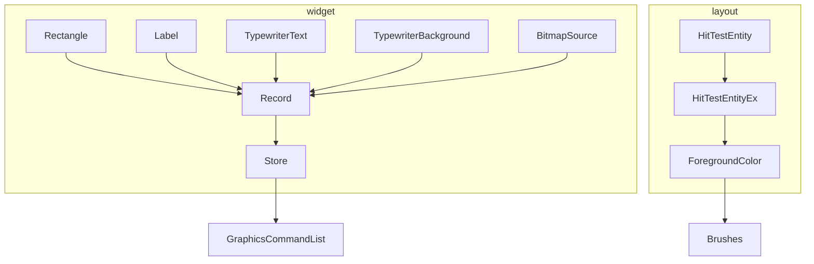
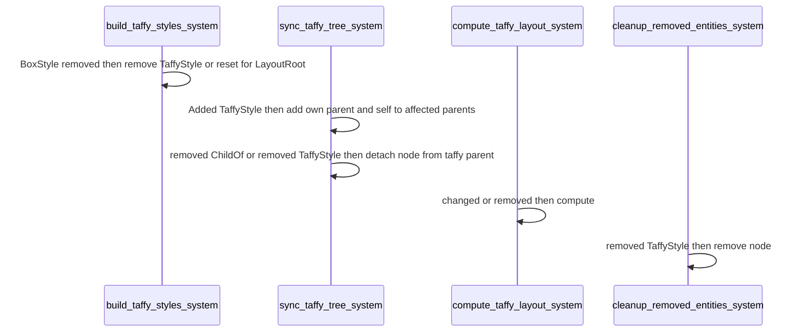
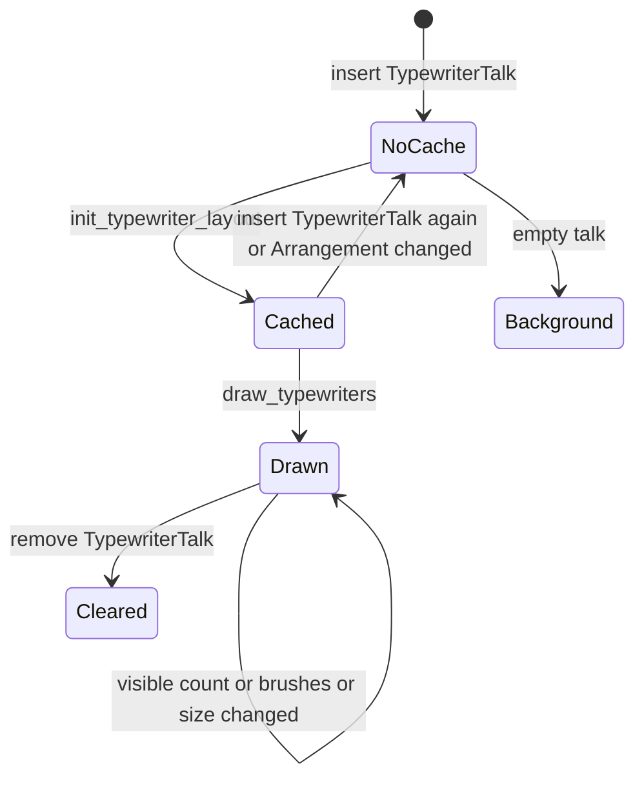
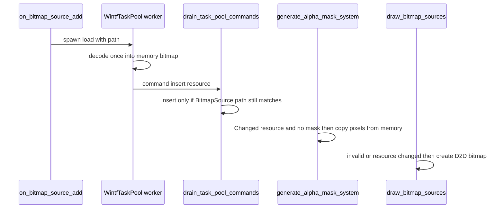

# 設計: audit-wintf-layout-widget

## Overview

**目的**: wintf の置き場所と部品（`crates/wintf/src/ecs/layout/`・`crates/wintf/src/ecs/widget/`）に audit をかけて出た指摘のうち、要件の「指摘の扱い」で直すと決めた 36 件（16 番を除く 1〜37 番）を、いちばん小さな完全な変更で直す。直し終わりは、同じ範囲への 2 度目の audit の 0 件と全体テストの緑で確かめる。

**使い手**: areka の開発者と、wintf を使う areka の各クレート（`areka-emo-present`・`areka-emo-text`・`areka` 本体）と、wintf の例。

**変わること**: 木に入った後で `BoxStyle` を付けた部品・外した部品・消した子の兄弟が、正しく配置し直される。打ち出し表示（`Typewriter`）は、トークを入れ替えると新しい文になり、最後の文字の後ろの待ちと知らせも起き、知らせの宛先が消えていても落ちず、絵文字や 𠮷 でも隠す範囲と待ちの位置がずれない。画像（`BitmapSource`）は付け直すと新しい絵と当たりになり、外すと古い当たりのマスクが消え、解読は裏の作業で 1 回だけになる。描く 5 か所は 1 つの骨組みを通り、失敗は記録に残り、恒久の失敗を毎回やり直さず、止まった表示は描き直さない。当たり判定の規則は 1 か所になる。使われない型・関数・テスト・古い説明が消える。

### Goals
- 要件の「指摘の扱い」で「直す」とした指摘を、3 つの組とも全部直す（3.1）。
- バグと危ない所の直しには、元に戻すと落ちるテストを 1 件につき 1 本以上置く（3.2）。
- 最後の audit で新しい指摘 0 件を、0 件と書いて記録に残す（6.3）。全体テストが緑（6.6）。

### Non-Goals
- 16 番（色分け画像の透明な画素の扱い）。`hit-id-pass` へ申し送り済み（requirements.md）。この spec のテストは透明な画素の答えを固定しない。
- 新しい機能。28 番で「書き換えたら読み直す」形は取らない（要件 3.6）。
- 係の並びの変更（`ecs/world/mod.rs`）・依存の追加・`Cargo.toml`／`Cargo.lock` の変更。

## Boundary Commitments

### This Spec Owns
- `crates/wintf/src/ecs/layout/` と `crates/wintf/src/ecs/widget/` の全ファイルの直しと、その中のテストの足し・直し・消し。
- 新しいファイル 4 つ（下の File Structure Plan）: 描く骨組み `widget/record.rs` とそのテスト・`widget/text/label_tests.rs`・`layout/systems/taffy_systems_tests.rs`。
- 部品の約束のうち、この spec が決めるもの: 命令の列の記録の失敗の扱い（下の「描く骨組み」）・`TypewriterTalk` を入れ替え／外したときの控えと絵の扱い・`BitmapSource` を外したときに外す部品（`BitmapSourceResource` だけ）。
- 範囲の外で直してよいと討議で決めた `crates/wintf/tests/`・`crates/wintf/examples/` の呼び手（13・14・24・25・26・33 番）。

### Out of Boundary
- `crates/wintf/src/ecs/mod.rs`・`ecs/world/mod.rs`（同じウェーブの `wintf-visual-tree` の持ち物・要件 5.9）。係の名前を全部残すので、どちらも書き換えずに済む。
- `ecs/visual/`・`ecs/graphics/`（要件 5.10）。`GraphicsCommandList`・`format_entity_name`・`GraphicsCore` は読むだけ。
- `crates/areka/` 全部（要件 5.11）。例外は、`placement-crate-split` が main に着地し、この枝が main を取り込んだ後の `crates/areka/examples/mock-shell.rs:609`（1 行）と `crates/areka/examples/clickthrough_two_rects.rs:192`（説明）だけ（下の「28 番の扱い」）。
- `crates/wintf/src/com/`（11・17 番は範囲の中で直す）。
- 16 番と、`alpha_mask.rs` の置き換え（`wintf-d2d-composite-rules` の議題）。
- `vendors/`・`Cargo.lock`・`crates/wintf/Cargo.toml`。

### Allowed Dependencies
- bevy_ecs 0.19.1（`RemovedComponents`・`on_insert`／`on_remove`・`try_remove`・`try_insert`・`get_entity`・`bypass_change_detection`・`Or`／`Changed`）・taffy 0.13・windows 0.62.2（D2D・DirectWrite・WIC）。今の `Cargo.toml` のまま。
- テストの PNG は wintf の開発用の依存に在る `image` 0.25 で書く。
- 層の向き: `layout/`（配置・当たり判定）は `widget/` の `Brushes`・`AlphaMask`・`BitmapSourceResource` を読む（今と同じ）。`widget/` は `layout/` の `Arrangement`・`HitTest` と、`graphics/` の公開の型を読む。新しい向きは足さない。

### Revalidation Triggers
- 命令の列の記録の失敗の約束（「命令の列が無い部品にだけ空の列を入れる」）が変わるとき → `audit-wintf-graphics-world` の立ち直り（命令の列を外したら描き直す）を確かめ直す。
- `Arrangement` の付けたときのフックの約束（`GlobalArrangement` は無ければ入れる）が変わるとき → `areka-emo-present`・`areka-emo-text` の当たり判定のテストを確かめ直す。
- `hit_test_entity_ex` の `NamedRegions` の答え（αのマスクを見ない・表に無い所は無名の当たり）が変わるとき → `hit-id-pass` が確かめ直す。
- `ColorMapData::from_image` の失敗の約束（255 色まで・パスは UTF-16 のまま）が変わるとき → `hit-id-pass` が確かめ直す。
- `monitor_systems_transition_tests.rs:32` が見張る `ecs/world/mod.rs` の字面が変わるとき（`wintf-visual-tree` が先に変えうる） → この spec は main を取り込み、テストがその字面に合っていることを確かめる。
- `monitor_systems.rs` の記録の文「Redriving window DPI from updated Monitor (no WM_DPICHANGED required)」が変わるとき → `crates/areka/src/placement/transition_judge_reobservation_tests.rs:74` の実機ログの写し（逐語の fixture）と `monitor_systems_tests.rs:350` が壊れる。この spec は文を変えない（research.md 8.10）。
- `Arrangement` の付けたときのフックが「`GlobalArrangement` が無ければ入れる」をやめるとき → `ecs/graphics/visual.rs:19`・`:135`（`Visual` の付けたときのフックは `Arrangement` だけを入れ、`GlobalArrangement` はこのフックの連鎖に任せる）が確かめ直す。

## Architecture

### Existing Architecture Analysis
- 配置: `Layout` のスケジュールに `build_taffy_styles_system → sync_taffy_tree_system → compute_taffy_layout_system → update_arrangements_system → cleanup_removed_entities_system` が `.chain()` で並ぶ（`ecs/world/mod.rs:243-256`・変えない）。`chain` は命令の反映を間に挟む。
- 描く部品: 四角・文字・打ち出し表示（文と空の背景の 2 本）・画像の 5 か所が、それぞれ同じ骨組み（作る → 的にする → 変換を戻す → `BeginDraw` → 透明で消す → 描く → `EndDraw` → 閉じる）を写して `GraphicsCommandList` を入れる。`audit-wintf-graphics-world` が入れた立ち直り（命令の列が外されたら描き直す `Without<GraphicsCommandList>`）は残す。
- 当たり判定: `hit_test_entity`（本番のクリック・カーソル・ツールチップ）と `hit_test_entity_ex`（領域の名前）が規則を写して持つ。

### Architecture Pattern & Boundary Map

選んだ形は「今の作りのまま、写しを 1 つにまとめて穴を塞ぐ」。足すのは、描く骨組みの関数 2 つ（`widget/record.rs`）・向きの関数 1 つ・モニタの `BoxStyle` の関数 1 つ・前景色の関数 1 つ・打ち出し表示の純な関数 2 つ・画像を解読する関数 1 つ・フック 1 つ（`TypewriterTalk` の `on_insert`）だけ。



- `Record` は `record_command_list`、`Store` は `store_command_list`。`GraphicsCommandList` は `ecs/graphics/` の型（読むだけ）。
- `HitTestEntity` は `hit_test_entity`、`HitTestEntityEx` は `hit_test_entity_ex`、`ForegroundColor` は `Brushes::foreground_color`。

### Technology Stack

| 層 | 選ぶもの・版 | この spec での役目 | 備考 |
|---|---|---|---|
| ECS | bevy_ecs 0.19.1 | 消えた記録・フック・無ければ何もしない命令 | `RemovedComponents` は係ごとに読み位置を持つ（research.md 8.2） |
| 配置 | taffy 0.13 | flexbox の計算 | 形は変えない |
| 描画 | windows 0.62.2（D2D・DirectWrite・WIC） | 命令の列・文の配置・画像 | `CreateBitmapFromSource(WICBitmapCacheOnLoad)` を使う（research.md 8.4） |
| テスト | 標準のテスト・`image` 0.25（開発用の依存に在る） | 決定論のテスト・2×2 の PNG | 依存は足さない |

## File Structure Plan

### Directory Structure
```
crates/wintf/src/ecs/
├── layout/
│   ├── mod.rs                       # 29 番（古い説明・TextLayoutMetrics の説明の行）
│   ├── arrangement.rs               # 13 番（無ければ入れる）・31 番（Default を derive に）
│   ├── box_style.rs                 # 31 番（taffy の既定値の入れ直しを消す）
│   ├── dimension.rs                 # 33 番（Component の derive を外す）
│   ├── metrics.rs                   # 23 番（validate）・24 番（TextLayoutMetrics）・33 番
│   ├── rect.rs                      # 29 番
│   ├── taffy.rs                     # 26 番（逆引きの表と 2 つの関数）・29 番（unsafe impl の根拠の説明）
│   ├── hit_region/
│   │   ├── mod.rs                   # 15・17 番・23 番（ColorMapDef・ColorMapping）
│   │   └── tests/color_map.rs       # 15・17・18 番のテスト
│   ├── hit_test/
│   │   ├── mod.rs                   # 14・25・32・36 番
│   │   ├── tests.rs                 # 14 番のテスト・25 番（PointF へ）・35 番
│   │   └── tests_ex/                # 13 番（回り道を素直に）・14 番（説明と α の分岐のテスト）・35・37 番
│   │       ├── alpha_mask.rs
│   │       ├── alpha_mask_resource.rs
│   │       ├── entity_ex.rs
│   │       └── opacity.rs
│   └── systems/
│       ├── mod.rs                   # 変えない（テストは taffy_systems.rs の中で宣言する）
│       ├── taffy_systems.rs         # 1・2・9・30 番
│       ├── taffy_systems_tests.rs   # 新: 1・2 番のテスト
│       ├── arrangement_systems.rs   # 30 番（伝播前の trace を消す）
│       ├── monitor_systems.rs       # 20 番・31 番（With を消す）
│       └── window_pos_systems.rs    # 30・31 番
└── widget/
    ├── mod.rs                       # record の mod 宣言（pub(crate)）
    ├── record.rs                    # 新: 描く骨組み（21・9・10・30・31 番の共通の所）
    ├── record_tests.rs              # 新: 骨組みのテスト（実 GPU）
    ├── brushes.rs                   # 32 番（foreground_color）・35 番
    ├── shapes/rectangle.rs          # 21・10・9 番・23 番（Color・colors）・29・30・31・35 番
    ├── text/
    │   ├── mod.rs                   # 24 番（TextLayoutResource の再公開を消す）
    │   ├── label.rs                 # 19 番（apply_direction）・24・29・34 番
    │   ├── label_tests.rs           # 新: 19 番のテスト
    │   ├── draw_labels.rs           # 21・10・9・19・24 番
    │   ├── typewriter/mod.rs        # 3・4・22・29・34 番
    │   ├── typewriter/tests.rs      # 3・4・5・6・8・12 番のテスト・35 番
    │   ├── typewriter_ir.rs         # 23 番（empty・total_duration）・35 番
    │   ├── typewriter_layout.rs     # 6・19・9・30 番
    │   └── typewriter_draw.rs       # 5・6・8・9・12・21・29・32 番
    └── bitmap_source/
        ├── bitmap_source.rs         # 7・11・27・28・29 番
        ├── resource.rs              # 22・29 番
        ├── systems.rs               # 7・10・11・21・23・29・30・31 番
        ├── task_pool.rs             # 23 番（drain_and_apply・send_command・is_empty）
        └── tests.rs                 # 7・11 番のテスト・23・35・37 番
```

### 範囲の外で直すファイル（要件 3.4・討議の決め）
討議で書き換えてよいと決めた `crates/wintf/tests/`・`crates/wintf/examples/` の呼び手だけ。持ち主の `audit-wintf-runtime` は完了しているので申し合わせは要らない。
- 13 番: `crates/wintf/tests/drag/window_dragging_filter_test.rs`（上書きを前提にした説明 2 か所）・`crates/wintf/tests/ecs/tree_propagation_test.rs:35-37`（説明）。どちらも既定値を渡しているので答えは変わらない。
- 14 番: 範囲の外の呼び手（`clickthrough`・`cursor`・`tooltip`・`window_proc`・emo-present・emo-text）は関数の形が変わらないので触らない。
- 24 番: `crates/wintf/tests/widget/label_defaults_test.rs`（`TextLayoutResource` の確かめを消す）・`crates/wintf/tests/layout/metrics_test.rs`（`TextLayoutMetrics` の確かめを消す）。
- 25 番: `crates/wintf/examples/taffy_flex_demo/main.rs:88` と `region.rs:15`（`PhysicalPoint` を `PointF` に）。
- 26 番: `crates/wintf/tests/layout/taffy_advanced_test/mapping_management.rs`・`tree_sync.rs`・`crates/wintf/tests/layout/taffy_child_order_test.rs`（逆引きの代わりに `get_node` と taffy の `children` で確かめる）。
- 28 番（前提つき・`placement-crate-split` が main に着地し、この枝が main を取り込んだ後だけ）: `crates/areka/examples/mock-shell.rs:609`（`bitmap.path()` へ 1 行）・`crates/areka/examples/clickthrough_two_rects.rs:192`（説明）。
- 33 番: 値の型を部品として使う所は木の全体で 0 件（research.md 8.8）。組み立てが通らない所が出たら、その呼び手だけを直す。

## System Flows

### taffy の木のつなぎ（1・2 番）



決めたこと:
- **後から付けた `BoxStyle`（1 番）**: 木をつなぐ係は、`Added<TaffyStyle>` の部品ごとに、その親（`ChildOf` を持つなら）と自分（`Children` を持つなら）を「影響を受けた親」に足す。節が前から在る部品（モニタは先に節を作る）でも同じに足す。そのあとの「親ごとに `Children` の順で子の節を並べ直す」は今のまま。読む口 `Query<(Option<&ChildOf>, Has<Children>)>` を 1 つ足す。
- **外した `BoxStyle`（1 番）**: スタイルを作る係が `RemovedComponents<BoxStyle>` を読み、まだ居る部品について、`LayoutRoot` を持てば `TaffyStyle` を既定のスタイルへ戻し（`LayoutRoot` だけの部品と同じ扱い）、持たなければ `TaffyStyle` と `TaffyComputedLayout` を外す。`Arrangement` はその部品の最後の値のまま残す（taffy が配置しない部品の `Arrangement` は使い手の持ち物で、wintf は書かない）。
- **外した節を計算から外す（1・2 番）**: 木をつなぐ係が `RemovedComponents<TaffyStyle>` も読み、その節を taffy の親から外す（`ChildOf` が消えたときと同じ処理）。掃除の係は計算の後に並ぶので、ここで外さないと、その回の計算が消える前の節を含んでしまう（research.md 8.2）。
- **消えたら計算し直す（2 番）**: 計算の係が `RemovedComponents<ChildOf>` と `RemovedComponents<TaffyStyle>` を読む。両方を毎回読み切ってから（`read().count()` を 2 つとも取ってから）、どちらかが 1 以上なら計算する。`is_empty()` だけでは読み位置が進まず、次の回もまた計算してしまう。係の並びは変えない（要件 5.9）。
- **失敗の記録（9 番）**: `create_node`・`set_style`・`set_children`・`remove_child`・`compute_layout`・`layout()` の失敗は `error!`（部品と失敗を載せる）。係には `Err` を返す先が無いので記録だけにし、理由を 1 行書く（`audit-wintf-graphics-world` の 10 番と同じ扱い）。

### 打ち出し表示（3・4・5・6・8・12 番）



決めたこと:
- **入れ替え（3 番）**: `TypewriterTalk` に `on_insert` のフックを足し、`try_remove::<TypewriterLayoutCache>()` を命令で出す（入れるたびに呼ばれる・初めて入れたときは外す物が無いので何もしない）。控えが無くなるので、次の `Draw` で新しいトークの控えが作られる。
- **外し（3・34 番）**: `TypewriterTalk` の外すときのフックは、`Label` の `on_label_remove` と同じく `GraphicsCommandList` を `set_if_neq(GraphicsCommandList::empty())` で空にし、控えを `try_remove` で外す（消すときも安全）。`Typewriter` と `TypewriterLayoutCache` の、ログを出すだけの外すときのフックは消す（34 番）。
- **完了（4 番）**: 完了の判定を「時間表の項目を最後まで進めた（`next_item_index >= timeline.items.len()`）」に変える。全部の文字が出ても、後ろに待ちか知らせが残っていれば `Playing` のまま進める。進み具合（`progress`）の出し方は今のまま。
- **知らせの宛先（5 番）**: `commands.get_entity(target)` で確かめ、居なければ `debug!`（宛先と知らせを載せる）を残して捨てる。居れば `try_insert` で入れる（同じ回のうちに消えた場合も落ちない）。
- **文字の数え方（6 番）**: 次の 2 つの純な関数にする（DirectWrite の配置を持たない）。
  - `typewriter_layout.rs` の時間表の項目を作る関数。トークンの文の UTF-16 の長さ（`encode_utf16().count()`）の終わりに届くまで、クラスタの長さを足しながら `Glyph` を作る。待ちと知らせは今のまま。
  - `typewriter_draw.rs` の隠す範囲を出す関数。見せるクラスタの長さの和から、全部のクラスタの長さの和までを返す（同じなら隠さない）。`chars().count()` は使わない。
- **背景（8 番）**: `draw_typewriter_backgrounds` の問い合わせを `Or<(Changed<Arrangement>, Changed<Brushes>, Changed<TypewriterTalk>, Without<GraphicsCommandList>)>` にし、命令の列は `Option<&mut GraphicsCommandList>` で読む。文の無いトークで、背景の色が無いか大きさがまだ足りないときは、命令の列を `set_if_neq(GraphicsCommandList::empty())` で空にする（文のトークから空のトークへ入れ替えたとき、前の文の絵を残さない）。
- **毎回の描き直し（12 番）**: `update_typewriters` は `bypass_change_detection()` 越しに `update` を呼び、見せる数か状態が変わったときだけ `set_changed()` する。`draw_typewriters` の問い合わせを `Or<(Changed<TypewriterTalk>, Changed<TypewriterLayoutCache>, Changed<Arrangement>, Changed<Brushes>, Without<GraphicsCommandList>)>` に絞る。

### 画像（7・10・11 番）



決めたこと:
- **解読を 1 回に（11 番）**: `bitmap_source/systems.rs` に、`load_bitmap_source` が返す変換器を `CreateBitmapFromSource(変換器, WICBitmapCacheOnLoad)` でメモリの画像にして `IWICBitmapSource` として返す関数を置き、裏の作業はそれを呼ぶ。`com/wic.rs` は変えない。UI スレッドの `copy_pixels` と `CreateBitmapFromWicBitmap` はメモリを読むだけになる。αのマスクの係の「`IWICBitmapSource` は Send でないため同期で取る」の説明を中身に合わせる（`BitmapSourceResource` は手書きの `Send` を持つ・UI で読むのはメモリの写し）。
- **付け直し（7 番）**: 描く係は `Ref<BitmapSourceResource>` で読み、`!graphics.is_valid() || resource.is_changed()` のとき D2D の画像を作り直す。αのマスクの係は `Changed<BitmapSourceResource>` にし、マスクがまだ無いものだけ作る（今の確かめのまま）。マスクを入れる命令は `bypass_change_detection()` 越しに入れる（入れたことで描く係が D2D の画像をもう一度作らないため）。
- **古い読み込みを捨てる（7 番）**: 裏の作業の命令は、部品がまだ `BitmapSource` を持ち、その `path` が読み込んだ `path` と同じときだけ `BitmapSourceResource` を入れる。違えば `debug!` を残して捨てる（外した直後や別の絵に付け直した後に、前の読み込みが遅れて着いた場合）。αのマスクの命令も、今の `BitmapSourceResource` の画像が、マスクを作った画像と同じ物（COM の番地を `usize` で持って比べる）のときだけ入れる。
- **外し（7 番・議題 3）**: 外すときのフックは、命令の列を空にし（今のまま）、`BitmapSourceGraphics` を `invalidate()` し、`BitmapSourceResource` を `try_remove` で外す。`HitTest` は残す（利用者が入れたものかもしれない・マスクが無ければ当たりは矩形に戻る）。
- **フックの二重の挿入（27 番）**: 付けたときのフックは「無ければ入れる」を 3 つ（`Visual`・`BitmapSourceGraphics`・`HitTest::alpha_mask()`）並べるだけにする。

## Requirements Traceability

| 要件 | 中身 | 受け持つ所 |
|---|---|---|
| 1.1 | 範囲のファイルを列挙して数を記録 | research.md 1 節（済み）・2 度目の audit の記録 |
| 1.2 | 後から足されたファイルも範囲に入れる | 2 度目の audit の前に `ecs/` を測り直す（新しいファイル 4 つも含める） |
| 1.3 | 範囲を全部読む | research.md 1 節（済み）・2 度目の audit も全部読む |
| 1.4 | 範囲の外を見直さない | Boundary Commitments |
| 2.1 | 範囲だけに audit | research.md（済み）・2 度目の audit |
| 2.2 | 上限なしで全件 | research.md（済み）・2 度目の audit |
| 2.3 | 読まなかった所を残さない | research.md（済み）・2 度目の audit |
| 2.4 | 番号と組をそのまま | 本書の「指摘ごとの直し方」は audit の番号で書く |
| 2.5 | 直し済みを数え直さない | research.md 2 節（済み）。本書はその 5 件に触らない |
| 2.6 | `Arrangement` のフックの判断 | 13 番（指摘にする・直す） |
| 2.7 | 3 ファイルは直した後の形 | 10・21 番は `audit-wintf-graphics-world` の `Without<GraphicsCommandList>` を残したまま直す |
| 2.8 | 討議で直す対象を確定 | requirements.md「指摘の扱い」（済み） |
| 3.1 | 3 つの組とも全部直す | 「指摘ごとの直し方」の全行 |
| 3.2 | バグと危ない所に元に戻すと落ちるテスト | Testing Strategy の表（1〜8・10〜15・17〜19・22 番。9 番は記録を足すだけで分かれ目を持たない・16 番は直さない） |
| 3.3 | 消す前にツリー全体で確かめる | 「消すものの確かめ」・research.md 8.8 |
| 3.4 | 形が変わる関数の呼び出し元を全部直す | 「範囲の外で直すファイル」と各行の「呼び出し元」 |
| 3.5 | 走っている spec の持ち物は申し合わせてから | 該当なし（範囲の外で触るのは完了した `audit-wintf-runtime` の持ち物だけ） |
| 3.6 | 新しい機能を足さない | Non-Goals（28 番は読み直しの形を取らない） |
| 4.1 | 残してよいのは 3 種類だけ | 16 番（⑶・裁定済み）。`colors` の `#[deprecated]` は消す（議題 6 の裁定） |
| 4.2 | 残す指摘は議題にして裁定 | requirements.md（済み）・2 度目の audit で新しく出たら議題へ |
| 4.3 | SSP・ukadoc に関わるなら ukadoc で確かめる | 16 番だけが該当し、申し送り済み。ほかの直しは wintf 独自の部品の中 |
| 4.4 | `hit_region/`・`alpha_mask.rs` は消さずに申し送る | 15・17・18 番は直して試す（消さない）。`alpha_mask.rs` には触らない。`ColorMapDef`・`ColorMapping` は討議で消すと決めた |
| 4.5 | 触らない約束に当たる指摘は議題へ | 28 番（設計の調べで見つけた・「相手の着地の後へ回す」を取る・「28 番の扱い」）。2 番は係の中で直す |
| 4.6 | 残す・後へ回す指摘を記録 | research.md（16 番・8.11 に 28 番の後へ回す一歩と理由と答え） |
| 5.1 | 1,000 行を越えない | 「行数の見込み」 |
| 5.2 | 決定論のテスト | Testing Strategy（時刻は引数で渡す・乱数なし） |
| 5.3 | 失敗はエラーのログと呼び出し元への失敗 | Error Handling |
| 5.4 | 終了の道は正規のまま | 終了の道には触らない（フックの直しは部品の外しだけ） |
| 5.5 | 実機の根と一時フォルダは `target` の下 | 15・17・18 番のテストの PNG は `target/hit_region_color_map_test/` に置く |
| 5.6 | GPU のテストは実 GPU | 描く係のテストは実のハードウェアの装置（`GraphicsCore::new()`） |
| 5.7 | 文字化けはコンソールで逃げない | 道具の出力に触らない |
| 5.8 | 依存を足さない | Technology Stack |
| 5.9 | `ecs/mod.rs`・`ecs/world/mod.rs` に触らない | Out of Boundary・research.md 8.8（名前を全部残す） |
| 5.10 | `ecs/visual/`・`ecs/graphics/` に触らない | Out of Boundary |
| 5.11 | `crates/areka/` と `placement-crate-split` の範囲に触らない | Out of Boundary（相手の着地の後の 2 か所だけ・「28 番の扱い」） |
| 5.12 | areka が使う公開の形を変えない | 28 番だけが当たる。ウェーブのあいだは `path()` を足すだけにし、欄を非公開にするのは相手の着地の後。ほかの直しは areka の参照 0（research.md 8.8） |
| 6.1 | 直し終えたら 2 度目の audit | タスク「2 度目の audit」 |
| 6.2 | 新しい指摘も直すか裁定へ | 同上 |
| 6.3 | 0 件を明記 | 同上（research.md に「新しい指摘 0 件」と書く） |
| 6.4 | 5 回目で打ち切る案 | 同上（5 回目になったら開発者へ知らせる） |
| 6.5 | 打ち切りの記録 | 同上 |
| 6.6 | 全体テストが緑 | タスク「全体テスト」 |
| 6.7 | 20 を越えそうなら 2 本目の案 | 討議で示して退けた（議題 1）。本書の見立ては 21 タスク |

## Components and Interfaces

### 一覧

| 部品 | 置き場 | 役目 | 要件 |
|---|---|---|---|
| 描く骨組み | `widget/record.rs` | 命令の列を記録し、結果を部品へ入れる | 3.1・3.2・5.3 |
| 向きの設定 | `widget/text/label.rs` | 4 つの向きを書式へ設定する | 3.1・3.2・5.3 |
| 時間表と隠す範囲 | `widget/text/typewriter_layout.rs`・`typewriter_draw.rs` | UTF-16 とクラスタで数える | 3.1・3.2 |
| 画像の解読 | `widget/bitmap_source/systems.rs` | 裏で 1 回だけ解読する | 3.1・3.2 |
| 前景色 | `widget/brushes.rs` | 前景色を既定へ落とす式を 1 つに | 3.1 |
| 当たり判定の正本 | `layout/hit_test/mod.rs` | `hit_test_entity_ex` を 1 本の規則に | 3.1・3.2 |
| モニタの `BoxStyle` | `layout/systems/monitor_systems.rs` | 3 か所の組み立てを 1 つに | 3.1 |

### widget

#### 描く骨組み（`widget/record.rs`）

```rust
/// 透明の色（四角・文字・打ち出し表示が使っていた 3 つの写しを 1 つに）。
pub(crate) const TRANSPARENT: D2D1_COLOR_F;

/// 共有の描く文脈で命令の列を 1 本記録する。
/// 作る → 的にする → 変換を戻す → BeginDraw → 透明で消す → draw → EndDraw → 閉じる。
pub(crate) fn record_command_list(
    dc: &ID2D1DeviceContext,
    draw: impl FnOnce(&ID2D1DeviceContext) -> windows::core::Result<()>,
) -> windows::core::Result<ID2D1CommandList>;

/// 記録の結果を部品へ入れる。
pub(crate) fn store_command_list(
    commands: &mut Commands,
    entity: Entity,
    name: Option<&Name>,
    had_list: bool,
    recorded: windows::core::Result<ID2D1CommandList>,
    what: &'static str,
);
```
- `record_command_list` の約束: `BeginDraw` の後は、`draw` が失敗しても必ず `EndDraw` を呼ぶ。返す失敗は `draw` の失敗を先に、無ければ `EndDraw`、`close` の順。変換を戻すのは `SetTransform(&Matrix3x2::identity())` に揃える（`set_transform` の 1 か所も同じ呼び方へ）。画像の命令の列にも透明の消しが入る（ほかの 4 か所と同じ。部品ごとの描画面なので見た目は変わらない）。
- `store_command_list` の約束（10 番）: 成功なら `GraphicsCommandList::new` を入れる。失敗なら `warn!`（`format_entity_name(entity, name)`・失敗・`what` を載せる。名前の文字列は失敗のときだけ作る＝30 番）を 1 行残し、`had_list` が偽のときだけ `GraphicsCommandList::empty()` を入れる。空の列が入った部品は `Without<GraphicsCommandList>` から外れ、次の変化（各係の `Changed<…>`）か立ち直り（命令の列が外される）まで、やり直さない。前から命令の列を持っていた部品は、その絵を残す（一時の失敗で絵を消さない）。
- 新しい命令の列は COM の番地が必ず違うので、今の「同じなら入れない」の比べ（31 番）は消える。
- 使う所: `draw_rectangles`・`draw_labels`・`draw_typewriters`・`draw_typewriter_backgrounds`・`draw_bitmap_sources`。各係の問い合わせに `Option<&GraphicsCommandList>`（背景の係は `Option<&mut>`）を持たせて `had_list` を渡す。
- D2D の画像が作れない（11・10 番の 16,384 を越える画像）ときも、`create_d2d_bitmap(..).and_then(|b| record_command_list(..))` の形で同じ道を通す。

#### 向きの設定（`widget/text/label.rs`）

```rust
/// 読む向きと行の向きを書式へ設定する。DirectWrite は組み合わせを配置を使う所で確かめる
/// （research.md 8.3）ので、設定の順はこのままでよい。
pub(crate) fn apply_direction(
    format: &IDWriteTextFormat,
    direction: TextDirection,
) -> windows::core::Result<()>;
```
- `draw_labels` と `init_typewriter_layout` から呼ぶ。失敗は `warn!`（部品・向き・失敗）。打ち出し表示は続けて揃え（右から左の横書きだけ `TRAILING`、ほかは `LEADING`・段落は `NEAR`）を設定し、失敗は同じく `warn!`。
- `draw_labels` の `SetWordWrapping` と `GetMetrics`、打ち出し表示の `GetMetrics` の失敗も `warn!` を残してその部品を飛ばす（原点 0 のまま描かない）。

#### 時間表と隠す範囲（6 番）

```rust
// typewriter_layout.rs
/// トークン列とクラスタの長さ（UTF-16）から時間表の項目を作る。
pub(crate) fn timeline_items(
    tokens: &[TypewriterToken],
    cluster_lengths: &[u16],
    default_char_wait: f64,
) -> Vec<TimelineItem>;

// typewriter_draw.rs
/// 見せるクラスタ数から、透明にする範囲（UTF-16 の開始と長さ）を返す。隠す所が無ければ None。
pub(crate) fn hidden_text_range(cluster_lengths: &[u16], visible_clusters: u32) -> Option<(u32, u32)>;
```
- `convert_to_timeline` は `get_cluster_metrics()` の `length` を並べて `timeline_items` に渡す。`TypewriterTimeline` は `full_text`・`items`・`total_cluster_count` を持つ（23 番で `total_duration` と `empty()` を消す）。
- 描く係は `hidden_text_range` の答えで `SetDrawingEffect` を当てて外す。透明の筆が作れないときは全文を描く回り道をやめ、失敗として記録の道へ返す（9 番）。`SetDrawingEffect` の失敗も同じ。
- 「横書きは `-left`・縦書きは `(0,0)`」の説明（29 番）は、コードの今の答えに合わせて書き直す。

#### 画像の解読（11 番・`widget/bitmap_source/systems.rs`）

```rust
/// 画像を読み、裏の作業の中で 1 回だけ解読してメモリの画像にする。
pub(crate) fn load_decoded_bitmap(
    factory: &IWICImagingFactory2,
    path: &Path,
) -> windows::core::Result<IWICBitmapSource>;
```
- 中身は `load_bitmap_source(factory, path)` → `CreateBitmapFromSource(&converter, WICBitmapCacheOnLoad)` → `cast::<IWICBitmapSource>()`。失敗は呼び手（裏の作業）が今のとおり `warn!` を残す。
- `pub use crate::com::wic::load_bitmap_source;` の再公開は残す（`crates/wintf/tests/` が使う）。

#### 前景色（32 番・`widget/brushes.rs`）

```rust
impl Brushes {
    /// 前景色。色が決まっていなければ既定の前景色。
    pub fn foreground_color(&self) -> D2D1_COLOR_F;
}
```
- 足すだけの公開の関数（要件 5.12 に当たらない）。四角・文字・打ち出し表示・当たり判定から呼ぶ。`brushes.rs:373-401` の式を写したテストは、この関数を試す形に書き換える。

### layout

#### 当たり判定の正本（14・25・36 番）
- `hit_test_entity(world, entity, point: PointF) -> bool` を `!matches!(hit_test_entity_ex(world, entity, point), RegionHit::Miss)` の 1 行にし、写しの約 40 行を消す。`NamedRegions` の部品は αのマスクを見ず、今の `hit_test_entity_ex` のとおり矩形の中なら当たり、領域の名前は表から引く（議題 2）。
- `Bounds` の分岐の前景の α は `Brushes::foreground_color().a`（部品に `Brushes` が無ければ既定の前景色）。
- `pub type PhysicalPoint = PointF;` を消し、関数の引数を `PointF` と書く（型は同じなので呼び手の答えは変わらない）。
- 領域の表が無い `NamedRegions` の部品の記録は `debug!` に下げる（当たり判定は `&World` しか持たず印を書けない・research.md 8.9）。

#### モニタの `BoxStyle`（20 番）

```rust
/// モニタの物理の大きさと左上から、絶対配置の BoxStyle を作る。
fn monitor_box_style(monitor: &Monitor) -> BoxStyle;
```
- 起動（`initialize_layout_root`）と新しいモニタ（`detect_display_change_system`）はこれをそのまま使う。値の更新（`update_monitor_layout_system`）は今と同じく `size` と `inset` だけをこれから写す。
- `monitor_systems_transition_tests.rs` が数える 4 つの字面は変わらない（research.md 8.7）。
- `monitor_systems_transition_tests.rs:32` は `include_str!("../../world/mod.rs")` で `ecs/world/mod.rs` の字面を見張る。同じウェーブの `wintf-visual-tree` が先にその行を変えたなら、この spec は main を取り込み、テストがその字面に合ったままであることを確かめるだけにする（`ecs/world/mod.rs` には触らない・要件 5.9）。
- 記録の行は動かすだけで文を変えない。`[detect_display_change_system] Redriving window DPI from updated Monitor (no WM_DPICHANGED required)`（`monitor_systems.rs:564`）は `crates/areka/src/placement/transition_judge_reobservation_tests.rs:74` が逐語の fixture に、`monitor_systems_tests.rs:350` が確かめに使う（research.md 8.10）。

## 指摘ごとの直し方

| 番号 | 直し方（消すもの・まとめる所） | 呼び出し元・範囲の外 |
|---|---|---|
| 1 | 「taffy の木のつなぎ」の後から付けた・外した `BoxStyle` と、外した節を計算から外す所 | なし（係の中だけ・登録の行は変わらない） |
| 2 | 計算の係が 2 つの消えた記録を読み切る（上の流れ） | なし。`ecs/world/mod.rs` の並びは変えない |
| 3 | `TypewriterTalk` の `on_insert` と外すときのフック（上の流れ）。型の説明（「トーク追加時に生成」「完了・クリア時に remove」）を中身に合わせる | `crates/areka/examples/mock-shell.rs`・`crates/wintf/examples/typewriter_demo.rs` は 1 度入れるだけで形は変わらない |
| 4 | 完了の判定を時間表の終わりに | なし |
| 5 | `get_entity` で確かめて `try_insert` | なし |
| 6 | `timeline_items` と `hidden_text_range`（上の節） | なし |
| 7 | 描く係の作り直しの条件・マスクの係の `Changed`・古い読み込みを捨てる・外すときのフック（上の流れ） | `HitTest` は外さない（議題 3） |
| 8 | 背景の係の問い合わせと空にする所（上の流れ） | なし |
| 9 | taffy の 6 か所は `error!`。描く 5 か所は骨組みの `store_command_list` で `warn!` が揃う。向き・揃え・`SetWordWrapping`・`GetMetrics`・`SetDrawingEffect`・筆は `warn!`。`systems.rs:208` の `EndDraw` は骨組みが返す | ギャップ分析で指摘にしなかった `tx.send` と後始末の `EndDraw` は骨組みの中に入るか、今のまま |
| 10 | `store_command_list` の空の列（上の節） | `ecs/graphics/` の立ち直りの係は変えない |
| 11 | `load_decoded_bitmap`（上の節）・`systems.rs:355`・`mod.rs:3-4` の説明 | `com/wic.rs` は変えない |
| 12 | `update` の変化の印と描く係の絞り（上の流れ） | なし |
| 13 | `on_arrangement_add` を `insert_if_new((GlobalArrangement::default(), ArrangementTreeChanged))` に（`LayoutRoot` のフックと同じ考え方）。`GlobalArrangement` が無いときは今と同じく入れる（`ecs/graphics/visual.rs:19`・`:135` の `Visual` のフックがこの連鎖に頼る・research.md 8.10）。変わるのは束で渡した値を上書きしなくなる所だけ。`tests_ex/entity_ex.rs:19-20`・`tests_ex/opacity.rs:32-37` の回り道を素直な形に戻す | 範囲の外のテスト 2 ファイルの説明（上の「範囲の外で直すファイル」） |
| 14 | 当たり判定の正本（上の節）。`tests_ex/alpha_mask_resource.rs:5`・`:127-131`・`:263-264` の説明を、実際の道（`hit_test` → `hit_test_entity`）に合わせる | 呼び手の形は変わらない |
| 15 | `from_image` で対応が 255 個を越えたら `error!` を残し、`Error::new(E_INVALIDARG, …)` を返す（戻りの型は今のまま）。説明に「255 色まで」と書く | なし |
| 17 | `HSTRING::from(image_path)`（`com/wic.rs:35` と同じ） | なし |
| 18 | 読み込みのテストを足す（Testing Strategy） | なし |
| 19 | `apply_direction`（上の節） | なし |
| 20 | `monitor_box_style`（上の節）。記録の行（`debug!` の文と欄）には触らない。特に「Redriving window DPI from updated Monitor (no WM_DPICHANGED required)」の文は 1 字も変えない | `crates/areka/src/placement/transition_judge_reobservation_tests.rs:74` が逐語で使う（触らない） |
| 21 | 描く骨組み（上の節）。透明の色の定数 3 つを `record::TRANSPARENT` 1 つに | なし |
| 22 | `TypewriterLayoutCache`・`BitmapSourceGraphics` の `unsafe impl Send/Sync` と説明を消す。`test_typewriter_layout_cache_is_send_sync` は残す（自動の導出を試す意味を持つ） | `GraphicsCommandList` などの慣習は `ecs/graphics/` の持ち物で変えない |
| 23 | 消す: `InsertBitmapSourceResource`（`unsafe impl Send` ごと）・`test_asset_path`・`rectangle.rs` の `Color` 別名と `colors`（`#[deprecated]` ごと）とそのテスト・`LayoutScale::validate`・`task_pool.rs` の `drain_and_apply`・`send_command`・`is_empty` とそれを試すテスト（`bitmap_source/tests.rs:72-81`）・`ColorMapDef`・`ColorMapping`・`TypewriterTimeline::empty`・欄 `total_duration`。wintf の `serde` 機能は残す（`Shape`・`ShapeRegion` が使う） | 参照 0（research.md 2 節・8.8）。`Cargo.toml`・`Cargo.lock` は変えない |
| 24 | `TextLayoutResource`・`TextLayoutMetrics`・入れる行・`on_text_layout_remove`・`text/mod.rs` の再公開を消す。`layout/mod.rs` の説明の行も直す | `crates/wintf/tests/widget/label_defaults_test.rs`・`crates/wintf/tests/layout/metrics_test.rs` |
| 25 | `layout` の別名を消す（上の節） | `crates/wintf/examples/taffy_flex_demo/main.rs`・`region.rs`・範囲の中のテスト |
| 26 | `node_to_entity`・`get_entity`・`verify_mapping_consistency` を消す | 範囲の外のテスト 3 ファイル |
| 27 | 付けたときのフックを「無ければ入れる」3 つに | なし |
| 28 | `path()` を足し、範囲の中の読み手を替える。欄を非公開にするのは前提つき（下の「28 番の扱い」） | `crates/areka/examples/mock-shell.rs:609`（前提つき・1 行） |
| 29 | 古い説明を中身に合わせて直すか消す（research.md の 29 番の一覧の全部。taffy の `unsafe impl` の根拠は「`TaffyTree<()>` は calc のポインタを一度も読まない」へ・版は 0.13 へ） | なし |
| 30 | `format_entity_name` は失敗のときだけ作る（taffy・窓の位置・四角・画像）。`init_typewriter_layout` の数える `debug!` と `arrangement_systems.rs:61-82` の伝播前の `trace!` を消す。`monitor_systems.rs` の記録の行は削る対象にしない（「Redriving window DPI from updated Monitor」の行は `crates/areka/` の fixture が逐語で使う） | なし |
| 31 | `box_style.rs:178-183`・`:195-196` の既定値の入れ直し・`Arrangement` の手書きの `Default`（derive へ）・`window_pos_systems.rs:140` の重なる `use`・`monitor_systems.rs:212` の `With<Monitor>`・描く 2 か所のいつも真の比べ（骨組みで消える）を消す | なし |
| 32 | `Brushes::foreground_color`（上の節） | 足すだけ |
| 33 | `Dimension`・`LengthPercentageAuto`・`LengthPercentage`・`Rect<T>`・`LayoutScale` の `Component` の derive を外す | 部品として使う所は 0 |
| 34 | ログを出すだけの外すときのフックを消す（`Typewriter`・`TypewriterLayoutCache`・`TextLayoutResource`）。`TypewriterTalk` のフックは 3 番で中身を持つ | なし |
| 35 | 消す: `typewriter_ir.rs:128-246`・`typewriter/tests.rs:15-35`・`rectangle.rs:298-335`・`brushes.rs:195-231`・`:285-371`・`bitmap_source/tests.rs:123-136`・`:153-170`・`hit_test/tests.rs:25-46`・`tests_ex/alpha_mask.rs:9-13`・`:33-52`・`:75-79` | なし |
| 36 | `debug!` に下げる（上の節） | なし |
| 37 | `bitmap_source/tests.rs:11-21`・`tests_ex/alpha_mask_resource.rs:197-209` の COM の初期化を、入れたときだけ後始末し、`RPC_E_CHANGED_MODE` のほかの失敗は落とす形に（`audit-wintf-runtime` の 130 番と同じ） | なし |

### 28 番の扱い（要件 4.5・案 ⒜＝相手の着地の後へ回す）

- 討議の決め: 「欄を読み取り専用にする（`path()` を足し欄を非公開に）」。
- 設計の調べで見つけたこと: `crates/areka/examples/mock-shell.rs:609` が `bitmap.path` を読む（research.md 8.8）。欄を非公開にすると、このウェーブでは触れない `crates/areka/` の例が組み立たなくなる。要件 5.12 は「足すだけで直せないなら要件 4.5 の議題に回す」と決めている。
- 取る道（取りまとめ役の答え・2026-11-06。設計の討議で開発者に確かめる）: 要件 4.5 の「相手の着地の後へ回す」。開発者は `wintf-visual-tree` と `placement-crate-split` をこの spec より先に実装する見込みなので、この spec の実装は自然に `placement-crate-split` の着地の後になる。
  - **今の段で行う（前提なし）**: `pub fn path(&self) -> &str` を足す（足すだけ）。範囲の中の読み手（`bitmap_source.rs:93`・`bitmap_source/tests.rs:127`・`:135`）を `path()` に替える。
  - **前提つきで行う**: `placement-crate-split` が main に着地し、この枝が main を取り込んだ後にだけ、欄 `path` を非公開にし、`crates/areka/examples/mock-shell.rs:609` を `bitmap.path()` に替える。同じタスクで `crates/areka/examples/clickthrough_two_rects.rs:192` の説明を、7 番の後の条件（`Changed<BitmapSourceResource>` ＋ `With<HitTest>` ＋ `HitTestMode::AlphaMask`・マスクがまだ無いとき）に合わせる。
  - **前提が満たされていないとき**: そのタスクは手を付けずに止まり、開発者へ尋ねる（`crates/areka/` には触らない）。
- 要件 5.11・5.12 との関係: 両要件は「同じウェーブのあいだ」の約束で、上の前提（相手の着地と main の取り込み）が満たされた後の 2 ファイルの書き換えは、この約束に当たらない。

### 消すものの確かめ（要件 3.3）
ツリー全体（テスト・例・fixture・設定・文字列の参照）で確かめた結果（research.md 2 節の 23・24・26・33 番と 8.8）:
- 参照 0: `InsertBitmapSourceResource`・`ColorMapDef`・`ColorMapping`・`LayoutScale::validate`・`colors`・`drain_and_apply`・`send_command`・`TypewriterTimeline::empty`・`total_duration`・範囲の中の `test_asset_path`（`crates/wintf/tests/com/common/mod.rs` の同じ名前は別物）。
- テストだけ: `TextLayoutResource`（`label_defaults_test.rs`）・`TextLayoutMetrics`（`metrics_test.rs`）・taffy の逆引き（3 ファイル）・`is_empty`（`bitmap_source/tests.rs:72-81`）。
- `ecs/mod.rs`・`ecs/world/mod.rs` が名指す名前は 1 つも消さない。

### 行数の見込み（要件 5.1）
- 一番大きい `layout/hit_test/mod.rs` は 632 → 約 580（写しを消す）。`widget/text/typewriter/tests.rs` は 263 → 約 480（足すテスト）。`typewriter_draw.rs` 377 → 約 320。`bitmap_source/systems.rs` 389 → 約 330。新しいファイルはどれも 250 行未満。どれも 1,000 行から遠い。

## Error Handling

- **係とフック**: `Err` を返す先が無いので、失敗は記録だけにする（要件 5.3 の「呼び出し元へ失敗として返す」は返す先の在る関数に当てる）。taffy の失敗は `error!`、描く所の失敗は `warn!`（今の描く係の記録と同じ重さ）。理由を各所に 1 行書く。
- **返す先の在る関数**: `record_command_list`・`apply_direction`・`load_decoded_bitmap`・`ColorMapData::from_image` は `windows::core::Result` を返し、呼び手が 1 回記録する。`from_image` の 255 色越えは `error!` を残してから返す。
- **消えていた相手**: 5 番の宛先・7 番の古い読み込みとマスクは、捨てたことを `debug!` に残す（相手が消えるのは普通の流れで、失敗ではない）。
- **恒久の失敗**: 空の命令の列を入れて、次の変化か立ち直りまでやり直さない（毎回の `warn!` を止める）。

## Testing Strategy

元に戻すと落ちるテスト（要件 3.2）。どれも決定論（時刻は引数で渡し、乱数を使わない）。GPU を使うものは実のハードウェアの装置（`GraphicsCore::new()`）で回す。テストの一時ファイルはワークツリーの `target/` の下に置く。

| 番号 | テスト | 置き場 | 元に戻すと |
|---|---|---|---|
| 1 | 親の下へ `BoxStyle` 無しで子を作り、次の回に子へ `BoxStyle` を付けると、子の配置の大きさが付けた値になる。親へ後から付けた場合も同じ。`BoxStyle` を外すと `TaffyStyle` が外れ、残った兄弟が詰まる | `layout/systems/taffy_systems_tests.rs` | 子の大きさが 0 のまま・古い寸法のまま |
| 2 | 横に 3 つ並べた flex の真ん中を消すと、その回のうちに 3 つ目の位置が詰まる。消した後の次の回は計算しない（読み位置が進む） | 同上 | 3 つ目が元の位置に残る・毎回計算する |
| 3 | 文のトークを入れて控えができた後、別の文のトークを入れ直すと控えが外れ、作り直した控えの文が新しい文になる。トークを外すと命令の列が空になる | `widget/text/typewriter/tests.rs`（控えは `GraphicsCore` の DirectWrite で作る・実 GPU） | 古い文のまま・絵が残る |
| 4 | `[Text("おしまい"), Wait(1.0), FireEvent{..}]` の時間表で、全部の文字が出た時刻には `Playing` のまま、1 秒後に知らせが返って `Completed` | 同上（CPU だけ） | 文字が出た時点で完了し、知らせが来ない |
| 5 | 知らせの宛先を消してから `update_typewriters` を回しても落ちない | 同上（CPU だけ） | 命令の失敗で panic |
| 6 | `timeline_items`: 「𠮷野家です」（クラスタの長さ 2,1,1,1,1）で `Glyph` が 5 つ。「❤️ok」（2 文字 1 クラスタ）＋待ち＋「!」で、「!」の `Glyph` が待ちの後ろに来る。`hidden_text_range`: 𠮷を 1 つ見せたら隠す範囲は (2, 4) | 同上（CPU だけ） | 項目の数と位置がずれる |
| 7 | 画像を付けて描き、外して別の画像を付け直すと、D2D の画像が作り直される（番地が変わる）。外しただけの部品から `BitmapSourceResource` が消え、`HitTest` は残る。遅れて着いた前の読み込みは入らない | `widget/bitmap_source/tests.rs`（実 GPU） | 古い画像のまま・古いマスクで当たる |
| 8 | 背景色つきの空のトークの大きさを変えると命令の列が入れ替わる。文のトークから空のトーク（背景色なし）に入れ替えると命令の列が空になる | `widget/text/typewriter/tests.rs`（実 GPU） | 最初の大きさのまま・前の文の絵が残る |
| 10 | 必ず失敗する記録を `store_command_list` に渡すと空の列が入り、2 回目の係で対象にならない。前から列を持つ部品の列は入れ替わらない | `widget/record_tests.rs`（実 GPU） | 毎回やり直す・絵が消える |
| 11 | `load_decoded_bitmap` の答えが `IWICBitmap` へ `cast` できる（変換器はできない） | `widget/bitmap_source/tests.rs`（COM だけ） | 変換器のまま返る |
| 12 | 打ち終えて止まった表示で、2 回目の `update_typewriters` が変化の印を立てず、`draw_typewriters` が命令の列を入れ替えない | `widget/text/typewriter/tests.rs`（実 GPU） | 毎回入れ替わる |
| 13 | `Arrangement` と値を入れた `GlobalArrangement` を束で入れると、渡した値が残る | `layout/hit_test/tests_ex/entity_ex.rs`（回り道を戻したテスト） | 既定値に変わる |
| 14 | `NamedRegions` の部品に、点の所が透明な `AlphaMaskResource` を付けると、`hit_test_in_window` は当たり、`hit_test_in_window_ex` も当たる。`_ex` の `AlphaMask` の分岐を通るテストを 1 本 | `layout/hit_test/tests.rs` | クリックは素通し・領域は当たりで食い違う |
| 15 | 256 色の対応を渡すと `from_image` が失敗する | `layout/hit_region/tests/color_map.rs` | 番号が回って 1 個目の名前を返す |
| 17 | 対のないサロゲートを含む名の PNG を読める | 同上（`target/hit_region_color_map_test/`） | 名が化けて開けない |
| 18 | 2×2 の不透明な PNG（赤・緑・青・白）を `image` で書いて読み、各画素の名前（白は名前なし）と寸法を確かめる。透明な画素は使わない（16 番の答えを固定しない） | 同上 | B と R の入れ替えなどで答えが変わる |
| 19 | 4 つの向きで `apply_direction` の後に読む向き・行の向きを読み返すと決めた組み合わせになり、その書式で作った配置の `GetMetrics` が通る | `widget/text/label_tests.rs`（DirectWrite だけ） | 組み合わせが崩れる・配置が断られる |
| 22 | 手書きの `unsafe impl` を消した後も `test_typewriter_layout_cache_is_send_sync` が通る（自動の導出を試す） | `widget/text/typewriter/tests.rs`（今のテスト） | 後で `Send` でない欄を足すと組み立たない |

- 20・21・23〜37 番は振る舞いを変えない直し（まとめる・消す・説明）で、今のテストが緑のままであることで確かめる。21 番は骨組みのテスト（10 番の行）も通す。
- 記録の文を守る確かめ: 20・30 番の後も `monitor_systems_tests.rs:350`（「Redriving window DPI from updated Monitor」が出る）が緑で、`crates/areka/src/placement/transition_judge_reobservation_tests.rs` が全体テストで緑であること。13 番の後も、`Visual` だけを付けた部品に `GlobalArrangement` が入ること（`crates/wintf/tests/layout/component_hooks_test.rs` など今のテストで見る）。
- 前後の確かめ: 1・2 番は配置の答えが変わる（正しくなる方へ）ので、`crates/wintf/tests/layout/` の配置のテストを前後で回す。7・10・11・12・21 番は描画の流れに触るので、`audit-wintf-graphics-world` の立ち直りのテスト（`crates/wintf/tests/graphics/device_lost_recovery_test.rs` など）と `crates/wintf/tests/widget/bitmap_source_integration_test.rs` を前後で回す。13 番は emo-present・emo-text の当たり判定のテストを全体テストで見る。

## Performance & Scalability
- 12 番で、止まった打ち出し表示の毎回の描画と描画面の更新が無くなる（今は毎秒 60 回・測ってはいない）。
- 11 番で、UI スレッドの画像の解読が 0 回になる（今は 2 回）。マスクのための `copy_pixels` はメモリの写しになる。
- 10 番で、恒久の失敗の毎回の `warn!` とやり直しが無くなる。
- 2 番で、部品が消えた回にだけ計算が 1 回増える。

## 設計で決めたこと（開発者が確かめたい所）

技術の都合で決めたもの。答えで作業が変わるのは 1 だけ。28 番の道（相手の着地の後へ回す）は取りまとめ役の答えで、設計の討議で開発者に確かめる。

1. **恒久の失敗の扱い**（10 番）: 命令の列が無い部品にだけ空の列を入れ、前から列を持つ部品は絵を残す。一時の失敗で絵を消さないため。
2. **11 番のαのマスクは UI スレッドで写す今の形のまま**: 解読は裏の 1 回になるので「2 度の解読」は解ける。マスクを裏で作って命令で戻す道は足さない。
3. **7 番の古い読み込みを捨てる守り**: 外した直後や付け直した後に前の読み込みが遅れて着いた場合のために、`path` と画像の番地を比べる。
4. **6 番の透明の筆が作れないときは全文を描かない**: 失敗として記録し、前の絵を残す。
5. **36 番は `debug!`**: 当たり判定は印を書けないため。
6. **画像の命令の列にも透明の消しが入る**（21 番）: 5 か所を同じ骨組みに揃えるため。部品ごとの描画面なので見た目は変わらない。

## タスクの切り方の見立て（21）

同じファイルに閉じる直しは 1 つにまとめる。骨組み（タスク 5）を先に置き、描く 5 か所はその後に並べる。

1. taffy の木のつなぎ（1・2 番・taffy の 9 番・30 番の taffy 分）とテスト
2. taffy の逆引き（26 番）・`taffy.rs` の説明（29 番）・`box_style.rs`（31 番）・値の型の derive（33 番）・`metrics.rs`（23 番の `validate`）と範囲の外のテスト 3 ファイル
3. `Arrangement` のフック（13 番）・`Default`（31 番）・伝播前の `trace!`（30 番）・回り道のテスト 2 本・範囲の外のテストの説明
4. モニタの `BoxStyle`（20 番）・`With`（31 番）
5. 描く骨組み `widget/record.rs`（21・10 番の共通の所）とテスト
6. 四角を骨組みへ（`rectangle.rs` の 21・10・9・23（`Color`・`colors`）・29・30・31・35 番）と前景色（32 番・`brushes.rs` の 35 番）
7. 文字を骨組みへ・向きの関数（19 番）・`TextLayoutResource`／`TextLayoutMetrics` を消す（24・34 番）・説明（29 番）と範囲の外のテスト 2 ファイル
8. 打ち出し表示のトークの入れ替えと外し（3・34 番）
9. 打ち出し表示の完了と知らせの宛先（4・5 番）
10. 打ち出し表示の時間表と隠す範囲（6 番）・`total_duration`／`empty`（23 番）・`typewriter_ir.rs` のテスト（35 番）
11. 打ち出し表示の描画を骨組みへ・背景（8 番）・毎回の描き直し（12 番）・失敗の記録（9 番）・`unsafe impl`（22 番）・説明（29・30 番）
12. 画像の解読を 1 回に（11 番）
13. 画像の外し・付け直し（7 番）・フックの二重の挿入（27 番）
14. 画像を骨組みへ（21・10・9 番）・使われないコード（23 番の画像の分）・`unsafe impl`（22 番）・説明（29・30・31 番）・COM の初期化（37 番の画像の分）
15. `BitmapSource.path`（28 番）の前提なしの分: `path()` を足し、範囲の中の読み手を替える
16. 当たり判定の 1 本化（14 番）・`PhysicalPoint`（25 番）・警告（36 番）・テストの説明・COM の初期化（37 番）・型のテスト（35 番）・例 `taffy_flex_demo`
17. 色分け画像（15・17・18 番）・`ColorMapDef`／`ColorMapping`（23 番）
18. 小物: 残りの古い説明（29 番の `layout/mod.rs`・`rect.rs`）・`window_pos_systems.rs`（30・31 番）
19. 前提つきの 2 か所（28 番）: **前提＝`placement-crate-split` が main に着地し、この枝が main を取り込んだこと**。満たされていれば欄 `path` を非公開にし、`crates/areka/examples/mock-shell.rs:609` を `bitmap.path()` に、`crates/areka/examples/clickthrough_two_rects.rs:192` の説明を 7 番の後の条件に替える。満たされていなければ手を付けずに止まり、開発者へ尋ねる
20. 2 度目の audit（範囲を測り直し・全部読む・新しい指摘 0 件を明記）
21. 全体テスト（`pwsh -NoProfile -File tools/test-all.ps1`）

## Risks
- **配置の答えが変わる**（1・2 番）: 後から `BoxStyle` を付ける形を前提に答えを固定したテストがあれば赤になる。正しい答えへ直す（陳腐化したテストの扱いの決まりに従う）。
- **`GlobalArrangement` を束で渡すテストの答えが変わる**（13 番）: 今は上書きされて伝播で作り直されていた値が残る。emo-text の `marker_surface_tests.rs` などが束で渡しているので、全体テストで見る。
- **打ち出し表示の完了が遅れる**（4 番）: 最後の待ちの分だけ `Completed` が後になる。`is_completed()` で次へ進む使い手（`mock-shell.rs` は入れるだけ・本番の areka は `Typewriter` を使わない）は待ちの分だけ遅れる。これが正しい振る舞い。
- **画像の命令の列に透明の消しが入る**（21 番）: `bitmap_source_integration_test.rs` の画素のテストで確かめる。

## Supporting References
- 消えた記録・フック・WIC・DirectWrite の出典と、消すものの確かめは research.md の 8 節。
- 指摘の場所と最小の直し方の案は research.md の 2 節。
