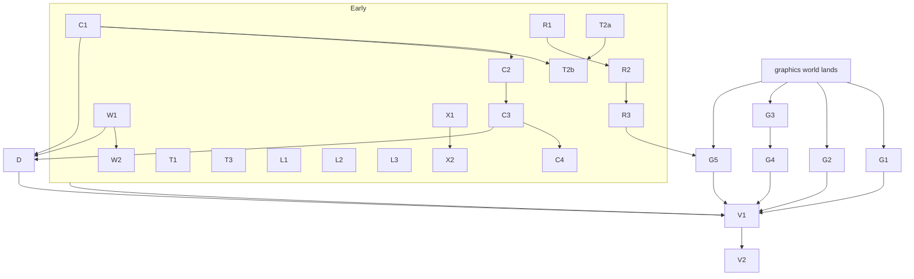
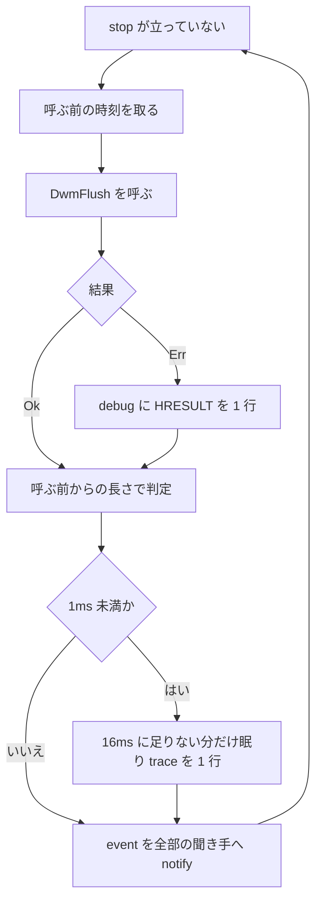
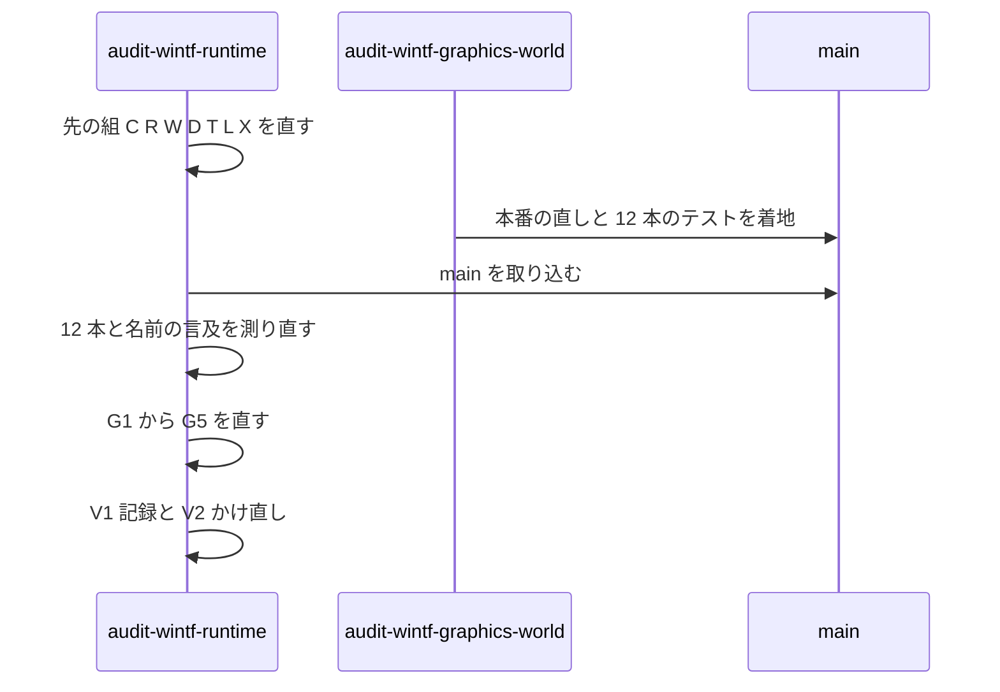

# 設計書: audit-wintf-runtime

## 概要

この spec は、wintf のうち ECS の外（刻みの土台 `runtime/`・COM の包み `com/`・窓の型 `win_style`・Win32 の口 `api.rs`・数の型 `numerics/`・テスト・example・`Cargo.toml`）に ponytail の audit をかけて出た 119 件のうち、「直す」と確定した 115 件（1〜20・24〜87・89〜119）を、それぞれいちばん小さな完全な変更で直す。直し方の大半は「消す」で、残りは記録の無い失敗の道を塞ぐ直し・失敗しえないテストを失敗しうる形へ直す直し・注記を実際に合わせる直しである。

- **目的**: 受け持つ範囲から、バグ・危ない所・負荷に弱い所・テストの抜け・遅い所・要らないコードを無くす（開発者「とにかく指摘事項は全部直す」）。
- **使う人**: areka の開発者（wintf を載せて areka を作る）と、crates.io の `wintf` の利用者。
- **影響**: 公開の口のいくつかが消えるか形が変わる（0.x の壊す変更・次の版の知らせに載せる・「公開の口の変化」）。wintf の依存が 3 つ減り（`nonmax`・`ambassador`・開発用の `rand`）、`bevy_app` が開発用へ移る。example が 5 本、資産が 8 つ減る。実行の振る舞いが変わるのは、vblank のスレッドの待ち方（2・8）・位置だけを指定した窓の出方（3）・生成に失敗した窓の扱い（6）・ログ（4・7・8・9・10）・百分率の余白（5）・WIC の α の判定（15）だけ。

各指摘の中身・場所の行・困ること・直し方の案は `research.md` の 3 節が正本で、この文書は番号で引く。設計で案を変えた所・決めた所は、この文書だけで読めるように書く。

### Goals

- 「直す」と確定した 115 件を、3 つの組とも全部直す（要件 4.1）。
- 直したバグと危ない所ごとに、壊れたら落ちる決定論のテストを持つ（要件 7.1・7.2）。
- 全体テスト `pwsh -NoProfile -File tools/test-all.ps1` を緑にする（要件 7.3）。
- 直した後に同じ作法で audit をかけ直し、残す 4 件（21・22・23・88）を除いて 0 件を確かめる（要件 8）。
- 変わった公開の口の一覧を記録に残す（要件 4.4）。

### Non-Goals

- 21・22・23・88 番（描画の木の部品・`wintf-visual-tree` へ申し送り）は直さない。`numerics/` の働きは、使われていないことを理由に消さない。
- 30・35 番の本番の直し（単一スレッドの名札の定数・付け替えの穴 P47）は `audit-wintf-graphics-world` の持ち物。
- 新しい機能。clippy の指摘の機械的な直し（`clippy-199-lints`）。`vendors/` の下。
- `crates/wintf/src/ecs/` の下の見直し（ほかの見直しの持ち物）。ただし下の「境界の外へ及ぶ直し」に挙げた行だけは直す。

## 境界の約束

### この spec が持つもの

- `crates/wintf/` のうち `src/ecs/` の外の、git の管理下のファイル全部（着手のとき 160 ファイル・`research.md` 1 節）と、その指摘の直し。
- 討議で広げた本番の直し: 2・8 番（`wintf-dwmflush-wait-compensation` を吸収）、5・94・101 番の `src/ecs/layout/dimension.rs`・`box_style.rs`・`metrics.rs`（`audit-wintf-layout-widget` の受け持つ本番）。
- `src/runtime/tick_bridge.rs` の説明の行（`audit-wintf-graphics-world` との申し合わせ）。
- 範囲の外への最小の追従（要件 6.1）。次の行だけを直す。
  - `src/ecs/window/window_system.rs` の `create_windows` の問い合わせに失敗の印の除外を 1 つ足す（6 番）。持ち主 `audit-wintf-window` は今走っていない。
  - `crates/areka-emo-atlas/src/decode/wic_arm.rs` の α の判定を wintf と同じ形へ替え、その判定のテストを `decode/wic_arm_tests.rs` に足す（15 番・完了した `emo-atlas-palette-alpha` の「2 つの読み手は同じ答え」を保つため）。持ち主 `audit-emo-atlas` は今走っていない。
  - `tests/graphics/command_list_test.rs` の 3 か所（69 番で消す `create_command_list` の呼び手・範囲の中）。
  - 根の `Cargo.toml`（`nonmax`・`ambassador` の宣言・`Win32_UI_Animation` の機能）・`Cargo.lock`・`.kiro/steering/tech.md`・`structure.md`・`logging.md` の該当の行。
  - `audit-wintf-graphics-world` の着地の後だけ: こちらの削除で古くなる名前の言及（`src/ecs/world/mod.rs`・`world/vsync.rs`・`ecs/app.rs`・`ecs/graphics/visual.rs` の注記）。
- 直しのために足すテストと、直すテスト。

### 境界の外

- 21・22・23・88 番と `numerics/` の働き（86 番の import の 1 行だけは直す）。
- 30・35 番の本番。`audit-wintf-graphics-world` が本番の直しと一緒に書き換えてよいテストのファイル 12 本（requirements の Boundary Context の一覧）は、あちらの着地の前には触らない。
- `src/ecs/` の下の、上に挙げた行の外。`ecs/test_support.rs` の形（84 番の補助はそこへ置かない）。
- `ecs/window/window_pos/mod.rs` の `to_window_coords_for_creation` の決まり（片方が既定値のとき素通し）。3 番は生成の側だけで直す。
- `crates/pilot/examples/wintf-winmsg-executor` の同じ形のループ（`wintf-dwmflush-wait-compensation` の brief の Out）。
- `doc/`・`docs/` を名指す行（足さない・変えない）。emo-text のクレートへのファイルの追加。`vendors/`。

### 使ってよいもの

- 今ある依存だけ。新しい依存も新しい機能（`windows` の features）も足さない（要件 5.7）。減らすのは `nonmax`・`ambassador`・開発用の `rand`、移すのは `bevy_app`（開発用へ）。
- `windows` 0.62.2 の既存の機能の中の API（`IWICPixelFormatInfo2::SupportsTransparency`・`CoGetApartmentType`・`GetThreadDpiAwarenessContext`・WUC の `Visual`／`ContainerVisual` の読み口）。
- bevy_ecs 0.19.1 の既存の口（`DeferredWorld::from(&mut World)`・`World::read_change_tick`・`get_change_ticks`）。
- 開発用の既存の `log-capture-kit`（`count_levels`・`capture`）。
- 依存の向きは今のまま: `numerics` ← `com` ← `ecs` ← `runtime`（`runtime` が `ecs` を呼ぶ唯一の上向きの線 `create_windows` → `EcsWindowFactory` は今のまま）。テストの補助は `#[cfg(test)]` の中にだけ置き、本番のコードから呼ばない。

### 見直し直すきっかけ

- `audit-wintf-graphics-world` の着地: 後回しの組（G1〜G5）を始める前に、12 本のテストのファイルと `try_tick_on_vsync`・`AsyncTickTask`・`notify_shutdown`・`Opacity`・`wuc_spike` の言及を測り直す。あちらがファイルを消していれば、その指摘は「消えて解けた」と記録する。
- `audit-wintf-layout-widget` のギャップ分析: `dimension.rs`・`box_style.rs`・`metrics.rs` の 5・94・101 番はこの spec で直し済み（二重に数えない）。
- `audit-wintf-window`: `window_system.rs` の失敗の印の除外（6 番）と、`window_factory.rs` の生成の旗（3 番）。
- `audit-emo-atlas`: `wic_arm.rs` の α の判定を `SupportsTransparency` へ替えた（15 番）。
- `wintf-visual-tree`: `numerics/` は 86 番の import の 1 行のほか変えていない。申し送り 4 件（21・22・23・88）。
- 公開の口の形を変えたとき（「公開の口の変化」）: `areka-emo-present`・`areka-emo-text` など wintf を使う crate の全体テスト。
- 範囲のファイルの増減（要件 1.3）: 最後のかけ直しの前に数え直す。

## 作りの全体

### 今の作り

- `runtime/` は `WinApp`（入口）・vblank のスレッド（`tick_bridge.rs`）・窓の生成（`window_factory.rs`）・メッセージループ（`message_loop.rs`）・窓の登録簿で、UI スレッドの上の async タスク（刻み・クリック透過の中継）を `spawn_local` で回す。
- `com/` は Win32／WinRT の COM の薄い拡張の trait 群。本番が使うのは一部で、使われない拡張と、読み出せない描画命令の記録係（`RecCommandSink`）が残っている。
- テストは `tests/<領域>.rs` の入口から `#[path]` で束ねる。GPU の Compositor を作るテストは `tests/graphics/common/mod.rs` の持ち主のスレッドへ寄せる決まり（`tech.md`）で、見た目の実行ファイルだけがまだ寄っていない。
- 守る決まり: 記録の無い失敗の道を作らない（`error!`＋`Err`）・1 ファイル 1,000 行・GPU のテストは実 GPU・終了の道は正規の手順のまま。

### 組と順

直しを、触るファイルが重ならない「組」に分ける。組の中は順に、組どうしは並べてよい。後回しの組（G）は `audit-wintf-graphics-world` の着地を待つ。最後に V。



- **選んだ形**: 指摘をファイルのまとまりで組にする（brief の Boundary Candidates の 2 つ目）。矢印でつながる組（同じ鎖）は順に回すので同じファイルを触ってよい（例: `tests/com.rs` は C1 と C3、`tests/graphics.rs` は T2a と T2b、`tests/graphics/surface_systems_test.rs` は C1 と T2b、`runtime/mod.rs` は R1・R3・G5）。矢印でつながらない組どうしは同じファイルを触らない（例外は無い）。
- **なぜ D が後か**: 依存の行を消すには、それを使うコード（`ambassador` の印＝C1・W1、`Win32_UI_Animation`＝C3）が先に消えている必要がある。
- **なぜ G5 が R3 の後か**: 72・73 は R3 で直した `runtime/mod.rs`・`message_loop.rs` の上に乗る。

### 技術の層

| 層 | 選ぶもの・版 | この spec での役目 | 補足 |
|---|---|---|---|
| Win32／WinRT | `windows` 0.62.2（既存の機能のまま） | `DwmFlush`・`SetWindowPos`・WIC・DirectWrite・WUC の読み口 | 機能 `Win32_UI_Animation` を外す |
| ECS | bevy_ecs 0.19.1 | テストの確かめ（変更の刻み・`DeferredWorld`） | `bevy_app` は開発用へ移す |
| 刻みの待ち | `std::thread::sleep` | `DwmFlush` が待たずに戻った回の補い | brief どおり。高分解能かどうかで作りは変わらない |
| ログの確かめ | `log-capture-kit`（開発用・既存） | `error!`／`warn!` の数を数える | GPU の持ち主のスレッドの中で数える |

## ファイルの構成の計画

### ディレクトリ（触る所だけ）

```
crates/wintf/
├── Cargo.toml                       # D: 依存・keywords・注記
├── build.rs                         # C4: 見本の在る無しの cfg（29）
├── src/
│   ├── lib.rs                       # W1: win_state の宣言を消す
│   ├── api.rs                       # W1: 試験の窓の補助（84）・W2: doc（87）
│   ├── api_owner_chain_probe_tests.rs        # W1（84 の使い手）・W2（82・83）
│   ├── api_owner_chain_nudge_probe_tests.rs  # W2（82）
│   ├── win_state.rs                 # W1: 消す（17）
│   ├── win_style.rs                 # W1: WinStyle を消す（18）・補助を使う（84）
│   ├── win_style_accept_files_tests.rs       # W1: 補助を使う（84）
│   ├── numerics/aabb.rs             # W2: 重なった import の 1 行（86）
│   ├── com/
│   │   ├── mod.rs                   # C3: animation の宣言を消す
│   │   ├── animation.rs             # C3: 消す（14）
│   │   ├── d2d/mod.rs               # C1
│   │   ├── d2d/command_sink.rs      # C1: 消す（13）
│   │   ├── d2d/command_types.rs     # C1: 消す（1・13）
│   │   ├── d3d11.rs                 # C2
│   │   ├── dwrite.rs                # C2
│   │   ├── dwrite_cluster_tests.rs  # C2: 新規（4 の判定のテスト）
│   │   ├── wic.rs                   # C4
│   │   ├── wic_tests.rs             # C4（15 の形式のテストを足す）
│   │   └── wuc.rs                   # C3
│   └── runtime/
│       ├── mod.rs                   # R1・R3・G5
│       ├── tick_bridge.rs           # R1・G5
│       ├── tick_bridge_vsync_tests.rs        # R1: 新規（2・8・11 のテスト）
│       ├── message_loop.rs          # R3・G5
│       ├── ui_com_init_tests.rs     # R3: 新規（7 のテスト）
│       ├── window_factory.rs        # R2
│       ├── window_factory_creation_tests.rs  # R2: 新規（3・6・9・10 のテスト）
│       └── window_registry.rs       # R2（77 の注記）
├── tests/  …                        # T・L・C・G の各組（下の表）
└── examples/ …                      # X・R3・G2
```

### 新しく作るファイル

| ファイル | 組 | 中身 |
|---|---|---|
| `src/runtime/tick_bridge_vsync_tests.rs` | R1 | `compensation`・`vsync_once`・`join_vsync`・`relay_vblank` のテスト（`tick_bridge.rs` は 612 行で、テストを足すと番人に近づくため兄弟へ） |
| `src/runtime/window_factory_creation_tests.rs` | R2 | `initial_pos_flags`・失敗の印・`SetParent` の失敗の記録・登録簿の無いときの記録のテスト |
| `src/runtime/ui_com_init_tests.rs` | R3 | `init_ui_com` の別の部屋の場合のテスト |
| `src/com/dwrite_cluster_tests.rs` | C2 | 大きさの問い合わせの結果の読み分けのテスト |

新しい本番のファイルは作らない。

### 消すファイル

| ファイル | 組 | 番号 |
|---|---|---|
| `src/com/d2d/command_sink.rs`・`src/com/d2d/command_types.rs`・`tests/com/command_sink_test.rs`・`tests/com/command_types_test.rs` | C1 | 1・13・24 |
| `src/com/animation.rs`・`tests/com/animation_test.rs` | C3 | 14・91 |
| `src/win_state.rs` | W1 | 17 |
| `tests/drag/capture_guard_panic_safety_test.rs` | T1 | 26 |
| `tests/graphics/surface_pixel_equivalence_test.rs`・`tests/graphics/frame_time_test.rs` | T2 | 44・106 |
| `tests/layout/taffy_layout_integration_test/wrapper_types.rs`・`box_components.rs` | L1 | 93・94 |
| `tests/layout/boxstyle_coordinate_separation_test/drag_lifecycle.rs`・`boxstyle_inset.rs` | L2 | 55・97 |
| `examples/dcomp_demo.jpg`・`wuc_spike.rs`・`dcomp_taffy_demo.rs`・`multi_window_test.rs`・`split_image.rs`・`tests/assets/seikatu.webp`・`seikatu_0_1.webp`・`seikatu_0_2.webp`・`seikatu_1_0.webp`・`seikatu_1_1.webp`・`seikatu_1_2.webp`・`demo_checker_64x64.png` | X1 | 60・61・62・65・89・119 |
| `examples/dcomp_demo.rs` | R3 | 74・112 |
| `tests/ecs/component_state_pattern_test.rs`・`lazy_reinit_pattern_test.rs`・`resource_removal_detection_test.rs` | G1 | 27 |
| `tests/visual/parent_visual_test.rs`・`remove_visual_api_test.rs` | G3 | 109・110 |

### 直すファイル（組ごと）

各組の「触るファイル」は、その組だけが触る。下の「部品と口」の各組の表が、番号ごとの直しの正本。

| 組 | 触るファイル |
|---|---|
| C1 | `src/com/d2d/mod.rs`・`tests/com.rs`・`tests/com/d2d_ext_test.rs`・`tests/graphics/command_list_test.rs`・`tests/graphics/surface_systems_test.rs:266` の 1 行（＋上の消すファイル） |
| C2 | `src/com/dwrite.rs`・`src/com/d3d11.rs`・`tests/com/dwrite_test.rs`・`tests/com/d3d11_test.rs`（＋新規 1） |
| C3 | `src/com/wuc.rs`・`src/com/mod.rs`・`tests/com.rs`（C1 の後）（＋消すファイル） |
| C4 | `src/com/wic.rs`・`src/com/wic_tests.rs`・`build.rs`・`tests/com/wic_test.rs`・`tests/com/common/mod.rs`・`tests/widget.rs`・`tests/widget/bitmap_source_integration_test.rs`・`crates/areka-emo-atlas/src/decode/wic_arm.rs`・`crates/areka-emo-atlas/src/decode/wic_arm_tests.rs` |
| R1 | `src/runtime/tick_bridge.rs`・`src/runtime/mod.rs`（`run` の中継の呼び出しと 337・365 行の注記）（＋新規 1） |
| R2 | `src/runtime/window_factory.rs`・`src/runtime/window_registry.rs`・`src/ecs/window/window_system.rs`（＋新規 1） |
| R3 | `src/runtime/mod.rs`・`src/runtime/message_loop.rs`（＋新規 1・`examples/dcomp_demo.rs` を消す） |
| W1 | `src/lib.rs`・`src/api.rs`・`src/win_style.rs`・`src/win_style_accept_files_tests.rs`・`src/api_owner_chain_probe_tests.rs`（`create_probe_window` だけ） |
| W2 | `src/api.rs`（W1 の後・87 の doc）・`src/api_owner_chain_probe_tests.rs`（W1 の後）・`src/api_owner_chain_nudge_probe_tests.rs`・`src/numerics/aabb.rs` |
| D | `crates/wintf/Cargo.toml`・根の `Cargo.toml`・`Cargo.lock`・`.kiro/steering/tech.md`・`.kiro/steering/structure.md` |
| T1 | `tests/ecs/tree_propagation_test.rs`・`tests/drag.rs`・`tests/drag/window_dragging_filter_test.rs`・`tests/win_app.rs` |
| T2a | `tests/graphics.rs`・`tests/graphics/core_ecs_test.rs`・`core_test.rs`・`surface_optimization_test.rs`・`common/mod.rs`（114 の自己テスト）（＋消すファイル `frame_time_test.rs`） |
| T2b | `tests/graphics.rs`（T2a の後）・`surface_systems_test.rs` は C1 の後・`tests/graphics/clip_sync_system_test.rs`・`surface_systems_test.rs`・`dcomp_integration_test.rs`・`init_window_graphics_test.rs`（＋消すファイル `surface_pixel_equivalence_test.rs`） |
| T3 | `tests/window/monitor_hierarchy_test.rs`・`tests/window/multiwindow_event_test.rs`・`tests/widget/vertical_text_layout_test.rs` |
| L1 | `src/ecs/layout/dimension.rs`・`box_style.rs`・`metrics.rs`・`tests/layout/dimension_conversion_test.rs`・`metrics_test.rs`・`taffy_layout_integration_test/mod.rs`・`unit_integration.rs`・`taffy_advanced_test/mapping_management.rs` |
| L2 | `tests/layout/graphics_sync_test.rs`・`feedback_loop_convergence_test.rs`・`taffy_advanced_test/layout_conversion.rs`・`boxstyle_coordinate_separation_test/mod.rs`・`changed_timing.rs`・`tests/drag/dispatch_test.rs` |
| L3 | `tests/layout/taffy_flex_layout_pure_test.rs`・`taffy_advanced_test/tree_sync.rs`・`boundary_scenarios.rs`・`client_area_positioning_test.rs`・`box_style_consolidation_test.rs`・`hierarchical_bounds_test.rs`・`taffy_child_order_test.rs`・`arrangement_bounds_test/arrangement.rs` |
| X1 | `examples/generate_test_image.rs`・`.kiro/steering/logging.md`（＋消すファイル） |
| X2 | `examples/clip_demo.rs`・`typewriter_demo.rs`・`postmessage_click_test.rs`・`taffy_flex_demo/main.rs`・`setup.rs`・`diagnostics.rs`・`drag.rs`・`handlers.rs` |
| G1 | `tests/ecs.rs`・`tests/ecs/world_lifecycle_test.rs`・`dola_animator_test.rs`・`tests/window/owner_window_exists_test.rs`（＋消すファイル） |
| G2 | `tests/graphics/window_pos_systems_test.rs`・`reinit_unit_test.rs`・`components_test.rs`・`examples/graphics_reinit_test.rs` |
| G3 | `tests/visual.rs`・`tests/visual/common/mod.rs`・`hierarchy_reparent_gap_test.rs`・`graphics_auto_creation_test.rs` と、Compositor を作る見た目のテストのファイル全部（本体を包むだけ）（＋消すファイル） |
| G4 | `tests/visual/hierarchy_sync_test.rs`・`property_sync_test.rs`・`child_order_test.rs`・`graphics_auto_creation_test.rs`・`component_test.rs`・`widget_visual_auto_insert_test.rs`・`insert_visual_test.rs`（G3 の後） |
| G5 | `src/runtime/tick_bridge.rs`・`mod.rs`・`message_loop.rs`（R3 の後）と、名前の言及だけ `src/ecs/world/mod.rs`・`src/ecs/world/vsync.rs`・`src/ecs/app.rs`・`src/ecs/graphics/visual.rs` |
| V1・V2 | `.kiro/specs/audit-wintf-runtime/` の記録だけ |

## 流れ

### vblank のスレッドの 1 周（2・8）



- 待ったかどうかは呼ぶ前後の時間だけで決め、HRESULT はログにだけ使う。状態（回数・モード）を持たない。notify はループの最後の 1 か所で、`Err` の回も必ず撃つ。
- 待てた回（1ms 以上）は何も足さない＝今と同じ周期。待てなかった回は、呼ぶ前から数えて 16ms になるまで眠る（brief の「約 16ms」・今の `Err` の腕の 15ms とほぼ同じ）。
- スレッドが panic で終わったら、`join` の側で `error!` を 1 行残す（8）。

### 着地の順（後回しの組）



- 測り直しで、あちらがファイルを消していた指摘（27 の `lazy_reinit_pattern_test.rs`・31 の `dola_animator_test.rs`・30 のテスト・64・118 の example など）は「消えて解けた」と記録し、残っていれば下の表の直しを当てる。

## 要件との対応

| 要件 | 要約 | 担う所 | 流れ・口 |
|---|---|---|---|
| 1.1 | 範囲を数えて記録 | `research.md` 1 節（160 ファイル）・V2 で数え直し | — |
| 1.2 | `src/ecs/`・`vendors/` を範囲に含めない | 境界の約束 | — |
| 1.3 | 増減を測り直す | V2（消すファイル・新規の 4 ファイルを入れて数え直す） | — |
| 2.1 | 範囲だけに audit | `research.md` 3 節 | — |
| 2.2 | 全件 | `research.md` 3 節（119 件） | — |
| 2.3 | 全部読む | `research.md` 1 節（160/160） | — |
| 2.4 | 番号と組 | `research.md` 3 節 | — |
| 2.5 | 組ごとの件数 | `research.md` 3 節（5・63・51） | — |
| 3.1 | 全件を直す／残すに確定 | requirements の「指摘の扱い」 | — |
| 3.2 | 残すのは 3 種類だけ | 残すのは 21・22・23・88（⑵）だけ。15・29 は完了した spec の決めを覆さない形で直す（C4） | — |
| 3.3 | ⑶ は ukadoc で確かめる | 該当なし（`research.md` 7 節） | — |
| 3.4 | `numerics` を消さない | 境界の外・W2（86 の import の 1 行だけ） | — |
| 3.5 | 描画の木の傷との重なりを記録 | `research.md` 4 節・V1 | — |
| 3.6 | DwmFlush の重なり | R1 で吸収（2・8）・V1 で台帳を閉じる知らせ | vblank の 1 周 |
| 3.7 | 20 タスクを越える件 | 1 本のまま（討議の裁定 6）・組を約 27 タスクへ割る | 組と順 |
| 4.1 | 3 つの組とも全部直す | C1〜C4・R1〜R3・W1・W2・D・T1〜T3・L1〜L3・X1・X2・G1〜G5 | 部品と口の各表 |
| 4.2 | 最小で完全・呼び出し元まで | 各組の表の「呼び手・テスト」の欄 | — |
| 4.3 | 消す前に参照を確かめ記録 | `research.md` 11 節の表・各組の実装の前にもう一度 grep | — |
| 4.4 | 公開の口の一覧 | 「公開の口の変化」・V1 | — |
| 4.5 | 裁定を覆さない | C4 の決め（15・29）・3 番の決め（素通しの決まりを変えない） | — |
| 5.1 | 1,000 行 | 新規のテストは兄弟のファイルへ（ファイルの構成の計画） | — |
| 5.2 | 記録の無い失敗の道を作らない | R1・R2・R3・C2・C4（失敗の扱い） | — |
| 5.3 | 終了の道は正規のまま | R1（stop→join の順は変えない）・G5（72 は `request_exit` の中で同じ notify を撃つ） | — |
| 5.4 | 実機の根は `target` の下 | テストは一時のフォルダを作らない。`generate_test_image` は手で走らせる道具で、書き先は `tests/assets`（今のまま） | — |
| 5.5 | GPU は実 GPU | T2・G2〜G4 は実 GPU で回す | — |
| 5.6 | 文字化けは読む側を直す | 当たる直しは無い。出会ったら読む側を直す | — |
| 5.7 | 依存を足さない | D（減らすだけ） | — |
| 6.1 | 呼び出し元を全部直す | 各組の表・境界の約束の「最小の追従」 | — |
| 6.2 | 走っている spec と申し合わせ | 後回しの組（G1〜G5）・`audit-wintf-graphics-world` への知らせ（84 の置き場所） | 着地の順 |
| 6.3 | `doc/`・`docs/` の行 | 範囲に 0 行。足さない | — |
| 6.4 | emo-text にファイルを足さない | emo-text に触らない | — |
| 6.5 | `vendors/` を変えない | 触らない | — |
| 7.1 | 直したバグ・危ない所ごとのテスト | テストの方針の表 | — |
| 7.2 | 決定論 | 時刻を差し込む（2）・判断の分岐を純関数にして試す（3・4・6）・ログを数える（7〜10） | — |
| 7.3 | 全体テストを緑 | V2 | — |
| 8.1 | かけ直し | V2 | — |
| 8.2 | 新しい指摘も直し 0 件まで | V2（新しい指摘は要件 3 の裁定を経て直す） | — |
| 8.3 | 読んだ数・件数・残す番号を記録 | V2 | — |

## 部品と口

「部品」はここでは直しの組。新しい本番の口は少なく、どれも `pub(crate)` 以下（試験の補助は `#[cfg(test)]`）。

| 組 | 層 | 狙い | 番号 | 先に要るもの | 新しい口 |
|---|---|---|---|---|---|
| C1 | com | Direct2D の使えない口を消す | 1・13・16・20（印）・24・69（d2d）・91（d2d_ext） | — | なし |
| C2 | com | DirectWrite の失敗を返す・使われない拡張を消す | 4・69（dwrite・d3d11）・91（d3d11）・92（dwrite） | C1 | `sizing_outcome` |
| C3 | com | 使われない WUC の後始末とアニメの包みを消す | 12・14・70・91（animation） | C2 | なし |
| C4 | com | WIC の α の判定を WIC に聞く・テストを確かめる形へ | 15・28・29・90・91（wic）・116（bitmap_source） | C3 | `pixel_format_has_alpha(factory, format)` |
| R1 | runtime | vblank のスレッドの空回りと止まりを直す | 2・8・11・77（tick_bridge の module doc）・78（tick_bridge・中継の doc） | — | `compensation`・`vsync_once`・`join_vsync`・`relay_vblank` |
| R2 | runtime | 窓の生成の位置・失敗・記録 | 3・6・9・10・75（window_factory）・77（window_factory・window_registry）・80・81（window_factory） | R1 | `WindowCreationFailed`・`initial_pos_flags` |
| R3 | runtime | 入口の COM の記録・死んだコード・doc | 7・71・74・75（mod.rs）・76・77（mod.rs・message_loop）・79・81（mod.rs）・112 | R2 | `init_ui_com` |
| W1 | 窓の型 | 古い型を消す・試験の窓の補助 | 17・18・84 | — | `create_test_window`・`with_test_window`（`#[cfg(test)]`） |
| W2 | api・numerics | 調べのテストの注記と補助・小さな直し | 82・83・86・87 | W1 | なし |
| D | Cargo・steering | 依存を減らす・見出しと注記 | 14（機能）・19・20（依存）・66（keywords）・85 | C1・C3・W1 | なし |
| T1 | tests | ecs・drag・win_app の先の分 | 25・26・32・33・91（drag）・92（tree） | — | なし |
| T2a | tests | graphics の重なりと同語反復 | 34・104・105・106・107・114 | — | なし |
| T2b | tests | graphics の確かめの無いテスト | 37・38・44・113（先のファイル）・116（dcomp_integration） | T2a・C1 | なし |
| T3 | tests | window・widget の先の分 | 43・46・108・116（monitor_hierarchy） | — | なし |
| L1 | layout（本番ごと） | 百分率・死んだ型 | 5・52・93・94・101・103 | — | なし |
| L2 | layout | 帰還の輪・同期・座標の分離 | 49・50・55・57・96・97・98・99 | — | なし |
| L3 | layout | 計算・木の同期・境目 | 51・53・54・56・58・59・95・100・102 | — | なし |
| X1 | examples | 使われない example と資産を消す | 60・61・62・65・89・119 | — | なし |
| X2 | examples | example の文言と振る舞い | 63・66（clip_demo）・67・68・117 | X1 | なし |
| G1 | tests（後） | ecs・window の後の分 | 27・30・31・36 | あちらの着地 | なし |
| G2 | tests・examples（後） | graphics の後の分 | 39・48・64・111（graphics）・113（後のファイル）・118 | あちらの着地 | なし |
| G3 | tests（後） | 見た目のテストを持ち主のスレッドへ | 45・109・110・111（visual）・115 | あちらの着地 | なし |
| G4 | tests（後） | 見た目のテストの確かめ | 35・40・41・42・47・116（visual） | G3 | なし |
| G5 | runtime（後） | 刻みの土台の名前と注記を合わせる | 72・73・申し合わせの説明の行・名前の言及 | あちらの着地・R3 | なし |
| V1 | 記録 | 公開の口・申し送り・台帳の知らせ | 4.4・3.5・3.6 | 全部の直し | — |
| V2 | 検証 | 全体テスト・かけ直し | 7.3・8.1〜8.3・1.3 | V1 | — |

各表の「直し」の欄で「research の案」とあるものは、`research.md` 3 節のその番号の「直し方」をそのまま当てる。違う所だけを書く。

### COM（C1〜C4）

#### C1 Direct2D の使えない口を消す

| 番号 | 直し | 呼び手・テスト |
|---|---|---|
| 1・13 | `command_sink.rs`・`command_types.rs` と `d2d/mod.rs:1-4` を消す（`dup_com` ごと） | 参照は `d2d_ext_test.rs` だけ（`research.md` 11 節） |
| 24 | research の案。`tests/com.rs` の 2 つの宣言・`d2d_ext_test.rs` の 216-219 行と 325-367 行と、ファイルの頭の注記の `RecCommandSink` の文を消す | 121-215 行は残す。ただしこの範囲と L64・L80・L93・L106 は、13・69 で消す口（`create_command_list`・`create_rounded_rectangle_geometry`・`create_bitmap_from_wic_bitmap`・`fill_geometry`・`draw_text`・`draw_image`）を使うので、`windows` の生の呼び出し（`CreateCommandList`・`CreateRoundedRectangleGeometry`・`CreateBitmapFromWicBitmap`・`FillGeometry`・`DrawText`・`DrawImage`）へ置き換えてから消す。確かめる中身は変えない。確かめの相手が消す包みそのものだけのテストは、包みと一緒に消す |
| 16 | `D2D1CommandListExt::open` を trait と実装から消す。`d2d_ext_test.rs:95` のテストも消す | `close` は残す |
| 20（印） | `d2d/mod.rs` の `use ambassador::*` と `#[delegatable_trait]` を消す | 依存の行は D |
| 69（d2d） | `D2D1FactoryExt`（trait ごと）・`D2D1DeviceExt::create_command_list`・`D2D1DeviceContextExt` の `create_bitmap_from_wic_bitmap`・`draw_text`・`fill_geometry`・`draw_image` を消し、それだけのテストを消す | `create_command_list` は `tests/graphics/command_list_test.rs:22`・`:35`・`:45` と `tests/graphics/surface_systems_test.rs:266` が使う→装置の文脈を作って `CreateCommandList()` を呼ぶ形に直す（`GraphicsCore` に文脈の口があればそれを使う）。`surface_systems_test.rs` は T2b も触るので、C1 は T2b より先に回す（C1 → T2b） |
| 91（d2d_ext） | research の案（`d2d_ext_test.rs:72-81`） | |

#### C2 DirectWrite の失敗を返す・使われない拡張を消す

| 番号 | 直し | 呼び手・テスト |
|---|---|---|
| 4 | `get_cluster_metrics` の大きさだけの問い合わせの戻り値を `sizing_outcome` で読み分ける（下の口） | 本番の呼び手 3 つ（`typewriter_layout.rs:193`・`typewriter_draw.rs:114`・`areka-emo-text/src/draw_metrics.rs:304`）は既に `Err` を扱うので直さない |
| 69（dwrite・d3d11） | `get_cluster_count`・`hit_test_text_position`・`DWriteTextFormatExt`（trait ごと）・`D3D11DeviceExt`（trait ごと）と、それだけのテストを消す | `DWriteTextLayoutExt` の残りは emo-text が使う |
| 91（d3d11） | research の案（`d3d11_test.rs:216-219`） | |
| 92（dwrite） | `dwrite_test.rs:156-165` は `textPosition` を確かめないので消す（`hit_test_text_position` を消すとき同時に消える） | |

```rust
// crates/wintf/src/com/dwrite.rs（非公開）
/// 大きさだけの GetClusterMetrics の結果を読む。
/// Ok(false) = 塊が 0（空を返して終わる）。Ok(true) = 入れ物が足りない（続けて取る）。
/// それ以外の失敗は error! を 1 行残して Err を返す。
fn sizing_outcome(r: windows::core::Result<()>) -> windows::core::Result<bool>;
```
- 前提: `r` は `GetClusterMetrics(None, &mut count)` の戻り値。
- 後: 失敗が空の成功に化けない。

#### C3 使われない WUC の後始末とアニメの包みを消す

| 番号 | 直し | 呼び手・テスト |
|---|---|---|
| 12 | `drain_dispatcher_queue`・`DrainStep`・`drain_step`・`pump_current_thread_messages` と、そのテスト（`wuc.rs:237-292`）と、それだけが使う import を消す | 呼び手 0 |
| 70 | `wuc.rs` の `dcomp.rs` を引く文を消す | |
| 14・91 | `animation.rs`・`com/mod.rs:1`・`tests/com/animation_test.rs`・`tests/com.rs` の宣言を消す | 根の機能は D |

#### C4 WIC の α の判定

| 番号 | 直し | 呼び手・テスト |
|---|---|---|
| 15 | `pixel_format_has_alpha` を「工場の `CreateComponentInfo(format)` を `IWICPixelFormatInfo2` にして `SupportsTransparency` を聞く」に替え、12 の手書きの一覧を消す。番号つきの形式は今のまま `palette_has_alpha`。`load_bitmap_source` の形（`(IWICBitmapSource, bool)`）は変えない。`areka-emo-atlas/src/decode/wic_arm.rs` の写しも同じ形に替える | 呼び手の形は変わらない。`ecs/widget/bitmap_source/` は触らない |
| 28 | research の案 | |
| 29 | `build.rs` が `CARGO_MANIFEST_DIR/../areka-emo-atlas/src/testdata/palette` の在る無しを見て `cfg(areka_palette_samples)` を出し（`cargo::rustc-check-cfg` で名を宣言・MSVC でないときの早い戻りより前に置く）、`wic_test.rs` のパレットの 6 本に `cfg_attr(not(areka_palette_samples), ignore = "...")` を付ける。見本は写さない | 見本の README（emo-atlas の持ち物）は変えない |
| 90 | research の案（`tests/widget.rs` に `#[path = "com/common/mod.rs"] mod common;`） | |
| 91（wic） | research の案（`wic_test.rs:223-228`） | |
| 116（bitmap_source） | `bitmap_source_integration_test.rs:205-242` の `!is_null()` のテストを消す | |

```rust
// crates/wintf/src/com/wic.rs（非公開）と areka-emo-atlas の写し（同じ形）
/// 番号つきでない形式が透明度を持つかを WIC に聞く。
/// 形式の情報が取れないときは WIC のエラーを返し、推測で決めない。
fn pixel_format_has_alpha(
    factory: &IWICImagingFactory2,
    format: &windows::core::GUID,
) -> windows::core::Result<bool>;
```
- 判定の規則（実測）: 実装のとき、今の一覧の 12 の形式に TRUE が返ることを確かめる。どれかが FALSE なら、その形式だけを名前つきの定数に残し「WIC の答え または 定数」にして、理由を 1 行の注記に書く。

### 刻みの土台（R1〜R3）

#### R1 vblank のスレッド

| 番号 | 直し | 呼び手・テスト |
|---|---|---|
| 2 | `vsync_loop` を `while !stop { vsync_once(..) }` にし、1 周を下の口へ出す（brief の Approach そのまま）。`tick_bridge.rs` の頭の「周期」の節・`AsyncTickTask` の注記の「固定 60Hz のフォールバック」・`runtime/mod.rs:337`・`:365` の「60Hz」の注記を実際（画面の更新周期・待てなかった回だけ約 16ms 待って起こす）に合わせる | テストは新規の兄弟のファイル |
| 8 | `stop` の `join` を `join_vsync` へ出し、`Err` で `error!` を 1 行 | 同上 |
| 11 | `run` の中のクリック透過の中継（`runtime/mod.rs:390-408`）を `relay_vblank` として `run_async_tick` の隣へ出し、`run` はそれを `spawn_local` する | `run_async_tick` の「run の後は止まる」のテスト（`tick_bridge.rs:571-611`）を写す |
| 77・78（tick_bridge・中継） | module doc の「後続タスク」「本タスクの時点では結線は行わず」の文を消す（L5-6・L18-21）。`run_async_tick` の doc（L278-279）と、11 で動かす中継の doc（今の `runtime/mod.rs:409-411`）の「自分で終わる」を、実際（正常な終了の後は vblank の起こしが来ないので止まったまま・run 1 回につき 1 度の小さな残り）に合わせる | `AsyncTickTask` の doc（L164-166・L173-174）は G5 で構造体ごと消える |

```rust
// crates/wintf/src/runtime/tick_bridge.rs（非公開）
/// これより短く戻った DwmFlush は「待たずに戻った」とみなす。
const WAITED_AT_LEAST: Duration = Duration::from_millis(1);
/// 待たずに戻った回に、呼ぶ前から数えて合わせる 1 周の長さ。
const FALLBACK_PERIOD: Duration = Duration::from_millis(16);

/// 待たずに戻った回だけ、FALLBACK_PERIOD に足りない長さを返す（状態を持たない）。
fn compensation(waited: Duration) -> Option<Duration>;

/// vblank のスレッドの 1 周。時刻・DwmFlush・眠り方を差し込める。
/// Err は debug に HRESULT を 1 行、補った回は trace を 1 行。最後に必ず 1 回 notify する。
fn vsync_once(
    now: &mut impl FnMut() -> Instant,
    flush: impl FnOnce() -> windows::core::Result<()>,
    sleep: impl FnOnce(Duration),
    event: &event_listener::Event,
);

/// vblank のスレッドを待ち合わせる。panic で終わっていたら error! を 1 行残す。
fn join_vsync(handle: JoinHandle<()>);

/// vblank ごとにクリック透過の起こしを中継する。World が落ちたか run が戻った後は終わる。
async fn relay_vblank(
    vblank: Arc<event_listener::Event>,
    world: Weak<RefCell<EcsWorld>>,
    wake: Arc<event_listener::Event>,
    running: Rc<Cell<bool>>,
);
```
- 不変: `vsync_once` は 1 回の呼び出しで notify をちょうど 1 回撃つ。`compensation` は `waited < WAITED_AT_LEAST` のときだけ `Some(FALLBACK_PERIOD - waited)`。
- 本番の `vsync_loop` は `Instant::now`・`DwmFlush`・`thread::sleep` を渡す。
- 実機の確かめ: brief の 3 場面（ディスプレイ消灯＝AI が `SC_MONITORPOWER`・ロック画面＝AI が `LockWorkStation`、開発者は解除のログインだけ・リモートデスクトップ＝開発者は接続だけ）で、スレッド別 CPU の報告（役割 `vblank` と UI スレッド）と trace のログを見て、張り付かないことを確かめる。

#### R2 窓の生成

| 番号 | 直し | 呼び手・テスト |
|---|---|---|
| 3 | 生成直後の `SetWindowPos` を `initial_pos_flags(x, width)` で決める。両方とも既定なら呼ばない。位置が既定なら `SWP_NOMOVE`、大きさが既定なら `SWP_NOSIZE` を足す。座標は今の `to_window_coords_for_creation` の値（片方が既定のときは素通し）のまま。L14-15 の注記を実際に合わせる | `ecs/window/window_pos/` は変えない |
| 6 | `new_ex` が失敗したら `error!` を 1 行残し、実体に `WindowCreationFailed` を入れて戻る。`create_windows` の問い合わせに `Without<WindowCreationFailed>` を足す（`ecs/window/window_system.rs`）。印は外されるまで残り、外せば次の刻みでまた作る | `create_windows` の呼び手は `UISetup` の 1 つ |
| 9 | `SetParent`・2 つの `SetWindowPos`・`SetWindowTextW` を `if let Err(e) = .. { error!(..) }` にし、今どおり先へ進む。`SetParent` の「無視」の注記を消す | |
| 10 | 登録簿をその場で作る枝の `debug!` を `error!` にする（作って入れる動きは今のまま） | |
| 75（window_factory） | `create_window` の doc の `new_checked_ex` を実際（`new_ex`・World を借りたまま作り、生成時のメッセージは借用中の道で飛ばす）に合わせる（L90・L95-97） | |
| 77（window_factory・window_registry） | 「後のタスクで結線する」の文を消す（`window_factory.rs:82-84`・`window_registry.rs:20-25`・`:36-39`・`:69-72`） | |
| 80 | research の案 | |
| 81（window_factory） | テストの doc の「見えない」を直し、本物の窓を作るテストは作った直後に `ShowWindow(SW_HIDE)` で隠してから確かめる（討議の裁定 9） | |

```rust
// crates/wintf/src/runtime/window_factory.rs（クレートの中だけ）
/// 窓の生成に失敗した実体の印。create_windows の問い合わせから外す。
#[derive(Component)]
pub(crate) struct WindowCreationFailed;

/// 生成直後の SetWindowPos の旗。位置も大きさも既定（CW_USEDEFAULT）なら None（呼ばない）。
fn initial_pos_flags(x: i32, width: i32) -> Option<SET_WINDOW_POS_FLAGS>;
```

#### R3 アプリの入口

| 番号 | 直し | 呼び手・テスト |
|---|---|---|
| 7 | `with_exit_policy` の COM の初期化を `init_ui_com` へ出し、`RPC_E_CHANGED_MODE` のとき `warn!` を 1 行（戻り値は今のまま Ok） | |
| 71 | `MessageLoopDriver::run`・`default_filter` とそのテスト・doc の項目・要らなくなる import を消す | 呼び手 0 |
| 74・112 | `WinApp::spawn_ui_local` と `examples/dcomp_demo.rs` を消す（唯一の呼び手） | `wintf::executor::spawn_local` が既に公開 |
| 75（mod.rs）・76 | research の案（L62-64・L232-234） | |
| 77（mod.rs・message_loop） | research の案（`mod.rs:117-119`・`message_loop.rs:5-7`・`:35`） | |
| 79 | research の案（`message_loop.rs:224-255`） | |
| 81（mod.rs） | R2 の 81 と同じ（`mod.rs:573-574`） | |

```rust
// crates/wintf/src/runtime/mod.rs（非公開）
/// UI スレッドの COM を MTA で初期化する。
/// 別の部屋で初期化済み（RPC_E_CHANGED_MODE）なら warn! を 1 行残して Ok。ほかの失敗は Err。
fn init_ui_com() -> windows::core::Result<()>;
```

### 窓の型と api（W1・W2）

| 番号 | 組 | 直し | 呼び手・テスト |
|---|---|---|---|
| 17 | W1 | `win_state.rs` と `lib.rs:8`・`:14` を消す | 参照 0 |
| 18 | W1 | `WinStyle`・`set_style`・`set_ex`・そのテスト（L452-667）と `#![allow(non_snake_case)]` を消す。`apply_click_through`・`apply_layered_companion` とそのテストは残す | 参照 0 |
| 84 | W1 | 試験の窓の補助を `api.rs` の `#[cfg(test)]` に置き、範囲の中の 5 か所で使う（下の口）。調べの窓は `create_test_window` で作ってから `SW_SHOWNOACTIVATE` で見せる（位置は (10,10) から (0,0) へ。大きさ 0×0 で重なりの順の答えに効かない） | `ecs/` の 15 ファイルは触らない。置き場所を `audit-wintf-graphics-world` へ知らせる |
| 82・83 | W2 | research の案（行を直すか消す・`is_visible`・`place_at` を消して本物を呼ぶ） | 調べの檻の判定は変えない |
| 86 | W2 | `aabb.rs:169` の import の 1 行を消す（働きは消さない） | |
| 87 | W2 | `clear_window_owner` の doc に 1 行足す（research の案） | |

```rust
// crates/wintf/src/api.rs（#[cfg(test)]・クレートの中だけ）
/// 定義済みの "Static" の窓を作る（見えない・0×0）。壊すのは呼んだ側。
pub(crate) fn create_test_window(
    ex: WINDOW_EX_STYLE,
    style: WINDOW_STYLE,
    parent: Option<HWND>,
    title: PCWSTR,
) -> HWND;

/// 試験の窓を作り、f を回し、panic でも必ず DestroyWindow してから panic を投げ直す。
pub(crate) fn with_test_window<R>(
    ex: WINDOW_EX_STYLE,
    style: WINDOW_STYLE,
    parent: Option<HWND>,
    f: impl FnOnce(HWND) -> R + std::panic::UnwindSafe,
) -> R;
```

### 依存と見出し（D）

| 番号 | 直し |
|---|---|
| 19 | wintf の `nonmax`・開発用の `rand` の行を消し、`bevy_app` を `[dev-dependencies]` へ移す。根の `[workspace.dependencies]` の `nonmax` を消す。`tech.md` の `nonmax` の行を消し、`bevy_app` の行に「wintf は開発用」を書く |
| 20 | wintf と根の `ambassador` の行を消す。`tech.md` の行を消す |
| 14（機能） | 根の `Cargo.toml` の `Win32_UI_Animation` を消す。`structure.md:37` の `animation.rs` の行を消す |
| 17（steering） | `structure.md:121` の `win_state.rs` の行を消す |
| 66（keywords） | `directcomposition` を外す（4 語。代わりの語は 20 文字の上限で入らない） |
| 85 | `Cargo.toml:49` の「消費 10 crate」の数を外す |

- `Cargo.lock` は `cargo` が直す（手で書かない）。`THIRD-PARTY-NOTICES.md` は完了の全体テストが作り直す。

### テスト（T1〜T3・L1〜L3）

確かめを直す指摘は、research の案を当て、下の「壊し方」で 1 度赤を確かめてから戻す（テストの方針の「較正」）。research の案から変えた所だけを書く。

| 番号 | 組 | 直し（research の案からの違い） |
|---|---|---|
| 25 | T1 | 回す前に `world.read_change_tick()` を控え、根の `ArrangementTreeChanged` の変更の刻みが控えより新しいことを確かめる。確かめの system と `DirtyProbe` を消す |
| 26・32・91（drag）・92（tree） | T1 | research の案 |
| 33 | T1 | `CoGetApartmentType` が `APTTYPE_MTA` で、かつ限定子が `APTTYPEQUALIFIER_IMPLICIT_MTA` でないことを確かめる（テストのプロセスはプロセスの寿命の MTA を持ちうるので、初期化しないスレッドでも MTA と答える）。DPI は `AreDpiAwarenessContextsEqual(GetThreadDpiAwarenessContext(), PER_MONITOR_AWARE_V2)` |
| 34・104・105・106・107・114 | T2a | research の案。107 の `App` の利用はそのまま（`bevy_app` は開発用でも使える） |
| 37・38 | T2b | `count_levels` は持ち主のスレッドの閉包の中で呼ぶ（ログの購読はそのスレッドに付く） |
| 44・113（先のファイル）・116（dcomp_integration） | T2b | research の案。113 は `clip_sync_system_test.rs`・`dcomp_integration_test.rs`・`init_window_graphics_test.rs`・`surface_systems_test.rs` の分 |
| 43・46・108・116（monitor_hierarchy） | T3 | research の案 |
| 5 | L1 | 本番の 2 つの `From`（`dimension.rs:161`・`:207`）に `/ 100.0` を足し、テストの期待を `percent(0.5)`・`percent(0.25)` に裏返し、実在しない「P49」を引く注記（L6-7）を消す |
| 94・101 | L1 | `box_style.rs` の `FlexContainer`・`FlexItem`、`metrics.rs` の `Opacity` と、その型だけを試すテストを消す。`metrics.rs:1` の allow の注記も消す |
| 52・93・103 | L1 | research の案。103 は 52 で消える範囲（`unit_integration.rs:54-66`）を `mapping_management.rs` の 1 本へ寄せ、作って消した後に確かめる |
| 49・50・55・57・96・97・98・99 | L2 | research の案。55 の `initial_window_pos` の確かめは `tests/drag/dispatch_test.rs` へ移す |
| 51・53・54・56・58・59・95・100・102 | L3 | research の案。53 は確かめを `#[cfg(debug_assertions)]` の外へ出す。54 は `WS_VISIBLE` を外す |

### example（X1・X2）

| 番号 | 組 | 直し |
|---|---|---|
| 60・61・62・119 | X1 | ファイルを消す（61 で 119 も消える） |
| 65 | X1 | `multi_window_test.rs` を消し、`logging.md:118` を `cargo run -p wintf --example tooltip_demo` に向け直す（濾しの語はそのまま） |
| 89 | X1 | research の案 |
| 63・67・68・117 | X2 | research の案。67 は受け手の `Changed<TypewriterEvent>` を `info!` する system を 1 本足す |
| 66（clip_demo） | X2 | 文言と名前を WUC に直し、効かない `WS_EX_NOREDIRECTIONBITMAP` の行を消す |

### 後回しの組（G1〜G5）

始める前に、`audit-wintf-graphics-world` の着地した main を取り込み、対象のファイルが在るか・中身が変わったかを読み直す。消えていれば「消えて解けた」と記録する。

| 番号 | 組 | 直し |
|---|---|---|
| 27 | G1 | 3 ファイルと `tests/ecs.rs` の 6 行を消す |
| 30 | G1 | `world_lifecycle_test.rs:90-99` を消す（本番の名札の口とそのテストはあちら） |
| 31 | G1 | `Schedule` に本物の `tick_dola_animators` を足して回し、L154-162 を消す（あちらがファイルか包みを消していれば解けた扱い） |
| 36 | G1 | 写しを消し、本物の `owner_window_exists(&DeferredWorld::from(&mut world), e)` を呼ぶ |
| 39・48・113（後のファイル）・118 | G2 | research の案。39 は各回の後に `drain_window_pos_commands()` を取り、持ち主のスレッドで包むのもやめる |
| 64 | G2 | research の案（数えた件数が 1 以上・世代 0 の枝で失敗・`tracing_subscriber` の 4 行） |
| 111（graphics） | G2 | `reinit_unit_test.rs` の `init_com_mta` を消す（113 で要らなくなる）。`components_test.rs` の `add_child`／`remove_child` は 109・110 で写し元が消えるので、そのまま残す |
| 45 | G3 | `tests/visual.rs` に `#[path = "graphics/common/mod.rs"] mod gpu;` を足し、Compositor を作る見た目のテストの本体を `gpu::on_gpu_owner_thread(|| ..)` で包む。`visual/common/mod.rs` の `init_com_mta` と慣らしの描画面を消す（判定の規則は下） |
| 109・110 | G3 | 2 ファイルと `tests/visual.rs` の宣言を消す |
| 111（visual）・115 | G3 | `hierarchy_reparent_gap_test.rs:20-26` の `init_com_mta` を消す。`WucVisualFactory::new` は引数の装置を使い、中の `GraphicsCore::new()` を消す |
| 35 | G4 | `hierarchy_sync_test.rs:57-117` を消す |
| 40・41・42・47・116（visual） | G4 | research の案。WUC の値の読み出しは持ち主のスレッドの閉包の中で行う |
| 72 | G5 | `run` の最後の起こし（L439-440）と注記を消し、`notify_shutdown` を `request_exit` の中へ畳む |
| 73 | G5 | `MessageLoopDriver`・`AsyncTickTask` を消し、`crate::executor::block_on` と `spawn_local(run_async_tick(..))` を直接呼ぶ |
| 申し合わせ | G5 | `tick_bridge.rs` の `try_tick_on_vsync` を引く説明の行を、あちらの 13 番の結果（消した／名前を変えた）に合わせる |
| 言及 | G5 | こちらの削除で古くなった名前（`AsyncTickTask`・`MessageLoopDriver`・`notify_shutdown`・`Opacity`・`wuc_spike`）を、ツリー全体の grep で 0 件にする（`ecs/world/mod.rs:143`・`:152`・`:784`・`world/vsync.rs:18`・`:60`・`:74`・`ecs/app.rs:51`・`ecs/graphics/visual.rs:140`・`message_loop.rs:166`。行の番号は着地の後に変わりうる） |

- **45 の判定の規則**: 実 GPU で見た目の実行ファイルを 2 回回し、2 回とも緑なら確定。落ちる（プロセスの死を含む）なら、慣らしの描画面を持ち主のスレッドの中に戻して同じく 2 回回し、緑なら「慣らしが要る」を `visual/common/mod.rs` の注記に 1 行残す。それでも落ちるなら止めて報告する。
- **25・34・49・50・53 の判定の規則**（T1・T2a・L2・L3）: 直したテストが緑なら終わり。赤なら、今の本番の後退が初めて見えたということ。赤のテストを `#[ignore]` で隠さず、新しい指摘として開発者に報告する（要件 8.2・要件 3 の裁定を経る）。本番を読んだ見立ては 5 件とも緑。

### 記録と検証（V1・V2）

- **V1**: 「公開の口の変化」の表を、実際に消した・変えた口で確かめ直して `research.md` に残す（要件 4.4）。申し送り（`wintf-visual-tree` へ 21・22・23・88・`audit-wintf-layout-widget` へ 5・94・101 は直し済み・`audit-wintf-window` へ 3・6・`audit-emo-atlas` へ 15）を記録する。`wintf-dwmflush-wait-compensation` を完了のときに台帳から閉じることを書く。
- **V2**: 範囲のファイルを数え直し（要件 1.3）、全体テストを緑にし（要件 7.3）、要件 2 と同じ作法で audit をかけ直す（要件 8.1）。新しい指摘は要件 3〜7 と同じ扱い（要件 8.2）。記録に、読んだ数＝範囲の数・3 つの組の件数（0 件も数字で）・残す番号（21・22・23・88）を書く（要件 8.3）。

## 公開の口の変化（要件 4.4）

0.x の壊す変更として次の版でまとめて変える。`#[deprecated]` は挟まない（討議の裁定 3）。

| 番号 | 口 | 変化 |
|---|---|---|
| 1・13・24 | `wintf::com::d2d::{command_sink, command_types}` と再公開の型・`RecCommandSink`・`dup_com` | 消える |
| 16 | `wintf::com::d2d::D2D1CommandListExt::open` | 消える（`close` は残る） |
| 69 | `wintf::com::d2d::D2D1FactoryExt`・`D2D1DeviceExt::create_command_list`・`D2D1DeviceContextExt::{create_bitmap_from_wic_bitmap, draw_text, fill_geometry, draw_image}` | 消える |
| 69 | `wintf::com::d3d11::D3D11DeviceExt`・`wintf::com::dwrite::DWriteTextFormatExt`・`DWriteTextLayoutExt::{get_cluster_count, hit_test_text_position}` | 消える |
| 20 | 隠れたマクロ `ambassador_impl_D2D1DeviceContextExt`・`ambassador_impl_WinState` | 消える |
| 4 | `DWriteTextLayoutExt::get_cluster_metrics` | 形は同じ。DirectWrite の失敗で `Ok(空)` でなく `Err` を返す |
| 12 | `wintf::com::wuc::drain_dispatcher_queue` | 消える |
| 14 | `wintf::com::animation`（全部） | 消える |
| 15 | `wintf::com::wic::load_bitmap_source` | 形は同じ。番号つきでない形式の α の有無を WIC に聞く（一覧から漏れていた α つきの形式が「有り」になる） |
| 17 | `wintf::{WinState, SimpleWinState}` | 消える |
| 18 | `wintf::WinStyle`（組み立ての関数ごと） | 消える（`apply_click_through`・`apply_layered_companion` は残る） |
| 74 | `wintf::WinApp::spawn_ui_local` | 消える（`wintf::executor::spawn_local` を使う） |
| 5 | `wintf::ecs::layout::{LengthPercentageAuto, LengthPercentage}::Percent` の taffy への変換 | 100 で割る（文書どおり 0.0〜100.0） |
| 94 | `wintf::ecs::layout::{FlexContainer, FlexItem}` | 消える |
| 101 | `wintf::ecs::layout::Opacity` | 消える |
| 66 | crates.io の keywords | `directcomposition` が外れる |

## 失敗の扱い

- 記録の無い失敗の道を作らない（`logging.md`・要件 5.2）。この spec で塞ぐ道と、その記録の重さ:

| 番号 | 道 | 記録 | 呼び手へ |
|---|---|---|---|
| 2 | `DwmFlush` の失敗 | `debug!`（HRESULT つき・熱い経路なので間引かない） | 返さない（スレッドの中・補って notify） |
| 2 | 待たずに戻った回の補い | `trace!` | — |
| 8 | vblank のスレッドの panic | `error!` | 返さない（Drop の中） |
| 4 | 塊の数の問い合わせの失敗 | `error!` | `Err` |
| 6 | 窓の生成の失敗 | `error!`（1 度だけ・印で繰り返しを止める） | 返さない（system の中） |
| 7 | 別の部屋で COM が初期化済み | `warn!` | `Ok`（今のまま） |
| 9 | `SetParent`・`SetWindowPos`・`SetWindowTextW` の失敗 | `error!` | 返さず先へ進む（今のまま） |
| 10 | 登録簿の無い生成 | `error!` | 返さない（その場で作る今の動き） |
| 15 | 形式の情報が取れない | WIC のエラーを返す（呼び手の `bitmap_source` が `warn!`） | `Err` |

- 終了の道（5.3）: vblank のスレッドの `stop_flag → join` の順は変えない。72 は同じ notify を `request_exit` の中で撃つだけで、終了の手順は変わらない。

## テストの方針

### 直したバグと危ない所のテスト（要件 7.1・7.2）

どれも決定論（時刻を差し込む・純関数の分岐を試す・ログを数える・本物の窓は作ってすぐ隠す）。

| 番号 | テスト | 壊れたら赤になること |
|---|---|---|
| 2 | `compensation` の境: 0 → `Some(16ms)`・999µs → `Some(16ms − 999µs)`・1ms → `None`・16ms → `None`。`vsync_once` を偽の時計で: `Err`＋経過 0 → 眠り 16ms・notify 1 回／`Ok`＋経過 5ms → 眠らない・notify 1 回／`Ok`＋経過 0 → 眠り 16ms・notify 1 回 | `Err` の回の notify を抜く・線を変える・補いを消す |
| 8 | panic するスレッドを `join_vsync` に渡し、`error` が 1 | `error!` を `trace!` へ戻す |
| 11 | `relay_vblank` に `running = false` で起こしを配ると、`wake` を起こさずに終わる（`run_async_tick` のテストの写し） | L402 の判定を消す |
| 3 | `initial_pos_flags` の 4 通り（両方既定 → `None`・位置だけ → `NOSIZE` 入り・大きさだけ → `NOMOVE` 入り・両方 → どちらも無し）。位置だけの実の窓を作り、隠してから `GetWindowRect` の左上が与えた位置 | 片方だけのとき呼ばない形へ戻す |
| 6 | 失敗の枝の小さな関数が印を入れ `error` を 1 残す。印の付いた実体に `create_windows` が窓を作らない | 印を入れない・除外を外す |
| 9 | 壊した窓の HWND を親に渡して `create_window` を回し、`error` が 1 以上で窓は作られる | `let _ =` へ戻す |
| 10 | 登録簿の無い World で `create_window` を回し、`error` が 1 | `debug!` へ戻す |
| 7 | STA で初期化したスレッドで `init_ui_com` → `Ok` かつ `warn` が 1。初期化していないスレッドでは `warn` が 0 | `warn!` を消す |
| 4 | `sizing_outcome` の 3 通り（`Ok` → `Ok(false)`・`E_NOT_SUFFICIENT_BUFFER` → `Ok(true)`・`E_FAIL` → `Err` かつ `error` が 1） | 戻り値を捨てる形へ戻す |
| 5 | `Percent(50.0)` → taffy の `percent(0.5)`・`Percent(25.0)` → `percent(0.25)` | `/ 100.0` を消す |
| 15 | 両方の crate で、今の一覧の 12 の形式と `16bppBGRA5551`・`64bppRGBAHalf`・`40bppCMYKAlpha` が「有り」、`24bppBGR`・`32bppBGR`・`8bppGray`・`48bppRGB` が「無し」。パレットの 6 本の見本の答えは今のまま | 手書きの一覧へ戻す（5551 が「無し」になる） |
| 29 | ワークスペースの中でパレットの 6 本が「無視」にならずに回る（テストの結果の数で確かめる） | cfg が立たない |
| 54・81 | 本物の窓を作るテストは、隠してから（または `WS_VISIBLE` なしで）確かめる | — |

- **消して解いた指摘**（1・12・13・14・16・17・18・24・26・27・44・60〜62・65・69・71・74・89・93・94・101・106・109・110・112・119 ほか）は、壊れる元のコードが無くなるので専用のテストを持たない。消えたことは、コンパイル（呼び手が残っていれば通らない）と V2 のかけ直しと grep で確かめる。
- **example の直し**（63・64・66〜68・117・118）は、example がテストの枠の外の手で走らせる道具なので、全体テストでのビルドと、振る舞いを変えるもの（64・67・68）を 1 度ずつ走らせてログを見ることで確かめる。

### 直したテストの較正

確かめを直した指摘（25・28・31・32・33・34・36・37・38・39・40・41・42・47・49・50・53・54・56・58）は、research の「困ること」に書いた壊し方（例: 25＝`mark_dirty_trees` の中身を空にする・34＝毎回作り直す・49＝大きさ 0 以下の守りを消す）を本番に 1 度入れて、直したテストが赤になることを確かめてから戻す。記録に「壊し方・赤になったテストの名」を残す（較正の前に 0 件を書かない）。

### 実 GPU と回し方

- GPU を使うテスト（T2・G2〜G4・C1 の `command_list_test`・C4 の WIC）は実のハードウェア GPU で回す（WARP へ替えない）。
- 高負荷のテストは何度も回さない。直しの確かめは組のテストの実行ファイルに絞り、2 回目からは赤のテストだけ。見た目の実行ファイルは 45 の判定の規則の 2 回だけ。
- 全体テストは V2 の 1 回（赤が範囲の外の crate だけなら、決めごとどおり赤の crate だけ 1 回回し直す）。

## 設計の討議で確かめること

この設計が決めた所のうち、開発者に見てもらうもの。audit の spec の議題は推奨案で承認してよい（2026-11-04 開発者）ので、どれも推奨の形で書いた。

1. **15 番（WIC の α）**: `has_alpha` は消さず（完了した `emo-atlas-palette-alpha` の要件 3 を守る）、手書きの一覧を WIC の `SupportsTransparency` に置き換える。emo-atlas の写し（範囲の外・`audit-emo-atlas` は今走っていない）も同じに替える。同じ spec の要件 3.3（パレットでない形式の答えを今と変えない）は、その spec の巻き添えを禁じた約束と読んだ。
2. **29 番（見本の場所）**: 見本を写さず（2026-10-31 の設計の討議の議題 1 を守る）、`build.rs` で見本の在る無しを見て、無いときだけ 6 本を「無視」にする。代わりの案は ⑴ として直さずに残すこと。
3. **3 番**: 片方だけ与えた窓の座標の換算（枠の厚み）は、今の素通しの決まり（`window_pos/tests.rs` が固定）を変えない。生成の側が与えられた側だけを反映する。
4. **6 番**: 生成に失敗した窓は、印が外されるまで作り直さない（毎刻みの作り直しとログのあふれを止める代わりに、一時的な失敗からの自動の立ち直りは無くなる）。
5. **84 番**: 試験の窓の補助は `src/api.rs` の `#[cfg(test)]`。調べの窓の位置を (10,10) から (0,0) にそろえる。
6. **要件 7.1 の読み方**: 消して解いた指摘と example の直しは、専用のテストの代わりに、コンパイル・かけ直し・example の 1 度の実行で確かめる。
