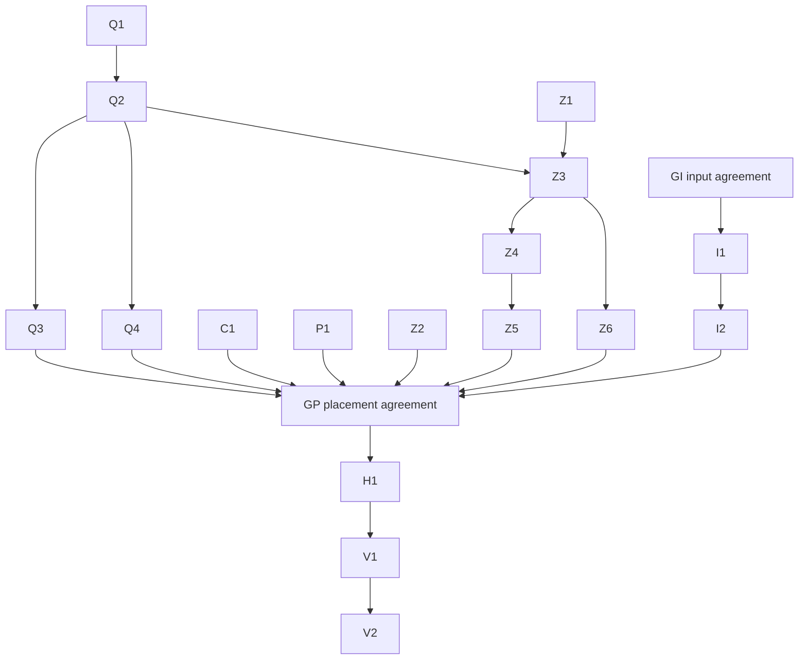
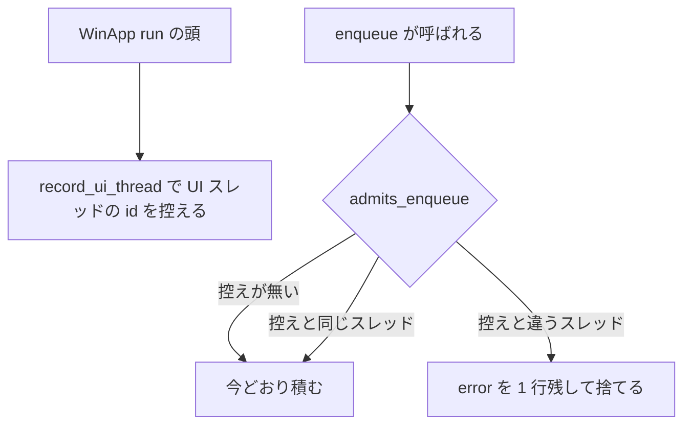
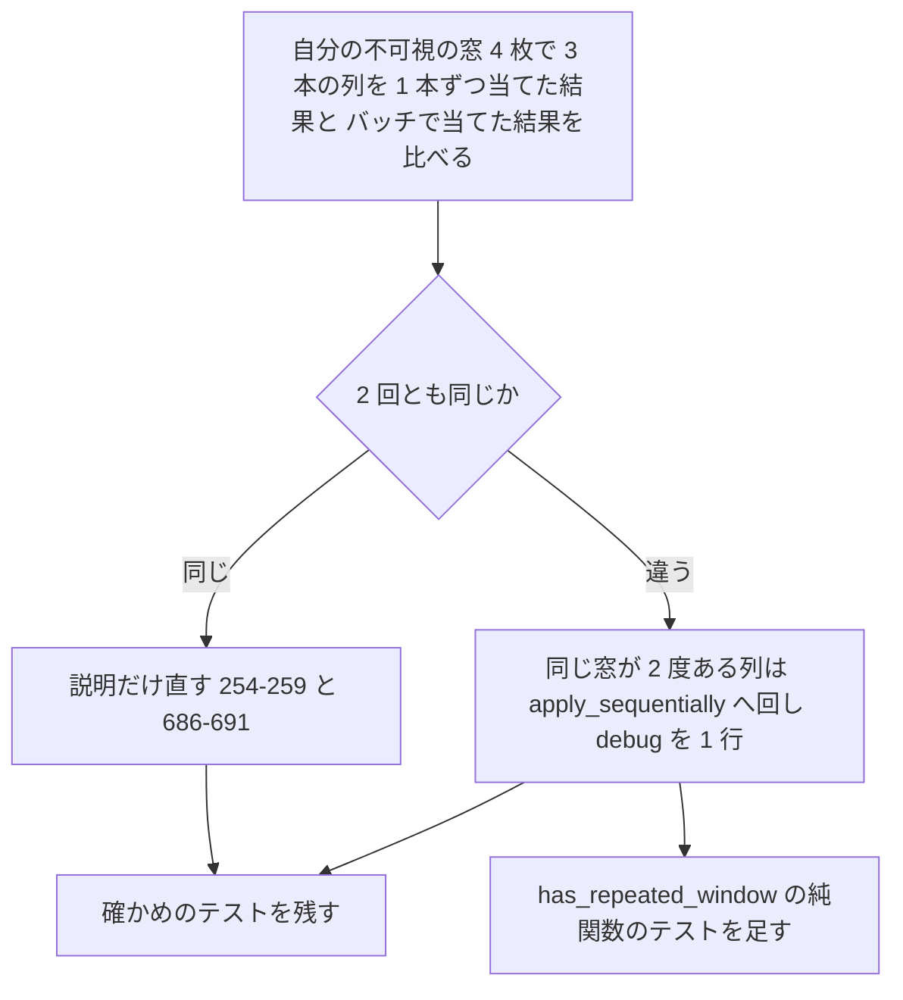
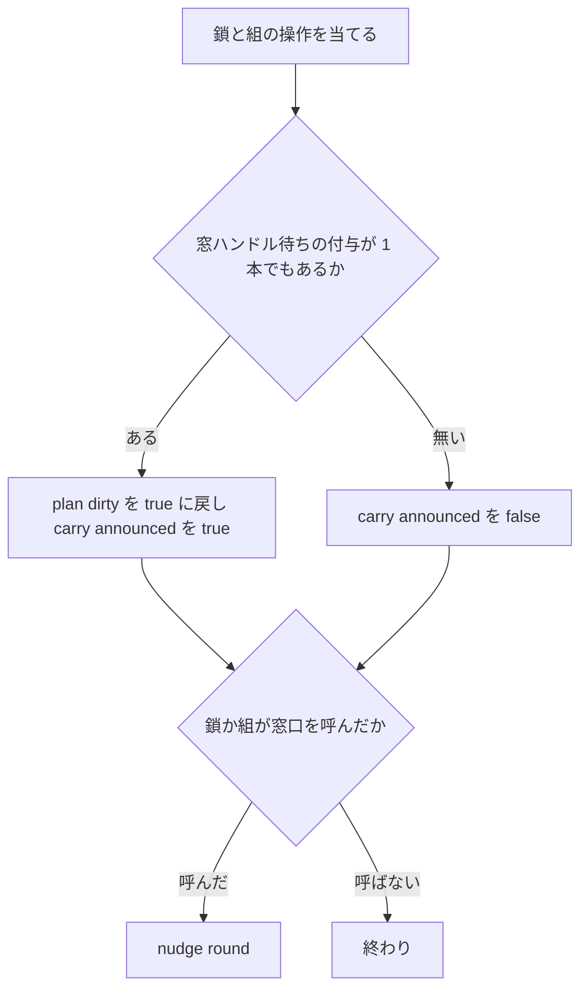

# 設計書: audit-wintf-window

## 概要

この spec は、wintf の窓と窓の手続き（`crates/wintf/src/ecs/window/`・`window_proc/`・69 ファイル）に ponytail の audit をかけて出た 63 件（必ず直す 6・直したほうがよい 47・できれば 10）を、討議の決めのとおり **63 件とも**、それぞれいちばん小さな完全な変更で直す。直し方の大半は「説明を今の事実に合わせる」「写しを 1 つにまとめる」「誰も使わない口を消す」で、残りは記録の無いまま黙って守られない・戻らない道を塞ぐ直しと、壊れても落ちないテストの穴を埋める直しである。

- **目的**: 受け持つ範囲から、バグ・危ない所・負荷に弱い所・テストの抜け・遅い所・要らないコードを無くす（開発者「とにかく指摘事項は全部直す」）。
- **使う人**: areka の開発者（wintf の上に areka を作る）と、crates.io の `wintf` の利用者。
- **影響**: 公開の口がいくつか消えるか形が変わる（0.x の壊す変更・「公開の口の変化」）。依存の増減は 0。areka の本番の振る舞いが変わる見込みは、ほぼ 0（6 番の離脱の見張りは areka では `cursor/answer.rs` が既に毎回掛けている・8 番の外し方は areka の本番に無い・15 番は列挙の失敗の稀な場面・41 番は空のキューを流さなくなるだけ・44 番は記録が増えるだけ・45 番は 2 つの枝を 1 つにするだけ）。外の使い手の振る舞いが正しい側へ変わるのは 1・2・3・4・6・7（枝による）・8 番。

各指摘の場所の行・困ること・直し方の案は `research.md` の 3 節が正本で、この文書は番号で引く。設計の段の調べと決めは `research.md` の 12 節にあり、設計で案を変えた所・決めた所は、この文書だけで読めるように書く。

### Goals

- 確定した 63 件を、3 つの組とも全部直す（要件 3.1・3.2）。残すと裁定した指摘は 0 件、ほかのウェーブへ回した指摘も 0 件。
- 直したバグと危ない所の 1 件ずつに、壊れたら落ちる決定論のテストを持つ（要件 5.5・5.6）。
- 直した後に同じ作法で audit をかけ直し、新しい指摘が 0 件になるまで直す（要件 5.1〜5.4）。
- 全体テスト `pwsh -NoProfile -File tools/test-all.ps1` を緑にする（要件 5.7）。
- 変わった公開の口の一覧を記録に残す（要件 3.5）。

### Non-Goals

- 申し送り ⑵（`WindowCreationFailed` を外して立ち直らせる側）と ⑶（DPI の変わり目で中心を保つ動き）は指摘にしない（討議の決め 6）。⑶ は説明だけを 16 番で直す。
- A-1（実窓の重なり順の間欠の赤）の隔離と根治。`#[ignore]` と `require_explicit_real_window_run()` の隔離は変えず、「測り方の問題か欠陥か」の決着は台帳の `zorder-chain-residue` に残す（討議の決め 7）。
- 28 番の ⒝（`ExplicitMaintenance`・`raise_assist`・`RaisedAbove`／`RaisedBelow` を消す）。⒜ の説明の直しだけを行う（討議の決め 2）。
- `audit-wintf-input` の持ち物（`ecs/drag/`・`ecs/pointer/`・`ecs/clickthrough/`）の直し。ただし 6 番の型 `WindowPointerTracking` を消す分だけは、申し合わせのうえでこちらが行う。
- 新しい機能。clippy の指摘の機械的な直し（`clippy-199-lints`）。`vendors/` の下。

## 境界の約束

### この spec が持つもの

- `crates/wintf/src/ecs/window/`・`window_proc/` の git の管理下のファイル全部（着手のとき 69 本・`research.md` 1 節）と、その指摘の直し。
- 直しのために足すテストと直すテスト（新しいファイルは「ファイルの構成の計画」の 4 本）。
- 範囲の外への最小の追従（要件 6.1）。次の行だけを直す。
  - `crates/wintf/src/runtime/mod.rs`: `WinApp::run` の頭に UI スレッドの控えの 1 行（1 番）。持ち主の `audit-wintf-runtime` は完了済み・走っているセッションは無い。
  - `crates/wintf/src/ecs/layout/systems/monitor_systems.rs`: `apply_monitor_snapshot` の頭の 0 台の判定と `detect_display_change_system` の戻り・記録（15 番）と、そのテスト 1 本（既存のテストのファイル）。持ち主の `audit-wintf-layout-widget` は完了済み。
  - `crates/wintf/src/runtime/window_factory_creation_tests.rs`: `create_windows` を直に呼ぶ 2 か所を `run_system_once` へ（52 番）。持ち主は完了済み。
  - `crates/wintf/src/ecs/pointer/types/mod.rs`・`ecs/pointer/types/tests.rs`・`ecs/mod.rs`: 型 `WindowPointerTracking` とそのテストと再公開を消す（6 番）。持ち主の `audit-wintf-input` と申し合わせ済み（2026-11-14）・実装の直前に確かめ直す。
  - `WindowHandle {` を組む 65 ファイル（wintf 31・`crates/areka` 20・`crates/areka-placement` 14）の `instance` の 1 欄と、`runtime/window_factory.rs` の `get_instance_handle()` の呼び出しと説明（11 番）。`areka-placement` の 14 本はタスクの前に申し合わせる。
  - 台帳 `.kiro/specs/zorder-chain-residue/brief.md` の書き直し（B-6 を閉じる・隔離は 3 本・行 `:767` は今 `:789`）（討議の決め 7）。

### 境界の外

- 申し送り ⑵・⑶ の振る舞い（`runtime/window_factory.rs` の `WindowCreationFailed` の扱い・`window_proc/dpi_helpers.rs` の中心を保つ補正）。
- A-1 の隔離（`#[ignore]` の属性があること・本文 1 行目の `require_explicit_real_window_run()`・環境変数 `AREKA_WINTF_REAL_WINDOW_ZORDER`）と、その根治。
- `ecs/drag/` の全部（`check_threshold` とそのテスト 5 本はあちらが残す・44 番の空の取っ手の出どころ `drag/dispatch.rs:102`・`drag/state/mod.rs:383` も触らない）。`ecs/pointer/` は 6 番の型の削除のほか触らない。
- C20 の約束 ⑶ の型と綴り: `MonitorRecord`（`window/transition_diag.rs`）・`Monitor`（`window/monitor.rs`）は欄もメソッドも足さず変えない。`DESPAWNED_SKIP_TAG`（`[despawn-skip]`）とその説明（`window_proc/lifecycle.rs:34`・`:38`）、記録の的 `areka_placement::diag` を名指す綴り（`window_proc/window_pos_tests.rs` の絞り込み）は変えない。
- `audit-placement-core` の指摘 73（`zorder_chain.rs` の `ChainPlan.absent` の形）と 67（`transition_diag.rs` の `MISSING` の公開）。こちらが `zorder_chain.rs` で触るのは説明の `:115`・`:547` だけ。
- `crates/wintf/src/ecs/api.rs` のテストにある組の下ごしらえの写し（範囲の外・32 番の対象にしない）。
- `vendors/`・`Cargo.toml`・`Cargo.lock`。

### 使ってよいもの

- 今ある依存だけ。新しい依存も `windows` の新しい機能も足さず、`Cargo.lock` を変えない（要件 7.5・C20 の約束 ⑸）。
- `windows` 0.62 の既存の機能の中の API と定数（`AdjustWindowRectExForDpi`・`TrackMouseEvent`・`DeferWindowPos` の 3 つ・`GetWindow`・`WA_ACTIVE`／`WA_INACTIVE`・`DragQueryFileW`）。`GlobalAlloc` だけはテストの中の `#[link(name = "kernel32")] extern "system"` で宣言する（`Win32_System_Memory` を足さないため）。
- 標準の `std::sync::OnceLock`・`std::thread::ThreadId`。
- bevy_ecs の既存の口（排他 system の `&mut QueryState`・`RunSystemOnce`・`Ref::is_added`）。
- 開発用の既存の `log-capture-kit`（`capture`）と `crate::ecs::test_support::capture_under_filter`。
- 依存の向きは今のまま: `runtime` → `ecs`（`create_windows` → `EcsWindowFactory` の上向きの 1 本も今のまま）。`runtime/mod.rs` が呼ぶのは `ecs::window` の `record_ui_thread` の 1 つだけ。テストの道具は `#[cfg(test)]` の中にだけ置き、本番のコードから呼ばない。

### 見直し直すきっかけ

- `audit-wintf-input` の着地（2 段目・こちらの後の見込み）: あちらが先に着いたら、`window_proc/mouse_move.rs` の `Preparing` の腕（62 番）・`dragging_window_origin`（`initial_inset` の名替え）・`mouse_click_tests.rs`／`mouse_dblclick_wheel_tests.rs` の `DragStateSnapshot`・`DragConfig.right_button` の行を読み直してから I1・I2 を当てる。
- `audit-placement-core`・`audit-placement-follow` の着地: H1（11 番）の前に `areka-placement` の 14 ファイルを読み直す。`zorder_chain.rs:115`・`:547` の行がずれていれば名前で探す。
- `wintf-visual-damage-redraw` の着地: `crates/wintf/tests/graphics/` の 4 本（`device_lost_recovery_test.rs`・`draw_tree_systems_test.rs`・`init_window_graphics_test.rs`・`window_pos_systems_test.rs`）を H1 の前に読み直す。後に着いた方が rebase する。
- `wintf-winmsg-executor-import` の着地: `runtime/window_factory.rs` の `crate::executor::util::get_instance_handle` の道が変わっていないか、H1 の前に確かめる（取りまとめの測りではソースの重なり 0）。
- 7 番の門の結果（Q4 の手順 1）: 「違う」なら `apply_sequentially` への回し、「同じ」なら説明の直しだけ。どちらでも確かめのテストは残る。
- 公開の口を消した・変えたとき（「公開の口の変化」）: `areka`・`areka-placement` ほか wintf を使う crate の全体テスト。
- 範囲のファイルの増減（要件 1.2）: この spec は範囲に 4 本足す（`command_test_support.rs`・`zorder_pair_test_support.rs`・`window_pos_decision_tests.rs`・`mouse_move_dispatch_tests.rs`）。V2 で数え直し、かけ直しの audit の対象に入れる。

## 作りの全体

### 今の作り

- `window/` は窓の部品（`Window`・`WindowStyle`・`WindowHandle`・`WindowPos`・`DPI`・`Monitor`）、窓の書き込みをスレッドごとのキューに積んで tick の後に `DeferWindowPos` の 1 バッチで当てる仕組み（`command.rs`）、窓の重なり順を守る 2 つの仕組み（組＝`zorder_pair*`・鎖＝`zorder_chain*`）、常に手前の帯（`window_band.rs`）、DPI の移り変わりの記録（`transition_diag.rs`）を持つ。
- `window_proc/` は OS からの窓のメッセージを受けて ECS へ写す。入口は `runtime/wndproc_bridge.rs` の `make_wndproc` だけで、World が書き込みのために借りられている間はハンドラを呼ばない（`research.md` 12.1 の 41 番）。
- テストは本番のファイルの兄弟の `*_tests.rs` を `#[path]` で子のモジュールにする形。共有の道具は `<stem>_test_support.rs`（`structure.md`）。
- 守る決まり: 記録の無い失敗の道を作らない・1 ファイル 1,000 行・GPU のテストは実 GPU・終了の道は正規の手順のまま。

### 組と順

直しを、触るファイルのまとまりで「組」に分ける（1 組＝1 タスク・合計 17）。矢印でつながる組は順に回し、同じファイルを触ってよい。矢印でつながらない組どうしは同じファイルを触らない。門（GI・GP）は申し合わせの確かめで、それ自体はコードを変えない。



- **選んだ形**: 指摘をファイルのまとまりで組にする（brief の Boundary Candidates の 2 つ目）。1 本の spec で進める（討議の決め 8）。17 タスクで 20 に収まるので 2 本目は切らない。
- **なぜ Q2 が Z3 の前か**: 12 番で `SetWindowPosCommand::flush` を消すと、組の実窓テストの 8 本（43 か所）が呼び名を `flush_window_pos_commands` へ替える必要がある。Q2 がその 1 行ずつの置き換えをし、Z3 はその上で下ごしらえをまとめる。
- **なぜ Z1 が Z3 の前か**: 3 番のテストを足す `zorder_chain_apply_tests.rs` は、32 番の写しの 1 つ（`:146`）でもある。
- **なぜ H1 が最後の直しか**: 11 番は 65 ファイルに 1 欄ずつ触り、並走の spec の持ち物を含む（討議の決め 3）。この spec が足すテストのファイルも `WindowHandle {` を組むので、全部の直しが済んでから数え直して 1 回で消す。その後に記録（V1）とかけ直し・全体テスト（V2）を置くのは、かけ直しの audit が 11 番の直しも読むため。

### 着手の門（申し合わせ）

| 門 | いつ | 相手 | 確かめること | 合わなければ |
|---|---|---|---|---|
| GI | I1 の頭 | `audit-wintf-input` | ⒜ 6 番＝型 `WindowPointerTracking`（`ecs/pointer/types/mod.rs:206`・`tests.rs:122-125`・`ecs/mod.rs:35` の再公開）をこちらが丸ごと消す・あちらは触らない ⒝ 62 番 ⒜＝あちらは `check_threshold` とテスト 5 本を残す・こちらが呼ぶ ⒞ あちらがこちらのファイルに入れるのは機械的な追従だけ（`initial_inset`→`initial_window_pos`・`DragStateSnapshot` を消した読み手の型の名・`DragConfig.right_button` のテストの 1 行・`push_pointer_sample` が `i32` なら 2 行）で、`local_point` の構築の場所は変えない（2026-11-14 の申し合わせ） | 止めて取りまとめへ知らせる（6 番の型を消す・62 番 ⒜ の呼び出しを、確かめが取れるまで当てない） |
| GP | H1 の頭 | `audit-placement-core`・`audit-placement-follow` | `areka-placement` の 14 ファイルから `instance` の 1 欄を消すこと（`follow_test_support.rs:25` があちら follow、残る 13 本が core）。こちらが先に着地し、あちらが後で載せる（core は 2026-11-14 に了解済み） | 止めて取りまとめへ知らせる（要件 6.2） |
| Q4 の手順 1 | Q4 の頭 | Windows そのもの | 7 番の実窓の確かめ（下の「流れ」） | 結果で枝を選ぶ（止まらない） |

### 技術の層

| 層 | 選ぶもの・版 | この spec での役目 | 補足 |
|---|---|---|---|
| Win32 | `windows` 0.62（既存の機能のまま） | 枠の厚み・離脱の見張り・バッチの確かめ・投げ込み | `GlobalAlloc` はテストの中の宣言 |
| ECS | bevy_ecs（既存の版） | 排他 system の問い合わせの状態・追加の印 | `&mut QueryState`・`Ref::is_added` |
| スレッド | `std::sync::OnceLock<ThreadId>` | UI スレッドの控え | プロセスで 1 つ |
| ログの確かめ | `log-capture-kit`（開発用・既存） | 行の数を数える | TRACE を含む全水準を捕捉 |

## ファイルの構成の計画

### ディレクトリ（触る所だけ）

```
crates/wintf/src/
├── runtime/
│   ├── mod.rs                              # Q4: WinApp::run の頭に record_ui_thread（1）
│   ├── window_factory.rs                   # H1: instance と get_instance_handle（11）
│   └── window_factory_creation_tests.rs    # C1: run_system_once（52）
└── ecs/
    ├── mod.rs                              # I1: WindowPointerTracking の再公開を消す（6）
    ├── layout/systems/monitor_systems.rs   # P1: 0 台の列挙で表を変えない（15）
    ├── pointer/types/{mod.rs, tests.rs}    # I1: WindowPointerTracking を消す（6）
    ├── window/
    │   ├── mod.rs                          # Z3: 共有の下ごしらえの宣言 1 行
    │   ├── command.rs                      # Q1・Q2・Q4
    │   ├── command_test_support.rs         # Q1: 新規（13）
    │   ├── zorder_pair_test_support.rs     # Z3: 新規（32・19）
    │   └── …                               # 各組の表
    └── window_proc/
        ├── window_pos.rs                   # Q2
        ├── window_pos_decision_tests.rs    # Q2・Q3: 新規（41・42）
        ├── mouse_move.rs                   # I1・I2
        ├── mouse_move_dispatch_tests.rs    # I1: 新規（6・44・48）
        └── …                               # 各組の表
```

### 新しく作るファイル

| ファイル | 組 | 中身 | 宣言する所 |
|---|---|---|---|
| `ecs/window/command_test_support.rs` | Q1 | 書き込みのテストの道具の正本（`fake_hwnd`＝`command_transition_tests.rs` の 0x20／0x21 を潰さない版・`clean_slate`・`transition_lines`・`lines_of_kind`・`emit_control`・`SIGNOFF_DIRECTIVES`・`CONTROL_LINE`） | `command.rs` に `#[cfg(test)] #[path = "command_test_support.rs"] mod test_support;` |
| `ecs/window/zorder_pair_test_support.rs` | Z3 | 組の実窓テストの下ごしらえの正本（`research.md` 32 番の一覧・実窓の門の定数 `AREKA_WINTF_REAL_WINDOW_ZORDER` と `require_explicit_real_window_run`）。書き込みの記録の文言は `command.rs` の `WINDOW_WRITE_LOG_MESSAGE` を使い、手写ししない | `window/mod.rs` に `#[cfg(test)] mod zorder_pair_test_support;`（項目は `pub(super)`＝`window` とその子孫から見える） |
| `ecs/window_proc/window_pos_decision_tests.rs` | Q2・Q3 | `WM_WINDOWPOSCHANGED` の判断の決定論テスト（41 番の 1 本・42 番の 3 本） | `window_proc/window_pos.rs` に `#[cfg(test)] #[path] mod decision_tests;` |
| `ecs/window_proc/mouse_move_dispatch_tests.rs` | I1 | 配送の経路で確かめる `WM_MOUSEMOVE`／`WM_MOUSELEAVE` のテスト（6・44・48 番） | `window_proc/mouse_move.rs` に `#[cfg(test)] #[path] mod dispatch_tests;` |

新しい本番のファイルは作らない。消すファイルは無い（消すのはファイルの中の項目だけ）。

### 直すファイル（組ごと）

各組の「触るファイル」は、その組と、矢印でつながる組だけが触る。下の「部品と口」の各組の表が、番号ごとの直しの正本。パスは `crates/wintf/src/ecs/` から（範囲の外は全体のパス）。

| 組 | 番号 | 触るファイル |
|---|---|---|
| Q1 | 13 | `window/command.rs`（宣言 1 行）・`window/command_batch_tests.rs`・`command_coalesce_tests.rs`・`command_transition_tests.rs`（＋新規 1） |
| Q2 | 12・20・41・59 | `window/command.rs`・`command_transition_tests.rs`・`transition_diag.rs`・`transition_diag_tests.rs`・`window_proc/window_pos.rs`・`window_proc/window_pos_transition_tests.rs`・呼び名の置き換えだけ＝`window/window_band_pipeline_real_tests.rs`・`zorder_pair_maintain_always_on_top_tests.rs`・`zorder_pair_maintain_multipair_tests.rs`・`zorder_pair_maintain_release_tests.rs`・`zorder_pair_maintain_survivor_tests.rs`・`zorder_pair_maintain_tests.rs`・`zorder_pair_measure_tests.rs`・`zorder_pair_sink_tests.rs`（＋新規 `window_pos_decision_tests.rs`） |
| Q3 | 42・43・49 | `window_proc/window_pos_decision_tests.rs`・`window_proc/dpi_helpers_tests.rs`・`window_proc/drop_files_tests.rs` |
| Q4 | 1・7 | `window/command.rs`・`command_threadlocal_tests.rs`・`command_batch_tests.rs`・`crates/wintf/src/runtime/mod.rs` |
| C1 | 8・9・10・52 | `window/window_handle.rs`・`window/components.rs`・`window_proc/lifecycle.rs`（`:80-87` の段落だけ）・`window/window_system.rs`・`crates/wintf/src/runtime/window_factory_creation_tests.rs` |
| P1 | 2・14・15・16・17・18・21 | `window/window_pos/mod.rs`・`window/window_pos/tests.rs`・`window/dpi.rs`・`window/monitor.rs`（自由関数と冒頭の説明だけ・`Monitor` は変えない）・`layout/systems/monitor_systems.rs` |
| Z1 | 3・22・23・24・26・27・53・54 | `window/zorder_chain_apply.rs`・`zorder_chain.rs`（説明 `:115`・`:547` だけ）・`zorder_chain_apply_tests.rs`・`zorder_chain_diag.rs`・`zorder_chain_diag_tests.rs`・`zorder_pair_diag.rs`・`zorder_chain_tests.rs` |
| Z2 | 25 | `window/zorder_chain_order_tests.rs`・`zorder_chain_order_lifecycle_tests.rs`・`zorder_chain_order_outsider_tests.rs`・`zorder_chain_order_inversion_tests.rs` |
| Z3 | 19・32 | `window/mod.rs`・`zorder_pair_maintain_tests.rs`・`_multipair_tests.rs`・`_detach_tests.rs`・`_survivor_tests.rs`・`_always_on_top_tests.rs`・`_release_tests.rs`・`zorder_pair_sink_tests.rs`・`zorder_pair_measure_tests.rs`・`zorder_pair_establish_tests.rs`・`zorder_pair_establish_release_tests.rs`・`zorder_chain_apply_tests.rs`・`window_band_real_tests.rs`・`window_band_pipeline_real_tests.rs`（＋新規 1） |
| Z4 | 4・28・29・30・31 | `window/zorder_pair.rs`・`zorder_pair_establish.rs`・`zorder_pair_establish_tests.rs`・`zorder_pair_tests.rs`・`zorder_pair_deferred_vocabulary_tests.rs`（`:321` の説明だけ） |
| Z5 | 5・33・34・35・55・56・57 | `window/zorder_pair.rs`・`zorder_pair_sink.rs`・`zorder_pair_sink_tests.rs`・`zorder_pair_record_tests.rs` |
| Z6 | 36・37・38・39・40・58 | `window/zorder_pair_maintain.rs`・`zorder_pair_maintain_always_on_top_tests.rs`・`zorder_pair_maintain_detach_tests.rs`・`zorder_pair_maintain_tests.rs` |
| I1 | 6・44・45・48・50（move）・62 | `window_proc/mouse_move.rs`・`pointer/types/mod.rs`・`pointer/types/tests.rs`・`ecs/mod.rs`（＋新規 `mouse_move_dispatch_tests.rs`） |
| I2 | 46・47・50（残り）・51・60・61・63 | `window_proc/mouse_click.rs`・`mouse_dblclick_wheel.rs`・`mouse_dblclick_wheel_tests.rs`・`mouse_move.rs`（47 の呼び出しだけ）・`keyboard.rs` |
| H1 | 11 | `window/window_handle.rs`・`crates/wintf/src/runtime/window_factory.rs` と、`git grep -l "WindowHandle {"` の全ファイル（着手のとき 65 本＋この spec が足したテスト） |
| V1 | 記録 | `.kiro/specs/audit-wintf-window/research.md`・`.kiro/specs/zorder-chain-residue/brief.md` |
| V2 | 検証 | `.kiro/specs/audit-wintf-window/research.md`（かけ直しの記録） |

## 流れ

### 窓の書き込みを積むとき（1 番）



- 控えは `WinApp::run` の頭で 1 度だけ立つ（`get_or_init`）。テストの実行ファイルは `WinApp::run` を呼ばないので、控えは立たず今どおり（`research.md` 12.1）。
- 判断は `admits_enqueue` が `tick_wake::mark` と合流より先に行う（捨てる指令で次の画面更新を起こさない）。

### 同じ窓が 2 度入った列（7 番・Q4 の手順 1 が門）



- 列は `[A を B の後へ][C を A の後へ][A を D の後へ]`（Z だけ・`SWP_NOMOVE | SWP_NOSIZE | SWP_NOACTIVATE`）。比べるのは `GetWindow(GW_HWNDNEXT)` で読む 4 枚の相対の順だけ。1 本ずつの側は `guarded_set_window_pos` を順に呼ぶ。毎回、同じ初めの順に並べ直してから当てる。
- 残すテスト（`command_batch_tests.rs`）は、どちらの枝でも「キューに積んで `flush_window_pos_commands` で流した結果＝1 本ずつ当てた結果」を主張する。

### 鎖の持ち越し（3 番・53 番）



- 持ち越しの判断を `acted` の外へ出す。書けた繋ぎは帳簿に載るので、次の巡の差分には待ちの分だけが残る。待っている間は窓口を呼ばず、見送りの記録は待ち始めの 1 回だけ（`carry_announced`）。後押しの規則（鎖が書けたら必ず・組だけが書けたら組の分）は今のまま。

## 要件との対応

| 要件 | 要約 | 担う所 | 流れ・口 |
|---|---|---|---|
| 1.1 | 範囲を数えて記録 | `research.md` 1 節（69 本）・V2 で数え直し | — |
| 1.2 | 増減を測り直す | V2（新規の 4 本を入れて数え直す・「見直し直すきっかけ」） | — |
| 1.3 | 範囲だけに audit | `research.md` 3 節 | — |
| 1.4 | 上限なし・全部読む | `research.md` 1 節（69/69）・V2 も同じ作法 | — |
| 1.5 | 番号・組・件数 | `research.md` 3 節（6・47・10） | — |
| 1.6 | 確定した一覧 | requirements の「確定した指摘の一覧」 | — |
| 1.7 | A-1・B-6 との重なり | Z3・Z6（32・19・38・40 は説明と置き場だけ・36 で B-6）・V1（台帳の brief を書き直す） | — |
| 1.8 | 20 タスクを越えるとき | 17 タスクで収まる＝2 本目は切らない（討議の決め 8） | 組と順 |
| 2.1 | 申し送り 4 件の判断 | `research.md` 4 節 | — |
| 2.2 | 4 件の中身 | ⑴＝2 番（P1）・⑵＝指摘にしない・⑶＝16 番（P1・説明だけ）・⑷＝41 番（Q2） | — |
| 2.3 | 扱いの確定 | requirements の「申し送り 4 件の扱い」 | — |
| 2.4 | 範囲の外へ及ぶとき | ⑴・⑷ は範囲の中で閉じる（`research.md` 3 節の 2・41 番） | — |
| 3.1 | 3 つの組とも全部直す | Q1〜Q4・C1・P1・Z1〜Z6・I1・I2・H1 | 部品と口の各表 |
| 3.2 | 残すのは裁定したものだけ | 残す 0 件・回す 0 件 | — |
| 3.3 | 最小で完全・消せるものは消す | 各表の直し（消すものは `research.md` 12.3 の「削り」） | — |
| 3.4 | 呼び出し元まで直し切る | 各表の「呼び手・テスト」の欄・Q2 の呼び名の置き換え・H1 の数え直し | — |
| 3.5 | 公開の口の一覧 | 「公開の口の変化」・V1 で実物と突き合わせて `research.md` へ | — |
| 4.1 | 残す 3 種類は議題に | 討議で 0 件と確定。実装中に当たる直しが出たら止めて議題にする（「失敗の扱い」の止まる条件） | — |
| 4.2 | ⑶ は ukadoc で確かめる | 当たる指摘は 0（`research.md` 6 節の投げ込みの項）。49 番はテストを足すだけ | — |
| 4.3 | 当たらないものは直す | 63 件とも直す | — |
| 4.4 | 裁定の記録 | requirements の一覧（残す 0 件）・V2 の記録 | — |
| 5.1 | かけ直し | V2 | — |
| 5.2 | 0 件まで | V2（新しい指摘は要件 3・4 の扱いで直す） | — |
| 5.3 | 5 回目で打ち切り | V2 の判定の規則 | — |
| 5.4 | 記録の中身 | V2（読んだ数＝範囲の数・回ごとの 3 組の件数・判定・残す番号＝無し） | — |
| 5.5 | バグ・危ない所ごとのテスト | 「テストの方針」の表 | — |
| 5.6 | 決定論 | 純関数の分岐・偽の OS・自分の不可視の窓・ログを数える（「テストの方針」） | — |
| 5.7 | 全体テストを緑 | V2（排他テストの机を通す） | — |
| 6.1 | 呼び出し元を全部直す | 「この spec が持つもの」の範囲の外の追従・Q2・H1 | — |
| 6.2 | 走っている spec と申し合わせ | 門 GI・GP・「申し合わせと着地の順」 | 着手の門 |
| 6.3 | 消す前に参照を確かめ記録 | 各組の実装の前に `git grep`（テスト・fixture・設定・文字列を含む）・結果を V1 で `research.md` へ | — |
| 6.4 | 範囲の外の要らない所を直さない | 「境界の外」（`api.rs` の写し・`ecs/drag/` を触らない） | — |
| 6.5 | `vendors/` を触らない | 触らない | — |
| 7.1 | `MonitorRecord`・`Monitor` を変えない | 15 番は自由関数の中だけ・20 番は説明だけ・`Monitor` の欄もメソッドも足さない | — |
| 7.2 | `DESPAWNED_SKIP_TAG` を変えない | 8 番は `lifecycle.rs:80-87` の段落だけ | — |
| 7.3 | `areka_placement::diag` の綴りを変えない | `window_pos_tests.rs` の絞り込みに触らない | — |
| 7.4 | 変えずに直せないとき | 当たる指摘 0 件（`research.md` 7 節） | — |
| 7.5 | 依存を足さない・`Cargo.lock` を変えない | `GlobalAlloc` はテストの中の宣言（49 番） | — |
| 7.6 | 依存が要ると分かったとき | 当たる直し無し。出たら止めて議題にする | — |
| 8.1 | 1,000 行 | 新規のテストは兄弟のファイルへ・978 行と 977 行の 2 本は減る側か行の増えない直しだけ（「1,000 行の見積もり」） | — |
| 8.2 | 記録の無い失敗の道を作らない | 「失敗の扱い」（1・15・17・44 を塞ぐ） | — |
| 8.3 | 終了の道は正規のまま | 8 番は破棄の道（登録簿の掃除）を変えず、投げても仕事をしない `WM_CLOSE` を消すだけ | — |
| 8.4 | 実機の根は `target` の下 | 足すテストは一時のフォルダを作らない（49 番のパスは文字列だけで、ファイルを作らない） | — |
| 8.5 | GPU は実 GPU | 範囲のテストは GPU を使わない。全体テストは実 GPU のまま | — |
| 8.6 | 文字化けは読む側を直す | 当たる直し無し。49 番は日本語のパスを UTF-16 のまま比べる | — |

## 部品と口

「部品」はここでは直しの組。新しい本番の口は 2 つ（1 番）だけで、どちらも `pub(crate)` 以下。テストの道具は `#[cfg(test)]`。

| 組 | 狙い | 番号 | 先に要るもの | 新しい口 |
|---|---|---|---|---|
| Q1 | 書き込みのテストの道具を 1 つに | 13 | — | `command_test_support` の 7 項目（`#[cfg(test)]`） |
| Q2 | 流しの口を 1 つにし、③ を消す | 12・20・41・59 | Q1 | なし（`window_pos_transition_tests.rs` の道具窓を `pub(super)`） |
| Q3 | 窓の手続きの判断と投げ込みのテスト | 42・43・49 | Q2 | なし |
| Q4 | 積み込みのスレッドと重なった列 | 1・7 | Q2 | `record_ui_thread`・`admits_enqueue`（・枝により `has_repeated_window`） |
| C1 | 窓の部品の名残と生成の問い合わせ | 8・9・10・52 | — | なし（`create_windows` の引数が 1 つ増える） |
| P1 | 生成の座標・窓の位置・DPI・モニターの説明と失敗 | 2・14・15・16・17・18・21 | — | なし |
| Z1 | 鎖の持ち越しと説明 | 3・22・23・24・26・27・53・54 | — | なし（`zorder_pair_diag` の 2 項目を `pub(crate)`） |
| Z2 | 鎖の実窓テストの足場を 1 つに | 25 | — | なし |
| Z3 | 組の実窓テストの下ごしらえを 1 つに | 19・32 | Q2・Z1 | `zorder_pair_test_support`（`#[cfg(test)]`） |
| Z4 | 組の確立と案の説明 | 4・28・29・30・31 | Z3 | なし |
| Z5 | 沈降の観測と組の記録 | 5・33・34・35・55・56・57 | Z4 | なし（`is_behind_foreground` の引数が 1 つ増える） |
| Z6 | 組の維持の説明と切り離しのテスト | 36・37・38・39・40・58 | Z3 | なし |
| I1 | 移動と離脱 | 6・44・45・48・50（move）・62 | GI | なし |
| I2 | 押下とダブルクリック | 46・47・50（残り）・51・60・61・63 | I1 | なし |
| H1 | `WindowHandle.instance` を消す | 11 | GP・ほかの全部 | なし |
| V1 | 記録 | 3.5・1.7・6.3 | H1 | — |
| V2 | 検証 | 1.2・5.1〜5.7 | V1 | — |

各表の「直し」の欄で「research の案」とあるものは、`research.md` 3 節のその番号の「直し方の案」をそのまま当てる。違う所・決めた所だけを書く。

### 窓の書き込みのキュー（Q1〜Q4）

#### Q1 書き込みのテストの道具

| 番号 | 直し | 呼び手・テスト |
|---|---|---|
| 13 | 7 項目を `command_test_support.rs` へ移し、3 本の写しを消して `use super::test_support::*` にする。`fake_hwnd` は `command_transition_tests.rs` の版（0x20 と 0x21 を潰さない）を正本にする | テストの中身と名前は変えない |

#### Q2 流しの口を 1 つにし、③ を消す

| 番号 | 直し | 呼び手・テスト |
|---|---|---|
| 12 | `SetWindowPosCommand::flush` の本体を `flush_window_pos_commands` へ移してメソッドを消す。`command.rs:823` ほかの説明の参照を自由関数へ。構造の検査 `command_transition_tests.rs:516` を `code.contains("pub fn flush_window_pos_commands()")` へ | 呼び名の置き換え＝`command.rs:936`・`command_transition_tests.rs` の 3 か所・組と帯の実窓テスト 8 本の 43 か所（1 行ずつ・中身は変えない）。直した後に木全体の `SetWindowPosCommand::flush` が 0 件 |
| 41 | research の案。`window_pos.rs:295-299` の呼び出しと説明を消し、`:41-44` を「① 借用 → ② 錠を取って流す」の 2 手順に。行番号で ③ を指す説明（`command.rs:22`・`command_transition_tests.rs:445`）は「`WM_WINDOWPOSCHANGED` の手順②」と名前で指す。入れ子の理由の説明 4 か所（`command.rs:709-714`・`transition_diag.rs:806-811`・`command_transition_tests.rs:444-446`・`window_pos_transition_tests.rs:594-596`）を「入れ子は錠を取らない直の流しの内側の ② で起きる」に。`FlushEpoch` は残す | 新しいテスト（`window_pos_decision_tests.rs`）＝下の口 |
| 59 | `window_pos.rs` の 2 つのハンドラの、意味の無い 2 段のブロック（`:83-84`／`:300-301`・`:387-388`／`:430-431`）を外す | 振る舞いは変わらない |
| 20 | research の案（`transition_diag.rs:81-84`・`:98-99`・`transition_diag_tests.rs:5` の数と列を今の定数に） | `MonitorRecord` には触れない |

- 道具窓の共有: `window_pos_transition_tests.rs` の `DISPATCH_TARGET`・`test_wndproc`・`register_test_class`・`create_test_window` を `pub(super)` にし、新しい兄弟ファイルから `super::window_pos_transition_tests::…` で使う（写さない）。

#### Q3 窓の手続きの判断と投げ込みのテスト

| 番号 | 直し | 呼び手・テスト |
|---|---|---|
| 42 | `window_pos_decision_tests.rs` に 3 本（research の案の ⑴〜⑶）。entity には `WindowHandle`・`WindowPos`・`BoxStyle`・`DPI` を付け、判断の本体へ届かせる | 本番は変えない |
| 43 | research の案（1 語） | |
| 49 | research の案。HDROP の組み立ては `research.md` 12.1 の形。パスは日本語を含む 2 本（存在しなくてよい・ファイルを作らない） | 本番は変えない |

#### Q4 積み込みのスレッドと重なった列

| 番号 | 直し | 呼び手・テスト |
|---|---|---|
| 1 | `enqueue` の説明に「`WinApp::run` を回すスレッド（UI スレッド）から呼ぶ。ほかのスレッドから積んだ指令は `error!` を残して捨てる」を書き、頭で `admits_enqueue` を呼ぶ。`runtime/mod.rs` の `run` の手順 1 の前に `crate::ecs::window::record_ui_thread();` を 1 行 | `enqueue` の呼び手（`zorder_pair_maintain.rs:530`・`graphics/systems/window_pos.rs:110`・`areka-placement` の `follow/window_move.rs:728`・`areka/examples/mock-shell.rs:403`）は直さない（全部 UI スレッド） |
| 7 | 「流れ」の門の手順。説明（`command.rs:254-259`・`:686-691`）は、どちらの枝でも今の事実に合わせて直す | 確かめのテストは `command_batch_tests.rs` |

```rust
// crates/wintf/src/ecs/window/command.rs（クレートの中だけ）
/// `WinApp::run` を回すスレッドの id。立つのは `record_ui_thread` の 1 回だけ。
static UI_THREAD: std::sync::OnceLock<std::thread::ThreadId>;

/// `WinApp::run` の頭で呼ぶ。2 度目からは何もしない（`get_or_init`）。
pub(crate) fn record_ui_thread();

/// 今のスレッドで窓の書き込みを積んでよいか。
/// 控えが無い（`WinApp::run` を回していない）か、控えと同じスレッドなら true。
/// 違うスレッドなら error! を 1 行（hwnd・控えのスレッド・今のスレッド）残して false。
fn admits_enqueue(ui_thread: Option<std::thread::ThreadId>) -> bool;

// 7 番で「違う」の枝のときだけ足す（非公開）
/// 同じ窓への指令が 2 本以上ある列か（`DeferWindowPos` が 1 項目へ畳む形）。
fn has_repeated_window(cmds: &[SetWindowPosCommand]) -> bool;
```
- 不変: `enqueue` は `admits_enqueue` が false の指令を、合流・`tick_wake::mark`・記録の行のどれにも渡さない。
- テストは控えのプロセス全体の値を立てない（同じ実行ファイルのほかのテストの積み込みを捨てさせないため）。判断は `admits_enqueue` に控えを渡して試す。

### 窓の部品（C1）

| 番号 | 直し | 呼び手・テスト |
|---|---|---|
| 8 | research の案（`PostMessageW` の 3 行と説明を消し、`:270` の debug の文と `:273` の説明を今の形に）。`lifecycle.rs:80-87` の段落は「陳腐化した id は、despawn から登録簿の掃除までの間に利用者や OS が投げた `WM_CLOSE` が届くと来る」に直す（`[despawn-skip]` の枝はそのまま要る） | `DESPAWNED_SKIP_TAG` とその説明（`:34`・`:38`）は触らない |
| 9 | research の案（`window_handle.rs` の中の `mod tests` に 1 本） | |
| 10 | research の案（`impl WindowStyle { from_hwnd }` を消す） | 使い手 0（`research.md` 3 節） |
| 52 | 問い合わせを型の別名 `PendingWindow`（今の `Pending` の 3 条件）にして関数の外へ出し、`create_windows(world: &mut World, pending: &mut QueryState<Entity, PendingWindow>)` にする。self-ref の確かめは今どおり先 | 直に呼ぶテスト（`window_system.rs:76`・`runtime/window_factory_creation_tests.rs:104`・`:111`）は `world.run_system_once(create_windows)` へ。`UISetup` への登録（`world/mod.rs:220`）は直さない |

### 生成の座標・位置・DPI・モニター（P1）

| 番号 | 直し | 呼び手・テスト |
|---|---|---|
| 2 | `to_window_coords_for_creation` を下の形に置き換える（今の矩形の道と `:396-397` の古い説明は消える）。形は変えない | 呼び手は `runtime/window_factory.rs:290` の 1 つ・`initial_pos_flags` は変えない。テストは `window_pos/tests.rs:233-247` を 2 本（位置だけ・大きさだけ・`WS_OVERLAPPEDWINDOW`）に改め、期待値は両方を与えたときの値から出す |
| 14 | research の案（`set_window_pos` を消し、`build_flags` の本体を `build_flags_for_system` へ移して私有の方を消す） | `build_flags_for_system` の呼び手 3 つ（`graphics/systems/window_pos.rs:76`・`zorder_chain.rs:479`・`zorder_pair_maintain.rs:207`）とテストは変わらない |
| 15 | `monitor.rs` の 2 か所の `warn!` を `error!`（1 台ぶんは `hmonitor`・`error = %e`）に。0 台の判定は `apply_monitor_snapshot` の頭に置き、0 台なら表を変えずに `None` を返す（戻り値を `usize` から `Option<usize>` に）。`detect_display_change_system` は `None` なら旗を下ろさずに戻る（次の刻みで読み直す）。0 台が続く間は `Local<bool>` で覚え、`warn!`（0 台）と頭の `info!`（構成の変化）は続きの最初の 1 回だけ出す（設計の討議の決め 2） | `enumerate_monitors` の形と、ほかの呼び手（`areka-placement`・examples・tests・`areka` の `ghost_session.rs`・collision-probe）は変わらない |
| 16 | research の案（説明に 2 行） | 振る舞いは変えない |
| 17 | research の案（説明を直し、`LayoutRoot` が無くて親を付けない枝に `debug!` を 1 行） | |
| 18 | `wintf::ecs::monitor` を `wintf::ecs::window::monitor` に直す（`rust,ignore` は外さない＝例は OS の列挙を呼ぶので doctest にしない） | |
| 21 | research の案 | |

```rust
// crates/wintf/src/ecs/window/window_pos/mod.rs（公開・形は今のまま）
/// 生成のときの窓の外枠の座標と大きさ（クライアント領域の値から）。
/// 位置も大きさも既定（CW_USEDEFAULT）なら、そのまま返す（API を呼ばない）。
/// それ以外は、空の矩形を AdjustWindowRectExForDpi に渡して枠の 4 辺を得て、
/// 与えられた側にだけ足す（位置＝左上へ left・top、大きさ＝幅へ right-left・高さへ bottom-top）。
/// 既定の側は CW_USEDEFAULT のまま返す。API が失敗したら今どおり warn! を残して元の値を返す。
pub fn to_window_coords_for_creation(
    &self,
    style: WINDOW_STYLE,
    ex_style: WINDOW_EX_STYLE,
    dpi: u32,
) -> (i32, i32, i32, i32);
```
- 位置が既定かは `x == CW_USEDEFAULT`、大きさが既定かは `width == CW_USEDEFAULT` で決める（`initial_pos_flags` と同じ）。両方を与えたときの値は今と同じ。

### 重なり順の鎖（Z1・Z2）

| 番号 | 組 | 直し | 呼び手・テスト |
|---|---|---|---|
| 3・53 | Z1 | 「流れ」の形。`ExecOutcome` を組まずにローカルの `acted`・`handle_missing` の 2 つにし、持ち越しの判断を `acted` の外へ出す。`:265-299` の長い説明を新しい規則（ハンドル待ちの付与が残る巡は印を戻す・書けた分は帳簿に載るので待つ間は窓口を呼ばない）に書き直す | `zorder_chain_apply_tests.rs:424` のテストに「印が残る」の主張を 1 つと、「ハンドルが付いた次の巡で `b←c` を張って印が落ちる」の 1 本を足す。印を立てるのは `areka` の `zorder_drain.rs:317` と本ファイルだけ（直さない） |
| 22 | Z1 | research の案 | |
| 23 | Z1 | research の案。`zorder_chain.rs:115` の `dirty` の説明は 3 番の後の規則（窓ハンドル待ちの付与が残る巡は、適用系が true へ戻す）に合わせる。`:547` はパスだけ | `audit-placement-core` の 73・67 の行には触れない |
| 24 | Z1 | research の案（2 行と、`zorder_chain_diag_tests.rs:440-452` の例の値を `nudged_hwnd=0xC0 insert_after=0xB0`） | 行の綴りは変わらない |
| 26 | Z1 | `zorder_pair_diag.rs` の `UNKNOWN` と `tristate_field` を `pub(crate)` にし、鎖の側は `hwnd_field` と同じ `use` で借りて自前の 2 つを消す | 字面は同じ（`-`） |
| 27 | Z1 | research の案 | |
| 54 | Z1 | research の案 | |
| 25 | Z2 | research の案。`zorder_chain_order_tests.rs` の `chain_schedule`・`spawn_window`・`publish_full_chain`・`place_after` と、`zorder_chain_order_lifecycle_tests.rs` の `schedule`・`spawn_scopes`・`balloon_offsets` を `pub(super)` にし、outsider と inversion は `use super::zorder_chain_order_tests::…`（4 本とも `zorder_chain_apply` の子）で借りる。少し変えた写し（inversion の 3 つ）は、違いが引数で表せるなら引数にし、表せないなら写しのまま残して理由を 1 行書く | `zorder_chain_order_tests.rs`（977 行）は行を増やさない（修飾子を足すだけ） |

### 重なり順の組（Z3〜Z6）

| 番号 | 組 | 直し | 呼び手・テスト |
|---|---|---|---|
| 32 | Z3 | research の案。`zorder_pair_test_support.rs` に一覧の項目を 1 つずつ置き、各テストのファイルの写しを消して `use crate::ecs::window::zorder_pair_test_support::…` にする。`measure_tests` の可視の前提の assert は共有の側に残す。書き込みの記録の文言は `WINDOW_WRITE_LOG_MESSAGE` を使う | テストの中身と名前は変えない（`crates/areka/src/placement_tests/zorder_inversion_branch_coverage_tests.rs:107-112` が `zorder_pair_maintain_release_tests.rs` のテストの名前を文字列で読む）。A-1 の 3 本の `#[ignore]` と本文 1 行目の門の呼び出しは動かさない |
| 19 | Z3 | 実窓の門（定数と `require_explicit_real_window_run`）は `zorder_pair_test_support.rs` に 1 つだけ置き、帯の 2 本と `always_on_top` が使う。帯の窓の手伝い（`create_ghost_shaped`・`destroy`・`in_band`・`relative_order`）は `window_band_real_tests.rs` を正本にして `pub(super)` にし、`window_band_pipeline_real_tests.rs` は `use super::real_tests::…` で借りる（2 本とも `window_band` の子） | 門の環境変数の名前は変えない |
| 4 | Z4 | 問い合わせを `Ref<KeepDirectlyAbove>` にし、`handle_added` に `declaration.is_added() ||` を足す（宣言が付いた巡も判断に入る） | テスト 1 本（下の表） |
| 28 | Z4 | ⒜ research の案（`zorder_pair.rs:163-174`・`:344`・`zorder_pair_establish.rs:145` の説明だけ） | 案の切り替えと `raise_assist` は残す |
| 29 | Z4 | research の案（テスト 1 本） | 本番は変えない |
| 30 | Z4 | `PairTrigger::Establish` を消し、`:392` を `Reassert` だけに、テストの 2 か所（`ALL_TRIGGERS` ほか）を直す。`RaisedAbove`／`RaisedBelow` は残し、`#[allow(dead_code)]` に残す理由を 1 行（「案 B の z の変化の語彙。完了 spec `areka-P0-ghost-window-zorder` の要件 5.6 の案の切り替えを残す 2026-11-14 の討議の決め 2。挿す側は無い」）書く | `pub(crate)` なので外へは及ばない |
| 31 | Z4 | research の案（説明の行を今の事実に） | コードは変えない |
| 5 | Z5 | `is_behind_foreground` に `foreground_visible: bool` を足す（下の口）。呼び手は `foreground.is_some_and(is_window_visible)` を渡す。`sink_tests.rs:767-768`・`zorder_pair.rs:659` の説明を直す | 表に 1 行（下の表） |
| 33・35・57 | Z5 | research の案 | |
| 34 | Z5 | 理由の文（`zorder_pair_sink.rs:31-33`・`zorder_pair.rs:21-22`・`:434-437`・`zorder_pair_record_tests.rs:43-45`・`:381-384`）を「出力先はモジュール `zorder_pair` 1 つに揃える（読み手の `EnvFilter` は前方一致なので分けても漏れはしないが、記録の関数を `zorder_pair.rs` に集めて 1 つに固定する）」に直す。テストの検査は区切りの `:` まで含めた一致にする | 記録の関数は全部 `zorder_pair.rs` にあるので緑のまま意味を持つ |
| 55 | Z5 | research の案（失敗の行に始めた窓 `hwnd` と失敗した窓 `at` の 2 つ） | `[zorder-pair]` のタグは無いので実機の grep の語は変わらない |
| 56 | Z5 | research の案（`const ALL_REASONS: [(SkipReason, &str); 6]`） | |
| 36 | Z6 | 字面を引かずに「`areka-placement` の `wire_zorder_pair` の chain では確立系が本 system より前に走る」と書く（説明だけ） | B-6 を閉じる（V1） |
| 37・40 | Z6 | research の案（説明だけ） | A-1 の隔離は変えない |
| 38 | Z6 | research の案（「3 本」とテストの名前・`:410` の `#[ignore]` の理由の文を「帯から外す指令が効かない回がある」に） | 属性があること・門の呼び出しは変えない |
| 39 | Z6 | 外した直後に `flush_window_pos_commands();` を 1 行足し、外すのを `remove::<(ReassertZOrder, IssuedPairFix)>()` にし、説明を直す | |
| 58 | Z6 | research の案（テストを消す） | 同じことを `zorder_pair_measure_tests.rs:325-336` が厳しく押さえている |

```rust
// crates/wintf/src/ecs/window/zorder_pair_sink.rs（クレートの中だけ）
/// 対象が前面窓より背面に居るかを、走査結果から決める（純関数）。
/// 表に 1 行足す: 前面窓が不可視（foreground_visible が false）なら None
/// （走査の列は可視の窓だけなので、不可視の前面窓は列に現れず、判定できない）。
/// 前面窓が取れない（None）の行は今のまま先に判定する。
pub(crate) fn is_behind_foreground(
    target: HWND,
    foreground: Option<HWND>,
    foreground_visible: bool,
    scan: &FrontScan,
) -> Option<bool>;
```

### 窓の手続きの入力（I1・I2）

#### I1 移動と離脱

| 番号 | 直し | 呼び手・テスト |
|---|---|---|
| 6 | `WM_MOUSEMOVE` の頭（World の借用の外）で毎回 `track_mouse_leave(hwnd)` を呼ぶ。旗の読み書き（`:157-189`）と `WM_MOUSELEAVE` の旗の戻し（`:523-528`）を消す。型 `WindowPointerTracking` とそのテスト（`pointer/types/tests.rs:122-125`）と再公開（`ecs/mod.rs:35`）を消す（門 GI） | 使い手は wintf の中だけ（`crates/areka*`・examples・`crates/*/tests` は 0・実装の前に grep し直す） |
| 45 | 当たった枝と当たらない枝を `let target = hit_entity.unwrap_or(window_entity);` の 1 本にまとめる（`get_entity_mut` の失敗はどちらでも今の当たった枝の `warn!`）。離脱の付け外しは `leave_pointer` に出し、`WM_MOUSEMOVE` は `Some(target)`、`WM_MOUSELEAVE` は `None` で呼ぶ | `collect_entities_to_leave` のテスト 4 本は引数を `Some(target)` に直す |
| 44 | `guarded_set_window_pos` の `Err` を `error!(event = "drag_move_window_failed", hwnd, x, y, error)` で残す | 窓の手続きの中なので返す相手は無い |
| 62 | ⒜ `:228-235` の手書きの判定を `crate::ecs::drag::check_threshold(current_pos, drag_config.threshold)` の呼び出しに替える（門 GI）。腕の `start_pos` の束縛が要らなくなれば外す | あちらの `check_threshold` のテスト 5 本が本番の判定を守る形になる |
| 48 | テスト 1 本（下の表） | |
| 50（move） | `mouse_move.rs:1-3` のファイル頭の一覧に `WM_SETCURSOR` を足す | |

```rust
// crates/wintf/src/ecs/window_proc/mouse_move.rs（非公開）
/// 離脱の見張り（TME_LEAVE）を掛ける。WM_MOUSEMOVE のたびに呼ぶ（状態を持たない）。
/// 成功は trace! を 1 行、失敗は debug! を 1 行（返す相手が無い・次の移動でまた呼ぶ・warn! だと溢れる。
/// `cursor/answer.rs` と同じ。この理由の 1 行を本番の説明にも書く）。
fn track_mouse_leave(hwnd: HWND);

/// 窓 `window` に属する PointerState の持ち主のうち `keep` 以外から PointerState を外し、
/// PointerLeave を付ける（ほかの窓の PointerState は残す）。
fn leave_pointer(world: &mut World, window: Entity, keep: Option<Entity>);

/// `keep` を除く、窓 `window` に属する PointerState の持ち主（今の関数の引数を Option に）。
pub(super) fn collect_entities_to_leave(
    world: &mut World,
    window: Entity,
    exclude: Option<Entity>,
) -> Vec<Entity>;
```

#### I2 押下とダブルクリック

| 番号 | 直し | 呼び手・テスト |
|---|---|---|
| 46 | `handle_button_message` に `double_click: bool` を足す（ふつうの押下と離しは false）。true のとき、付ける `PointerState` と既にある `PointerState` の `double_click` に `double_click_of(button)` を入れる。4 つの `WM_*BUTTONDBLCLK` は `handle_button_message(.., is_down = true, double_click = true)` を呼ぶだけにして `handle_double_click_message` を消す。これで当たらなかったときの予備の枝（窓の entity へ記録）もダブルクリックに効く | `mouse_dblclick_wheel_tests.rs` の試し方を新しい道に合わせる（中身の主張は変えない）。テスト 1 本（下の表） |
| 47 | `pub(super) fn screen_point(world: &World, window_entity: Entity, x: i32, y: i32) -> (i32, i32)` を `mouse_click.rs` に置き、押下（`mouse_click.rs:54-69`）と移動（`mouse_move.rs:198-210`）から呼ぶ（46 の後は 2 か所） | |
| 60 | `fn xbutton_of(wparam: WPARAM) -> PointerButton` を `mouse_click.rs` に置き、`WM_XBUTTONDOWN`・`UP`・`DBLCLK` の 3 か所から呼ぶ（`DoubleClick` は `double_click_of` がボタンから決める） | |
| 61 | 付ける `PointerState` のボタンの初めの値を消して `..Default::default()` に任せる | `local_point` の構築の欄は変えない（`audit-wintf-input` の持ち物の計算に合わせる余地を残す・申し合わせ ⒞） |
| 63 | research の案（4 か所を `debug!` に下げ、`entity_name`・`bounds_info` はマクロのフィールドの中で組む） | `drop_files.rs:140`・`lifecycle.rs` の 2 か所の `info!` は変えない |
| 51 | research の案（`mouse_dblclick_wheel_tests.rs:56` を消す） | |
| 50（残り） | research の案（`keyboard.rs:1-4` に `WM_CAPTURECHANGED`・`mouse_dblclick_wheel.rs:19-21` の行を整える） | |

```rust
// crates/wintf/src/ecs/window_proc/mouse_click.rs（非公開）
/// ダブルクリックの種類をボタンから決める（Left → DoubleClick::Left ほか）。
fn double_click_of(button: PointerButton) -> DoubleClick;
```

### `WindowHandle.instance`（H1）

| 番号 | 直し | 呼び手・テスト |
|---|---|---|
| 11 | 門 GP の後に、`git grep -l "WindowHandle {"` を数え直し（着手のとき 65 本・この spec が足したテストを含む）、全部の構築の式から `instance` の 1 欄（と、それだけが使う `HINSTANCE` の import）を消す。`window_handle.rs` の欄と、`unsafe impl Send/Sync` の理由（`:27-34`）の中の `HINSTANCE` の文を消す。`runtime/window_factory.rs` の `get_instance_handle()` の呼び出し（`:235`）と import（`:37` の 1 語）と説明（`:24-26`・`:134`）を消す（`:31` のライブラリのクラス登録の説明は残す） | 直した後に `git grep -n "instance:" -- crates` で `WindowHandle` の構築の欄が 0 件 |

### 記録と検証（V1・V2）

- **V1**: 「公開の口の変化」の表を、実際に消した・変えた口で確かめ直して `research.md` に残す（要件 3.5）。消した項目ごとの、消す前の `git grep` の結果（テスト・fixture・設定・文字列を含む）を残す（要件 6.3）。台帳 `.kiro/specs/zorder-chain-residue/brief.md` を書き直す: B-6 は「消化済みの見込み」ではなく生きていて、この spec の 36 番で閉じた・A-1 の隔離は 3 本（`:410`・`:788`・`:857`）・行 `:767` は今 `:789`（討議の決め 7）。7 番の門の結果（どちらの枝を取ったか・2 回の答え）を残す。
- **V2**: 範囲のファイルを数え直し（要件 1.2・新規の 4 本を入れる）、要件 1.4 と同じ作法で audit をかけ直す（要件 5.1）。新しい指摘は要件 3・4 と同じ扱いで直し、0 件までかけ直す（要件 5.2）。5 回目で収まらず、5 回目に「必ず直す」と本番の振る舞いに関わるものが無ければ、開発者に一言知らせて 5 回目の指摘を直したところで打ち切る（要件 5.3）。記録に、読んだ数＝範囲の数・回ごとの 3 組の件数（0 件も数字で）・0 件か打ち切りの判定・残す番号（無し）を書く（要件 5.4）。最後に全体テストを排他テストの机を通して 1 回回し、緑を確かめる（要件 5.7）。

## 公開の口の変化（要件 3.5）

0.x の壊す変更として次の版でまとめて変える。`#[deprecated]` は挟まない（使い手は木の中で 0 か、全部この spec で直す）。

| 番号 | 口 | 変化 |
|---|---|---|
| 1 | `wintf::ecs::SetWindowPosCommand::enqueue` | 形は同じ。`WinApp::run` を回すスレッドの外から呼ぶと `error!` を残して捨てる（説明にも書く） |
| 2 | `wintf::ecs::WindowPos::to_window_coords_for_creation` | 形は同じ。位置か大きさの片方だけを与えたとき、与えた側に枠の分を足す（両方のときは今と同じ） |
| 3 | `wintf::ecs::apply_zorder_chain`・`ZOrderChainPlan.dirty` | 形は同じ。窓ハンドル待ちの付与が残る巡は、1 本でも書けていても印を戻す |
| 4 | `wintf::ecs::establish_owner_links` | 形は同じ。ハンドルの付いた窓に後から付けた `KeepDirectlyAbove` でも owner を張る |
| 6 | `wintf::ecs::WindowPointerTracking`（`ecs::pointer::WindowPointerTracking`） | 消える |
| 7 | `wintf::ecs::flush_window_pos_commands` | 形は同じ。「違う」の枝のときだけ、同じ窓が 2 度ある列を 1 本ずつ当てる |
| 10 | `wintf::ecs::WindowStyle::from_hwnd` | 消える |
| 11 | `wintf::ecs::WindowHandle` の欄 `instance` | 消える |
| 12 | `wintf::ecs::SetWindowPosCommand::flush` | 消える（`flush_window_pos_commands` を使う） |
| 14 | `wintf::ecs::WindowPos::set_window_pos` | 消える |
| 15 | `wintf::ecs::window::monitor::enumerate_monitors` | 形は同じ。失敗を `error!` で残す（返す値は今のまま） |

`create_windows`（`pub(crate) mod window_system`）・`PairTrigger`・`is_behind_foreground`・`collect_entities_to_leave`・`zorder_pair_diag` の項目はクレートの外から見えないので、この表に入れない。

## 失敗の扱い

- 記録の無い失敗の道を作らない（要件 8.2・`logging.md`）。この spec で塞ぐ道と、その記録の重さ:

| 番号 | 道 | 記録 | 呼び手へ |
|---|---|---|---|
| 1 | UI スレッドの外の積み込み | `error!`（積むたび） | 返さない（`enqueue` は戻り値を持たない・説明に書く） |
| 6 | `TrackMouseEvent` の失敗 | `debug!`（設計の討議の決め 1。理由: 窓の手続きの中で `Err` を返す相手が無い・次の `WM_MOUSEMOVE` でまた呼ぶので立ち直る・失敗が続く場面で `warn!` にすると移動のたびに溢れる・`cursor/answer.rs:225` も同じ失敗を `debug!` で残す。今は `let _ =` で何も残していない） | — |
| 15 | モニター 1 台ぶんの読み取りの失敗・`EnumDisplayMonitors` の失敗 | `error!`（`error = %e`） | 返さない（形を変えない）。`apply_monitor_snapshot` は 0 台を失敗とみなして `None` を返し表を変えない。呼び手は 0 台の続きの最初の 1 回だけ `warn!` を残す |
| 17 | `LayoutRoot` が無くて親を付けない | `debug!` | — |
| 44 | ドラッグで窓を動かす `SetWindowPos` の失敗 | `error!` | 返す相手は無い（窓の手続き） |
| 55 | 走査の失敗 | `warn!`（今のまま・欄を足す） | — |

- 止まる条件: 実装の途中で、直しが要件 4 の 3 種類のどれかに当たる・要件 7.1〜7.3 の型や綴りを変えずには直せない・新しい依存が要る、と分かったときは、その指摘だけを当てずに止め、議題にする（要件 4.1・7.4・7.6）。門 GI・GP の確かめが取れないときも止める。
- 終了の道（要件 8.3）: 8 番は登録簿の掃除（`reconcile_window_registry`）による破棄の道を変えない。消すのは、窓を壊す仕事をしていない `WM_CLOSE` の投函だけ。

## テストの方針

### 直したバグと危ない所のテスト（要件 5.5・5.6）

「バグと危ない所」は、必ず直すの 6 件と、`research.md` 9 節がテストが要ると挙げた 7・9・29・41・42・44・48・49、それに設計でテストを足すと決めた 46。どれも決定論（純関数の分岐・偽の OS・自分の不可視の窓・ログを数える）。

| 番号 | テスト（置き場） | 壊れたら赤になること |
|---|---|---|
| 1 | `admits_enqueue` の 3 通り（控え無し → true・控え＝今のスレッド → true・控え＝別のスレッドの id → false かつ `error` が 1）（`command_threadlocal_tests.rs`） | 比べを外す・`error!` を消す |
| 2 | `WS_OVERLAPPEDWINDOW` で、両方を与えた値 (X, Y, W, H) に対し、位置だけ → (X, Y, 既定, 既定)・大きさだけ → (既定, 既定, W, H)。両方の値が与えた値と違う（枠が 0 でない）ことも確かめる（`window_pos/tests.rs`） | 素通しへ戻す |
| 3 | 偽の OS で鎖 `[a, b, c]`（c だけハンドル無し）: 1 巡目のあと印が残る。c にハンドルを付けた 2 巡目に `b←c` を張り、印が落ちる（`zorder_chain_apply_tests.rs`） | 持ち越しを `!acted` の中へ戻す |
| 4 | ハンドルの付いた窓 2 枚で 1 巡回してから `KeepDirectlyAbove` を付けると、次の巡で owner が張られ `owner-established` が 1 本（`zorder_pair_establish_tests.rs`） | `is_added` の条件を外す |
| 5 | `is_behind_foreground` の表に 1 行: 前面窓が不可視 → `None`（`zorder_pair_sink_tests.rs`） | 引数を無視する |
| 6 | 同じ窓へ `WM_MOUSEMOVE` を 2 回配ると、`TrackMouseEvent(TME_LEAVE)` の行（成功の `trace` か失敗の `debug`）が 2 本（`mouse_move_dispatch_tests.rs`） | 1 度だけ掛ける形へ戻す |
| 7 | 自分の不可視の窓 4 枚で、重なった 3 本の列を流した結果＝1 本ずつの結果（`command_batch_tests.rs`）。「違う」の枝ではさらに `has_repeated_window` の 2 通り | 「違う」の枝で回しを外す |
| 9 | `WS_OVERLAPPEDWINDOW` の実窓で `client_to_window_coords` → `window_to_client_coords` が元に戻る（`window_handle.rs` の `mod tests`） | 引き算の符号を誤る |
| 29 | null のハンドルで失敗させたあと実窓のハンドルに付け替えて 1 巡回すると `owner-established` が 1 本（`zorder_pair_establish_tests.rs`） | 比べを `failed.is_some()` にする |
| 41 | 錠を `engage_tick_flush_guard()` で取ったまま 1 本積み、`WM_WINDOWPOSCHANGED` を道具窓へ配っても `drain_window_pos_commands()` が 1 本返す（`window_pos_decision_tests.rs`・今のコードでは赤） | ③ を戻す |
| 42 | research の案の 3 本（`window_pos_decision_tests.rs`） | `:143` を `is_echo` だけにする・`:228` から `dpi_context.is_some()` を落とす |
| 44 | ドラッグ中（取っ手が空の窓・`move_window`）に `WM_MOUSEMOVE` を配ると `drag_move_window_failed` の `error` が 1（`mouse_move_dispatch_tests.rs`） | `let _ =` へ戻す |
| 46 | 当たらない形（素の `EcsWorld`）で `WM_LBUTTONDBLCLK` を配ると、窓の entity に左の押下が記録される（`mouse_dblclick_wheel_tests.rs`） | 予備の枝を外す |
| 48 | research の案（窓 A・B・A へ `WM_MOUSELEAVE`）（`mouse_move_dispatch_tests.rs`） | 窓の絞り込みを外す |
| 49 | 日本語を含むパス 2 本の HDROP で `WM_DROPFILES` を呼び、同じ 2 本が届く（`drop_files_tests.rs`） | 長さの `+ 1` を落とす |
| 15 | 既にある `apply_monitor_snapshot` の檻（偽のモニターの一覧を流し込む形）に空の一覧を渡すと `None` が返り、`Monitor` の entity が残る（`monitor_systems` の既存のテストのファイル） | 0 台の判定を外す |

- **消して解いた指摘**（8・10・11・12・14・30・53・54・58。6 番の旗と型の削除の分も。6・41 番の振る舞いは上の表のテストが守る）と、写しをまとめた指摘（13・19・25・32・45・47・60・62）は、壊れる元のコードが 1 か所になるか無くなるので、専用のテストを足さない。消えたことはコンパイル（呼び手が残れば通らない）と V2 のかけ直しと `git grep` で確かめる。62 番の判定はあちらの `check_threshold` のテスト 5 本が守る。
- **説明だけの直し**（16〜18・20〜24・27・28・31・33〜38・40・43・50）は振る舞いを変えないので、テストを持たない。24 番の例の値と 34・39 番の検査の形は、既にあるテストを直す。
- **振る舞いを変えるがテストの穴ではない直し**（17・52・55・57・59・61・63）は、既にあるテストが緑のままであることで確かめる。

### 直したテストの較正

新しく足したテストと確かめを直したテスト（上の表の全部と 24・34・39）は、上の表の「壊れたら赤になること」の壊し方を本番に 1 度入れて、そのテストが赤になることを確かめてから戻す。記録に「壊し方・赤になったテストの名」を残す（較正の前に 0 件を書かない）。

### 1,000 行の見積もり（要件 8.1）

| ファイル | 今 | 増えるもの | 減るもの |
|---|---:|---|---|
| `window/zorder_pair_maintain_tests.rs` | 978 | 呼び名の置き換え（行数は同じ） | 下ごしらえ約 220 行（Z3）・58 番の 15 行（Z6） |
| `window/zorder_chain_order_tests.rs` | 977 | 修飾子 `pub(super)` だけ（行は増やさない） | — |
| `window/command_batch_tests.rs` | 718 | 7 番の確かめ約 60 行 | 道具の写し約 30 行（Q1） |
| `window/zorder_chain_apply_tests.rs` | 814 | 3 番の 1 本と主張 1 つ・約 45 行 | 下ごしらえの写し（Z3） |
| `window/zorder_pair_sink_tests.rs` | 816 | 5 番の 1 行 | 下ごしらえ約 150 行（Z3） |
| `window/zorder_pair_establish_tests.rs` | 524 | 4・29 番の 2 本・約 80 行 | 下ごしらえの写し（Z3） |
| `window_proc/drop_files_tests.rs` | 244 | 49 番・約 60 行 | — |
| `window_proc/mouse_move.rs` | 632 | `track_mouse_leave`・`leave_pointer` | 旗の扱いと 2 つの枝の写し・約 90 行 |
| `window/command.rs` | 941 | 1 番の `UI_THREAD`・`record_ui_thread`・`admits_enqueue` と `enqueue` の説明・7 番の「違う」の枝の `has_repeated_window`（見積もり 970〜1,000 行） | 12 番の `flush` の包み・41 番に伴う説明 |
| `window/zorder_chain_apply.rs` | 930 | 3 番の新しい規則の説明 | 53 番の `ExecOutcome` の組み立て・`:265-299` の長い説明の書き直し |
| `window/zorder_pair.rs` | 929 | 30 番の理由の 1 行 | 28・31・34 番の説明の直し（行は増やさない） |
| `window/zorder_pair_tests.rs` | 934 | 30 番のテストの直し（行は増やさない） | — |

- `window/command.rs` は上限に届きうる。Q4 の頭で行数を測り、直した後に 1,000 行を越えるなら、1 番の `UI_THREAD`・`record_ui_thread`・`admits_enqueue`（とその説明）を兄弟の `window/command_ui_thread.rs` へ出し、`command.rs` からは `use` で呼ぶ（`structure.md` の兄弟の置き方）。越えないなら `command.rs` に置く。
- 新しい 4 本（と、要れば `command_ui_thread.rs`）はどれも数百行に収まる。番人の例外表へ新しいファイルを足さない。

### 回し方

- 直しの確かめは組のテストに絞る（`cargo test -p wintf <組のモジュール>`）。実窓のテストを何度も回さない。2 回目からは赤のテストだけ。7 番の門の確かめだけは 2 回回す。
- A-1 の 3 本は既定の走行に入らないことを、Z3・Z6 の後に `--ignored` を付けない走行で確かめる（隔離を崩さない）。
- 全体テストは V2 の 1 回（排他テストの机を通す）。赤が範囲の外の crate だけなら、決めごとどおり赤の crate だけ 1 回回し直す。

## 申し合わせと着地の順（2026-11-14）

- **C20 は 2 段**: この spec は 1 段目（`wintf-visual-damage-redraw`・`wintf-winmsg-executor-import`・`audit-placement-follow` と同じ段）。`audit-wintf-input`・`audit-placement-core` は 2 段目（1 段目の着地の後に実装を始める）ので、実際にはこの spec が両方より先に着地する。
- **`audit-placement-core`**: こちらが先に着地し、あちらはその後に、あちらの指摘 73・67 の wintf 側の変更まで含めて直す。こちらの 63 件はどちらにも触らない（`zorder_chain.rs` で触るのは説明 `:115`・`:547` だけ）。11 番の `areka-placement` の 13 ファイルは門 GP で確かめ直す。
- **`audit-placement-follow`**: `Monitor` はこの spec で変えない（15 番は `monitor.rs` の自由関数の中だけ）。11 番で触るあちらの持ち物は `follow_test_support.rs:25` の 1 行だけ（門 GP）。
- **`audit-wintf-input`**: 門 GI の ⒜〜⒞ のとおり。`window_proc/` の中の作りの直し（45・46・61・62・63）はこちらが持つ。着地は先に着いた方がそのまま入れ、後の方が rebase して追従する（討議の決め 9）。
- **`wintf-visual-damage-redraw`**: `crates/wintf/tests/graphics/` の 4 本（11 番が 1 行ずつ直す）に触りうる。後に着いた方が rebase する。
- **`wintf-winmsg-executor-import`**: ソースの重なり 0。`Cargo.lock` の席はあちら（こちらは変えない）。
- **`zorder-chain-residue`（未着手）**: B-6 はこの spec で閉じる。A-1 の隔離と根治は台帳に残す（V1 で brief を書き直す）。
- **`instant-to-interrupt-ticks`（v0.2.0）**: この spec の着地を待つ。`Instant` に関わる指摘は 0。
