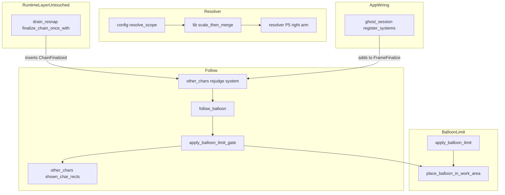
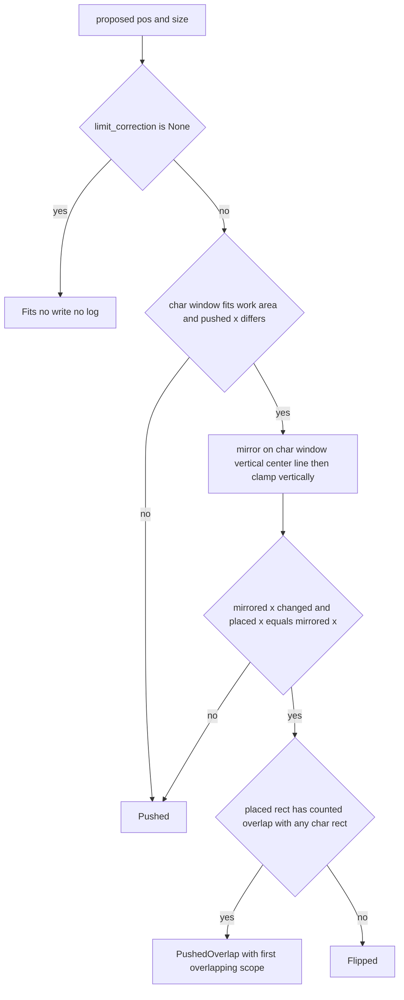
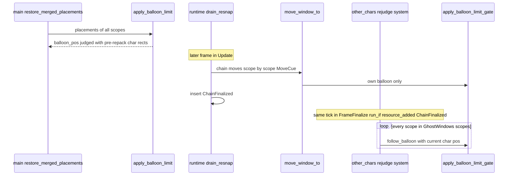

# Design Document: balloon-flip-side-rules

## Overview

**Purpose**: バルーンを反対の側へ並べ替えるときの判定に、ほかのスコープのキャラ窓を入れる（件 1）。あわせて、起動で右に出すバルーンの初めの位置で、descript の `balloon.offsetx` の分をシェルに近づく向き（画面の左向き）に当てる（件 2）。どちらも `crates/areka-placement` の中で閉じ、本体の実行の層（`crates/areka/src/runtime/`）に触れない。

**Users**: areka の利用者（相方の絵がバルーンに隠れない）と、descript にバルーンの置き方を書くゴースト・シェルの作者（`balloon.offsetx` が左右どちらでもシェルからの間合いとして同じに効く）。

**Impact**: 判定の純関数 `place_balloon_in_work_area` に「映した先がほかのスコープのキャラ窓に重なるなら押し込みへ倒す」段を 1 つ足し、起動の関門と書き込みの関門の両方から全スコープのキャラ窓の矩形を渡す。起動の並べ直しが済んだ巡（`ChainFinalized` が入った巡）に 1 度だけ、全スコープのバルーンを今のキャラ窓の位置で判定し直す。P5 の右の腕は、合流済みの `balloon_offset.x` のうち descript の分だけを反転する（`windowposition.x` の数値の分は今どおり画面の右向き）。

### Goals

- 映した先がほかのスコープのキャラ窓に 1 ピクセル以上重なる（自分の窓と重なる部分を除く）とき、並べ替えずに今の押し込みで置く（2.1〜2.9）。
- 起動の並べ直し・シェル位置初期化・拡大率が変わった後の解き直しがキャラ窓を動かした後も、動いた後の矩形で判定し直す（2.10）。
- 初めから右に出たバルーンと、左から並べ替えて右に来たバルーンを、descript の `balloon.offsetx` の分について同じ位置にする（3.1〜3.4）。
- 今の記録の行 `[balloon-limit] Clamp` に欄を 1 つ足すだけで、押し込みの理由を見分けられる（4.1〜4.4）。
- 重ならず横のずらしが 0 のバルーンは 1 ピクセルも動かさない（6.4）。

### Non-Goals

- 並べ替え・押し込みを残すかどうかの見直し（別 spec `balloon-flip-ssp-review`）。
- 相方の窓を避けてさらに動かす置き方（決めごと 1 で採らない）。
- `windowposition.x` の数値の分の映し方（3.8 で今のまま）・キーワードの横の位置（`keyword_balloon_pos`）・縦の置き方。
- 鎖の寄せ（`work_area_clamp.rs`）そのもの・押し込みの式（`limit_correction`）そのもの・ドラッグを離したときの補正。
- 3 体以上の窓での確かめ（`extra-character-windows`）。規則はスコープ数を決め打ちしない形で書く。
- surfaces.txt の surfaceブレスの `balloon.offsetx`・方向の 1 文字付きの鍵（`balloon.offsetxr` など）。

## Boundary Commitments

### This Spec Owns

- 並べ替えの判定に「ほかのスコープのキャラ窓との重なり」の段を足すこと（`place_balloon_in_work_area` と `BalloonPlace`）。
- 2 つの関門が判定へ渡す「判定に入れるキャラ窓の矩形の列」を組むこと（起動の関門＝`ScopePlacement` の列から、書き込みの関門＝`GhostWindows` と `WindowPos` と表示の有無から）。
- 起動の並べ直し・シェル位置初期化・拡大率が変わった後の解き直しの後に全スコープのバルーンを判定し直すこと（素の関数 `rejudge_all_balloons`・起動の並べ直しの系とその登録の口・`reset_pos.rs` と `chain_realign.rs` からの呼び出し各 1 行）。
- `crates/areka-placement/src/windowposition.rs` の `windowposition.x` の古い注記の直し（設計の話し合いの議題 5）と、§8 の `windowposition.x` の符号規約の行の ⚠ の直し。
- P5 の右の腕の横のずらしの向きと、そのための `ScopeConfig` の欄（descript の `balloon.offsetx` の分）。
- `[balloon-limit] Clamp` の行の欄 1 つ（重なったほかのスコープ）。
- 決定論のテスト（件 1・件 2・2.10）と、`doc/COMPAT_ARCHITECTURE.md` §8 の該当の行の書き足し。

### Out of Boundary

- `crates/areka/src/runtime/` の下の全ファイル（`drain_resnap.rs` の起動の並べ直しの手順を含む）。同じウェーブの `runtime-crate-split` との約束。
- 鎖の寄せの判定（`follow/work_area_clamp.rs`）・`place_chain_in_work_area` の署名。
- 押し込みの式（`clamp_rect_to_work_area`・`limit_correction`）・ドラッグを離したときの補正（`on_balloon_drag_end`）。
- キーワードの横の位置（`keyword_balloon_pos`・`rederive_keyword_balloon_offset`）・縦のずらし・`windowposition.y`。
- 記憶の合流（`persist::merge_scope`）。保存の値はそのまま使う（3.6）。
- `windowposition.rs` の換算と合流（`to_screen_adjust`・`apply_windowposition`）の式（注記の文だけを直し、式は変えない）。
- 記録の語（`[balloon-limit] Clamp`・`[balloon-limit] Unresolved`・`how` の `fits`／`flipped`／`pushed`・`PlacementRoute` の語）の追加と変更。

### Allowed Dependencies

- 依存の向き: `resolver`（値の型・`ScopePlacement`）→ `balloon_limit`（純関数・起動の関門）→ `follow`（書き込みの関門・判定し直しの系）。逆向きの import は足さない。
- `balloon_limit.rs` は今どおり `bevy_ecs`・`wintf` を import しない（`MonitorSnapshot` と `work_area_for_window` の消費は今の例外のまま）。
- `follow/other_chars.rs`（新設）が使ってよいのは、`bevy_ecs`（`World`・`Children`・`resource_added`）・`wintf::ecs`（`WindowPos`・`Visual`・`FrameFinalize`）・同じ crate の `GhostWindows`・`ChainFinalized`・`follow_balloon`・`BalloonFollowTrigger`・`PlacementRoute::MoveCue`・`window_rect_of`・`BALLOON_LIMIT_UNRESOLVED_TAG`。
- 新しい外部の crate は足さない。`Cargo.toml` は変えない。
- `crates/areka/src/ghost_session.rs`（`runtime/` の外）の `register_systems` に、登録の 1 行だけを足してよい（決めごと D4）。実装の段の初めに `runtime-crate-split` のセッションへこの 1 行を知らせる。

### Revalidation Triggers

- `BalloonPlace` の形（変種の追加）と `place_balloon_in_work_area` の引数が変わる → 呼び手 2 か所（起動の関門・書き込みの関門）と `balloon_limit_flip_tests.rs` を確かめ直す。`audit-placement-follow-residue`（`balloon_limit.rs` の式の差し替え・`balloon_limit_flip_tests.rs`）と同じウェーブに置かない。
- `ScopeConfig` に欄が増える → 全欄を列挙して組む 2 か所（`config.rs` の `resolve_scope`・`resolver_balloon_keyword_tests.rs`）がコンパイルで赤になる（意図どおり）。`balloon-canon-residue`・`defaultx-canon`・`window-snap`（`resolver.rs` を触る）は同じウェーブに置かない。
- 起動の並べ直しの終わりの印（`ChainFinalized` を入れる時点）が変わる → 判定し直しの系の引き金を確かめ直す。`runtime-crate-split` が `drain_resnap.rs` を動かしても、印を入れる順（並べ直しの書き込みの後）が保たれていれば影響しない。
- 3 体目の窓（`extra-character-windows`）が加わる → 判定に入れる矩形の列はスコープを全部回すので、規則の変更は要らない。3 体目での確かめはその spec が持つ。
- キャラ窓に `Visual` を持つ新しい子が付く → OtherChars の「表示している」の読み方（前提 A2）を確かめ直す。
- `runtime-crate-split` が `doc/COMPAT_ARCHITECTURE.md` の中のパスを書き換える → §8 の同じ表の行どうしなので、rebase のときに行ごとに合わせる。

## Architecture

### Existing Architecture Analysis

- 判定の純関数は `crates/areka-placement/src/balloon_limit.rs` の `place_balloon_in_work_area(pos, size, char_rect, area) -> BalloonPlace`（`Fits`／`Flipped`／`Pushed`）1 本で、起動の関門（同ファイル `apply_balloon_limit_one`）と書き込みの関門（`follow/window_move.rs` の `apply_balloon_limit_gate`）が同じ関数を呼ぶ。判定は状態を持たず、毎回、生の相対の位置から出し直す。
- 起動の並べ直しは `crates/areka/src/runtime/frame/drain_resnap.rs` の `finalize_chain_once_with` が、`place_chain_in_work_area` の結果を `move_window_to`（経路 `PlacementRoute::MoveCue`＝台本の `\![move]` と同じ経路）で 1 スコープずつ書き、最後に `ChainFinalized` を入れる。`move_window_to` は自分のバルーンだけを随伴させる。経路の語では台本の `\![move]` と見分けられないので、判定し直しの引き金は `ChainFinalized` の挿入にする。
- 窓の書き込みは `enqueue_window_set_pos` が `WindowPos` を即座に写し（bypass ミラー）、積んだ指令は 1 巡の後（`tick_bridge` の `flush_window_pos_commands`）にまとめて流れる。`frame_system` は `Update`、`FrameFinalize` は同じ巡の最後の段なので、`FrameFinalize` に置いた系の書き込みは同じ巡で流れる（1 フレーム遅らせない）。
- P5（`resolver.rs` の数値指定・未指定の腕）は `sc.balloon_offset.x`（descript の `balloon.offsetx` をシェル軸で換算した値と、バルーンの `windowposition.x` の数値をバルーン軸で換算した値の和）を、左右どちらでも画面の右向きに足す。右に決まるのは `BalloonSide::Right` と、`Auto`（`none`）でキャラ窓の中心が作業領域の中央より左のとき。`none` の側は resolver の中でしか決まらないので、向きは resolver の中で決める。
- キャラ窓の「表示している」は ECS の上では、キャラ窓の子の描画面（`areka-emo-present` の装着の surface entity と文字の層の枠）の `Visual.is_visible` で表される。`\s[-1]` は子の `Visual` を不可視にし、窓そのものの `WS_VISIBLE` は変えない。

### Architecture Pattern & Boundary Map

既存の「純関数の核と薄い関門」の形をそのまま広げる。規則は核 1 本に置き、関門は「判定に入れる矩形の列」を組んで渡すだけにする。



**Architecture Integration**:
- 選んだ形: 判定の核に段を 1 つ足す（ギャップ分析の案 A）＋書き込みの関門の矩形集めを `follow/` の新しいファイルへ出す（案 B）＋起動の並べ直しの後の判定し直しを `areka-placement` の系で行う（案 C を `runtime/` に触れない形で）。件 2 は合流の前の descript の分を `ScopeConfig` に別の欄で持つ（案 D）。
- 自分の窓を列から外さない: 2.4 の規則（重なりの矩形が自分のキャラ窓に収まり切るなら数えない）は、自分の窓との重なりを必ず「収まり切る」にするので、列に自分の窓が入っていても数えない。呼び手は全スコープの矩形をそのまま渡せばよい。
- 守る既存の形: 判定は状態を持たない・書き込みは単一の書き手 `enqueue_window_set_pos`・表示の位置だけを補正し相対の位置に焼き付けない（DD6）・記録は関門が出し語彙は `balloon_limit.rs` が持つ。
- steering: 失敗の道は記録する（新しい語は作らず `[balloon-limit] Unresolved` を使う）・テストは兄弟のファイル・1 ファイル 1,000 行（`window_move.rs` は例外表のまま、足すのは数行）。

**依存の向き**: `resolver` → `config`／`lib`（供給）→ `balloon_limit` → `follow`（`window_move` → `other_chars`）。`other_chars` は `chain_finalize::ChainFinalized` を読むだけで、`chain_finalize` から `other_chars` への参照は作らない。

### Technology Stack

| Layer | Choice / Version | Role in Feature | Notes |
|-------|------------------|-----------------|-------|
| ECS | bevy_ecs（workspace の版のまま） | 判定し直しの系・`resource_added::<ChainFinalized>` の引き金・`Children` で子の描画面を引く | 新しい依存なし |
| 窓と描画 | wintf（同じ workspace） | `WindowPos`（矩形）・`Visual.is_visible`（表示の有無）・`FrameFinalize`（系の段） | 読むだけ |
| 記録 | tracing | 既存の `info!`／`warn!` に欄を足すだけ | 新しい語なし |

## File Structure Plan

### Directory Structure

```
crates/areka-placement/src/
├── balloon_limit.rs                 # 判定の核に重なりの段・BalloonPlace の変種・起動の関門の矩形の列と記録の欄
├── balloon_limit_flip_tests.rs      # 件 1 の純関数と起動の関門の檻・件 2 の 3.3／3.8 の檻（既存に足す）
├── balloon_limit_gate_tests.rs      # 書き込みの関門の檻（表示していない窓・決まらない窓・重なる窓）（既存に足す）
├── config.rs                        # ScopeConfig の欄 balloon_offset_descript_x と resolve_scope の設定
├── lib.rs                           # apply_author_balloon_offset_scale が換算後の descript の分も書く
├── resolver.rs                      # P5 の右の腕で descript の分だけを反転
├── resolver_resolve_balloon_tests.rs   # 3.1・3.2・3.4・3.5 の檻（既存に足す）
├── resolver_balloon_keyword_tests.rs   # 全欄列挙の ScopeConfig に新しい欄を足すだけ
├── balloon_offset_supply_tests.rs   # 換算後の descript の分が windowposition の分を含まない檻（既存に足す）
├── reseed_tests.rs                  # 右に出す sakura（offsetx,30）の期待値を CHAR0.w + 30 → CHAR0.w − 30 へ（4 か所）
├── follow.rs                        # ファサード: mod other_chars・再束縛・テストの接続宣言
├── follow_other_chars_tests.rs      # 新設: shown_char_rects と 2.10 の判定し直し・2.7 の置き直さないの檻
└── follow/
    ├── other_chars.rs               # 新設: 判定に入れるキャラ窓の矩形の列・起動の並べ直しの後の判定し直しの系と登録
    └── window_move.rs               # 書き込みの関門に矩形の列を渡す・記録の欄・window_rect_of を pub(super) に
crates/areka/src/
└── ghost_session.rs                 # register_systems に登録の 1 行（runtime/ の外）
crates/areka-placement/src/ (続き)
├── reset_pos.rs                     # reset_window_positions の書き込みの後に rejudge_all_balloons を 1 行
├── chain_realign.rs                 # realign_chain_once_with の書き込みの後に rejudge_all_balloons を 1 行
└── windowposition.rs                # windowposition.x の古い注記を今の ukadoc に合わせる（式は変えない）
doc/
└── COMPAT_ARCHITECTURE.md           # §8「【上書き】バルーンだけが作業領域からはみ出すとき」の行
.kiro/specs/balloon-flip-side-rules/
└── research.md                      # 3.7 の数えの確定（配布版のぱすたの kero の値）
```

### Modified Files

- `crates/areka-placement/src/balloon_limit.rs` — `place_balloon_in_work_area` に引数 `chars: &[(usize, RectPx)]` を足し、映した先が数える重なりを持てば `BalloonPlace::PushedOverlap` を返す。`BalloonPlace` に変種 `PushedOverlap { to, scope }` と読み口 `overlap_scope()` を足す（`how()` は `"pushed"`）。`apply_balloon_limit` は `map` の前に全スコープのキャラ窓の矩形の列を 1 度組み、`apply_balloon_limit_one` へ渡す。記録の `info!` に欄 `overlap_scope` を足す。重なりの判定の小さな私有関数（交わり・内包）をここに置く。
- `crates/areka-placement/src/follow/window_move.rs` — `apply_balloon_limit_gate` で `shown_char_rects(world)` の結果を判定へ渡し、`let … else` の型に `PushedOverlap` を足し、`info!` に欄 `overlap_scope` を足す。`window_rect_of` を `pub(super)` にする。増分は数行に抑える。
- `crates/areka-placement/src/follow.rs` — `mod other_chars;`、`use self::other_chars::shown_char_rects;`（私有の再束縛）、`use self::window_move::window_rect_of;`、`pub use self::other_chars::register_balloon_rejudge;`、テストの接続宣言 `#[path = "follow_other_chars_tests.rs"]`。
- `crates/areka-placement/src/config.rs` — `ScopeConfig` に `balloon_offset_descript_x: i32` を足し、`Default` は 0、`resolve_scope` は `offset_x.unwrap_or(0)` を入れる。
- `crates/areka-placement/src/lib.rs` — `apply_author_balloon_offset_scale` が換算後の x を `balloon_offset_descript_x` にも書く（`balloon_offset` と同じ値・`windowposition` の合流の前）。
- `crates/areka-placement/src/resolver.rs` — P5 の `None` の腕で、右に出すときだけ横のずらしを `ox − 2 × balloon_offset_descript_x` にする（右端 − descript の分 ＋ `windowposition.x` の分）。左の腕とキーワードの腕は変えない。
- `crates/areka/src/ghost_session.rs` — `register_systems` の末尾に `areka_placement::follow::register_balloon_rejudge(world);` を 1 行。
- `crates/areka-placement/src/reset_pos.rs` — `reset_window_positions` が全スコープを書き終えた後に `rejudge_all_balloons(world)` を 1 行。
- `crates/areka-placement/src/chain_realign.rs` — `realign_chain_once_with` が全スコープを書き終えた後に `rejudge_all_balloons(world)` を 1 行。
- `crates/areka-placement/src/windowposition.rs` — 冒頭の説明（22〜24 行目）と `to_screen_adjust` の「符号規約」節（153〜158 行目）の「正典は…シェル側が+…と記述する／この文言との乖離は互換対応表の記録対象」を、今の ukadoc（2026-09-20 に「バルーンを左右どちらに出していても常に右方向が+」へ改まり SSP の実測と一致）に合わせる。式と表は変えない。
- `doc/COMPAT_ARCHITECTURE.md` — §8 の該当の行に件 1・件 2 の扱いと SSP 2.9.34 の測り（並べ替えも押し込みもしない）を足し、「測っていない」の記述を置き換える（5.4）。

## System Flows

### 並べ替えの判定（2.1〜2.9・両関門で共通）



- 数える重なり: 映して縦だけ収めた矩形 B と、列の各キャラ窓 O の交わり I＝B∩O が空でなく、かつ I が自分のキャラ窓 C に収まり切らないとき（2.4・2.9）。自分の窓は I⊂C になるので数えない。バルーンの矩形は列に入れない（2.4）。
- 列は昇順のスコープで、最初に数える重なりを持ったスコープを `scope` に入れる。押し込みの位置は今の `limit_correction` の戻りそのまま（2.5）。

### 起動の並べ直しの後の判定し直し（2.10・2.7）



- 判定し直しの本体は素の関数 `rejudge_all_balloons(world)`。呼ぶのは 3 か所＝`ChainFinalized` の挿入で走る系（起動の並べ直し）・`reset_window_positions`（シェル位置初期化）・`realign_chain_once_with`（拡大率が変わった後の解き直し）の書き込みの後。台本の `\![move]`・ドラッグ・面の切り替えの随伴では走らない（2.7）。
- 全スコープのバルーンを今のキャラ窓の位置で随伴させ直す。判定は状態を持たないので、窓が 1 つも動いていない巡でも、ほかの窓の矩形が変わっていなければ結果は今の位置と同じになる（前提 A1）。
- 随伴の引き金は `BalloonFollowTrigger::Placement(PlacementRoute::MoveCue)`（並べ直しの書き込みと同じ・可視性の守りを当てない）。バルーンの書き込みは今どおり `PlacementRoute::BalloonFollow` を名乗る。新しい経路の語は作らない。

## Requirements Traceability

| Requirement | Summary | Components | Interfaces | Flows |
|-------------|---------|------------|------------|-------|
| 1.1 | 測り ⑴ | 測りの記録（`research.md` 9 節・済み） | — | — |
| 1.2 | 測り R2 | 測りの記録（`research.md` 9 節・済み） | — | — |
| 1.3 | 版・検体・手順・値を残す／測れなければ理由 | 測りの記録（9.2・9.3 に「測れなかった」と理由） | — | — |
| 1.4 | 入っている物だけで測る・戻す | 測りの記録（9 節の手順） | — | — |
| 1.5 | ウェーブに知らせる | 測りの記録（9 節） | — | — |
| 1.6 | 試験の根は `target\` の下 | 測りの記録（9 節）・テストは headless で根を作らない | — | — |
| 1.7 | 覆されたら話し直す | 測りの結果は決めごとを覆していない（9.3） | — | — |
| 2.1 | 重なれば押し込み | FlipJudge | `place_balloon_in_work_area`・`BalloonPlace::PushedOverlap` | 並べ替えの判定 |
| 2.2 | 重ならなければ今の並べ替え | FlipJudge | 同上（`Flipped`） | 並べ替えの判定 |
| 2.3 | 両関門で同じ規則 | BootGate・RuntimeGate | 両関門が同じ核を呼ぶ | 並べ替えの判定 |
| 2.4 | 自分の窓・バルーン・自分と重なる部分を数えない | FlipJudge | `counted_overlap` | 並べ替えの判定 |
| 2.5 | 押し込みの結果の重なりは許す | FlipJudge | `limit_correction` の戻りのまま | 並べ替えの判定 |
| 2.6 | 決まらない窓・表示していない窓は入れない | OtherChars・BootGate | `shown_char_rects`（`window_rect_of` が `None`・子の `Visual` が全部不可視なら入れない）・起動の関門は列の全スコープ | — |
| 2.7 | 置く・書き込む時点と 2.10 だけ | RejudgeSystem・RuntimeGate | `resource_added::<ChainFinalized>` だけが引き金 | 判定し直し |
| 2.8 | スコープ数を決め打ちしない | BootGate・OtherChars | 列は全スコープを回す | 並べ替えの判定 |
| 2.9 | 窓の矩形で数える | FlipJudge・OtherChars | `WindowPos`／`ScopePlacement` の矩形 | — |
| 2.10 | 起動の並べ直し・シェル位置初期化・拡大率の解き直しの後に判定し直す | RejudgeSystem | `rejudge_all_balloons`・`register_balloon_rejudge`・系 `rejudge_balloons_after_chain_finalize`・`reset_pos.rs`／`chain_realign.rs` の呼び出し | 判定し直し |
| 3.1 | 右は「右端 − descript の分」・`windowposition.x` は右向き | P5RightArm・DescriptOffsetField | `ScopeConfig.balloon_offset_descript_x` | — |
| 3.2 | 左は今のまま | P5RightArm | 左の腕は変えない | — |
| 3.3 | 初めから右＝並べ替えて右（descript の分） | P5RightArm・FlipJudge | 映しの式は今のまま | — |
| 3.4 | 3 つの鍵に同じに当てる | DescriptOffsetField | `cascade2` の結果をそのまま欄へ | — |
| 3.5 | 縦・`windowposition`・キーワードを変えない | P5RightArm | `windowposition.x` の分は `ox − d` で右向きのまま・キーワードの腕は別 | — |
| 3.6 | 記憶はそのまま | （変更なし）`persist::merge_scope` | 保存値は P5 を通らない | — |
| 3.7 | 見た目の変わる場面を数える | `research.md` 2.6 節・10 節 | — | — |
| 3.8 | `windowposition.x` の分の映しは今のまま | FlipJudge | 映しの式を変えない | 並べ替えの判定 |
| 4.1 | 押し込みの理由の欄 | BootGate・RuntimeGate | 欄 `overlap_scope` | — |
| 4.2 | 語を変えない・作らない | BootGate・RuntimeGate・RejudgeSystem | `how()` は `"pushed"`・経路の語も既存 | — |
| 4.3 | `fits` は記録しない | BootGate・RuntimeGate | `Fits` で記録なし（今どおり） | — |
| 4.4 | 決まらないときは警告して続ける | BootGate・RuntimeGate・RejudgeSystem | `[balloon-limit] Unresolved` | — |
| 5.1 | 決定論のテストで固定 | Testing Strategy | — | — |
| 5.2 | 直す前に赤 | Testing Strategy | — | — |
| 5.3 | 4.3 ⑴ の形と縦にも重なる形 | Testing Strategy | — | — |
| 5.4 | §8 の行 | CompatDoc | — | — |
| 6.1 | 名前・初回を見る分岐を持たない | 全部品 | 入力は矩形と descript の値だけ | — |
| 6.2 | 5.6・5.7 を保つ | FlipJudge・RuntimeGate | キャラ窓がはみ出す・limit 0・解放の補正の腕は今のまま | — |
| 6.3 | 鎖の寄せ・押し込みの式を変えない | 境界（Out of Boundary） | — | — |
| 6.4 | 重ならず横のずらし 0 なら 1 ピクセルも変えない | FlipJudge・P5RightArm | d＝0 なら P5 は今の式・重ならなければ判定は今の腕 | — |

## Components and Interfaces

| Component | Domain/Layer | Intent | Req Coverage | Key Dependencies | Contracts |
|-----------|--------------|--------|--------------|------------------|-----------|
| FlipJudge | `balloon_limit.rs`（純関数） | 映した先の重なりで押し込みへ倒す | 2.1, 2.2, 2.4, 2.5, 2.9, 3.3, 3.8, 6.2, 6.4 | `resolver` の値の型（P0） | Service |
| BootGate | `balloon_limit.rs`（起動の関門） | 全スコープの矩形の列を組んで判定へ渡す・記録の欄 | 2.3, 2.6, 2.8, 4.1〜4.4 | FlipJudge（P0）・`MonitorSnapshot`（P0） | Service |
| RuntimeGate | `follow/window_move.rs`（書き込みの関門） | 表示しているキャラ窓の矩形の列を判定へ渡す・記録の欄 | 2.3, 2.6, 4.1〜4.4 | FlipJudge（P0）・OtherChars（P0） | Service |
| OtherChars | `follow/other_chars.rs` | 判定に入れるキャラ窓の矩形の列を World から組む | 2.6, 2.8, 2.9 | `GhostWindows`・`WindowPos`・`Children`・`Visual`（P0） | Service |
| RejudgeSystem | `follow/other_chars.rs` | 起動の並べ直しの後に全スコープのバルーンを判定し直す | 2.7, 2.10, 4.4 | `ChainFinalized`（P0）・`follow_balloon`（P0） | Batch, State |
| DescriptOffsetField | `config.rs`・`lib.rs` | 合流の前の descript の分を運ぶ | 3.1, 3.4 | `cascade2`・`scale_author_offset`（P0） | State |
| P5RightArm | `resolver.rs` | 右に出すとき descript の分だけを反転 | 3.1, 3.2, 3.3, 3.5, 6.4 | DescriptOffsetField（P0） | Service |
| CompatDoc | `doc/COMPAT_ARCHITECTURE.md` | §8 の行の書き足し | 5.4 | `research.md` 9 節（P1） | — |

### 判定の層（balloon_limit.rs）

#### FlipJudge

| Field | Detail |
|-------|--------|
| Intent | 映した先がほかのスコープのキャラ窓に重なるときだけ、並べ替えずに今の押し込みで置く |
| Requirements | 2.1, 2.2, 2.4, 2.5, 2.9, 3.3, 3.8, 6.2, 6.4 |

**Responsibilities & Constraints**
- 今の分岐（`Fits`・キャラ窓がはみ出すときの押し込み・映した先が横に入らないときの押し込み・映しても x が変わらないときの押し込み）は 1 ビットも変えず、`Flipped` を返す直前に重なりの段を 1 つ足す。
- 重なりの段は映して縦だけ収めた矩形（`placed` × `size`）で判定する。映しの式（`x' = char.left + char.right − (pos.x + size.w)`）は変えない（3.8）。
- `bevy_ecs`・`wintf` を import しない（今の依存規約）。

**Contracts**: Service [x]

##### Service Interface

```rust
/// バルーンの置き方（[`place_balloon_in_work_area`] の戻り）。
#[derive(Debug, Clone, Copy, PartialEq, Eq)]
pub(crate) enum BalloonPlace {
    Fits,
    Flipped(PointPx),
    Pushed(PointPx),
    /// 映した先がほかのスコープのキャラ窓に重なるので、並べ替えずに今の押し込みで置いた（要件 2.1）。
    /// `to` は [`limit_correction`] の戻りそのまま・`scope` は最初に重なったスコープ。
    PushedOverlap { to: PointPx, scope: usize },
}

impl BalloonPlace {
    /// `how` 欄の語。`PushedOverlap` も `"pushed"`（要件 4.2）。
    pub(crate) fn how(self) -> &'static str;
    /// `overlap_scope` 欄の値。`PushedOverlap` だけ `Some(scope)`、ほかは `None`（要件 4.1）。
    pub(crate) fn overlap_scope(self) -> Option<usize>;
}

/// `chars` は判定に入れるキャラ窓の矩形の列（スコープ・矩形の昇順）。自分のキャラ窓が
/// 入っていてもよい（自分の窓との重なりは要件 2.4 の規則で数えない）。
pub(crate) fn place_balloon_in_work_area(
    pos: PointPx,
    size: SizePx,
    char_rect: RectPx,
    area: RectPx,
    chars: &[(usize, RectPx)],
) -> BalloonPlace;

/// 数える重なりか: `placed ∩ other` が空でなく、かつ `own` に収まり切らない（要件 2.4・2.9）。
/// 矩形は半開（右と下は外の最初の画素）。接するだけは重ならない。
fn counted_overlap(placed: RectPx, own: RectPx, other: RectPx) -> bool;
```

- Preconditions: 座標と寸は物理 px。`size` は正（今の契約）。
- Postconditions: `chars` が空、またはどの矩形とも数える重なりが無いとき、戻りは今の関数と同一（6.4）。`PushedOverlap.to` は `Pushed` になるはずだった位置と同一（2.5）。
- Invariants: 純関数で状態を持たない（同じ入力なら同じ戻り）。

**Implementation Notes**
- 交わりは `max`／`min` の 4 つ、内包は比較 4 つ。`follow/visibility.rs` の `rects_intersect` は開かない（交わりの矩形そのものが要るため）。
- 4.3 ⑴ の形（本体 `0,610 764×1094`・相方 `764,904 672×800`・バルーン 800×448 が `(-268,352)`）は、映した先 `232〜1032 × 352〜800` が相方の窓（`904〜`）と縦に重ならないので `Flipped`（2.2・5.3）。

#### BootGate

| Field | Detail |
|-------|--------|
| Intent | 起動で置くスコープ全部のキャラ窓の矩形を判定へ渡し、押し込みの理由を記録する |
| Requirements | 2.3, 2.6, 2.8, 4.1, 4.2, 4.3, 4.4 |

**Responsibilities & Constraints**
- `apply_balloon_limit` は署名を変えない（呼び手 `crates/areka/src/main.rs` を触らない）。`map` の前に `placements` から `(scope, キャラ窓の矩形)` の列を 1 度組み、各スコープの判定へ同じ列を渡す。起動で置くスコープはどれも同じ起動で表示するので、全部を入れる（2.6 の括弧書き）。
- キャラ窓の矩形を組む式（今 `apply_balloon_limit_one` の中にある 4 行）は、列を組む側と共有する私有関数 1 つにする。
- `info!`（`[balloon-limit] Clamp`）に `overlap_scope = ?place.overlap_scope()` を足す。`let … else` の型に `PushedOverlap { to: corrected, .. }` を足す。

**Contracts**: Service [x]（公開の署名は今のまま）

### 書き込みの層（follow/）

#### RuntimeGate

| Field | Detail |
|-------|--------|
| Intent | 書き込みの関門で、表示しているキャラ窓の矩形の列を判定へ渡す |
| Requirements | 2.3, 2.6, 4.1, 4.2, 4.3, 4.4 |

**Responsibilities & Constraints**
- `apply_balloon_limit_gate` で、今の判定の呼び出しの直前に `let chars = shown_char_rects(world);` を置き、判定の第 5 引数に渡す。`let … else` の型に `PushedOverlap` を足し、`info!` に `overlap_scope` を足す。ほかの分岐（寸の未確定・scope 不明・キャラ窓不明・作業領域不明の `[balloon-limit] Unresolved`）は変えない。
- `window_move.rs`（1,228 行・例外表）の増分は 5 行ほどに抑える。矩形を集める本体は OtherChars に置く。

**Contracts**: Service [x]（私有関数・外への形は変わらない）

#### OtherChars

| Field | Detail |
|-------|--------|
| Intent | World から「判定に入れるキャラ窓の矩形の列」を組む |
| Requirements | 2.6, 2.8, 2.9 |

**Responsibilities & Constraints**
- `GhostWindows::scopes()`（昇順）を全部回し、`char_window(s)` → `window_rect_of(world, e)`（位置か寸が未確定なら `None`）→ 表示しているか、の 3 つが揃ったスコープだけを入れる。自分のスコープも外さない（FlipJudge が数えない）。
- 表示しているか: キャラ窓の子（`Children`）のうち `Visual` を持つものが 1 つでも `is_visible` なら表示している。子が無い（描画面の装着の前）・全部不可視（`\s[-1]`）なら入れない（前提 A2）。今見ている子は `areka-emo-present` の装着の面（`emo-surface`）と文字の層の枠（`emo-text-layer-slot`）で、箱の文字の面（`Visual::default()`）は非表示のときに箱の同期が外す。ほかの子が窓に付くようになると黙って「表示している」に倒れるので、そのときはこの読み方を確かめ直す（Revalidation Triggers）。
- `GhostWindows` が無ければ空の列（判定は今の並べ替えの規則になる・2.6）。記録はしない（関門が自分のキャラ窓で `Unresolved` を出す道は今のまま）。

**Contracts**: Service [x]

##### Service Interface

```rust
/// 判定に入れるキャラ窓の矩形の列（スコープの昇順）。矩形が決まらない窓と表示していない窓は入れない（要件 2.6）。
pub(super) fn shown_char_rects(world: &World) -> Vec<(usize, RectPx)>;
```

#### RejudgeSystem

| Field | Detail |
|-------|--------|
| Intent | 起動の並べ直し・シェル位置初期化・拡大率の解き直しが窓を書き終えた後に 1 度だけ、全スコープのバルーンを今のキャラ窓の位置で判定し直す |
| Requirements | 2.7, 2.10, 4.4 |

**Responsibilities & Constraints**
- 系は `FrameFinalize` に置き、`run_if(resource_added::<ChainFinalized>)` で走らせる。`ChainFinalized` は `drain_resnap.rs` が並べ直しの書き込みの後に入れ、終了のときに `app_exit.rs` が外すので、ゴーストの窓の一式ごとに 1 度だけ走る。
- 判定し直すのは `BalloonLimit(true)` のバルーンだけ（`windowposition.limit,0` のバルーンは並べ替えの判定に入らない＝`window-work-area-clamp` 要件 5.6。可視性の守りを当てない `MoveCue` の随伴で、守りが寄せた位置を書き戻さないため）。
- スコープを先に集めてから（`GhostWindows` の借用を切ってから）、各スコープのキャラ窓の `WindowPos.position` を読み、`follow_balloon(world, char, pos, BalloonFollowTrigger::Placement(PlacementRoute::MoveCue))` を呼ぶ。判定と記録は書き込みの関門がする（`[balloon-limit] Clamp` に `context="runtime-gate"`・`route=BalloonFollow`）。
- キャラ窓の位置が決まらないスコープは `[balloon-limit] Unresolved` の `warn!` を残して飛ばす（4.4）。`BalloonFollow` が無ければ `follow_balloon` が何もしない（今どおり）。
- 新しい記録の語・経路の語を作らない（4.2）。

**Contracts**: Batch [x] / State [x]

##### Batch / Job Contract
- Trigger: `ChainFinalized` が入った巡の `FrameFinalize`。
- Input: `GhostWindows` の全スコープ・各キャラ窓の `WindowPos`。
- Output: 各スコープのバルーンの書き込み（`enqueue_window_set_pos` 経由・同じ巡の終わりに流れる）。
- Idempotency: 判定は状態を持たないので、同じ矩形なら何度走っても同じ位置になる。

##### Service Interface

```rust
/// 判定し直しの系をプロセスに 1 回だけ載せる（`ghost_session::register_systems` から）。
pub fn register_balloon_rejudge(world: &mut World);

/// 全スコープの `BalloonLimit(true)` のバルーンを今のキャラ窓の位置で判定し直す（要件 2.10）。
/// 呼び手＝下の系・`reset_window_positions`・`realign_chain_once_with`（書き込みの後）。
pub(crate) fn rejudge_all_balloons(world: &mut World);

/// 起動の並べ直しの後の判定し直しの系（`ChainFinalized` の挿入で 1 度・中身は `rejudge_all_balloons`）。
fn rejudge_balloons_after_chain_finalize(world: &mut World);
```

### 配置の式の層（config.rs・lib.rs・resolver.rs）

#### DescriptOffsetField

| Field | Detail |
|-------|--------|
| Intent | 合流済みの `balloon_offset.x` のうち descript の `balloon.offsetx` の分を別に運ぶ |
| Requirements | 3.1, 3.4 |

**Contracts**: State [x]

##### State Management
- State model: `ScopeConfig.balloon_offset_descript_x: i32`（既定 0）。
- 不変条件: どの段でも「`balloon_offset.x` のうち descript の `balloon.offsetx` から来た分」と同じ空間の同じ値を持つ。`resolve_scope` では生値（`offset_x.unwrap_or(0)`）、`apply_author_balloon_offset_scale` の後は換算後の値（`balloon_offset` と同じ x）、`apply_windowposition` は触らない（`windowposition.x` の分は入らない）。
- `cascade2` が `balloon.offsetx`・`sakura.balloon.offsetx`・`kero.balloon.offsetx` をゴーストとシェルの 2 層で解いた結果をそのまま入れるので、3 つの鍵に同じに効く（3.4）。
- 全欄を列挙して組む 2 か所（`config.rs` の `resolve_scope`・`resolver_balloon_keyword_tests.rs`）に欄を足す。`..ScopeConfig::default()` で組むテストは 0 が入る（descript の分なし＝今の P5 と同じ）。

#### P5RightArm

| Field | Detail |
|-------|--------|
| Intent | 右に出すときだけ、descript の分をシェルに近づく向き（画面の左向き）に当てる |
| Requirements | 3.1, 3.2, 3.3, 3.5, 6.4 |

**Responsibilities & Constraints**
- `keyword_balloon_pos` が `None` を返す腕の中だけを変える。右に決まったとき（`Right`・`Auto` で右）の横の位置を「`x + w` ＋（`ox − d`）− `d`」にする（`d`＝`balloon_offset_descript_x`・`ox − d`＝`windowposition.x` の分）。左の腕（`x − balloon.w + ox`）と縦（`+ oy`）は変えない（3.2・3.5）。
- `balloon_offset`（`balloon_pos − char_pos`）は事後条件のまま P5 の結果から組むので、追従のずらし（`BalloonFollow`）・基準対・シェルの差し替え（`reseed.rs`）・シェル位置初期化（`reset_pos.rs`）は式を通るだけで揃う。
- `d`＝0 のとき今の式と同一（6.4）。記憶の値は P5 を通らない（3.6）。

**Implementation Notes**
- 式の確かめ（L〜R はキャラ窓・w はバルーンの幅・p は `windowposition.x` の分）: 初めから右 R − d + p。左（L − w + d + p）から映すと R − d − p。p＝0 なら一致（3.3）。p≠0 の 2p のずれは 3.8 で今のまま。
- 変わる檻: `reseed_tests.rs` の右に出す sakura（`offsetx,30`）の追従のずらし `CHAR0.w + 30` → `CHAR0.w − 30`（4 か所）。`placement_windowposition_tests.rs` の `prepare_windowposition_adjust_is_identical_for_both_balloon_sides` は緑のまま（`windowposition.x` の分を反転しない証）。

### 文書

#### CompatDoc

- `doc/COMPAT_ARCHITECTURE.md` 166 行目（`windowposition.x` の符号規約）の「⚠ ukadoc は…シェル側が+…と記しており、参照実装の挙動はこの文言と食い違う」を、「ukadoc は 2026-09-20（ukatech/ukadoc の f92e4ff9）に『バルーンを左右どちらに出していても常に右方向が+』へ改まり、SSP の実測と一致した」に改める（議題 5）。
- `doc/COMPAT_ARCHITECTURE.md` 431 行目の行に足す: ⑴ 映した先がほかのスコープのキャラ窓（自分の窓と重なる部分を除く・表示している窓だけ・窓の矩形で数える）に重なるときは並べ替えず押し込む・押し込んだ結果の重なりは許す・起動の並べ直しの後に判定し直す ⑵ 右に出すバルーンの descript の `balloon.offsetx` は ukadoc どおり左向きが＋（SSP は測っていない）・`windowposition.x` の数値は左右とも右向き ⑶ SSP 2.9.34 は、キャラ窓が収まりバルーンだけが横にはみ出す形で、`\![move]` でもドラッグでもバルーンを並べ替えも押し込みもしない（`research.md` 9 節）ので、並べ替え・押し込み・件 1 の判定・件 2 の映しはどれも areka の裁量 ⑷ 記録の欄 `overlap_scope`。「測っていない」の記述（P5 の符号）を置き換える。並べ替えを残すかの見直しは `balloon-flip-ssp-review` が持つと書く。

## Data Models

### Domain Model

- `BalloonPlace` に変種 `PushedOverlap { to: PointPx, scope: usize }` を足す。語は `pushed`（新しい語なし）。読み口は `how()` と `overlap_scope()`。
- `ScopeConfig` に `balloon_offset_descript_x: i32` を足す（不変条件は DescriptOffsetField）。
- 判定に入れるキャラ窓の矩形の列は `Vec<(usize, RectPx)>`（スコープの昇順）。新しい型や資源・Component は作らない。

## Error Handling

### Error Strategy

- 判定に入れる窓の矩形が決まらない・表示していない: その窓を列に入れない（2.6）。縮退ではなく規則なので記録しない。
- 書き込みの関門で自分のバルーン・キャラ窓・作業領域が決まらない: 今どおり `[balloon-limit] Unresolved` の `warn!` を残し、補正せずに書き込みを続ける（4.4）。
- 判定し直しの系でキャラ窓の位置が決まらない: `[balloon-limit] Unresolved` の `warn!`（scope・`context="runtime-gate"`・理由の文）を残してそのスコープを飛ばす（4.4・新しい語なし）。`GhostWindows` が無い巡は `ChainFinalized` が入らないので起きないが、起きたら同じ `warn!` を 1 行残して戻る。
- panic する道は作らない（`saturating_*`・`Option` の分岐）。

### Monitoring

- `[balloon-limit] Clamp` の行（両関門）に `overlap_scope` 欄。押し込みの理由が重なりなら `Some(n)`、作業領域から外れたための押し込みと並べ替えは `None`。
- 判定し直しで動いたバルーンは、書き込みの関門の `[balloon-limit] Clamp`（`context="runtime-gate"`・`route=BalloonFollow`）で読める。

## Testing Strategy

どれも実機の窓を使わない決定論のテストで、直す前に赤になることを確かめてから直す（5.1・5.2）。

### Unit Tests（`balloon_limit_flip_tests.rs`・`resolver_resolve_balloon_tests.rs`・`balloon_offset_supply_tests.rs`）

1. 映した先が相方の窓と縦にも横にも重なる合成の形（相方の窓の上端がバルーンの下端より上）→ `PushedOverlap { to: limit_correction の戻り, scope: 1 }`（2.1・5.3 の赤の 1 件）。直す前は `Flipped` で赤。
2. 4.3 ⑴ の形（本体 `0,610 764×1094`・相方 `764,904 672×800`・バルーン 800×448 が `(-268,352)`）→ `Flipped(232, 352)`（2.2・5.3）。本体と相方が同じ位置に重なる形（配布版のぱすた・`offsetx,476` のバルーン）→ `Flipped`（2.4）。接するだけの形 → `Flipped`（半開）。
3. 3 スコープの列で 2 番目は重ならず 3 番目が重なる → `PushedOverlap { scope: 2 }`（2.8）。押し込んだ位置がなお相方の窓に重なる形でも `to` は押し込みの位置のまま（2.5）。
4. P5: `Right`・descript の分 d＝30（`windowposition.x` の分 0）→ バルーンの左端＝キャラ窓の右端 − 30（3.1・直す前は +30 で赤）。`Left`・同じ d → 今と同じ（3.2）。`Auto` で右に決まった形 → 右端 − d。`Right`・d＝0・`windowposition.x` の分 −237 → 右端 − 237（3.5・反転しない）。
5. 一致: `Right`・d で初めから出した位置と、`Left`・同じ d で出して `place_balloon_in_work_area` で左から右へ映した位置の x が同じ（3.3）。`windowposition.x` の分 p≠0 の形では映しの結果が今の式（L + R − (pos.x + w)）のまま（3.8）。
6. 供給: `scale_then_merge` の後、`balloon_offset_descript_x` は descript の分の換算値で、`windowposition.x` の分を含まない。`sakura.`／`kero.`／無印のどの鍵から来ても同じ欄に入る（3.4）。

### Integration Tests（`balloon_limit_flip_tests.rs`・`balloon_limit_gate_tests.rs`・`follow_other_chars_tests.rs`）

1. 起動の関門: 2 スコープの `ScopePlacement` で本体のバルーンの映した先が相方の窓に重なる → 本体の `balloon_pos` が押し込みの位置・`[balloon-limit] Clamp` が `how="pushed"`・`overlap_scope=Some(1)`・`context="boot-gate"` で 1 行（2.3・4.1・4.2）。重ならない形は `how="flipped"`・`overlap_scope=None`。
2. 書き込みの関門（headless の World・`spawn_ghost_windows`）: 相方のキャラ窓の子の `Visual` が可視で重なる → 押し込み＋`overlap_scope=Some(1)`（2.3）。同じ形で子の `Visual` を全部不可視にする → 並べ替え（2.6）。相方の `WindowPos` の寸が未確定 → 並べ替え（2.6）。
3. 判定し直し（2.10）: 相方の窓を重ならない位置に置いて本体のバルーンを並べ替えた後、`move_window_to` で相方の窓を映した先に重なる位置へ動かし、`ChainFinalized` を入れて系を回す → 本体のバルーンが押し込みの位置に書かれる。直す前（系なし）は並べ替えた位置のまま（赤）。
3a. シェル位置初期化と拡大率の解き直し（2.10）: 本体を先に動かす順で相方の窓が本体のバルーンの映した先に重なる位置へ戻る形を、`reset_window_positions` と `realign_chain_once_with` で 1 回ずつ回す → 本体のバルーンが押し込みの位置に書かれる。直す前（呼び出しなし）は並べ替えた位置のまま（赤）。
4. 置き直さない（2.7）: `ChainFinalized` を入れずに `move_window_to` で相方の窓を動かす（台本の `\![move]` と同じ道）→ 本体のバルーンは動かない。`ChainFinalized` が入った後の 2 回目の巡では系が走らない。
5. 判定し直しで動かない（6.4）: どの窓も重ならない形で `ChainFinalized` を入れて系を回す → 全バルーンの `WindowPos` が回す前とビット同一で、`[balloon-limit] Clamp` の行が増えない。`windowposition.limit,0` のバルーンは系の対象に入らない（書き込みが 1 つも出ない）。既存の檻は `register_systems` を通らずこの系を回さないので、この檻を別に置く。
6. 6.4 の見張り: 既存の `balloon_limit_flip_tests.rs`・`balloon_limit_gate_tests.rs`・`spawn_follow_pipeline_tests.rs`・`placement_windowposition_tests.rs` がそのまま緑（`reseed_tests.rs` の右の sakura の 4 か所だけ期待値を書き換える）。

### 実機

- 実機の通しは要件に無い。`[balloon-limit] Clamp` の `overlap_scope` 欄は、後の実機サインオフで grep できる形にしておく。

## 決めごと（2026-11-16 設計の話し合い・開発者が全議題を推奨案で一括承認）

- **D1（判定し直しの場面・議題 1）**: 起動の並べ直し（`ChainFinalized` の挿入）・シェル位置初期化（`reset_window_positions`）・拡大率が変わった後の解き直し（`realign_chain_once_with`・`ClampScene::DpiRealign`）の 3 か所で、窓を書き終えた後に `rejudge_all_balloons` を呼ぶ。要件 2.10・2.7 を 3 つの場面に広げた。どれも `areka-placement` の中で、`runtime/` に触れない。
- **D2（判定し直しの範囲・議題 2）**: 動いた窓の相方だけでなく、全スコープの `BalloonLimit(true)` のバルーンを 1 度ずつ随伴させ直す。動いた窓は `runtime/` の中でしか分からず、判定は状態を持たないので、窓が動いていなければ結果は同じ。
- **D3（「表示している」の読み方・議題 3）**: キャラ窓の子の描画面の `Visual.is_visible` のどれかが真なら表示している（OtherChars）。新しい Component は足さない。
- **D4（登録の場所・議題 4）**: `crates/areka/src/ghost_session.rs`（`runtime/` の外）の `register_systems` の末尾に 1 行。`runtime/zorder_wiring_tests.rs` の字面の読みは末尾の 1 行で崩れない。実装の段の初めに `runtime-crate-split` のセッションへ知らせる。
- **D5（`windowposition.x` の古い注記・議題 5）**: `windowposition.rs` の注記（22〜24 行目・153〜158 行目）と、`doc/COMPAT_ARCHITECTURE.md` 166 行目の ⚠ を、今の ukadoc に合わせて直す。ukadoc は 2026-09-20（ukatech/ukadoc の f92e4ff9「バルーンオフセットの方向サフィックス記法を整理し足元(bottom)を追加」）で `windowposition.x` を「バルーンを左右どちらに出していても常に右方向が+。シェルのballoon.offsetxと違い、右に出す時も符号が反転しない」に改め、2026-07-31 の SSP の実測（emo2 で左右とも素の画面の向き）と一致した。ukadoc と SSP の食い違いは、この項目では残っていない。式と表は変えない。
- **記録の欄（前提 A4 のまま）**: 欄の名前は `overlap_scope`、値は `Option<usize>` を `?` で出す。
