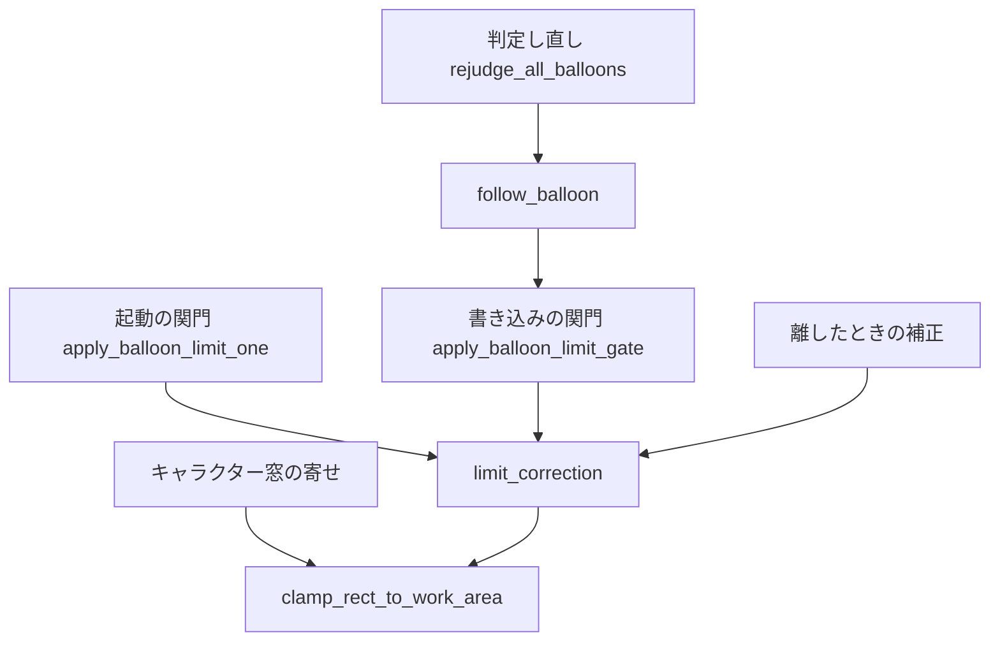

# Design Document: balloon-flip-ssp-review

## Overview

**Purpose**: キャラクター窓が作業領域に収まっていてバルーンだけが横にはみ出すとき、areka はバルーンを反対の側へ並べ替えるのをやめ、今の押し込み（作業領域の端へ寄せる・キャラクター窓に重なってよい）だけで置く（要件 3・決めごとの 12 の案 ⑵）。ukadoc の `windowposition.limit`（既定 1「バルーンを強制的に画面内に維持」）どおりの決まりに戻す。

**Users**: areka の利用者（バルーンの出方が、ukadoc に書かれた決まりの 1 本だけで決まる）と、互換の決まりを読む開発者（`doc/COMPAT_ARCHITECTURE.md` §8 の行が、測った事実と選んだ決まりだけで読める）。

**Impact**: 並べ替えは `crates/areka-placement/src/balloon_limit.rs` の `place_balloon_in_work_area` 1 本に集まっている。案 ⑵ では、この関数の答えが「動かさない」か「押し込み」だけになり、`limit_correction` と同じになる。そこで関数と戻りの型 `BalloonPlace` を外し、起動の関門と書き込みの関門が `limit_correction` を直に呼ぶ（利用者がバルーンを離したときの補正と同じ形になる）。`balloon-flip-side-rules` が足した重なりの判定（`counted_overlap`・表示しているキャラクター窓の列 `shown_char_rects`）と記録の欄 `overlap_scope` も一緒に外れる。判定し直しの系と直の呼び手は残す（決めごとの 5）。

測り（要件 1）・裁定（要件 2）・報告の文案（要件 6）・見た目の変わる場面の数え（要件 7.7）は、要件の段で済んでいる（`research.md` 8〜11 節）。設計の段から先に残るのは、コードの直し・檻の入れ替え・§8 の行の書き直し・檻の扱いの記録である。

### Goals

- 横にはみ出したバルーンを、どのスコープでも、起動の関門と書き込みの関門の両方で、今の押し込みの位置に置く（3.1、3.6、3.7）。
- 並べ替え・重なりの判定・映しの式と、それだけのための型・関数・欄を外す（3.2、3.4、4.3）。
- 2026-10-30 の形・2026-11-16 の形・変わらない形を、両関門の決定論の檻で固定する（7.1〜7.5）。
- §8 の行を、測った事実と案 ⑵ の決まりで書き直す（5.1〜5.7）。

### Non-Goals

- 判定し直しの系の登録（`crates/areka/src/ghost_session.rs`）と直の呼び手（`reset_pos.rs`・`chain_realign.rs`）を外すこと（決めごとの 5・次のウェーブで決める）。
- 押し込みの式 `limit_correction`／`clamp_rect_to_work_area` を変えること（キャラクター窓の寄せと共有）。
- キャラクター窓の鎖の寄せ（`[work-area-clamp] Clamp` の `how="flipped"`）・キャラクター窓を作業領域へ戻す決まり・バルーンの縦の置き方・`windowposition.x` のキーワードの式・利用者がバルーンを離したときの補正・件 2（右に出す `balloon.offsetx` の向き）の決まり（8.2〜8.4）。
- SSP の測りのやり直し・報告の文案の送付（済み・送るのは開発者）。

## Boundary Commitments

### This Spec Owns

- バルーンだけが横にはみ出すときの置き方の決まり（押し込みだけ）と、それを当てる 2 つの関門（起動の関門 `apply_balloon_limit`／`apply_balloon_limit_one`・書き込みの関門 `apply_balloon_limit_gate`）の中の判定の呼び出し。
- `[balloon-limit] Clamp` の行の欄の並び（`how="pushed"` を残し、`overlap_scope` を外す）。
- 並べ替え・重なりの判定・映しの式を固定していた檻の書き換えと除き、新しい檻（10-30 の形・11-16 の形・変わらない形）、その扱いの記録（`research.md`）。
- `doc/COMPAT_ARCHITECTURE.md` §8 の「【上書き】バルーンだけが作業領域からはみ出すとき」の 1 行。

### Out of Boundary

- `crates/areka/src/ghost_session.rs`（判定し直しの系の登録の 1 行を含む）と `crates/areka-runtime/src/frame/`（同じウェーブの約束）。
- `crates/areka-placement/src/reset_pos.rs`・`chain_realign.rs` の本番のコード（判定し直しの直の呼び出しは残す）。
- `limit_correction`・`clamp_rect_to_work_area`・`clamp_axis` の式、`follow/work_area_clamp.rs`・`follow/move_shift.rs`・`follow/balloon_drag.rs`・`resolver` の本番のコード。
- 完了 spec（`window-work-area-clamp`・`areka-P0-windowposition-limit`・`balloon-flip-side-rules`）の本文（2.5）。
- 箱の文字の面の名前 `emo-text-box-surface` の扱い（`balloon-text-visual-tree` の持ち場）。この spec は配置の側の写しを 1 つ減らすだけで、名前も付ける側も変えない。

### Allowed Dependencies

- `balloon_limit.rs` → `resolver` の値型（`PointPx`・`SizePx`・`RectPx`・`ScopePlacement`）・`follow` の `MonitorSnapshot`・`work_area_for_window`・`rect_at`（今と同じ）。
- `follow/window_move.rs` → `super::limit_correction`（`follow.rs` が既に `balloon_drag` のために取り込んでいる）。
- 檻 → `log_capture_kit`（`capture`・`expect_one`・`CapturedEvent::field`）・`spawn_ghost_windows`・`move_window_to`・`shared_test_support::placement_sized`（今の檻と同じ）。
- 新しい依存は足さない（`Cargo.toml` に触らない）。

### Revalidation Triggers

- `[balloon-limit] Clamp` の欄から `overlap_scope` が外れる。この欄を読む道具・檻はほかに無い（`tools/` に 0 件・`crates/` はこの spec が直す檻だけ）。後から欄を足し戻すなら、この spec の檻（欄が無いことの主張）を直す。
- `follow/other_chars.rs` から `shown_char_rects`・`is_shown`・`TEXT_BOX_SURFACE_NAME` が外れ、`emo-text-box-surface` を字で書く所は `crates/areka-emo-text/src/surface_window_child.rs` の 1 か所だけになる。`balloon-text-visual-tree` の brief（96 行「配置とのつながり（まだ開いた穴）」）の前提が変わるので、完了の棚卸でその brief へ申し送る。
- `follow.rs` の取り込みの行（`use super::balloon_limit::{…}` と `use self::other_chars::shown_char_rects;`）が変わる。同じウェーブの `audit-emo2-boot-frame` の brief は「`follow.rs` へ及ばない限り重なり 0」と書くので、実装の前にそのセッションへ触る行を知らせる。
- 判定し直しの系を次のウェーブで外すときは、この spec の判定し直しの檻（押し込みの位置が変わらないこと）を一緒に見直す。

## Architecture

### Existing Architecture Analysis

- 押し込みの式は `limit_correction` 1 本で、キャラクター窓の寄せ・面の `move` のずれ・利用者がバルーンを離したときの補正が共有する。
- 並べ替えは `place_balloon_in_work_area` だけが持ち、その呼び手は起動の関門と書き込みの関門の 2 か所だけ（`research.md` 2.1 節）。
- 書き込みの関門は `enqueue_window_set_pos` の中で毎回のバルーンの書き込みに当たる。判定し直しの系はその書き込みを全スコープについてもう 1 度起こすだけで、置き方は持たない。

### Architecture Pattern & Boundary Map



**Architecture Integration**:
- 選んだ形: 既にある純関数 `limit_correction` を 3 つの関門が共有する形に戻す（`balloon-flip-side-rules` と `window-work-area-clamp` の 5.3〜5.8 が足した 1 段を外す）。新しい部品は作らない。
- 持ち場の分け方: 置き方の決まりは `balloon_limit.rs` が持ち、関門は「有効か・作業領域は決まるか・動いたら記録する」だけを持つ（今と同じ）。
- 保つもの: `Fits` で書き込みも記録もしない約束（`limit_correction` の `None`）・表示の位置だけを書き換え `balloon_offset` に焼き付けない約束（DD6）・`Unresolved` の警告で素通しする縮退（log-first）。
- steering: log-first（黙って落ちる道を作らない）・決定論の檻・ベースウェアに判断を足さない（判断を 1 段減らす向き）。

### Technology Stack

| Layer | Choice / Version | Role in Feature | Notes |
|-------|------------------|-----------------|-------|
| 配置の crate | `areka-placement`（Rust 2024・bevy_ecs・tracing） | 置き方の決まりと 2 つの関門 | 新しい依存なし |
| 檻 | `log-capture-kit`・`spawn_ghost_windows` の headless の World | 両関門の決定論の檻 | 今の檻と同じ道具 |
| 文書 | `doc/COMPAT_ARCHITECTURE.md` §8 | 互換の決まりの正本 | 1 行の書き直し |

## File Structure Plan

### Modified Files

- `crates/areka-placement/src/balloon_limit.rs` — `BalloonPlace`・`place_balloon_in_work_area`・`counted_overlap` と節「反対の側への並べ替え」を外す。`apply_balloon_limit` はキャラクター窓の矩形の列を組まず 1 スコープずつ写す。`apply_balloon_limit_one` は引数 `chars` を外し、`limit_correction(p.balloon_pos, p.balloon_size, area)` が `Some` のときだけ書き換えて記録する。記録の `how` の語を持つ定数 `BALLOON_LIMIT_PUSHED_HOW`（`"pushed"`）を置き、`overlap_scope` の欄を外す。モジュールの注（並べ替えの記述）を押し込みだけの形に直す。
- `crates/areka-placement/src/follow/window_move.rs` — `apply_balloon_limit_gate` の判定を `limit_correction(proposed, target_size, area)` に替え、`shown_char_rects` の呼び出しと `overlap_scope` の欄を外し、`how` は `BALLOON_LIMIT_PUSHED_HOW` を出す。`Unresolved` の 5 つの分岐とシグネチャは変えない。注の「並べ替えも押し込みも」を「押し込みが」に直す。取り込みから `BalloonPlace`・`place_balloon_in_work_area`・`shown_char_rects` を外す（`limit_correction`・`BALLOON_LIMIT_PUSHED_HOW` を足す）。ファイルは行数の番人の例外表に載ったまま（1,234 行から数行減るだけで 1,000 行を割らない）。
- `crates/areka-placement/src/follow/other_chars.rs` — `shown_char_rects`・`TEXT_BOX_SURFACE_NAME`・`is_shown` と、それだけが使う取り込み（`Visual` など）を外す。`register_balloon_rejudge`・`rejudge_balloons_after_chain_finalize`・`rejudge_all_balloons` は中身を変えない。モジュールの注と 78 行の注（「並べ替えの判定に入らない」）を、判定し直しだけの形に直す。ファイル名は変えない。
- `crates/areka-placement/src/follow.rs` — `use super::balloon_limit::{…}` から `BalloonPlace`・`place_balloon_in_work_area` を外して `BALLOON_LIMIT_PUSHED_HOW` を足し、`use self::other_chars::shown_char_rects;` とその注を外し、`mod other_chars;` の注を判定し直しだけの形に直す。
- `crates/areka-placement/src/balloon_limit_flip_tests.rs` → `crates/areka-placement/src/balloon_limit_push_tests.rs`（名前を変える・`balloon_limit.rs` の `#[path]` と `mod flip_tests` を `mod push_tests` に直す） — 中身を「押し込みだけ」の檻に入れ替える（Testing Strategy の表）。
- `crates/areka-placement/src/follow_other_chars_tests.rs` — `shown_char_rects` の 8 本を除き、判定し直しの 1 本を書き換え、残り 3 本はそのまま（注だけ直す）。
- `crates/areka-placement/src/reset_pos_tests.rs` — `reset_rejudges_the_balloon_after_the_partner_returns_onto_its_flip_target` の名前と注を、押し込みの位置のまま変わらないことの檻に直す（主張の値は変えない）。
- `crates/areka-placement/src/chain_realign_script_moved_tests.rs` — `realign_rejudges_the_balloon_after_the_partner_returns_onto_its_flip_target` を同じ形に直す（主張の値は変えない）。
- 注だけを直すファイル（主張・値は変えない）: `crates/areka-placement/src/balloon_limit_gate_tests.rs`（71 行・363 行の「並べ替えず」）・`crates/areka-placement/src/follow_balloon_limit_tests.rs`（47 行の「反対の側へ並べ替える」）・`crates/areka/src/main_restore_seam_tests.rs`（216〜217 行の「反対の側へ映した」）・`crates/areka-placement/src/follow_other_chars_tests.rs`（147 行の `balloon_limit_flip_tests.rs` を名指す注）。前提合わせ（キャラクター窓をはみ出させる）は残す。外すと檻の数が変わるだけで主張は同じなので、手を入れない。
- 注を直すときの決まり（上のどのファイルにも当てる）: `CLAUDE.md` の「Comments」節に従う。並べ替えを書いた古い注は、書き直すより消すのを先に考え、残すのは名前や型や檻で言えない理由（なぜ）だけにする。コードの注に spec 名・要件番号・タスク番号を書かない（ukadoc は書いてよい）。`///`・`//!` の文書の注は正しく短く直す。
- `doc/COMPAT_ARCHITECTURE.md` — §8 の 438 行目を書き直す（CompatDoc）。
- `.kiro/specs/balloon-flip-ssp-review/research.md` — 檻の扱いの表（要件 7.6）を実装の後に書く節を足す。

### Not Modified（境界の確かめ用）

- `crates/areka/src/ghost_session.rs`・`crates/areka-runtime/src/frame/`・`crates/areka-placement/src/reset_pos.rs`・`crates/areka-placement/src/chain_realign.rs`・`crates/areka-placement/src/follow/balloon_drag.rs`・`crates/areka-placement/src/follow/work_area_clamp.rs`・`crates/areka-placement/src/follow/move_shift.rs`・`crates/areka-placement/src/resolver*.rs`・`crates/areka-placement/src/balloon_limit_tests.rs`。

## System Flows

フローは 1 本（関門が `limit_correction` を呼び、`Some` なら書き換えて記録する）で、上の図で足りる。判定し直しは `follow_balloon` を起こすだけなので、書き込みの関門の同じ道を通る。

## Requirements Traceability

| Requirement | Summary | Components | Interfaces | Flows |
|-------------|---------|------------|------------|-------|
| 1.1, 1.2, 1.3, 1.4, 1.5, 1.6, 1.7, 1.8, 1.9, 1.10, 1.11 | SSP での測り | 済み（`research.md` 8.1〜8.5 節・場面 ⑵ は決めごとの 13 で測らない・⑶ は作れない） | — | — |
| 2.1, 2.2 | 裁定と記録 | 済み（決めごとの 12・`research.md` 11 節） | — | — |
| 2.3 | 足した段の扱い | BalloonLimitCore・WriteGate・Rejudge（重なりの判定と映しの式と `overlap_scope` を外し、判定し直しを残す） | — | — |
| 2.4 | 登録を外すとき | 外さないので当たらない（Non-Goals） | — | — |
| 2.5 | 完了 spec の本文を書き換えない | CompatDoc（§8 とこの spec の文書だけ） | — | — |
| 3.1 | 押し込みだけで置く | BalloonLimitCore・WriteGate | `limit_correction` | 関門の図 |
| 3.2 | 重なりを判定に使わない | BalloonLimitCore（`counted_overlap` を外す）・Rejudge（`shown_char_rects` を外す） | — | — |
| 3.3 | 窓がはみ出す・縦にはみ出すは今のまま | BalloonLimitCore（式は `limit_correction` のまま） | `limit_correction` | — |
| 3.4 | `how="flipped"` を残さない | BalloonLimitCore・WriteGate（`BALLOON_LIMIT_PUSHED_HOW` だけを出す） | 記録の行 | — |
| 3.5 | 判定し直しても位置が変わらない | Rejudge（中身はそのまま）・RejudgeCages | `rejudge_all_balloons` | 判定し直しの道 |
| 3.6 | 両関門で同じ | BalloonLimitCore（起動の関門）・WriteGate が同じ関数を呼ぶ | `limit_correction` | 関門の図 |
| 3.7 | スコープの数を決め打ちしない | BalloonLimitCore（スコープを見ない）・PushCages の全スコープの檻 | — | — |
| 3.8 | `limit=0` は収めない | BalloonLimitCore（起動の関門）・WriteGate の入り口（今のまま） | — | — |
| 3.9 | 表示の位置だけ | BalloonLimitCore（起動の関門は `balloon_pos` だけ）・WriteGate（書き込みの位置だけ） | — | — |
| 3.10 | 明示と既定を分けない | `BalloonLimit(bool)`・`ScopePlacement.balloon_limit` のまま | — | — |
| 4.1, 4.2, 4.3, 4.4 | 記録の欄 | BalloonLimitCore（起動の関門）・WriteGate（`how="pushed"`・`overlap_scope` を外す・`Fits` は記録しない） | 記録の行 | — |
| 4.5, 4.6 | 失敗の道 | BalloonLimitCore（起動の関門）・WriteGate の `Unresolved` の分岐をそのまま残す（新しい失敗の道は作らない） | — | — |
| 5.1, 5.2, 5.3, 5.4, 5.5, 5.6, 5.7 | §8 の書き直し | CompatDoc | — | — |
| 6.1, 6.2, 6.3, 6.4, 6.5 | 報告の文案 | 済み（`research.md` 9 節・画像は `target\balloon-flip-ssp-review\`） | — | — |
| 7.1, 7.2, 7.3, 7.4, 7.5 | 決定論の檻 | PushCages | — | — |
| 7.6 | 外した段の檻の扱いの記録 | PushCages・RejudgeCages・TestRecord | — | — |
| 7.7 | 見た目の変わる場面の数え | 済み（`research.md` 10 節） | — | — |
| 8.1 | 名前や初回を見ない | BalloonLimitCore（分岐を足さない） | — | — |
| 8.2, 8.3, 8.4 | 変えない決まり | Out of Boundary の本番のコードに触らない・件 2 は resolver の檻が持つ | — | — |
| 8.5 | 収まっていれば 1 ピクセルも変えない | `limit_correction` の `None`（今のまま）・PushCages の「収まる」の行 | — | — |
| 8.6 | 記録の語の綴りを変えない | BalloonLimitCore（起動の関門）・WriteGate（`[balloon-limit] Clamp`・`Unresolved`・`pushed` は同じ綴り。`flipped`・`overlap_scope` は出なくなるだけ） | 記録の行 | — |

## Components and Interfaces

| Component | Domain/Layer | Intent | Req Coverage | Key Dependencies | Contracts |
|-----------|--------------|--------|--------------|------------------|-----------|
| BalloonLimitCore（`balloon_limit.rs`） | 配置の決まり | 押し込みだけで置く・起動の関門を持つ | 2.3, 3.1〜3.4, 3.6〜3.10, 4.1〜4.5, 8.1, 8.5, 8.6 | `limit_correction`（P0）・`work_area_for_window`（P0） | Service |
| WriteGate（`follow/window_move.rs`） | 配置の関門 | 書き込みの位置を押し込む | 3.1, 3.4, 3.6, 3.8, 3.9, 4.1〜4.6, 8.6 | `limit_correction`（P0）・`GhostWindows`・`MonitorSnapshot`（P0） | Service |
| Rejudge（`follow/other_chars.rs`） | 配置の系 | 判定し直しを残し、重なりの列を外す | 2.3, 3.2, 3.5 | `follow_balloon`（P0） | Service |
| PushCages（`balloon_limit_push_tests.rs`） | 檻 | 押し込みだけの決まりを両関門で固定する | 3.1〜3.9, 4.1, 4.3, 4.4, 7.1〜7.6, 8.4, 8.5 | `apply_balloon_limit`・`move_window_to`（P0） | — |
| RejudgeCages（`follow_other_chars_tests.rs`・`reset_pos_tests.rs`・`chain_realign_script_moved_tests.rs`） | 檻 | 判定し直しても押し込みの位置が変わらないことを固定する | 3.5, 7.6 | `register_balloon_rejudge`・`reset_window_positions`・`realign_chain_once_with`（P0） | — |
| CompatDoc（`doc/COMPAT_ARCHITECTURE.md` §8） | 文書 | 測った事実と案 ⑵ の決まりで 1 行を書き直す | 2.5, 5.1〜5.7 | `research.md` 8〜11 節（P0） | — |
| TestRecord（`research.md` の新しい節） | 文書 | 檻をどう扱ったかの表 | 7.6 | PushCages・RejudgeCages（P1） | — |

### 配置の決まり

#### BalloonLimitCore

| Field | Detail |
|-------|--------|
| Intent | 横にはみ出したバルーンを、どのスコープでも今の押し込みで置く |
| Requirements | 2.3, 3.1, 3.2, 3.3, 3.4, 3.6, 3.7, 3.8, 3.9, 3.10, 4.1, 4.2, 4.3, 4.4, 4.5, 8.1, 8.5, 8.6 |

**Responsibilities & Constraints**
- 置き方の決まりは `limit_correction` の 1 本だけ。キャラクター窓が収まっているか・横か縦か・ほかの窓に重なるかで分けない。
- 起動の関門は `balloon_pos` だけを書き換え、`balloon_offset`・`balloon_offset_base` に触れない（3.9・DD6）。
- `limit=0` のスコープは素通し、作業領域が決まらなければ `[balloon-limit] Unresolved` の `warn!` で素通し（今のまま）。

**Contracts**: Service [x]

##### Service Interface

```rust
// 変えない（キャラクター窓の寄せ・離したときの補正と共有）
pub(crate) fn limit_correction(pos: PointPx, size: SizePx, area: RectPx) -> Option<PointPx>;

// 新しく置く語の定数（綴りは今の how の値のまま・新しい語ではない）
pub(crate) const BALLOON_LIMIT_PUSHED_HOW: &str = "pushed";

// シグネチャは変えない。中身はキャラクター窓の矩形の列を組まずに 1 スコープずつ写す
pub fn apply_balloon_limit(placements: Vec<ScopePlacement>, snapshot: &MonitorSnapshot) -> Vec<ScopePlacement>;

// 引数 chars を外す
fn apply_balloon_limit_one(p: ScopePlacement, snapshot: &MonitorSnapshot) -> ScopePlacement;

// 外す: enum BalloonPlace / fn place_balloon_in_work_area / fn counted_overlap
```

- Preconditions: 座標・寸は物理 px（今と同じ）。
- Postconditions: 出力の長さと順は入力と同じ。`limit_correction` が `None` のスコープ・`limit=0` のスコープ・作業領域が決まらないスコープは入力と同じ。`Some(to)` のスコープは `balloon_pos == to` で、ほかの欄は入力と同じ。
- Invariants: `Some(to)` のときだけ `[balloon-limit] Clamp` を 1 行残す。欄は `scope`・`context="boot-gate"`・`how="pushed"`・`from`・`to`・`balloon_size`・`work_area`（`overlap_scope` は無い）。

**Implementation Notes**
- Integration: 戻りの型が無くなるので、`let … else` の 3 腕の型は `let Some(corrected) = limit_correction(..) else { return p; };` になる。
- Validation: PushCages の起動の関門の表・`balloon_limit_gate_tests.rs` の今の檻（緑のまま）。
- Risks: 10-30 の形（配布版のぱすたの相方）と emo2 の端の形で、バルーンが反対の側でなくキャラクター窓に重なって出る（見た目の変化・`research.md` 10 節で承知済み）。

### 配置の関門

#### WriteGate

| Field | Detail |
|-------|--------|
| Intent | バルーン窓の書き込みの位置を、キャラクター窓のモニターの作業領域へ押し込む |
| Requirements | 3.1, 3.4, 3.6, 3.8, 3.9, 4.1, 4.2, 4.3, 4.4, 4.5, 4.6, 8.6 |

**Responsibilities & Constraints**
- `fn apply_balloon_limit_gate(world: &World, window: Entity, proposed: PointPx, size: Option<SizePx>, route: Option<PlacementRoute>) -> PointPx` のシグネチャは変えない。
- 判定の前の 5 つの `Unresolved` の分岐（寸の未確定・scope 不明・キャラ窓不明・キャラ窓の矩形の未確定・作業領域不明）は変えない（4.5）。
- 判定は `limit_correction(proposed, target_size, area)`。`None` なら `proposed` をそのまま返し、記録しない（4.4・8.5）。`Some(to)` なら `[balloon-limit] Clamp` を 1 行（`scope`・`context="runtime-gate"`・`how="pushed"`・`entity`・`route`・`from`・`to`・`balloon_size`・`work_area`）残して `to` を返す。
- 書き込みを止める失敗の道は今も無く、足さない（4.6 は新しい失敗の道を作らないことで保つ）。

**Contracts**: Service [x]

**Implementation Notes**
- Integration: キャラクター窓の矩形 `char_rect` は作業領域を決めるのにだけ使う（判定には渡さない）。
- Validation: PushCages の書き込みの関門の表・`follow_balloon_limit_tests.rs` の今の檻（緑のまま）。
- Risks: 無し（押し込みの位置は今の `Pushed` と同じ式）。

### 配置の系

#### Rejudge

| Field | Detail |
|-------|--------|
| Intent | 起動の並べ直し・位置の初期化・鎖の並べ直しの後に全スコープのバルーンを書き込み直す系を残し、重なりの列を外す |
| Requirements | 2.3, 3.2, 3.5 |

**Responsibilities & Constraints**
- `pub fn register_balloon_rejudge(world: &mut World)` と `pub(crate) fn rejudge_all_balloons(world: &mut World)` は中身もシグネチャも変えない（`ghost_session.rs`・`reset_pos.rs`・`chain_realign.rs` から呼ばれたまま）。
- 押し込みは自分のキャラクター窓と作業領域だけで決まるので、判定し直しの書き込みは同じ位置を書く（3.5）。1 巡に同じ位置の書き込みが数本増えるだけ。
- 外す: `pub(super) fn shown_char_rects(world: &World) -> Vec<(usize, RectPx)>`・`fn is_shown`・`const TEXT_BOX_SURFACE_NAME`。

**Contracts**: Service [x]

**Implementation Notes**
- Integration: 系を外すかは次のウェーブ（決めごとの 5）。この spec の後は、系が置き方を変えないことを RejudgeCages が示す。
- Risks: 判定し直しの書き込みは押し込みのたびに `[balloon-limit] Clamp` をもう 1 行残す（今も並べ替え・押し込みで同じ）。頻度は増えない。

### 檻（PushCages・RejudgeCages・TestRecord）

要約だけ（新しい境目を作らない）。中身は Testing Strategy の表。`balloon_limit_flip_tests.rs` は名前を `balloon_limit_push_tests.rs` に変える。外した型を名指す檻はビルドが通らなくなるので、コードの直しと同じタスクで書き換える（新しい檻だけを先に赤で確かめる）。

### 文書

#### CompatDoc

| Field | Detail |
|-------|--------|
| Intent | §8 の「【上書き】バルーンだけが作業領域からはみ出すとき」の行を、追記でなく書き直す |
| Requirements | 2.5, 5.1, 5.2, 5.3, 5.4, 5.5, 5.6, 5.7 |

**Responsibilities & Constraints**（行に書く中身。今の行の並べ替えの記述・映しの式・`overlap_scope` の記述は残さない）
- 1 列目: 見出しはそのまま。括弧の中を「ukadoc の `windowposition.limit` は既定 1 で『バルーンを強制的に画面内に維持』と書く（URL）。完了 spec `window-work-area-clamp` 5.3〜5.8 の並べ替えと `balloon-flip-side-rules` の足した段を改める」に直す（今の「ukadoc は沈黙」は誤り）。
- 2 列目（決まり）: まずキャラクター窓を作業領域に収める（上の 3 行）。キャラクター窓が収まっていても、はみ出していても、バルーンがはみ出すときは、どのスコープのバルーンも作業領域の端へ押し込む（4 辺・キャラクター窓に重なってよい・反対の側へ並べ替えない・ほかのキャラクター窓との重なりを判定に使わない）。`windowposition.limit` が 0 なら収めない。明示の `limit,1` と既定を分けない。表示の位置だけに当て、相対の位置に焼き付けない。バルーンを動かさない指定は押し込みを止めない。判定し直し（起動の並べ直し・位置の初期化・拡大率の解き直しの後）は残すが、位置は変わらない。記録は `[balloon-limit] Clamp` の `how="pushed"`（5.5）。
- 3 列目（根拠）: ⑴ ukadoc どおりに押し込む（意味は ukadoc から取る）。⑵ SSP 2.9.34 は押し込まない: 2026-11-16（バルーンが横に 63px・103px はみ出す形・`\![move]` とドラッグ）と 2026-11-20（はみ出し 88% と 100%・`windowposition.limit,1` の明示でも同じ値）。測りの記録は `completed/balloon-flip-side-rules/research.md` 9 節とこの spec の `research.md` 8 節（5.3）。⑶ areka は SSP と違う。理由は、意味を ukadoc から取ることと、SSP どおりだとバルーンが全部画面の外へ出て読めなくなる形があること（5.4・5.6）。⑷ ukadoc の語は「画面」で、areka はキャラクター窓のモニターの作業領域で収める（完了 `areka-P0-windowposition-limit` の決めのまま）。⑸ 2026-10-30 の「SSP 2.9.26 は並べ替える」という読みは、相方のバルーンのもともとの側を見分けていなかった疑いがある（11-20 の測りでは、窓の左右に余地のある初めの位置で本体のバルーンが窓の左に出ることを先に読み、窓を左の画面の左端へ寄せても左のまま＝並べ替えないことを確かめた。10-30 に見た相方のバルーンの右隣は、相方のもともとの側だった見込み・5.2）。⑹ 改めた決まり＝並べ替え・重なりの判定・映しの式・欄 `overlap_scope`。残した決まり＝押し込み・判定し直し・件 2（右に出す `balloon.offsetx` は左向きが＋・`windowposition.x` は左右とも右向き）（5.5）。⑺ 定義点＝`crates/areka-placement/src/balloon_limit.rs` の `limit_correction`（呼び手は起動の関門の `apply_balloon_limit_one` と `crates/areka-placement/src/follow/window_move.rs` の書き込みの関門 `apply_balloon_limit_gate`）（5.7）。
- 4 列目（spec）: `balloon-flip-ssp-review`（要件 3・5）／上書き: `window-work-area-clamp`（要件 5.3〜5.8 の並べ替え）・`balloon-flip-side-rules`（重なりの判定・映しの式・欄 `overlap_scope`）／保つ: `areka-P0-windowposition-limit`（押し込みの決まり）。
- 書き方: 平易な日本語・project の語（キャラクター窓・バルーン・押し込み・関門・判定し直し）。比喩を足さない。

## Data Models

### Domain Model

- 記録の行 `[balloon-limit] Clamp`（起動の関門・書き込みの関門）の欄から `overlap_scope` を外す。`how` の値は `"pushed"` だけになる（`"fits"` は今も記録されない・`"flipped"` は作られない）。離したときの補正（`context="release-gate"`）の行は変えない（`how` を今も持たない）。
- `BalloonLimit(bool)` と `ScopePlacement.balloon_limit` は変えない（3.10）。

## Error Handling

### Error Strategy

- 今の縮退をそのまま残す。起動の関門は作業領域が決まらなければ `[balloon-limit] Unresolved` の `warn!` で素通し、書き込みの関門は 5 つの分岐のどれかで `Unresolved` の `warn!` を残して `proposed` を書く（4.5）。判定し直しは `GhostWindows` が無い・キャラクター窓の位置が未確定のとき `Unresolved` の `warn!` で飛ばす（今のまま）。
- 直しは判定を減らすだけで、`Err` を返す道も `panic` も足さない（4.6）。

### Monitoring

- 実機の確かめでは `[balloon-limit] Clamp` の行の `how="pushed"` と `context` で関門を見分ける。`how="flipped"` と `overlap_scope` の欄は出なくなる（8.6）。

## Testing Strategy

すべて実機の窓を使わない決定論の檻（headless の World・`log_capture_kit` の捕捉）。

### 新しい檻（PushCages・`balloon_limit_push_tests.rs`）— 直す前に赤を確かめる（7.2）

形の表を 1 つ置き、同じ表を起動の関門（`apply_balloon_limit` に `placement_sized` の配置を入れる）と書き込みの関門（キャラクター窓を形の位置と違う作業領域の中ほどに、バルーンが収まる形で spawn し、`move_window_to` で形の位置へ動かす）の両方に通す。作業領域は `0,0,2880,1704`。

| 形 | キャラクター窓（位置・寸） | バルーン（ずらし・寸） | 期待 | 直す前（位置） | 直す前（欄 `overlap_scope` が無い） |
|---|---|---|---|---|---|
| 10-30 の形（配布版のぱすたの相方・scope 1）（7.3） | `0,336`・1108×1368 | `(-872,0)`・872×900（位置 `(-872,336)`） | `(0,336)`・`how="pushed"` | 赤（`(1108,336)` に並べ替わる） | 赤（`how="flipped"` の行に欄が載る） |
| 11-16 のドラッグの後の形（相方・scope 1）（7.4） | `2524,1304`・336×400 | `(131,-116)`・288×203（位置 `(2655,1188)`） | `(2592,1188)`・`how="pushed"` | 赤（`(2441,1188)` に並べ替わる） | 赤（同上） |
| 収まる（7.5・8.5） | `1200,904`・1108×800 | `(-872,0)`・872×400 | `(328,904)`・記録なし | 緑 | —（記録が無い） |
| `limit=0`（7.5・3.8） | `0,904`・1108×800 | `(-872,0)`・872×400 | `(-872,904)`・記録なし | 緑 | —（記録が無い） |
| キャラクター窓がはみ出す（7.5・3.3） | `-200,904`・1108×800 | `(-872,0)`・872×400 | `(0,904)`・`how="pushed"` | 緑 | 赤（今は押し込みの行にも `overlap_scope=None` が載る） |
| 縦にはみ出す（7.5・3.3） | `1200,904`・1108×800 | `(-872,1000)`・872×400 | `(328,1304)`・`how="pushed"` | 緑 | 赤（同上） |

各行で次も確かめる。起動の関門: `balloon_offset`・`balloon_offset_base` が入力と同じ（3.9）。両関門: 記録のある行は `[balloon-limit] Clamp` がちょうど 1 行で、`how` が字の `"\"pushed\""`（今の檻と同じ比べ方。定数 `BALLOON_LIMIT_PUSHED_HOW` を檻から名指すと、直す前はビルドで落ちて赤の確かめにならないため）・`context` が関門の語・`field("overlap_scope")` が `None`（3.4・4.1・4.3）。記録の無い行は、捕捉が生きていること（書き込みの関門は `[diag.window_move]` の行）を確かめてから `Clamp` が 0 行（4.4）。直す前の赤は、位置の主張と欄の主張を分けて確かめる（上の表の 2 列）。

### 書き換える檻・除く檻（7.6・扱いは TestRecord に表で残す）

| 今の檻 | 扱い | 書き換えた後の主張 |
|---|---|---|
| `left_side_balloon_of_left_edge_window_flips_to_the_right_keeping_y`・`right_side_balloon_of_right_edge_window_flips_to_the_left`・`flipped_position_overflowing_only_vertically_is_clamped_vertically` | 除く | 新しい表の 10-30・11-16・縦の行が持つ |
| `fallback_cases_return_the_current_push_in`・`fitting_balloon_is_left_alone` | 除く | 純関数が無くなる。式は `balloon_limit_tests.rs`（変えない）、関門は新しい表 |
| 重なりの 7 本（`flip_target_overlapping_partner_window_is_pushed_instead`・`shape_4_3_1_flips_because_partner_is_below`・`partner_at_same_position_as_own_window_is_not_counted`・`partner_only_touching_the_flip_target_is_not_counted`・`first_overlapping_scope_is_reported_across_three_scopes`・`pushed_position_is_kept_even_if_it_still_overlaps`・`empty_char_list_keeps_the_current_flip`） | 除く | 重なりの判定ごと外す（決めごとの 5） |
| `boot_gate_flips_keeps_offset_and_logs_how`・`boot_gate_pushes_on_overlap_and_logs_the_scope`・`boot_gate_does_not_flip_when_limit_is_disabled` | 除く | 新しい表の起動の関門 |
| `write_gate_flips_and_returns_to_the_original_side` | 書き換え | 左端へ動かすと `(0,904)`・`how="pushed"`・欄 `overlap_scope` なし。中ほどへ戻すと `(328,904)`・記録なし（焼き付けない・3.9） |
| `write_gate_pushes_on_overlap_with_a_shown_partner`・`write_gate_flips_when_the_partner_is_hidden_or_undetermined` | 1 本に書き換え | 相方の窓が可視でも不可視でも寸が未確定でも、本体のバルーンは `(0,904)`（重なりを判定に使わない・3.2） |
| `write_gate_does_not_flip_when_limit_is_disabled` | 除く | 新しい表の `limit=0` の行 |
| `balloon_move_locks_do_not_stop_the_flip` | 書き換え | 動かせない指定があっても押し込む（`(0,904)`） |
| `release_correction_never_flips` | 名前だけ変える | 離したときの補正は今のまま `(0,904)`・`context="release-gate"`（8.3） |
| `flip_is_the_same_for_every_scope` | 書き換え | スコープ 0・1・2 のどれも `(0,904)`（3.7・8.1） |
| `right_from_start_equals_left_mirrored_for_descript_part` | 書き換え（映しを使わない） | descript の分 d（30・100）: 右に出した x ＝ キャラクター窓の右端 − d、かつ右の間合い（キャラクター窓の右端とバルーンの左端の差）と左の間合い（バルーンの右端とキャラクター窓の左端の差）が同じ（8.4） |
| `mirror_of_windowposition_part_keeps_current_formula` | 書き換え（映しを使わない） | `windowposition.x` の分 −237（descript 0）: 左に出した x ＝ 窓の左端 − 幅 − 237、右に出した x ＝ 窓の右端 − 237（左右とも右向きが＋・8.4） |
| `follow_other_chars_tests.rs` の `shown_char_rects` の 8 本（`visible_window_is_included`・`window_with_any_visible_child_is_included`・`window_whose_children_are_all_invisible_is_excluded`・`window_without_surface_children_is_excluded`・`text_box_surface_alone_does_not_count_as_shown`・`window_with_undetermined_size_is_excluded`・`three_scopes_come_in_ascending_order`・`no_ghost_windows_gives_empty_list_without_logging`） | 除く | 関数ごと外す |
| `rejudge_after_chain_finalize_pushes_the_balloon_onto_the_moved_partner_once` | 書き換え | 本体を左端へ動かすと `(0,904)`。案 ⑵ では系が走っても走らなくても位置は同じなので、系が走ったかは位置でなく巡ごとの `[balloon-limit] Clamp` の行の数で確かめる。印の無い巡: 同じ捕捉の中に `[diag.window_move]` の行があること（捕捉が生きている）を先に確かめ、`Clamp` が 0 行。印の入った巡: `Clamp` がちょうど 1 行（`how="pushed"`・欄 `overlap_scope` なし）で、位置は `(0,904)` のまま（3.5）。印の後の巡: `Clamp` が 0 行 |
| `rejudge_without_overlap_keeps_every_balloon_bit_identical`・`rejudge_skips_balloons_with_limit_disabled`・`rejudge_skips_a_scope_whose_char_position_is_undetermined` | 残す（注だけ直す） | 今のまま |
| `reset_pos_tests.rs` `reset_rejudges_the_balloon_after_the_partner_returns_onto_its_flip_target`・`chain_realign_script_moved_tests.rs` `realign_rejudges_the_balloon_after_the_partner_returns_onto_its_flip_target` | 名前と注を書き換え（値は変えない） | 並べ直し・詰め直しの後も本体のバルーンは押し込みの位置（3.1・3.5）。直す前も後も緑（並べ替えの前提が無くなるだけ）。注に「判定し直しが起きたかはここでは見ない（系の檻が見る）」と書く |

### 緑のまま残る檻（前提合わせは触らない）

- `balloon_limit_tests.rs`（式）・`balloon_limit_gate_tests.rs`・`follow_balloon_limit_tests.rs`・`follow_drag_end_limit_tests.rs`・`crates/areka/src/main_restore_seam_tests.rs`・`resolver_resolve_balloon_tests.rs` の件 2 の 4 本・キャラクター窓の鎖の寄せの檻（`[work-area-clamp] Clamp` の `how="flipped"`）。
- 直した後に `areka-placement`・`areka`・`areka-runtime` の全部のテストを回す。フレームの檻（`crates/areka/src/runtime_tests/`・`crates/areka-runtime/src/`）が赤になったら、`frame/` に触る直しは入れずに止めて報告する（同じウェーブの約束）。

## Open Questions / Risks

- 見た目の変化: 今並べ替えで置かれている場面（`research.md` 10 節の太字）で、バルーンがキャラクター窓に重なって出る（裁定の承知の上）。
- `follow.rs` の取り込みの行の変更は、同じウェーブの `audit-emo2-boot-frame` と行が近い（Revalidation Triggers）。
## 決めごと（2026-11-20 設計の話し合い・開発者「推奨どおり承認」）

- **D1 外し方**: (b)。`BalloonPlace`・`place_balloon_in_work_area`・`counted_overlap`・引数 `chars`・欄 `overlap_scope`・`shown_char_rects`・`is_shown`・`TEXT_BOX_SURFACE_NAME` を外し、両関門は `limit_correction` を直に呼ぶ（(a) は作られない変種の警告を押さえる属性が要り、読み手を迷わせる）。
- **D2 名前**: `how` の語は定数 `BALLOON_LIMIT_PUSHED_HOW = "pushed"` を `balloon_limit.rs` に 1 つ置く（檻は字の `"\"pushed\""` で比べる）。檻のファイルは `balloon_limit_flip_tests.rs` → `balloon_limit_push_tests.rs`。`follow/other_chars.rs` は名前を変えず注だけ直す（`follow.rs` の行を増やさない）。
- **D3 判定し直しの檻**: 系の檻 1 本で、巡ごとの `[balloon-limit] Clamp` の行の数（印の無い巡 0・印の巡 1・印の後の巡 0）で「印の巡で 1 度だけ走り、位置は変わらない」を示す。`reset_pos`・`chain_realign` の 2 本は値を変えず名前と注だけ直す。
- **D4 件 2 の檻**: 除かずに、映しを使わない形へ書き換える（件 2 の決まりは変えない）。
- **D5 SSP の版**: 11-20 の測りの SSP は 2.9.34 と書く（11-16 と同じ実行ファイル `C:\wintools\ssp\ssp.exe`・`system.version` は読めなかった）。
- **D6 ほかのセッションへの知らせ**: 実装の前に `audit-emo2-boot-frame` へ `follow.rs` で触る 2 行（`use super::balloon_limit::{…}` と `use self::other_chars::shown_char_rects;`）を知らせる（2026-11-20 に知らせた）。`balloon-text-visual-tree` へは完了の棚卸で brief の 96 行へ申し送る。
