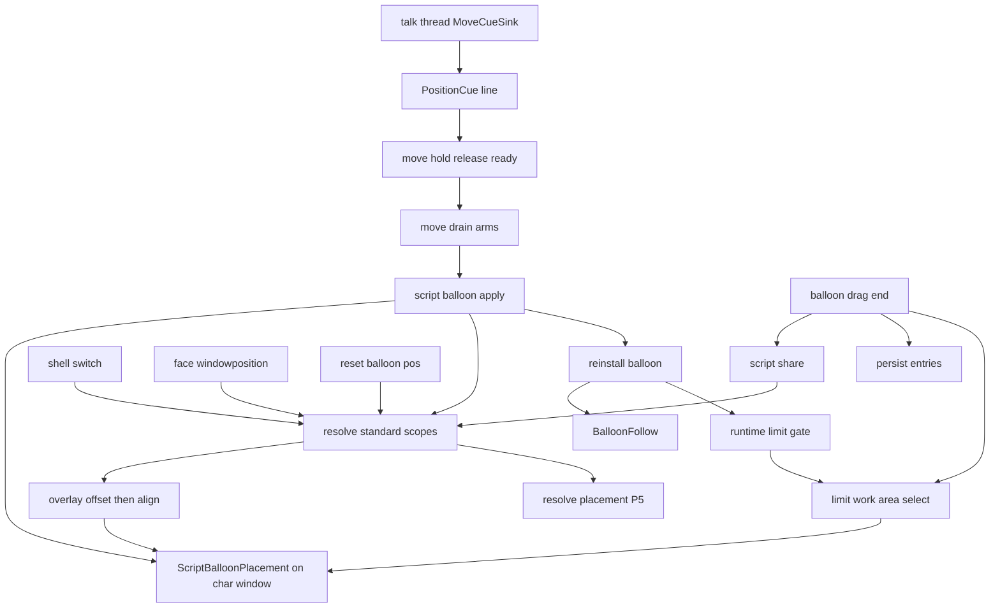
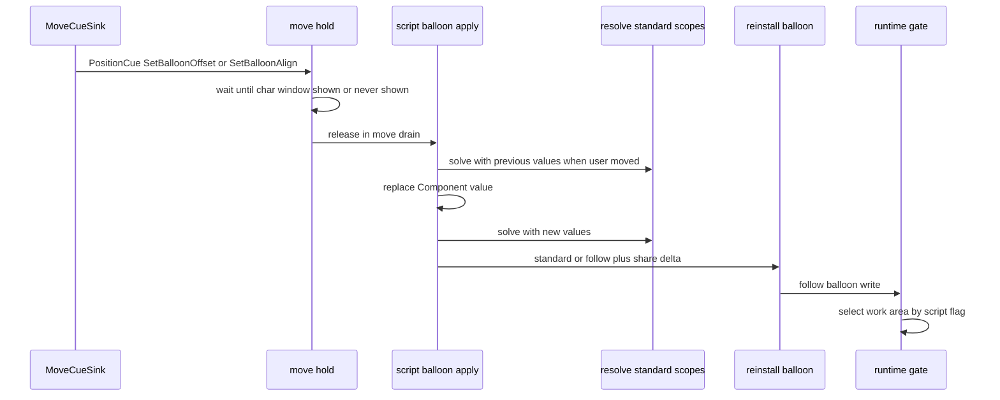
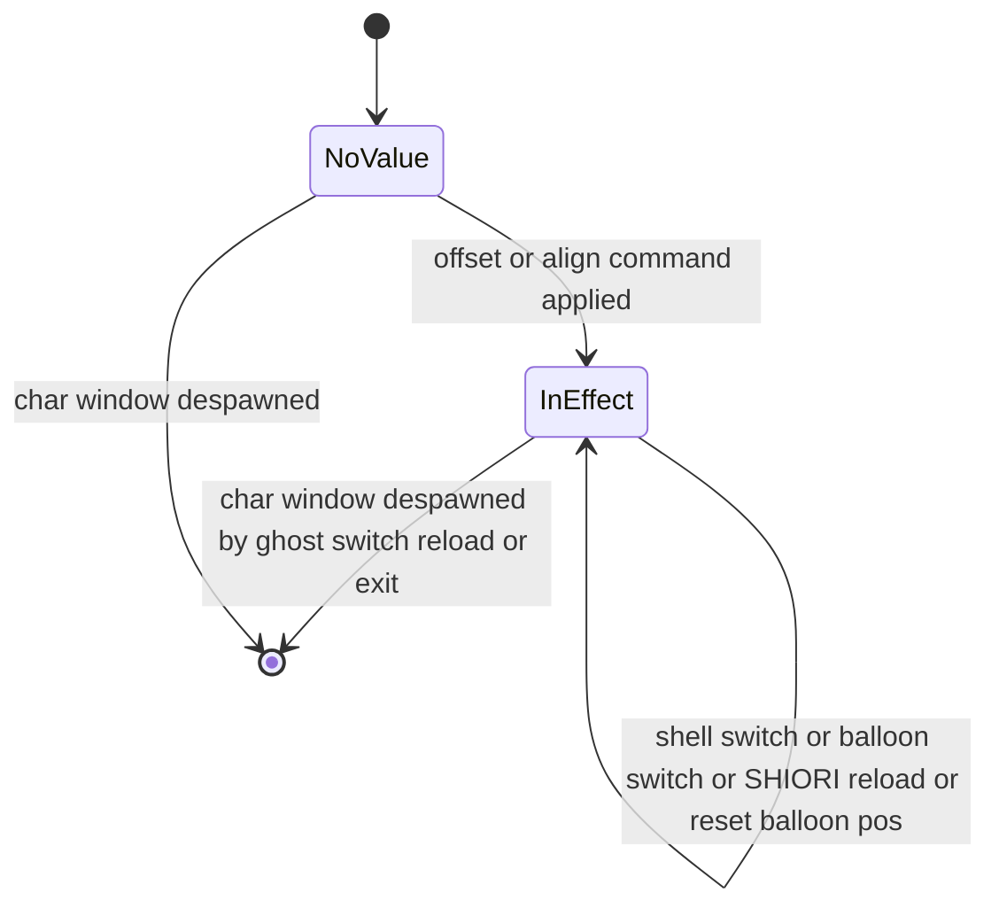

# Design Document: balloon-script-offset-align

## Overview

**Purpose**: 台本の `\![set,balloonoffset,x,y]` と `\![set,balloonalign,ID]` を ukadoc の意味どおりに受け、命令を書いたスコープのバルーンの置き方を、descript の既定の上に重ねた「台本の値」で決める。台本の値が効いているスコープだけ、押し戻しの関門をバルーン自身の画面の作業領域で見るので、作者が台本でバルーンを本体から離せば、本体と別の画面（DPI の違う画面を含む）にバルーンを出せる。

**Users**: ゴーストの作者（台本でバルーンの置き方を変える）・利用者（ドラッグで決めた位置が台本の値の上に乗る）・開発者（`shell-scale-linkage` の段 4 の実機の確かめ直し）。

**Impact**: 受け手の表に 2 行を足し、`\![set,alignmenttodesktop]`・`\![lock,balloonmove]` と同じ線（`MoveCueSink` → `PositionCue` → move drain → placement の当て口）で placement へ届ける。値はキャラクター窓の新しい Component に持ち、標準の位置を解く 1 か所（`reseed` の `resolve_standard_scopes`）で descript の値に重ねる。台本の値の無いスコープの置き場所・押し戻しは 1 ビットも変えない。版は v0.2.0（ウェーブ C28 の ④）。

### Goals
- 2 つの命令を受け、`check_script` が受け手の無い命令と報告しない（台帳の 2 行を実装済みにする）。
- 台本の値を、起動の後の最初の置き方・本体への追従・押し戻し・ドラッグ・シェルの倍率の変化・シェルとバルーンの切り替え・バルーン位置初期化のどれでも同じ所から読む。
- 利用者のずらしを台本の値の上に足し、記憶の `BalloonOffset` には台本の値の分を除いて書く（`persist.rs` は変えない）。
- 台本の値が効いているスコープだけ、押し戻しの関門がバルーン自身の画面を見る。
- 指令の当ては、指令と同じ巡で画面へ出る（フレームを遅らせない）。

### Non-Goals
- descript の鍵の読みの追加（方向つきのずらし・`surfaces.txt` のずらしは `balloon-directional-offset-keys`）。
- `none` のときの左右の判定の決まりと右に出すときの符号の決まりの変更（`balloon-flip-side-rules` の持ち物・今の式をそのまま使う）。
- 台本の値の保存（記憶への書き込み）。
- 倍率・DPI の値そのもの・`currentmonitor.dpi` の読み手・バルーンの大きさ・面の選び。
- キャラクター窓の作業領域への寄せ（`work_area_clamp.rs`）・3 体以上の窓。

## Boundary Commitments

### This Spec Owns
- 受け手の表の 2 行 `("set", Some("balloonoffset"))`・`("set", Some("balloonalign"))` と、`MoveCueSink` の 2 つの腕・`PositionCue` の 2 つの変種・預かりと move drain の腕。
- 引数の読み（軸ごとの絶対と相対・壊れた値・6 語と上記以外・大文字と小文字）。
- 台本の値の持ち主: キャラクター窓の Component `ScriptBalloonPlacement`（新しいファイル `crates/areka-placement/src/script_balloon.rs`）。寿命はキャラクター窓と同じ。
- descript の値に台本の値を重ねる層（ずらしは換算の前・向きは合流の後）と、それを通す標準の位置の解き（`resolve_standard_scopes`）。
- 台本の値の分（`script_share`＝台本の値ありの標準 − 台本の値なしの標準）の計算と、その分を記憶に入れない・記憶から戻したずらしに足す決まり。
- 押し戻しの関門の画面の選び方（`balloon_limit.rs` の 1 つの関数）と、3 か所の `[balloon-limit] Clamp` の行の欄 `monitor`・`script`。
- 網羅台帳の 2 行・`doc/COMPAT_ARCHITECTURE.md` §8 の行・SSP の残りの測りの記録・段 4 の実機の確かめ直しと知らせ。

### Out of Boundary
- P1〜P5 の配置式（`resolver.rs`）・`keyword_balloon_pos` の幾何・`none` の左右の判定・右の符号の反転。この spec は入力の `ScopeConfig` を変えるだけで、式を変えない。
- `persist.rs`（記憶の重ね・鍵の型・書き手の口）と、約束の試験の支え 5 本（`follow_test_support.rs`・`persist_finalize_save_tests.rs`・`crates/areka-runtime/src/frame_persist_test_support.rs`・`move_cue_apply_move_tests.rs`・`placement_tests/reset_balloon_pos_tests.rs`）。読む・呼ぶのはよいが変えない。
- `ScopePlacement`・`ScopeConfig` の欄の追加（どちらも欄を足さない）。
- 起動の配置準備（`prepare_ghost_windows`・`areka-session` の `boot_seam`）の重ね。台本の値は保存せず、ゴーストの切り替え・読み直しで窓ごと捨てるので、起動の時点では必ず無い（起動の関門は「台本の値なし」で同じ選び方の関数を呼ぶだけ）。
- `\![lock,balloonmove]` の帳簿・`DragConfig.move_window`（読みも書きもしない）。
- 倍率の表と DPI の読み手（`shell-scale-linkage`）。

### Allowed Dependencies
- `areka-runtime` → `areka-placement`（今の向き。`script_balloon` の型と当て口を `move_cue.rs`・`frame/` から引く）。
- `script_balloon.rs` → `config`（`ScopeConfig`・`BalloonSide`・`BalloonXMode`）・`reseed`（`resolve_standard_scopes`・`resolve_descript_scopes`・`reinstall_balloon`）・`face_windowposition`（`BalloonUserMoved`・`mark_user_moved`）・`follow`（`BalloonFollow`）・`reset_pos`（`DefaultPlacementBasis`）・`spawn`（`GhostWindows`）・`resolver`（`OffsetBase`・`PointPx`）。`lib.rs` の依存の向きの約束で「同じ段」のモジュールどうしの引き合いに当たる（新しい向きは作らない）。
- `reseed.rs` → `script_balloon`（重ねの 2 関数と `is_script_placed`）。`balloon_limit.rs`・`follow/window_move.rs`・`follow/balloon_drag.rs` → `script_balloon::is_script_placed`。
- 外のクレートの追加は無い（`Cargo.toml`・`Cargo.lock` に触らない）。

### Revalidation Triggers
- `resolve_standard_scopes` の呼び手が増える・減る（重ねがその道でも効くかを確かめ直す）。
- `persist::merge_scope` の「記憶のずらしは標準を置き換え、基準を未係留にする」形が変わる（シェルの切り替えで台本の値の分を足す条件 `dpi.is_none()` が崩れる。`sylphya-sqlite-kvs` は鍵と口の形を保つ約束）。
- `balloon-flip-side-rules`・`balloon-flip-ssp-review` が P5 の右の式か押し戻しの関門を変える（重ねの入力の意味と画面の選び方の呼び場所）。
- `balloon-directional-offset-keys` が descript のずらしの選び方を変える（相対の指定と向きの基準をその選び方へ付け替える）。
- `balloon-text-visual-tree` が `frame/drain_resnap.rs` の move drain の腕を動かす。

## Architecture

### Existing Architecture Analysis
- **受け口**: `\!` の汎用キャリアは受け手の表 `CANONICAL_ROWS`（`consumer_ledger.rs`）で担当が決まり、`MoveCueSink::emit` が `(名前, 第 1 引数)` で自己選別して `PositionCue` を線へ送る。UI スレッドの move drain（`frame/drain_resnap.rs` の `run_move_drain_with`）が預かり（`frame/move_hold.rs` の `release_ready`）を通して placement の関数へ渡す。窓の一式が無い間は線が保留を兼ねる。
- **標準の位置の解き**: `reseed::resolve_standard_scopes` が `build_placement_config` → スコープごとに窓の DPI で `scale_then_merge`（descript のずらしをシェル軸で換算 → バルーンの `windowposition` を合流。合流は `balloon_x_mode` を `windowposition.x` の語で上書きする＝`lib.rs:625`）→ 全スコープを昇順で `resolve_placement`。呼び手はシェルの切り替え（`apply_shell_descript`）・面の `windowposition`（`face_windowposition`・バルーンの切り替えもここを通る）・バルーン位置初期化（`reset_balloon_pos`）の 3 つで、据え直しは `reinstall_balloon` 1 か所。
- **追従と記憶**: `BalloonFollow` はキャラ窓の左上からバルーンの左上への 1 つの値と基準対（値＋表示 DPI）を持つ。利用者が動かした印 `BalloonUserMoved` は、ドラッグと記憶から戻したずらし（未係留の基準）で付き、標準の据え直しで外れる。記憶の `BalloonOffset` の書き手はバルーンのドラッグを離したとき（`balloon_drag.rs`）だけ。
- **押し戻し**: 式は `limit_correction` 1 本。起動の関門（`apply_balloon_limit_one`）・書き込みの関門（`window_move.rs` の `apply_balloon_limit_gate`）・離したときの補正（`balloon_drag.rs` の `apply_release_limit_correction`）の 3 か所が、どれもキャラ窓の矩形を `work_area_for_window` へ渡している。
- **先例**: 台本の吸着の向きはキャラ窓の Component（`AnchorSource.by_script`）に持ち、シェルの切り替えで保ち、ゴーストの切り替え・読み直しで窓ごと消える（§8 の「台本で変えた吸着の向き」の行）。

### Architecture Pattern & Boundary Map



**Architecture Integration**:
- Selected pattern: 既存の「表 → 線 → drain → placement の当て口 1 つ」の型を伸ばし、値の重ねは標準の位置を解く 1 か所に置く（research の案 C＝案 A の重ね＋利用者のずらしは差で扱う）。
- Domain/feature boundaries: 受け付けは runtime、値と重ねと分の計算は placement の新しいファイル、画面の選び方は押し戻しの式の持ち主 `balloon_limit.rs`。配置式（resolver）は変えない。
- Existing patterns preserved: 受け手の表が正本・`actor_scope` の読み・預かりの順の保ち方・`reinstall_balloon` の 5 手・`limit_correction` 1 本・記録の語の型。
- New components rationale: 値の持ち主が無い（descript の値はファイルの値で、台本の値を持つ所が無い）ので Component を 1 つ足す。画面の選び方は 3 か所の写しを 1 つにまとめる。
- Steering compliance: 失敗の道は必ず記録・ベースウェアに判断やモードを足さない（台本の値は作者の明示の指定で、既定の振る舞いは変えない）・フレームを遅らせない・1,000 行の上限（`window_move.rs` は行を増やさない）。

### Technology Stack

| Layer | Choice / Version | Role in Feature | Notes |
|-------|------------------|-----------------|-------|
| ECS | bevy_ecs 0.19（ワークスペースの版） | 値の Component・`on_remove` の hook | 新しい依存は無い。hook は `spawn.rs` の `on_remove`・`chain_finalize.rs` の `on_insert` の先例どおり |
| Placement | `areka-placement`（ワークスペースの crate） | 値・重ね・分・画面の選び方 | 新しいファイル 1 本 |
| Runtime | `areka-runtime` | 受け付け・預かり・drain | 既存のファイルに腕を足す |
| Logging | tracing（`info!`／`warn!`） | 受けた・捨てた・押し戻した | `.kiro/steering/logging.md` の決まり |

## File Structure Plan

### Directory Structure
```
crates/areka-placement/src/
├── script_balloon.rs                        # 新: 台本の値の型・Component・引数の読み・重ね・当て口・台本の値の分
├── script_balloon_args_tests.rs             # 新: 引数の読み（絶対・相対・混ぜ・壊れた値・6 語・上記以外・大小・余分な引数）
├── script_balloon_overlay_tests.rs          # 新: 重ねの純関数（換算の前のずらし・合流の後の向き・windowposition の語の上書き）
├── script_balloon_apply_tests.rs            # 新: 当て口（即時の置き直し・右と center・bottom の符号・windowposition の調整量・他のスコープ・lock・ドラッグ中）
├── script_balloon_user_shift_tests.rs       # 新: 利用者のずらしの重ね（命令の前のドラッグ・向きを変えたとき・記憶から戻したずらし）と記憶への書き込み
├── script_balloon_lifetime_tests.rs         # 新: 寿命（シェルの切り替え・面とバルーンの切り替え・初期化・窓を捨てたときの記録）
├── script_balloon_test_support.rs           # 新: 上の 5 本が共に使う World の組み立て（約束の支えは読むだけで変えない）
└── balloon_limit_monitor_tests.rs           # 新: 画面の選び方（台本の値あり・なし・またぐ・limit 0・3 か所が同じ・欄）
crates/areka-runtime/src/
├── move_cue_balloon_script_tests.rs         # 新: MoveCueSink の 2 つの腕（送る・捨てる・余分な引数・実行者）と受け手の表の 2 行
├── frame_move_hold_balloon_script_tests.rs        # 新: 預かり（表示は待たない・同じ窓の順・初期化との順）
├── frame_balloon_script_drain_tests.rs      # 新: move drain の腕から当て口まで・着地した巡の解き直し・見えた巡に台本の位置（frame_system の段）
└── frame_dpi_balloon_script_tests.rs              # 新: バルーン窓だけの DPI の変化で「接する」が保たれ、選ぶ画面が 1 回で止まる
```

### Modified Files
- `crates/areka-placement/src/lib.rs` — `pub mod script_balloon;` と 1 行の doc。`//!` の依存の向きの節の「ほかの 21 のモジュール」の数を 22 へ直す。
- `crates/areka-placement/src/reseed.rs` — `resolve_standard_scopes` の本体を私有の関数へ移し、層の選び（台本あり／descript だけ）を受ける。台本ありの道でスコープごとに `overlay_offset`（`scale_then_merge` の前）と `overlay_align`（後）を当てる。`resolve_descript_scopes`（descript だけ）を足す。`apply_shell_descript` で、記憶から戻したずらしを使うスコープに台本の値があるとき、台本の値の分を足す。
- `crates/areka-placement/src/balloon_limit.rs` — 画面の選び方 `limit_work_area` と `LimitMonitor` を足し、起動の関門をそれで引き（台本の値なし）、`Clamp` の行に `monitor`・`script` の欄を足す。
- `crates/areka-placement/src/follow/window_move.rs` — `apply_balloon_limit_gate` の「キャラ窓の矩形 → 作業領域」の段を `limit_work_area` の呼び出しへ替え、`Clamp` の行に 2 つの欄を足す。**差し引きの行は増やさない**（上限の例外のファイル）。
- `crates/areka-placement/src/follow/balloon_drag.rs` — 離したときに記憶へ書く値から台本の値の分を引く。離したときの補正を `limit_work_area` で引き、`Clamp` の行に 2 つの欄を足す。
- `crates/areka-runtime/src/consumer_ledger.rs` — `CANONICAL_ROWS` に 2 行（担当 `MoveSink`）。
- `crates/areka-runtime/src/consumer_ledger_test_support.rs` — 見本 `samples` に 2 行。
- `crates/areka-runtime/src/move_cue.rs` — `PositionCue::SetBalloonOffset`・`SetBalloonAlign` と `MoveCueSink::emit` の 2 つの腕。新しいテストのファイルの `mod` の宣言。
- `crates/areka-runtime/src/frame/move_hold.rs` — 2 つの変種の `touched_scopes`・表示を待たない判定・初期化との順（テストの宣言は `frame.rs`）。
- `crates/areka-runtime/src/frame/drain_resnap.rs` — move drain の 2 つの腕と、頭の `resettle_script_balloons` の呼び出し。
- `crates/areka-runtime/src/frame/dpi.rs` — バルーン窓の寸が変わったときに `reanchor_after_balloon_resize` を呼ぶ 1 か所。
- `crates/areka-runtime/src/frame.rs` — runtime の 3 つの新しいテストのファイルの `#[path = "frame_*.rs"]` の宣言だけ（今の型どおり、ファイル名は `frame_move_hold_balloon_script_tests.rs`・`frame_balloon_script_drain_tests.rs`・`frame_dpi_balloon_script_tests.rs`）。
- `doc/ukadoc-coverage/ledger/sakura-script.toml` — 2 行（3043・3088 行目の項目）を実装済みに。
- `doc/COMPAT_ARCHITECTURE.md` — §8 に別々の行を足し、451 行目の「【上書き】バルーンだけが作業領域からはみ出すとき」の行を画面の選び方に合わせて改める。

触らないと決めたファイル（roadmap ④ の列にあるが不要）: `crates/areka-runtime/src/move_cue_args.rs`（引数の読みは placement に置く＝`parse_alignment_word` の先例）・`crates/areka-placement/src/resolver.rs`（配置式は変えない）。

## System Flows

### 命令の当て（出ている間・利用者が動かしていた場合を含む）



- **預からない**: 2 つの変種は表示の着地（`Landed`）を待たない。届いた巡の move drain で値を Component へ入れ、`DefaultPlacementBasis` があればその場で今の窓の大きさで解いて置き直す（バルーンを出す判断は預かりを見ないので、預かるとバルーンが descript の位置で見えてから跳ぶ）。キャラ窓がまだ着地していなければ印 `ScriptBalloonUnsettled` を付け、着地した巡の move drain の頭で印のあるスコープを着地した大きさで解き直して印を外す（右に出すバルーンの `char_x + char_w` と `center`・`bottom` の中央が仮の大きさのまま残らない）。同じスコープの先の指令が預かりに居るときだけ、今の決まり（台本の順を保つ）でその後ろに並ぶ。窓の無いスコープは当て口が `warn!` で残す。
- **同じ巡**: move drain は可視性の相・窓寸の照合・再スナップの後、同じ `frame_system` の中にある（`frame.rs`）。指令と最初の台詞が同じ巡に届けば、バルーンを出したのと同じ巡のうちに台本の位置を書く（フレームを遅らせない）。台本の送り手は指令を台詞より先に送り、drain は表示の線を移動の線より先に読むので、台詞を取り出した巡には指令も線に在る。例外は、先に預かった同じスコープの指令（表示を待つ `\![move]`）の後ろに並んだときだけで、これは台本の順を保つ今の決まりのまま。「バルーンが見えた巡には、もう台本の位置にある」を `frame_system` の段のテストで固定する。
- **ドラッグ中**: そのスコープのバルーン窓に `WindowDragging` があるときは値だけを取り替え、置き直さない（`script_balloon_reanchor_skipped`・`reason=balloon_dragging`）。離したときに、ドラッグの位置を新しい値の上の利用者のずらしとして据え、記憶には新しい値の分を除いて書く。

### 状態（台本の値の寿命）



- 2 つの命令は Component の別々の欄（ずらし・向き）を置き換える。片方だけを書いたスコープは、もう片方を descript の値のまま使う。
- 「台本の値が効いている」＝Component がある（どちらかの命令を 1 度でも当てた）。`@0,@0`・`none` を書いても Component は残る（決まったこと 4）。

## Requirements Traceability

| Requirement | Summary | Components | Interfaces | Flows |
|-------------|---------|------------|------------|-------|
| 1.1 | ずらしの命令で台本の基準点を置き換える | MoveCueSink の腕・ScriptBalloonApply | `apply_script_balloon_offset` | 命令の当て |
| 1.2 | 向きの命令で台本の向きを置き換える | MoveCueSink の腕・ScriptBalloonApply | `apply_script_balloon_align` | 命令の当て |
| 1.3 | `check_script` が受け手の無い命令と報告しない | ConsumerLedger の 2 行 | `CANONICAL_ROWS` | — |
| 1.4 | 軸ごとに絶対と相対を読む | ScriptBalloonArgs | `parse_balloon_offset` | — |
| 1.5 | ID を大小を区別せず読む | ScriptBalloonArgs | `parse_balloon_align` | — |
| 1.6 | 余分な引数は読まない | ScriptBalloonArgs | 両方の読み | — |
| 1.7 | 壊れたずらしは当てず警告 | ScriptBalloonArgs・MoveCueSink の腕 | `OffsetArgError` | — |
| 1.8 | ID が無ければ当てず警告 | ScriptBalloonArgs・MoveCueSink の腕 | `parse_balloon_align` の `None` | — |
| 1.9 | 読めないスコープ・窓の無いスコープは当てず警告 | MoveCueSink（`actor_scope`）・ScriptBalloonApply | `script_balloon_skipped` | — |
| 2.1 | 絶対の指定で descript のずらしの代わりに使う | ScriptBalloonOverlay | `overlay_offset` | 命令の当て |
| 2.2 | 相対の指定は descript のずらしに足す | ScriptBalloonOverlay | `overlay_offset` | 命令の当て |
| 2.3 | 台本の基準点＋利用者のずらし | ScriptBalloonApply・ScriptShare | 差で据え直す決まり | 命令の当て |
| 2.4 | descript のずらしと同じ座標の決まり | ScriptBalloonOverlay（換算の前に入れる） | `scale_then_merge` を通す | — |
| 2.5 | 置き換えるのは descript のずらしだけ | ScriptBalloonOverlay | 合流の前に入れる | — |
| 2.6 | 出ている間は次の移動を待たず置き直す | ScriptBalloonApply | `reinstall_balloon` | 命令の当て |
| 2.7 | 出る前の値を覚えて最初の置き方に使う | ScriptBalloonPlacement・ScriptBalloonUnsettled | 着地した巡の解き直し | 命令の当て |
| 3.1 | `left` | ScriptBalloonOverlay | `ScriptAlign::side_and_mode` | — |
| 3.2 | `right` | ScriptBalloonOverlay | 同上 | — |
| 3.3 | `center`・`top` | ScriptBalloonOverlay | 同上（`keyword_balloon_pos`） | — |
| 3.4 | `bottom` | ScriptBalloonOverlay | 同上 | — |
| 3.5 | `none` は今の左右の決め方 | ScriptBalloonOverlay | `BalloonSide::Auto` | — |
| 3.6 | 上記以外は `none`＋記録 | ScriptBalloonArgs・ScriptBalloonApply | `ScriptAlign::Unknown` | — |
| 3.7 | 決まった向きの間は側を入れ替えない | 既存の P5（初めの配置の後に入れ替えない） | — | — |
| 3.8 | 出ている間に向きを変えたら置き直す | ScriptBalloonApply | `reinstall_balloon` | 命令の当て |
| 3.9 | 向きを変えたら基準点と利用者のずらしを新しい向きへ | ScriptBalloonApply・ScriptShare | 差で据え直す決まり | 命令の当て |
| 4.1 | どの道でも同じ値を読む | ResolveStandardScopes の重ね・LimitWorkArea | `resolve_standard_scopes` | 状態 |
| 4.2 | 本体のドラッグについていく | 既存の BalloonFollow | — | — |
| 4.3 | 倍率が変わったら台本の基準点も換算 | BalloonFollow の基準対（据え直しで係留） | `OffsetBase` | — |
| 4.4 | 台本の値の無いスコープは今のまま | 全部の部品（Component が無ければ素通し） | `is_script_placed` | — |
| 4.5 | 他のスコープに使わない | ScriptBalloonPlacement（キャラ窓ごと） | — | — |
| 4.6 | lock は利用者のドラッグだけを止める | ScriptBalloonApply（lock を読まない） | — | — |
| 5.1 | ゴーストが終わるまで保つ | ScriptBalloonPlacement（キャラ窓の寿命） | — | 状態 |
| 5.2 | ゴーストの切り替え・読み直しで捨てる | ScriptBalloonPlacement（窓ごと消える） | `on_remove` | 状態 |
| 5.3 | シェルの切り替えで保つ | ResolveStandardScopes の重ね・ApplyShellDescript | `apply_shell_descript` | 状態 |
| 5.4 | バルーンの切り替えで保つ | ResolveStandardScopes の重ね（面の書き手の道） | `apply_face_windowposition` | 状態 |
| 5.5 | 初期化は利用者のずらしだけ捨てる | ResolveStandardScopes の重ね（初期化の道） | `reset_balloon_positions` | 状態 |
| 5.6 | 保存しない | ScriptBalloonPlacement（記憶へ書く口を持たない） | — | — |
| 5.7 | SHIORI だけの読み直しで保つ | ScriptBalloonPlacement（窓が残る） | — | 状態 |
| 5.8 | 記憶には台本の値の分を除いて書く | BalloonDragPersist・ScriptShare | `script_share` | — |
| 6.1 | 台本の値があればバルーンの矩形の中心の画面 | LimitWorkArea | `limit_work_area` | — |
| 6.2 | どれか 1 つの画面に収まれば押し戻さない | LimitWorkArea | 同上 | — |
| 6.3 | 押し込みだけ・焼き付けない | 既存の `limit_correction`・3 か所の関門 | — | — |
| 6.4 | limit 0 は押し戻さない | 既存の関門の入口 | — | — |
| 6.5 | 3 か所で同じ選び方 | LimitWorkArea（3 か所が呼ぶ） | `limit_work_area` | — |
| 6.6 | 分かれたとき DPI の読み手が別々に答える | 既存の読み手（変えない）・段 4 の確かめ | — | — |
| 6.7 | 台本の値が無ければ本体の画面 | LimitWorkArea | 同上 | — |
| 7.1 | 受けて当てた記録 | ScriptBalloonApply | `script_balloon_offset_set`・`script_balloon_align_set` | — |
| 7.2 | 壊れた値の警告 | MoveCueSink の腕 | `script_balloon_rejected` | — |
| 7.3 | `Clamp` の行に 2 つの欄 | 3 か所の関門 | `monitor`・`script` | — |
| 7.4 | 材料が無く当てられないときの記録 | ScriptBalloonApply・BalloonDragPersist | `script_balloon_skipped`・`script_balloon_place_deferred`・`balloon_persist_skipped` | — |
| 7.5 | 捨てたスコープの記録 | ScriptBalloonPlacement の hook | `script_balloon_dropped` | 状態 |
| 8.1 | 分かれ目ごとの赤から始まるテスト | Testing Strategy の各ファイル | — | — |
| 8.2 | 台帳の 2 行 | 文書 | — | — |
| 8.3 | §8 の行 | 文書 | — | — |
| 8.4 | 約束のファイルを変えず新しい兄弟のファイル | File Structure Plan | — | — |
| 9.1 | SSP の測りは毎回許しを取る | 開発の手順（決まったこと 3・5） | — | — |
| 9.2 | 段 4 の実機の確かめ直し | 開発の手順（Validation Hooks） | — | — |
| 9.3 | ぱすた開発のセッションへ知らせる | 開発の手順 | — | — |
| 9.4 | 食い違ったら記録して決め直す | 開発の手順 | — | — |

## Components and Interfaces

| Component | Domain/Layer | Intent | Req Coverage | Key Dependencies (P0/P1) | Contracts |
|-----------|--------------|--------|--------------|--------------------------|-----------|
| ConsumerLedger の 2 行 | runtime | 2 つの命令の担当を `MoveSink` にする | 1.3 | `CANONICAL_ROWS`（P0） | State |
| MoveCueSink の 2 つの腕 | runtime（talk スレッド） | 実行者と引数を読み `PositionCue` を送る・壊れた値を捨てる | 1.1, 1.2, 1.6, 1.7, 1.8, 1.9, 7.2 | ScriptBalloonArgs（P0） | Event |
| MoveHold の判定 | runtime（UI） | 同じ窓の順を保つ（表示は待たない） | 1.1, 1.2 | `release_ready`（P0） | Event |
| ScriptBalloonUnsettled | placement（印の Component） | 着地前に当てたスコープを着地した巡に解き直す | 2.7 | `Landed` の読み口（P0） | State |
| BalloonDpiReanchor | placement（`script_balloon.rs`）・runtime の DPI の相 | バルーン窓だけの DPI の変化で「接する」を保つ | 3.1, 3.2, 3.3, 3.4, 6.1, 6.2 | `reconcile_window_size` の前後の寸（P0） | Service |
| MoveDrain の 2 つの腕 | runtime（UI） | 当て口を呼ぶ | 1.1, 1.2 | ScriptBalloonApply（P0） | Event |
| ScriptBalloonArgs | placement（純粋） | 引数の読み | 1.4, 1.5, 1.6, 1.7, 1.8, 3.6 | — | Service |
| ScriptBalloonPlacement | placement（Component） | 台本の値の持ち主・寿命 | 4.5, 5.1, 5.2, 5.6, 5.7, 7.5 | キャラ窓の entity（P0） | State |
| ScriptBalloonOverlay | placement（純粋） | descript の値に台本の値を重ねる | 2.1, 2.2, 2.4, 2.5, 3.1, 3.2, 3.3, 3.4, 3.5 | `ScopeConfig`（P0） | Service |
| ResolveStandardScopes の重ね | placement | 標準の位置を台本ありと descript だけの 2 つの層で解く | 4.1, 5.3, 5.4, 5.5 | `scale_then_merge`・`resolve_placement`（P0） | Service |
| ScriptBalloonApply | placement | 命令の当て・置き直し・利用者のずらしの重ね | 1.1, 1.2, 1.9, 2.3, 2.6, 3.6, 3.8, 3.9, 4.6, 7.1, 7.4 | ResolveStandardScopes・`reinstall_balloon`（P0） | Service |
| ScriptShare | placement | 台本の値の分（台本あり − descript だけ） | 2.3, 3.9, 5.3, 5.8 | ResolveStandardScopes（P0） | Service |
| BalloonDragPersist の変更 | placement（follow） | 記憶へ書く値から分を引く | 5.8, 7.4 | ScriptShare（P0）・`persist_entries`（P1） | Service |
| LimitWorkArea | placement（`balloon_limit.rs`） | 押し戻しの画面を選ぶ | 6.1, 6.2, 6.5, 6.7, 7.3 | `work_area_for_window`（P0） | Service |

### runtime（受け付け）

#### MoveCueSink の 2 つの腕と PositionCue

| Field | Detail |
|-------|--------|
| Intent | `set,balloonoffset`・`set,balloonalign` を実行者のスコープの指令として線へ送る |
| Requirements | 1.1, 1.2, 1.6, 1.7, 1.8, 1.9, 7.2 |

**Responsibilities & Constraints**
- `match (name, tokens.first())` に `("set", Some("balloonoffset"))`・`("set", Some("balloonalign"))` の腕を足す。実行者は `actor_scope`（数でなければ今の `move_cue_bad_actor` の `warn!`＝1.9 の前半）。
- 読みは `parse_balloon_offset(&tokens[1..])`・`parse_balloon_align(&tokens[1..])`。壊れた値は送らずにここで `warn!`（talk スレッドの受け口が置き換えの警告を出す `move_arg_substituted` の先例と同じ置き場）。
- 受け手の表の 2 行は担当 `MoveSink`。見本は `("set", Some("balloonoffset"), vec!["balloonoffset", "@-10", "200"])`・`("set", Some("balloonalign"), vec!["balloonalign", "right"])`。

**Contracts**: Event [x]

##### Event Contract
- Published: `PositionCue::SetBalloonOffset { scope: u32, offset: ScriptOffset }`・`PositionCue::SetBalloonAlign { scope: u32, align: ScriptAlign }`。
- Ordering: 1 本の線の FIFO。預かりで同じスコープの指令を追い越さない（`touched_scopes` は `Some(vec![scope])`）。`ResetBalloonPos` の順の並び（預かったバルーン側の指令とだけ順を保つ）に 2 つの変種を足す。
- 預かりの条件: 表示の着地は待たない（`settle` を見ない）。同じスコープの先の指令が預かりに居るときだけ、その後ろに並ぶ。

#### MoveDrain の 2 つの腕

- `PositionCue::SetBalloonOffset { scope, offset }` → `apply_script_balloon_offset(world, scope, offset, landed)`、`SetBalloonAlign { scope, align }` → `apply_script_balloon_align(world, scope, align, landed)`（`landed` は move drain の `Landed` の読み口がそのスコープに答える値）。戻り値は捨てる（記録は当て口の中・1 件の縮退が他の指令を巻き込まない＝今の腕と同じ）。

### placement（値と重ね）

#### ScriptBalloonArgs（`script_balloon.rs` の純関数）

| Field | Detail |
|-------|--------|
| Intent | 2 つの命令の引数を型へ読む |
| Requirements | 1.4, 1.5, 1.6, 1.7, 1.8, 3.6 |

**Contracts**: Service [x]

##### Service Interface
```rust
/// 台本のずらしの 1 軸。
pub enum OffsetAxis {
    /// 符号つきの整数（descript のずらしの代わり）。
    Absolute(i32),
    /// 頭に `@` の符号つきの整数（descript のずらしからの相対）。
    Relative(i32),
}

pub struct ScriptOffset { pub x: OffsetAxis, pub y: OffsetAxis }

/// 台本の向き（ukadoc の 6 語と上記以外）。
pub enum ScriptAlign { Left, Right, Center, Top, Bottom, None, Unknown(String) }

pub enum OffsetArgReason { MissingAxis, NotANumber, AtWithoutNumber }

pub struct OffsetArgError { pub reason: OffsetArgReason, pub raw: Vec<String> }

pub fn parse_balloon_offset(args: &[&str]) -> Result<ScriptOffset, OffsetArgError>;

/// `None` は ID が無い（空・空白だけを含む）。
pub fn parse_balloon_align(args: &[&str]) -> Option<ScriptAlign>;

impl ScriptAlign {
    /// 左右（`None` は今の左右を変えない）と水平配置モード。
    pub fn side_and_mode(&self) -> (Option<BalloonSide>, BalloonXMode);
}
```
- 前後の空白を除いて読む（`parse_alignment_word` と同じ）。軸ごとに `@` の有無を見て、残りを `i32` として読む（`+` の符号も可・`i32` を超える値は数として読めない）。
- x・y のどちらかが欠けた・読めない・`@` だけなら `Err`（両方の軸を変えない＝1.7）。3 つ目以降の引数は `debug!` だけで読まない（1.6）。
- ID は大小を区別せず `left`・`right`・`center`・`top`・`bottom`・`none` を読み、それ以外は `Unknown(受け取った字)`（3.6）。
- `left`→`(Some(Left), Side)`・`right`→`(Some(Right), Side)`・`center`／`top`→`(None, CenterTop)`・`bottom`→`(None, CenterBottom)`・`none`／上記以外→`(Some(Auto), Side)`。

#### ScriptBalloonPlacement（Component）

| Field | Detail |
|-------|--------|
| Intent | そのスコープの台本の値を持つ（キャラ窓の entity に付ける） |
| Requirements | 4.5, 5.1, 5.2, 5.6, 5.7, 7.5 |

**Contracts**: State [x]

##### State Management
```rust
#[derive(Component, Debug, Clone, PartialEq, Eq)]
#[component(on_remove = log_script_balloon_dropped)]
pub struct ScriptBalloonPlacement {
    pub scope: usize,
    pub offset: Option<ScriptOffset>,
    pub align: Option<ScriptAlign>,
}

/// 台本の値が効いているか（Component があるか）。
pub(crate) fn is_script_placed(world: &World, char_window: Entity) -> bool;
```
- State model: 無い → 命令を当てると付く。各命令は自分の欄だけを置き換える。外すのはキャラ窓の despawn だけ（ゴーストの切り替え・読み直し・終了）。
- Persistence: 記憶へは書かない（書く口を持たない＝5.6）。
- `on_remove` の hook が `info!(event = "script_balloon_dropped", scope)` を 1 行残す（7.5）。シェルの切り替え・バルーンの切り替え・SHIORI だけの読み直しは窓を残すので外れない（5.3・5.4・5.7）。
- 値はキャラ窓に持つ（`AnchorSource.by_script` の先例）。Resource の帳簿（`balloon_lock.rs` の型）にしないのは、寿命が窓と同じで据え直しの結線（`areka-session` の `ghost_session.rs`）が要らず、スコープの鍵と窓の対応を二重に持たないため。

#### ScriptBalloonOverlay（重ねの純関数）

| Field | Detail |
|-------|--------|
| Intent | `ScopeConfig` の descript の値を台本の値で置き換える・足す |
| Requirements | 2.1, 2.2, 2.4, 2.5, 3.1, 3.2, 3.3, 3.4, 3.5 |

**Contracts**: Service [x]

##### Service Interface
```rust
/// `scale_then_merge` の前に当てる（作者の空間の生値の段）。
pub(crate) fn overlay_offset(sc: &mut ScopeConfig, offset: &ScriptOffset);
/// `scale_then_merge` の後に当てる（合流が `balloon_x_mode` を上書きした後）。
pub(crate) fn overlay_align(sc: &mut ScopeConfig, align: &ScriptAlign);
```
- `overlay_offset`: descript の生値 `(dx, dy) = sc.balloon_offset.unwrap_or((0, 0))`。軸ごとに `Absolute(v)` は `v`、`Relative(v)` は `d + v`（飽和加算）。`sc.balloon_offset = Some((x, y))`・`sc.balloon_offset_descript_x = x`。この後の `apply_author_balloon_offset_scale` がシェル軸で換算して `balloon_offset_descript_x` を換算値で置き直すので、右に出すときの符号の反転と倍率の換算が descript のずらしと同じに効く（2.4）。`windowposition` の調整量はこの後の合流で足される（2.5）。面の `move` のずれは毎フレームの相のまま。
- `overlay_align`: `side_and_mode` の値で `sc.balloon_alignment`・`sc.balloon_x_mode` を置き換える（`center`・`top`・`bottom` は `balloon_alignment` に触れない）。合流の前に当てると `windowposition.x` の語が上書きし返すので、合流の後に当てる（`lib.rs:625`）。
- 幾何は P5（`resolve_placement`）と `keyword_balloon_pos` のまま。`center`・`bottom` のときの x は反転しない（`keyword_balloon_pos` が調整量をそのまま足す＝SSP 2.9 の測りと同じ）。

#### ResolveStandardScopes の重ね（`reseed.rs`）

| Field | Detail |
|-------|--------|
| Intent | 標準の位置を、台本ありの層と descript だけの層の 2 通りで解く |
| Requirements | 4.1, 5.3, 5.4, 5.5 |

**Contracts**: Service [x]

##### Service Interface
```rust
/// 台本の値を重ねて解く（今の呼び手 3 つはこのまま）。
pub(crate) fn resolve_standard_scopes(world: &World, windows: &GhostWindows,
    src: &DescriptSource, balloon: &BalloonPlacementInputs) -> Vec<StandardScope>;
/// descript の値だけで解く（台本の値の分を出すため）。
pub(crate) fn resolve_descript_scopes(world: &World, windows: &GhostWindows,
    src: &DescriptSource, balloon: &BalloonPlacementInputs) -> Vec<StandardScope>;
```
- 本体は私有の 1 つの関数で、層の選び（台本あり／descript だけ）を受ける。台本ありのとき、1 周目のスコープごとの段で `world.get::<ScriptBalloonPlacement>(running.char_window)` を引き、`overlay_offset` → `scale_then_merge` → `overlay_align` の順に当てる。2 周目（解決）は今のまま。私有の関数はもう 1 つ、あるスコープのバルーンの寸の差し替え（`Option<(usize, SizeI)>`）を受け、BalloonDpiReanchor が寸の前（`before`）の標準を解くときだけ使う（今のバルーンの寸は `WindowPos` から読むので、前の寸はこの口でしか渡せない）。
- シェルの切り替え・面の `windowposition`（バルーンの切り替え）・バルーン位置初期化の 3 つの道は呼び手を変えずに台本の値を読む（5.3・5.4・5.5）。初期化は今のまま利用者のずらしと記憶の鍵を捨て、Component に触らない（5.5）。
- `apply_shell_descript`: `apply_restored_placements` の後、記憶から戻したずらしを使うスコープ（`p.balloon_offset_base.dpi.is_none()`）に Component があるとき、そのスコープの台本の値の分（`placement`（重ねる前の標準＝台本あり）− `resolve_descript_scopes` の同じスコープ）を `balloon_offset_base.offset`・`balloon_offset`・`balloon_pos` に足す。記憶は「descript の標準＋利用者のずらし」なので、足した結果は「新しいシェルの台本の基準点＋利用者のずらし」になる（5.3・2.3）。`resolve_descript_scopes` は Component を持つスコープがあるときだけ呼ぶ。

#### ScriptBalloonApply（当て口）

| Field | Detail |
|-------|--------|
| Intent | 命令の値を Component へ入れ、そのスコープのバルーンを置き直す |
| Requirements | 1.1, 1.2, 1.9, 2.3, 2.6, 3.6, 3.8, 3.9, 4.6, 7.1, 7.4 |

**Contracts**: Service [x]

##### Service Interface
```rust
/// 当てたら真。
/// `landed` はそのスコープのキャラ窓の表示が実表示寸へ着地したか（runtime の `Landed` の読み口が答える）。
pub fn apply_script_balloon_offset(world: &mut World, scope: u32, offset: ScriptOffset, landed: bool) -> bool;
pub fn apply_script_balloon_align(world: &mut World, scope: u32, align: ScriptAlign, landed: bool) -> bool;
/// 着地前の印のあるスコープのうち `landed` が真と答えたものを解き直す。
pub fn resettle_script_balloons(world: &mut World, landed: &dyn Fn(u32) -> bool);
```
- 手順（2 つの当て口が共に通る私有の 1 本）:
  1. `GhostWindows`・`char_window(scope)` が無ければ当てず `warn!(event = "script_balloon_skipped", scope, command, reason)`（`no_ghost_windows`・`no_char_window`＝1.9・7.4）。値は持たない。
  2. `Unknown(raw)` の向きは `warn!(event = "script_balloon_align_unknown", scope, raw)` を残し `none` として当てる（3.6）。
  3. `DefaultPlacementBasis` があり、利用者が動かした印（`BalloonUserMoved`）があるとき、Component を取り替える**前**に `resolve_standard_scopes` でそのスコープの前の標準 `S_prev` を解く。
  4. Component を取り替える（無ければ付ける）。欄はその命令の分だけ置き換える。
  5. そのバルーン窓に `WindowDragging` があれば置き直さず `info!(event = "script_balloon_reanchor_skipped", scope, reason = "balloon_dragging")` で終える。
  6. `DefaultPlacementBasis` が無い・そのスコープが解けない（印があって `S_prev` が解けなかったときを含む）ときは、値を持ったまま `warn!(event = "script_balloon_place_deferred", scope, command, reason)`（`no_default_basis`・`not_resolved`）。次に標準を解く道（シェル・面・初期化）で効く（7.4）。
  7. 新しい標準 `S_new` を解く。印が無ければ `reinstall_balloon(world, &running, &S_new)`。印があれば、`BalloonFollow.offset() + (S_new.balloon_offset − S_prev.balloon_offset)` を基準（係留済み・`running.dpi`）とキーワードの素材なしで据えた `ScopePlacement` の写しを `reinstall_balloon` へ渡し、その後 `mark_user_moved` で印を付け直す（2.3・3.9）。
  8. `info!(event = "script_balloon_offset_set" | "script_balloon_align_set", scope, command, …値…, user_moved)`（7.1・軸ごとに `absolute`／`relative` と値）。
- `\![lock,balloonmove]` を読まない（4.6）。キャラ窓・`Anchored` に触れない。置き直しの経路は `reinstall_balloon` の `PlacementRoute::Restore`（`\![execute,resetballoonpos]` と同じ）。
- 着地前の当て: 着地は World の Component ではなく、runtime の move drain の中の `Landed` の読み口（表示の拡大率の読み口＋キャラ窓の `WindowPos.size`）が答えるので、move drain の腕が引数 `landed` で渡す。`landed` が偽のときは、手順 7 の後に印 `ScriptBalloonUnsettled`（キャラ窓の Component・欄なし）を付ける。move drain の頭の `resettle_script_balloons(world, landed)` が、`Landed` になった窓の印を外し、そのスコープを着地した大きさで解き直す（利用者が動かした印が無ければ標準で据え直す。着地の前は利用者がバルーンをドラッグできないので、印のある間の利用者のずらしは命令の前から持ち越した分だけで、手順 7 と同じ差の式で残す）。

#### BalloonDpiReanchor（バルーン窓だけの DPI の変化）

```rust
/// バルーン窓の DPI の相が窓の寸を書き換えた直後に呼ぶ（台本の値の無いスコープは素通し）。
pub fn reanchor_after_balloon_resize(world: &mut World, scope: u32, before: SizeI, after: SizeI);
```
- 呼び手は `crates/areka-runtime/src/frame/dpi.rs` の DPI の相で、`GhostWindowKind::Balloon` の窓の寸が `reconcile_window_size` で変わったとき（`before != after`）だけ。変わった時点が分かるので押しで呼ぶ（毎フレーム比べない）。
- そのスコープのキャラ窓に Component があるとき、バルーンの寸を `before` にして解いた標準 `S_prev` と `after` で解いた `S_new` の差を `BalloonFollow` の値に足して据え直す（命令の当ての手順 7 と同じ式・利用者のずらしは保つ）。これで `left` の「シェルの左上にバルーンの右上が接する」と `center`・`bottom` の中央が、バルーンだけが DPI の違う画面へ移っても崩れない。
- 据え直した位置は書き込みの関門を通り、`limit_work_area` が新しい矩形で画面を選ぶ。押し込んだ結果は選んだ画面に収まり、その画面の DPI はもう変わらないので、寸の変化と選び直しは 1 回で止まる（揺れ止めは入れない）。
- 寸の前後が取れない・標準が解けないときは置き直さず `warn!(event = "script_balloon_reanchor_skipped", scope, reason)`。

#### ScriptShare（台本の値の分）

```rust
pub(crate) enum ScriptShare {
    /// 台本の値が無い（分は 0・今と同じ）。
    NotPlaced,
    /// 台本ありの標準 − descript だけの標準（キャラ窓の左上からの相対・物理 px・今の表示 DPI）。
    Share(PointPx),
    /// 解けなかった理由。
    Unresolved(&'static str),
}

pub(crate) fn script_share(world: &World, scope: usize) -> ScriptShare;
```
- `DefaultPlacementBasis`・`GhostWindows` を引き、`resolve_standard_scopes` と `resolve_descript_scopes` の同じスコープの `balloon_offset` の差。今の窓の大きさと DPI で毎回解く（古い分を持ち回らない＝倍率の変化やバルーンの大きさの変化で古くならない）。

#### BalloonDragPersist の変更（`follow/balloon_drag.rs`）

| Field | Detail |
|-------|--------|
| Intent | 記憶の `BalloonOffset` に台本の値の分を入れない |
| Requirements | 5.8, 7.4 |

- `on_balloon_drag_end` の手順 2（記憶へ書く）で、`persist = offset_tl − share`（`ScriptShare::Share`）。`NotPlaced` は今と同じ `offset_tl`。`Unresolved(reason)` は記憶へ書かず `warn!(event = "balloon_persist_skipped", scope, reason)` を残す（台本の分が記憶に入ると次の起動で台本の位置へ出る＝5.6 の趣旨に反するので、書かない方を取る）。手順 2′〜4 の順は変えない（追従の基準は離した位置そのもの＝台本の値の上の利用者のずらし）。
- 保存の記録 `areka::persist::save` の行に `script_share_x`・`script_share_y` を足す。

#### LimitWorkArea（`balloon_limit.rs`）

| Field | Detail |
|-------|--------|
| Intent | 押し戻しの関門が見る作業領域を 1 つの決まりで選ぶ |
| Requirements | 6.1, 6.2, 6.5, 6.7, 7.3 |

**Contracts**: Service [x]

##### Service Interface
```rust
pub(crate) enum LimitMonitor { Shell, Balloon }   // 記録の語は "shell"・"balloon"

/// `script` が真ならバルーンの矩形、偽ならキャラ窓の矩形を `work_area_for_window` へ渡す。
pub(crate) fn limit_work_area(snapshot: &MonitorSnapshot, char_rect: RectPx,
    balloon_rect: RectPx, script: bool) -> Option<(RectPx, LimitMonitor)>;
```
- 帰属の決まり（窓の中心・外なら最も近い画面）は `work_area_for_window` のまま（6.1）。矩形がどれか 1 つの作業領域に収まれば、その中心はその画面に入るので押し戻さない（6.2）。2 つの画面にまたがる矩形は中心の画面へ押し込む。
- 呼び手: 起動の関門（`script = false`。起動の時点で台本の値は無い）・書き込みの関門（`is_script_placed(world, char_window)`・矩形は書き込もうとする位置×寸）・離したときの補正（同じ判定・矩形は離した位置×バルーンの寸）。3 か所が同じ関数を呼ぶ（6.5）。`limit` が 0 なら今のまま入口で素通し（6.4）。押し込みは表示の位置だけ（6.3・今のまま）。
- 3 か所の `[balloon-limit] Clamp` の行に `monitor = LimitMonitor の語`・`script = bool` を足す（7.3）。

**Implementation Notes**
- Integration: `window_move.rs` は「キャラ窓の矩形 → `work_area_for_window`」の数行を `limit_work_area` の 1 回の呼び出しへ替え、行の差し引きを 0 以下にする（上限の例外のファイル）。矩形の組み立て・`is_script_placed` の引き・`Clamp` の 2 つの欄の値は `balloon_limit.rs` の側で作り、`window_move.rs` には呼び出しと戻り値の受け渡しだけを残す（そのままの書きぶりでは欄の分だけ行が増えるため）。既存の `Unresolved` の `warn!` の文と欄は保つ。
- Risks: 揺れ（Risks の 1・揺れ止めは入れない）。

## Data Models

### Domain Model
- **台本の値**（`ScriptBalloonPlacement`）: キャラ窓 1 つに 0 か 1。欄は独立（ずらし・向き）。不変条件: スコープの値はそのスコープのキャラ窓にだけある（4.5）。
- **標準の位置**: `S_script`（台本あり）と `S_descript`（descript だけ）。どちらも同じ窓の大きさ・DPI・作業領域で解く。
- **台本の値の分**: `D = S_script.balloon_offset − S_descript.balloon_offset`（物理 px・今の表示 DPI）。
- **追従の値**: `BalloonFollow.offset` = `S_script + U`（`U` は利用者のずらし。印 `BalloonUserMoved` が無ければ `U = 0`）。
- **記憶の値**: `BalloonOffset` = `S_descript + U` = 離した位置の相対 − `D`（5.8）。記憶から戻すと `BalloonFollow.offset` = 記憶 + `D`（シェルの切り替え・5.3）。台本の値が無ければ `D = 0` で今の式と同じ（4.4）。

### Data Contracts & Integration
- `PositionCue` の 2 つの変種の欄（上の Event Contract）。`ScriptOffset`・`ScriptAlign` は placement の公開の型で、runtime はそれを運ぶだけ。

## Error Handling

### Error Strategy
すべての捨てる・当てられない道は記録を残す（`.kiro/steering/logging.md`）。どれも致命ではないので `warn!`（入力の拒否・材料の不在）で、`error!`＋`Err` に当たる内部の失敗は無い（当て口は真偽を返し、drain は捨てて次の指令へ進む＝今の腕と同じ）。

| 場面 | 振る舞い | 記録 |
|---|---|---|
| ずらしの軸の欠け・数でない・`@` だけ | 送らない（両軸とも変えない） | `warn!(event = "script_balloon_rejected", scope, command = "set,balloonoffset", raw = ?受け取った字, reason)` |
| ID が無い | 送らない | `warn!(event = "script_balloon_rejected", scope, command = "set,balloonalign", reason = "missing_id")` |
| 実行者が数でない | 送らない | 今の `move_cue_bad_actor` |
| 上記以外の ID | `none` として当てる | `warn!(event = "script_balloon_align_unknown", scope, raw)` |
| 窓の一式・キャラ窓が無い | 当てない・持たない | `warn!(event = "script_balloon_skipped", scope, command, reason)` |
| 材料が無い・解けない | 値を持ち、置き直さない | `warn!(event = "script_balloon_place_deferred", scope, command, reason)` |
| 記憶へ書く分を出せない | 記憶へ書かない | `warn!(event = "balloon_persist_skipped", scope, reason)` |

### Monitoring
- 受けた: `info!` `script_balloon_offset_set`・`script_balloon_align_set`。捨てた: `info!` `script_balloon_dropped`。押し戻した: `[balloon-limit] Clamp … monitor=… script=…`。実機の確かめはこの語で grep する。

## Testing Strategy

どれも直す前に赤になる決定論のテスト（8.1）。placement の World のテストは headless（`MonitorSnapshot` を手で組む・GPU 無し）。約束の 5 本の支えは読む・呼ぶだけで変えない（8.4）。

### Unit Tests
- `script_balloon_args_tests.rs`: `100,0`・`@-10,200`（軸ごとの混ぜ）・`@0,@0`・`+5,-5`・`@,abc`（`AtWithoutNumber` で両軸とも不採用）・`abc,0`・`10`（`MissingAxis`）・`i32` を超える値・余分な引数・`RIGHT`／`Center`・`top` と `center` が同じ・`foo` が `Unknown("foo")`・空と空白だけが `None`（1.4〜1.8・3.6）。
- `script_balloon_overlay_tests.rs`: descript `offsetx=476` に絶対 `100` → 生値 100、相対 `@-10` → 466、descript 無しで相対 `@5` → 5（2.1・2.2）。`overlay_offset` の後に `scale_then_merge`（k=1.5）を通すと 150 と `balloon_offset_descript_x=150`（2.4）。`windowposition.x` が `centertop` のとき `overlay_align(left)` を合流の後に当てると `Side`、前に当てると合流に上書きされる（順の檻）。`windowposition.y` の調整量が残る（2.5）。6 語と `Unknown` の写像（3.1〜3.5）。
- `balloon_limit_monitor_tests.rs`: 2 つの画面（左に DPI の違う画面）で、`script=true` かつバルーンの矩形が左の画面に収まる → 押し戻さない・`Balloon`（6.1・6.2）／またぐ → 中心の画面へ押し込む／`script=false` → 本体の画面へ押し戻す・`Shell`（6.7）／押し込んだ結果を同じ寸で当て直すと同じ画面を選ぶ（冪等）。

### Integration Tests（placement の World）
- `script_balloon_apply_tests.rs`: 出ているバルーンに絶対の指定 → その巡でバルーンの `WindowPos` が `char_pos + 換算した値`（2.1・2.6）。右に出すスコープで正の x が本体の側（2.4・SSP の測りの 100→150 の形）、`center`・`bottom` で正の x が右（3.3・3.4）。向きを変えるとその巡で新しい側（3.8）。`Unknown` で `none` と同じ位置＋警告 1 行（3.6）。lock の効いたスコープでも当たる（4.6）。スコープ 0 の命令でスコープ 1 の `BalloonFollow` が変わらない（4.5）。Component の無いスコープの解きは今と bit 同一（4.4）。キャラ窓の無いスコープは警告 1 行で何も変えない（1.9・7.4）。バルーンのドラッグ中は位置を書かない。
- `script_balloon_user_shift_tests.rs`: 利用者が (+30, +20) 動かした後に絶対の指定 → `BalloonFollow.offset = S_new + (30, 20)`（2.3）。`left` → `right` で (30, 20) が新しい側の基準に乗る（3.9）。記憶から戻したずらしのスコープに命令 → 記憶 + 分（2.3）。台本の値のあるスコープでドラッグを離す → 記憶へ書かれる値が `離した相対 − 分`（5.8）・無いスコープは今と同じ値（4.4）。保存の入れ物は `follow_test_support.rs` の既存の口を読むだけで使う。
- `script_balloon_lifetime_tests.rs`: シェルの切り替え（`apply_shell_descript`）の後も Component が残り、相対の指定が新しいシェルの descript のずらしからの相対になる（5.3）。記憶から戻すスコープでも分が足される（5.3）。面の `windowposition` の書き換え（バルーンの切り替えの道）の後も台本の位置（5.4）。`reset_balloon_positions` の後、利用者のずらしだけが消え台本の位置へ戻り、Component が残る（5.5）。キャラ窓の despawn で `script_balloon_dropped` が 1 行（5.2・7.5）。DPI の変化（`rescale_follow_offset`）で据えた基準から引き直される（4.3）。起動の関門・書き込みの関門・離したときの補正の 3 か所の `Clamp` の行に `monitor`・`script` がある（6.5・7.3）・`limit` 0 は素通し（6.4）。

### Integration Tests（runtime）
- `move_cue_balloon_script_tests.rs`: 受け手の表で `consumer_of("set", Some("balloonoffset"))`・`("set", Some("balloonalign"))` が `MoveSink`（1.3）。`\0` で書けば `scope=0` の変種が 1 件、`\1` で `1`（1.1・1.2）。壊れた値は線に何も出ず警告 1 行に受け取った字（1.7・1.8・7.2）。余分な引数は無視（1.6）。実行者が数でなければ今の警告（1.9）。
- `frame_move_hold_balloon_script_tests.rs`: キャラ窓の表示が決まっていなくても預からずに出す。先に預かった同じスコープの `\![move]` を追い越さない。`\![execute,resetballoonpos]` が預かった台本の値の指令を追い越さない。
- `frame_balloon_script_drain_tests.rs`: `run_move_drain_with` の 1 回で、届いた指令が当て口を通ってバルーンの `WindowPos` まで書かれる（同じ巡・2.6）。着地の前に届いた指令は印を付けて仮の大きさで置き、着地した巡に着地した大きさで解き直される（2.7）。`frame_system` の段で、起動の最初の台本の指令と台詞が同じ巡に届いたとき、バルーンが見えた巡にはもう台本の位置にある（窓寸の照合が次の巡へ回る形を含む）。
- `frame_dpi_balloon_script_tests.rs`: 2 つの画面で、`left` のスコープのバルーン窓の寸だけを DPI の相で書き換えると、バルーンの右端が本体の左端に接したまま（3.1）・`center` の中央が保たれる（3.3）・利用者のずらしが残る（2.3）・押し込んだ後の当て直しで選ぶ画面が変わらない（6.1）。台本の値の無いスコープは今と bit 同一（4.4）。

### 台帳と文書（8.2・8.3）
- 網羅台帳の検査（`ukadoc-survey` の既存の検査）が 2 行の実装済みを通す。§8 の行は文書の置き場の照合（`doc_tree_guard_test.rs`）を通す。

### 実機（9.2）
- Validation Hooks の段 4 の手順。決定論のテストでは窓の大きさが DPI で変わらないので、揺れと `WM_DPICHANGED` の推奨の矩形は実機でだけ見える。

## Integration & Migration Notes / Validation Hooks

- **段 4 の実機の確かめ直し（9.2・9.3）**: 排他テストの机を持ち、試験の根と検体はワークツリーの `target\` の下。ぱすたのゴースト（倍率のずれの台詞を出す側）を areka で起こし、DPI の違う 2 つの画面で、MCP の `sakurascript` から `\0\![set,balloonoffset,<隣の画面へ届く x>,0]` を打つ。`currentghost.balloon.scope(0).currentmonitor.dpi` と `currentghost.scope(0).currentmonitor.dpi` を `get_property` で読み（6.6）、`[balloon-limit] Clamp` の行が出ないか `monitor="balloon"` であること、ぱすたの倍率のずれの台詞が出ないことをログで確かめる。結果（合否と根拠のログの行）をぱすた開発のセッションへ知らせる（9.3）。同じ机でバルーンの窓が別の DPI の画面へ移ったときの大きさの変化と位置の揺れ（Risks の 1・2）を見る。
- **SSP の残りの測り（9.1・9.4）**: 実装の段にタスクを 1 つ立てる。利用者のドラッグとの重ね方（命令の前のドラッグ・向きを変えたとき・命令の後のドラッグが次の起動に台本の分を持ち越すか）と、シェルとバルーンの切り替えの後の寿命を、画面の操作の机を取り、測るたびに開発者の許しを取って測る。結果が要件の決めと食い違ったら `research.md` に記録し、開発者と決め直す。
- **roadmap ④ の触るファイル**: 足す＝`crates/areka-placement/src/{reseed,lib,script_balloon}.rs`・`follow/balloon_drag.rs`・`crates/areka-runtime/src/consumer_ledger_test_support.rs`・`crates/areka-runtime/src/frame/dpi.rs`。要らない＝`move_cue_args.rs`・`resolver.rs`。C28 の他の 5 本の列と重ならないことを確かめた（`sylphya-sqlite-kvs` の placement の分は `persist.rs`・`follow_test_support.rs`・`persist_finalize_save_tests.rs` だけ）。設計の討議で roadmap の C28 の行を書き換えた。

## Risks
1. **DPI の境での揺れ**: 台本の値のあるスコープはバルーン自身の画面で見るので、窓の大きさが画面で変わると選ぶ画面が行き来しうる。押し込んだ結果は選んだ画面に収まり、収まった窓の DPI はその画面のもの（OS は交わりの大きい画面の DPI を当てる）なので、大きさの変化は 1 回で止まる見込み。止まらないのはバルーンが作業領域より大きい形だけ。決定論のテスト（`frame_dpi_balloon_script_tests.rs`）が寸だけを書き換える形で 1 回で止まることを固定し、実機の段 4 で見る。揺れ止めは入れない。
2. **バルーンの窓だけが別の DPI の画面へ移ったときの相対の位置**: 左に出すバルーンの追従の値は `−バルーンの幅 + ずらし` で、バルーンの幅が移った先の DPI で変わると本体との隙間が変わる。BalloonDpiReanchor が寸の前後の標準の差を足して「接する」を保つ。`WM_DPICHANGED` の推奨の矩形が位置をずらさないかは段 4 で見る。
3. **`resolve_standard_scopes` を 1 命令につき 1〜2 回・ドラッグの離しで 2 回解く**: 純粋な計算で窓の数は 2〜数個。台本の値のあるスコープだけが 2 回目を払う。

## 決まったこと（設計の討議・2026-11-27）
1. **バルーンが古い位置に見えないこと**: 2 つの変種は表示の着地を待たずに届いた巡で当て、着地の前なら印 `ScriptBalloonUnsettled` を付けて着地した巡に解き直す（状態の持ち方で 0 フレームにする）。「バルーンが見えた巡にはもう台本の位置にある」を `frame_system` の段のテストで固定する。
2. **バルーンだけが DPI の違う画面へ移ったとき**: ukadoc の「接する」を保つ。バルーン窓の寸が DPI の相で変わったら、台本の値のあるスコープは寸の前後の標準の差を追従に足して据え直す（BalloonDpiReanchor）。揺れ止めは入れず、寸だけを書き換えるテストで 1 回で止まることを固定し、実機の段 4 で見る。
3. **SSP の残りの測り**: 実装の段にタスクを 1 つ立て、画面の操作の机を取り、測るたびに開発者の許しを取って測る。食い違えば要件 9.4 で決め直す。
4. **`@0,@0` と `none` を書いた後**: 台本の値が効いていると見る（Component は残り、押し戻しはバルーン自身の画面で見続ける）。ukadoc に「descript の既定へ戻す」語は無い。
5. **`center`・`top`・`bottom` の縦の基準**: areka の今の `keyword_balloon_pos`（キャラ窓の上下の端・`windowposition.x` の語と同じ幾何）のまま。SSP との違い（`research.md` 8 節）を §8 に記録し、SSP の基準を調べて合わせるかは、同じ式を持つ `balloon-directional-offset-keys` の件 2 として渡した。
6. **roadmap の C28 の行の触るファイル**: 設計の討議で書き換えた（Integration Notes の列）。
