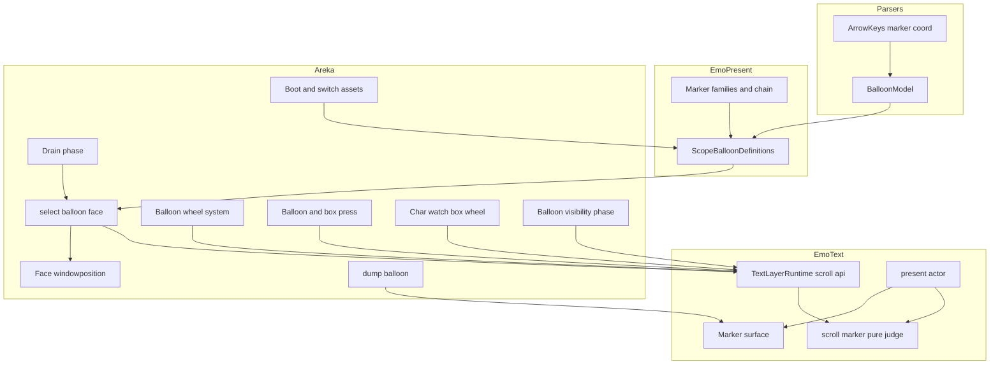
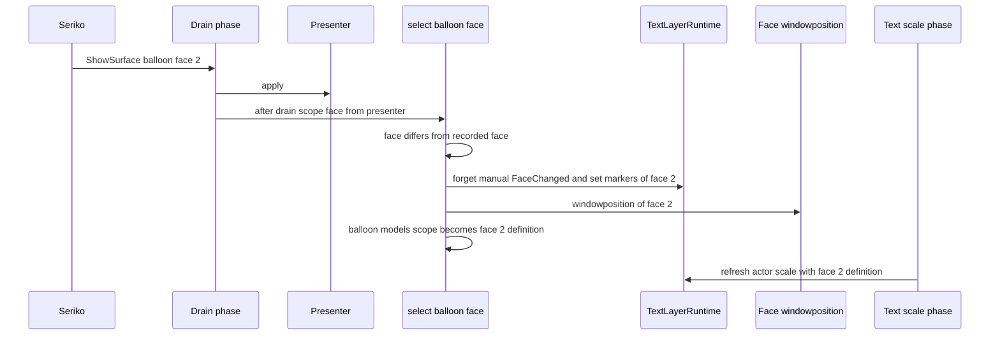
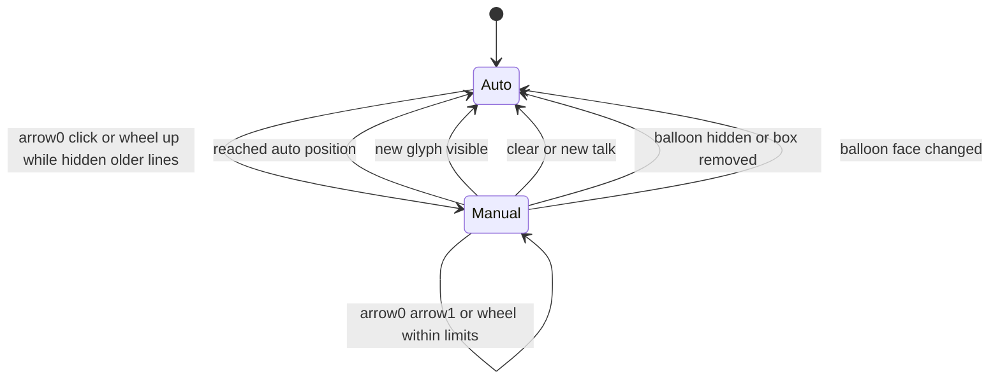
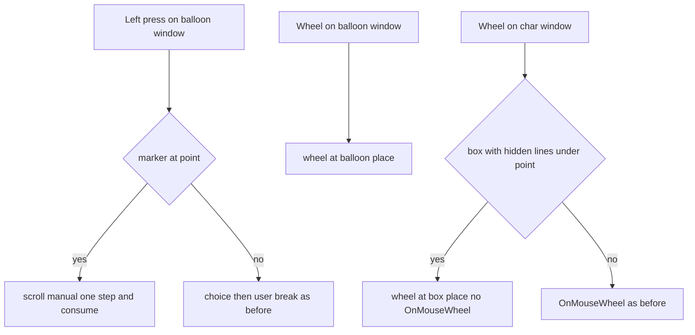

# 設計: balloon-scroll-arrows

## Overview

**Purpose**: 長い台詞で押し出された文字があるとき、バルーンの descript が定める位置にスクロールの矢印 `arrow0`・`arrow1` を出し、矢印のクリックとホイールで手動に戻して読めるようにする。横書きと縦書き、普通のバルーンとシェル内バルーン（箱）で同じ規則にする。矢印の絵の名前の選び方は、後に続く印（クリック待ち `clickwait*`・状態の印）がそのまま乗れる土台として作る。あわせて `\b[ID]` で面が替わったとき、その面の設定ファイルを重ねた定義へ作り直す（要件 1.7・すべての鍵）。

**Users**: ゴーストの利用者（読み返す）、バルーンとシェルの作者（SSP 向けに作った矢印がそのまま出る）、areka の開発者（記録と決定論のテストで振る舞いを確かめる）。ぱすたの縦書きのバルーン `pasta_tategaki` と、既定のバルーン `areka-balloon` が最初の当事者である。

**Impact**: 今は自動の送り（最新の行が見える位置へ行単位で送る）だけで、矢印の鍵は読まれず、普通のバルーンの窓のホイールはどこも読まない。本 spec は、(1) 読み手に矢印の鍵の型を足し、(2) 見える範囲の決め方に「手動の位置」を 1 つの入口で差し込み、(3) 文字の面の手前に「印の面」を場所ごとに足し、(4) 押下とホイールの受け口に矢印の分岐を足し、(5) スコープのバルーンの定義を面ごとに持って面の切り替えで差し替える。自動の送りの規則・選択肢の当たりの決まり・時間切れの数え方は変えない。

### Goals

- 押し出された行があるとき、正典どおりの座標（マイナスは右端・下端から、`--数値` はマイナスそのもの）に正典どおりの名前の矢印を出す（要件 1〜4・7）。
- 矢印のクリックとホイールで 1 行（縦書きは 1 列）ずつ戻し、限りと戻り方・新しい文字・消去・面の切り替え・拡大率・選択肢の当たりとの関係を決まった形にする（要件 5・6・8）。
- `\b[ID]` で面が替わったら、その面の設定ファイルを重ねた定義をすべての消費者が使う（要件 1.7）。
- 正典が黙る所の決めを §8 に、SSP で測った値を `research.md` に残し、決定論のテストと実機で固定する（要件 9〜11）。

### Non-Goals

- 状態の印（`onlinemarker.*`・`number.*`・`sstpmarker`・`marker*`）を出すこと（`balloon-markers`）。
- クリック待ちの印を出すこと（`talk-fast-forward`）。本 spec は名前の選び方の土台と、その順を示す決定論のテストだけを持つ。
- 押し出される行のフェード（`balloon-scroll-fade`）。
- 自動の送りの規則、`\![set,autoscroll,disable]`・`\![set,autoscroll,enable]`、横のホイール、`.png` 以外の矢印の絵（`balloon-webp-names`）、バルーンの窓の上のホイールを `OnMouseWheel` として送ること。
- バルーンの面の選び方・寿命（`balloon-canon-residue`・完了 `balloon-lifecycle-events`）。
- `--数値` を矢印以外の座標の鍵へ広げること。

## Boundary Commitments

### This Spec Owns

- 読み手（`areka-parsers`）の矢印の鍵の型 `MarkerCoord`／`MarkerPoint`／`ArrowKeys` と、読めなかった鍵の事実（`KeyIssue`）。`--数値` の読みは矢印の鍵だけで行う。
- 印の族の表 `ARROW_FAMILY`・`CLICKWAIT_FAMILY` と、名前の連鎖（明示の名前を先頭に置く連鎖）・番号ごとの絵の選び・絵の読み込み（emo-present の新しいファイル）。
- スコープのバルーンの定義を面ごとに持つ束 `ScopeBalloonDefinitions`（面ごとの設定ファイルを重ねたモデルと、その面の矢印の絵）と、その作り方（読み込みの時に 1 度だけファイルを読む）。
- 面の切り替えで「今の定義」を差し替える唯一の書き手 `select_balloon_face`（areka の emo2_boot）。差し替えは文字の層・手動の位置・配置の `windowposition` の 3 つへ同じ点から届ける。
- 文字の層の手動の位置の状態 `PlaceScroll`（場所ごと）と、見える範囲・矢印の出る条件・矢印の置き場・送りの限りの純粋な判断（emo-text の新しい純粋なファイル）。
- 印の面（場所ごとに 1 枚・文字の面の手前の窓の子）の装着・描画・当たりのマスクと、`dump_balloon` への写し。
- 普通のバルーンの窓のホイールの受け口（新しい系）と、押下・箱の押下・箱の上のホイールの矢印の分岐。
- `doc/COMPAT_ARCHITECTURE.md` §8 の行、網羅台帳 `assets.toml` の 5 行、`roadmap-draft.md` の数の行。

### Out of Boundary

- 自動の送りの規則（`LayoutEngine::visible_window` の式そのもの）。本 spec は手動の位置が無いときこの関数をそのまま呼ぶ。
- 選択肢の当たりの決まり（`choice.rs` の `to_window_physical`）。手動の位置は `committed`（面に反映した送りの量）を通して届くので、`choice.rs` に触らない。
- バルーンの時間切れの数え方（`balloon_visibility_decision.rs`）。可視の相からは「隠した」を手動の位置へ伝えるだけ。
- キャラクターの窓のホイールの間引きと足し合わせ（`wheel.rs`）。箱の上で隠れた行がある場合の横取りだけを `char_watch.rs` に足す。
- バルーンの面をどれにするか（seriko の `apply_balloon`）と、面 0 必在の契約（`resolve_balloon_faces`）。
- 印の族を状態の印・クリック待ちに使って印を出すこと（下流の spec）。

### Allowed Dependencies

- 依存の向きは今のまま: `areka-parsers` ← `areka-emo-atlas` ← `areka-emo-present` ← `areka-emo-text` ← `areka`（左の crate を右が使う）。emo-present は emo-text を知らない。印の絵の型（`MarkerImage`・`MarkerPair`）は emo-present に置き、emo-text が使う。
- 絵の読み込みは emo-atlas の公開の `ElementDecoder`（本番は `WicDecoderArm`）と `Normalizer`（バルーンの面と同じ `AlphaParams`）を使う。新しい依存の crate は足さない（`Cargo.toml`・`Cargo.lock` は動かない）。
- 描画は wintf の `GraphicsCore` と、文字の層が今使っている D3D11／D2D の口だけを使う。補間はバルーンの絵と同じ `D2D1_INTERPOLATION_MODE_LINEAR`。
- 配置の置き直しは今ある純粋な関数（`resolve_standard_scopes`・`follow_balloon`）と材料 `DefaultPlacementBasis` を使う。
- ファイルを読むのは読み込みの時（起動の資産づくり・シェルとバルーンの切り替えの背景の資産づくり）だけ。UI スレッドの毎フレームの処理はファイルを読まない。

### Revalidation Triggers

- `ScopeBalloonDefinitions`・`MarkerPair`・`MarkerImage` の形が変わったとき（`balloon-markers`・`talk-fast-forward` が乗る）。
- `PlaceScroll` の公開の口（`scroll_manual_at`・`wheel_at`・`forget_manual_at`・`marker_at_point`・`has_hidden_lines_at`）の意味が変わったとき（`balloon-scroll-fade` が乗る）。
- 印の面の窓の子の並び（文字の面の直前＝手前）が変わったとき（下流の印の面が同じ並びに乗る）。
- SSP の測り（要件 10）で、出る条件・送る量・座標が無いときの置き場・新しい文字の扱いが推奨と違ったとき（要件 10.3 で要件を改めた後に設計を合わせ直す）。
- `select_balloon_face` の呼び手（drain・装着・バルーンの切り替え）が増減したとき。

## Architecture

### Existing Architecture Analysis

- **読み手**: `parse.rs` が 2 層（`descript.txt`＋面ごとの設定ファイル）を後勝ちで 1 つの表にまとめ、`get_scalar` で数に読む。`--5` は数として読めず `None` になる。マイナスを端からに直すのは下流（emo-text の `region.rs`）。`model.rs` は 774 行で、新しい鍵は兄弟の新しいファイルに型を置き、`BalloonModel` には `with_…` と読み口だけを足すのが流儀。箱の定義（`areka-emo-compose` の `BoxDef.model`）も同じ `parse` を通るので、読み手に足した鍵は箱にも届く（要件 7.1）。
- **名前の選び方**: emo-present の `SeriesFamily`・`prefix_chain`・`select_faces` は族の名前を変えるだけで要件 2.1 の順を作り、`select_faces` は面の番号ごとに連鎖を辿る（要件 2.1 の「番号ごと」と同じ）。
- **スコープの定義**: `load_scope_balloon_model(dir, scope, face0)` が面 0 の設定ファイルだけを重ね、`BalloonScopeAssets.model`（`assets.rs`）→ `Emo2Wiring.balloon_models`（`wiring.rs`）→ 毎フレームの文字層の再追従（`scale_text.rs` の `refresh_actor_scale`）と装着（`attach.rs`）で使う。配置は `scope_windowposition`（`placement/mod.rs`）が同じ関数で面 0 の `windowposition` を読む。`\b[ID]` の整数は seriko が面を決め、drain の相（`drain_resnap.rs`）で presenter が適用する。文字の層は面の大きさ（binding の `image_size`）だけを追い、定義は替わらない。バルーンの切り替え（`switch.rs` の `finish_balloon`）も文字の模型だけを入れ替える。
- **見える範囲**: `LayoutEngine::visible_window`（`layout.rs`）は行の列と描画範囲だけから自動の位置を決める純粋な関数で、`present_actor`（`actor_present.rs`）が毎フレーム呼ぶ。送りの描き直し（`ScrollPlanner`・blit）と選択肢の当たり（`committed`）は渡された `VisibleWindow` に従う。
- **面と当たり**: 文字の面は描画範囲の大きさで、普通のバルーンは予約スロットへ、箱はシェルの窓の直接の子（`attach_window_child`）として挿す。箱の面は字の矩形だけを当たりのマスクにする。バルーンの窓の当たりは絵の α ≥ 0.5 の画素だけ。
- **入力**: キャラ窓のホイールは `char_watch.rs` が `PointerState.wheel.vertical` を毎 tick 読む。バルーンの窓のホイールはどこも読まない。バルーンの押下は `balloon_pressed.rs` が選択肢 → 利用者の中断の順に流す。箱の押下の判断は `shell_box.rs`／`shell_box_handler.rs`。
- **MCP**: `dump_balloon.rs` は presenter の最後の絵（原寸）に、文字の面の写し（物理寸）を `overlay_text` で原寸へ縮めて重ねる。

### Architecture Pattern & Boundary Map

採るのは「文字の層に印の面を場所ごとに足す」形（research.md の案 B）。手動の位置は見える範囲を決める 1 か所で差し込み、印の面は送りの blit から独立させる。面ごとの定義は読み込みの時に作り、面の切り替えの時に 1 か所で差し替える。



**Architecture Integration**:

- Selected pattern: 純粋な判断（emo-text の `scroll_marker.rs`）と、副作用の入口（資産づくり・`select_balloon_face`・印の面）を分ける今の流儀。手動の位置は `VisibleWindow` を 1 か所で差し替えるだけなので、送りの描き直しと選択肢の当たりは今の仕組みのまま合う。
- Domain/feature boundaries: 名前と絵は emo-present、位置と出る条件と送りは emo-text、入力の振り分けと面の切り替えの合図は areka。
- Existing patterns preserved: 族の表（`SeriesFamily`）・番号ごとの選び（`select_faces`）・場所ごとの表（`PlaceKey`）・窓の子の面（`attach_window_child`）と当たりのマスク（`hit_cells_mask`）・毎フレームの再追従の唯一の権威（`refresh_actor_binding`）・`dump_balloon` の重ね（`overlay_text`）・読み込みの時だけのファイル I/O。
- New components rationale: 下の表のとおり。どれも前例の型に乗り、新しい層を作らない。
- Steering compliance: 1 ファイル 1,000 行（`model.rs`・`actor.rs`・`balloon.rs`・`placement/mod.rs`・`surface.rs` には数行だけ足し、本体は兄弟の新しいファイルへ）・兄弟のテスト・emo-text の `lib.rs` の 2 つの一覧に新しいファイルを載せる・ログ無しの失敗経路を作らない・外の crate は改造しない。

### Technology Stack

| Layer | Choice / Version | Role in Feature | Notes |
|-------|------------------|-----------------|-------|
| 読み手 | `areka-parsers`（既存） | 矢印の鍵の型と読み | 新しい依存なし |
| 絵の読み込み | `areka-emo-atlas` の `ElementDecoder`・`Normalizer`（既存・本番は `WicDecoderArm`） | 矢印の絵を BGRA へ・バルーンの面と同じ透過の扱い | `.png` のみ（要件 2.6） |
| 描画 | wintf `GraphicsCore`・D3D11／D2D（既存の文字の面と同じ口）・`D2D1_INTERPOLATION_MODE_LINEAR` | 印の面へ矢印を拡大率で描く | バルーンの絵と同じ補間 |
| 入力 | wintf `PointerState`（`wheel.vertical`・`client_point`） | 普通のバルーンの窓のホイール・押下の座標 | `mouse-click-wheel-events` が届けている値を読むだけ |
| ECS | bevy_ecs（既存） | 新しいホイールの系・窓の子の面 | `char_watch` と同じ段に登録 |

## File Structure Plan

### Directory Structure

```
crates/areka-parsers/src/balloon/
├── marker.rs              # 新: MarkerCoord / MarkerPoint / ArrowKeys / KeyIssue と、マージ済みの表からの読み（--数値・読めない値の事実）
└── marker_tests.rs        # 新: 読みの決定論のテスト（マイナス・--数値・面ごとの上書き・読めない値）
crates/areka-emo-present/src/
├── balloon_marker.rs      # 新: ARROW_FAMILY / CLICKWAIT_FAMILY・明示の名前を先頭に置く連鎖・番号ごとの選び（純粋）・絵の読み込み（fs と記録の入口）・MarkerImage / MarkerPair
├── balloon_marker_tests.rs
├── balloon_definitions.rs # 新: ScopeBalloonDefinitions（面ごとのモデル＋その面の矢印の絵）と load_scope_balloon_definitions（読み込みの時だけ）
└── balloon_definitions_tests.rs
crates/areka-emo-text/src/
├── scroll_marker.rs       # 新（純粋）: PlaceScroll（手動の位置・ホイールの端数・最後に見えた字の数）・手動の VisibleWindow・矢印の出る条件・矢印の置き場（座標あり・座標なしの暫定）・送りの限り
├── scroll_marker_tests.rs
├── actor_scroll.rs        # 新: TextLayerRuntime の手動の送りと印の公開の口（impl ブロック）と、present_actor から呼ぶ印の提示
├── actor_scroll_tests.rs
├── marker_surface.rs      # 新（GPU）: 印の面の装着（窓の子）・矢印の描画・当たりのマスク・片付け・読み戻し
└── marker_surface_tests.rs
crates/areka/src/emo2_boot/frame/
├── balloon_face.rs        # 新: select_balloon_face（今の定義の唯一の書き手）と drain の後の面の変化の拾い
└── balloon_face_tests.rs
crates/areka/src/placement/
├── face_windowposition.rs # 新: 面の windowposition を配置の材料へ入れ、標準の位置のバルーンだけを置き直す
└── face_windowposition_tests.rs
crates/areka/src/input_events/
├── balloon_wheel.rs       # 新: 普通のバルーンの窓のホイールの系（PointerState → wheel_at）
└── balloon_wheel_tests.rs
```

### Modified Files

- `crates/areka-parsers/src/balloon/mod.rs` — `mod marker;`・`mod marker_tests;`・`pub use marker::{…}`。
- `crates/areka-parsers/src/balloon/model.rs` — 欄 `arrow_keys: ArrowKeys`・`with_arrow_keys`・`arrow_keys()` の数行（`PartialEq` に乗る）。
- `crates/areka-parsers/src/balloon/parse.rs` — `marker::read_arrow_keys(&merged)` を 1 回呼んで `with_arrow_keys` へ渡す 2 行。
- `crates/areka-parsers/src/balloon/validation_tests.rs` — 「arrow… は accessor が無い」のコメントを今の姿へ直す（期待値は変えない）。
- `crates/areka-emo-present/src/lib.rs` — `pub mod balloon_marker;`・`pub mod balloon_definitions;`。`balloon.rs` は触らない（公開の `prefix_chain`・`select_faces`・`load_scope_balloon_model` と crate 内の `face_digits_of` を使う）。
- `crates/areka-emo-text/src/actor.rs` — `TextLayerRuntime` に欄 `scrolls: HashMap<PlaceKey, PlaceScroll>`・`balloon_markers: HashMap<ActorKey, MarkerPair>`、`ActorRender` に欄 `markers: Option<MarkerSurface>`、`ResolvedBalloonText` に欄 `markers: ResolvedMarkerPlacement`、`apply_cue` の `Clear`／`ClearAll` の腕に `forget_manual_at` を 1 行ずつ。`mod` の行。
- `crates/areka-emo-text/src/actor_present.rs` — `LayoutEngine::visible_window` の呼び出しを `scroll_marker::window_for(…)` に替える 1 か所、その**直前**に字の数の観測（新しい文字で手動を捨てる・`observe_visible`）の 1 行（同じフレームで先に呼ぶ）、`changed` の後の `present_markers` の 1 行、潰れた場所の片付けで印の面も外す 1 行。
- `crates/areka-emo-text/src/actor_box.rs` — 箱の束に箱ごとの `MarkerPair` を受ける欄、箱の登録を外すときの `forget_manual_at`、`box_child_index` が印の面も数えること（MarkerSurface の「並び」）。
- `crates/areka-emo-text/src/lib.rs` — `PURE_SOURCES`（`scroll_marker.rs`・`scroll_marker_tests.rs`・`actor_scroll.rs`・`actor_scroll_tests.rs`）と `SOURCES_OUTSIDE_THE_PURE_SCAN`（`marker_surface.rs`・`marker_surface_tests.rs`）と数の行。
- `crates/areka/src/emo2_boot/assets.rs` — `BalloonScopeAssets.model` を `definitions: ScopeBalloonDefinitions` へ（`load_scope_balloon_definitions` を呼ぶ）、シェルの資産づくりで箱ごとの `MarkerPair` を解く（シェルのフォルダ）。
- `crates/areka/src/emo2_boot/shell_box_assets.rs` — `ShellBoxAssets` に `markers: BTreeMap<BoxName, MarkerPair>`、`hand_to` で文字の層へ渡す。
- `crates/areka/src/emo2_boot/frame/wiring.rs` — 欄 `balloon_definitions: HashMap<u32, ScopeBalloonDefinitions>`・`balloon_faces: HashMap<u32, u32>`（今の面の番号）。`balloon_models` は「今の定義」のまま残す（書き手は `select_balloon_face` だけ）。
- `crates/areka/src/emo2_boot/frame/attach.rs` — 装着で定義の束を入れ、面 0 で `select_balloon_face` を呼ぶ。
- `crates/areka/src/emo2_boot/frame/drain_resnap.rs` — drain の後に `balloon_face::after_drain` を 1 回呼ぶ。
- `crates/areka/src/emo2_boot/frame/switch.rs` — `SwapFinish::Balloon` が定義の束を運び、`finish_balloon` は `select_balloon_face` を通して入れる。
- `crates/areka/src/emo2_boot/frame.rs` — `mod balloon_face;`。
- `crates/areka/src/emo2_boot/balloon_visibility_phase.rs` — バルーン（箱）を隠す枝で `forget_manual_at(…, Hidden)` を 1 行。
- `crates/areka/src/placement/mod.rs` — `mod face_windowposition;` の 1 行（969 → 970 行）。
- `crates/areka/src/input_events/mod.rs` — `balloon_wheel` の `mod` と登録の 2 行。
- `crates/areka/src/input_events/balloon_pressed.rs` — 頭（左押下の確認の直後）に矢印の分岐。
- `crates/areka/src/input_events/shell_box.rs`・`shell_box_handler.rs` — 箱の押下の判断の頭に矢印の分岐。
- `crates/areka/src/input_events/char_watch.rs` — 5 番の段で、隠れた行のある箱の上の回転を `wheel_at` へ回して `OnMouseWheel` に積まない分岐。
- `crates/areka/src/mcp/dump_balloon.rs` — 文字の面の後に印の面の写しを同じ `overlay_text`（ずらし 0）で重ねる。
- `doc/COMPAT_ARCHITECTURE.md` §8・`doc/ukadoc-coverage/ledger/assets.toml`（5 行）・`doc/ukadoc-coverage/roadmap-draft.md`（数の行）・`.kiro/specs/balloon-scroll-arrows/research.md`（測りの記録）。

## System Flows

### 面の切り替えで今の定義を差し替える（要件 1.7・8.6）



- 面の変化を拾うのは drain の後（presenter が適用した後）で、拾う材料は presenter の `current_surface_id(balloon_target(scope))`（一次の情報源）と、`Emo2Wiring.balloon_faces` に覚えた前の面。そのフレームで ShowSurface を受けた balloon の target だけを見る（変わった時点が分かる所で 1 回だけ届ける＝プッシュ）。動く絵のコマの適用は面の番号が同じなので差し替えない。
- 文字の層の再追従は今の唯一の権威（`refresh_actor_binding`）が同じフレームの後段で新しい定義を受け取り、比べる鍵（モデル）が違うので作り直す。1 フレーム遅れは生じない（drain → スケールの相 → 文字の相の順）。

### 矢印のクリックと手動の位置（要件 3・5・8）



- `Auto`＝`PlaceScroll.manual` が `None`。見える範囲は `LayoutEngine::visible_window` の答えそのもの。
- `Manual(line)`＝先頭に見せる行の番号。限りは `0 ≤ line < auto_first`（`auto_first` は自動の先頭行）。`line == auto_first` に達したら `Auto` へ戻る（要件 5.4）。
- 拡大率の変化（再追従）は `scrolls` に触らないので `Manual(line)` が残り、同じ行が古い側に残る（要件 8.7）。

### 押下とホイールの振り分け（要件 5.5・5.6・6・7.4〜7.6）



## Requirements Traceability

| Requirement | Summary | Components | Interfaces | Flows |
|-------------|---------|------------|------------|-------|
| 1.1 | 4 つの座標の鍵を左上の位置として読む | ArrowKeys | `read_arrow_keys`・`BalloonModel::arrow_keys` | — |
| 1.2 | 左上原点・マイナスは端から・`--数値` | MarkerCoord | `MarkerCoord::resolve` | — |
| 1.3 | 面ごとの設定ファイルで上書き | ArrowKeys（2 層の後勝ち）・ScopeBalloonDefinitions | `parse_str`・`load_scope_balloon_definitions` | 面の切り替え |
| 1.4 | `arrow.filename` を名前の元として読む | ArrowKeys | `ArrowKeys::filename` | — |
| 1.5 | 読めない値は無いものとして警告 | ArrowKeys（KeyIssue）・ScopeBalloonDefinitions（記録の入口） | `ArrowKeys::issues` | — |
| 1.6 | 鍵を持たないバルーンは変わらない | ArrowKeys（既定は全部 None）・ScrollMarker | — | — |
| 1.7 | `\b[ID]` で面の設定ファイルを重ねて作り直す・すべての鍵 | ScopeBalloonDefinitions・BalloonFaceSelector・FaceWindowPosition | `select_balloon_face`・`apply_face_windowposition` | 面の切り替え |
| 2.1 | 番号ごとに族の順で探す | MarkerFamilies | `marker_chain`・`select_marker_names` | — |
| 2.2 | `arrow.filename` を全スコープに使う | MarkerFamilies | `marker_chain(…, explicit)` | — |
| 2.3 | 書かれた名前の絵が無ければ既定の順へ・警告 | MarkerFamilies | `resolve_marker_pair` | — |
| 2.4 | 1 枚も無ければ出さず手動だけ受ける | MarkerFamilies・ScrollMarker | `MarkerPair`（両方 None） | — |
| 2.5 | 片方だけなら片方を出し記録 | MarkerFamilies | `resolve_marker_pair` | — |
| 2.6 | 大小無視・`.png` | MarkerFamilies（`face_digits_of` を共有） | `select_marker_names` | — |
| 2.7 | クリック待ちにも同じ規則・テストで示す | MarkerFamilies（`CLICKWAIT_FAMILY`） | `marker_chain` | — |
| 3.1 | 古い側に押し出された行で arrow0 | ScrollMarker | `marker_visibility` | 手動の位置 |
| 3.2 | 手動で新しい側に隠れた行で arrow1 | ScrollMarker | `marker_visibility` | 手動の位置 |
| 3.3 | どちらも無ければ出さない | ScrollMarker | `marker_visibility` | — |
| 3.4 | 左上＋座標・絵の大きさ・同じ拡大率 | ScrollMarker・MarkerSurface | `ResolvedMarkerPlacement`・`MarkerSurface::draw` | — |
| 3.5 | バルーンの絵より手前・範囲の外でも絵の中は出す | MarkerSurface（画像全体の面・文字の面の直前＝手前の子） | `MarkerSurface::attach` | — |
| 3.6 | `dump_balloon` に同じ位置で写す | DumpBalloonOverlay | `MarkerSurface::read_back`・`overlay_text` | — |
| 3.7 | 座標なしで絵があれば SSP の置き場・§8 | ScrollMarker（`default_marker_position`）・Docs | `default_marker_position` | — |
| 3.8 | 有無が変わったら次の描き直しで合わせる | ActorScroll（`present_markers`） | `present_markers` | — |
| 4.1 | 縦書きは arrow0＝右・arrow1＝左 | ScrollMarker（古い側の判断を書字方向の正準表で） | `window_for`・`marker_visibility` | — |
| 4.2 | 縦書きでも座標の意味を入れ替えない | MarkerCoord・ScrollMarker | `MarkerCoord::resolve` | — |
| 4.3 | ぱすたで SSP と同じ所 | 実機の確かめ（Testing） | — | — |
| 4.4 | SSP と違えば合わせて要件を改める | SSP の測り（Testing・research） | — | — |
| 5.1 | arrow0 の押下で古い側へ 1 行 | ActorScroll・BalloonPress | `marker_at_point`・`scroll_manual_at` | 押下の振り分け |
| 5.2 | arrow1 の押下で新しい側へ 1 行 | 同上 | 同上 | 押下の振り分け |
| 5.3 | 古い限りと自動の位置の限り | ScrollMarker | `PlaceScroll::step` | 手動の位置 |
| 5.4 | 自動の位置に戻ったら手動を捨てる | ScrollMarker | `PlaceScroll::step` | 手動の位置 |
| 5.5 | 矢印の押下をバルーンのクリックにしない | BalloonPress | `on_balloon_pointer_pressed` の頭の分岐 | 押下の振り分け |
| 5.6 | 矢印の無い所は今までどおり | BalloonPress | 同上 | 押下の振り分け |
| 5.7 | 当たりを画面の位置と大きさに合わせる | ActorScroll（物理 px の写し）・MarkerSurface（マスク） | `marker_at_point` | — |
| 6.1 | 上へ回すと古い側へ | BalloonWheel・ScrollMarker | `wheel_at` | 押下の振り分け |
| 6.2 | 下へ回すと新しい側へ | 同上 | 同上 | 同上 |
| 6.3 | 120 ごとに 1 行・端数を持ち越す | ScrollMarker（`PlaceScroll::wheel`） | `wheel_at` | — |
| 6.4 | ホイールにも限りと戻り方 | ScrollMarker | `PlaceScroll::step` | — |
| 6.5 | 隠れた行が無ければ何もしない | ScrollMarker | `wheel_at` | — |
| 6.6 | 矢印の絵が無くてもホイールで送れる | ScrollMarker（絵と無関係） | `wheel_at` | — |
| 6.7 | `OnMouseWheel` を送らない・横は送らない | BalloonWheel | — | — |
| 7.1 | 箱の鍵を同じ読み方・原点は箱 | ArrowKeys（箱も同じ parse）・ScrollMarker（広がり＝箱の大きさ） | `ResolvedMarkerPlacement::resolve` | — |
| 7.2 | 箱にも出る条件と縦書きの向き | ScrollMarker | `marker_visibility` | — |
| 7.3 | 箱の絵はシェルのフォルダ→バルーンのフォルダ | ShellBoxMarkers・ActorScroll（足りない番号はスコープのバルーンの絵） | `resolve_marker_pair`・`box_markers_for` | — |
| 7.4 | 箱の矢印の押下を箱のクリックにしない | BoxPress | `judge_box_press` の頭の分岐 | 押下の振り分け |
| 7.5 | 隠れた行のある箱の上のホイールは箱を送り `OnMouseWheel` にしない | CharWatchBoxWheel | `has_hidden_lines_at`・`wheel_at` | 押下の振り分け |
| 7.6 | 隠れた行が無ければ `OnMouseWheel` | CharWatchBoxWheel | 同上 | 押下の振り分け |
| 7.7 | 箱の座標なしも同じ置き場の決まり | ScrollMarker | `default_marker_position` | — |
| 8.1 | 見える字が増えたら手動を捨てる | ScrollMarker（`observe_visible`）・ActorScroll | `PlaceScroll::observe_visible` | 手動の位置 |
| 8.2 | 消去で捨てる | ActorScroll（`apply_cue` の腕） | `forget_manual_at` | 手動の位置 |
| 8.3 | 消えたら捨てる | Visibility・ActorScroll | `forget_manual_at(…, Hidden)` | 手動の位置 |
| 8.4 | 時間切れの数え方を変えない | （変更なし） | — | — |
| 8.5 | 選択肢の当たりを見えている位置に | ScrollMarker（手動の VisibleWindow → `committed`） | `window_for` | — |
| 8.6 | 面が替わったら手動を捨て新しい面で出し直す | BalloonFaceSelector | `select_balloon_face` | 面の切り替え |
| 8.7 | 拡大率が変わっても古い側の行を保つ | ScrollMarker（行の番号で持つ） | `PlaceScroll` | 手動の位置 |
| 8.8 | スコープ（場所）ごとに別々 | ActorScroll（`PlaceKey` の表） | `scrolls` | — |
| 9.1 | 絵の解決を debug で 1 回 | MarkerFamilies | `resolve_marker_pair` | — |
| 9.2 | 手動の始まり・終わりを debug | ActorScroll | `ScrollChange` | — |
| 9.3 | 1 回ごとの送りを info 以上で残さない | ActorScroll（送りは trace） | — | — |
| 9.4 | 読めない絵は警告・その矢印だけ出さない | MarkerFamilies | `resolve_marker_pair` | — |
| 9.5 | §8 に登記・既存 2 行を直す | Docs | — | — |
| 9.6 | 台帳 5 行・数の行・検査を緑 | Docs | — | — |
| 10.1 | 6 点を SSP で測る | SSP の測り（Testing） | — | — |
| 10.2 | 測りのやり方と答えを research.md に | SSP の測り | — | — |
| 10.3 | 推奨と違えば開発者に諮る | SSP の測り（差し込み点の一覧） | — | — |
| 10.4 | 画面の操作は排他テストの机で | SSP の測り | — | — |
| 11.1 | 決定論のテストで固定 | Testing | — | — |
| 11.2 | 鍵を持たない既存のテストを変えずに通す | Testing | — | — |
| 11.3 | areka-balloon の実機 | Testing | — | — |
| 11.4 | ぱすたの縦書きの実機 | Testing | — | — |
| 11.5 | 箱の実機 | Testing | — | — |

## Components and Interfaces

| Component | Domain/Layer | Intent | Req Coverage | Key Dependencies (P0/P1) | Contracts |
|-----------|--------------|--------|--------------|--------------------------|-----------|
| ArrowKeys（`marker.rs`） | areka-parsers | 矢印の鍵の型と読み | 1.1〜1.6・4.2・7.1 | `parse.rs` のマージ済みの表（P0） | Service |
| MarkerFamilies（`balloon_marker.rs`） | emo-present | 族・連鎖・番号ごとの選び・絵の読み込み | 2.1〜2.7・7.3・9.1・9.4 | `select_faces`・`ElementDecoder`・`Normalizer`（P0） | Service |
| ScopeBalloonDefinitions（`balloon_definitions.rs`） | emo-present | 面ごとの定義の束 | 1.3・1.5・1.7 | `load_scope_balloon_model`（P0）・MarkerFamilies（P0） | Service, State |
| ScrollMarker（`scroll_marker.rs`） | emo-text（純粋） | 手動の位置・見える範囲・出る条件・置き場・限り | 3.1〜3.4・3.7・4.1・4.2・5.3・5.4・6.3〜6.6・7.1・7.2・7.7・8.1・8.5・8.7 | `LayoutEngine::visible_window`（P0） | State |
| ActorScroll（`actor_scroll.rs`） | emo-text | 手動の送りと印の公開の口・印の提示 | 3.8・5.1・5.2・5.7・6.1・6.2・7.3・8.2・8.3・8.8・9.2・9.3 | ScrollMarker（P0）・MarkerSurface（P0） | Service |
| MarkerSurface（`marker_surface.rs`） | emo-text（GPU） | 印の面の装着・描画・マスク・読み戻し | 3.4・3.5・3.6・5.7 | `GraphicsCore`・`attach_window_child` の前例（P0） | Service |
| BalloonFaceSelector（`frame/balloon_face.rs`） | areka emo2_boot | 今の定義の唯一の書き手 | 1.7・8.6 | presenter（P0）・TextLayerRuntime（P0）・FaceWindowPosition（P1） | Service, Event |
| FaceWindowPosition（`placement/face_windowposition.rs`） | areka placement | 面の `windowposition` を配置へ | 1.7 | `DefaultPlacementBasis`・`resolve_standard_scopes`・`follow_balloon`（P0） | Service |
| BalloonWheel（`input_events/balloon_wheel.rs`） | areka input | 普通のバルーンの窓のホイール | 6.1〜6.7 | `PointerState`（P0）・ActorScroll（P0） | Event |
| BalloonPress（`balloon_pressed.rs` の分岐） | areka input | 矢印の押下を先に取る | 5.1・5.2・5.5・5.6 | ActorScroll（P0） | — |
| BoxPress・CharWatchBoxWheel（`shell_box*.rs`・`char_watch.rs` の分岐） | areka input | 箱の矢印の押下・箱の上のホイールの横取り | 7.4〜7.6 | ActorScroll（P0）・`box_under_point`（P0） | — |
| ShellBoxMarkers（`assets.rs`・`shell_box_assets.rs`） | areka emo2_boot | 箱ごとの矢印の絵（シェルのフォルダ） | 7.3 | MarkerFamilies（P0） | — |
| DumpBalloonOverlay（`dump_balloon.rs`） | areka mcp | 印の面を写しに重ねる | 3.6 | MarkerSurface（P0）・`overlay_text`（P0） | — |
| Docs | 文書 | §8・台帳・数の行 | 9.5・9.6・3.7 | `crates/ukadoc-survey` の検査（P0） | — |

### areka-parsers

#### ArrowKeys

| Field | Detail |
|-------|--------|
| Intent | 矢印の 5 つの鍵をマージ済みの表から型へ写し、読めなかった鍵を事実として返す |
| Requirements | 1.1, 1.2, 1.3, 1.4, 1.5, 1.6, 4.2, 7.1 |

**Responsibilities & Constraints**

- 鍵は完全一致で引く（`arrow0.x`・`arrow0.y`・`arrow1.x`・`arrow1.y`・`arrow.filename`）。面ごとの上書きは今の 2 層の後勝ちのまま（要件 1.3）。
- 座標の読み: `"12"` → `FromStart(12)`、`"-12"` → `FromEnd(-12)`（広がり＋値）、`"--12"` → `Literal(-12)`（マイナスの座標そのもの）。前後の空白は今の読み手と同じ扱い。どれでもない値（`"abc"`・`"---1"`・空）は `None` とし、`KeyIssue { key, value }` を積む（要件 1.5）。
- 読み手は記録を出さない（寛容な写像のまま）。警告は fs の入口（`load_scope_balloon_definitions`）が出す。
- 鍵が 1 つも無い定義は `ArrowKeys::default()`（全部 `None`・issues 空）で、`BalloonModel` の等しさも既存の値も変わらない（要件 1.6）。

**Contracts**: Service [x]

##### Service Interface

```rust
/// 印の座標 1 つ（正典の脚注 *1）。広がりは横は画像（箱）の幅、縦は高さ。
#[derive(Debug, Clone, Copy, PartialEq, Eq)]
pub enum MarkerCoord {
    FromStart(i32), // 0 以上: 左上から
    FromEnd(i32),   // マイナス: 右端・下端からの相対（値は負）
    Literal(i32),   // `--数値`: マイナスの座標そのもの（値は負）
}
impl MarkerCoord {
    pub fn resolve(self, extent: i32) -> i32; // FromStart(v)=v / FromEnd(v)=extent+v / Literal(v)=v
}
#[derive(Debug, Clone, Copy, PartialEq, Eq, Default)]
pub struct MarkerPoint { pub x: Option<MarkerCoord>, pub y: Option<MarkerCoord> }
#[derive(Debug, Clone, PartialEq, Eq)]
pub struct KeyIssue { pub key: &'static str, pub value: String }
#[derive(Debug, Clone, PartialEq, Eq, Default)]
pub struct ArrowKeys {
    pub arrow0: MarkerPoint,          // 上（縦書きでは右）
    pub arrow1: MarkerPoint,          // 下（縦書きでは左）
    pub filename: Option<String>,     // `arrow.filename`（拡張子なし・そのまま）
    pub issues: Vec<KeyIssue>,        // 読めなかった座標の鍵と値（書かれた順）
}
pub(super) fn read_arrow_keys(merged: &BTreeMap<String, String>) -> ArrowKeys;
impl BalloonModel {
    pub fn with_arrow_keys(self, keys: ArrowKeys) -> Self;
    pub fn arrow_keys(&self) -> &ArrowKeys;
}
```

- Postconditions: x と y の片方だけ書かれた点は、その矢印を「座標なし」として扱う（片方だけの座標は置き場を決められない＝要件 3.7 の置き場に従う）。
- Invariants: `MarkerCoord` は読み手の型で、`balloon-markers`・`talk-fast-forward` の印の座標も同じ型で読む（`--数値` を他の座標の鍵へ広げることはしない）。

### emo-present

#### MarkerFamilies

| Field | Detail |
|-------|--------|
| Intent | 印の族の表と名前の連鎖、番号ごとの絵の選びと読み込みを 1 か所に持つ |
| Requirements | 2.1, 2.2, 2.3, 2.4, 2.5, 2.6, 2.7, 7.3, 9.1, 9.4 |

**Responsibilities & Constraints**

- 族の表: `ARROW_FAMILY = SeriesFamily { base: "arrow", scope0_legacy: &["arrows", "arrow"], scope1_legacy: &["arrowk"] }`、`CLICKWAIT_FAMILY = SeriesFamily { base: "clickwait", scope0_legacy: &["clickwaits", "clickwait"], scope1_legacy: &["clickwaitk"] }`。`prefix_chain` がそのまま要件 2.1 の順（旧名 `arrow`／`clickwait` を最後）を作る。
- 明示の名前（`arrow.filename`・後に `clickwaitmarker.filename`）は連鎖の先頭に置く（`MarkerChain { explicit, chain }`）。番号 `0` と `1` をそれぞれ別に先頭から辿る（番号ごと・要件 2.1・議題 7）。判定は `face_digits_of`（大小無視・`.png`・全数字）を共有する（要件 2.6）。番号 0・1 以外は見ない。
- 明示の名前で番号の絵が見つからなければ既定の連鎖へ落ち、「書かれた名前の絵が無い」を `warn!` で 1 回（名前と番号ごと・要件 2.3）。
- 絵が 1 枚も無い → `MarkerPair::default()`（両方 `None`・`debug!`・要件 2.4）。片方だけ → 見つかった方だけ・もう一方が無いことを `warn!` で 1 回（要件 2.5）。
- 読み込みは `ElementDecoder::decode` → `Normalizer::normalize(…, AlphaParams { use_self_alpha })`（バルーンの面と同じ宣言）。失敗はファイルの場所と理由を `warn!` し、その番号を `None` にして続ける（要件 9.4）。
- 解決の結果（スコープ・連鎖・採った名前・見つかった絵の大きさか無いこと）を `debug!` で解決 1 回につき 1 行（要件 9.1）。
- 探す場所は順の付いたフォルダの列（普通のバルーン＝`[バルーンのフォルダ]`、箱＝`[シェルのフォルダ]`）。番号ごとに、列の先頭のフォルダで連鎖を全部辿り、無ければ次のフォルダ。

**Contracts**: Service [x]

##### Service Interface

```rust
pub const ARROW_FAMILY: SeriesFamily;
pub const CLICKWAIT_FAMILY: SeriesFamily;

pub struct MarkerChain { pub explicit: Option<String>, pub chain: Vec<SeriesPrefix> }
pub fn marker_chain(family: &SeriesFamily, scope: u32, explicit: Option<&str>) -> MarkerChain;

/// 純核: ファイル名の列から番号 0・1 の採用ファイル名を決める（fs 非依存）。
pub struct MarkerNames { pub up: Option<MarkerName>, pub down: Option<MarkerName> }
pub struct MarkerName { pub file_name: String, pub prefix: String, pub explicit: bool }
pub fn select_marker_names<S: AsRef<str>>(names: &[S], chain: &MarkerChain) -> MarkerNames;

/// 読んだ絵（原寸・乗算済み BGRA・バルーンの面と同じ透過の扱い）。
#[derive(Debug, PartialEq, Eq)]
pub struct MarkerImage { pub width: u32, pub height: u32, pub bgra: Vec<u8> }
#[derive(Debug, Clone, Default, PartialEq, Eq)]
pub struct MarkerPair { pub up: Option<Arc<MarkerImage>>, pub down: Option<Arc<MarkerImage>> }

/// fs と記録の入口（読み込みの時だけ呼ぶ）。
pub fn resolve_marker_pair(
    dirs: &[&Path],
    family: &SeriesFamily,
    scope: u32,
    explicit: Option<&str>,
    decoder: &impl ElementDecoder,
    alpha: AlphaParams,
) -> MarkerPair;
```

- Preconditions: 呼ぶのは背景の資産づくりか起動の資産づくり（COM 初期化済みのスレッド）。
- Postconditions: 同じフォルダの中身と引数なら同じ答え（走査の順に依らない＝`select_faces` と同じ決め方）。
- Invariants: 面 0 必在の契約を持ち込まない（印は無くても失敗にしない）。

**Implementation Notes**

- Integration: `CLICKWAIT_FAMILY` は本 spec では表と決定論のテストだけに使い、絵は読まない（要件 2.7）。
- Risks: 同じ絵を面ごと・スコープごとに読み直さないよう、`load_scope_balloon_definitions` は `(scope, explicit)` ごとに 1 回だけ `resolve_marker_pair` を呼ぶ。

#### ScopeBalloonDefinitions

| Field | Detail |
|-------|--------|
| Intent | スコープの面ごとの定義（面の設定ファイルを重ねたモデル＋その面の矢印の絵）を読み込みの時に作る |
| Requirements | 1.3, 1.5, 1.7 |

**Responsibilities & Constraints**

- 面ごとのモデルは既存の `load_scope_balloon_model(dir, scope, face)` を採用面ごとに呼んで作る（2 層の重ね方の権威を増やさない）。
- 各面のモデルの `arrow.filename` ごとに `resolve_marker_pair` を 1 回（同じ名前は共有）。
- 読めなかった鍵（`KeyIssue`）は `(key, value)` で重複を除き、スコープにつき 1 回ずつ `warn!`（鍵の名前と値・要件 1.5）。descript.txt の値は全部の面に重なるので、面ごとに鳴らさない。
- 面の番号に定義が無いとき（`for_face` で見つからない）は面 0 の定義を返し、`debug!` を残す（presenter が出せない面は seriko がそもそも出さない）。

**Contracts**: Service [x] / State [x]

##### Service Interface

```rust
pub struct FaceDefinition { pub model: BalloonModel, pub arrows: MarkerPair }
pub struct ScopeBalloonDefinitions { /* face id -> FaceDefinition（面 0 は必ず在る） */ }
impl ScopeBalloonDefinitions {
    pub fn for_face(&self, face: u32) -> &FaceDefinition;
    pub fn face0(&self) -> &FaceDefinition;
}
pub fn load_scope_balloon_definitions(
    balloon_dir: &Path,
    scope: u32,
    faces: &[ResolvedFace],
    decoder: &impl ElementDecoder,
    alpha: AlphaParams,
) -> ScopeBalloonDefinitions;
```

##### State Management

- State model: 読み込みの後は変わらない値。バルーンの切り替えは新しい束で丸ごと入れ替える。
- Persistence & consistency: UI スレッドへは move で渡り、以後ファイルを読まない。

**Implementation Notes**

- Risks: `load_scope_balloon_model` の `info!`（確定値）は面の数だけ出る（起動とバルーンの切り替えの時だけ）。面の数は実物で 1〜4 程度で、毎フレームの量ではない。

### emo-text

#### ScrollMarker（純粋）

| Field | Detail |
|-------|--------|
| Intent | 手動の位置を持ち、見える範囲・矢印の出る条件・置き場・送りの限りを純粋に決める |
| Requirements | 3.1, 3.2, 3.3, 3.4, 3.7, 4.1, 4.2, 5.3, 5.4, 6.3, 6.4, 6.5, 6.6, 7.1, 7.2, 7.7, 8.1, 8.5, 8.7 |

**Responsibilities & Constraints**

- 見える範囲: 手動の位置が無ければ `LayoutEngine::visible_window` をそのまま返す。在れば先頭の行の番号 `line` から、自動と同じ式（`block_offset = -block_dir × (near(lines[line]) − origin)`・書字方向の正準表）で作る。行 0 でも同じ式を使うので、一番古い行が描画範囲の始まりに来る（冒頭の保留改行の空きは見せない・要件 5.3。自動の送りが先頭行 0 であふれを解いたときと同じ見え方）。
- 古い側と新しい側は書字方向の正準表で決まる（横書き＝上が古い、`vertical_rl`＝右が古い、areka 独自の `vertical_lr`＝左が古い）。`arrow0` はいつも「古い側へ送る矢印」、`arrow1` は「新しい側へ送る矢印」（`vertical,1` で右・左＝要件 4.1。`vertical_lr` の読みは §8 に登記）。座標の意味は書字方向で入れ替えない（要件 4.2）。
- 出る条件（暫定・要件 10 の測りで確かめる）: `up = 見えている先頭の行 > 0`（要件 3.1）、`down = 手動の位置が在る`（手動の位置は必ず自動の先頭より古い＝新しい側に隠れた行が在る・要件 3.2）。どちらも偽なら出さない（要件 3.3）。
- 送り（暫定・1 段＝1 行／1 列）: `step(dir)` は `Older` で `line − 1`、`Newer` で `line + 1`。手動の位置はいつも `0 ≤ line < auto_first`。`Older` は `line == 0` で止まり、`Newer` で `line + 1 == auto_first` に達したら手動を捨てて自動へ戻る（要件 5.3・5.4）。隠れた古い行が無い（`auto_first == 0` で手動も無い）なら何もしない（要件 6.5）。
- ホイール: 端数 `wheel_remainder: i32` を足し、`±120` ごとに 1 段（正＝向こう側＝古い側・要件 6.1〜6.3）。何も送れない間は端数を 0 に戻す（持ち越しは送れる間だけ）。絵の有無と無関係（要件 6.6）。
- 新しい文字（要件 8.1）: `observe_visible(count)` は前のフレームの見える字の数より増えたら手動を捨て、理由 `NewText` を返す（台本の届いた時でなく見える字が増えた時＝バルーンの可視の相の `Content` と同じ合図）。数が減った（消去）ときは覚え直すだけ。`present_actor` は同じフレームで `observe_visible` を `window_for` より**先に**呼ぶ（字が増えたそのフレームを自動の位置で描く。後に呼ぶと戻りが次のフレームになり、1 フレーム遅れの解になる）。
- 置き場: 座標が x・y とも在れば `(x.resolve(幅), y.resolve(高さ))`（広がりは普通のバルーン＝面の画像、箱＝箱の大きさ・要件 3.4・7.1）。座標が無いのに絵が在れば `default_marker_position`（暫定: 描画範囲の右端に右寄せ、`arrow0` は描画範囲の上端、`arrow1` は描画範囲の下端に下寄せ。SSP の測り ⑷ の答えでこの 1 関数だけを替える・要件 3.7・7.7）。
- 拡大率: 手動の位置は行の番号で持つので、再追従で描画資源を作り直しても同じ行が古い側に残る（要件 8.7）。
- 選択肢の当たり: 手動の `VisibleWindow` が `render_styled` に渡り、executor の `committed` がその送りを反映し、`to_window_physical` がそれを読む（要件 8.5・`choice.rs` は触らない）。

**Contracts**: State [x]

##### State Management

```rust
#[derive(Debug, Clone, Copy, PartialEq, Eq)]
pub enum ScrollDir { Older, Newer }
#[derive(Debug, Clone, Copy, PartialEq, Eq)]
pub enum ScrollChange { Started, Stopped(StopReason), Moved, Unchanged }
#[derive(Debug, Clone, Copy, PartialEq, Eq)]
pub enum StopReason { ReachedAuto, NewText, Cleared, Hidden, FaceChanged, BoxRemoved }
#[derive(Debug, Clone, Default, PartialEq)]
pub struct PlaceScroll {
    manual: Option<usize>,      // 先頭に見せる行の番号（None＝自動）
    wheel_remainder: i32,       // 120 に満たない回転
    last_visible: usize,        // 前のフレームの見える字の数
    auto_first: usize,          // 前のフレームの自動の先頭行（押下・ホイールの限り）
}
impl PlaceScroll {
    pub fn step(&mut self, dir: ScrollDir) -> ScrollChange;
    pub fn wheel(&mut self, delta: i32) -> ScrollChange;
    pub fn observe_visible(&mut self, count: usize) -> Option<StopReason>;
    pub fn forget(&mut self, reason: StopReason) -> ScrollChange;
    pub fn has_hidden_lines(&self) -> bool; // auto_first > 0 || manual.is_some()
}
/// 自動の先頭行を覚え直し、手動の位置が自動の位置に追い付いていたら捨てる（捨てた理由を返す＝呼び手が debug! する）。
pub fn window_for(lines: &[PositionedLine], region: &TextRegion, mode: WritingMode, scroll: &mut PlaceScroll)
    -> (VisibleWindow, Option<StopReason>);
#[derive(Debug, Clone, Copy, PartialEq, Eq, Default)]
pub struct MarkerShown { pub up: bool, pub down: bool }
pub fn marker_visibility(window: &VisibleWindow, scroll: &PlaceScroll) -> MarkerShown;
#[derive(Debug, Clone, Copy, PartialEq, Default)]
pub struct ResolvedMarkerPlacement { pub up: Option<MarkerAt>, pub down: Option<MarkerAt> } // image px の左上（座標なしは None）
pub fn default_marker_position(kind: MarkerKind, region: &TextRegion, marker: (u32, u32)) -> (i32, i32);
```

- State model: 場所（`PlaceKey`）ごとに 1 つ（要件 8.8）。`window_for` は毎フレーム `auto_first` を覚え直し、手動の位置が新しい `auto_first` 以上になっていたら捨てる（`ReachedAuto`）。
- Concurrency strategy: UI スレッドだけ（`TextLayerRuntime` と同じ `!Send` の持ち方）。

#### ActorScroll

| Field | Detail |
|-------|--------|
| Intent | `TextLayerRuntime` の手動の送りと印の公開の口・印の提示・記録 |
| Requirements | 3.8, 5.1, 5.2, 5.7, 6.1, 6.2, 7.3, 8.2, 8.3, 8.8, 9.2, 9.3 |

**Responsibilities & Constraints**

- 普通のバルーンの矢印の絵はスコープごとに `set_balloon_markers` で受ける（`select_balloon_face` が入れる）。箱の矢印の絵は箱の束から箱の名前ごとに受け、足りない番号はそのスコープの普通のバルーンの絵で埋める（要件 7.3・議題 1）。
- `present_markers` は `present_actor` の最後に呼ぶ。出す矢印（`MarkerShown`）・絵・置き場・拡大率が前と同じなら何もしない。違えば印の面を描き直して提示し、当たりの写し（窓の物理 px の矩形と絵）を作り直す（要件 3.8）。
- `marker_at_point` は最後に提示した写しを見て、点（窓の client 物理 px・選択肢の行と同じ空間）が矢印の矩形の中で、その位置の絵の画素の α ≥ 0.5 なら矢印の種類を返す（要件 5.7・当たりの原則）。
- 手動の始まり・終わりは `debug!`（場所と理由・要件 9.2）。1 段ごとの送りは `trace!`（要件 9.3）。
- 消去（`apply_cue` の `Clear`／`ClearAll`）は `forget_manual_at(…, Cleared)`（要件 8.2）。箱の登録を外すときは `BoxRemoved`。

**Contracts**: Service [x]

##### Service Interface

```rust
#[derive(Debug, Clone, Copy, PartialEq, Eq)]
pub enum MarkerKind { Up, Down } // Up＝arrow0（古い側へ）・Down＝arrow1（新しい側へ）
impl TextLayerRuntime {
    pub fn set_balloon_markers(&mut self, actor: ActorKey, markers: MarkerPair);
    pub fn marker_at_point(&self, place: &PlaceKey, client_px: (f32, f32)) -> Option<MarkerKind>;
    pub fn scroll_manual_at(&mut self, place: &PlaceKey, dir: ScrollDir) -> ScrollChange;
    pub fn wheel_at(&mut self, place: &PlaceKey, delta: i32) -> ScrollChange;
    pub fn has_hidden_lines_at(&self, place: &PlaceKey) -> bool;
    pub fn forget_manual_at(&mut self, place: &PlaceKey, reason: StopReason);
    pub fn forget_manual_of(&mut self, actor: &ActorKey, reason: StopReason); // 普通のバルーンとその箱の全部
    pub fn marker_surface(&self, actor: &ActorKey) -> Option<&TextSurface>;   // dump_balloon の写し
}
```

- Postconditions: `scroll_manual_at`・`wheel_at` は描き直しを直接しない。次のフレームの `present_actor` が新しい `VisibleWindow` で `ScrollPlanner` の blit とダーティ描画を出す（今の送りの描き直しの仕組み）。
- Invariants: `scrolls` を書くのは本ファイルと `apply_cue` の消去の腕だけ。

#### MarkerSurface（GPU）

| Field | Detail |
|-------|--------|
| Intent | 場所ごとに 1 枚の印の面を文字の面の手前に挿し、矢印を描き、当たりのマスクを焼く |
| Requirements | 3.4, 3.5, 3.6, 5.7 |

**Responsibilities & Constraints**

- 大きさと置き場: 普通のバルーンは面の画像全体（`ceil(画像 × k)`・ずらし 0）、箱は箱の大きさ（`ceil(箱 × k)`・ずらし `箱の (X,Y) × k`）。矢印が描画範囲の外でも絵の中なら出る（要件 3.5）。絵の外へはみ出す分は面の端で切れる。
- 並び: wintf の `Children` は**先頭の子ほど手前**（`areka-emo-present/src/mount.rs` 43・163〜186 行）。印の面は窓の直接の子として、文字の面（普通のバルーンは予約スロット、箱は箱の文字の面）の**直前**（同じ添字に挿して文字の面を 1 つ後ろへ送る）に挿す（`attach_window_child` の前例）。これでバルーンの絵より手前・文字より手前になる。箱の挿し位置を数える `box_child_index`（`actor_box.rs` 465 行）は、差し込み口の後ろに箱の文字の面しか無い前提で数えているので、印の面も数えるように直す（同じスコープで面を持つより大きい element番号の箱の、文字の面と印の面の両方の数だけ後ろへずらす）。並びは装着の檻で固定する。
- 描画: 矢印の絵を D2D のビットマップにして `(位置 × k, 大きさ × k)` へ `D2D1_INTERPOLATION_MODE_LINEAR` で描く（要件 3.4）。出す矢印が変わったフレームだけ全面を描き直す。
- 当たり: 出ている矢印の絵の α ≥ 0.5 の画素を物理寸のマスクへ写す（`hit_cells_mask` と同じ `AlphaMask` の組み立て・空のときも面の大きさの空のマスクを入れる）。これで矢印の下のバルーンの絵が透けていても押せる（research.md §6 の決める点 8。当たりは矢印の絵そのものの α ≥ 0.5 の画素だけ）。
- 寿命: `ActorRender` の欄なので、再追従で描画資源を捨てると一緒に捨て、次のフレームで新しい物理寸で作り直す。描画範囲が潰れた場所の片付けでも外す。
- 読み戻し: `read_back()` は文字の面と同じ（乗算済み BGRA・物理寸）。

**Contracts**: Service [x]

##### Service Interface

```rust
pub struct MarkerSurface { /* TextSurface を窓の子として持つ */ }
impl MarkerSurface {
    pub fn attach(world: &mut World, window: Entity, child_index: usize, compositor: &Compositor,
                  core: &GraphicsCore, physical_size: (u32, u32), physical_offset: (i32, i32))
        -> Result<MarkerSurface, TextLayerError>;
    pub fn draw(&mut self, world: &mut World, core: &GraphicsCore, shown: &[PlacedMarker], scale: &ScaleContract)
        -> Result<(), TextLayerError>; // 描いて提示し、マスクを差し替える
    pub fn read_back(&self) -> Result<Vec<u8>, TextLayerError>;
    pub fn size(&self) -> (u32, u32);
    pub fn despawn(self, world: &mut World);
}
pub struct PlacedMarker { pub kind: MarkerKind, pub at: (i32, i32), pub image: Arc<MarkerImage> }
```

- 失敗は今の文字の面と同じく `TextLayerError` を返し、`present_frame` の既存の log-first の扱いに乗る（その場所の印だけが出ない・バルーンは出る）。

### areka

#### BalloonFaceSelector（`frame/balloon_face.rs`）

| Field | Detail |
|-------|--------|
| Intent | スコープの「今の定義」を書く唯一の点。面の切り替え・装着・バルーンの切り替えが同じ関数を通る |
| Requirements | 1.7, 8.6 |

**Responsibilities & Constraints**

- `select_balloon_face(wiring, world, scope, face, cause)`: 束から `for_face(face)` を引き、(1) `balloon_models[scope]` を新しいモデルにする、(2) `set_balloon_markers` で新しい面の矢印の絵を入れる、(3) 面が前と違えば `forget_manual_of(actor, FaceChanged)`（要件 8.6）、(4) `apply_face_windowposition` で配置へ届ける、(5) `balloon_faces[scope] = face`。
- `after_drain(wiring, world, shown)`: drain がこのフレームで `ShowSurface` を適用した balloon の target について、presenter の `current_surface_id` が `balloon_faces` と違えば `select_balloon_face(…, FaceChange)` を呼ぶ。
- 文字の層の作り直しは呼ばない。同じフレームの文字層スケール相が `balloon_models[scope]` を読み、唯一の権威 `refresh_actor_binding` が比べて作り直す（第 2 の再結線の道を作らない）。

**Contracts**: Service [x] / Event [x]

##### Service Interface

```rust
pub(in crate::emo2_boot) enum FaceCause { Attach, FaceChange, BalloonSwitch }
pub(in crate::emo2_boot) fn select_balloon_face(
    wiring: &mut Emo2Wiring, world: &mut World, scope: u32, face: u32, cause: FaceCause);
pub(super) fn after_drain(wiring: &mut Emo2Wiring, world: &mut World, shown_balloon_targets: &[TargetId]);
```

##### Event Contract

- Subscribed events: drain の相で適用した balloon の target への `ShowSurface`（適用の後に presenter を読む）。
- Ordering / delivery guarantees: drain → `after_drain` → 文字層スケール相 → 文字の相の順（同じフレーム）。記録は `debug!`（scope・前の面・新しい面・cause）を差し替え 1 回につき 1 行。

#### FaceWindowPosition（`placement/face_windowposition.rs`）

| Field | Detail |
|-------|--------|
| Intent | 面の `windowposition`（x・y・limit）を配置の材料へ入れ、標準の位置にあるバルーンだけを新しい面の標準の位置へ置き直す |
| Requirements | 1.7 |

**Responsibilities & Constraints**

- `DefaultPlacementBasis.balloon.windowpositions[scope]` を新しい面の `(WindowPosition, WindowPositionRaw)` にする（後の位置の初期化・シェルの切り替えも新しい面の値で解く）。値が前と同じなら何もしない。
- 置き直しの規則: 前の材料と新しい材料で `resolve_standard_scopes` を同じ窓の DPI で解き、今の `BalloonFollow` のずらしが前の材料の標準のずらしと等しい（利用者のドラッグ・台本・記憶でまだ動かしていない）スコープだけ、シェルの切り替えの入れ直し（`apply_shell_descript`）と同じ部品（`BalloonFollow`・`BalloonKeywordBase`）を新しい答えで入れて `follow_balloon` で置き直す。動かしてあるスコープは位置を保ち、材料だけを替える。
- 窓の位置の記憶（`persist`）は書かない（面は台本の一時の状態）。記録は `info!(event = "balloon_face_windowposition", scope, moved)` を変化 1 回につき 1 行。

**Contracts**: Service [x]

```rust
pub(crate) fn apply_face_windowposition(
    world: &mut World, scope: usize, wp: (WindowPosition, WindowPositionRaw)) -> bool; // 置き直したら true
```

**Implementation Notes**

- Risks: 本来は SSP の測りで確かめたい振る舞い（`\b[ID]` で面ごとの `windowposition` が違うとき SSP がバルーンを動かすか）。要件 10.1 の 6 点には入っていないので、設計の議題として出す（下の Open Questions 1）。

#### BalloonWheel・BalloonPress・BoxPress・CharWatchBoxWheel

- **BalloonWheel**（新しい系・`char_watch` と同じ `Input` の段・`dispatch_pointer_events` の前）: `PointerState` の持ち主から `BalloonWindowMarker` の窓を引き、`wheel.vertical != 0` なら `wheel_at(PlaceKey::balloon(actor), delta)`。`OnMouseWheel` は送らない・横は読まない（要件 6.7）。`Emo2Wiring` 不在は正常縮退（`debug!`）。
- **BalloonPress**: `on_balloon_pointer_pressed` の左押下の確認の直後に `marker_at_point` を見て、当たれば `scroll_manual_at` して `true`（選択肢の確定・中断・閉じる働きへ流さない・要件 5.5）。当たらなければ今の流れ（要件 5.6）。
- **BoxPress**: 箱の押下の判断の前に、押された箱の場所で `marker_at_point` を見て、当たれば送りだけをして `OnMouseClick` などのクリックとして扱わない（要件 7.4）。
- **CharWatchBoxWheel**: `char_watch` の 5 番の段で、回転を `rotations` に積む前（透けた所の判断より前）に `box_under_point(shown_boxes(actor), client)` を引き、その箱が `has_hidden_lines_at` なら `wheel_at(箱の場所, delta)` して `OnMouseWheel` に積まない（要件 7.5）。隠れた行が無ければ今のまま（要件 7.6）。

#### ShellBoxMarkers・DumpBalloonOverlay

- **ShellBoxMarkers**: シェルの資産づくり（起動・シェルの切り替え・背景のスレッド）で、箱の定義ごとに `resolve_marker_pair(&[shell_dir], &ARROW_FAMILY, scope, box_model.arrow_keys().filename, …)` を解き、`ShellBoxAssets.markers` に入れて `hand_to` で文字の層へ渡す。シェルのフォルダに無い番号は、文字の層がそのスコープの普通のバルーンの絵で埋める（バルーンの切り替え・面の切り替えにも自動で追う・要件 7.3）。
- **DumpBalloonOverlay**: `dump_balloon` は文字の面を重ねた後に `marker_surface(actor)` の読み戻しを同じ `overlay_text`（ずらし `(0, 0)`）で重ねる（要件 3.6）。印の面が無い（矢印が出ていない・絵が無い）ときは重ねない。

## Data Models

### Domain Model

- **BalloonModel**（値）: 既存の鍵＋`ArrowKeys`。面ごとに 1 つ。
- **ScopeBalloonDefinitions**（集約・読み込みの時に作る）: 面の番号 → `FaceDefinition { model, arrows }`。面 0 は必ず在る（`resolve_balloon_faces` の契約）。
- **今の定義**（`Emo2Wiring.balloon_models[scope]`・`balloon_faces[scope]`）: 書き手は `select_balloon_face` だけ。
- **PlaceScroll**（場所ごとの状態）: 手動の位置・ホイールの端数・前の見える字の数・前の自動の先頭行。
- 不変条件: (a) 手動の位置が在るなら `manual < auto_first`、(b) 今の定義は `balloon_faces[scope]` の面の定義に等しい、(c) 印の面は出ている矢印の絵と同じ画素だけを当たりにする。

## Error Handling

### Error Strategy

| 事象 | 扱い | 記録 |
|------|------|------|
| 座標の値が数として読めない | その鍵は書かれていないもの | `warn!`（鍵・値・スコープ・バルーン）をスコープにつき 1 回（要件 1.5） |
| `arrow.filename` の絵が無い | 既定の連鎖で探し直す | `warn!`（名前・番号）（要件 2.3） |
| 絵が 1 枚も無い | 出さない・手動の送りは受ける | `debug!`（要件 2.4・9.1） |
| 片方だけ | 見つかった方だけ | `warn!`（無い番号）（要件 2.5） |
| 絵が読めない（壊れた絵） | その番号だけ出さない・バルーンは出す | `warn!`（場所・理由）（要件 9.4） |
| 印の面の装着・描画の失敗 | その場所の印だけ出さない | `present_frame` の既存の `error!` の流れ |
| 面の番号に定義が無い | 面 0 の定義 | `debug!` |
| `Emo2Wiring` 不在でホイール・押下 | 何もしない | `debug!`（今の押下の流儀） |

メッセージボックスは出さない。panic しない。

### Monitoring

- 実機の確かめは `RUST_LOG` に `areka_emo_present::balloon_marker=debug,areka_emo_text::actor_scroll=debug,areka::emo2_boot::frame::balloon_face=debug` を足して、解決・手動の始まりと終わり・面の差し替えの行を読む。

## Testing Strategy

### 決定論のテスト（要件 11.1・11.2）

- **読み手**（`marker_tests.rs`）: `-12`・`--12`・`12`・`0`・`abc`・`---1`・空白、面ごとの設定ファイルが descript を上書きすること、片方だけの座標、`arrow.filename` の素通し、鍵の無い定義が `ArrowKeys::default()` で `BalloonModel` の等しさを変えないこと。
- **名前の選び方**（`balloon_marker_tests.rs`）: スコープ 0・1・2 の連鎖の順、`arrows0`＋`arrow1` だけのとき上＝`arrows0`・下＝`arrow1`（番号ごと）、旧名 `arrow` だけ、`arrow.filename` が在る・無いときの戻り、大小違い、片方だけ、0 枚、壊れた絵（偽の decoder で失敗を返す）、`CLICKWAIT_FAMILY` の連鎖が要件 2.1〜2.3 と同じ順で解けること（要件 2.7）。
- **定義の束**（`balloon_definitions_tests.rs`）: 面 2 の `balloons2s.txt` の `validrect`・書体・矢印の鍵が面 2 の定義にだけ入ること、面 0 以外の設定ファイルを持たないバルーンで全部の面が面 0 と同じ値になること、読めない値の警告が重複しないこと（log-capture-kit）。
- **純粋な判断**（`scroll_marker_tests.rs`）: 横書き・`vertical_rl`・`vertical_lr` の出る条件、`step` の限りと自動の位置への戻り、ホイールの 120 ごとと端数の持ち越し・送れない間の端数の扱い、`observe_visible` で字が増えたら捨てること・減ったら覚え直すこと・字が増えたそのフレームの `VisibleWindow` が自動の位置であること（1 フレーム遅れが無い）、行 0 の手動の位置の `block_offset`、拡大率の再追従を挟んでも手動の位置が残ること、座標あり・なしの置き場（普通のバルーンは画像・箱は箱の大きさ）。
- **公開の口**（`actor_scroll_tests.rs`）: 消去・`Hidden`・`FaceChanged`・`BoxRemoved` で手動を捨てること、場所ごとに別々なこと、手動の位置で選択肢の当たりの写しが戻した分だけずれること（`committed` を通る）、`marker_at_point` が α < 0.5 の画素で当たらないこと、箱の足りない番号がスコープの絵で埋まること。
- **面の切り替え**（`balloon_face_tests.rs`）: 面 0 → 2 → 0 で今の定義と矢印の絵が替わり手動が捨てられること、動く絵のコマ（同じ面の番号）で差し替えないこと、バルーンの切り替えで束が入れ替わること。
- **配置**（`face_windowposition_tests.rs`）: 標準の位置のバルーンだけが新しい面の位置へ動き、ドラッグで動かしたバルーンは動かないこと、値が同じなら何もしないこと。
- **入力**（`balloon_wheel_tests.rs`・`balloon_pointer_handler_tests.rs`・`shell_box_handler_tests.rs`・`char_watch_tests.rs` に足す）: 矢印の押下が選択肢・中断へ流れないこと、矢印の無い所は今までどおり、隠れた行のある箱の上のホイールが `OnMouseWheel` にならず、無い箱では今までどおり。
- **GPU**（`marker_surface_tests.rs`・実 GPU）: 印の面が文字の面より手前（`Children` で直前）に挿され、箱が複数あっても element番号の順が崩れないこと、描いた矢印の画素が読み戻しに出ること、拡大率 1.5 で位置と大きさが合うこと、マスクが出ている矢印だけを持つこと。
- **既存のテスト**: 矢印の鍵を持たないバルーンの既存のテストは期待値を変えずに通す（要件 11.2）。`validation_tests.rs` はコメントだけを直す。

### SSP の測り（要件 10・開発者の許しと排他テストの机）

- 測る 6 点は要件 10.1 のとおり。答えを入れる所は 1 か所ずつ: ⑴ 出る条件＝`marker_visibility`、⑵ 送る量＝`PlaceScroll::step`・`wheel`（1 段の行数と 120）、⑶ 新しい文字＝`observe_visible`、⑷ 座標なしの置き場＝`default_marker_position`、⑸ ぱすたの位置＝実機の絵の比べ、⑹ 矢印の押下と早送り・閉じる働き＝`balloon_pressed.rs` の分岐。答えが推奨と違えば要件 10.3 のとおり開発者に諮る。
- 測りのやり方（SSP の版・バルーンと台本・操作）と答えは `research.md` に残す（要件 10.2）。画面の操作は排他テストの机で順を取り、測り終えたらすぐ手放す（要件 10.4）。

### 実機（要件 11.3〜11.5）

- emo2 を写した検体（ワークツリーの `target\` の下）に `areka-balloon` を置き、長い台詞で `arrow0` が出ること・クリックとホイールで戻せること・新しい台詞で最新の行へ戻ることを、記録と `dump_balloon` の絵で確かめる（要件 11.3）。
- ぱすたの縦書きのバルーン（`doc/pasta-real-run.md` の入れ方）で、SSP と同じ所に矢印が出ることを排他テストの机で確かめ、結果を spec の文書に残す（要件 4.3・11.4）。
- 箱を持つ検体のシェル（今は実機の検体に無いので `target\` の下に組む）で箱の矢印・クリック・ホイールを確かめる（要件 11.5）。

## Boundary / Risks（並走との重なり・要件 1.7 の根の置き場）

### 要件 1.7 を 1 か所で直す置き場

- 定義の作り方は emo-present の `load_scope_balloon_definitions`（既存の `load_scope_balloon_model` を面ごとに呼ぶ）、今の定義の書き手は areka の `select_balloon_face` の 1 つ。文字の層（すべての文字の鍵と矢印）、手動の位置、配置の `windowposition` は、どれもこの 1 つの書き手から届く。

### 触るファイルの重なり（2026-10-30 の確かめ・`main` `484263230`）

- **並走中（ウェーブ C13 の兄弟）**: `stay-on-top-directives`（ブランチ `claude/blissful-wing-97d9e5`・要件まで）・`seriko-pattern-calls`（`claude/seriko-pattern-calls-175601`・要件まで）・`animated-surface-log-flood`（`claude/animated-surface-log-flood-54fed6`・要件まで）。どれも design.md・tasks.md を持たない。要件 1.7 の対象のファイル（`crates/areka/src/emo2_boot/assets.rs`・`crates/areka/src/placement/mod.rs`・`crates/areka-emo-present/src/balloon.rs`・`crates/areka-emo-text/src/actor*.rs`・`viewbox*.rs`）を直すと書いた spec は無い。
  - `animated-surface-log-flood` は `crates/areka-emo-present/src/balloon.rs` を読んだだけ（調べた範囲の列）で、`crates/areka-emo-text/src/actor_scroll_retain_tests.rs` は「水準の主張があるものだけ直す」の候補（テストのファイル・本 spec は触らない）。重なり 0。
  - `stay-on-top-directives` は `crates/areka/src/emo2_boot/frame/switch.rs` の `finish_shell`（重なりの基底の置き直し・491 行あたり）と `frame/wiring.rs`・`frame.rs` を今の姿として引いている。本 spec は同じ `switch.rs` の `finish_balloon` と `wiring.rs` の欄・`frame.rs` の `mod` の行を触る＝同じファイルの別の所（許す重なりの候補）。向こうの設計で触る所が決まったら、着地の順で合わせる。
  - `seriko-pattern-calls` は `crates/areka/src/emo2_boot/mod.rs` と seriko・emo-compose。重なり 0。
- **待機（brief だけ・後のウェーブ）で同じファイルを名指すもの**: `placement-measure-bake-once`（`emo2_boot/assets.rs`・`placement/mod.rs`、案 B なら emo-present の `balloon.rs`＝C14・本 spec の着地の後と決めてある）・`extra-character-windows`（`assets.rs`・`placement/mod.rs`・`balloon.rs`・`actor_present.rs`）・`balloon-font-file`（`assets.rs`・`actor*.rs`・`viewbox_draw*.rs`）・`ghost-alias-file`（`assets.rs`）・`multi-ghost-runtime`・`placement-crate-split`・`shell-scale-linkage`・`shell-balloon-scale-setting`（`placement/mod.rs`）・`balloon-canon-residue`・`balloon-webp-names`・`balloon-markers`・`talk-fast-forward`（emo-present の `balloon.rs`・emo-text の `actor*.rs`）。どれも本 spec の後に並ぶ。本 spec は `balloon.rs` を触らず（新しいファイルへ置く）、`placement/mod.rs` は `mod` の 1 行だけなので、後の spec への影響は小さい。
- emo-text の「1 ウェーブに 1 本だけの席」（新しいソースファイル）を本 spec が使う（`scroll_marker.rs`・`actor_scroll.rs`・`marker_surface.rs` と兄弟のテスト）。

### 危うさ

- 印の面を窓の子として挿すのは箱で前例があるが、普通のバルーンの窓では初めて。予約スロットの直前（手前）に挿す並びは装着の檻で固定する。
- 印の面がマスクで押下を受けたとき、その押下が普通のバルーンの窓の受け口（`on_balloon_pointer_pressed`）へ届くこと（子の面が別の持ち主にならないこと）を、実装の最初の GPU のテストか実機で確かめる。届かなければ受け口の側で印の面の持ち主もバルーンの窓として引く。
- 面ごとの `windowposition` でバルーンが動く振る舞いは SSP で測っていない（Open Questions 1）。
- 測り（要件 10）の答えが推奨と違えば、純粋な判断の関数を替え、要件を改める（設計の形は変わらない）。

## Open Questions（設計の討議で諮る点）

**決着（2026-10-30・設計の討議）**: 議題 1（下の 1・2）は推奨どおり「本設計のまま進め、測りに ⑺ を足す。SSP が動かさないと分かれば FaceWindowPosition を外し、配置の鍵は面 0 の値のまま」。議題 2（測りの時期）は開発者「SSP での測りは今やったほうが良い」で、要件 10 の測り（⑴〜⑺）をタスク分解の前に行い、答えで本設計の暫定（出る条件・送る量・新しい文字・座標なしの置き場・矢印の押下・面の windowposition）を確定させる。3・4 は推奨どおり（4 は測り ⑷ の答えで確定）。

1. **面ごとの `windowposition` で配置を置き直すか**: 要件 1.7 の「すべての鍵」に `windowposition.x`・`windowposition.y`・`windowposition.limit` も入る（正典はこれらを面ごとの設定ファイルの鍵とし、descript.txt に書けるのを「SSP に限り」とする）ので、本設計は面の切り替えで配置の材料を替え、まだ動かしていないバルーンだけを新しい面の標準の位置へ置き直す（FaceWindowPosition）。SSP がどう振る舞うかは測りの 6 点に無い。推奨: 本設計のまま進め、測りに「`\b[ID]` で面ごとの `windowposition` が違うときの SSP のバルーンの位置」を足す。代案: 配置の鍵は面 0 の値のまま（今と同じ）とし、要件 1.7 の「すべての鍵」を文字の層が読む鍵に限ると改める。
2. **バルーンの切り替えでも `windowposition` が新しいバルーンの値になる**: `finish_balloon` も `select_balloon_face` を通すので、今は入れ直していない新しいバルーンの `windowposition` が配置に入る（今の作りの抜けの直し・1 の決めに従う）。
3. **箱の矢印の絵の「バルーンのフォルダ」の側**: シェルのフォルダに無い番号は、そのスコープの普通のバルーンが解いた矢印の絵を使う（要件の表の理由「シェルが何も用意しなくても、バルーンの矢印で読み返せる」どおり）。箱が自分の `arrow.filename` を書き、その名前の絵がシェルに無くバルーンのフォルダにだけある、という形はバルーンの絵の側の名前で解く（§8 に登記）。
4. **座標が無いときの置き場の暫定**: 描画範囲の右端に右寄せ、`arrow0` は上端・`arrow1` は下端（SSP の測り ⑷ の答えで `default_marker_position` だけを替える）。
