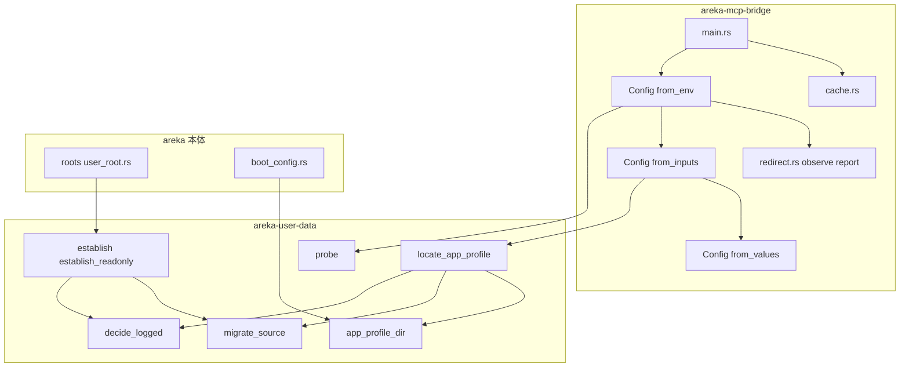
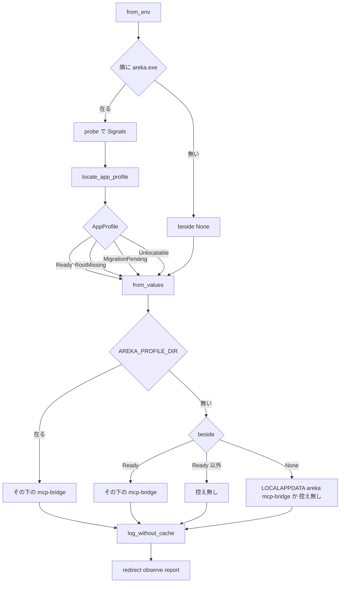
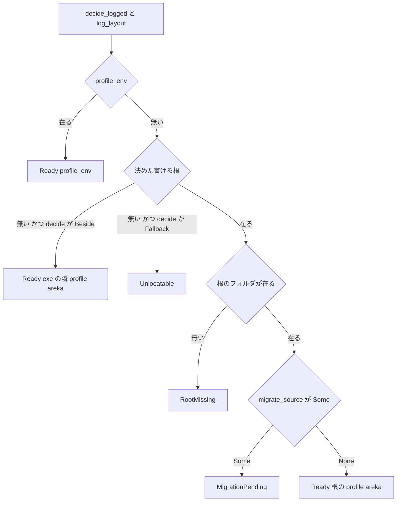

# 設計書: bridge-store-user-root

> 2026-10-29・ワークツリーの先頭 `29f6ff2c` のコードに対する設計。コードは「何の定義か」（関数名・型名＋ファイルパス）で指す。行番号と行数は今の値。
> ギャップ分析（`research.md` の 1〜8b）の案 A／B／C・調べの持ち越し・設計へ回す事項は、この設計で決めた（根拠と捨てた案は `research.md` の 10 章）。要件の末尾の「討議で決めたこと」7 点は、すべてこの設計の前提にしている。

## Overview

**Purpose**: Claude Desktop が起こす中継（`areka-mcp-bridge.exe`）が、控えの置き場を決めるときに、利用者ごとの置き場を作らず、exe の隣の記憶を写さないようにする。Microsoft Store 版の Claude Desktop から起こされたときの控えは箱の中に置くことを決まりとして受け入れ、そのことを中継の起動の記録と説明書で伝える。

**Users**: Store 版の Claude Desktop から areka をつなぐ利用者は、areka 本体の置き場と別の写しが箱の中にできなくなり、控えの場所を説明書で知る。開発者は、中継の起動の記録を読めば、控えをどこに置いたか（置かなかったならその理由）と、書き込みが箱へ回されているかが分かる。

**Impact**: 今の中継は `Config::from_env`（`crates/areka-mcp-bridge/src/config.rs`）で `areka_user_data::establish` を呼び、置き場を作り・写す。これを、`areka-user-data` に足す「決めるだけ」の口 `locate_app_profile` に替える。置き場がまだ無い・写しがまだ・場所を決められないときは、控えを持たずに動く。起動の記録に、控えを持たない理由の行と、箱の行を足す。areka 本体の振る舞いと、中継の MCP の中継の働きは変えない。

### Goals
- 中継が作る利用者ごとの置き場の数・写す記憶の数・書き換える／消す exe の隣の記憶の数を、箱の中でも外でも 0 にする。
- 控えの置き場の答えを、要件 2 の各場面で 1 つに決め、決定論テストで固める。
- 起動の記録だけで、控えの置き場（または置かない理由）と、箱へ回されているか（または見分けられないこと）が読める。
- 直す前と直した後の実機の測りで、上の 3 つを数で確かめる。

### Non-Goals
- 箱の外の本当の置き場へ控えを届けること（討議 1 で箱の中を受け入れた。`PROC_THREAD_ATTRIBUTE_DESKTOP_APP_POLICY` の手は測らず採らない）。
- areka 本体の置き場の決め方・作り方・写し方（完了 `user-data-root`）。
- 控えの中身・候補の番号・待つ時間・組み込みの答え（完了 `mcp-stdio-bridge`）。
- 前の版（0.0.3）の中継が箱の中に残した写しを消すこと（説明書で「消してよい」と伝えるだけ）。
- arm64 の機械での確かめ。

## Boundary Commitments

### This Spec Owns
- `areka-user-data` の「決めるだけ」の口 `locate_app_profile` と答えの型 `AppProfile`（作らない・写さない・記録は今の判断の記録を分け合う）。
- 中継の控えの置き場の決め方（`Config::from_env`・`Config::from_inputs`・`Config::from_values`）と、控えを持たない理由の記録の行。
- 中継の箱の見立て（`crates/areka-mcp-bridge/src/redirect.rs`）と、その記録の行。
- `dist/README.txt` の 2 か所: 利用者ごとの置き場の形の一覧の「中継の控え」の行（今の 297 行）と、その下の中継の控えの段落（今の 308 行）。
- 実機の測り（直す前・直した後）の手順と記録（`research.md` の 11 章）。

### Out of Boundary
- `areka-user-data` の今の口（`decide`・`probe`・`establish`・`establish_readonly(_from)`・`readonly_app_profile_dir`・`app_profile_dir`）の答えと記録の文。1 行も変えない。
- areka 本体の呼び手（`crates/areka/src/roots/user_root.rs`・`crates/areka/src/boot_config.rs`）。
- 中継の `cache.rs`（控えの読み書き・書けないときの warn）・`service.rs`・`scan.rs`・`http.rs`・`stdio.rs`・`errors.rs`。
- `dist/README.txt` のほかの行（zip の形の一覧の「中継の控え」の行＝今の 289 行を含む）と、`winget-release-automation` が触る段落。
- `tools/mcp-bridge-install.ps1`（開発者の机の中継は隣に `areka.exe` が無い形で、この直しの場面に当たらない）。
- steering の文書（`structure.md` の中継と `areka-user-data` の節の書き直しは完了の段で行う）。

### Allowed Dependencies
- `areka-mcp-bridge` → `areka-user-data`（`probe`・`locate_app_profile`・`AppProfile`・`Signals`）・`areka-mcp`（今どおり）。中継は `establish` と `app_profile_dir` を呼ばなくなる。
- `areka-user-data` は上の層を知らない（中継のことを知らない。答えの型は「記憶の置き場がどうか」だけを言う）。
- 中継の開発用の依存に `log-capture-kit`（ワークスペースの中）を足す。外部のクレートは足さない。`windows` クレートも `extern "system"` の宣言も足さない。
- OS の機能は標準ライブラリの `std::fs::canonicalize`・`Path::is_dir`・`Path::exists` だけ。

### Revalidation Triggers
- `AppProfile` に値が増えた・意味が変わった: 中継の `Config::from_values` と記録（`log_without_cache`）を見直す。
- 写しの条件（`migrate_source`）が変わった: `MigrationPending` の場面が一緒に変わる（持ち主は 1 つなので直すのは 1 か所）。
- areka 本体が `mcp-bridge` のフォルダを作るようになった: 箱の見立て（控えのフォルダを作るのは中継だけ、という前提）を見直す。
- 実機の測りで、中継の exe の `canonicalize` が箱の場所を返さない・箱の中から本当の置き場が見えないと分かった: 箱の見立て（D-6）と説明書の文を見直す（設計に戻る）。
- 控えの置き場の段（`AREKA_PROFILE_DIR` → 隣の areka → `LOCALAPPDATA`）を変える spec は、`Some(AppProfile::Ready 以外)` で `LOCALAPPDATA` へ落ちない約束を保つ。

## Architecture

### Existing Architecture Analysis
- 中継の環境を読むのは `Config::from_env` の 1 か所で、判断は値だけを受ける `Config::from_values` が持つ（段は `profile_dir.or(beside_profile).or(local)` の下の `mcp-bridge`）。置き場を決めた行は `main.rs` の `[bridge] cache dir`（info）、置き場が無いときの行は `from_env` の `warn!` 1 件。
- 控えの書きは `cache.rs` の `replace` で、書く前に `create_dir_all(dir)` で控えのフォルダを親ごと作る。控えの置き場を「まだ無い置き場の下」に決めると、ここで置き場が作られる。
- `areka-user-data` の判断は `decide`（純粋）、判断の記録は `decide_logged`（非公開・書けるか分からない warn と決められない error）、形の記録は `log_layout`（非公開・`user_data_layout`）、写しの条件は `migrate_source`（`pub(crate)`）。どれも `establish.rs` の中にある。
- `decide_logged` は `Beside` と `Fallback` のどちらでも `(None, reason)` を返す。`Beside` の理由はいつも `Reason::Neither`、`Fallback` の理由は決して `Neither` ではない（`decide` の本文）。

### Architecture Pattern & Boundary Map

選んだ形は案 B（`areka-user-data` に「決めるだけ」の口を 1 つ足し、中継はそれを呼ぶ）。箱の見立ては中継の中の新しい兄弟のファイルに置き、OS に触る所を `canonicalize` の 2 回に絞る。



**Architecture Integration**:
- Selected pattern: 判断は値だけの関数・OS に触る所は薄い 1 か所（中継の `from_env` と `areka-user-data` の `probe` の今の分け方を守る）。
- Domain/feature boundaries: 「置き場がどうか」（在る・まだ無い・写しがまだ・決められない）は `areka-user-data` が答え、「だから控えをどこに置くか・何を記録するか」は中継が決める。
- Existing patterns preserved: `probe` → 値 → 判断、`[bridge]` の頭の ASCII の記録、テストは兄弟のファイル・根は `target\` の下・捕捉は `log-capture-kit`。
- New components rationale: `locate_app_profile`＝写しの条件と判断の記録の持ち主を 1 つに保つため（討議 5）。`redirect.rs`＝箱の見立てを `config.rs` から分け、値で試せるようにするため。
- Steering compliance: 新しい外部依存 0・記録は ASCII・ログの無い失敗の道を作らない（控えを持たない場面はどれも 1 件の行を残す）。

**依存の向き**: `areka-user-data`（型 → `decide` → `establish.rs` の口）→ 中継の `config.rs` → `redirect.rs` → `main.rs`。`redirect.rs` は `areka-user-data` を知らない（控えのフォルダと `LOCALAPPDATA` の値だけを受ける）。`areka-user-data` は中継を知らない。

### Technology Stack

| Layer | Choice / Version | Role in Feature | Notes |
|-------|------------------|-----------------|-------|
| CLI（中継の exe） | `areka-mcp-bridge`（今の版） | 控えの置き場の決め方・記録・箱の見立て | 依存は今のまま＋開発用の `log-capture-kit` |
| 共有の葉 | `areka-user-data`（今の版） | 「決めるだけ」の口 | 依存は `std` と `tracing` のまま |
| OS | `std::fs::canonicalize`（Windows では `CreateFile`＋`GetFinalPathNameByHandle`） | 控えのフォルダの最終の場所を尋ねる | 何も作らない・書かない |
| 記録 | `tracing`（今の版） | 記録の行 | 文は ASCII・頭は `[bridge]` |

## File Structure Plan

### Directory Structure
```
crates/
├── areka-user-data/src/
│   ├── lib.rs                       # 型 AppProfile を足す・pub use に locate_app_profile を足す
│   ├── establish.rs                 # locate_app_profile を足す（decide_logged・log_layout・migrate_source を中で使う）
│   └── establish_locate_tests.rs    # 新: locate_app_profile の決定論テスト
└── areka-mcp-bridge/
    ├── Cargo.toml                   # dev に log-capture-kit・areka-user-data の注記を書き直す
    ├── src/
    │   ├── lib.rs                   # mod redirect（クレートの中だけ）
    │   ├── config.rs                # from_env の組み替え・from_inputs・from_values の形・控えを持たない理由の記録
    │   ├── config_tests.rs          # from_values の新しい形へ合わせる・Ready 以外で LOCALAPPDATA へ落ちない
    │   ├── config_prepare_tests.rs  # 新: target の下の根で要件 2 の各場面・作らない・写さない・記録の行
    │   ├── redirect.rs              # 新: 箱の見立て（observe＝OS・classify＝値だけ・report＝記録）
    │   ├── redirect_tests.rs        # 新: 見立てと記録の行の決定論テスト
    │   └── main.rs                  # 70 行の注記だけ書き直す
    └── tests/exe_test.rs            # 52〜53 行の注記だけ書き直す
dist/README.txt                      # 297 行と 308 行の段落だけ
.kiro/specs/bridge-store-user-root/research.md   # 11 章: 実機の測りの記録
```

### Modified Files
- `crates/areka-user-data/src/lib.rs`（205 行）— `AppProfile` を足す（約 20 行）。`pub use establish::{…}` に `locate_app_profile` を足す。ほかは変えない。
- `crates/areka-user-data/src/establish.rs`（310 行）— `locate_app_profile` を足す（約 40 行）。`#[path = "establish_locate_tests.rs"]` のテストの接続宣言を足す。今の関数は 1 行も変えない。
- `crates/areka-mcp-bridge/src/config.rs`（130 行）— `from_env` を「読むだけ」に組み替え、`from_inputs`（`pub(crate)`）と `log_without_cache`（非公開）を足す。`from_values` の 3 つ目の引数を `Option<AppProfile>` にする。`#[path = "config_prepare_tests.rs"]` のテストの接続宣言を足す。`establish`・`app_profile_dir` の呼び出しを消す。約 180 行になる見込み。
- `crates/areka-mcp-bridge/src/config_tests.rs`（166 行）— `cache_dir_of` の 2 つ目の引数を `AppProfile` にし、`beside_profile_from_the_shared_rule_lands_under_the_areka_profile` を「`Ready` はその下・`Ready` 以外は控え無しで `LOCALAPPDATA` へ落ちない」の確かめに書き直す。
- `crates/areka-mcp-bridge/src/lib.rs`（23 行）— `mod redirect;` を足す（`pub` にしない）。
- `crates/areka-mcp-bridge/src/redirect.rs`（新）— 末尾に `#[path = "redirect_tests.rs"]` のテストの接続宣言を置く。
- `crates/areka-mcp-bridge/src/main.rs`（106 行）— 70 行の注記（「置き場が無いときの 1 件は `Config::from_env` の `warn!` が出している」）を、「控えを持たないときの 1 件と箱の行は `Config::from_env` が出している」に書き直す。コードは変えない。
- `crates/areka-mcp-bridge/Cargo.toml` — `[dev-dependencies]` に `log-capture-kit = { path = "../log-capture-kit" }` を足す。`areka-user-data` の依存の注記（「establish と app_profile_dir」）を「決めるだけの口 locate_app_profile と入力の probe」に書き直す。
- `crates/areka-mcp-bridge/tests/exe_test.rs` — 52〜53 行の注記を、「中継は置き場を作らないが、開発者の `AREKA_USER_ROOT` で判断の形が変わらないように外す」に書き直す。`env_remove` は残す。
- `dist/README.txt` — 297 行と 308 行の段落（下の「説明書の文」）。
- `.kiro/specs/bridge-store-user-root/research.md` — 11 章（実機の測りの記録）を足す。

## System Flows

### 起動のときの控えの置き場の決め方



- 決めるのは起動のときの 1 回だけ（`main` が `from_env` を 1 回呼ぶ・要件 2.11）。起動している間に areka が置き場を作っても、その起動の控えは無いまま。次に起こされたときに `locate_app_profile` が `Ready` を返す。
- `Ready` 以外の 3 つは、`LOCALAPPDATA` の段へ落ちない（落ちると最初の控えの書きが `%LOCALAPPDATA%\areka` を作る）。

### `locate_app_profile` の答え



## Requirements Traceability

| Requirement | Summary | Components | Interfaces | Flows |
|-------------|---------|------------|------------|-------|
| 1.1 | 直す前に Store 版から起こして 4 点を測る | 実機の測り（M-1） | 測りの手順 | 実機の測り |
| 1.2 | PowerShell から起こした比べ | 実機の測り（M-1） | 測りの手順 | 実機の測り |
| 1.3 | 直した後にもう一度測る | 実機の測り（M-2） | 測りの手順 | 実機の測り |
| 1.4 | 検体は `target\` の下・箱は既定の置き場で・比べは `AREKA_USER_ROOT` を `target\` へ | 実機の測り | 測りの手順 ⑴⑵ | 実機の測り |
| 1.5 | 本物の置き場と箱の中の物を控えて戻す | 実機の測り | 測りの手順 ⑶⑻ | 実機の測り |
| 1.6 | Claude Desktop の設定と起動し直しは開発者に頼む | 実機の測り | 測りの手順 ⑸ | 実機の測り |
| 1.7 | Bash の道具から下見してよい | 実機の測り | 測りの手順 ⑷ | 実機の測り |
| 2.1 | 置き場の答えを今の規則のまま | `locate_app_profile` | `decide_logged`・`app_profile_dir` を使う | `locate_app_profile` の答え |
| 2.2 | 利用者ごとの置き場を作らない | `locate_app_profile`・`Config::from_values` | `AppProfile::RootMissing`・`LOCALAPPDATA` へ落ちない | 控えの置き場の決め方 |
| 2.3 | exe の隣の記憶を写さない・書き換えない・消さない | `locate_app_profile`・`Config::from_values` | `AppProfile::MigrationPending`・exe の隣へ書かない | 同上 |
| 2.4 | 根が見えない→控え無し・待たない | `locate_app_profile`・`Config::from_values` | `RootMissing` | 同上 |
| 2.5 | 写しがまだ→控え無し・`profile\areka` を作らない | `locate_app_profile`・`Config::from_values` | `MigrationPending`（`migrate_source`） | 同上 |
| 2.6 | ほか→根の `profile\areka\mcp-bridge` | `locate_app_profile` | `Ready(根の profile\areka)` | 同上 |
| 2.7 | 利用者ごとの置き場の形なら exe の隣に書かない・決められなければ控え無し | `locate_app_profile`・`Config::from_values` | `Unlocatable`・`Ready` 以外は控え無し | 同上 |
| 2.8 | zip の形は exe の隣の `profile\areka\mcp-bridge` | `locate_app_profile` | `Ready(exe の隣)` | 同上 |
| 2.9 | `AREKA_PROFILE_DIR` が在ればその下 | `locate_app_profile`・`Config::from_values` | `profile_dir` の段が先 | 同上 |
| 2.10 | 隣に `areka.exe` が無ければ今どおり | `Config::from_values` | `beside = None` | 同上 |
| 2.11 | 起動のときに 1 回・次の起動から控え | `Config::from_env`（`main` が 1 回呼ぶ） | — | 同上 |
| 2.12 | 控え無しでも答え方は今どおり | `cache.rs`・`service.rs`（変えない） | `Cache::new(None)` | — |
| 3.1 | 決めた控えの置き場の行（info） | `main.rs` の `[bridge] cache dir`（変えない） | — | — |
| 3.2 | 控えを持たない理由と根の場所の行（info） | `log_without_cache` | 行 W1 | 控えの置き場の決め方 |
| 3.3 | 決められない→控え無し（warn） | `log_without_cache` | 行 W2・W3 | 同上 |
| 3.4 | 書けない→今どおり warn | `cache.rs`（変えない） | — | — |
| 3.5 | 箱の中なら箱の行を 1 件 | `redirect::report` | 行 B1 | 箱の見立て |
| 3.6 | 箱のフォルダの場所も出す | `redirect::classify` | `BoxSight::Inside.box_dir` | 同上 |
| 3.7 | 箱の外と分かれば 0 件 | `redirect::report` | `BoxSight::Outside` | 同上 |
| 3.8 | 足す文は ASCII | `log_without_cache`・`redirect::report` | 行 W1〜W3・B1・B2 | — |
| 3.9 | 見分けられなければ 1 件（info）・箱の行は出さない | `redirect::report` | 行 B2 | 同上 |
| 4.1 | 箱の外へ届く手の調べと結論を記録 | `research.md` 3.3・11 章 | — | — |
| 4.2 | 採るのは 3 条件を満たす手だけ | 設計の決め（箱の中を受け入れる） | — | — |
| 4.3 | 無ければ箱の中を受け入れ、説明書と記録で伝える | 説明書の文・行 B1 | — | — |
| 4.4 | どちらでも作る・写すは 0 | `locate_app_profile`・`Config::from_values` | — | — |
| 4.5 | 箱の外で子を起こす手は測らず採らない | 設計の決め | — | — |
| 4.6 | `AREKA_USER_ROOT` を外へ向ける手を説明書に足さない | 説明書の文 | — | — |
| 5.1 | 段落を決めた形と測りに合う確定の文に | 説明書の文 | — | — |
| 5.2 | Store 版の控えの場所（例のパス） | 説明書の文 | — | — |
| 5.3 | 控え無しの場面と控えができる時 | 説明書の文 | — | — |
| 5.4 | 作らない・写さない | 説明書の文 | — | — |
| 5.5 | 変えるのは 2 か所だけ | 説明書の文 | — | — |
| 5.6 | 0.0.3 の写しの場所と消してよいこと | 説明書の文 | — | — |
| 6.1 | areka 本体の振る舞いの差 0 | `locate_app_profile` は足すだけ・今の口は不変 | — | — |
| 6.2 | 中継の MCP の働きを変えない | `cache.rs`・`service.rs` などは不変 | — | — |
| 6.3 | 新しい外部依存 0 | `Cargo.toml`（dev にワークスペースの `log-capture-kit` だけ） | — | — |
| 6.4 | 要件 2 の各場面の控えの置き場をテストで固定 | `config_prepare_tests.rs`・`config_tests.rs`・`establish_locate_tests.rs` | — | — |
| 6.5 | 2.4・2.5 で作られていない・写されていないをテストで | `config_prepare_tests.rs` | — | — |
| 6.6 | 記録の行をテストで固定 | `config_prepare_tests.rs`・`redirect_tests.rs` | — | — |
| 6.7 | 注入で組む・環境変数を書き換えない・根は `target\` の下 | `Config::from_inputs`・`redirect::observe` の引数 | — | — |

## Components and Interfaces

| Component | Domain/Layer | Intent | Req Coverage | Key Dependencies | Contracts |
|-----------|--------------|--------|--------------|------------------|-----------|
| `AppProfile`・`locate_app_profile` | `areka-user-data` | 記憶の置き場がどうかを、作らず写さずに答える | 2.1〜2.9・4.4・6.1 | `decide_logged`・`log_layout`・`migrate_source`・`app_profile_dir`（P0） | Service |
| `Config::from_env`・`from_inputs`・`from_values`・`log_without_cache` | 中継 `config.rs` | 控えの置き場を 1 回決め、控えを持たない理由を記録する | 2.1〜2.12・3.2・3.3・3.8・6.7 | `probe`・`locate_app_profile`（P0）・`redirect`（P1） | Service |
| `redirect`（`BoxSight`・`observe`・`classify`・`report`） | 中継 `redirect.rs` | 書き込みが箱へ回されているかを見立て、記録する | 3.5〜3.9・6.6・6.7 | `std::fs::canonicalize`（P0） | Service |
| 説明書の文 | `dist/README.txt` | 控えの場所・控え無しの場面・0.0.3 の残りを伝える | 4.3・4.6・5.1〜5.6 | 実機の測り（P0） | — |
| 実機の測り | 手順（`target\` の下で使い捨て）と `research.md` 11 章 | 直す前と後の 4 点を数で確かめる | 1.1〜1.7・4.1 | 開発者（Claude Desktop の設定と起動し直し） | Batch |

### areka-user-data

#### `AppProfile`・`locate_app_profile`

| Field | Detail |
|-------|--------|
| Intent | 記憶の置き場がどうか（使える・根がまだ無い・写しがまだ・決められない）を、作らず写さずに答える |
| Requirements | 2.1, 2.2, 2.3, 2.4, 2.5, 2.6, 2.7, 2.8, 2.9, 4.4, 6.1 |

**Responsibilities & Constraints**
- 判断と判断の記録は `decide_logged` と `log_layout` を今のまま使う（書けるか分からない warn・決められない error・`user_data_layout` の info）。新しい記録の行は足さない。
- フォルダを作らない・ファイルを書かない・写さない。読むのは `Path::is_dir` と `migrate_source`（`exists`・`is_dir`）だけ。
- areka 本体からは呼ばれない（`establish`・`establish_readonly` の呼び手は今のまま）。

**Dependencies**
- Inbound: 中継の `Config::from_inputs` — 控えの置き場を決める（P0）
- Outbound: `decide_logged`・`log_layout`・`migrate_source`・`app_profile_dir`（同じクレートの中）（P0）

**Contracts**: Service [x]

##### Service Interface
```rust
// crates/areka-user-data/src/lib.rs
/// 記憶の置き場を決めるだけの答え（作らない・写さない。spec: bridge-store-user-root）。
#[derive(Clone, Debug, PartialEq, Eq)]
pub enum AppProfile {
    /// 記憶の置き場。`app_profile_dir` と同じ値（`AREKA_PROFILE_DIR`・在る書ける根の
    /// `profile\areka`・今の形なら実行ファイルの隣の `profile\areka`）。
    Ready(PathBuf),
    /// 書ける根を使う形だが、根のフォルダがまだ無い（`root` は決めた根）。
    RootMissing { root: PathBuf },
    /// 根は在るが、実行ファイルの隣の記憶がまだ写されていない（`migrate_source` の条件）。
    MigrationPending { root: PathBuf },
    /// 書ける根を使う形だが、場所を決められない（`Decision::Fallback`）。
    Unlocatable,
}

// crates/areka-user-data/src/establish.rs
/// 記憶の置き場を決めるだけ（作らない・写さない）。判断と記録は `establish` と分け合う。
/// `signals` は呼び手が `probe` で詰める（テストは組んで渡す）。
pub fn locate_app_profile(
    signals: &Signals,
    exe_dir: &Path,
    profile_env: Option<&OsStr>,
) -> AppProfile;
```
- Preconditions: `exe_dir` は `areka.exe` の在るフォルダ（中継が確かめてから渡す）。
- Postconditions:
  - `profile_env` が `Some` なら、いつも `Ready(PathBuf::from(profile_env))`（要件 2.9・根の有無と写しを見ない）。
  - `profile_env` が `None` で、`decide(signals)` が `Decision::Fallback` なら `Unlocatable`（要件 2.7）。`Decision::Beside` なら `Ready(exe_dir\profile\areka)`（要件 2.8）。
  - 決めた根 `R` が在り、`R.is_dir()` が偽なら `RootMissing { root: R }`（要件 2.4）。
  - `R.is_dir()` が真で `migrate_source(R, exe_dir)` が `Some` なら `MigrationPending { root: R }`（要件 2.5）。
  - ほかは `Ready(R\profile\areka)`（要件 2.6。`R\profile\areka` が在っても無くても）。
  - `Ready` の値は、同じ入力で `app_profile_dir(profile_env, &Layout { user_root: 決めた根, reason }, Some(exe_dir))` と等しい（要件 2.1）。
  - 呼ぶ前と後で、ファイルの木は同じ（要件 2.2・2.3）。
- Invariants: `Beside` と `Fallback` の見分けは、純粋な `decide(signals)` をもう一度呼んで `matches!(…, Decision::Fallback { .. })` で見る（`decide_logged` の返す `Reason` から読み戻さない＝理由の決まりに頼らない）。テストで `Fallback` の 4 つの理由（`EnvEmpty`・`EnvRelative`・`LocalAppDataMissing`・`LocalAppDataRelative`）が `Unlocatable` になることを固める。

**Implementation Notes**
- Integration: 記録の順は `decide_logged`（warn／error）→ `log_layout`（`user_data_layout`・決めた根をそのまま `Layout.user_root` に入れる）。`RootMissing` のときも「決めた」形として `mode = user_root` が出る（作っていないことは中継の行 W1 が言う）。
- Validation: `establish_locate_tests.rs`（下の Testing Strategy）。
- Risks: `Unlocatable` のとき `decide_logged` の error の文は "staying beside the exe"（areka 本体の文）。中継はその後に行 W2（控え無し）を出して打ち消す。文は areka 本体と共有なので変えない。

### 中継（areka-mcp-bridge）

#### `Config::from_env`・`Config::from_inputs`・`Config::from_values`・`log_without_cache`

| Field | Detail |
|-------|--------|
| Intent | 控えの置き場を起動のときに 1 回決め、控えを持たない理由を記録する |
| Requirements | 2.1〜2.12, 3.2, 3.3, 3.8, 6.7 |

**Responsibilities & Constraints**
- `from_env` は本物の環境を読むだけ: exe の場所（`current_exe` の親）・隣の `areka.exe` の有無・`AREKA_PROFILE_DIR`・`AREKA_MCP_PORT`・`LOCALAPPDATA`・隣に `areka.exe` が在るときだけ `probe(Some(exe_dir))`。そのあと `from_inputs` を呼び、最後に `redirect::report(&redirect::observe(local, config.cache_dir))` を 1 回呼ぶ。
- `from_inputs` は値だけを受ける。`locate_app_profile` → `from_values` → `log_without_cache` の順。
- `from_values` は I/O なし。段は `profile_dir` → `beside` → `local_app_data` の `areka`。どれもその下の `mcp-bridge`。

**Dependencies**
- Inbound: `main.rs`（`from_env` を 1 回）・テスト（`from_inputs`・`from_values`）
- Outbound: `areka_user_data::probe`・`locate_app_profile`（P0）・`redirect`（P1）

**Contracts**: Service [x]

##### Service Interface
```rust
// crates/areka-mcp-bridge/src/config.rs
impl Config {
    /// 本物の環境を読む唯一の口（変えない名前・戻り値）。
    pub fn from_env() -> Config;

    /// `from_env` の内側（本物の環境を読まない）。`areka` は隣に areka.exe が在るときの
    /// （実行ファイルのフォルダ, `probe` の答え）。控えを持たない理由の記録もここで残す。
    pub(crate) fn from_inputs(
        port_value: Option<&str>,
        profile_env: Option<&OsStr>,
        areka: Option<(&Path, &areka_user_data::Signals)>,
        local_app_data: Option<PathBuf>,
    ) -> Config;

    /// 値 → 設定（I/O なし）。`beside` は `None`＝隣に areka.exe が無い、
    /// `Some(Ready(dir))`＝その下、`Some(ほか)`＝控え無し（`local_app_data` の段へ落ちない）。
    pub fn from_values(
        port_value: Option<&str>,
        profile_dir: Option<PathBuf>,
        beside: Option<areka_user_data::AppProfile>,
        local_app_data: Option<PathBuf>,
    ) -> Config;
}

/// 控えを持たないときの 1 件（持つときは 0 件）。
fn log_without_cache(beside: Option<&areka_user_data::AppProfile>, config: &Config);
```
- Postconditions（`from_values` の控えの置き場）:

| `profile_dir` | `beside` | `local_app_data` | 控えの置き場 |
|---|---|---|---|
| `Some(p)` | どれでも | どれでも | `p\mcp-bridge`（要件 2.9） |
| `None` | `Some(Ready(d))` | どれでも | `d\mcp-bridge`（要件 2.6・2.8） |
| `None` | `Some(RootMissing／MigrationPending／Unlocatable)` | どれでも | 無し（要件 2.4・2.5・2.7） |
| `None` | `None` | 絶対パス `l` | `l\areka\mcp-bridge`（要件 2.10） |
| `None` | `None` | 無い・空・相対 | 無し（今どおり） |

- 記録（`log_without_cache`・どれも ASCII・頭は `[bridge]`）:

| 行 | 出す場面 | 重さ | 文と欄 |
|---|---|---|---|
| W1 | 控え無し かつ `beside` が `RootMissing`／`MigrationPending` | info | `"[bridge] running without the cache until areka prepares its user root; it is used from the next start"`・`reason = "user_root_missing"`／`"app_memory_not_migrated"`・`user_root = <根>` |
| W2 | 控え無し かつ `beside` が `Unlocatable` | warn | `"[bridge] the user root of areka could not be located; running without the cache"` |
| W3 | 控え無し かつ `beside` が `None` | warn | 今の文のまま（`"[bridge] no place for the cache (AREKA_PROFILE_DIR, areka profile beside the bridge, LOCALAPPDATA: none available); running without it"`） |
| — | 控えが在る | — | 0 件（置き場の行は今どおり `main.rs` の `[bridge] cache dir`） |

**Implementation Notes**
- Integration: 記録の並びは `user_data_layout` ほか（`areka-user-data`）→ W1〜W3 のどれか 1 件（あれば）→ 箱の行 B1／B2（あれば）→ `main.rs` の候補・`cache dir`・待つ時間。
- Validation: `config_tests.rs`（`from_values` の表）・`config_prepare_tests.rs`（`from_inputs` を `target\` の下の根で）。
- Risks: `from_values` の引数の形が変わる。呼び手はテストと `from_inputs` だけ（`grep` で確かめた）。

#### `redirect`（箱の見立て）

| Field | Detail |
|-------|--------|
| Intent | 控えのフォルダの最終の場所を尋ね、書き込みが箱へ回されているかを見立てて記録する |
| Requirements | 3.5, 3.6, 3.7, 3.8, 3.9, 6.6, 6.7 |

**Responsibilities & Constraints**
- OS に触るのは `observe` の `std::fs::canonicalize` の 2 回（`LOCALAPPDATA` と控えのフォルダ）だけ。何も作らず、書かない。
- 判断は値だけの `classify`。記録は `report`（0 件か 1 件）。
- 尋ねる物は控えのフォルダだけ（areka 本体は `mcp-bridge` を作らないので、在れば中継の書きの行き先）。親を辿って尋ねない（本当の場所に在る親を尋ねると、箱の中でも「外」と見立ててしまう）。

**Dependencies**
- Inbound: `Config::from_env`（1 回）
- External: `std::fs::canonicalize`（P0）

**Contracts**: Service [x]

##### Service Interface
```rust
// crates/areka-mcp-bridge/src/redirect.rs
/// `%LOCALAPPDATA%` の下への書き込みが箱へ回されているかの見立て。
#[derive(Clone, Debug, PartialEq, Eq)]
pub(crate) enum BoxSight {
    /// 控えのフォルダが本当の `LOCALAPPDATA` の外に解けた。`box_dir` は解けた場所から
    /// `LOCALAPPDATA` の下の相対の部分を除いた所（末尾が合わなければ `None`）。
    Inside { asked: PathBuf, resolved: PathBuf, box_dir: Option<PathBuf> },
    /// 控えのフォルダが本当の `LOCALAPPDATA` の下に解けた。
    Outside,
    /// 尋ねる物が無い・解けない。`why` は下の 4 語のどれか。
    Unknown { asked: Option<PathBuf>, why: &'static str },
}

/// 薄い OS の口: 控えのフォルダが `local_app_data` の下なら、両方を `canonicalize` して `classify` へ。
pub(crate) fn observe(local_app_data: Option<&Path>, cache_dir: Option<&Path>) -> BoxSight;

/// 値だけの判断。`rel` は `asked` の `local_app_data` からの相対の部分。
pub(crate) fn classify(
    rel: &Path,
    asked: &Path,
    local_resolved: std::io::Result<PathBuf>,
    asked_resolved: std::io::Result<PathBuf>,
) -> BoxSight;

/// 記録（`Inside`＝B1 を 1 件・`Unknown`＝B2 を 1 件・`Outside`＝0 件）。
pub(crate) fn report(sight: &BoxSight);
```
- 見立ての決まり:

| 入力 | 見立て | `why` |
|---|---|---|
| 控えのフォルダが無い（`cache_dir = None`） | `Unknown` | `"no_cache_dir"` |
| `local_app_data` が無い・相対・控えのフォルダがその下でない（`strip_prefix` が外れる・相対の部分が空） | `Unknown` | `"not_under_local_app_data"` |
| 控えのフォルダの `canonicalize` が `NotFound` | `Unknown` | `"not_there_yet"` |
| どちらかの `canonicalize` がほかの失敗 | `Unknown` | `"cannot_resolve"` |
| `asked_resolved` と `local_resolved.join(rel)` が、文字列として ASCII の大小を無視して等しい | `Outside` | — |
| ほか | `Inside`（`box_dir`＝`asked_resolved` の末尾の `rel` の部品の数だけ親へ上がった所。末尾の部品が `rel` と ASCII の大小を無視して合わなければ `None`） | — |

- 記録（`report`・ASCII・頭は `[bridge]`）:

| 行 | 場面 | 重さ | 文と欄 |
|---|---|---|---|
| B1 | `Inside` | info | `"[bridge] writes under LOCALAPPDATA are redirected into the app's private folder (Microsoft Store app)"`・`asked`・`resolved`・`box_dir`（`None` なら欄を出さない） |
| B2 | `Unknown` | info | `"[bridge] cannot tell whether writes under LOCALAPPDATA are redirected"`・`why`・`asked`（`None` なら欄を出さない） |
| — | `Outside` | — | 0 件 |

**Implementation Notes**
- Integration: `from_env` の最後で 1 回。`observe` に渡す `local_app_data` は `from_env` が読んだ `LOCALAPPDATA` と同じ値。
- Validation: `redirect_tests.rs`。`classify` は値だけで全部の腕を固める（箱の中の場所は注入の値）。`observe` は `target\` の下に組んだ「偽の LOCALAPPDATA」と控えのフォルダで `Outside`・`not_there_yet`・`not_under_local_app_data`・`no_cache_dir` を確かめる（本物の箱はテストで作れない）。
- Risks: 箱の外の取り違え（一度だけ）と、ジャンクションの取り違え（`research.md` 10.5）。`Outside` の腕に `// shortcut: 箱の外で作られた控えのフォルダを、箱の中の中継は控えを箱の中へ初めて書けた起動までは「外」と見立てる（areka が居なくて書けない間は何回でも続く）。困る場面が出たら名乗りの読み（D1）を重ねる` の注記を置く。

### 説明書の文（`dist/README.txt`）

変えるのは 2 か所だけ（要件 5.5）。下は下書きで、実機の測り（M-1・M-2）の数と食い違う所は測りに合わせて直す（要件 5.1）。`AREKA_USER_ROOT` を `AppData` の外へ向ける手は書かない（要件 4.6）。

- 297 行（利用者ごとの置き場の形の一覧）:
  `・中継の控え: %LOCALAPPDATA%\areka\profile\areka\mcp-bridge\（Microsoft Store 版の Claude Desktop が起動した中継では場所が変わります。下の段落を参照）`
- 308 行の段落（置き換え）:
  `中継の控えは、中継を areka.exe と別の場所に置いたときは %LOCALAPPDATA%\areka\mcp-bridge\ にあります。中継は控えの置き場を決めるだけで、利用者ごとの置き場を作らず、areka.exe の隣の記憶を写しません。利用者ごとの置き場を使っているとき、areka をまだ一度も起動していない（利用者ごとの置き場が無い）間と、areka.exe の隣の記憶がまだ利用者ごとの置き場へ写されていない間は、中継は控えを持たずに動きます（areka が居なければ組み込みの答えで答えます）。areka を起動した後、次に Claude Desktop が中継を起こして areka へつないだときから控えを作ります。Microsoft Store 版の Claude Desktop が起動した中継では、中継が %LOCALAPPDATA% の下へ書く物は、%LOCALAPPDATA%\Packages\ の中の Claude_ で始まるフォルダの LocalCache\Local\ の下へ回されます。これは Windows の決まりで、areka からは変えられません。控えはそこに置きます（たとえば別の場所に置いたときは LocalCache\Local\areka\mcp-bridge\、利用者ごとの置き場を使っているときは LocalCache\Local\areka\profile\areka\mcp-bridge\）。前の版（0.0.3）の中継は、ここ（LocalCache\Local\areka\ の下）に利用者ごとの置き場と areka の記憶の写しを作ったことがあります。areka はこの写しを使わないので、LocalCache\Local\areka\ のフォルダは消してかまいません。控えは消しても、次に Claude Desktop を起動し直して areka へつないだときに作り直します。`

### 実機の測り（M-1 直す前・M-2 直した後）

**Contracts**: Batch [x]

- Trigger: M-1 は実装の最初のタスク（直しのコードより前）。M-2 は直しと説明書の後、最後のタスク。
- 検体（要件 1.4）: `target\bridge-store-measure\<before|after>\` に、建てた `areka.exe`・`areka-mcp-bridge.exe`・空の `Areka.Areka.Portable_measure.db`（winget の控え）・`profile\areka\sylphya.toml`（中身の決まった exe の隣の記憶）を並べる。M-1 は直す前のコード（ワークツリーの先頭）を建てたもの、M-2 は直した後のもの。`target\` は `AppData` の外なので、検体の隣への書きは箱へ回らない（本物の winget の入れ先は `AppData\Local\Microsoft\WinGet\Packages\` の下で回される）。直した中継は利用者ごとの置き場の形では exe の隣へ書かないので効かないが、違いとして記録に残す。
- 場面（箱の働きは既定の `%LOCALAPPDATA%\areka` で測る・Claude Desktop の設定に `AREKA_USER_ROOT` を書かない）:
  - S1: 本当の `%LOCALAPPDATA%\areka` が無い（今の机の形）。M-1・M-2 の両方。
  - S2: 本当の `%LOCALAPPDATA%\areka\profile\areka\` が在る（PowerShell の道具＝箱の外から測りの間だけ作る）。M-1・M-2 の両方。要件 1.1 の d と要件 2.6 を見る。
  - S3: 本当の `%LOCALAPPDATA%\areka\` は在るが `profile\areka\` が無い（同じく測りの間だけ作る）。M-2 だけ（要件 2.5）。
- 手順:
  1. 測る前の写しを取る（PowerShell の道具＝箱の外の見え方）: 箱 `%LOCALAPPDATA%\Packages\Claude_<…>\LocalCache\Local\areka\` と本当の `%LOCALAPPDATA%\areka\` の木と、検体の exe の隣の記憶の SHA256。
  2. 本物に触れうる物を控える（要件 1.5）: 箱の中の `LocalCache\Local\areka\`（今は開発者の机の中継の `mcp-bridge` が在る）を `target\bridge-store-measure\backup\` へ移す。本当の `%LOCALAPPDATA%\areka` は今は無い（在れば同じく控える）。
  3. 場面を作る（S2・S3 なら本当の置き場のフォルダを作る）。
  4. 下見（要件 1.7・任意）: Bash の道具から検体の中継を起こし、`initialize` と `tools/list` の 2 行を流して閉じる。結果は「下見」と書いて分け、本番の代わりにしない。下見で箱にできた物は 2 の形へ戻してから本番へ進む。
  5. 開発者に頼む（要件 1.6）: Claude Desktop の設定の areka の `command` を検体の中継へ向け直し、Claude Desktop を起動し直す。頼む文は「急がなくてよい・切れ目で」を先頭にする。中継が areka（開発者の机で動いていれば）へつないで控えを書くまで待つ。箱の見立ては控えを書く前の起動の初めに行うので、控えのフォルダがまだ無い起動では B2（`not_there_yet`）になる。M-2 の S2 は areka を動かしたまま 2 回起こしてもらい、1 回目で B2 と箱の中に控えのフォルダができること、2 回目で B1 と `box_dir` を記録する（設計の一番危うい見込み＝`canonicalize` が箱の場所を返すことを確かめる 1 回）。
  6. 4 点を測る（PowerShell の道具から）: (a) 箱の中に `areka\`・`areka\profile\` ができたか（数）、(b) 箱の中に `areka\profile\areka\sylphya.toml` の写しができたか（数）と、検体の exe の隣の記憶の SHA256 が 1 と同じか、(c) `server-info.json`・`tools.json` がどこにできたか（箱・本当の置き場・検体の隣を探す。控えは areka が動いていてつながったときだけ書かれるので、つながらなかったときは「書かれない」とその理由を記録する）、(d) 中継の起動の記録（Claude Desktop がとる中継の標準エラーの記録）の `user_data_layout`・W1〜W3・B1／B2 の行と、S2 で本当の置き場が「在る」と見えたか（M-1 は `user_root_created` の行の有無、M-2 は `AppProfile` の答え）。中継のプロセスがパッケージの名乗りを持つかも、起動中の中継の pid に PowerShell から `GetPackageFamilyName` を尋ねて記録に残す（設計の判断には使わない・`research.md` 7 の 1 の答えとして）。
  7. 比べ（要件 1.2）: 同じ検体の中継を PowerShell の道具から、`AREKA_USER_ROOT` を `target\bridge-store-measure\<before|after>\user-root\` に向けて起こし、`initialize` と `tools/list` を流して同じ 4 点を測る（本当の `%LOCALAPPDATA%\areka` を作らない）。
  8. 戻す（要件 1.5）: 測りで新しくできた物（箱の中の `areka\`・S2／S3 で作った本当の置き場・`user-root\`）を消し、2 で控えた物を元の場所へ戻す。開発者に Claude Desktop の設定を元へ戻してもらう。1 の写しと木を比べ、元の形に戻ったことを記録する。止めるプロセスは、自分で起こしたと確かめたものだけ。
- 記録: `research.md` の 11 章に、場面ごとの表（Store 版／PowerShell × a〜d）と、記録の行の写し（ASCII のまま）を残す。M-2 では、要件 2 と要件 3 のとおりに動いたこと（作る数 0・写す数 0・exe の隣の記憶の SHA256 不変・S1 と S3 で W1・S2 の 1 回目で B2 と控えが箱の中の `areka\profile\areka\mcp-bridge\`・S2 の 2 回目で B1 に箱のフォルダ）を、起動ごとの欄に分けた表で示す。要件 4.1 の調べの結論（`research.md` 3.3）に、測りで分かったことを足す。
- Idempotency & recovery: どの段で止まっても 8 を行えば元に戻る。2 の控えは `target\` の下に残るので、戻す前に消えない。

## Data Models

新しい永続のデータは無い。控えのファイルの形・名前（`server-info.json`・`tools.json`）は変えない。足す型は `AppProfile`（`areka-user-data`）と `BoxSight`（中継の中だけ）の 2 つで、どちらもプロセスの中の値。

## Error Handling

### Error Strategy
- 控えを持たない場面は、どれも失敗として返さず、記録 1 件を残して控え無しで続ける（中継の答え方は変えない・要件 2.12）。
- 箱の見立ての失敗（`canonicalize` の失敗）は `Unknown` として記録 1 件。中継は止めない。
- 控えを書けないときは今どおり `cache.rs` の warn（要件 3.4）。

### Error Categories and Responses

| 場面 | 重さ | 行 | 続き方 |
|---|---|---|---|
| 根がまだ無い・写しがまだ（要件 2.4・2.5） | info | W1 | 控え無し |
| 根の場所を決められない（要件 2.7・3.3） | warn（と `areka-user-data` の error） | W2 | 控え無し |
| 控えの置き場がどこにも無い | warn | W3（今のまま） | 控え無し |
| 書けない（要件 3.4） | warn | `cache.rs` の今の行 | 控え無しで続ける |
| 箱の中（要件 3.5・3.6） | info | B1 | 続ける |
| 見分けられない（要件 3.9） | info | B2 | 続ける |

### Monitoring
中継の記録は標準エラーだけ（Claude Desktop がファイルに書く）。上の行で、控えの有無と箱の見立てがいつも 1 件以上読める（控えが在り箱の外と分かったときだけ、箱の行が 0 件）。

## Testing Strategy

どれもプロセスの環境変数を書き換えず、値を注入して組む。根・記憶の置き場・控えの置き場は `TempPath::under_target` の下（要件 6.7）。記録は `log_capture_kit::capture` で捕まえる（要件 6.6）。

### Unit Tests（`crates/areka-user-data/src/establish_locate_tests.rs`）
根は `Signals.local_app_data`（`target\` の下）の `areka`、入力は winget の控え在りの形で、`establish_tests.rs`・`establish_readonly_tests.rs` の `fixture`（`AREKA_USER_ROOT` の形）とは別の組み方なので、このファイルの中に 1 つ持つ。
- `Signals` を組み（winget の控え在り・`local_app_data` は `target\` の下）、根が無い → `RootMissing { root }`・根が作られていない・exe の隣の `sylphya.toml` の中身が同じ（要件 2.4・2.2・2.3）。
- 根は在るが `profile\areka` が無く exe の隣の記憶が在る → `MigrationPending`・`root\profile\areka` が作られていない（要件 2.5）。
- 根の `profile\areka` が在る → `Ready(root\profile\areka)`。根は在るが `profile\areka` も exe の隣の記憶も無い → `Ready(root\profile\areka)`（要件 2.6）。どちらも `app_profile_dir` と同じ値（要件 2.1）。
- 理由が `Neither`（控え無し・書ける）→ `Ready(exe\profile\areka)`（要件 2.8）。`Fallback` の 4 つの理由 → `Unlocatable`（要件 2.7）。`profile_env` 在り → 根が無くても `Ready(profile_env)`・根が作られていない（要件 2.9）。
- `Fallback` のとき `user_root_unavailable`（error）と `user_data_layout`（info）が今どおり 1 件ずつ出る（記録の持ち主が 1 つのまま・要件 6.1 の確かめ）。

### Unit Tests（`crates/areka-mcp-bridge/src/config_tests.rs`）
- `from_values` の表の 5 行（`profile_dir` が先・`Ready` はその下・`Ready` 以外は `local_app_data` が在っても控え無し・`None` は `LOCALAPPDATA\areka\mcp-bridge`・絶対でない `LOCALAPPDATA` は無し）（要件 2.4・2.7・2.9・2.10・6.4）。今のテストの候補の列・待つ時間はそのまま。

### Integration Tests（`crates/areka-mcp-bridge/src/config_prepare_tests.rs`）
`target\` の下に「偽の LOCALAPPDATA」・exe のフォルダ（`areka.exe` は空のファイル・`profile\areka\sylphya.toml`）を組み、`Config::from_inputs` を `capture` の中で呼ぶ。木の比べのヘルパ `tree` はこのファイルの中に 1 つ（ほかのテーマのファイルは使わない）。
- 要件 2.4: 根が無い → 控え無し・W1（`reason = user_root_missing`・`user_root` の欄が根）1 件・W2／W3 は 0 件。続けて `Cache::new(config.cache_dir).save_tools(…)` と `save_server_info(…)` を呼んでも、呼ぶ前と後で木が同じ（根も `LOCALAPPDATA\areka` も作られない・要件 2.2・6.5）。
- 要件 2.5: 根は在り `profile\areka` が無い → 控え無し・W1（`reason = app_memory_not_migrated`）1 件・同じく保存を呼んでも木が同じ（`root\profile\areka` が無い・exe の隣の中身が同じ・要件 2.3・6.5）。
- 要件 2.6: 根の `profile\areka` が在る → `root\profile\areka\mcp-bridge`・W1〜W3 は 0 件。根は在るが `profile\areka` も exe の隣の記憶も無い → 同じ置き場で、保存を呼んだ後に増えた物が `root\profile\areka\mcp-bridge\` の下だけ（ほかの物を作らない）。
- 要件 2.7・3.3: winget の控え在り・`Signals.local_app_data = None` → 控え無し（exe の隣の `profile\areka\mcp-bridge` でない）・`areka-user-data` の `user_root_unavailable`（error）の後に W2 が warn で 1 件（この順を固める）。`AREKA_USER_ROOT` が相対の値でも同じ。
- 要件 2.8: 控え無し・書ける → `exe\profile\areka\mcp-bridge`。要件 2.9: `profile_env` 在り・根が無い → `profile_env\mcp-bridge`・根は作られない・W1 は 0 件。要件 2.10: `areka = None` → `LOCALAPPDATA\areka\mcp-bridge`。
- 要件 2.11: 2.4 の形で 1 回呼んで控え無し → 根の `profile\areka` を作る（areka が置き場を作った形）→ もう 1 回呼ぶと `root\profile\areka\mcp-bridge`。
- 要件 3.8: このファイルと下の `redirect_tests.rs` が捕まえた W1・W2・B1・B2 の文と、決まった語の欄（`reason`・`why`）が ASCII（`is_ascii`）。パスの欄（`user_root`・`asked`・`resolved`・`box_dir`）は利用者の名前しだいで ASCII でないので確かめない。

### Unit Tests（`crates/areka-mcp-bridge/src/redirect_tests.rs`）
- `classify`: 本当の場所に解けた → `Outside`、`report` が 0 件（要件 3.7）。別の場所に解けた（`…\Packages\Claude_x\LocalCache\Local\areka\mcp-bridge` を注入）→ `Inside { box_dir: …\LocalCache\Local }`、`report` が B1 を info で 1 件・`box_dir` の欄あり（要件 3.5・3.6）。末尾が合わない → `box_dir: None`・B1 に `box_dir` の欄なし。大小だけ違う → `Outside`。`NotFound` → `Unknown("not_there_yet")`・ほかの失敗 → `Unknown("cannot_resolve")`、`report` が B2 を info で 1 件・B1 は 0 件（要件 3.9）。
- `observe`（`target\` の下の偽の LOCALAPPDATA）: 控えのフォルダが在る → `Outside`。無い → `Unknown("not_there_yet")` で、控えのフォルダが作られていない（`exists` が偽）。控えのフォルダが偽の LOCALAPPDATA の外 → `Unknown("not_under_local_app_data")`。`cache_dir = None` → `Unknown("no_cache_dir")`。木の比べのヘルパは持たない（`config_prepare_tests.rs` の `tree` を写さない）。

### E2E（建てた exe・`crates/areka-mcp-bridge/tests/exe_test.rs`）
- 今のテストがそのまま緑（`AREKA_PROFILE_DIR` の下に控え・答え方が今どおり・要件 2.12・6.2）。足すテストは無い。

### 実機（M-1・M-2）
- 上の「実機の測り」。全体テストには入れない。

## 実装の順（タスク生成への申し送り）

1. M-1（直す前の実機の測り）。人の待ち（Claude Desktop の設定と起動し直し）を含む。
2. `areka-user-data` の `AppProfile`・`locate_app_profile` とそのテスト。
3. 中継の `config.rs`（`from_env`・`from_inputs`・`from_values`・`log_without_cache`）・`Cargo.toml`・`config_tests.rs`・`config_prepare_tests.rs`・注記（`main.rs`・`exe_test.rs`）。2 の後。
4. 中継の `redirect.rs` とそのテスト・`from_env` からの呼び出し。2・3 と同じファイルを触るのは `config.rs` の `from_env` の 1 行と `lib.rs` の 1 行だけなので、3 の後に続ける。
5. `dist/README.txt` の 2 か所（M-1 の結果に合わせる）。
6. M-2（直した後の実機の測り）と、説明書の文を測りに合わせる直し。
