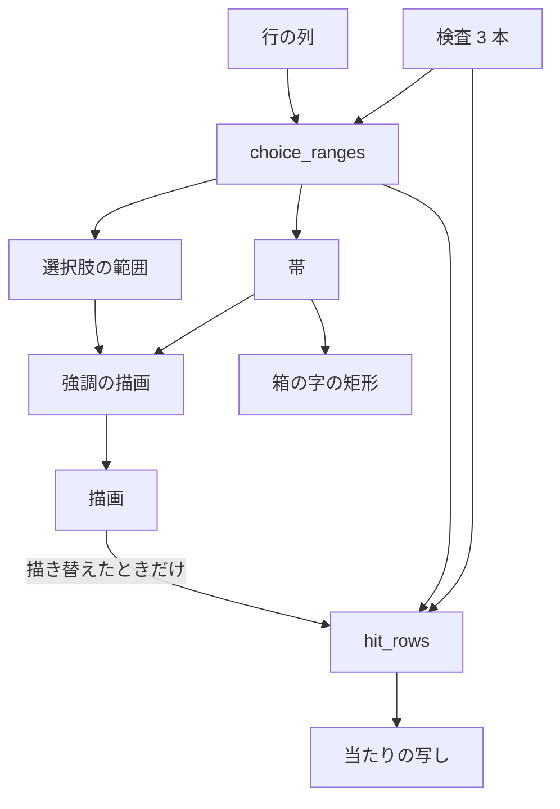
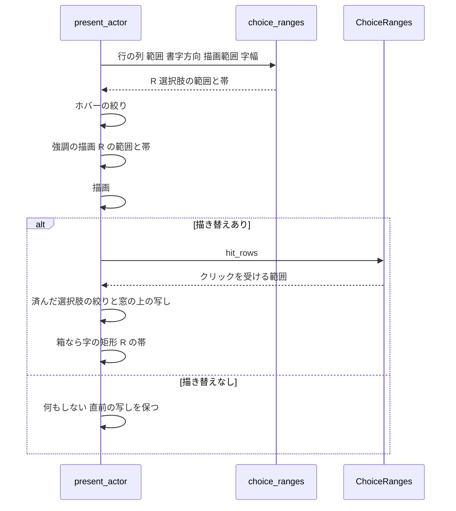

# 設計: choice-ranges-one-function

## Overview

**目的**: 選択肢とアンカー（以下まとめて「選択肢」）の強調とクリックの当たりを、表示されている字と同じ行の列から導く本番の手順を、関数 1 つにまとめる。バルーンと箱の文字の提示（`present_actor`）と、選択肢を確かめる 2 か所の検査が、同じその関数を呼ぶ。

**使う人**: areka の開発者。本番の並び（範囲の割り当て → 帯 → 当たり）や渡す行の列が変わったとき、検査が赤になって気付ける。

**変わること**: `crates/areka-emo-text/src/actor_present.rs` に、行の列から選択肢の範囲と帯を出す関数 `choice_ranges` と、その結果からクリックを受ける範囲を出す手続き `ChoiceRanges::hit_rows` を足す。`present_actor` と検査の 2 か所は、`choice.rs` の 3 つの関数（`annotate_lines`・`line_bands`・`derive_hit_rows`）を直接並べる代わりにこれを呼ぶ。字・強調の色と位置・帯・クリックの当たりは 1 画素も変えない。

### Goals

- 行の列 → 選択肢の範囲・帯・クリックを受ける範囲の並びを、本番の 1 か所（`choice_ranges` とその結果の型）だけに書く。
- 強調の描画・クリックを受ける範囲・箱の字の矩形が、すべてその 1 か所の結果から帯を取る。
- 描き替えの無いフレームではクリックを受ける範囲を計算しない今の省き方を保つ。
- 検査は決まった字幅でその関数を呼ぶだけになり、並びをわざと崩すと赤になる（崩した形と赤になった検査の名前を記録に残す）。

### Non-Goals

- 選択肢の見た目・強調の色・帯の寸法の決め方・クリックの当たりの規則の変更。
- 強調の描画（`decorate_canvas`）と描画（`render_styled`）の段の作り替え。
- 選択肢のイベント（`OnChoiceSelect` など）・ホバーの扱い・済んだ選択肢の絞りの規則の変更。
- 文字の提示の全体（`present_frame`）を決まった字幅で回せるようにすること。
- 名指しの 2 か所のほかで 3 つの手順を並べ直している検査（`layout_cluster_tests.rs`・縦書きの帯を読み戻す GPU の検査 2 本・crate の外の結合検査 `tests/staysee_balloon_fixture/script.rs`）の呼び替え。

## Boundary Commitments

### This Spec Owns

- `actor_present.rs` の中の、行の列から選択肢の範囲・帯・クリックを受ける範囲を出す並び（`choice_ranges`・`ChoiceRanges`・`ChoiceRanges::hit_rows`）。
- `present_actor` の中で、強調の描画・クリックを受ける範囲の写し・箱の字の矩形へ渡す範囲と帯の出どころを、その結果に揃えること。
- 検査の 2 か所（`actor_lookahead_shapes_tests.rs` の `choice_highlight_and_click_ranges_come_from_the_judged_rows`、`choice_anchor_tests.rs` の支え `hit_in`）の呼び替えと、帯の共有を見る新しい検査 1 本。
- 検査から関数へ届くための `actor.rs` の再輸出 1 行（検査のビルドだけ）。
- 並びを崩す変異の確かめと、その記録。

### Out of Boundary

- `choice.rs` の 3 つの関数・`decorate_canvas`・`glyph_cells`・`to_window_physical` の中身（呼ぶだけで変えない）。
- 済んだ選択肢を当たりの写しから外す絞りと、済んだ選択肢を指すホバーを強調へ渡さない絞り（今の位置＝`present_actor` の中、`choice_ranges` の外に残す）。
- 当たりの写し `ChoiceHitRow` の組み立て（通し番号で範囲を引き、ID・ラベル・参照を添え、窓の上の矩形へ写す）。描画の後に決まる `committed` を使うので `choice_ranges` の外に残す。
- 行の列を作る手順（`arrange_lines`）と、検査が決まった字幅で行の列を得る今の読み口（`arrange_for_test`・`choice_anchor_tests.rs` が配置を直接呼ぶ支え）。
- 選択肢やリンクの範囲の種類を足すこと（後の spec の持ち物）。

### Allowed Dependencies

- `actor_present.rs` → `crate::choice`（3 つの関数 `annotate_lines`・`line_bands`・`derive_hit_rows` と公開の型 `LineChoiceSegment`・`LineBand`・`CanvasHitRow`）・`crate::layout`（`GlyphMetrics`・`PositionedLine`）・`crate::region::TextRegion`・`crate::writing::WritingMode`・`crate::state::ChoiceSpan`。どれも今の crate の中の純粋な型と関数。
- 検査 `choice_anchor_tests.rs`（`choice` の子）→ `crate::actor::choice_ranges`（`#[cfg(test)]` の再輸出だけを通る）。本番のビルドの依存の向き（`actor` → `choice`）は変わらない。
- 外部の依存は足さない。新しいソースファイルも足さない。

### Revalidation Triggers

- `choice_ranges` の引数・`ChoiceRanges` の公開の欄（`segments`・`bands`）・`hit_rows` の形が変わったとき（検査の 2 か所と新しい検査、後の spec が足す範囲の種類が影響を受ける）。
- 帯の配り先（強調・当たり・箱の字の矩形）が増えたり減ったりしたとき。
- `choice_ranges` を `choice.rs` など別の所へ移すとき（`actor.rs` の再輸出が要らなくなる・並走の約束の見直しが要る）。
- 済んだ選択肢の絞りを `choice_ranges` の中へ入れると決め直すとき（`hit_in` の受け取る物が変わる）。

## Architecture

### Existing Architecture Analysis

- 今の `present_actor` の並び: `arrange_lines` → `window_for` → `annotate_lines(&lines, spans)` → `line_bands(&lines, mode, &render.metrics)` → ホバーの絞り → `decorate_canvas(…, &segments, …, &bands)` → `render_styled` → `changed` のときだけ `derive_hit_rows(&lines, &segments, mode, &region, &bands)` → 済んだ選択肢の絞りと窓の上の写し → 箱なら `glyph_cells(&lines, &bands, …)`。
- `derive_hit_rows` の入力（`lines`・`segments`・`mode`・`region`・`bands`）は描画の前にすべて揃っている。描画の後でしか決まらない `committed` は、窓の上の写し（`to_window_physical`）と `glyph_cells` だけが使う。
- `actor_present.rs` は `actor.rs` の非公開の子 `mod present`。`actor` の子の検査（`actor_lookahead_shapes_tests.rs`）は `super::present::…` で届くが、`choice` の子の検査（`choice_anchor_tests.rs`）は届かない。

### Architecture Pattern & Boundary Map



- **採る形**: 2 段の形。`choice_ranges` が行の列・描画範囲・書字方向を借りたまま、選択肢の範囲と帯を出して小さな構造体 `ChoiceRanges` に持つ。クリックを受ける範囲は、その構造体の手続き `hit_rows` が、構造体の持つ同じ行の列・範囲・帯からだけ作る。
- **遅延の形を採らない理由**: 遅延（`OnceCell` などで当たりを初めて読んだときに計算する）は、内側の書き換えか閉包の型を足すだけで、2 段の形と同じ「描き替えたときだけ計算する」しか得られない。呼び出しの側に `if changed { ranges.hit_rows() }` と書く 2 段の形の方が短く、どのフレームで計算するかが読んで分かる。
- **毎フレーム 3 つとも出す形を採らない理由**: 要件 1.5（描き替えが無いフレームは計算し直さない）に合わない（要件討議で除外済み）。
- **並びが 1 か所になる理由**: `annotate_lines`・`line_bands`・`derive_hit_rows` を呼ぶのは `choice_ranges` と `hit_rows` だけになる。`hit_rows` は引数を取らない（行の列・範囲・帯・描画範囲・書字方向をすべて構造体から読む）ので、別の行の列や別の帯で当たりを作る道が書けない。
- **守る今の形**: 強調の描画と描画の段の位置、`changed` のときだけ写しを入れ替える省き方、ホバーと済んだ選択肢の絞りの位置、`arrange_lines` を 1 回だけ呼ぶ形。
- **steering との合い方**: 新しいファイル・新しい依存・`lib.rs` の一覧の行を足さない。1 ファイル 1,000 行の番人に収まる（下の File Structure Plan）。

### Technology Stack

| Layer | Choice / Version | Role in Feature | Notes |
|-------|------------------|-----------------|-------|
| テキスト層 | Rust（ワークスペースの版のまま）・`areka-emo-text` | 本番の関数と検査 | 新しい依存なし |
| 検査 | `cargo test`・`FixedMetrics`（決まった字幅） | GPU なしで関数を呼ぶ | ビルドとテストは `-j 2` |

## File Structure Plan

### Modified Files

- `crates/areka-emo-text/src/actor_present.rs`（555 行 → 600 行前後）— `ChoiceRanges`・`choice_ranges`・`ChoiceRanges::hit_rows` を足す。`present_actor` の `annotate_lines`／`line_bands`／`derive_hit_rows` の直接の呼び出しを、`choice_ranges` の呼び出しと `if changed` の中の `ranges.hit_rows()` に替え、`decorate_canvas` と `glyph_cells` へ渡す範囲と帯を `ranges.segments`・`ranges.bands` にする。`use crate::choice::{…}` から 3 つの関数は `choice_ranges` と `hit_rows` の中だけで使う。
- `crates/areka-emo-text/src/actor.rs`（825 行 → 827 行）— `pub use present::present_frame;` の隣に `#[cfg(test)] pub(crate) use present::choice_ranges;` の 2 行を足す。これだけ。
- `crates/areka-emo-text/src/actor_lookahead_shapes_tests.rs`（421 行 → 420 行前後）— `choice_highlight_and_click_ranges_come_from_the_judged_rows` の 3 行（183〜185 行目）を `choice_ranges` の呼び出しと `hit_rows()` に替え、`use crate::choice::{annotate_lines, derive_hit_rows, line_bands};` を外す。判定の文は変えない。
- `crates/areka-emo-text/src/choice_anchor_tests.rs`（340 行 → 390 行前後）— `hit_in` の配置の部分を支え `arranged`（行の列と描画範囲を返す）へ切り出し、`hit_in` を `arranged` → `choice_ranges` → `hit_rows()` に替える。帯の共有を見る新しい検査 1 本を足す。既存の検査の判定は変えない。

- `.kiro/specs/choice-ranges-one-function/tasks.md`（タスク生成で作る）— 変異の確かめのタスクの実装の記録に、入れた変異と赤になった検査の名前を残す（4.4）。ソースではない。

新しく作るソースファイルは無い。`choice.rs`・`lib.rs` は触らない。

## System Flows



- `choice_ranges` は描画の前に 1 回だけ呼ぶ。`hit_rows` は描き替えたフレームでだけ 1 回呼ぶ。
- 字幅（`render.metrics`）は `choice_ranges` の呼び出しの間だけ借り、構造体には持たない。続く `render.executor.render_styled(…, &mut render.surface, …)` の可変の借用と重ならない。

## Requirements Traceability

| Requirement | Summary | Components | Interfaces | Flows |
|-------------|---------|------------|------------|-------|
| 1.1 | 手順を本番の関数 1 つに | ChoiceRanges | `choice_ranges`・`hit_rows` | 提示の流れ |
| 1.2 | 字幅を受け GPU なしで呼べる | ChoiceRanges | `metrics: &dyn GlyphMetrics` | — |
| 1.3 | 強調の範囲と帯は関数の結果から | present_actor の呼び替え | `ranges.segments`・`ranges.bands` | 強調の描画 |
| 1.4 | 当たりは同じ行の列・範囲・帯から関数を通して | ChoiceRanges | `hit_rows(&self)`（引数なし） | 描き替えあり |
| 1.5 | 描き替えなしは当たりを計算しない | present_actor の呼び替え | `if changed { ranges.hit_rows() }` | 描き替えなし |
| 1.6 | 強調・当たり・箱の字の矩形に別の手順の範囲・帯を使わない | present_actor の呼び替え | `glyph_cells(&lines, &ranges.bands, …)` | 箱の字の矩形 |
| 2.1 | 値を変えない（横書き・縦書き） | ChoiceRanges | 同じ 3 つの関数を同じ引数で呼ぶ | — |
| 2.2 | 済んだ選択肢の扱いを変えない | present_actor の呼び替え | 絞りは今の位置のまま | 描き替えあり |
| 2.3 | ホバーの扱いを変えない | present_actor の呼び替え | ホバーの絞りは今の位置のまま | — |
| 2.4 | 箱の字の矩形と写しの中身を変えない | present_actor の呼び替え | `ChoiceHitRow` の組み立てと `glyph_cells` は今のまま | — |
| 2.5 | 既存の検査が判定を書き換えずに緑 | 検査の呼び替え | — | 確かめの手順 |
| 3.1 | 検査は決まった字幅で関数を呼ぶ | 検査の呼び替え | `choice_ranges(…, &FixedMetrics)` | — |
| 3.2 | 検査は 3 つの手順を並べ直さない | 検査の呼び替え | 2 か所から 3 つの関数の `use` を外す | — |
| 3.3 | 名指しの 2 か所を呼び替える | 検査の呼び替え | `actor_lookahead_shapes_tests.rs`・`hit_in` | — |
| 3.4 | 2 か所の判定の中身を保つ | 検査の呼び替え | 判定の文はそのまま | — |
| 3.5 | 検査の読み口は検査のビルドだけ | actor.rs の再輸出 | `#[cfg(test)] pub(crate) use present::choice_ranges;` | — |
| 3.6 | 強調へ渡す帯と当たりのブロック軸が同じ帯から出る新しい検査 | 帯の共有の検査 | `ranges.bands` と `ranges.hit_rows()` | — |
| 4.1 | 別の行の列を渡す変異で赤 | 変異の確かめ | 変異 V1〜V3 | 確かめの手順 |
| 4.2 | 帯を別々に出す変異（両方の形）で決まった字幅のまま赤 | 変異の確かめ・帯の共有の検査 | 変異 V4・V5 | 確かめの手順 |
| 4.3 | 手順を抜く変異で赤 | 変異の確かめ | 変異 V6・V7 | 確かめの手順 |
| 4.4 | 変異と赤になった検査の名前を記録 | 変異の確かめ | `tasks.md` の実装の記録 | — |
| 4.5 | 変異を戻して全部緑 | 変異の確かめ | — | 確かめの手順 |
| 5.1 | 関数を `actor_present.rs` に置く | ChoiceRanges | — | — |
| 5.2 | `choice.rs` を変えない | 全体 | — | — |
| 5.3 | 新しいソースファイルと `lib.rs` の行を足さない | 全体 | — | — |
| 5.4 | 外部の依存を足さない | 全体 | — | — |
| 5.5 | 行の列を得る今の手立てをそのまま使う | 検査の呼び替え | `arrange_for_test`・`LayoutEngine::layout` を直接 | — |
| 5.6 | `actor.rs` を変える理由と範囲 | actor.rs の再輸出 | 再輸出 1 行（`#[cfg(test)]`）だけ | — |
| 5.7 | 1 ファイル 1,000 行以下 | 全体 | File Structure Plan の行数 | — |
| 5.8 | `-j 2` で回す | 確かめの手順 | `cargo test -p areka-emo-text -j 2` | — |

## Components and Interfaces

| Component | Domain/Layer | Intent | Req Coverage | Key Dependencies | Contracts |
|-----------|--------------|--------|--------------|------------------|-----------|
| ChoiceRanges（`choice_ranges`・`hit_rows`） | テキスト層・actor の子 | 行の列から範囲・帯・当たりを出す並びの唯一の場所 | 1.1, 1.2, 1.4, 2.1, 5.1 | `choice.rs` の 3 つの関数（P0） | Service |
| present_actor の呼び替え | テキスト層・actor の子 | 強調・当たりの写し・箱の字の矩形の入力を ChoiceRanges に揃える | 1.3, 1.5, 1.6, 2.2, 2.3, 2.4 | ChoiceRanges（P0） | — |
| actor.rs の再輸出 | テキスト層・actor | `choice` の子の検査から関数へ届く口（検査のビルドだけ） | 3.5, 5.6 | ChoiceRanges（P0） | — |
| 検査の呼び替え | 検査 | 2 か所を関数の呼び出しに替える | 2.5, 3.1, 3.2, 3.3, 3.4, 5.5 | ChoiceRanges（P0） | — |
| 帯の共有の検査 | 検査 | 強調へ渡す帯と当たりのブロック軸が同じ帯から出ることを判定 | 3.6, 4.2 | ChoiceRanges（P0） | — |
| 変異の確かめ | 確かめの手順 | 並びを崩すと検査が赤になることを確かめて記録 | 4.1〜4.5 | 上の検査 3 本（P0） | — |

### テキスト層（actor の子）

#### ChoiceRanges

| Field | Detail |
|-------|--------|
| Intent | 1 つの場所の行の列から、選択肢の範囲・帯・クリックを受ける範囲を出す並びを 1 か所に持つ |
| Requirements | 1.1, 1.2, 1.4, 2.1, 5.1 |

**Responsibilities & Constraints**

- `choice_ranges` は、今の `present_actor` と同じ順と同じ引数で `annotate_lines(lines, spans)` と `line_bands(lines, mode, metrics)` を呼び、結果を `ChoiceRanges` に持つ。
- `hit_rows` は `derive_hit_rows(self.lines, &self.segments, self.mode, self.region, &self.bands)` を呼ぶだけ。引数を取らない。
- 値を足したり変えたりしない（同じ入力なら今と同じ出力・失敗なし）。済んだ選択肢・ホバーの絞りは持たない。
- 字幅は呼び出しの間だけ借りる（構造体に持たない）。

**Dependencies**

- Inbound: `present_actor` — 毎フレームの提示（P0）
- Inbound: 検査 3 本（`choice_anchor_tests.rs` は `actor.rs` の再輸出を通る）— 決まった字幅で呼ぶ（P0）
- Outbound: `crate::choice::{annotate_lines, line_bands, derive_hit_rows}` — 今の純粋な関数（P0）

**Contracts**: Service [x]

##### Service Interface

```rust
/// 1 つの場所の行の列から出した選択肢の範囲と帯。クリックを受ける範囲は同じ値から
/// [`ChoiceRanges::hit_rows`] で出す（描き替えたフレームでだけ呼ぶ）。
pub(crate) struct ChoiceRanges<'a> {
    lines: &'a [PositionedLine],
    region: &'a TextRegion,
    mode: WritingMode,
    /// 選択肢の範囲（強調を塗る所）。
    pub(crate) segments: Vec<LineChoiceSegment>,
    /// 行ごとの帯。強調の描画・クリックを受ける範囲・箱の字の矩形へ同じ列を配る。
    pub(crate) bands: Vec<LineBand>,
}

/// 行の列 → 選択肢の範囲・帯（本番の提示と検査が同じこの関数を呼ぶ・GPU の資源は要らない）。
pub(crate) fn choice_ranges<'a>(
    lines: &'a [PositionedLine],
    spans: &[ChoiceSpan],
    mode: WritingMode,
    region: &'a TextRegion,
    metrics: &dyn GlyphMetrics,
) -> ChoiceRanges<'a>;

impl ChoiceRanges<'_> {
    /// 持っている行の列・範囲・帯からクリックを受ける範囲を出す（canvas-local image px）。
    pub(crate) fn hit_rows(&self) -> Vec<CanvasHitRow>;
}
```

- 事前条件: なし（どの入力でも値を返す）。
- 事後条件: `segments == annotate_lines(lines, spans)`、`bands == line_bands(lines, mode, metrics)`、`hit_rows() == derive_hit_rows(lines, &segments, mode, region, &bands)`。
- 不変: 当たりは構造体の持つ行の列・範囲・帯・描画範囲・書字方向からだけ作られる。
- 名前と公開の範囲: 関数は `choice_ranges`、型は `ChoiceRanges`、手続きは `hit_rows`。`pub(crate)` にするのは `actor.rs` の `pub(crate) use` で再輸出するため（再輸出は元の公開の範囲より広くできない）。`present` が非公開の子なので、本番のビルドで届くのは今と同じ `actor` の中だけ。欄 `lines`・`region`・`mode` は非公開にし、外から当たりの入力を差し替えられないようにする。`segments`・`bands` は強調の描画・箱の字の矩形・検査が読むので `pub(crate)`。
- 字幅の型は `arrange_lines` と同じ `&dyn GlyphMetrics`（`line_bands` は `?Sized` を受けるのでそのまま渡せる）。

**Implementation Notes**

- 置き場所は `arrange_lines` の近く（同じ「本番と検査が同じ関数を呼ぶ」役の並び）。
- 確かめ: 既存の選択肢・アンカー・帯・当たりの檻と帯の共有の検査。

#### present_actor の呼び替え（summary）

- 今の 316 行目と 325 行目を `let ranges = choice_ranges(&lines, spans, resolved.mode, &resolved.region, &render.metrics);` 1 つに替える。帯の決め方を説明している今の注記は `choice_ranges` の中へ移すか、呼び出しの横に残す（中身は変えない）。
- `decorate_canvas` へは `&ranges.segments` と `&ranges.bands` を渡す（1.3）。
- `if changed` の中で `let hit_rows = ranges.hit_rows();` とし、以降の済んだ選択肢の絞りと窓の上の写し（`spans` から通し番号で引く・`is_settled_choice` で外す・`to_window_physical`）はそのまま（1.4, 1.5, 2.2, 2.4）。
- 箱の字の矩形は `glyph_cells(&lines, &ranges.bands, …)`（1.6）。
- ホバーの絞り（`is_settled_ordinal`）は今の位置のまま（2.3）。
- 呼び替えの後、`actor_present.rs` の中で `annotate_lines`・`line_bands`・`derive_hit_rows` を書くのは `choice_ranges` と `hit_rows` の中だけになる（1.6 の確かめはこの字面を見る）。

#### actor.rs の再輸出（summary）

- 足すのは `#[cfg(test)]` と `pub(crate) use present::choice_ranges;` の 2 行だけ（5.6）。
- **理由**: `choice_anchor_tests.rs` は `choice.rs` の子（`choice.rs` の `#[cfg(test)] #[path] mod anchor_tests;`）で、`choice.rs` を変えられない（5.2）。`actor_present.rs` は `actor.rs` の非公開の子 `present` なので、関数の公開の範囲をいくら上げても `choice` の子からは届かない。届かせる方法は `actor.rs` で再輸出するか `mod present` の公開の範囲を上げるかで、前者を `#[cfg(test)]` にすれば本番のビルドには何も増えない（3.5）。
- **範囲**: 再輸出するのは関数 `choice_ranges` だけ。型 `ChoiceRanges` は名前を書かずに値として受け、欄を読むだけなので再輸出しない。`mod present` の公開の範囲・ほかの宣言・`arrange_for_test` は変えない。
- `actor_lookahead_shapes_tests.rs` は `actor` の子なので、再輸出を通らず `super::present::choice_ranges` で呼ぶ。

### 検査

#### 検査の呼び替え（summary）

- `actor_lookahead_shapes_tests.rs` の `choice_highlight_and_click_ranges_come_from_the_judged_rows`: 行の列は今の `rig.lines(&place, t)`（中は `arrange_for_test`・5.5）のまま。183〜185 行目を `let derived = choice_ranges(&lines, &spans, resolved.mode, &resolved.region, &FixedMetrics); let segments = &derived.segments; let hits = derived.hit_rows();` に替える（名前を `ranges` にしないのは、207 行目に判定の側の `let ranges: Vec<_> = …` が既にあり、判定の文は変えないため）。以降の判定の文（覆う字の比べ・行内の区間の比べ・最後の「ええと、」）は変えない（3.4）。
- `choice_anchor_tests.rs` の `hit_in`: 今の配置（`BalloonModel`・`TextRegion::resolve`・`LayoutEngine::layout(…, &FixedMetrics, WrapPlan::CharByChar)`）を支え `arranged(state, t, mode) -> (Vec<PositionedLine>, TextRegion)` へそのまま切り出す（5.5）。`hit_in` は `arranged` → `choice_ranges(&lines, place.choices(), mode, &region, &FixedMetrics)` → `hit_rows()` に替え、返す値（範囲の列と、種類・通し番号・矩形の組）は今と同じ。`hit`／`hit_in` を使う既存の検査の判定は変えない（3.4, 2.5）。
- 2 か所とも `annotate_lines`・`line_bands`・`derive_hit_rows` を自分で呼ばなくなる（3.2）。`choice_anchor_tests.rs` の `use super::*` は残るが、3 つの関数を呼ぶ文は無くなる。

#### 帯の共有の検査（新しい 1 本）

| Field | Detail |
|-------|--------|
| Intent | 決まった字幅で、強調の描画へ渡す帯（`ranges.bands`）と、クリックを受ける範囲の矩形のブロック軸が同じ帯から出ていることを判定する |
| Requirements | 3.6, 4.2 |

- 置き場所: `choice_anchor_tests.rs`。名前は `highlight_bands_and_hit_rows_share_one_band_in_every_writing_mode`。
- 台本: 書字方向ごとに、行（縦書きでは列）をまたぐ選択肢を使う。横書きは「あい」＋選択肢「うえおか」＋「き」（1 行目と 2 行目に区間）。縦書きは `hit_in` と同じ描画範囲で 1 列に 20 字入り、上の台本では折り返さないので、`vertical_choice_across_columns_has_a_band_on_each_column` と同じ前置き 19 字＋選択肢「はいいえ」（1 列目と 2 列目に区間）を使う。
- 書字方向: 横書き・縦書き右から左・縦書き左から右の 3 つ。
- 判定の前に、どの向きでも選択肢の範囲が 2 行（列）以上に分かれていることを確かめる（台本が折り返さず、2 行目の帯を見ないまま緑になるのを防ぐ）。
- 手順: `arranged` で行の列と描画範囲を得る → `choice_ranges(…, &FixedMetrics)` → `hit_rows()`。
- 判定:
  - 当たりの行の数が選択肢の範囲の数と同じで、0 でない（帯や範囲が消える変異でも赤）。
  - 範囲と当たりの行を順に組にし、範囲の行の添字で `ranges.bands` の帯と行の矩形を引く。ブロック軸の近い辺が「行の矩形の近い辺＋帯の寄せ−描画範囲の原点」、遠い辺が「近い辺＋帯の丈」に等しい（横書きは上下と原点の上・縦書きは左右と原点の左）。
- この判定は `present_actor` が `ranges.bands` をそのまま `decorate_canvas` へ渡すこと（上の呼び替え）と組になって、「強調の帯＝当たりの帯」を決まった字幅で見張る。既存の判定は変えない（新しい検査として足す）。

#### 変異の確かめ（手順）

並びを崩す変異を 1 つずつ `actor_present.rs` の `choice_ranges`／`hit_rows` に入れ、`cargo test -p areka-emo-text -j 2` の選択肢の検査（下の 3 本と `choice_*` の檻）を回して赤を確かめ、戻す。

| 変異 | 中身 | 要件 | 赤になる見込みの検査 |
|---|---|---|---|
| V1 | 範囲の割り当てへ別の行の列（先頭の行を落とした列）を渡す | 4.1 | 検査 8 の選択肢・アンカーの檻（帯の共有の検査は横書きでは緑になり得る・縦書きは範囲が空になり赤） |
| V2 | 帯へ別の行の列（空の列）を渡す | 4.1 | 同上 |
| V3 | `hit_rows` で当たりへ別の行の列（先頭の行を落とした列）を渡す | 4.1 | アンカーの檻・帯の共有の検査 |
| V4 | 強調の側だけ崩す: 返す `bands` の寄せをずらし、`hit_rows` は崩す前の帯（変異の間だけ持たせる写し）を使う | 4.2 | 帯の共有の検査（決まった字幅） |
| V5 | クリックの側だけ崩す: `hit_rows` が寄せをずらした帯を使い、返す `bands` は元のまま | 4.2 | 帯の共有の検査・アンカーの檻（決まった字幅） |
| V6 | 範囲の割り当てを抜く（空の列） | 4.3 | 検査 8 の選択肢・アンカーの檻・帯の共有の検査 |
| V7 | `hit_rows` を抜く（空の列を返す） | 4.3 | 検査 8 の選択肢・アンカーの檻・帯の共有の検査 |

- 見込みは見立てで、本当に赤になった検査の名前は確かめた後に記録する。V4 と V5 は GPU を使わない検査だけで赤にならなければならない（4.2）。どれかが赤にならなければ、検査が見張れていない所として止めて報告する（変異を通すために判定を緩めない）。
- **記録の置き場**（4.4）: `tasks.md` の、変異を確かめるタスクの実装の記録（Implementation Notes）。変異ごとに中身と赤になった検査の名前を表で残す。`research.md` は設計の前の調べの記録なので使わない。
- 全部を戻した後、変異を含まない状態で `cargo test -p areka-emo-text -j 2` を緑にする（4.5）。戻したことは `git diff` に変異の跡が無いことで確かめる。

## Error Handling

- 新しい失敗の経路は無い。`choice_ranges` と `hit_rows` は今の 3 つの関数と同じく、どの入力でも値を返す。`present_actor` の今の防御（行の列や状態が引けないときの空フレーム扱い・`render_styled` の失敗の `?`）は変えない。

## Testing Strategy

- **単体（決まった字幅・GPU なし）**
  - `choice_anchor_tests.rs` の既存の檻（`hit`／`hit_in` 経由）: 横書き・縦書きのアンカーと選択肢の区間と矩形の値が変わらない（2.1, 2.5, 3.4）。
  - `actor_lookahead_shapes_tests.rs` の `choice_highlight_and_click_ranges_come_from_the_judged_rows`: 各段階で強調の範囲が覆う字＝見えている選択肢の字、当たりの行内の区間＝強調の区間（3.1, 3.4）。
  - 新しい `highlight_bands_and_hit_rows_share_one_band_in_every_writing_mode`: 強調へ渡す帯と当たりのブロック軸が同じ帯から出る（3.6, 4.2）。
- **本番経路（実 GPU）**
  - `actor_choice_contract_tests.rs` の `present_frame` の檻（当たりの写しが入る・描き替えの無いフレームで写しが変わらない・装飾した選択肢の帯が高くなる・ホバーの帯の読み戻し）と、箱の字の矩形の檻: 呼び替えた後も値が変わらない（1.3〜1.6, 2.1〜2.4）。
- **変異の確かめ**: V1〜V7 で赤、戻して緑（4.1〜4.5）。
- **決まりの番人**: `file_length_guard_test.rs`（1,000 行・5.7）、`lib.rs` の純粋層の走査と実ファイルの突き合わせ（ファイルを足さないので母数 81 のまま・5.3）。
- 回し方: `cargo test -p areka-emo-text -j 2`（5.8）。
