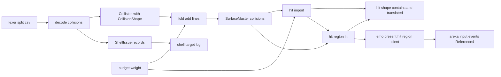
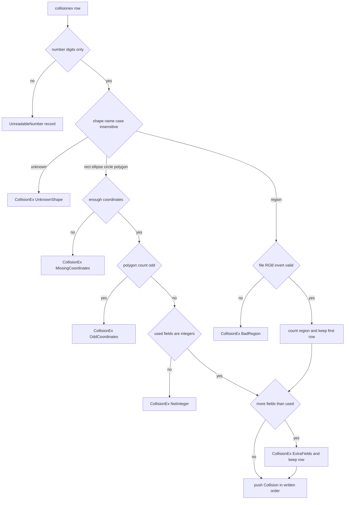

# Design Document: collisionex-regions

## Overview

**Purpose**: シェルの `surfaces.txt` に書いた不定形当たり判定 `collisionex*`（`rect`・`ellipse`・`circle`・`polygon`・`region`）を読み手が値にし、当たり判定の解決が形ごとに内外を判定する。これにより `collisionex` で書いたシェル（クローディアなど）を触ったとき、触った所の当たり判定の名前がマウスのイベントの Reference4 に載る。

**Users**: 利用者（撫で・クリック・ドラッグに部位ごとの台詞が返る）と、ゴーストの作者（書き損じた行がどれで、なぜ使われなかったかが記録に残る）。後の仕様 `hit-id-pass` は、型へ運んだ `region` の欄だけを使い、読み手に触れずに `region` の働きを足す。

**Impact**: 転記層の `Collision` を「矩形の 4 欄」から「形の列挙」へ置き換える。合成の畳み込み（`fold.rs`）は、同じサーフェスの同じ collision番号の前の行を除く今の振る舞いを改め、SSP と同じく両方を残して警告する。areka 本体（`crates/areka/`）・emo-present の判定の口・マウスのイベントの送り方は変えない。

### Goals
- `collisionex*` の 5 つの形を読み、`collision*` と書いた順に 1 つの並びへ置く（1.1〜1.9）。
- 4 つの形の内外を整数の座標で決定論に判定し、`region` は当たらずに下を続ける（2.1〜2.11）。
- 重なりの順（画家の順）・追記・入れ子の持ち込みを形を保ったまま今と同じ規則で扱い、同じ collision番号は両方を残して警告する（3.1〜3.7）。
- 読めない行・働かない `region` の行を理由つきで記録する（4.1〜4.10）。
- 台帳・§8・決定論の檻・実機で着地を確かめる（7.1〜7.5・8.1〜8.8）。

### Non-Goals
- `region` の働き（画像を読んで指定色の領域を当たり判定にする）＝`hit-id-pass`。
- `animation*.collision*`・`animation*.collisionex*`・`collision-sort` の忠実な解決・カーソルの形（`The Hand`）。
- マウスのイベントの種類・送る時・ほかの Reference。
- areka 本体のファイル（`crates/areka/src/input_events/mod.rs` の説明の 1 行は `audit-areka-input-menu` へ申し送り済み）。

## Boundary Commitments

### This Spec Owns
- 転記層の当たり判定の型 `Collision { index, shape, name }` と形の列挙 `CollisionShape`（5 つの形）・`region` の欄の型 `CollisionRegion`（`areka-parsers`）。
- `collisionex*` の行の読みと、読めない行の線引き・記録の種類（`ShellIssue::CollisionEx`・`ShellIssue::RegionInactive`・理由の列挙 `CollisionExFault`）。
- 形ごとの内外の判定と、形ごとのずらし（`areka-emo-compose` の新しい `hit_shape.rs`）。
- 当たり判定の解決 `hit_region_in` の述語の差し替え（入出力の形は変えない）。
- 同じサーフェスの同じ collision番号の扱い（両方を残す・警告する）と、当たり判定の行の重さの数え方（多角形は頂点の数）。
- 網羅台帳の 2 行（`collision*`・`collisionex*`）・`doc/COMPAT_ARCHITECTURE.md` §8 の追記と 1 行の書き直し・実機の確かめの記録。

### Out of Boundary
- `region` の画像を開く・読む・当たり判定にすること（`hit-id-pass`）。この仕様は `CollisionRegion` の欄を運ぶだけで、判定は常に「当たらない」。
- `collision-sort` の値による並び替え（今と同じく読むが並びは変えない）・`RegionPriority` の新しい規則。
- 表示の拡大率の戻し方（`hit_region_scaled_in`・`ScaleRatio`）・emo-present の `presenter/hit.rs`・areka 本体の `input_events/`（名前の文字列を受け取るだけで変えない）。
- 字句の段（`lexer.rs`）。行の原文は字句の段が捨てるので、記録の「行」は欄を `,` で繋いだもの（4.9）とし、字句の段から原文を運ぶ変更はしない。
- `crates/log-capture-kit/tests/file_length_guard_test.rs`（ウェーブ C22 の約束 ⑵）・`Cargo.lock`・emo-text（約束 ⑸）。

### Allowed Dependencies
- `areka-emo-compose` → `areka-parsers::shell` の公開型（`Collision`・`CollisionShape`・`CollisionBounds`・`CollisionRegion`）。今と同じ向き。
- 依存の向き: `model ← lexer ← decode ← parse`（parsers の中）→ `budget`・`hit_shape` ← `hit`・`hit_import`・`fold`（emo-compose の中）→ emo-present → areka 本体。逆向きの参照を作らない。`hit_shape.rs` は `std` と parsers の型だけを使い、`tracing`・`bevy_ecs`・`ScaleRatio` を使わない（純関数）。
- 依存を足さない（`std` の整数演算だけで判定する）。

### Revalidation Triggers
- `Collision` の欄・`CollisionShape` の腕・`CollisionRegion` の欄を変えたとき（`hit-id-pass` が `region` の欄と置く位置を読む契約）。
- `hit_region_in`／`hit_region_scaled_in` の入出力の形を変えたとき（emo-present と areka 本体の Reference4・カーソルの形の行）。
- `ShellIssue` の腕を足し引きしたとき（`shell_target.rs` が `severity()`／`message()` で出す）。
- 行の重さの数え方（`budget::weight`）を変えたとき（`IMPORT_BUDGET`・`VISIT_BUDGET`・`MAX_COPIED_LINES` の意味が変わる）。
- 同じ collision番号の扱い（両方を残す）を変えたとき（§8 の【上書き】の行・`fold_merge_tests.rs`）。

## Architecture

### Existing Architecture Analysis
- 読み手は 1 本の `Vec<Collision>`（書いた順）を `Surface`／`SurfaceAppend` に持ち、`decode_collisions` が本体の行を 1 回なめて作る。`collisionex` の行は `strip_prefix("collision")` の残り `ex0` が数字だけでないので、記録なしに飛んでいる。
- 合成は `fold.rs` が登場順に畳み込み、後の `surface*`ブレスの同じ collision番号の前の行を `numbers.cuts` で最後に 1 度除く。追記は重ねて足す。
- 当たり判定の解決 `hit_region_in` は列を逆順になめ、最初に当たった矩形の名前を返す（画家の順・閉区間・反転は当たらない）。`hit_region_scaled_in` は ÷k の後に委譲する。
- 子の当たり判定の持ち込み `hit_import.rs` は、子の列を element定義の X,Y だけ飽和でずらして親の列の前へ足し、親に直接書いた名前と同じ名前の子の領域を落とす。予算（`VISIT_BUDGET`・`IMPORT_BUDGET`・`HitMemo`）と畳み込みの写しの上限（`MAX_COPIED_LINES`）は、当たり判定を 1 件 1 として数える（`budget::surface_rows`・`fold::body_lines`）。
- 記録の出口は `ShellIssue` → `areka-emo-present` の `shell_target.rs` が読み込みのたびに `warn!`／`error!` で出す。新しい腕も自動で出る。

### Architecture Pattern & Boundary Map



**Architecture Integration**:
- Selected pattern: ギャップ分析の候補 C（混成）。読みは `decode.rs` に兄弟の関数を足し、形の算術（内外とずらし）だけを emo-compose の新しい `hit_shape.rs` 1 か所に置く。
- Domain/feature boundaries: 読み手は欄の検査と値への写しだけを持ち、幾何を持たない。幾何は `hit_shape.rs` だけが持ち、`hit.rs`（重なりの規則）と `hit_import.rs`（持ち込みの走査）は形を知らずに `hit_shape` を呼ぶ。
- Existing patterns preserved: 1 本の並び・逆順の `find`・`RegionPriority` の網羅 match・`ShellIssue` を積んで出口で出す流れ・element番号の二重定義の `warn!` の書き方・飽和の足し算によるずらし。
- New components rationale: `hit_shape.rs` は `hit.rs`（677 行・中に檻を持つ）に整数の算術を混ぜないため。ウェーブ C22 の表の「形の検査の新しいファイル」と一致する。
- Steering compliance: 新しい檻は兄弟ファイル・1 ファイル 1,000 行以下・依存なし・沈黙する失敗なし（読めない行は必ず 1 件記録）・1 フレーム遅らせる解なし。

### Technology Stack

| Layer | Choice / Version | Role in Feature | Notes |
|-------|------------------|-----------------|-------|
| 読み手 | `areka-parsers`（ワークスペース内・Rust 2024） | `collisionex*` の行を `Collision` にし、記録を積む | 変更は `shell/{model,decode,parse,mod}.rs` |
| 合成・判定 | `areka-emo-compose`（ワークスペース内） | 形の内外・ずらし・重なり・持ち込み・畳み込み | 新しいファイル `hit_shape.rs` |
| 記録 | `tracing`（既存） | `fold.rs` の二重定義の `warn!`・`shell_target.rs` の出口 | 新しい依存なし |
| 台帳 | `ukadoc-survey`（既存の道具） | 台帳の検査と報告の作り直し | `cargo run -p ukadoc-survey -- report`・`report-summary` |

## File Structure Plan

### Directory Structure
```
crates/areka-parsers/src/shell/
├── model.rs                       # Collision・CollisionShape・CollisionBounds・CollisionRegion・ShellIssue の 2 腕・CollisionExFault
├── decode.rs                      # collisionex の行の読み（兄弟の関数）・Reading の region の数え・記録の口
├── decode_collisionex_tests.rs    # 新: collisionex の読み・線引き・記録・region の欄の檻（1.x・4.x・5.1・5.2）
├── parse.rs                       # parse_all の最後に region の記録を 1 件まとめる
└── mod.rs                         # 新しい型の pub use
crates/areka-emo-compose/src/
├── hit_shape.rs                   # 新: 形ごとの内外 contains と、ずらし translated（純関数）
├── hit_shape_tests.rs             # 新: 形ごとの中・外・境界・反転・負の半径・交差・極値・ずらしの檻（2.1〜2.10・3.4）
├── hit.rs                         # hit_region_in の述語を hit_shape::contains へ・mod 宣言を足す
├── hit_order_tests.rs             # 新: 混ぜた並びの重なり・region の素通り・拡大率・parse からの通し（2.8・2.11・3.1〜3.3・5.3）
├── hit_import.rs                  # import を hit_shape::translated へ・数えを budget::weights へ
├── budget.rs                      # 当たり判定の行の重さ weight・weights・surface_rows の数えを重さへ
└── fold.rs                        # numbers.cuts を除く・collision番号の二重定義の warn!・body_lines を重さへ
.kiro/specs/collisionex-regions/verification/
└── real-machine.md                # 新: 実機の確かめの手順と記録（8.5〜8.7）
```

### Modified Files
- `crates/areka-parsers/src/shell/model.rs` — `Collision` の 4 欄を `shape: CollisionShape` へ置き換え、形の型 3 つと `ShellIssue` の 2 腕・`CollisionExFault` を足す（356 行 → 約 470 行）。
- `crates/areka-parsers/src/shell/decode.rs` — `decode_collisions` に `collisionex` の分岐を足し、1 行を読む兄弟の関数 `decode_collisionex_row` を置く。`Reading` に `collision_ex`・`region_read` の口と region の数えを足す。モジュールの説明と `dispatch_block` の注記から「collisionex を値にしない」を除く（680 行 → 約 820 行）。
- `crates/areka-parsers/src/shell/parse.rs` — 輪の後に `reading.finish()`（region の記録を 1 件積む）を呼ぶ。
- `crates/areka-parsers/src/shell/mod.rs` — `CollisionShape`・`CollisionBounds`・`CollisionRegion`・`CollisionExFault` を `pub use` に足す。
- `crates/areka-parsers/src/shell/{decode_charset_tests,decode_tests_append_tests,decode_tests_element_collision_tests,parse_tests}.rs` — `Collision {` の直書きを `shape: CollisionShape::Rect(..)` へ書き換える（振る舞いは変えない）。
- `crates/areka-parsers/src/shell/decode_tests_lenient_input_tests.rs`・`validation_tests.rs` — `collisionex` を「値にしない」と固定した檻（名前を最後の欄に書いた誤った書式）を、正しい書式で新しい振る舞いを固定する檻へ書き直す（8.8）。直書きと `.left` の読みも書き換える。
- `crates/areka-emo-compose/src/hit.rs` — 述語を `hit_shape::contains(&c.shape, x, y)` へ。モジュールと関数の説明の「矩形」を「形」へ。末尾に `hit_order_tests` の接続宣言。中の檻（`mod tests`）は `coll` 経由なので直さない。
- `crates/areka-emo-compose/src/hit_import.rs` — `import` のずらしを `hit_shape::translated` へ。`imported`・持ち越しの切り方・`HitMemo` の数えを `budget::weights` へ。
- `crates/areka-emo-compose/src/budget.rs` — `weight`・`weights` を足し、`surface_rows`・`rows` の説明を「行の重さ」へ。
- `crates/areka-emo-compose/src/fold.rs` — `Numbers.cuts` と最後の除きを消し、`add_lines` が波括弧（`Source::Brace`）の行を足すときだけ collision番号の二重定義の `warn!` を足す（同じブレスの中だけの重なりと追記は警告しない・FoldCollisions）。`body_lines` を重さへ。`add_lines` の説明の collision の段を書き直す。
- `crates/areka-emo-compose/src/lib.rs` — `mod hit_shape;` を足す（公開しない）。
- `crates/areka-emo-compose/src/plan_test_support.rs` — `coll` の中身を `CollisionShape::Rect` へ（呼び手は直さない）。
- `crates/areka-emo-compose/src/{fold_merge_tests,row_budget_tests}.rs` — 前の行を除くと固定した檻を両方を残す振る舞いと警告 1 行へ書き直し、`.right` の読みを書き換える。`row_budget_tests.rs` に多角形の重さの檻を足す。
- `crates/areka-emo-compose/src/hit_import_tests.rs` — 子から持ち込む楕円・円・多角形・`region` のずらしと、親の同じ名前の `region` が子を落とす檻を足す（3.4・3.5）。
- `crates/areka-emo-present/src/presenter_test_support.rs` — `hit_coll` の中身を `CollisionShape::Rect` へ。658 行の直書きは `hit_coll` を使う形へ（890 行のまま・行は増やさない）。
- `doc/ukadoc-coverage/ledger/assets.toml`・`doc/ukadoc-coverage/report/assets.md`・`doc/ukadoc-coverage/report/summary.md` — 2 行の書き直しと報告の作り直し（報告は機械で作る）。
- `doc/COMPAT_ARCHITECTURE.md` — §8 に行を足し、【上書き】の行の collision の決めを書き直す。

ウェーブ C22 の表の「触るファイル」に無いのは、parsers の `parse.rs`・`mod.rs`（記録のまとめ 1 行と `pub use`）と、emo-compose の `fold.rs`・`budget.rs`・`lib.rs` とその檻（同じ collision番号の扱い・重さの数え・`mod` 宣言）。同じウェーブのほかの 5 本は parsers と emo-compose に触らない（要件の Boundary Context の注記）。

触らないことを確かめるファイル: `crates/areka-emo-present/src/presenter/hit.rs`（名前を運ぶだけ・変更不要）・`crates/areka/` 全部・`crates/areka-parsers/src/shell/lexer.rs`。

## System Flows



- 判定の順は図のとおりで固定する（1 行に複数の理由が当てはまっても記録は 1 件・決定論）。`region` の欄は「ファイル名が空でない・R・G・B が 0〜255 の整数・領域反転の欄が無いか `true`／`false`」を 1 つの検査とし、どれかが外れたら `BadRegion`。
- `UnknownShape`〜`BadRegion` の行は並びに入れない。`ExtraFields` の行は前から求める数だけを使って並びに入れる（4.5）。
- 読めた `region` の行は並びに入れたうえで数を数え、`parse_all` の最後に 1 件の `RegionInactive` にまとめる（4.7）。

## Requirements Traceability

| Requirement | Summary | Components | Interfaces | Flows |
|-------------|---------|------------|------------|-------|
| 1.1 | `collisionex` に数字の番号が続く行を 1 件にする | CollisionExReader・ShellModel | `decode_collisionex_row` | 読みの流れ |
| 1.2 | `rect`・`ellipse` は 4 欄 | CollisionExReader・ShellModel | `CollisionBounds` | 読みの流れ |
| 1.3 | `circle` は中心と半径 | CollisionExReader・ShellModel | `CollisionShape::Circle` | 読みの流れ |
| 1.4 | `polygon` は書いた順の頂点 | CollisionExReader・ShellModel | `CollisionShape::Polygon` | 読みの流れ |
| 1.5 | `region` の欄・領域反転の既定 `false` | CollisionExReader・ShellModel | `CollisionRegion` | 読みの流れ |
| 1.6 | 名前は書いたまま | CollisionExReader | `CollisionName::new` | — |
| 1.7 | 形の名前は ASCII の大小文字を区別しない | CollisionExReader | `eq_ignore_ascii_case` | 読みの流れ |
| 1.8 | `collision*` と書いた順に 1 つの並び | CollisionExReader | `decode_collisions` の 1 回の走査 | — |
| 1.9 | `collision*` の読みを変えない | CollisionExReader | `decode_collisions` の既存の枝 | — |
| 2.1 | 矩形は閉区間 | HitShape | `contains` | — |
| 2.2 | 楕円は囲みの長方形の中かつ内接楕円の中 | HitShape | `contains` | — |
| 2.3 | 円は距離が半径以下 | HitShape | `contains` | — |
| 2.4 | 多角形は閉じた辺の中または辺の上 | HitShape | `contains` | — |
| 2.5 | 交差する多角形は巻き数の規則 | HitShape | `contains` | — |
| 2.6 | 反転した矩形・楕円は当たらない | HitShape | `contains` | — |
| 2.7 | 負の半径の円は当たらない | HitShape | `contains` | — |
| 2.8 | `region` は当たらず下を続ける | HitShape・HitResolve | `contains`・`hit_region_in` | — |
| 2.9 | 整数の点・決定論 | HitShape・HitResolve | `contains` | — |
| 2.10 | 極端な値で異常終了しない | HitShape | 検査つきの整数演算 | — |
| 2.11 | 拡大率が 1 でないときは戻してから判定 | HitResolve | `hit_region_scaled_in`（変更なし） | — |
| 3.1 | 区別なく後に書いたものが手前 | HitResolve | `hit_region_in` | — |
| 3.2 | 追記は後ろ（手前）に置く | FoldCollisions | `add_lines`（`Source::Append`） | — |
| 3.3 | 同じ番号は 1 つの並びで両方を残す | FoldCollisions・CollisionExReader | `add_lines`・`Collision.index` | — |
| 3.4 | 子の形を element定義の X,Y だけずらす | HitShape・HitImport | `translated`・`import` | — |
| 3.5 | 持ち込みの順と同じ名前の規則は今と同じ・`region` も同じ | HitImport | `names_of`（変更なし） | — |
| 3.6 | `collision-sort` で並びを変えない | HitResolve | `RegionPriority::Painter`（変更なし） | — |
| 3.7 | 同じ番号の重なりを警告（追記は対象外） | FoldCollisions | `add_lines` の `warn!` | — |
| 4.1 | 未知の形は記録して使わない | CollisionExReader・IssueRecords | `CollisionExFault::UnknownShape` | 読みの流れ |
| 4.2 | 座標が足りない | CollisionExReader・IssueRecords | `CollisionExFault::MissingCoordinates` | 読みの流れ |
| 4.3 | 整数として読めない | CollisionExReader・IssueRecords | `CollisionExFault::NotInteger` | 読みの流れ |
| 4.4 | 多角形の座標の数が奇数 | CollisionExReader・IssueRecords | `CollisionExFault::OddCoordinates` | 読みの流れ |
| 4.5 | 多すぎる欄は前から使い記録 | CollisionExReader・IssueRecords | `CollisionExFault::ExtraFields` | 読みの流れ |
| 4.6 | `region` の欄が不正 | CollisionExReader・IssueRecords | `CollisionExFault::BadRegion` | 読みの流れ |
| 4.7 | `region` は読み込みごとに 1 件 | CollisionExReader・IssueRecords | `ShellIssue::RegionInactive`・`Reading::finish` | 読みの流れ |
| 4.8 | 番号が読めない | CollisionExReader・IssueRecords | `ShellIssue::UnreadableNumber` | 読みの流れ |
| 4.9 | 見出しと欄を `,` で繋いだ行・警告の重さ | IssueRecords | `ShellIssue::message`・`severity` | — |
| 4.10 | 読めない行で止めない | CollisionExReader | `decode_collisions` の `continue` | — |
| 5.1 | `region` の欄を書いた位置に置く | CollisionExReader・ShellModel | `CollisionRegion` | — |
| 5.2 | ファイルを開かない | CollisionExReader | I/O なし（`parse` は純関数） | — |
| 5.3 | `region` を並びから除かない | HitResolve・HitImport | `hit_region_in`・`import` | — |
| 6.1 | 名前が Reference4 に載る | HitResolve（下流は変更なし） | `hit_region_in` の戻り値の形 | — |
| 6.2 | イベントの送り方を変えない | 境界（areka 本体に触らない） | — | — |
| 6.3 | カーソルの形の行は名前で同じに引く | 境界（下流は変更なし） | `ClientHit.region` | — |
| 6.4 | `collision*` だけのシェルは同じ番号のときだけ変わる | FoldCollisions・CollisionExReader | `add_lines` | — |
| 7.1 | 台帳の `collisionex*` を `degraded`・担当・説明 | LedgerAndDocs | `assets.toml` | — |
| 7.2 | 台帳の `collision*` の説明と理由 | LedgerAndDocs | `assets.toml` | — |
| 7.3 | §8 に沈黙の決めを足す | LedgerAndDocs | `COMPAT_ARCHITECTURE.md` | — |
| 7.4 | §8 の【上書き】の行を書き直す | LedgerAndDocs | `COMPAT_ARCHITECTURE.md` | — |
| 7.5 | areka 本体を書き換えない | 境界 | — | — |
| 8.1 | 形ごとの中・外・境界・反転・交差の檻 | 檻 | `hit_shape_tests.rs` | — |
| 8.2 | 混ぜた並び・追記・同じ番号・持ち込みの檻と既存の檻の書き直し | 檻 | `hit_order_tests.rs`・`hit_import_tests.rs`・`fold_merge_tests.rs`・`row_budget_tests.rs` | — |
| 8.3 | 読めない行と `region` の記録の檻 | 檻 | `decode_collisionex_tests.rs` | — |
| 8.4 | `region` の欄と素通りの檻 | 檻 | `decode_collisionex_tests.rs`・`hit_order_tests.rs` | — |
| 8.5 | 実機でクローディアの撫でとドラッグ | RealMachineCheck | `verification/real-machine.md` | — |
| 8.6 | 矩形・楕円・多角形に 1 回ずつ当てる | RealMachineCheck | `verification/real-machine.md` | — |
| 8.7 | 排他テストの机で順を取る | RealMachineCheck | `areka-impl-watch` の机 | — |
| 8.8 | 誤った書式の既存の檻を書き直す | 檻 | `decode_tests_lenient_input_tests.rs`・`validation_tests.rs` | — |

## Components and Interfaces

| Component | Domain/Layer | Intent | Req Coverage | Key Dependencies (P0/P1) | Contracts |
|-----------|--------------|--------|--------------|--------------------------|-----------|
| ShellModel | parsers / model | 形を持つ当たり判定の型と記録の型 | 1.1〜1.5・5.1 | なし | State |
| CollisionExReader | parsers / decode | `collisionex*` の 1 行を値または理由にする | 1.1〜1.9・3.3・4.1〜4.10・5.1・5.2・6.4 | ShellModel (P0) | Service |
| IssueRecords | parsers / model・parse | 理由つきの記録と region のまとめ | 4.1〜4.9 | ShellModel (P0)・shell_target の出口 (P1) | Service |
| HitShape | emo-compose / hit_shape | 形ごとの内外とずらし | 2.1〜2.10・3.4 | ShellModel (P0) | Service |
| HitResolve | emo-compose / hit | 並びの逆順で最初に当たった名前 | 2.8・2.11・3.1・3.6・5.3・6.1 | HitShape (P0) | Service |
| HitImport | emo-compose / hit_import・budget | 子の形のずらしと重さで数える予算 | 3.4・3.5・5.3 | HitShape (P0)・Budget (P0) | Service |
| FoldCollisions | emo-compose / fold・budget | 同じ番号を両方残して警告・写しの重さ | 3.2・3.3・3.7・6.4 | Budget (P1)・tracing (P1) | Service |
| LedgerAndDocs | doc | 台帳・報告・§8 | 7.1〜7.5 | ukadoc-survey (P1) | — |
| RealMachineCheck | verification | クローディアの実機の確かめ | 8.5〜8.7 | impl-watch の机 (P0)・real-run-kit (P1) | — |

### parsers / model

#### ShellModel

| Field | Detail |
|-------|--------|
| Intent | 当たり判定 1 件を「番号・形・名前」で持ち、形を 5 つの腕で表す |
| Requirements | 1.1, 1.2, 1.3, 1.4, 1.5, 5.1 |

**Responsibilities & Constraints**
- `collision*` と `collisionex*` を同じ型で持つ。由来（どちらの綴りで書いたか）は持たない（要件が区別を求めず、使い手が居ない）。
- `CollisionShape` に `#[non_exhaustive]` を付けない。5 つの形は ukadoc が閉じて定める集合で拡張の継ぎ目ではなく、別 crate の emo-compose の `match` をワイルドカードなしの網羅に保ち、腕を足したときに判定とずらしの漏れをコンパイルで見つけるため（`ShellIssue` の前例・`RegionPriority` と同じ理由）。
- `CollisionRegion` は `region` の行の欄と、画像を置く位置 `x`・`y` を持つ。構文に置く位置の欄は無く、読みでは `(0, 0)`。子のサーフェスから持ち込むと element定義の X,Y だけずれる（3.4）。`hit-id-pass` は画像の左上をこの位置に置いて読む。

**Contracts**: State [x]

##### State Management
```rust
#[derive(Clone, Debug, PartialEq)]
pub struct Collision {
    pub index: u32,             // collision*・collisionex* の * （1 つの番号の並び）
    pub shape: CollisionShape,
    pub name: CollisionName,    // 書いたまま（空も大小文字もそのまま）
}

#[derive(Clone, Debug, PartialEq)] // #[non_exhaustive] を付けない（網羅の match を保つ）
pub enum CollisionShape {
    Rect(CollisionBounds),                       // collision* と collisionex*,…,rect
    Ellipse(CollisionBounds),                    // 囲みの長方形
    Circle { x: i64, y: i64, radius: i64 },      // 中心と半径（負も運ぶ）
    Polygon(Vec<(i64, i64)>),                    // 書いた順の頂点（読みでは 3 つ以上）
    Region(CollisionRegion),
}

#[derive(Clone, Copy, Debug, PartialEq, Eq)]
pub struct CollisionBounds { pub left: i64, pub top: i64, pub right: i64, pub bottom: i64 }

#[derive(Clone, Debug, PartialEq)]
pub struct CollisionRegion {
    pub file: String,   // 書いたまま（区切りも大小文字も変えない・開かない）
    pub red: u8, pub green: u8, pub blue: u8,
    pub invert: bool,   // 領域反転（欄が無ければ false）
    pub x: i64, pub y: i64, // 画像を置く位置（読みでは 0,0・持ち込みでずれる）
}
```
- Invariants: `Polygon` の頂点の数は読み手が作る値では 3 つ以上（判定は 0〜2 でも決まった結果を返す）。`CollisionBounds` は並べ直さない（反転のまま運ぶ）。

### parsers / decode

#### CollisionExReader

| Field | Detail |
|-------|--------|
| Intent | `surface*`・`surface.append*` の本体の `collisionex*` の行を、書いた順に `Collision` へ写すか、理由つきで記録する |
| Requirements | 1.1〜1.9, 3.3, 4.1〜4.10, 5.1, 5.2, 6.4 |

**Responsibilities & Constraints**
- `decode_collisions` の 1 回の走査の中で、行の頭が `collisionex` なら新しい枝、`collision` なら今の枝を通す（`collision` の枝は `ex0` を数字でないとして今どおり飛ばすので、枝の順で取り違えない）。どちらも同じ `Vec` へ書いた順に積む（1.8）。
- 番号の読み（数字だけ・`u32` に収まる）は `collision*` と同じ。数字だけでない残り（`collisionexfoo` など）は今の `collision*` と同じく記録なしに飛ばす（要件 4.8 は番号が無い・桁あふれだけを言う）。番号が読めない行は `ShellIssue::UnreadableNumber` を積み、`text` に欄を `,` で繋いだ行を入れる（4.8・4.9）。
- 欄の位置: 0＝`collisionexN`・1＝名前・2＝形・3 以降＝座標（または `region` の欄）。名前の欄が無ければ空の名前。
- 座標は `i64` として読む（`str::parse::<i64>`・字句の段が前後の空白を除いた後）。読めない欄は `NotInteger`（`collision*` の「0 にする」とは別の規則・1.9 は変えない）。
- 判定の順と理由は「System Flows」の図のとおり。`region` の領域反転は `true`・`false` の完全一致（大小文字を区別する）。
- ファイルを開かず、記録も出さない（記録は `Reading` に積むだけ・5.2）。

**Dependencies**
- Inbound: `dispatch_block`・`decode_append_block` — 本体の行（P0）
- Outbound: ShellModel・`Reading` — 値と記録（P0）

**Contracts**: Service [x]

##### Service Interface
```rust
/// collisionex の 1 行（番号は読めた後）を値にする。Err の行は並びに入れない。
fn decode_collisionex_row(index: u32, fields: &[String])
    -> Result<(Collision, Option<CollisionExFault>), CollisionExFault>;
// Ok((c, Some(CollisionExFault::ExtraFields))) は「使ったうえで記録する」行。

impl Reading {
    fn collision_ex(&mut self, fields: &[String], fault: CollisionExFault); // CollisionEx を積む
    fn region_read(&mut self, fields: &[String]);   // region の数と最初の行（見出しと行）を控える
    pub(crate) fn finish(&mut self);                // 数が 1 以上なら RegionInactive を 1 件積む
}
```
- Preconditions: `fields` は字句の段の 1 行（前後の空白を除いた欄）。
- Postconditions: 同じ入力に同じ結果。`Err` のときも `Ok(.., Some(ExtraFields))` のときも、呼び手が記録を 1 件だけ積む。
- Invariants: パニックしない・I/O なし・`collision*` の枝の結果を変えない。

**Implementation Notes**
- Integration: `decode.rs` の頭の説明（「collisionex は値にしない」）と `dispatch_block` の注記を書き直す。`decode.rs` は約 820 行で 1,000 行を越えない。
- Validation: `decode_collisionex_tests.rs` が形ごと・大小文字・混ぜた順・理由ごとの記録と「当たり判定になるか」を固定する。
- Risks: 末尾の `,`（空の欄）も欄として数えるので、多角形の行の末尾に `,` があると奇数として使われない（OPEN QUESTION 4）。

### parsers / model・parse

#### IssueRecords

| Field | Detail |
|-------|--------|
| Intent | `collisionex` の行を使わなかった（または一部だけ使った）理由と、働かない `region` のまとめを記録の型で運ぶ |
| Requirements | 4.1〜4.9 |

**Contracts**: Service [x]

##### Service Interface
```rust
pub enum ShellIssue {
    // …既存の 6 腕…
    /// collisionex の行を使わなかった、または前から求める数だけを使った（理由つき）。
    CollisionEx { heading: String, text: String, fault: CollisionExFault },
    /// region の行を型へ運んだが、まだ当たり判定として働かない（読み込みごとに 1 件）。
    RegionInactive { heading: String, text: String, count: usize },
}

#[derive(Clone, Copy, Debug, PartialEq, Eq)] // #[non_exhaustive] を付けない（ShellIssue と同じ）
pub enum CollisionExFault {
    UnknownShape, MissingCoordinates, OddCoordinates, NotInteger, BadRegion,
    ExtraFields, // この理由だけは行を使う
}
```
- `heading` はブレスの見出しの原文（`Reading.heading`）、`text` は行の欄を `,` で繋いだもの（4.9・既存の `UnreadableNumber.text` と同じ名前。既存の腕の `line` は行の番号なので使わない）。`RegionInactive` の `heading`・`text` は最初に読めた `region` の行のもの。
- `severity()` は新しい 2 腕とも `WARN`（4.9）。`message()` は見出し・行・理由（または数）を名指し、`ExtraFields` は「前から求める数だけを使った」、ほかは「当たり判定にしない」と書く。`RegionInactive` は「{count} 行の region を型へ運んだが、まだ当たり判定として働かない」と最初の行を書く。
- `parse_all` は字句の輪の後で `reading.finish()` を呼ぶので、`RegionInactive` は記録の列の最後に 1 件だけ入る（4.7）。

### emo-compose / hit_shape

#### HitShape

| Field | Detail |
|-------|--------|
| Intent | 形 1 つと整数の点から内外を決め、形を平行にずらす。形の算術を持つ唯一の場所 |
| Requirements | 2.1〜2.10, 3.4 |

**Responsibilities & Constraints**
- 境界はどの形も含む（閉じた形）。`match` はワイルドカードなしの網羅。
- 整数だけで判定し、浮動小数を使わない（2.9）。掛け算はすべて検査つき（`checked_mul`／`checked_add`）で、溢れたら「当たらない」と決める（2.10・決まった結果）。
- 形ごとの規則:
  - `Rect`: `left <= x <= right && top <= y <= bottom`（今の矩形と同じ・反転は当たらない・2.1・2.6）。
  - `Ellipse`: まず囲みの長方形の閉区間（反転は当たらない・2.6）。中なら `w = right - left`・`h = bottom - top`・`u = |2x - left - right|`・`v = |2y - top - bottom|` を `u128` で取り、`(u·h)² + (v·w)² <= (w·h)²` で決める（2.2）。幅か高さが 0 なら左辺も右辺も 0 になり、囲みの長方形の中＝線分・1 点に当たる（決め A8）。`w`・`h` がおよそ 2^32 未満なら厳密、越えて溢れたら当たらない。
  - `Circle`: `radius < 0` は当たらない（2.7）。`|x - cx| <= radius && |y - cy| <= radius`（`i128`）を先に見て、中なら `dx² + dy² <= radius²` を `u128` で決める（2.3）。先の囲みで `dx`・`dy` は `2^63` 以下に収まるので、`i64` の全域で溢れず厳密。半径 0 は中心の 1 点（決め A8）。
  - `Polygon`: 頂点を書いた順に結び、最後から最初へ閉じる。各辺で外積 `(x2-x1)(y-y1) - (x-x1)(y2-y1)`（`i128`・検査つき）が 0 かつ点が辺の囲みの中なら辺の上＝当たる（2.4）。辺の上でなければ巻き数（上向きに横切る辺で左なら +1、下向きで右なら −1）が 0 でなければ当たる（2.5・決め A3）。頂点が重なる・一直線に並ぶ多角形は面積 0 で、辺の上だけが当たる。外積が溢れる大きさ（座標の差がおよそ 2^63 以上）は当たらない。
  - `Region`: 常に当たらない（2.8）。
- `translated` は飽和の足し算でずらす: 矩形・楕円は 4 欄、円は中心（半径はそのまま）、多角形は全部の頂点、`region` は置く位置 `x`・`y`（3.4）。

**Dependencies**
- Inbound: HitResolve・HitImport（P0）
- Outbound: なし（`std` と parsers の型だけ）

**Contracts**: Service [x]

##### Service Interface
```rust
/// 形 shape が点 (x, y) を含むか（境界を含む・region は常に false・溢れたら false）。
pub(crate) fn contains(shape: &CollisionShape, x: i64, y: i64) -> bool;
/// 形 shape を (dx, dy) だけ飽和の足し算でずらした形。
pub(crate) fn translated(shape: CollisionShape, dx: i64, dy: i64) -> CollisionShape;
```
- Preconditions: 点と形は同じ座標空間（サーフェス px）。
- Postconditions: 同じ入力に同じ結果。パニックしない（`i64::MIN`・`i64::MAX` を含む）。
- Invariants: 割り当てなし（`contains`）。`translated` は形の腕を変えない。

**Implementation Notes**
- Validation: `hit_shape_tests.rs` が形ごとの中・外・境界の上・反転・負の半径・半径 0・幅 0・五芒星（SSP の測りの点 `(100,100)`・`(100,40)`・`(100,150)` と同じ形）・頂点の重なり・`i64` の極値・ずらしを、手で求めた期待値で固定する。
- Risks: 楕円の算術の厳密な範囲は 2^32 程度で、それを越える楕円は当たらない（OPEN QUESTION 3）。

### emo-compose / hit

#### HitResolve

| Field | Detail |
|-------|--------|
| Intent | 並びを逆順になめ、最初に `contains` が真になった当たり判定の名前を返す |
| Requirements | 2.8, 2.11, 3.1, 3.6, 5.3, 6.1 |

**Contracts**: Service [x]

##### Service Interface
```rust
// 入出力の形は変えない（emo-present と areka 本体の契約）。
pub fn hit_region_in(collisions: &[Collision], x: i64, y: i64, priority: RegionPriority) -> Option<&str>;
pub fn hit_region_scaled_in<'a>(collisions: &'a [Collision], x: i64, y: i64, k: ScaleRatio, priority: RegionPriority) -> ScaledHit<'a>;
```
- 変更は `RegionPriority::Painter` の腕の述語を `hit_shape::contains(&c.shape, x, y)` に替えるだけ。`region` は述語が偽なので並びに残ったまま下を続ける（2.8・5.3）。`hit_region_scaled_in` は委譲のままなので、拡大率の戻しは形によらず同じ（2.11）。`collision-sort` は今と同じく見ない（3.6）。
- 下流（`presenter/hit.rs` → `ClientHit.region` → areka 本体の `input_events`・カーソルの形の行）は名前の文字列だけを受け取るので、`collisionex` の名前も `collision*` と同じに届く（6.1〜6.3）。

### emo-compose / hit_import・budget

#### HitImport

| Field | Detail |
|-------|--------|
| Intent | 子の当たり判定を形を保ったままずらして持ち込み、予算を当たり判定の重さで数える |
| Requirements | 3.4, 3.5, 5.3 |

**Responsibilities & Constraints**
- `import` は名前の規則（`names_of`・親に直接書いた名前と同じ子の領域を落とす）と順を変えず、ずらしだけを `hit_shape::translated` に替える（3.4・3.5）。親の同じ名前が `region` でも同じ規則を当て、特別扱いを作らない（決め 6）。`region` も並びから除かない（5.3）。
- 当たり判定の重さ `weight` を「多角形は頂点の数（最小 1）・ほかは 1」とし、行の数で数えていた所をすべて重さで数える（OPEN QUESTION 1）:
  - `budget::surface_rows`（面に入る走査の予算・`VISIT_BUDGET`）。
  - `attach_hit_regions_limited` の持ち込んだ量（`IMPORT_BUDGET`）＝`weights(list) - weights(&master.collisions)`。
  - 段を閉じるときの持ち越し（`take_up_to`）。切るときは今と同じく列の前（奥）から落とし、残りの重さの合計が持ち越せる重さ以下になるまで落とす（直接書いた領域は根では切らない）。
  - `HitMemo` に入れる重さと、覚えを使うときに引く重さ。
- 予算の値（`VISIT_BUDGET`・`IMPORT_BUDGET`・`MAX_COPIED_LINES`）は変えない。矩形・楕円・円・`region` だけのシェルでは、重さは今の件数と同じなので振る舞いは変わらない。

**Contracts**: Service [x]

##### Service Interface
```rust
// budget.rs
/// 当たり判定 1 件の重さ（多角形は頂点の数・最小 1、ほかは 1）。走査と写しの予算はこの重さで数える。
pub(crate) fn weight(c: &Collision) -> usize;
/// 列の重さの合計（飽和）。
pub(crate) fn weights(cs: &[Collision]) -> usize;
```
- Invariants: 頂点の数を重さに数えるので、持ち込み済みの列が持つ頂点の合計は `IMPORT_BUDGET` 以下になり、点 1 つの判定の仕事も同じ数で抑えられる。

### emo-compose / fold

#### FoldCollisions

| Field | Detail |
|-------|--------|
| Intent | 同じサーフェスの同じ collision番号を前の行を除かずに両方残し、element番号の二重定義と同じ書き方で警告する |
| Requirements | 3.2, 3.3, 3.7, 6.4 |

**Responsibilities & Constraints**
- `Numbers.cuts` と、畳み込みの最後に前の行を除く処理を消す。波括弧も追記も、後の行を書いた順に末尾へ足す（後に書いた方が手前・3.2・3.3）。
- 警告（3.7）: element番号の二重定義と同じ仕組みで、`add_lines` が波括弧（`Source::Brace`）の行を足すとき、その面にすでにある collision番号（前の波括弧・追記で足した番号＝`numbers.collisions`）を持つ行を数え、1 件以上なら記述子 1 つにつき（面ごとに）1 行の `warn!` を出す。欄は `surface_id`・`collision`（最初に重なった番号）・`count`（重なった行の数）、文言は「collision番号の二重定義: 前の行も残して両方を足す（SSP と同じ）」。追記（`Source::Append`）が足す行は数えず警告しない（3.7）。`records` が `Quiet` なら出さない。
- 同じ波括弧の中だけで番号が重なる行は、今と同じく両方を残し、警告しない（**仮定・OPEN QUESTION 2**）。element番号の二重定義も同じブレスの中の重なりは警告しておらず、要件 6.4 が `collision*` だけのシェルの記録を変えてよいのを「2 つ以上のブレスで書いた」ときに限るため。
- `body_lines` の当たり判定の数を重さ（`budget::weights`）へ替える（`MAX_COPIED_LINES` の写しの上限・範囲の見出しで同じ多角形を何度も写す量を抑える）。

**Contracts**: Service [x]

##### Service Interface
- `add_lines(master, later, source, records, numbers)` の形は変えない（`Numbers` から `cuts` が消えるだけ）。警告は element の警告と同じく関数の中に書く。

**Implementation Notes**
- Integration: `add_lines` の説明の collision の段を「両方を足す・波括弧の重なりだけ警告」に書き直す。`fold.rs` は 572 行から増減わずか。
- Validation: `fold_merge_tests.rs` の `later_brace_adds_same_element_number_and_drops_same_animation_number`・`append_and_second_brace_match_the_ssp_2_9_29_measurements` と `row_budget_tests.rs` の `brace_drops_earlier_same_numbered_collisions_and_keeps_written_order` を新しい振る舞い（全部が書いた順に残る・警告 1 行）へ書き直し、SSP の測りの形（`collision4` と `collisionex4`・`collision5` どうし）を固定入力で写す。`log_firing_tests.rs` の `duplicate_surface_id_merge_logs_debug_not_warn` は collision を持たないので変わらない。
- Risks: 同じ番号を書き直す前提で書いたシェル（えみり型の共有ブレスなど）では警告が増え、前の行も当たる。SSP と同じ振る舞いで、開発者の裁定（2026-11-17）による。

### doc / verification

#### LedgerAndDocs（summary-only）
- `assets.toml` の `collisionex*` の行: `status = "degraded"`・`owner = "collisionex-regions"`・`note` は「4 つの形は働く・`region` は型へ運び記録だけ（働きは `hit-id-pass`）」（7.1）。`collision*` の行: `degraded` のまま・「`collisionex` を読み飛ばす」旨を除き、理由を「重なりの順が正典（先に書いた方が上位）と逆」へ（7.2）。どちらも `implemented` にしないので証拠のコメントは要らない（決め A7）。`cargo run -p ukadoc-survey -- report` と `report-summary` で報告を作り直し、`cargo test -p ukadoc-survey` で台帳の検査を通す。
- §8（7.3）に足す行: ⑴ 楕円・円の境界（周の上を含む・囲みの長方形を先に見る・大きさ 0 の形・反転と負の半径＝決め A8） ⑵ 多角形の辺の上と交差する多角形の巻き数の規則（SSP の測り） ⑶ 形の名前の大小文字を区別しない（SSP の測り） ⑷ `collision*` と `collisionex*` は 1 つの番号の並び（SSP の測り） ⑸ 読めない行の線引き（決め A4） ⑹ `region` は型へ運び当たらない・読み込みごとに 1 件の記録（決め A6） ⑺ 算術が溢れる大きさの形は当たらない。各行に ukadoc の `collisionex*` の節の URL と逐語の引用を添える。
- §8 の【上書き】の行（7.4）: 当たり判定の段を「同じ collision番号の前の行を除かず両方を残し、`warn!`（collision番号の二重定義）を出す（SSP 2.9 の測り・`research.md` 9 節）」へ書き直し、上書きした旨と根拠を添える。判定している檻の名前も書き直した檻へ付け替える。
- areka 本体は書き換えない（7.5）。

#### RealMachineCheck（summary-only）
- 手順は完了 `areka-P0-mouse-drag-events` の `verification/real-machine.md` の雛形（ワークツリーの `target\` の下の根・`real-machine-run.ps1 -Prepare`・`RUST_LOG=info,areka=debug,…`）に倣い、`.kiro/specs/collisionex-regions/verification/real-machine.md` に手順と結果を書く。
- クローディア（`sample-ghost-kit` の `claudia`）の `surface0` で、矩形（`Head` など）・楕円（`Foot`）・多角形（`Fan`）の中の点を表示の拡大率込みで先に求め、`SendInput` で撫で（`OnMouseMove`）とドラッグ（`OnMouseDragStart`／`OnMouseDragEnd`）を起こし、areka の記録（`hit_region_client` の `debug!` の region と、イベントの Reference4）で名前が載ることを確かめる（8.5・8.6）。`circle`・`region` はクローディアに無いので決定論の檻だけ。
- 画面を使う間は排他テストの机で順を取り、終わったらすぐ返す（8.7）。クローディアの読み込みで新しい `warn!` が出ないことも、実機の記録で合わせて見る（既存の `shell_target_element_base_tests.rs` のクローディアの檻は `undrawn_count` と外形を固定するだけで、`warn!` の行数は固定していない）。

## Data Models

### Domain Model
- 当たり判定（`Collision`）は面（`SurfaceMaster`）の並びの 1 要素で、番号（`index`）・形（`shape`）・名前（`name`）を持つ。並びの位置が重なりの順（後ろほど手前）。
- 番号は `collision*` と `collisionex*` で 1 つの並び。同じ面に同じ番号が複数あってよい（両方を残す）。番号は重なりの順にも判定にも使わず、畳み込みの警告にだけ使う。
- `region` は判定では当たらないが並びに残る。置く位置は持ち込みでずれる。

### Data Contracts & Integration
- `hit-id-pass` への契約: `CollisionShape::Region(CollisionRegion { file, red, green, blue, invert, x, y })` が並びの書いた位置に在ること・`file` は書いたまま・`(x, y)` は親の面の座標での画像の左上。`hit-id-pass` は読み手に触らずに働きを足す。ただし `contains` は `std` と parsers の型だけを使う純関数で、画像（指定色の領域）を受け取る口が無い。働きを足すには判定の口の形を変える（領域の画像を渡す）か、面ごとの当たりの面を別に持つ必要があり、それは `hit-id-pass` の設計で決める。どちらもこの仕様の Revalidation Triggers（`hit_region_in` の入出力の形）に当たる。この仕様が約束するのは型（`CollisionRegion` の欄と置く位置）と並びの位置だけ。

## Error Handling

### Error Strategy
- 読み手は失敗を `Result` で返さず、行を飛ばすか前から使って `ShellIssue` を 1 件積む（4.10・沈黙しない）。出口は既存の `shell_target.rs`（読み込みのたびに `warn!`）。
- 判定は失敗しない。溢れ・反転・負の半径・`region` はどれも「当たらない」という決まった結果（2.6〜2.8・2.10）。
- 畳み込みの同じ番号は失敗ではなく、SSP と同じ振る舞いとして両方を残し `warn!`（3.7）。

### Error Categories and Responses
| 入力 | 結果 | 記録 |
|------|------|------|
| 番号が無い・桁あふれ | 行を使わない | `UnreadableNumber`（warn） |
| 形の名前が未知 | 行を使わない | `CollisionEx { UnknownShape }`（warn） |
| 座標が足りない | 行を使わない | `CollisionEx { MissingCoordinates }` |
| 多角形の座標が奇数 | 行を使わない | `CollisionEx { OddCoordinates }` |
| 使う欄が整数でない | 行を使わない | `CollisionEx { NotInteger }` |
| `region` の欄が不正 | 行を使わない | `CollisionEx { BadRegion }` |
| 欄が多い | 前から求める数だけ使う | `CollisionEx { ExtraFields }` |
| 読めた `region` | 並びに置く・当たらない | 読み込みごとに `RegionInactive` 1 件 |
| 同じ面の同じ collision番号（波括弧） | 両方を残す | 記述子ごとに `warn!` 1 行 |

### Monitoring
- 実機の確かめでは `hit_region_client` の `debug!`（k・座標・region）と、マウスのイベントの記録の Reference4 を grep する。

## Testing Strategy

### Unit Tests
- `hit_shape_tests.rs`: 4 つの形のそれぞれで中・外・境界の上の点（2.1〜2.4・8.1）、五芒星の中心（巻き数 2）と腕（巻き数 1）が当たり、凸包の中で星の外が当たらない（2.5・SSP の測りの点）、反転した矩形・楕円と負の半径が何にも当たらない（2.6・2.7）、幅 0 の楕円・半径 0 の円・頂点の重なった多角形の当たり方（決め A8）、`i64::MIN`／`i64::MAX` の座標と点でパニックせず決まった結果（2.10）、`translated` が形ごとに正しい欄をずらし飽和する（3.4）。
- `decode_collisionex_tests.rs`: 5 つの形の欄の読み（1.2〜1.5）、`Ellipse`・`RECT` が読める（1.7）、名前の空と大小文字が書いたまま（1.6）、`collision*` と `collisionex*` を交互に書いた並びが書いた順（1.8）、`surface.append*` の中の `collisionex`（1.1）。
- 同じファイルで Requirement 4 の各行について「当たり判定になるか」と「記録が 1 件か・理由・見出し・行の綴り」を固定（4.1〜4.10・8.3）。`region` の欄が型に運ばれ、領域反転の省略が `false`（1.5・5.1・8.4）、`region` を 2 行読んだシェルで `RegionInactive` が最後に 1 件・`count=2`・最初の行（4.7）。
- `decode_tests_lenient_input_tests.rs`・`validation_tests.rs`: 名前を最後の欄に書いた誤った書式の檻を、正しい書式（名前が 2 番目の欄）で「値になる」ことを固定する檻へ書き直す（8.8）。`collision*` の欠けた座標が 0 になる今の振る舞いはそのまま固定（1.9）。

### Integration Tests
- `hit_order_tests.rs`: `parse` → `EmoWorld::build` → `hit_regions` → `hit_region_in` の通しで、`collision*` の矩形の上に後から書いた `collisionex` の楕円が手前になる（とその逆）（3.1）、`surface.append*` の当たり判定が手前（3.2）、`region` が上にあっても下の名前が返る（2.8・5.3・8.4）、k が 1 でないときの `hit_region_scaled_in` が形でも同じ戻し（2.11）。
- `fold_merge_tests.rs`・`row_budget_tests.rs`: 同じ番号を 2 つのブレスと同じブレスの中に書いた並びで、全部が書いた順に残り後の方が手前・警告は後の波括弧の記述子ごとに 1 行（`collision`・`count`）・同じブレスの中だけの重なりと追記の重なりは警告しない（3.3・3.7・6.4・8.2）。SSP の測りの形（`collision4`＋後の `collisionex4`・`collision5` どうし）で両方の名前が当たる。
- `hit_import_tests.rs`: 子のサーフェスの楕円・円・多角形・`region` を element定義の X,Y だけずらして持ち込み、ずらした形の中の点で子の名前が返る・親の同じ名前（`region` を含む）が子を落とす（3.4・3.5・8.2）。
- `row_budget_tests.rs`: 頂点の多い多角形を範囲の見出しや入れ子で何度も写すと、写しと持ち込みが重さの予算で止まり、`error!` が 1 度だけ出る（重さで数えること）。

### E2E / 実機
- クローディアの撫でとドラッグで、矩形・楕円・多角形のそれぞれの名前が Reference4 に載る（8.5・8.6）。排他テストの机で順を取る（8.7）。

## Performance & Scalability
- 点 1 つの判定は並びの重さの合計に比例する（矩形・楕円・円は定数、多角形は頂点の数）。持ち込み済みの列の重さは `IMPORT_BUDGET`（2^20）以下、面に直接書いた並びはファイルの大きさで抑えられる。クローディアの `surface0` は 138 行・多角形は 5〜7 頂点なので、撫での 1 回の判定の仕事は今の矩形と同じ桁。
- 予算の値は変えない（測り直しの候補のまま）。

## Open Questions（設計の討議へ）

入力で決めきれず、仮定を置いて書いた所。答えで設計が変わるものだけを挙げる。

1. **当たり判定の重さで予算を数えるか**（HitImport・FoldCollisions）: 仮定＝多角形は頂点の数、ほかは 1 として `surface_rows`・`body_lines`・持ち込みの量・持ち越し・`HitMemo` を重さで数える。頂点の多い多角形を範囲の見出しや入れ子で何度も写すと、件数で数える今の予算では写しの量と点 1 つの判定の仕事が頂点の数だけ膨らむため。退けた案＝件数のまま（差分は最小・膨らみは残る）・頂点の数に上限を設ける（正典に上限が無い）。
2. **同じ波括弧の中だけで collision番号が重なる行を警告するか**（FoldCollisions）: 仮定＝警告しない（両方を残すのは今と同じ）。要件 3.7 の「同じサーフェスで同じ番号が重なったとき」は広く読めるが、要件 6.4 は `collision*` だけのシェルの記録を変えてよいのを 2 つ以上のブレスに書いたときに限り、element番号の二重定義も同じブレスの中は警告しない。SSP の同じブレスの中の重なりは測っていない。
3. **溢れる大きさの形の扱い**（HitShape）: 仮定＝楕円は幅と高さがおよそ 2^32 未満、多角形は座標の差がおよそ 2^63 未満で厳密に判定し、それを越えて算術が溢れたら「当たらない」。円は `i64` の全域で厳密。退けた案＝読みで座標を `i32` の範囲に限る（持ち込みのずらしで範囲を越えうる）・256 ビットの掛け算を自作する（コードが増えるわりに実のシェルに無い大きさ）。
4. **行の末尾の `,`（空の欄）**（CollisionExReader）: 仮定＝空の欄も欄として数える（要件どおり）。多角形の行の末尾に `,` があると座標の数が奇数になって使われず、矩形などは多すぎる欄として記録が 1 件出る。SSP の振る舞いは測っていない。
5. **`region` の領域反転の大小文字**（CollisionExReader）: 仮定＝`true`・`false` の完全一致（要件 4.6 の綴りどおり）。形の名前は SSP に合わせて大小文字を区別しないので、そろえるなら区別しない側。`region` は働かないので、`hit-id-pass` の段で測って決め直してもよい。
6. **由来（`collision` か `collisionex` か）を型に残さないこと**（ShellModel）: 仮定＝残さない。今の使い手は居ない（重なりは区別しない・要件 3.1）。`collision-sort` を忠実にする後の仕様が要るなら、その仕様で足す。

## Supporting References
- ukadoc [descript_shell_surfaces の collisionex*](https://ukatech.shillest.net/ukadoc-spec/descript_shell_surfaces.html#collisionex-star)・[caption_z-axis](https://ukatech.shillest.net/ukadoc-spec/descript_shell_surfaces.html#caption_z-axis)。
- SSP の測り: `research.md` 9 節・`evidence/ssp-probe-surfaces.txt`。
- 設計の決めの経緯と退けた案: `research.md` 10 節。
