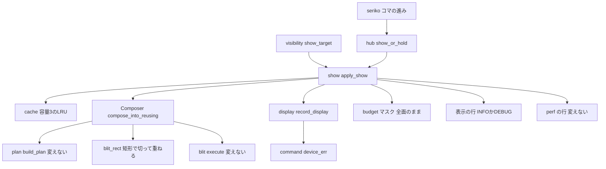
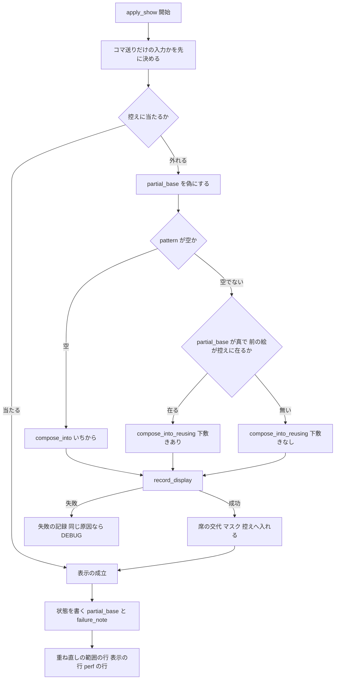

# 設計: animated-surface-log-flood

> 2026-10-30・ブランチ `claude/animated-surface-log-flood-54fed6`（main `484263230` の上）。行番号はこの時点のもの。実装の着手時に引き直すこと。
> 入力: `requirements.md`（末尾の「要件討議の決め」6 件は開発者の承認済み）・`research.md`（ギャップ分析と、本設計の段の記録）。
> 2026-10-30 追記: 開発者の決め（同日・推奨の案）で **件 26**（まばたきの閉じた絵が残る・要件 9）を足した。節「件 26: 止まったアニメーションの重ね絵が残る件（原因の決め方）」と、境界・対応表の行を足した。ほかの節の決めは変えていない。
> 2026-10-31 追記: 件 26 の原因が emo-compose の `plan.rs`（`flatten_surface` の pattern0 を静的に積む道）にあると分かり、開発者の決め（同日・案 1）で境界を `plan.rs` の 1 か所だけ広げた。節「件 26」の決めの記録と、境界・ファイルの一覧・対応表の行を直した。

## Overview

**目的**: 動く絵を持つゴースト（例: 「窓際のぱすたさん」）を areka で起こしているあいだ、コマが替わるたびに出ていた INFO の行をやめ、コマ替えのたびに面の全体を作り直していた重ね直しを、変わった範囲だけに縮める。

**使う人**: 実機の走行の記録を読んで判定をする人と、記録を数える道具（記録のあふれが消える）。動く絵を持つゴーストの利用者（何もしていないあいだの CPU が下がる）。

**変えること**: 表示の適用 `apply_show`（`crates/areka-emo-present/src/presenter/show.rs`）の終わりで、「コマ送りだけの適用」なら表示の行を DEBUG で、そうでなければ今と同じ INFO で出す。合成の側（emo-compose）に「前の絵を写し、前の命令列と今の命令列の違う所の矩形だけを全部の層ごと重ね直す」口を 1 つ足し、コマ替えの適用はこの口を通す。同じ原因の失敗が続くときの記録を 1 回にまとめる。最後に、ぱすたの実機で記録の量と CPU・記憶を直す前と同じ測り方で測り直し、SSP を面 1002 にそろえた基準と比べる。

### Goals

- 既定の水準の記録（`doc/pasta-real-run.md` の `RUST_LOG`）で、面 1002 のコマ送りだけの適用の行が 0 行になる（要件 1.1・5.1）。
- 記録を詳しく出す水準（`areka_emo_present=debug`）では、今と同じ文言・同じ項目の行が 1 適用 1 行で出続け、性能の道具の判定が変わらない（要件 2）。
- コマ替えの合成で、変わった範囲の外は前の絵をそのまま使い、画面の絵は今と画素単位で同じ（要件 3.1・3.2）。
- 何もしていないあいだの CPU の中央値が、release 版・debug 版とも直す前（2026-10-30 に同じ条件で取り直した基準: release 13.1%・debug 47.4%・`verification.md`）より下がる（要件 6.2）。

### Non-Goals

- 適用の回数とコマ替えの時刻を変えること（完了 `areka-P0-animated-image-playback` の決まりのまま・要件 1.7）。
- 当たりのマスクの作り直しと、GPU へ上げる絵の作り直しを矩形に縮めること（本設計の判断 D4）。wintf の窓の面の全面の描き直しを縮めること。
- 動く絵の読み込みとアトラスへの展開・perf の行・記録の仕組み（Boundary Context の Out of scope のとおり）。
- 合成の失敗（emo-compose の中で出す `error!`）を間引くこと（判断 D6）。

## Boundary Commitments

### This Spec Owns

- 表示の行 `apply(ShowSurface): 表示・マスクを更新` の水準の出し分け（INFO か DEBUG か）と、その判定（「コマ送りだけの適用」の述語）。
- 合成の口 `Composer::compose_into_reusing` と、その結果の型 `Recompose`（emo-compose の公開の面に足す 1 つの口）と、矩形で切って重ね直す処理（新しいファイル `blit_rect.rs`）。
- 表示の対象（target）ごとの 2 つの小さな状態: 「前の絵を下敷きにしてよいか」（`partial_base`）と「最後に記録した装置の失敗の原因」（`failure_note`）。
- 重ね直しの形を読むための DEBUG の行 `apply(ShowSurface): 重ね直しの範囲`（新しい行・要件 3.5）。
- 装置の失敗の記録を、同じ対象・同じ原因で続くあいだ 1 回にする仕組み（`device_err`・`record_display` の引数 1 つ）。
- 表示の行の水準に触れている注記・行の位置の参照（テスト・例・性能の道具・手順書・`doc/COMPAT_ARCHITECTURE.md`）の追随。
- 実機の測り（要件 5〜7）の手順と、その記録 `.kiro/specs/completed/animated-surface-log-flood/verification.md`。
- （件 26・要件 9）SERIKO のアニメーションが止まって外したコマが、表示の指令に載って emo-present の絵になるまでの道の正しさ。道は、seriko がコマを外して指令を出す所（`crates/areka-seriko/src/looper.rs` の停止の道と載せ直し `refresh`・`actor.rs` の呼び手・`commit_pattern`）と、emo-present がその指令で絵を作る所（`show.rs`・控えの引き当て・`blit_rect.rs`）。直すのは原因の 1 か所だけ。
- （件 26・2026-10-31 の開発者の決め・案 1）原因の 1 か所である emo-compose の `plan.rs` の `flatten_surface` のうち、コマの無い id の pattern0 を静的に積む道の 1 か所。`bind+random`（`Interval::BindRandom`）はコマが無いとき pattern0 を積まない、の 1 つの条件だけを足す。

### Out of Boundary

- emo-compose の `plan.rs`・`pattern.rs`・`blit.rs`・`composed.rs`・`method.rs`・`world.rs`・`plan_extent.rs` の中身（読むだけ・呼ぶだけ）。`seriko-pattern-calls` が `plan.rs`（`derive_ops`・505 行目と 535 行目のあたり）・`pattern.rs`・`method.rs`・`world.rs`・`plan_extent.rs` に触る見込みで、本 spec はそこに 1 行も触らない。ただし件 26 の直しの 1 か所（`flatten_surface` の pattern0 を静的に積む道・This Spec Owns の件 26 の 2 つ目の項）だけは例外（2026-10-31 の開発者の決め・案 1）。純 `bind` の扱い・`is_bind_interval`・`is_bind_animation`・`nesting.rs` 130 行目・抽選・コマの時刻・回数は変えない。
- 当たりのマスク（wintf の `AlphaMask`）・D2D の絵の作り方・wintf の描き直し（`render_surface`）。
- perf の行（`timing.rs` の `timing.emit`）の水準・文言・項目（`present-emit-tail-latency` の持ち物）。
- 控え（`cache.rs` の容量 3 の LRU）の形と容量。
- 記録の仕組み（`tracing` の設定・`RUST_LOG` の読み方）と、MCP の `get_log` の履歴の振り分け（`log_history.rs`。この行はもともと履歴に載っていない）。
- seriko のコマの進み（適用の回数・時刻）。件 26 の直しでも、抽選・コマの時刻・回数は変えない。直してよいのは、外したコマが指令と絵に正しく届くかどうかだけ。
- 件 26 の原因が、上の道の外（emo-compose の `plan.rs`・`pattern.rs`・`blit.rs`、wintf、シェルの定義の読み込み〔`areka-parsers`〕など）にある場合の直し。そのときは直さずに止まって報告する（要件 9.5）。2026-10-31、原因が `plan.rs` にあると分かって止まって報告し、開発者の決め（案 1）でその 1 か所だけを本 spec で直すことにした（上の項の例外）。ほかの所（`pattern.rs`・`blit.rs`・wintf・`areka-parsers` など）は今も直さない。

### Allowed Dependencies

- emo-present → emo-compose（既存の向き）: 新しい口 `Composer::compose_into_reusing` と型 `Recompose` を使う。
- emo-compose の新しいファイル → emo-compose の内部の既存の物（`plan::BlitOp`・`plan::Extent`・`blit::execute`・`ComposedSurface::bytes_mut`）と `areka_emo_atlas::AtlasTable`（既存の向き）。
- emo-present の中の既存の物（`log-capture-kit` はテストだけ）。
- 新しいクレート・新しい外部の依存は無い。逆向き（emo-compose → emo-present）は禁止。

### Revalidation Triggers

- `blit.rs` の重ね方の式（`div255`・`source_over_channel`）を変える、または `Overlay` 以外の合成の仕方を実装する: `blit_rect.rs` が同じ式を持つ。式の食い違いは同値のテストが捕まえ、`Overlay` 以外の命令がある面は自動でいちから合成へ倒れるが、新しい仕方を矩形で切って重ねたいなら `blit_rect.rs` も直す。
- `BlitOp` に位置や範囲に効く欄を足す（切り抜き・拡大など）: 矩形の求め方（置き場の矩形＝配置の位置＋切り詰めのずれ＋アトラスの矩形の幅と高さ）を見直す。`seriko-pattern-calls` の `move` が変えるのは `transform` の位置だけの見込みで、その場合は直さずに済む（命令が違えば矩形に入る）。
- `build_plan` の引数を変える: `lib.rs` の `compose_into` と `compose_into_reusing` の 2 か所の呼び出しを同じに直す。
- 合成の外形（`Extent`）がコマで変わるようになる（`seriko-pattern-calls` の `move` を命令と外形で表す形になった場合など）: 外形が前の絵と違えばいちから合成へ倒れるので正しさは保つが、その面ではコマ替えのたびに `full` になり、本 spec の効き目が消える。そうなったら、外形の替わりを下敷きの写しのずらしで扱う形を検討し直す。
- 表示の行の文言・項目・水準の決まりを変える: 性能の道具（`tools/perf/`）と手順書。
- `apply_show` の引数・`record_display`・`device_err` の引数を変える: 呼び手（`hub.rs`・`visibility.rs`・`refresh.rs`・`replace.rs`・テスト）。

## Architecture

### Existing Architecture Analysis

- 表示の適用は `EmoPresenter::apply_show` 1 本の漏斗で、引き当て（容量 3 の LRU）→ 外れたら合成（`Composer::compose_into`・面の全体）→ 表示の記録（`record_display`・全面を GPU へ上げる）→ 当たりのマスク（全面）→ 控えへ入れる → 表示の成立点で状態を書く → 表示の行（INFO）→ perf の行（DEBUG）の順に進む。失敗し得る呼び出しは控えの回収より前に集まり、失敗したら前の状態を何も動かさずに戻る。
- 合成は emo-compose の中で `plan::build_plan`（命令列 `Vec<BlitOp>` と外形）→ `blit::execute`（合成先を全部消して全命令を整数の式で重ねる）。`Composer` は命令列と祖先の走査の作業場だけを持ち、絵を持たない。
- 合成の外形は面ごとの静的な量で、コマにも着せ替えにもよらない（`plan.rs` の `Extent` の説明）。だから「同じ面」なら原寸の大きさは同じで、拡大率が同じなら物理の大きさも同じになる。
- バルーンの面も同じ漏斗を通る。外から所有される窓は、隠れているあいだのコマだけの指令を `show_or_hold` が預かり、出すときは `show_target` が漏斗を通し直してから見えるようにする。

### Architecture Pattern & Boundary Map



**Architecture Integration**:
- 選んだ形: 「前の絵を写し、前の命令列と今の命令列の違う所の矩形だけを全部の層ごと重ね直す」（要件討議の決め 4・research の案 ⒞）。どの層が動くかを種類で見分けず、命令列の比べで見分けるので、動く絵のコマ・SERIKO のコマ・着せ替えの重ね・`seriko-pattern-calls` の `move` のどれにも同じ仕組みが効く。
- 境界: emo-compose は「命令列を比べて矩形を決め、矩形の中だけ重ねる」純粋な処理を持つ。emo-present は「どの絵を下敷きにしてよいか」（控えの中の前の絵と、合成器が覚えている前の命令列が対であること）を決める。
- 守る既存の形: 1 本の漏斗・失敗し得る呼び出しを控えの回収より前に置く順・定常で新しい確保 0・容量 3 の LRU・表示の成立点でだけ状態を書く決まり。
- steering との対応: ログ無しの失敗の道を作らない（間引いた失敗も DEBUG で残す）。毎フレームの行は steering `logging.md` では `trace!` だが、性能の道具が `areka_emo_present=debug` で読むので `debug!` を取る（要件討議の決め 1・開発者の承認）。

### Technology Stack

| 層 | 選ぶもの / 版 | この機能での役 | 注記 |
|---|---|---|---|
| 合成 | `areka-emo-compose`（ワークスペース） | 矩形で切って重ね直す口 | 浮動小数を使わない整数の式のまま |
| 表示 | `areka-emo-present`（ワークスペース） | 記録の出し分け・下敷きの判定・失敗の間引き | |
| 記録 | `tracing`（ワークスペースの版） | `tracing::event!` に水準を字面で渡す | 新しい依存なし |
| テスト | `log-capture-kit`・実 GPU（`display_gpu_tests.rs` の読み戻し） | 出ていないことの主張と画素の一致 | |

## File Structure Plan

### 新しいファイル

```
crates/areka-emo-compose/src/
├── blit_rect.rs          # 前の絵を写し、命令列の違う所の矩形だけを重ね直す（Recompose・execute_reusing）
└── blit_rect_tests.rs    # 上の兄弟のテスト（同値・矩形・倒れ方・長い連なり・hot path の静的検査）
crates/areka-emo-present/src/
├── command_device_err_tests.rs               # 装置の失敗の記録が前の原因を運ぶ（タスク 3.1・要件 4.1・4.2）
├── presenter_failure_note_tests.rs           # 同じ原因の装置の失敗を間引く（タスク 3.4・要件 4.1〜4.3）
├── presenter_frame_log_tests.rs              # 記録の出し分け（要件 1.1〜1.6・2.1〜2.3・8.1・8.2）
├── presenter_partial_recompose_tests.rs      # 重ね直しの回数と形・失敗の道（要件 3.1・3.3〜3.6・4.1〜4.3・8.3・8.5）
└── presenter_partial_recompose_gpu_tests.rs  # 実 GPU で画素が同じ（要件 3.2・3.7・8.4）
.kiro/specs/completed/animated-surface-log-flood/
└── verification.md       # 実機の測りの記録（要件 5〜7）
```

`blit_rect_tests.rs` は `blit_rect.rs` の末尾の `#[cfg(test)] #[path = "blit_rect_tests.rs"] mod tests;` でつなぐ（`lib.rs` に足す行を増やさない）。emo-present の 3 本は `presenter.rs` の既存の並びに接続宣言を足す。

### Modified Files

- `crates/areka-emo-compose/src/lib.rs` — `mod blit_rect;` と `pub use blit_rect::Recompose;`、`Composer` に前の命令列の欄 `base_ops`、口 `compose_into_reusing`。詳しくは「emo-compose で触る所」。
- `crates/areka-emo-present/src/presenter/show.rs` — 「コマ送りだけの適用」の判定、`reveal` 引数、重ね直しの道の選び方、重ね直しの範囲の行、表示の行の水準の出し分け、装置の失敗の間引き、頭の注記（381〜385 行目）の書き直し。
- `crates/areka-emo-present/src/presenter/target.rs` — 欄 `partial_base: bool`・`failure_note: Option<(&'static str, i32)>`。
- `crates/areka-emo-present/src/presenter/hub.rs` — 対象を作る所（66 行目〜）で 2 欄の初期値、`apply_invalidate`（243 行目〜）で `partial_base = false`、`show_or_hold` の `apply_show` 呼び出し（197 行目）に `reveal=false`。
- `crates/areka-emo-present/src/presenter/visibility.rs` — `show_target` の `apply_show` 呼び出し（108 行目）に `reveal = !was_visible`。
- `crates/areka-emo-present/src/presenter/refresh.rs`（121 行目）・`replace.rs`（124 行目）— `apply_show` 呼び出しに `reveal=false`。
- `crates/areka-emo-present/src/command.rs` — `device_err(context, repeat)`。
- `crates/areka-emo-present/src/display.rs` — `record_display(dc, surface, repeat)`、`fault_point(at, repeat)`、テストの接続宣言 `mod gpu_tests;` を `pub(crate) mod gpu_tests;` に（新しい実 GPU のテストが読み戻しの手順を使うため・`#[cfg(test)]` のまま）。
- `crates/areka-emo-present/src/presenter/timing.rs` — 注記（35・92 行目）の「表示成立点 info!」を「表示成立点の行」へ。本体は変えない。
- `crates/areka-emo-present/src/presenter.rs` — 新しいテスト 3 本の接続宣言。
- テストの追随: `display_fault_tests.rs`・`display_gpu_tests.rs`（`record_display` の引数・`replay_and_read_back` を `pub(crate)` に。表示の記録は World の GraphicsCore の装置で作られるので、再生は同じ DC で行い、別の装置を作る `gpu_dc` は使わない）・`presenter/transition_record_tests.rs`（`record_display` の引数）・`presenter_perf_log_tests.rs`（同じ入力の 2 回目の適用の行は DEBUG）・`presenter_refresh_and_log_tests.rs`（注記）。
- 性能の道具: `tools/perf/judge-perf.py`（506 行目の注記の行の位置と水準・報告の見出しの「表示成立点 info!」を「表示成立点の行」へ。判定は変えない）・`tools/perf/judge-followup.py`（107 行目の行の位置）・`tools/perf/fixtures/generate.py` と `tools/perf/fixtures-loop/compare/measure_failed/case.txt`（注記の「info!」）。
- 例: `crates/areka/examples/{collision-probe.rs, emo-present.rs, emo-present/state.rs, emo-present/systems.rs, window-placement.rs}` — 水準に触れる注記があれば合わせる（最初の表示は INFO のままなので、多くは直しが要らない。要らないことを確かめて記録する）。
- （件 26）原因の 1 か所と、その兄弟の失敗するテスト。どのファイルになるかはテストで決める（節「件 26: 止まったアニメーションの重ね絵が残る件（原因の決め方）」）。候補は `crates/areka-seriko/src/looper.rs`・`actor.rs`・`state` の指令の保持と、emo-present の `show.rs`・`cache.rs`・新しい `blit_rect.rs`。
  - 2026-10-31 に決まった: 原因は emo-compose の `crates/areka-emo-compose/src/plan.rs`（`flatten_surface` の pattern0 を静的に積む道）。直すのはそこの 1 か所（開発者の決め・案 1）。テストは emo-compose の新しい兄弟 `plan_bind_random_tests.rs`（`plan.rs` に接続宣言を 1 つ足す）・seriko の `looper_tests.rs` に 1 本・emo-present の新しい `presenter_blink_stop_tests.rs`（`presenter.rs` に接続宣言を 1 つ足す）。
- 手順書: `doc/pasta-real-run.md`（127・141 行目の `RUST_LOG` の値はそのまま・すべての適用を見たいときの足し方の注記を足す、183 行目の表の `animated-surface-log-flood` の項、314 行目の「外して読む」の注記の書き直し）・`doc/COMPAT_ARCHITECTURE.md`（178 行目の `presenter/show.rs:194`/`:221` の行の位置）。

### emo-compose で触る所（`seriko-pattern-calls` と合わせるための一覧）

| ファイル | 触る所（2026-10-30 の行） | 何をするか |
|---|---|---|
| `crates/areka-emo-compose/src/lib.rs` | 65 行目 `pub mod blit;` の直後 | `mod blit_rect;` と `pub use blit_rect::Recompose;` の 2 行を足す |
| 同上 | 75〜110 行目 `Composer` の説明と構造体 | 欄 `base_ops: Vec<BlitOp>` を足し、「絵は持たない・前の命令列だけ持つ」を説明に足す |
| 同上 | 114〜119 行目 `Composer::new` | `base_ops: Vec::new()` を足す |
| 同上 | 160 行目（`compose_into` の閉じ）の直後 | 口 `compose_into_reusing` を足す（`build_plan` の呼び方は `compose_into` と同じ・その後 `blit_rect::execute_reusing` を呼び、命令列を `base_ops` と入れ替える） |
| `crates/areka-emo-compose/src/blit_rect.rs` | 新しいファイル | `Recompose`・`execute_reusing`・矩形の求め方・矩形で切って重ねる式 |
| `crates/areka-emo-compose/src/blit_rect_tests.rs` | 新しいファイル | 兄弟のテスト |

- 件 26（2026-10-31 の開発者の決め・案 1）で足した所: `plan.rs` の `flatten_surface` の、コマの無い id の pattern0 を静的に積む道（pattern0 を引いた直後）に、`Interval::BindRandom` なら積まずに次へ進む条件を 1 つ足す。あわせて `derive_ops` の説明に 1 文足し、末尾にテストの接続宣言を 1 つ足す。`seriko-pattern-calls` の触る見込みの 505 行目と 535 行目のあたり（pattern0 の語の引き方・`ComposeMethod::from_name`）と同じ関数の近い行なので、合わさるときは行の並びを見て確かめる。
- 触らない: `plan.rs`（件 26 の上の 1 か所のほかは `BlitOp`・`Extent`・`build_plan` を読むだけ）・`pattern.rs`・`blit.rs`（`execute` を呼ぶだけ）・`composed.rs`（`resize_and_clear`・`bytes_mut` を呼ぶだけ）・`method.rs`（`ComposeMethod::Overlay` を比べるだけ）・`world.rs`・`plan_extent.rs`・`composer_tests.rs` を含む既存のテストのファイルすべて。
- `seriko-pattern-calls` と重なりうるのは `lib.rs` だけ。向こうが新しいファイルの `mod` の行を足すなら、行の並びの違いだけで自動で合わさる見込み。向こうが `build_plan` の引数を変えるなら、`lib.rs` の 2 か所（148 行目の `compose_into` の中と、新しい口の中）を同じに直す。
- **向こうのセッションとの合わせ（2026-10-30・済み）**: この表を送り、`lib.rs` で触る行は重ならないと答えをもらった。`build_plan` の引数を変えることになったら、`lib.rs` の 2 か所は向こうが一緒に直して知らせる。`move` は窓の位置で表す案が有力で、そうなれば命令列も外形も変わらない。詳しくは `research.md` §10.6。

## System Flows



- 「コマ送りだけの入力か」（`frame_step`）は、上書きの前に適用の始めで決める: 前に成立した面の番号と着せ替えが今と同じ・前に適用した拡大率が今と同じ・この適用で窓が「見えていなかった → 見える」に替わらない、の 3 つが揃うとき真。窓が見えるようになるのは、指令で見える窓（シェル）なら「今見えていない」とき、外から所有される窓（バルーン）なら「今見えておらず、呼び手が `reveal=true` を渡した」（`show_target`）ときだけ。
- 表示の行の水準は `frame_step && !size_changed` なら DEBUG、それ以外は INFO。同じ面なら外形は同じなので、拡大率が同じなら `size_changed` は偽になるはずだが、要件 1.3 を字面どおり満たすため項を残す。
- 重ね直しの範囲の行は、控えに外れた適用だけ、表示の行の直前に 1 行出す。表示の行と perf の行のあいだには何も挟まない（要件 2.3）。
- `partial_base` は「合成器が覚えている前の命令列（`base_ops`）が、控えの中の前に成立した面（`last_show` の鍵の絵）を作った命令列である」ことを表す。表示の成立点でだけ真にでき、その条件は「この適用が控えに外れ、`compose_into_reusing` で合成した」。外れたときは合成の前に偽にするので、合成の後で失敗して戻った適用のあとは必ずいちから合成に戻る（要件 4.2）。

## Requirements Traceability

| 要件 | 要約 | 部品 | 口・状態 | 流れ |
|---|---|---|---|---|
| 1.1 | コマ送りだけの適用は既定の水準で出さない | 表示の適用 | `frame_step`・水準の出し分け | 判定→表示の行 |
| 1.2 | 面・着せ替え・拡大率の替わりは INFO | 表示の適用 | `frame_step` の 3 条件 | 同上 |
| 1.3 | `size_changed=true` は INFO | 表示の適用 | `!size_changed` の項 | 同上 |
| 1.4 | 付けた後・付け直した後の最初は INFO | 表示の適用 | `last_show` が空なら `frame_step` は偽（付け直しは新しい対象） | 同上 |
| 1.5 | 隠した後の出し直しは INFO | 表示の適用・`show_target` | `reveal`・`visible` の前の値 | 同上 |
| 1.6 | 失敗は今と同じ水準と文言 | 表示の適用・装置の失敗の記録 | 最初の失敗は今と同じ `error!`。同じ原因の続きだけ DEBUG（要件 4.3） | 失敗の記録 |
| 1.7 | 回数と時刻を変えない | 表示の適用 | 漏斗の入口と回数に触れない | — |
| 2.1 | 詳しく出す水準ではすべての適用に 1 行 | 表示の適用 | DEBUG と INFO のどちらかで必ず 1 行 | 表示の行 |
| 2.2 | 文言と項目を変えない | 表示の適用 | 欄の並びを局所のマクロ 1 か所に置く | — |
| 2.3 | 表示の行と perf の行が隣り合う | 表示の適用 | 新しい行は表示の行の前 | 表示の行→perf の行 |
| 2.4 | 道具を見本で回して判定が同じ | 性能の道具 | 判定の式は変えない・`--selftest` を回す | — |
| 2.5 | 表示が済んだ印の時点が同じ | 表示の適用 | 最初の表示は INFO のまま | — |
| 2.6 | 注記と行の位置を実物に合わせる | 注記の追随 | File Structure Plan の一覧 | — |
| 3.1 | 変わった範囲だけ重ね直す | `blit_rect`・`compose_into_reusing`・表示の適用 | `Recompose::Partial` | 外れ→下敷きあり |
| 3.2 | 画面の絵は画素単位で同じ | `blit_rect` | 矩形の求め方の正しさ・同じ式 | — |
| 3.3 | 動く層が複数・あいだに変わらない層 | `blit_rect` | 命令列の比べ（種類で見分けない） | — |
| 3.4 | 動いていない面は変えない | 表示の適用 | `pattern` が空なら今の `compose_into` のまま | 空→いちから |
| 3.5 | いちからか使い回しかを読める | 表示の適用 | 重ね直しの範囲の行・`cache_hit` | 範囲の行 |
| 3.6 | 記憶に上限 | `Composer`・表示の対象 | 絵の追加 0・前の命令列 1 本 | — |
| 3.7 | 当たり・クリックの透過・窓は同じ | 表示の適用 | マスクは同じ原寸の絵から全面で作る | — |
| 4.1 | 失敗しても前の表示を保つ | 表示の適用・`blit_rect` | 書くのは合成先の席だけ・下敷きは読むだけ | 失敗→戻る |
| 4.2 | 落ちずに次で戻れる | 表示の適用 | `partial_base` を合成の前に偽 | 同上 |
| 4.3 | 同じ原因の失敗を積まない | 装置の失敗の記録 | `failure_note`・`device_err` の `repeat` | 失敗の記録 |
| 5.1 | 実機で面 1002 の行が 0 | 実機の測り | 手順書の起動の塊 | — |
| 5.2 | 行の数と適用の数の突き合わせ | 実機の測り | 詳しい水準の走行で INFO の行を数える | — |
| 5.3 | 適用の回数が毎秒およそ 14 回のまま | 実機の測り | 詳しい水準の走行 | — |
| 6.1 | 6 分置いて CPU・記憶ほかを記録 | 実機の測り | 件 25 と同じ測り方 | — |
| 6.2 | 中央値が直す前より下 | 実機の測り | 合格の線 | — |
| 6.3 | SSP を上回れば差と理由を書いて仰ぐ | 実機の測り | 段別の所要を添える | — |
| 6.4 | 面 1002 が出ていたことを記録で確かめる | 実機の測り | 最後の表示の行と面の替わりの行 | — |
| 6.5 | 記憶が増え続けない | 実機の測り | WorkingSet の並び | — |
| 6.6 | 測りの条件を残す・静かな机 | 実機の測り | impl-watch の机 | — |
| 6.7 | 置き場は `target\` の下だけ | 実機の測り | `target\animated-surface-log-flood\` | — |
| 7.1 | SSP を面 1002 にそろえて測る | 実機の測り | 同じ測り方 | — |
| 7.2 | SSP の面を MCP で始めと終わりに確かめる | 実機の測り | SSP の MCP | — |
| 7.3 | SSP の操作の前に毎回許しを取る | 実機の測り | タスクの止まり所 | — |
| 7.4 | 測れなければ理由と条件の違いを書く | 実機の測り | `verification.md` | — |
| 8.1 | 記録の出し分けの決定論テスト | テスト | `presenter_frame_log_tests.rs` | — |
| 8.2 | 「出ていない」に対照の行 | テスト | 同じ捕捉の中の DEBUG の行と INFO の行 | — |
| 8.3 | 回数を数えるテスト | テスト | `presenter_partial_recompose_tests.rs`・`blit_rect_tests.rs` | — |
| 8.4 | 実 GPU で画素が同じ | テスト | `presenter_partial_recompose_gpu_tests.rs` | — |
| 8.5 | 失敗を注入するテスト | テスト | `arm_display_fault`・GraphicsCore を抜く | — |
| 8.6 | 手順書を書き直す | 注記の追随 | `doc/pasta-real-run.md` | — |
| 8.7 | 範囲外の問題は起票 | 実装の進め方 | `/kiro-discovery` | — |
| 9.1 | 外したコマを画面に出さない | 件 26 の原因の 1 か所（emo-compose の `plan.rs`・`flatten_surface` の pattern0 を静的に積む道） | 原因の決め方の節 | 停止→指令→表示の適用→合成の命令列 |
| 9.2 | アニメーションのコマを時刻のとおりに出す | 同上 | 同上 | 同上 |
| 9.3 | 直す前に失敗するテストで再現 | テスト | seriko と emo-present の境目の決定論テスト | — |
| 9.4 | 原因を 1 か所で直し、回数・時刻・画素の同じさを変えない | 件 26 の原因の 1 か所（`plan.rs`） | 既存の檻が緑のまま | — |
| 9.5 | 原因が境界の外なら止まって報告 | 実装の進め方 | Out of Boundary の件 26 の項 | — |
| 9.6 | 実機 6 分で目が開くことを両版で確かめる | 実機の測り | `dump_surface` を何度か撮る・`verification.md` | — |

## Components and Interfaces

| 部品 | 層 | 役 | 要件 | 主な依存 | 契約 |
|---|---|---|---|---|---|
| 矩形の重ね直し（`blit_rect.rs`） | emo-compose | 命令列の違いから矩形を決め、前の絵を写して矩形だけ重ねる | 3.1〜3.3・4.1 | `plan::BlitOp`（P0）・`blit::execute`（P0）・`AtlasTable`（P0） | Service |
| 合成の口（`Composer::compose_into_reusing`） | emo-compose | 命令列を作り、上を呼び、前の命令列を覚える | 3.1・3.6 | `build_plan`（P0） | Service・State |
| 表示の適用（`apply_show`） | emo-present | 判定・道の選び方・記録の出し分け・状態 | 1.1〜1.7・2.1〜2.5・3.4〜3.7・4.1〜4.3 | 上の口（P0）・`record_display`（P0） | Service・State |
| 装置の失敗の記録（`device_err`・`record_display`） | emo-present | 同じ原因の続きを DEBUG にする | 1.6・4.3 | `tracing`（P2） | Service |
| 注記の追随 | 道具・手順書 | 実物と合わせる | 2.4・2.6・8.6 | — | — |
| 実機の測り | 手順 | 記録の量・CPU・記憶・SSP の基準 | 5.1〜7.4 | 手順書・impl-watch の机・SSP の MCP | Batch |
| 件 26 の原因の 1 か所 | emo-compose の `plan.rs`（テストで決まった・2026-10-31 の開発者の決め・案 1 で境界を広げた） | `bind+random` のアニメーションは、コマが無いとき pattern0 を静的に積まない | 9.1〜9.6 | seriko の停止の道・表示の適用・合成の命令列 | — |

### emo-compose

#### 矩形の重ね直し（`blit_rect.rs`）

| 欄 | 中身 |
|---|---|
| 役 | 前の絵と前の命令列を下敷きに、命令列の違う所の矩形だけを全部の命令で重ね直す |
| 要件 | 3.1・3.2・3.3・4.1 |

**責務と制約**
- 入力の前の絵（下敷き）は読むだけで、書くのは合成先 `out` だけ（要件 4.1）。
- 浮動小数を使わない。重ね方の式は `blit.rs` と同じ（`div255(v)=(v+127)/255` の SourceOver）を、このファイルの中に私的な関数として持つ（`blit.rs` を変えないため）。同じであることはテストで縛る。
- 確保をしない（`out` の容量を使い回す・矩形の計算は値だけ）。

**矩形の求め方（正しさの根拠）**
1. 前の命令列 `B` と今の命令列 `C` で、先頭から同じ命令が続く長さ `p` と、末尾から同じ命令が続く長さ `s` を求める（`p + s` は短いほうの長さを超えない）。命令の「同じ」は `BlitOp` の `==`（`element`・`transform`・`method`）。
2. 残り `B[p..len(B)-s]` と `C[p..len(C)-s]` のすべての命令の置き場の矩形の和を取り、合成の絵の範囲 `[0,w)×[0,h)` で切る。置き場の矩形は `blit.rs` と同じ求め方＝左上が `transform.offset() + placement.trim_offset`、幅と高さが `placement.uv_rect` の `w`・`h`。`placement` が無い命令は空の矩形。
3. 矩形の外の画素では、その画素に重なる命令の並びが `B` と `C` で同じになる（先頭と末尾の同じ並びは同じ命令で、残りの命令は矩形の外に重ならない）。合成は画素ごとに独立した計算なので、矩形の外の画素は前の絵と同じ値になる。矩形の中は消してから `C` の全命令を順に重ねるので、いちから合成した値と同じになる。前の絵がいちから合成した絵と同じなら（いちから合成したか、同じ理屈で作った絵）、今の絵もいちから合成した絵と同じになる（要件 3.2）。
4. 動く層が複数でも、あいだに変わらない層を挟んでも、上に変わらない層が乗っていても、命令列の比べで同じに扱える（要件 3.3）。前のコマの位置と今のコマの位置の両方が矩形に入る（要件 3.1 の括弧書き）。コマごとに切り詰めのずれが違っても、置き場の矩形に入る。

**いちから合成へ倒れる条件**（どれか 1 つで `blit::execute` を呼び `Recompose::Full`）
- 下敷きが無い。
- 下敷きの絵の幅・高さが今の外形と違う。
- `B` か `C` に `method` が `ComposeMethod::Overlay` でない命令が 1 つでもある（今は `Overlay` 以外は実装されておらず `blit.rs` で読み飛ばされるが、将来の実装で式が食い違わないよう、矩形の道に入れない）。

**Contracts**: Service [x]

##### Service Interface

```rust
/// 合成の仕方の報告（重ね直しの範囲の行が読む）。
#[derive(Debug, Clone, Copy, PartialEq, Eq)]
pub enum Recompose {
    /// いちから合成した（合成先を全部消して全命令を重ねた）。
    Full,
    /// 下敷きを写し、この矩形の中だけを全命令で重ね直した。
    /// 幅か高さが 0 なら、命令列が前と同じで写しただけ。
    Partial { x: u32, y: u32, w: u32, h: u32 },
}

/// 命令列 `ops` を `out` へ重ねる。下敷き `base`（前の絵と、それを作った命令列）が
/// 使えるなら矩形だけ、使えなければいちから。
pub(crate) fn execute_reusing(
    out: &mut ComposedSurface,
    extent: Extent,
    ops: &[BlitOp],
    base: Option<(&ComposedSurface, &[BlitOp])>,
    atlas: &AtlasTable,
) -> Recompose;
```
- 事前条件: `base` の絵は `base` の命令列をこの `atlas` で重ねた絵である（呼び手の責任）。
- 事後条件: `out` の外形は `extent`、中身は `blit::execute(out, extent, ops, atlas)` と画素単位で同じ。`base` の絵は変わらない。
- 下敷きを使う道は、`out` を `resize_and_clear` で外形に合わせてから下敷きの全画素を写し、矩形の行を消し、全命令を矩形で切って重ねる。

#### 合成の口（`Composer::compose_into_reusing`・`lib.rs`）

| 欄 | 中身 |
|---|---|
| 役 | 命令列を作り、矩形の重ね直しを呼び、前の命令列を覚える |
| 要件 | 3.1・3.6 |

**Contracts**: Service [x] / State [x]

##### Service Interface

```rust
impl Composer {
    /// 下敷き形（コマ替えの経路）。`base` は、この合成器が直前に
    /// `compose_into_reusing` で成功させた合成の絵でなければならない。
    #[allow(clippy::too_many_arguments)]
    pub fn compose_into_reusing(
        &mut self,
        out: &mut ComposedSurface,
        base: Option<&ComposedSurface>,
        world: &EmoWorld,
        atlas: &AtlasTable,
        surface_id: u32,
        active_binds: &BindSet,
        pattern: &PatternState,
    ) -> Result<Recompose, ComposeError>;
}
```
- 手順: `build_plan` を `compose_into` と同じ引数で呼ぶ（`Err` はそのまま返し、`base_ops` は変えない）→ `execute_reusing(out, extent, &self.ops, base.map(|b| (b, self.base_ops.as_slice())), atlas)` → `std::mem::swap(&mut self.ops, &mut self.base_ops)`（確保なしで今の命令列を前の命令列にする）→ `Ok(recompose)`。
- 既存の `compose_into`・`compose` は変えない。`base_ops` を読みも書きもしない。

##### State Management
- 状態: `base_ops: Vec<BlitOp>`＝最後に `compose_into_reusing` が成功させた合成の命令列。絵は持たない（「合成器は合成の結果を持たない」の決まりは、絵について保つ）。
- 記憶の上限（要件 3.6）: 増えるのは対象ごとに命令列 1 本分（ぱすたの面 1002 で 7 件ほど・1 件 60 バイトほど）だけで、絵の追加は 0。命令列の長さは出した面の命令の数の最大で頭打ちになり、増え続けない。上限を超える場合は無い（控えの容量 3 の LRU も変えない）。

### emo-present

#### 表示の適用（`apply_show`・`show.rs`）

| 欄 | 中身 |
|---|---|
| 役 | 判定・道の選び方・記録の出し分け・状態の更新 |
| 要件 | 1.1〜1.7・2.1〜2.3・2.5・3.1・3.4〜3.7・4.1〜4.3 |

**責務と制約**
- 引数に `reveal: bool`（「呼び手がこの適用の後に窓を見えるようにする」）を足す。`show_target` は `!was_visible` を、ほかの呼び手（`show_or_hold`・`refresh_scale`・差し替え）は `false` を渡す。引数が 8 つになるので `#[allow(clippy::too_many_arguments)]` を付ける。
- 適用の始め（拡大率を求めた直後・どの状態も上書きする前）に `frame_step` を決める（System Flows の 3 条件）。
- 控えに外れたとき:
  1. `target.partial_base = false`。
  2. `pattern.is_empty()` なら今の `compose_into` をそのまま呼び、`Recompose::Full` とみなす（要件 3.4: 動いていない面は合成の回数・重さ・記憶・見た目とも今のまま）。
  3. 空でなければ、下敷きを `partial_base` が真で、`last_show` の鍵の絵が控えに在る（`cache.get`・順序を動かさない）ときだけ渡して `compose_into_reusing` を呼ぶ。
- 表示の成立点で `target.partial_base = !cache_hit && (pattern が空でなかった)`、`target.failure_note = None` を書く。
- 控えに外れた適用だけ、表示の行の直前に重ね直しの範囲の行を出す。
- 表示の行は局所の `macro_rules!` 1 つに欄の並びを置き、`tracing::event!(tracing::Level::DEBUG, …)` と `tracing::event!(tracing::Level::INFO, …)` の 2 つの呼び出しへ展開する（水準は字面で渡す決まりのため・欄の並びは 1 か所）。
- 頭の注記（381〜385 行目の「`info!` レベルであることが契約」）を「最初の表示と状態の替わりは INFO、コマ送りだけは DEBUG」へ書き直す。

**Contracts**: Service [x] / State [x]

##### Service Interface

```rust
impl EmoPresenter {
    #[allow(clippy::too_many_arguments)]
    pub(super) fn apply_show(
        &mut self,
        world: &mut World,
        target_id: TargetId,
        surface_id: u32,
        binds: BindSet,
        pattern: PatternState,
        reply: Option<ReplySender<PresentOutcome>>,
        reveal: bool,
    );
}
```
- 事後条件（成功）: 表示の行がちょうど 1 行（INFO か DEBUG）、その直後に perf の行がちょうど 1 行。控えに外れた適用では、その前に重ね直しの範囲の行がちょうど 1 行。
- 事後条件（失敗）: 表示・控え・マスク・可視・`applied`・`native_size`・`last_show`・`pending_resize` は前のまま（今と同じ）。`partial_base` は偽。

##### 新しい行（要件 3.5）

| 項目 | 中身 |
|---|---|
| 文言 | `apply(ShowSurface): 重ね直しの範囲` |
| 水準 | DEBUG（target は `areka_emo_present::presenter::show`） |
| 出る時 | 控えに外れて表示が成立した適用ごとに 1 行（表示の行の直前） |
| 欄 | `target_id`・`surface_id`・`recompose`（`"full"` か `"partial"`）・`rect_x`・`rect_y`・`rect_w`・`rect_h`（`full` のときは `0,0,原寸の幅,原寸の高さ`） |

- 読み分け: `cache_hit=true` の表示の行＝控えの絵を使い回した。`cache_hit=false` の表示の行＋この行の `recompose="full"`＝いちから合成した。`recompose="partial"`＝前の絵を写し、矩形だけ重ね直した。`cache_hit` の意味は変えない（控えに当たったか）。
- 表示の行に欄を足さないのは、表示の行の欄の集合を固定する既存のテスト（`presenter_perf_log_tests.rs` の `assert_info_line_contract`）と要件 2.2 を守るため。

##### State Management（`target.rs` の新しい欄）

| 欄 | 型 | 意味 | 書く所 |
|---|---|---|---|
| `partial_base` | `bool` | 合成器の `base_ops` が、控えの中の `last_show` の鍵の絵を作った命令列である | 対象を作るとき偽・控えに外れたら合成の前に偽・表示の成立点で `!cache_hit && !pattern.is_empty()`・`apply_invalidate` で偽 |
| `failure_note` | `Option<(&'static str, i32)>` | 最後に記録した装置の失敗の原因（`context`・`hresult`）。成立をはさまずに同じ原因が続くあいだだけ値を持つ | 対象を作るとき空・装置の失敗で `Some`・表示の成立点と装置以外の失敗（合成の失敗・全透明の縮退）で空 |

#### 装置の失敗の記録（`command.rs`・`display.rs`）

| 欄 | 中身 |
|---|---|
| 役 | 同じ対象・同じ原因の装置の失敗が、成立をはさまずに続くあいだ、2 回目からを DEBUG にする |
| 要件 | 1.6・4.3 |

```rust
pub(crate) fn device_err(
    context: &'static str,
    repeat: Option<(&'static str, i32)>,
) -> impl FnOnce(windows::core::Error) -> PresentError;

pub(crate) fn record_display(
    dc: &ID2D1DeviceContext,
    surface: &ComposedSurface,
    repeat: Option<(&'static str, i32)>,
) -> Result<GraphicsCommandList, PresentError>;
```
- `device_err` は `repeat == Some((context, hresult))` なら同じ文言 `D3D/DXGI 呼び出しが失敗`・同じ欄（`hresult`・`context`）で `debug!`、それ以外は今と同じ `error!`。target は今と同じ `areka_emo_present::command`。
- `apply_show` は `record_display` に `target.failure_note` を渡し、`Err(PresentError::Device { hresult, context })` なら `failure_note = Some((context, hresult))`。
- `GraphicsCore` が無い道（`show.rs` の `error!`）も同じ形で間引く。原因は `("GraphicsCore resource", 0)`（今の `PresentError::Device` の値と同じ）。文言と欄は今のまま、2 回目からを `debug!`。
- 「続くあいだは 1 回」の単位は、要件 4.3 の括弧書きのとおり「同じ窓（対象）・同じ原因・成立をはさまない」。コマの指令は面の番号が替わった直後も毎コマ届くので、コマ送りだけの適用に限らず、この単位で間引く。最初の 1 回は今と同じ水準と文言で出し、2 回目からも DEBUG で残すので、記録の無い失敗の道は作らない（要件 1.6）。
- テストの注入点 `fault_point(at, repeat)` も同じ `device_err` を通す。

**Implementation Notes**
- 統合: `record_display` の呼び手は `show.rs` と 4 本のテスト（`display_fault_tests.rs`・`display_gpu_tests.rs`・`presenter/transition_record_tests.rs` ほか）だけ。テストは `None` を渡す。
- 確かめ: `display_fault_tests.rs` の既存の主張（target `areka_emo_present::command`・ERROR・文言）はそのまま通る。

### 注記の追随（要件 2.4・2.6・8.6）

- 性能の道具は文言で行を拾い、水準を見ない（`judge-perf.py:507`・`judge-followup.py:115`・`perf-rank.py:118`・`invoke-followup-checks.ps1:137`）。判定の式は変えない。見出しと注記の「info!」だけ直し、`judge-perf.py --selftest` と `judge-followup` の見本（`fixtures-loop/followup/*/expected_stdout.txt`）で判定が前と同じことを確かめる。`expected_stdout.txt` は「表示成立点」とだけ書いていて「info!」を含まないので変わらない。
- 手順書 `doc/pasta-real-run.md`: `RUST_LOG` の値（127・141 行目）は変えない（`areka_emo_present` を含まないので、コマ送りだけの行は出ない）。表に「すべての適用を見たいときは `areka_emo_present=debug` を足す」を足す。314 行目の「外して読む」の注記を、「コマ送りだけの適用は既定の水準では出ない・出るのは最初の表示と状態の替わりと隠した後の出し直しだけ」へ書き直す。183 行目の表の `animated-surface-log-flood` の項を着地した結果の確かめへ直す。
- 実装の後に、文言 `apply(ShowSurface)` と「表示成立点 info」と `show.rs:` を、`.kiro/specs/completed` と `target` を除いて grep し、食い違いが 0 件であることを `verification.md` に書く。

### 実機の測り（要件 5〜7）

**Contracts**: Batch [x]

- 置き場: ワークツリーの `target\animated-surface-log-flood\` の下だけ（`flood\`・`quiet-debug\`・`quiet-release\`・`ssp\`）。結果は `.kiro/specs/completed/animated-surface-log-flood/verification.md`。
- 机: 測りの前に impl-watch の排他テストの机を取り、ほかのセッションの重い仕事と重ならないことを `tools/perf/check-quiet.ps1` で確かめ、持っていた机・機械ぜんたいの CPU の中央値・版・コミットを書く（要件 6.6）。
- **記録の量（要件 5.1〜5.3）**: 手順書の起動の塊と `RUST_LOG` の値のまま、件 21 と同じ段を通す走行を 1 回（`flood\run-info`）。数えるのは、面 1002 の表示の行（0 行のはず）・表示の行の全部・記録の全部の行数で、直す前（6,546 行のうち 6,073 行）と並べる。同じ段を `RUST_LOG` に `areka_emo_present=debug` を足して 1 回（`flood\run-debug`）。こちらで、面 1002 の表示の行が毎秒およそ 14 本であること（要件 5.3）と、INFO の表示の行それぞれが「対象の最初・面の番号の替わり・`k` の替わり・`size_changed=true`・直前に同じ対象の `apply(Hide)` の行か `show_target: 可視化した` の行がある」のどれかに当たり、当たらない行が着せ替えの替わりで説明できることを、小さな PowerShell で数えて確かめる（要件 5.2）。
- **何もしていないあいだ（要件 6）**: 件 25 と同じ測り方（完了 `areka-P0-pasta-in-windows-verification` の `verification.md` 6 節: `AREKA_APP_SMOKE_EXIT_MS=360000`・5 秒ごとに WorkingSet・`Responding`・5 秒あたりの CPU 秒・機械ぜんたいの CPU を `health.csv` へ・最初の 60 秒を除く）で、debug 版と release 版を 1 回ずつ。`RUST_LOG` は件 25 と同じ既定の値。面 1002 が出ていたこと（要件 6.4）は、シェルの対象の INFO の表示の行のうち、測りの窓の前の最後の行が `surface_id=1002` で、窓の中に別の面の INFO の表示の行が無いことで確かめる（コマ送りだけの行は既定の水準では出ないので、面の替わりは必ず INFO の行に出る）。
- **作る前の測り（設計討議の決め 1・2026-10-30）**: 実装のタスクの最初に、コードを変えずに、ぱすたの面 1002 を `RUST_LOG` に `areka_emo_present=debug` を足して短く走らせる（release 版と debug 版）。perf の行の `t_compose_us`・`t_mask_us`・`t_upload_us`・`t_total_us` の中央値と、`t_total_us` に対する合成の割合を `verification.md` に書く。合成の割合が小さく、合成を縮めても要件 6.2（両版とも直す前より下がる）に届く見込みが無ければ、実装に入る前に段ごとの所要を添えて止まり、開発者に仰ぐ（マスクと GPU の上げを矩形にする・wintf に触る、を決め直す）。届く見込みがあれば実装へ進む。前の絵の「消してから写す」二度なめは、今ある `ComposedSurface` の口だけで写すだけに縮められるかを実装で確かめる（`composed.rs` は境界の外なので、足りなければ二度なめのまま）。
- **合格の線（要件 6.2・6.3）**: 両版とも中央値が直す前より下なら合格。release 版の中央値が SSP の基準の中央値を上回ったら、差と、`areka_emo_present=debug` を足した短い走行で取った perf の行の段別の所要（合成・表示の記録・マスク）と、wintf の全面の描き直しが残ることを書いて、開発者の判断を仰ぐ（黙って合格にしない）。
- **SSP の基準（要件 7）**: SSP を起こす・面を替える・測る、のそれぞれの前にタスクの中で止まって開発者の許しを取る。SSP 2.9.23 のぱすたを面 1002 にし、areka と同じ測り方で 6 分。測りの始めと終わりに SSP の MCP（`dump_surface` か `get_property`）で面 1002 を確かめて書く。測れなかったら、理由と、件 25 の 10% の条件の違い（面を確かめていない）を書く。

### 件 26: 止まったアニメーションの重ね絵が残る件（原因の決め方）

> 2026-10-30 に開発者の決めで足した節（要件 9）。原因はまだ確かめていない。この節は、原因をどこでどう決めるかを決める。直しの形は原因が決まってから選ぶ。

**分かっていること**（`brief.md` の件 26 の節。main `484263230`・2026-10-30 に引き直した行）
- ぱすたさん（面 1000）が、まばたきの閉じた絵（1410）のまま戻らない。ボールの動く WebP は動き続けている。着せ替え（目＝ノーマル・まばたき＝ふつう）は正しく効いている。
- seriko の判定は対になっている: 「`seriko: loop 抽選発火`」と約 170ms 後の「`seriko: loop 停止（負 surface でベース復帰・要件 4.3）`」が 70 回ずつ。停止の道は `looper.rs` 293〜321 行で、コマを外し（310 行）、再生の記録を外す（311〜313 行）。
- 載せ直しの `LoopRuntime::refresh` は `looper.rs` 757 行。保持している指令の写し（`states.current_pattern`）から作り直し、`commit_pattern` が変化を返したら `Show` を出す。呼び手は `actor.rs` 494・688・755・806 行（688 行は着せ替えが替わった直後の道）。

**見立て（未確定）**: 停止で外した重ね絵が、ボールのコマ替えの載せ直しで古い状態のまま使われる。候補は 3 つ。
1. seriko の側: 停止の道で外したコマが、保持している指令（`current_pattern`）に届かず、載せ直しやコマ替えの指令が古い写しから作られる。
2. 表示の側の控え: 外したコマのある指令と無い指令が、控えの引き当てで同じ絵に当たる。
3. 本 spec の重ね直し（`blit_rect.rs`）: 外したコマの位置が矩形に入らず、前の絵の閉じた目が残る。ただし症状は本 spec の前の main で出ているので、1 か 2 が先に疑わしい。3 は本 spec が新しく持ち込みうる同じ形の不具合で、同じテストで縛る。

**決め方**
1. 直す前に、失敗する決定論テストを立てる（要件 9.3）。境目は seriko と emo-present のあいだ: 外から与えた時刻で、まばたき（`-1` で終わる重ね）と動く絵のコマ替えを同じ面で進め、停止の後の指令に外したコマが無いこと（seriko の側）と、その指令で成立した表示の絵に閉じた目が無いこと（表示の側・控えを通す道と、本 spec の矩形の道の両方）を判定する。ぱすたの animation1400 の並び（0ms・120ms・50ms の `-1`）と同じ時刻の見本を使う。
2. テストがどちらの側で赤になるかで、原因の場所を決める。赤の出た所の 1 か所だけを直す。両方の側を同時に直さない。
3. 原因が「分かっていること」の道の外（Out of Boundary の件 26 の項）にあると分かったら、直さずに止まり、場所と根拠を開発者に報告する（要件 9.5）。seriko の中を直すことになったら、触る行を、seriko に触る並走の spec のセッションと先に合わせる。
4. テストで再現できなかったら、推測で直さない。再現できなかった入力と、次に記録で確かめること（`RUST_LOG` で seriko と表示の判定の分岐まで開ける）を書いて止まり、開発者に仰ぐ。

**原因が決まった（2026-10-31・開発者の決め＝案 1）**
- テストの結果: seriko の側（`looper_tests.rs` の `blink_ending_in_minus_one_leaves_no_frame_in_the_command_after_stop`）は直す前から緑で、`-1` の停止はコマを指令から外していた。表示の側（`presenter_blink_stop_tests.rs` の `stopped_blink_leaves_no_closed_eye_in_the_picture`）は赤で、コマの無い指令の絵に閉じた目が残った。見立ての 3 つ（seriko・控え・矩形）のどれでもなかった。
- 原因: emo-compose の `plan.rs` の `flatten_surface`。`bind+random` も bind 種として「有効 bind」に入り、コマが無い id は pattern0 を静的に積む。ぱすたの animation1400（と 1401）は `bind+random` で pattern0 が閉じた目（1410）なので、seriko が `-1` で欄を外すと、閉じた目の pattern0 が静的に残る。
- 決め: 境界を `plan.rs` の 1 か所だけ広げる。`Interval::BindRandom` はコマが無いとき pattern0 を静的に積まない（再生しているあいだのコマだけを描く）。純 `bind`（着せ替え）は今までどおり bind が入っていれば pattern0 を積む。`is_bind_interval`（`nesting.rs` 130 行目・`plan_extent.rs`・`is_bind_animation` が使う）と、合流の id の集め方は変えない。外形は今までどおり pattern0 を含む静的な量で、変わらない。
- bind と時刻の組み合わせの語は、今の読み込み（`areka-parsers` の `decode.rs` の `normalize_interval`）では `bind+random` だけが `Interval::BindRandom` になり、ほかの組み合わせ（`bind+periodic` など）は `Interval::Other` で bind 種に入らない。だから足した条件は `BindRandom` だけで足りる。

**変えないこと**: 抽選・コマの時刻・適用の回数（要件 1.7）、要件 3.2 の画素の同じさ、表示の行の文言と欄（要件 2.2）、控えの容量 3 の LRU の形（原因が控えの鍵の比べなら、比べの誤りだけを直す）。

**確かめ（要件 9.6）**: 実機の測りと同じ置き場（`target\animated-surface-log-flood\blink\`）で、手順書 4 節の起動の塊（6 分）を debug 版と release 版で 1 回ずつ。排他テストの机を取って回す。areka の MCP の `dump_surface` で面 1000 を何度か撮り、閉じる・半目・開くが見え、閉じた絵が残らないことを確かめ、撮った時刻と見えた目の状態を `verification.md` に書く。

## Data Models

- 新しい保存のデータは無い。新しい状態は `Composer::base_ops`（命令列 1 本）と `PresentTarget` の 2 欄（上の表）だけ。
- 不変条件: `partial_base == true` ならば、`composer.base_ops` は `cache.get(last_show)` の絵を作った命令列で、その絵の外形は今の面の外形と同じ（同じ合成器・同じアトラス・同じ面の定義）。

## Error Handling

| 失敗 | 今 | 本 spec の後 |
|---|---|---|
| 未装着の対象 | `error!`＋`Err` | 同じ（間引かない・対象が無いので状態を持てない） |
| GraphicsCore／DeviceContext が無い | `error!`＋`Err` | 最初は同じ `error!`。同じ対象で成立をはさまず続く 2 回目から `debug!`（同じ文言・欄） |
| 表示の記録の失敗（4 点） | `device_err` の `error!`＋`Err` | 同上 |
| 合成の失敗（面が無い） | emo-compose の `error!`＋`show.rs` の `error!`＋`Err` | 同じ（間引かない。emo-compose の中の行は本 spec の境界の外。コマ送りだけの適用は前に合成に成功した同じ面なので、ここへは来ない） |
| 全透明の縮退 | `warn!`＋隠す＋`Ok` | 同じ |
| 下敷きが使えない（控えに無い・外形が違う・`Overlay` 以外の命令） | — | 失敗ではない。いちから合成へ倒れ、重ね直しの範囲の行が `full` と出る |

- 要件 1.6 と 4.3 の読み合わせ（設計討議の決め 2・2026-10-30）: 装置の失敗の間引きは、コマ送りだけの適用に限らず、同じ対象・同じ原因・成立をはさまないあいだのすべての適用に効かせる（面が替わった適用も含む）。要件 1.6 の「今と同じ水準・同じ文言」は、その原因の最初の 1 回に今と同じ ERROR を出すことで満たし、2 回目からも同じ文言を DEBUG で残すので、記録の無い失敗の道は作らない。原因が同じなら、面が替わっても知らせる中身は同じだからである。
- 失敗の後の戻り（要件 4.1・4.2）: 書くのは合成先の席だけで、席の交代・控えへ入れる・マスクは失敗の後に起きない（今の順のまま）。下敷きの絵は読むだけ。`partial_base` は合成の前に偽にしてあるので、次の外れはいちから合成になり、正しい絵に戻る。
- 異常終了しない: 新しい処理は境界の外の座標を切り捨て、`panic!` を持たない（`blit.rs` と同じ決まり）。

## Testing Strategy

### 単体（emo-compose・`blit_rect_tests.rs`）
- 下敷きなしの `execute_reusing` と、矩形が全面の矩形の道が、`blit::execute` とバイト単位で同じ（式の同値・`golden_tests_test_support` の見本の面で）。
- 動く層 1 枚の位置だけが替わる命令列で、`Recompose::Partial` の矩形が前の位置と今の位置の和になり、絵がいちから合成と同じ。
- あいだに変わらない層を挟む見本（動く層・変わらない層・動く層・上に変わらない層）と、ぱすたの面 1002 と同じ並び（変わらない 3 枚の上に、隣り合う動く 3 枚）で、40・48・40 コマを 240 コマ続けて下敷きを渡し続け、毎回いちから合成と同じ（要件 3.2・3.3）。
- 着せ替えの重ねが足される・外れる（命令の数が替わる）、コマごとに切り詰めのずれが違う、合成の絵の外へはみ出す位置、命令列が前と同じ（幅 0 の矩形・写しただけ）。
- 倒れる条件 3 つ（下敷きなし・外形の違い・`Overlay` 以外の命令）で `Recompose::Full`。
- `compose_into_reusing` が `Err` のとき `base_ops` が変わらない。`blit_rect.rs` の非テストの領域に `.resolve(` が無い（`composer_tests.rs` の hot path の検査と同じ形を、このファイルの中で持つ）。

### 統合（emo-present）
- `presenter_frame_log_tests.rs`（要件 1・2・8.1・8.2）: 同じ捕捉の中で、最初の表示が INFO・続くコマ送りだけの適用が DEBUG（対照として、その DEBUG の行が在ることを主張し、0 件で緑にしない）。面の番号・着せ替え・拡大率・`size_changed=true`・付け直し・隠した後の出し直し（シェルの `Hide` → 同じ面と同じコマの `ShowSurface`・バルーンの `show_target`）が INFO。隠れたバルーンへ届いた同じコマの指令（`show_target` を通らない）は DEBUG。どの適用でも表示の行の直後が perf の行。欄の集合が変わらない。
- `presenter_partial_recompose_tests.rs`（要件 3・4・8.3・8.5）: 動く絵の見本で N 回のコマ替え → 重ね直しの範囲の行が「最初の 1 回 `full`・残り `partial`」で、矩形が動く絵の範囲に収まる（回数で数える）。動いていない面（`pattern` が空）では範囲の行が毎回 `full`、合成の回数が前と同じ。控えに当たった次の外れは `full`。`InvalidateCache` の次は `full`。表示の記録の失敗を注入した次の適用が `full` で、絵が正しい。同じ原因の失敗を 3 回続けて注入すると ERROR が 1 本・DEBUG が 2 本、成立の後の同じ失敗は ERROR に戻る。GraphicsCore を抜いた道も同じ。失敗のあいだも前の表示が残る（今の `presenter_display_failure_tests.rs` と同じ状態の写しで比べる）。
- 既存の檻がそのまま緑: `presenter_budget_steady_state_tests.rs`（定常の確保 0）・`presenter_cache_capacity_tests.rs`（容量 3 の LRU）・`presenter_budget_equivalence_tests.rs`（席の道とバイトが同じ）・`presenter_film_tests.rs`（文言で数える）・`presenter_display_failure_tests.rs`。

### 実 GPU（`presenter_partial_recompose_gpu_tests.rs`・要件 3.2・3.7・8.4）
- 動く絵の見本でコマ替えを続け、各回の表示の記録を `display_gpu_tests.rs` の `replay_and_read_back` で読み戻し、同じ面・同じコマを新しい `Composer` でいちから合成したバイトと一致する。当たりのマスクが、いちから合成した絵から作ったマスクと同じ。

### 性能と実機
- 性能の道具: `judge-perf.py --selftest`・`judge-followup` の見本・`perf-rank.py` を見本で回し、判定が前と同じ（要件 2.4）。
- 実機: 「実機の測り」の節のとおり（要件 5〜7）。

## Performance & Scalability

- ぱすたの面 1002（554×684）のコマ替え 1 回の合成は、今は全命令で約 60 万画素を重ねる。後は、前の絵の写し（1.5 MB を 2 回なめる・`resize_and_clear` と写し）と、矩形 140×140 の中の重ね（全命令で 10 万画素ほど）になる見込み。
- 表示の記録（全面を GPU へ上げる）・当たりのマスク（全面）・wintf の全面の描き直しは残る。release 版の 20% のうち合成の割合は測っていないので、SSP の中央値に届くかは実機の測りで決める（要件 6.3 の道）。
- 動いていない面は、今の `compose_into` の道のまま（要件 3.4）。合成の回数・重ねる画素・絵と控えの席・見た目は変わらない。増えるのは、控えに外れた回の重ね直しの範囲の行 1 本（既定の水準では出ず、`tracing` の水準の確かめ 1 回だけ）と、対象ごとの 2 欄（数十バイト・コマごとには増えない）だけで、`base_ops` はこの道では確保されない。emo2 のまばたきは、控えに当たる回は今と同じ、外れる回は前に成立した適用が外れの合成だったときだけ矩形の道になる。

## Supporting References

- 判断の記録（案の比べ・選ばなかった理由）は `research.md` の「設計の段（2026-10-30）」。
