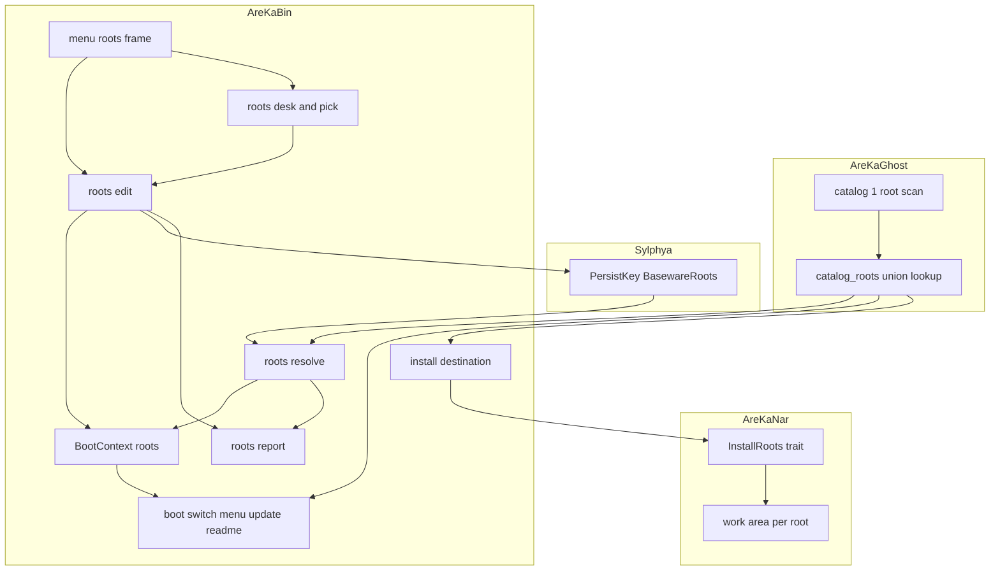
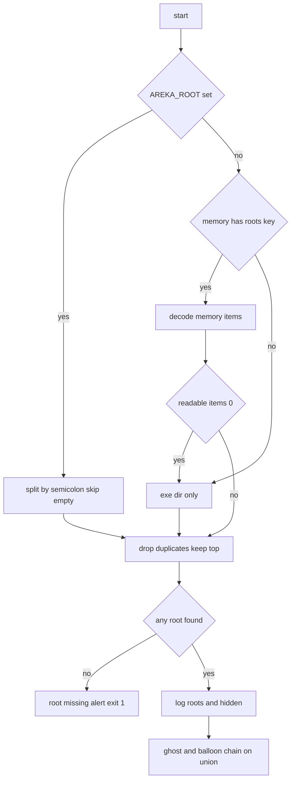
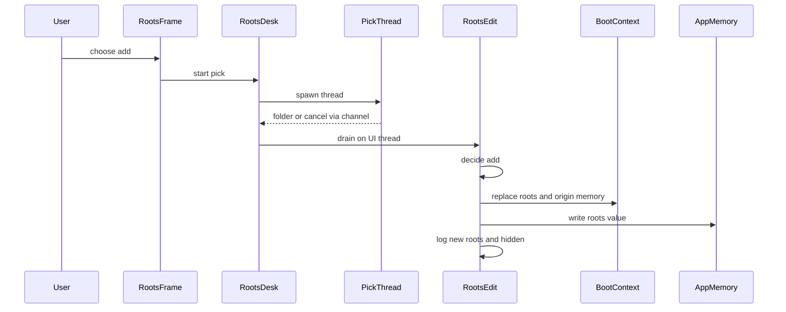
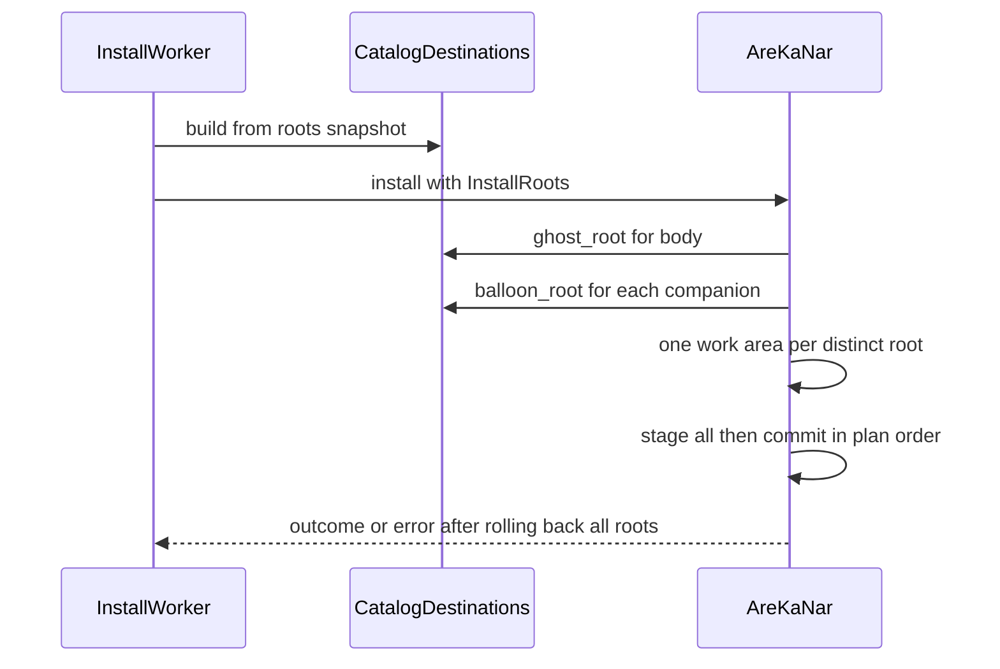

# 設計: areka-P0-baseware-root-list

> 実測は 2026-10-16・ブランチ `claude/areka-P0-baseware-root-list-455a14`（main `1e6590d8` の上に spec の文書だけ）。コードは「何の定義か」（関数名・型名＋ファイルパス）で指す。
> 調べの記録と退けた案は `research.md` の第 10 節。この文書だけで判断が分かるように、決めたことはここに書き直してある。

## Overview

**目的**: ゴーストとバルーンを置く場所（根）を、順番の付いた並びで持てるようにする。SSP のフォルダや別のドライブのフォルダを、移さずに areka で使えるようにする。

**利用者**: SSP と併用する人・SSP から乗り換える人・ゴーストを別のドライブに置きたい人。右クリックメニューの「置き場を追加…」「置き場を外す ▸」か、環境変数 `AREKA_ROOT` の `;` 区切りで並びを決める。

**変わること**: 今は `BootContext.root` に根が 1 つだけ入り、13 の呼び手と `areka-nar` が「根＋フォルダ名」で場所を組む。これを「根の並び」と、並び全体の和の上の「フォルダ名から場所を引く規則 1 つ」に置き換える。記憶の鍵（フォルダ名）は変えない。

### Goals

- 根の並び（既定・アプリの記憶・`AREKA_ROOT` の `;` 区切り）と、起動時の決め方を持つ。
- フォルダ名から場所を引く規則を 1 つにし、起動・切替・メニュー・インストール・ネットワーク更新・`\![open,explorer,…]` の全部をそこへ寄せる。
- 新しいものは先頭の根へ、すでにあるものはその場へ入れる。1 つの `.nar` が根をまたいでも全部か無しか。
- メニューの 2 項目で並びを変え、再起動なしで効かせ、次の起動にも残す。
- 並びが 1 つのときの振る舞いを今のまま保つ。

### Non-Goals

- ゴースト・シェル・バルーン 1 つずつを別の場所に結び付けること（後続 `dev-folder-alias`）。
- 並べ替えの画面・設定画面・本体の設定ファイル。SSP の個別の設定（一時的な除外など）。
- 既定の並びに実行ファイルの外の根を足すこと・書ける根（後続 `areka-P0-user-data-root`）。
- 書き込みの失敗を利用者へ知らせること（後続 `areka-P0-write-failure-notice`）。この spec は記録に残すまで。
- プロパティ `ghostlist`・`balloonlist`（後続 `property-catalog-lists`）。
- `.nar` の展開と `install.txt` の意味論。宛先の根を受ける口と作業フォルダの置き方だけを持つ。
- 同じゴーストを SSP と areka で同時に起動したときの保存ファイルの書き合いを防ぐこと（説明書の注意書きだけ）。

## Boundary Commitments

### This Spec Owns

- **根の並びの値と決め方**: 値型 `BasewareRoots`（`areka-ghost`）、出どころ `RootsOrigin`、起動時の決め方（`AREKA_ROOT` の `;` 区切り → アプリの記憶 → 既定）、重複と空の項目の扱い、「実行ファイルの隣」の綴り `<exe>`。
- **フォルダ名の同じ・違うの規則 1 つ**（`same_folder_name`・大文字小文字を区別しない）と、**同じ根の規則 1 つ**（`same_root`）。
- **和・隠れ・引き当て・入れる根**（`catalog_roots.rs`）。フォルダ名から場所を引く公開の口はここだけで、1 つの根だけを走査する関数は crate の外へ出さない。
- **一覧の項目の「どの根か」の欄**（`GhostEntry.root`・`BalloonEntry.root`）。
- **アプリの記憶の鍵 `PersistKey::BasewareRoots`**（TOML `[baseware] roots`・鏡像の名前 `areka.baseware.roots`）の形と読み書き。
- **`areka-nar` の宛先の根を尋ねる口**（trait `InstallRoots`）と、宛先の根ごとの作業フォルダ・根をまたぐ戻し。
- **メニューの 2 項目**（`Frame::RootAdd`・`Frame::RootRemove`）、フォルダ選択の画面とその受け口、並びの変更の適用（`BootContext` の書き換え・記憶への書き込み・記録）。
- **根が無いときの記録と告知の文面**（`RootError`・`AlertScene` の中身を並びに）。
- 起動と並びの変更のときの記録（並び・隠れ・見つからない根）。
- `dist/README.txt` と `doc/COMPAT_ARCHITECTURE.md` の該当の記述。

### Out of Boundary

- エイリアスの段（後続が `catalog_roots.rs` の口の手前に足す）。
- 既定の並びの中身を「実行ファイルの隣だけ」から変えること（後続 `user-data-root`）。
- 記憶の書き込み失敗の利用者への知らせ（後続 `write-failure-notice`）。
- `.nar` の展開・`install.txt` の解釈・拒否語彙の意味（`areka-nar` の今の持ち物のまま）。
- ゴーストの記憶・シェルの記憶の置き場（ゴーストのフォルダの中のまま）。
- 多重ゴースト・同時に 2 体以上を起動すること。
- MCP の `mcp/resolve.rs`（動いているゴーストの一覧の名前の引き当て・目録の根ではない）。
- メニューの項目名の `&` の扱いなど、メニューの表示の作り（今の `menu/win32.rs` のまま）。

### Allowed Dependencies

- `areka-ghost` → `areka-parsers`（今のまま）。`catalog_roots.rs` は std と `catalog.rs` だけを使い、`areka-sylphya`・`areka-nar` へは依存しない。
- `areka-nar` → 今の依存のまま。`areka-ghost` にも `areka` にも依存しない（宛先の根は trait で呼び手から受ける）。
- `areka-sylphya` → 今の依存のまま（最下層の規律）。
- `areka`（bin）→ `areka-ghost::catalog_roots`・`areka-nar::InstallRoots`・`areka-sylphya::persist`・`windows`（機能は今のまま `Win32_UI_Shell`・`Win32_System_Com`）。
- 新しい外部の依存は足さない。`Cargo.toml` の機能も足さない。
- 依存の向き（左から右へだけ使う）: `areka-sylphya`（記憶の鍵）→ `areka-ghost::catalog`（1 根の走査）→ `areka-ghost::catalog_roots`（並び・和・引き当て）→ `areka::roots`（決め方・記録・変更の適用・選ぶ画面）→ `areka` の呼び手（起動・切替・メニュー・インストール・更新・説明書）。`areka-nar` は独立で、`areka::install` だけがそれを使う。

### Revalidation Triggers

- `catalog_roots.rs` の口（`list_ghosts`・`list_balloons`・`find_ghost`・`find_balloon`・`install_root`・`survey`・`same_folder_name`）の形が変わる → `dev-folder-alias`・`property-catalog-lists`・`ghost-inner-balloon`・`shell-companion-balloon` が見直す。
- `GhostEntry`・`BalloonEntry` の欄が変わる → 一覧を使う後続の全部。
- 記憶の鍵 `[baseware] roots` の綴り・区切り・`<exe>` の綴りが変わる → `user-data-root`（既定の並びを足す）・`dev-folder-alias`（エイリアスの表も App の記憶に置く予定）。
- `InstallRoots` の形が変わる → `areka-nar` を使う全部（`sample-ghost-kit` を含む）。
- 並びの決め方の順（環境変数 → 記憶 → 既定）が変わる → `user-data-root`。

## Architecture

### Existing Architecture Analysis

- 一覧（`crates/areka-ghost/src/catalog.rs` の `list_ghosts`・`list_balloons`）は 1 つの根の直下 1 段を走査し、項目は自分のフォルダの絶対パス（`dir`）を持つ。呼び手の多くは「一覧を読んで項目の `dir` を使う」形なので、一覧を和に替えれば型の置き換えで済む。
- 「根＋フォルダ名」で場所を組み直している所が 3 種ある: 起動の鎖（`boot_resolve.rs` の `resolve_ghost`・`resolve_balloon` の中の `at` 閉包）、`main.rs` の後始末の告知（既定ゴーストの場所）、`areka-nar` の宛先（`plan.rs`）。ここは「項目が持つ場所」と「入れる根を尋ねる口」へ作り替える。
- 根の決め方は `boot_config.rs` の `resolve_root_from(env, exe)`（値を注入できる純粋な判断）。この形を並びへ広げる。
- App スコープの記憶の書き込みには「実行系が動いている間はそのゴーストの記憶の書き手を通す」約束がある（`boot_resolve.rs` の起動中の印の書き手の注記）。並びの書き込みもこれに従う。
- メニューの枠は 7 つ固定（`Frame::ORDER`・`MenuRegistry.slots`・`FRAME_CAPTIONS`・`plan.rs::group_of`）。供給関数はメニューを出すたびに呼ばれるので、並びを変えた直後のメニューから新しい一覧が出る。
- フォルダ名の突き合わせは今、起動と切替が `==`（区別する）、インストールが `eq_ignore_ascii_case` で、食い違っている。根が 2 つになると表に出るので、1 つの規則へそろえる。

### Architecture Pattern & Boundary Map



**Architecture Integration**:
- 選んだ形: 「並びの値型を足し、呼び手を寄せる」（`research.md` 第 4 節の案 B）。`BasewareRoot` は並びの 1 要素として残す。
- 境目: フォルダ名から場所を引く判断は `areka-ghost::catalog_roots` だけが持つ。根の並びの決め方・記録・変更は `areka::roots` だけが持つ。宛先の根の判断は bin が持ち、`areka-nar` は尋ねるだけ。
- 今の形を保つもの: 判断を純粋な関数に閉じて値を注入する形（`resolve_root_from` の型）、別スレッドで OS の画面を出して `mpsc` で UI スレッドへ返す形（`install/desk.rs`）、記憶の書き手の約束、`error!`＋`Err` の失敗の記録。
- 新しく作る理由: 並び（今は 1 つ）・隠れ（今は起きない）・メニューの 2 項目（今は無い）・フォルダ選択（今はファイル選択だけ）・根をまたぐインストール（今は 1 つの作業フォルダ）。
- steering: 1 ファイル 1,000 行の目安・テストは兄弟のファイル・テストの根は `target\` の下（`TempPath::under_target`）・ログは `tracing` の構造化欄。

### Technology Stack

| 層 | 選んだもの／版 | この機能での役 | 備考 |
|---|---|---|---|
| アプリ（bin） | Rust・`bevy_ecs`（今のまま） | `BootContext` の並び・メニューの動作・受け口の系 | 新しい依存なし |
| OS の口 | `windows` 0.62.2（機能 `Win32_UI_Shell`・`Win32_System_Com`・今のまま） | `IFileOpenDialog` のフォルダ選択 | `Cargo.toml` は触らない |
| 記憶 | `areka-sylphya` の persist（TOML・今のまま） | 鍵 `BasewareRoots` を 1 つ足す | 値は 1 本の文字列 |
| インストール | `areka-nar`（今のまま） | 宛先の根を尋ねる trait・根ごとの作業フォルダ | 公開面が変わる |

## File Structure Plan

### Directory Structure

```
crates/areka-ghost/src/
├── catalog.rs                  # 1 根の走査（scan_ghosts / scan_balloons を pub(crate) へ）・項目に root 欄
├── catalog_roots.rs            # 新: BasewareRoots・和・隠れ・引き当て・入れる根・same_folder_name・same_root
├── catalog_roots_tests.rs      # 新: 隠れ・和・引き当て・大文字小文字・入れる根の檻
└── lib.rs                      # 再輸出に BasewareRoots ほかを足す

crates/areka-nar/src/
├── lib.rs                      # NarArchive::install・place が根ごとに WorkArea を作る・log_failure の欄を作業フォルダの列に・使い方の例
├── install.rs                  # InstallRoots・InstallRequest の形・根ごとの作業フォルダ・戻しの列 1 本
└── plan.rs                     # 宛先を InstallRoots に尋ねて組む・Placement に root 欄

crates/areka-sylphya/src/persist/
├── mod.rs                      # PersistKey::BasewareRoots と正準の名前
└── format.rs                   # FormatDoc.baseware_roots・[baseware] roots の読み書き（空文字を保つ）

crates/areka/src/roots/         # 新: 根の並びの決め方・記録・変更・選ぶ画面
├── mod.rs                      # RootsOrigin・RootError・ROOTS_ENV・受け口の据え付け（install）
├── resolve.rs                  # 決め方の純粋な判断・記憶の値の読み書きの形（<exe>・| 区切り）・重複の除き
├── resolve_tests.rs
├── report.rs                   # 並び・見つからない根・隠れの記録（起動と変更のとき）
├── report_tests.rs
├── edit.rs                     # 追加・外すの純粋な判断と適用（BootContext・記憶・記録）
├── edit_tests.rs
├── pick.rs                     # IFileOpenDialog のフォルダ選択（unsafe はここだけ）
├── desk.rs                     # 選ぶ画面のスレッド・旗・通り道・UI スレッドの drain 系
└── desk_tests.rs

crates/areka/src/menu/
├── roots_frame.rs              # 新: 「置き場を追加…」「置き場を外す ▸」の供給関数
└── roots_frame_tests.rs

crates/areka/src/install/
├── destination.rs              # 新: InstallRoots を並びで答える包み（先頭の根を飛ばした記録）
└── destination_tests.rs

crates/areka/src/emo2_boot/
├── same_folder_pin.rs          # 新: 切替先が今のゴーストと同じフォルダ名なら今の場所へ差し替える（要件 8.7）
└── same_folder_pin_tests.rs
```

### Modified Files

- `crates/areka-ghost/src/catalog.rs` — `list_ghosts`・`list_balloons` を `pub(crate) fn scan_ghosts`・`scan_balloons`（1 根）へ改名し、公開の一覧は `catalog_roots.rs` へ。`GhostEntry`・`BalloonEntry` に `root: PathBuf` を足して走査で詰める。`catalog_tests.rs` は `scan_*` を呼ぶ形へ。
- `crates/areka-ghost/src/lib.rs` — `BasewareRoots`・`Hidden`・`StoreKind`・`Survey` を再輸出。
- `crates/areka-sylphya/src/persist/mod.rs`・`format.rs`・`persist_tests.rs` — 鍵 1 つと TOML の表 1 つ。往復の檻（`all_families()`・綴りの固定）に足す。
- `crates/areka-nar/src/lib.rs` — 作業フォルダを作って記録へ渡しているのはここ（`NarArchive::install`・`place`・`log_failure`）。①`place` が配置の根ごとに `WorkArea` を作る（`work: &mut Option<PathBuf>` → `works: &mut Vec<PathBuf>`）②`log_failure` の欄 `work` を作業フォルダの列にする（綴りは `; ` でつなぐ・根 1 つなら今と同じ）③`survivors` の約束を「どれかの作業フォルダの下」に改める ④冒頭の使い方の例（`rust,no_run`＝文書のテスト）を `InstallRequest { roots: &SingleRoot(root), target_ghost: None }` に直す。
- `crates/areka-nar/src/install.rs`・`plan.rs`・`error.rs`（`survivors` の注記と作業フォルダの複数を記録に載せる所だけ）と既存のテスト — `InstallRequest` の形の変更に合わせる。
- `crates/sample-ghost-kit/src/devroot.rs`・`examples/fold-samples.rs` — `InstallRequest` の作り方を単一の根の形へ（1 行ずつ）。
- `crates/areka/src/boot_config.rs` — `resolve_root_from`・`resolve_root`・`RootError`・`RootSource` を `roots/` へ移す（それを確かめていた今のテストは `roots/resolve_tests.rs` へ書き直す）。`resolve_boot_from` が並びを受け、一覧を和で引く。`BootContext.root` → `roots: BasewareRoots`＋`roots_origin: RootsOrigin`。`BootResolved` の 5 つ目を `ResolvedRoots` に。`resolve_balloon_for_ghost` は並びを受ける。
- `crates/areka/src/boot_resolve.rs` — `GhostInputs`・`BalloonInputs` から `root` を外し、`listed` をゴーストも項目の列（`&[GhostEntry]`）にし、`stores` を足す。`at` 閉包は項目の `dir` を使う。`find`・`find_balloon` は `same_folder_name`。`NoGhost`・`NoBalloon` は格納フォルダの列。`running_name` は根を受けず、決まったゴーストの場所（`ghost.dir`）の descript を直に読む。
- `crates/areka/src/main.rs` — 3 か所の置き換え（`running_name(ghost)`・後始末の告知の既定ゴーストの場所を `find_ghost` で引く・`BootContext { roots, roots_origin, … }`）と `roots::install(world)` の 1 行。
- `crates/areka/src/alert.rs` — `AlertScene::{RootMissing, GhostMissing, BalloonMissing}` の中身を並びに、`alert_text` の本文を行数可変に、文面を「置き場」の語に。
- `crates/areka/src/emo2_boot/ghost_switch.rs` — 一覧を和で引く 3 か所・`boot_into` の並び・`resolve_switch_target` と `lastinstalled` のフォルダ名の比べ方・`same_folder_pin` の呼び出し 1 か所（足す分は 10 行以内）。
- `crates/areka/src/emo2_boot/shell_balloon_resolve.rs` — `balloon_candidates(&BasewareRoots)`・候補のフォルダ名の比べ方を `same_folder_name` に。
- `crates/areka/src/emo2_boot/shell_balloon_switch.rs` — `SwitchContext.root` → `roots`。
- `crates/areka/src/menu/mod.rs`・`captions.rs`・`plan.rs` — 枠を 9 つへ（`ORDER`・`slots`・`FRAME_CAPTIONS` のリソース名を `Option`・`group_of`）。`ghost_frame.rs`・`balloon_frame.rs` は和と印の比べ方。`install_frame.rs` は `resource_for` の戻りの型の変更だけ。
- `crates/areka/src/ghost_session.rs` — `menu::roots_frame::register(world)` の 1 行（`install_frame::register` の隣）。
- `crates/areka/src/install/desk.rs`・`judge.rs`・`overwrite.rs`・`procedure.rs`・`worker.rs` — `PickingFlag` を `pub(crate)` に（置き場の受け口が使い回す）、`GhostFacts.root` → `roots: BasewareRoots`、`InstallRequest` を `install::destination` 経由で組む、比べ方を `same_folder_name` に、入れた先の記録。
- `crates/areka/src/update/desk.rs` — `Here.root` → `roots`（`updateother` の `--balloon=` だけ）。
- `crates/areka/src/readme/opener.rs` — `OpenContext.baseware: Option<BasewareRoots>`・候補のフォルダ名の比べ方。
- テストの組み立て（`BootContext {`・`GhostInputs {`・`BalloonInputs {`・`BasewareRoot::new` の約 40 ファイル）— `BasewareRoots::single(dir)` への 1 行の置き換え。
- `crates/areka/src/menu/mod_registry_tests.rs`・`captions_tests.rs`・`plan_tests.rs` — 7 → 9。
- `dist/README.txt`・`doc/COMPAT_ARCHITECTURE.md` — 要件 10。

## System Flows

### 起動の決め方



- 出どころは並び全体で 1 つ（環境変数・アプリの記憶・既定）。記憶の `<exe>` は今の実行ファイルのフォルダに読み替える（要件 1.10）。
- 「見つかったか」は記録と告知のためだけに見る。並びには見つからない根も残す（要件 9.2）。一覧と引き当ては使うたびに各根を見直す（要件 9.3）。

### メニューで置き場を足す



- 選ぶ画面を出している間、UI スレッドは塞がない（要件 6.3）。2 つ目の画面は出さない（旗）。`AREKA_NO_ALERT` のときは出さずに取り消しと同じ扱い（今のファイル選択に合わせる）。
- 外す方は画面を出さないので、メニューの動作がそのまま `Edit` を呼ぶ。

### 根をまたぐインストール



- 宛先の根は配置ごとに 1 回だけ尋ね、組んだ計画（`Placement.root`）に固定する。尋ねた後に並びが変わっても、その `.nar` は決めた根のまま入れる。
- 戻しの列は `.nar` 全体で 1 本。入れ替え（`rename`）はどれも同じ根の中の作業フォルダと宛先の間で行う（要件 5.9）。

## Requirements Traceability

| 要件 | 概要 | 部品 | 口 | 流れ |
|---|---|---|---|---|
| 1.1 | 根の並び・各根は ghost と balloon を持つ形 | BasewareRoots | `BasewareRoots::new`・`BasewareRoot` | 起動の決め方 |
| 1.2 | 種類ごとに分けない | BasewareRoots | 1 つの根が `ghost_store`・`balloon_store` の両方 | — |
| 1.3 | 環境変数も記憶も無い → 実行ファイルの隣 1 つ | RootsResolve | `resolve_roots_from` | 起動の決め方 |
| 1.4 | 記憶の並びをその順で | RootsResolve | `resolve_roots_from`・`decode_memory` | 起動の決め方 |
| 1.5 | `AREKA_ROOT` を `;` で区切り記憶を使わず書かない | RootsResolve・RootsEdit | `resolve_roots_from`・`RootsOrigin::EnvVar`・`decide_add`／`decide_remove` が `EnvLocked` | 起動の決め方 |
| 1.6 | `;` 無しは 1 つ | RootsResolve | `split_env` | — |
| 1.7 | 空の項目は飛ばして warn | RootsResolve | `split_env`・`RootSkip::Empty` | — |
| 1.8 | 相対はカレント基準で絶対化 | RootsResolve | `std::path::absolute` | — |
| 1.9 | 重複は上だけ・warn | RootsResolve・CatalogRoots | `same_root`・`RootSkip::Duplicate` | 起動の決め方 |
| 1.10 | 実行ファイルの隣を `<exe>` で覚える | RootsResolve | `EXE_TOKEN`・`encode_memory`・`decode_memory` | — |
| 1.11 | メニューで変えるまで書かない | RootsEdit | 書き込みは `apply_roots_change` だけ | — |
| 1.12 | 記憶の空・読めない項目は飛ばして warn | RootsResolve | `decode_memory`・`RootSkip::Unreadable` | — |
| 1.13 | 記憶の読める項目 0 → 既定＋warn | RootsResolve | `resolve_roots_from` | 起動の決め方 |
| 1.14 | `;` は区切りだけ | RootsResolve | `split_env`（引用符を解かない） | — |
| 1.15 | 起動時に並びを info | RootsReport | `log_roots` | 起動の決め方 |
| 2.1 | 上から探し最初のもの | CatalogRoots | `find_ghost`・`find_balloon`・`list_*` | — |
| 2.2 | ゴーストの隠れ | CatalogRoots | `survey`・`list_ghosts` | — |
| 2.3 | バルーンの隠れ | CatalogRoots | `survey`・`list_balloons` | — |
| 2.4 | ゴーストとバルーンは別々 | CatalogRoots | 種類ごとの和 | — |
| 2.5 | 隠れを 1 件 1 行＋件数（0 も） | RootsReport | `log_hidden` | 起動の決め方 |
| 2.6 | 引く規則は 1 つ | CatalogRoots | 1 根の走査を `pub(crate)` にし、公開は和と引き当てだけ | — |
| 2.7 | 一覧に出せるものだけが隠す | CatalogRoots | `scan_*` の結果だけで和を組む | — |
| 2.8 | 大文字小文字を区別しない 1 つの規則 | CatalogRoots と全呼び手 | `same_folder_name`・`fold_key` | — |
| 3.1 | ゴーストの和 | CatalogRoots | `list_ghosts` | — |
| 3.2 | バルーンの和 | CatalogRoots | `list_balloons` | — |
| 3.3 | 並びはフォルダ名のバイト順 | CatalogRoots | 和を `folder` で並べ直す | — |
| 3.4 | 項目からどの根か引ける | Catalog | `GhostEntry.root`・`BalloonEntry.root` | — |
| 3.5 | 和と引き当ての上で今と同じ規則 | 呼び手の付け替え | 下の「呼び手の付け替え」の表 | — |
| 3.6 | シェルの一覧は変えない | Catalog | `list_shells`（変更なし） | — |
| 4.1 | 記憶の鍵はフォルダ名のまま | 呼び手の付け替え | `PersistKey::LastGhost` ほか変更なし | — |
| 4.2 | 記憶のフォルダ名を規則 2 で引く | BootResolve | `resolve_ghost`・`resolve_balloon` が和の項目を引く | 起動の決め方 |
| 4.3 | 今の記憶をそのまま読む | BootResolve | 鍵・形とも変更なし | — |
| 4.4 | どの根にも無い → 今と同じ順と記録 | BootResolve | `last_ghost_not_found` ほか（event 名と欄名は同じ） | — |
| 4.5 | ゴーストとシェルの記憶の置き場は変えない | — | `read_last_balloon`・`read_last_shell`（変更なし） | — |
| 5.1 | 新しいものは先頭の根 | CatalogRoots・InstallDestination | `install_root` | 根をまたぐインストール |
| 5.2 | 先頭が見つからない → 見つかったいちばん上＋warn | InstallDestination | `InstallRoot.head_skipped`・`install_head_root_skipped` | — |
| 5.3 | すでにあるものは見えている根で上書き | CatalogRoots | `install_root`（見えている項目の `root`） | — |
| 5.4 | シェル・supplement は宛先ゴーストの根 | AreKaNarRoots | `InstallRoots::ghost_root(target)` | — |
| 5.5 | ゴーストと同梱のバルーンは 1 つずつ決める | AreKaNarRoots | 配置ごとに `ghost_root`／`balloon_root` | 根をまたぐインストール |
| 5.6 | 行き先を尋ねない | InstallDestination | 画面を出さない | — |
| 5.7 | 入れた先を info | InstallDesk | `install_placed` の記録 | — |
| 5.8 | ネットワーク更新はその場 | UpdateDesk | 対象の `dir` のまま（変更なし） | — |
| 5.9 | 根をまたいでも全部か無しか | AreKaNarRoots | 根ごとの作業フォルダ・戻しの列 1 本 | 根をまたぐインストール |
| 6.1 | 「置き場を追加…」を置く | RootsFrame | `Frame::RootAdd` | — |
| 6.2 | OS 標準のフォルダ選択 | RootsPick | `pick_folder` | メニューで置き場を足す |
| 6.3 | 画面の間も止めない | RootsDesk | 別スレッド・`mpsc` | メニューで置き場を足す |
| 6.4 | 末尾に足す | RootsEdit | `decide_add` | メニューで置き場を足す |
| 6.5 | 取り消し → 変えず info | RootsDesk | `send_pick`・`roots_pick_cancelled` | — |
| 6.6 | すでにある → 変えず warn | RootsEdit | `AddVerdict::AlreadyListed` | — |
| 6.7 | ghost も balloon も無い → 足して warn | RootsEdit | `AddVerdict::Added { empty: true }` | — |
| 6.8 | 実行ファイルのフォルダは「隣」として | RootsResolve | `encode_memory` が `same_root(exe_dir)` を `<exe>` で書く | — |
| 6.9 | 画面を出せない → 変えず error | RootsDesk | `PickError` → `error!` | — |
| 7.1 | 「置き場を外す ▸」と並びの全部 | RootsFrame | `Frame::RootRemove`・子は絶対パス | — |
| 7.2 | 外す・フォルダは消さず動かさない | RootsEdit | `decide_remove`（並びの値だけ） | — |
| 7.3 | 根が 1 つなら選べない | RootsFrame・RootsEdit | 子の `enabled: false`・`RemoveVerdict::LastOne` | — |
| 7.4 | 並べ替えの画面を持たない | — | 作らない | — |
| 8.1 | 記憶を書き換える | RootsEdit | `persist_roots` | メニューで置き場を足す |
| 8.2 | 次のメニューから効く・再起動なし | RootsEdit・呼び手 | `BootContext.roots` の書き換え・供給関数が毎回読む | — |
| 8.3 | 新しい並びと隠れを info | RootsReport | `log_roots`・`log_hidden` | — |
| 8.4 | 外した根の中で動いているものは切り替えない | RootsEdit | `BootContext.current` に触らない | — |
| 8.5 | 記憶へ書けない → error・その回は効かせる | RootsEdit | `persist_roots`（`save_scope` の `error!`）・書き換えは先に済ませる | — |
| 8.6 | `AREKA_ROOT` のときは選べない | RootsFrame・RootsEdit | `RootsOrigin::EnvVar` で `enabled: false` | — |
| 8.7 | 同じフォルダ名が見えても今のゴーストとして扱う | SameFolderPin・GhostFrame | `pin_to_current` | — |
| 9.1 | 見つからない根は飛ばして warn | RootsReport・CatalogRoots | `log_roots`・和は見つからない根を 0 件として読む | 起動の決め方 |
| 9.2 | 見つからない根を記憶から外さない | RootsResolve | 並びに残す | — |
| 9.3 | 使うたびに確かめる・記録は起動と変更のときだけ | CatalogRoots・RootsReport | `BasewareRoots::present` が毎回 `is_dir` | — |
| 9.4 | どの根も使えない → 告知・終了コード非 0 | RootsResolve・Alert | `RootError::NoneFound`・`EnvAllEmpty` | 起動の決め方 |
| 9.5 | 告知に試した根全部と `;` の案内 | Alert | `alert_text` | — |
| 9.6 | ゴーストが無い告知に各根の `ghost\` | Alert・BootResolve | `NoGhost.ghost_stores` | — |
| 9.7 | バルーンが無い告知に各根の `balloon\` | Alert・BootResolve | `NoBalloon.balloon_stores` | — |
| 9.8 | 告知は同じ内容を error | Alert | `raise`（変更なし） | — |
| 10.1 | 説明書に置き場の説明 | Docs | `dist/README.txt` | — |
| 10.2 | メニューの 2 項目の使い方 | Docs | `dist/README.txt` | — |
| 10.3 | SSP のフォルダを足すやり方と注意 | Docs | `dist/README.txt` | — |
| 10.4 | 構成の文書 | Docs | `doc/COMPAT_ARCHITECTURE.md` | — |
| 11.1 | 並び 1 つなら今と同じ | 全部 | 単一の根のテストの檻をそのまま通す | — |
| 11.2 | argv の起動は目録の外のまま | BootResolve | 段 1 の argv（変更なし） | — |
| 11.3 | アプリの記憶の置き場を変えない | — | `default_app_profile_dir`（変更なし） | — |
| 11.4 | 同時に 1 体 | — | 変更なし | — |
| 11.5 | 新しい外部依存なし | — | `Cargo.toml` を触らない | — |
| 11.6 | 1,000 行の目安 | File Structure Plan | 新しいファイルへ出す | — |
| 12.1〜12.8 | 決定論テスト | Testing Strategy | — | — |
| 12.9・12.10 | 実機確認 | Testing Strategy | — | — |

## Components and Interfaces

| 部品 | 層 | 役 | 要件 | 主な依存 | 契約 |
|---|---|---|---|---|---|
| CatalogRoots | areka-ghost | 並びの値・和・隠れ・引き当て・入れる根・2 つの比べ方 | 1.1, 1.2, 1.9, 2.1〜2.8, 3.1〜3.4, 5.1, 5.3, 9.3 | Catalog (P0) | Service |
| Catalog（変更） | areka-ghost | 1 根の走査・項目の `root` 欄 | 2.7, 3.4, 3.6 | areka-parsers (P0) | Service |
| PersistBasewareRoots | areka-sylphya | 鍵 1 つと TOML の表 | 1.4, 1.11〜1.13, 8.1 | — | State |
| AreKaNarRoots | areka-nar | 宛先の根を尋ねる口・根ごとの作業フォルダ・戻し | 5.4, 5.5, 5.9 | — | Service |
| RootsResolve | areka bin | 並びの決め方の純粋な判断・記憶の値の形 | 1.3〜1.14, 6.8, 9.2, 9.4 | CatalogRoots (P0), Persist (P0) | Service |
| RootsReport | areka bin | 起動と変更のときの記録 | 1.15, 2.5, 8.3, 9.1 | CatalogRoots (P0) | Service |
| RootsEdit | areka bin | 追加・外すの判断と適用 | 1.5, 1.11, 6.4〜6.8, 7.2, 7.3, 8.1〜8.6 | RootsResolve (P0), RootsReport (P1) | Service, State |
| RootsPick | areka bin | フォルダ選択の OS の口 | 6.2, 6.9 | windows (P0) | Service |
| RootsDesk | areka bin | 選ぶ画面のスレッドと受け口 | 6.3, 6.5, 6.9 | RootsPick (P0), RootsEdit (P0) | Event |
| RootsFrame | areka bin | メニューの 2 項目 | 6.1, 7.1, 7.3, 8.6 | RootsDesk (P0), RootsEdit (P0) | Service |
| InstallDestination | areka bin | 並びで `InstallRoots` に答える | 5.1〜5.3, 5.6 | CatalogRoots (P0), AreKaNarRoots (P0) | Service |
| SameFolderPin | areka bin | 同じフォルダ名なら今の場所へ | 8.7 | CatalogRoots (P1) | Service |
| Alert（変更） | areka bin | 告知の文面を並びに | 9.4〜9.8 | RootsResolve (P0) | Service |
| 呼び手の付け替え | areka bin | 和と引き当てへ寄せる | 3.5, 4.1〜4.4, 5.7, 5.8, 11.1 | CatalogRoots (P0) | — |

### areka-ghost

#### CatalogRoots（`crates/areka-ghost/src/catalog_roots.rs`）

| 欄 | 中身 |
|---|---|
| 役 | 根の並びの値と、フォルダ名から場所を引く規則 1 つ |
| 要件 | 1.1, 1.2, 1.9, 2.1〜2.8, 3.1〜3.4, 5.1, 5.3, 9.3 |

**責任と約束**
- 並びは呼び手が決めた順のまま持つ（重複を除くのは呼び手＝bin の `RootsResolve`・記録を出どころつきで残すため）。見つからない根も並びに残る。
- 和は「見つかった根を上から順に、1 根の走査（`scan_ghosts`／`scan_balloons`＝一覧に出せるものだけ）を足し、同じフォルダ名（`same_folder_name`）がすでにあれば隠れとして控える」で組み、最後にフォルダ名のバイト順に並べ直す。同じ根の中の大文字小文字だけ違う 2 つ（大文字小文字を区別するフォルダのとき）も、走査の順の先が勝ち、後ろを隠れとして控える。
- 引き当て（`find_*`）は和からフォルダ名で 1 つ引く。和と引き当てが同じ関数の上にあるので、どの経路でも同じフォルダ名から同じ場所が出る（要件 2.6）。
- 根の在否（`is_dir`）は呼ぶたびに見る（要件 9.3）。見つからない根は 0 件として読み、記録は残さない（記録は `RootsReport` の持ち物）。
- 1 根の走査は crate の外へ出さない。crate の外から一覧を引く口は、この部品の関数だけ。

**依存**
- Inbound: bin の全部の呼び手 — 一覧・引き当て（P0）
- Outbound: `catalog.rs` の `scan_ghosts`・`scan_balloons` — 1 根の走査（P0）

**Contracts**: Service [x]

##### Service Interface

```rust
/// 根の順の付いた並び（上ほど先に探す）。重複を除くのは作り手。
#[derive(Clone, Debug, PartialEq, Eq)]
pub struct BasewareRoots { roots: Vec<BasewareRoot> }

impl BasewareRoots {
    pub fn new(roots: Vec<BasewareRoot>) -> Self;
    /// 根 1 つの並び（テストと単一の根の呼び手のための口）。
    pub fn single(dir: PathBuf) -> Self;
    pub fn roots(&self) -> &[BasewareRoot];
    /// 今見つかる（`is_dir`）根を上から。呼ぶたびに見直す。
    pub fn present(&self) -> impl Iterator<Item = &BasewareRoot>;
    /// 見つかる根の `ghost\`・`balloon\`（告知と記録に載せる・上から）。
    pub fn ghost_stores(&self) -> Vec<PathBuf>;
    pub fn balloon_stores(&self) -> Vec<PathBuf>;
}

#[derive(Clone, Copy, Debug, PartialEq, Eq)]
pub enum StoreKind { Ghost, Balloon }

/// 隠れた 1 件。`hidden` は隠れたフォルダ、`by` は隠したフォルダ（どちらも絶対）。
#[derive(Clone, Debug, PartialEq, Eq)]
pub struct Hidden { pub kind: StoreKind, pub folder: String, pub hidden: PathBuf, pub by: PathBuf }

/// 和と隠れ（起動と並びの変更のときの記録用）。
pub struct Survey { pub ghosts: Vec<GhostEntry>, pub balloons: Vec<BalloonEntry>, pub hidden: Vec<Hidden> }

pub fn survey(roots: &BasewareRoots) -> Survey;
/// 隠れを除いた和（フォルダ名のバイト順）。
pub fn list_ghosts(roots: &BasewareRoots) -> Vec<GhostEntry>;
pub fn list_balloons(roots: &BasewareRoots) -> Vec<BalloonEntry>;
/// 和からフォルダ名で 1 つ（`same_folder_name`）。
pub fn find_ghost(roots: &BasewareRoots, folder: &str) -> Option<GhostEntry>;
pub fn find_balloon(roots: &BasewareRoots, folder: &str) -> Option<BalloonEntry>;

/// 入れる根。見えているものがあればその根、無ければ見つかるいちばん上の根。
/// `head_skipped` は先頭の根が見つからず飛ばしたときのその根（要件 5.2 の記録用）。
#[derive(Clone, Debug, PartialEq, Eq)]
pub struct InstallRoot { pub root: PathBuf, pub head_skipped: Option<PathBuf> }
/// 見つかる根が 1 つも無ければ `None`。
pub fn install_root(roots: &BasewareRoots, kind: StoreKind, folder: &str) -> Option<InstallRoot>;

/// フォルダ名の同じ・違う（要件 2.8 の 1 つの規則）。
pub fn same_folder_name(a: &str, b: &str) -> bool;
/// 比べるための鍵: 1 字ずつ Unicode の単純大文字へ（1 字 → 1 字のときだけ写す）。
pub fn fold_key(name: &str) -> String;
/// 同じ根か: 両方を `std::path::absolute` で絶対化し、末尾の区切りを落とした綴りを `fold_key` で比べる。
pub fn same_root(a: &Path, b: &Path) -> bool;
```

- 前提: `roots` は作り手が重複を除いたもの（除かれていなくても和は上を残すので壊れない）。
- 事後: `list_*` の結果に `same_folder_name` で等しい 2 項目は無い。各項目の `root` は並びの中の根のどれか。
- 不変: 1 根の走査の結果の外の項目を作らない（descript の無いフォルダは隠さない＝要件 2.7）。

**Implementation Notes**
- 字の範囲（要件 2.8 の「どこまでを同じとみなすか」）: `char::to_uppercase` が 1 字を返すときだけ写し、2 字以上（`ß` → `SS` など）はその字のまま。NTFS の大文字表と同じ「1 字 → 1 字」の考え方で、ASCII・全角英字・ギリシア・キリルは Windows のフォルダと一致する。
  `ponytail:` Unicode の版の差で NTFS の表と違う字が残る。食い違いが出たら OS の比較（`CompareStringOrdinal`）へ替える。
- 和の組み立ては根の数×項目の数の素直な走査（隠れの判定は `fold_key` の集合）。今の呼び手が一覧を毎回引く頻度のまま。

#### Catalog（変更・`crates/areka-ghost/src/catalog.rs`）

- `list_ghosts(&BasewareRoot)`・`list_balloons(&BasewareRoot)` を `pub(crate) fn scan_ghosts`・`scan_balloons` に改名する（中身は今のまま）。
- `GhostEntry`・`BalloonEntry` に `pub root: PathBuf`（走査した根の絶対パス）を足す。`ShellEntry` は変えない。
- `list_shells`・`list_all_shells`・`companion_balloon` ほか単独の鍵の読み手は変えない（要件 3.6）。

### areka-sylphya

#### PersistBasewareRoots（`persist/mod.rs`・`persist/format.rs`）

| 欄 | 中身 |
|---|---|
| 役 | アプリの記憶に根の並びを 1 つの値として持つ |
| 要件 | 1.4, 1.11〜1.13, 8.1 |

**Contracts**: State [x]

##### State Management
- 鍵: `PersistKey::BasewareRoots`。正準の名前 `areka.baseware.roots`。TOML は `[baseware]` 表の `roots`（文字列）。載せるスコープは App（呼び手の契約）。
- 値の形（この鍵の意味は bin の `RootsResolve` が持ち、persist は文字列として運ぶだけ）: 項目を `|` でつないだ 1 本の文字列。項目は絶対パスか記号 `<exe>`。
- 読み: 表や鍵が無い → 鍵ごと無し（要件 1.3 の「記憶に並びが無い」）。値が空文字 → 空文字のまま返す（`LastRunning` と違い「無し」に潰さない＝要件 1.13 の「0 項目」と読み分ける）。型外れ（文字列でない）→ 今の寛容読みどおり無し。
- 書き: 並び全体を 1 回で置き換える（短くなっても残りが残らない）。
- 鏡像: ほかの鍵と同じく `areka.baseware.roots` として写す（写さない鍵の先例を作らない）。
- 檻: `persist_tests.rs` の `all_families()` に足し、往復（`canonical_key_round_trips_with_to_canonical_string`）と綴りの固定（`canonical_key_exact_strings` の仲間）に入れる。`format.rs` の往復の檻に `[baseware]` を足し、空文字が往復で保たれることを固定する。

### areka-nar

#### AreKaNarRoots（`crates/areka-nar/src/lib.rs`・`install.rs`・`plan.rs`）

| 欄 | 中身 |
|---|---|
| 役 | 宛先の根を呼び手に尋ね、根をまたいでも全部か無しかで入れる |
| 要件 | 5.4, 5.5, 5.9 |

**責任と約束**
- `areka-nar` はどの根へ入れるかを決めない。配置ごとに `InstallRoots` へ尋ね、その答えの下に今と同じ規則で宛先を組む。
- 尋ね方: ゴーストの本体 → `ghost_root(install.txt の directory)`。シェル・サプリメント → `ghost_root(target_ghost)`（宛先ゴーストの在否の検査も、その根の `ghost\<target>` で行う）。バルーンの本体と同梱のバルーン（1 つずつ）→ `balloon_root(directory)`。
- 作業フォルダは宛先の根ごとに 1 つ（同じ根は綴りの完全一致で 1 つにまとめる）。全部の配置を組み終えてから、計画の順に確定する。戻しの手順の列は `.nar` 全体で 1 本で、失敗したら逆順にたどる（どの `rename` も同じ根の中で行う）。
- 掃除は今どおり、入れる前に「この `.nar` が触る根」の棚だけを行う。成功の後に全部の作業フォルダを消し、消せなかったものは `leftovers` に足す。

**Contracts**: Service [x]

##### Service Interface

```rust
/// 宛先の根を答える口。答えは `<根>`（その下に `ghost\`・`balloon\` を組む）。
pub trait InstallRoots {
    /// ゴーストの本体の `directory`、またはシェル・サプリメントの宛先ゴーストのフォルダ名に対して。
    fn ghost_root(&self, folder: &str) -> PathBuf;
    /// バルーンの本体・同梱のバルーンの `directory` に対して。
    fn balloon_root(&self, folder: &str) -> PathBuf;
}

/// 根 1 つ（どの問いにも同じ根を答える）。今の単一の根の呼び手とテストはこれを渡す。
pub struct SingleRoot<'a>(pub &'a Path);
impl InstallRoots for SingleRoot<'_> { /* 両方とも self.0 */ }

pub struct InstallRequest<'a> {
    pub roots: &'a dyn InstallRoots,
    pub target_ghost: Option<&'a str>,
}
```

- `Placement` に `root: PathBuf`（尋ねた答え）を足す。`InstalledElement.path` は今どおり宛先の絶対パス。
- 失敗の形（`NarError::Io` ほか）と拒否語彙は変えない。作業フォルダを載せる記録の欄だけを「作業フォルダの列」にする（`lib.rs` の `log_failure` の引数）。`survivors`（戻せずに残ったもの）は「どれかの作業フォルダの下」にある、と約束を改める（`lib.rs` の `place` と `error.rs` の注記）。
- 作業フォルダを掘るのは `lib.rs` の `place`（今は `WorkArea::create(request.root)` を 1 回）。配置の根ごとに 1 つ掘り、掘った場所を順に呼び手の列へ積む（途中で失敗しても、それまでに掘った場所が記録に載る）。
- 前提: 答えの根はフォルダであること。フォルダでなければ今どおり作業フォルダを掘れずに `Io { phase: Stage }` で返る（何も入れない）。

**Implementation Notes**
- 宛先を尋ねるのは計画を組むときの 1 回だけ（同じ配置に 2 回尋ねない）。
- `install.rs`（573 行）は作業フォルダの列の扱いで 60 行ほど増える見込み。1,000 行の内側。

### areka bin: roots

#### RootsResolve（`crates/areka/src/roots/resolve.rs`）

| 欄 | 中身 |
|---|---|
| 役 | 起動時の並びの決め方（純粋）と、記憶の値の読み書きの形 |
| 要件 | 1.3〜1.14, 6.8, 9.2, 9.4 |

**責任と約束**
- 入力はすべて値で受ける（環境変数の値・記憶の値・実行ファイルの場所）。プロセスの環境変数は読まない（要件 12.7）。読み口は `mod.rs` の薄い関数 1 つ。
- 決め方の順: `AREKA_ROOT` が在る → `;` で区切った項目（出どころ `EnvVar`・記憶は見ない）。無い → 記憶の鍵が在る → 記憶の項目（出どころ `Memory`）。読める項目が 0 → 既定（warn を残す）。記憶の鍵が無い → 既定（出どころ `Default`・実行ファイルのフォルダ 1 つ）。
- `AREKA_ROOT` の区切りは `;` だけ（引用符は解かない・`std::env::split_paths` は引用符を解くので使わない）。空の項目は飛ばして控える。相対の項目は `std::path::absolute`（カレント基準）で絶対にする。
- 記憶の項目: `<exe>` → 実行ファイルのフォルダ（取れなければ飛ばして控える）。絶対パス → そのまま。空・相対・パスとして読めない → 飛ばして控える。
- 重複は `same_root` で見て、いちばん上を残し、下を控える。
- 「見つかったか」（`is_dir`）を各根について見て結果に載せる。見つかる根が 0 → `RootError`（告知へ）。
- 記憶へ書く値の形: 並びの各根を、実行ファイルのフォルダと `same_root` なら `<exe>`、それ以外は絶対パスの綴りで、`|` でつなぐ。

**Contracts**: Service [x]

##### Service Interface

```rust
pub(crate) const ROOTS_ENV: &str = "AREKA_ROOT";
pub(crate) const EXE_TOKEN: &str = "<exe>";
pub(crate) const MEMORY_SEPARATOR: char = '|';

#[derive(Clone, Copy, Debug, PartialEq, Eq)]
pub(crate) enum RootsOrigin { EnvVar, Memory, Default }

/// 並びに入れなかった項目（記録用）。
#[derive(Clone, Debug, PartialEq, Eq)]
pub(crate) enum RootSkip {
    /// `AREKA_ROOT` の空の項目（何番目か）。
    Empty { index: usize },
    /// 記憶の読めない項目（綴りのまま・理由）。
    Unreadable { item: String, reason: &'static str },
    /// 上に同じ根がある（下の綴り・残した上の根）。
    Duplicate { dir: PathBuf, kept: PathBuf },
}

/// 並びの 1 根の見え方（記録と告知に使う）。
#[derive(Clone, Debug, PartialEq, Eq)]
pub(crate) struct RootStatus { pub dir: PathBuf, pub found: bool }

#[derive(Clone, Debug, PartialEq, Eq)]
pub(crate) struct ResolvedRoots {
    pub roots: BasewareRoots,
    pub origin: RootsOrigin,
    pub status: Vec<RootStatus>,
    pub skipped: Vec<RootSkip>,
    /// 記憶の読める項目が 0 だったので既定へ倒した（要件 1.13 の warn）。
    pub memory_fell_back: bool,
}

#[derive(Clone, Debug, PartialEq, Eq)]
pub(crate) enum RootError {
    /// 既定（または記憶の `<exe>` だけ）なのに実行ファイルの場所が取れない。
    ExeLocationUnavailable { tried: Vec<PathBuf>, origin: RootsOrigin },
    /// `AREKA_ROOT` の項目がすべて空。
    EnvAllEmpty,
    /// 並びの根がどれも見つからない。
    NoneFound { tried: Vec<PathBuf>, origin: RootsOrigin },
}

pub(crate) fn resolve_roots_from(
    env: Option<OsString>,
    memory: Option<String>,
    exe_dir: Option<PathBuf>,
) -> Result<ResolvedRoots, RootError>;

/// 記憶の値を並びへ（`<exe>` の読み替え・控え）。純粋。
pub(crate) fn decode_memory(value: &str, exe_dir: Option<&Path>) -> (Vec<PathBuf>, Vec<RootSkip>);
/// 並びを記憶の値へ（実行ファイルのフォルダと同じ根は `<exe>`）。純粋。
pub(crate) fn encode_memory(roots: &BasewareRoots, exe_dir: Option<&Path>) -> String;
/// 起動前の記憶の直読み（App スコープの `BasewareRoots`・`load_scope` を `FsPersistIo` で）。
pub(crate) fn read_memory(app_profile_dir: &Path) -> Option<String>;
/// 薄い読み口（`mod.rs`）: env `AREKA_ROOT`（`var_os`）・`read_memory`・`exe_location()` の親を読んで
/// `resolve_roots_from` へ渡す。プロセスの環境変数を読むのはここだけ。
pub(crate) fn resolve_roots(app_profile_dir: &Path) -> Result<ResolvedRoots, RootError>;
```

- 事後: `Ok` の `roots` は重複が無く、`status` は `roots` と同じ順・同じ数。少なくとも 1 つが `found`。
- `RootsOrigin::Default` の並びは記憶へ書かない（書くのは `RootsEdit` だけ・要件 1.11）。

#### RootsReport（`crates/areka/src/roots/report.rs`）

| 欄 | 中身 |
|---|---|
| 役 | 並び・見つからない根・隠れを記録に残す（起動と並びの変更のときだけ） |
| 要件 | 1.15, 2.5, 8.3, 9.1 |

```rust
/// 並びの 1 根ごとに info（絶対パス・出どころ・見つかったか）、見つからない根は warn（9.1）、
/// 控え（RootSkip）は warn、`memory_fell_back` は warn。`occasion` は boot か change。
pub(crate) fn log_roots(resolved: &ResolvedRoots, occasion: ReportOccasion);
/// 隠れを 1 件 1 行で info（種類・フォルダ名・隠れた場所・隠した場所）＋件数を info（0 件も）。
pub(crate) fn log_hidden(hidden: &[Hidden], occasion: ReportOccasion);
#[derive(Clone, Copy, Debug)]
pub(crate) enum ReportOccasion { Boot, Change }
```

- event の名前: `root_listed`（1 根ごと・info）・`root_missing`（warn）・`root_skipped`（warn）・`roots_memory_fell_back`（warn）・`root_hidden_item`（info）・`roots_hidden_count`（info）。欄は `logging.md` の構造化欄の規約に従う。
- 起動の今の `root_resolved` は `root_listed` に置き換わる（要件 11.1 が許す「要件 1.15 の記録の行」）。

#### RootsEdit（`crates/areka/src/roots/edit.rs`）

| 欄 | 中身 |
|---|---|
| 役 | 追加・外すの判断（純粋）と、その適用（並び・記憶・記録） |
| 要件 | 1.5, 1.11, 6.4〜6.8, 7.2, 7.3, 8.1〜8.6 |

**責任と約束**
- 判断は値だけで行う: 今の並び・出どころ・足すフォルダ（または外す根の添字）。
- 適用は UI スレッドで `&mut World` を受けて行う。順は ①`BootContext.roots` と `roots_origin = Memory` を書き換える（その回に効かせる・8.5）②記憶へ書く ③新しい並びと隠れを記録（`ReportOccasion::Change`）。
- `BootContext.current`（今のゴースト・バルーン）には触らない＝並びの変更だけで切り替えない（8.4）。
- フォルダそのものは消さない・動かさない（7.2）。触るのは並びの値だけ。
- 記憶へ書く経路: `GhostSlot` に動いているゴーストの実行系が在れば、その記憶の書き手で `persist_put(PersistScope::App, vec![(PersistKey::BasewareRoots, 値)])`。居なければ UI スレッドから `save_scope(App, …, &FsPersistIo, …)` を直接呼び、`Degraded` なら `error!`（`roots_memory_write_failed`）。書き手を通した失敗は `save_scope` が `error!` を残す（8.5）。

**Contracts**: Service [x] / State [x]

##### Service Interface

```rust
#[derive(Debug, PartialEq, Eq)]
pub(crate) enum AddVerdict {
    /// 末尾に足した。`empty` は直下に ghost も balloon も無い（6.7 の warn）。
    Added { roots: BasewareRoots, empty: bool },
    /// すでにある（6.6 の warn・変えない）。
    AlreadyListed { existing: PathBuf },
    /// `AREKA_ROOT` で渡している（8.6・変えない）。
    EnvLocked,
}

#[derive(Debug, PartialEq, Eq)]
pub(crate) enum RemoveVerdict {
    Removed { roots: BasewareRoots, removed: PathBuf },
    /// 根が 1 つしか無い（7.3・変えない）。
    LastOne,
    EnvLocked,
    /// 添字が並びの外（メニューを出した後に並びが変わった・warn・変えない）。
    Stale,
}

pub(crate) fn decide_add(roots: &BasewareRoots, origin: RootsOrigin, picked: &Path) -> AddVerdict;
pub(crate) fn decide_remove(roots: &BasewareRoots, origin: RootsOrigin, dir: &Path) -> RemoveVerdict;

/// UI スレッドの入口（メニューの動作と受け口の drain が呼ぶ）。判断・適用・記録をまとめる。
pub(crate) fn add_root(world: &mut World, picked: PathBuf);
pub(crate) fn remove_root(world: &mut World, dir: PathBuf);
```

- `decide_remove` は添字でなく、メニューに出した根の絶対パスで受ける（メニューを出した後に並びが変わっても、別の根を外さない）。`same_root` で見つからなければ `Stale`。
- 実行ファイルのフォルダを足したとき（6.8）は並びに絶対パスで入り、記憶へ書くときに `encode_memory` が `<exe>` で書く。
- 出どころが既定（記憶に並びが無い）のときに足すと、既定の並び（実行ファイルの隣）の末尾に足した並びになり、記憶には `<exe>|<足した根>` が書かれる。外すのも同じく、今の並びから外した並びを書く。

#### RootsPick（`crates/areka/src/roots/pick.rs`）

```rust
/// OS 標準のフォルダ選択（`IFileOpenDialog`＋`FOS_PICKFOLDERS | FOS_FORCEFILESYSTEM | FOS_PATHMUSTEXIST`）。
/// 呼んだスレッドを塞ぐ。`Ok(None)` は取り消し（`Show` が `HRESULT_FROM_WIN32(ERROR_CANCELLED)`）。
pub(crate) fn pick_folder() -> Result<Option<PathBuf>, crate::install::pick::PickError>;
```

- `install/pick.rs` と同じく `CoInitializeEx(None, COINIT_APARTMENTTHREADED)` → 画面 → `CoUninitialize`。COM の口は内側の関数に閉じ、`CoUninitialize` の前に手放す。`GetDisplayName` の文字列は `CoTaskMemFree` で返す。持ち主の窓は渡さない（今のファイル選択と同じ）。題は「置き場にするフォルダを選んでください」。
- 失敗の型は `install::pick::PickError`（`Com(HRESULT)`）を使い回す。`unsafe` はこのファイルだけに閉じ、各ブロックに SAFETY の注記を付ける。

#### RootsDesk（`crates/areka/src/roots/desk.rs`）

**Contracts**: Event [x]

##### Event Contract
- 受け口: World の NonSend `RootsDesk { tx, rx: Receiver<PickedFolder>, picking: Arc<AtomicBool> }`。`roots::install(world)`（`main.rs` が系の登録の後に 1 回）が据え、UI スレッドの系 `drain` を `Input` の段に足す。
- 送るもの: `enum PickedFolder { Chosen(PathBuf) }` だけ（取り消しと失敗は選ぶスレッドで記録して送らない）。
- 出し方: `start_pick(world, suppressed: bool, pick: F)`（`F: FnOnce() -> Result<Option<PathBuf>, PickError> + Send + 'static`・テストは偽の `pick` を注入）。旗が立っていれば出さない（debug）。`suppressed` なら出さずに取り消しと同じ（info `roots_pick_cancelled`・理由 `no_alert`）。スレッド名 `roots-pick`。旗は `install/desk.rs` の `PickingFlag` を使い回す（`pub(crate)` にする）。
- 選ぶスレッドの記録: 決めた → 送る（送れなければ warn）。取り消し → info `roots_pick_cancelled`（6.5）。失敗 → error `roots_pick_failed`（6.9）。スレッドを起こせない → error。
- 受け: `drain` が `try_iter` で受け、`edit::add_root` を呼ぶ。終了が始まって系が回らなくなった後に届いたものは受けずに捨てる（今のインストールの窓口と同じ性質）。
- `can_pick(world) -> bool`: 受け口が在り、旗が立っていない。

#### RootsFrame（`crates/areka/src/menu/roots_frame.rs`）

- `register(world)` が `Frame::RootAdd`・`Frame::RootRemove` の供給関数を登記する（`ghost_session.rs` の `install_frame::register` の隣の 1 行）。
- 「置き場を追加…」: 葉 1 つ。`enabled = roots_origin != EnvVar && desk::can_pick(world)`。動作は `desk::start_pick(world, alert::suppressed(), pick::pick_folder)`。
- 「置き場を外す ▸」: サブメニュー。見出しは `enabled = roots_origin != EnvVar`。子は並びの全部の根を並びの順に、絶対パスの綴りを名前にして並べる（見つからない根も）。子の `enabled = roots.len() > 1`。子の動作は捕まえた絶対パスで `edit::remove_root`。
- `caption_resource: None`（SSP に当たる SHIORI のリソース名が無い）。既定名は `FRAME_CAPTIONS` の行（「置き場を追加…」「置き場を外す」）。

#### InstallDestination（`crates/areka/src/install/destination.rs`）

```rust
/// 並びの写しで `InstallRoots` に答える。見つかる根が 1 つも無ければ作れない。
pub(crate) struct CatalogDestinations { roots: BasewareRoots, first: PathBuf }
impl CatalogDestinations {
    pub(crate) fn new(roots: BasewareRoots) -> Option<Self>;
}
impl areka_nar::InstallRoots for CatalogDestinations { /* install_root(…) の root */ }
```

- `ghost_root`・`balloon_root` は `catalog_roots::install_root` を引く。`head_skipped` が在れば warn `install_head_root_skipped`（先頭の根・入れる根）を残す（5.2）。答えが出ない（尋ねた間に全部の根が消えた）ときは `new` のときの `first` を答え、`areka-nar` が作業フォルダを掘れずに失敗として返す（記録は `areka-nar` の今の `error!`）。
- `new` が `None`（見つかる根が無い）なら、呼び手（`install/worker.rs`）は入れずに error `install_no_root` を残して今の失敗の経路へ倒す。
- 画面は出さない（5.6）。
- シェル・サプリメントの宛先ゴーストは和で引く。動いているゴーストが外した根の中にあって和に見えていない（要件 8.4 の状態）ときは、見つかるいちばん上の根の下に宛先ゴーストが無いので、今の「宛先ゴーストが無い」拒否（`TargetGhostMissing`）になる。

#### SameFolderPin（`crates/areka/src/emo2_boot/same_folder_pin.rs`）

```rust
/// 切替先が今のゴーストと同じフォルダ名（`same_folder_name`）で、場所が違えば、切替先を
/// 今のゴーストへ差し替える（info `ghost_switch_same_folder_kept`）。それ以外は手を触れない。
pub(crate) fn pin_to_current(target: SwitchTarget, current: &GhostDecision) -> SwitchTarget;
```

- 差し替えるのは `dir` だけでなく、`name`・`sakura_name` も今のゴーストの場所の descript から読み直す（`catalog::descript_name`・`catalog::sakura_name` を `current.dir` に対して）。場所は今のゴースト・名前は別の根のゴースト、という食い違いを `OnGhostChanging` の参照に渡さない。

- 呼び手は `ghost_switch.rs::request_ghost_switch_with`（`resolve_switch_target` の直後の 1 行）。
- 振る舞い（設計の討議で確定・無視する案は退けた）: 今のコードは今のゴーストを選ぶと「自分自身への切替」（降ろして同じ場所から起こし直す）になる。差し替えの後はそれと同じになり、別の根の同じフォルダ名のゴーストへは移らない（要件 8.7 の「今のゴーストを選んだものとして扱い、切り替えない」）。
- メニューの印はフォルダ名で付ける（`ghost_frame.rs` の比べ方を `same_folder_name` に）。

#### Alert（変更・`crates/areka/src/alert.rs`）

- `AlertScene::RootMissing(RootError)`（`roots::RootError` へ）・`GhostMissing { ghost_stores: Vec<PathBuf>, argv: Option<PathBuf> }`・`BalloonMissing { balloon_stores: Vec<PathBuf> }`。
- `alert_text` は本文を `Vec<String>` で組む（行数は場面と並びの長さで変わる）。文面の形（細かな言い回しは実装で決め、テストで固定する）:
  - 根が決まらない: 1 行目「置き場（ゴーストとバルーンを置くフォルダ）が見つかりません。」、続いて試した根を 1 行ずつ「試した場所: <絶対パス>（<出どころ>）」、「置くもの: ghost フォルダと balloon フォルダを持つフォルダ」、最後に「環境変数 AREKA_ROOT に、置き場のフォルダの絶対パスを ; で区切って複数渡せます。」。空の `AREKA_ROOT` と実行ファイルの場所が取れない場合は 1 行目をそれぞれの理由にする。
  - ゴーストが無い: 1 行目は今どおり（argv の場合を含む）、続いて「探した場所: <各根の ghost の絶対パス>」を 1 行ずつ、最後に今の「置くもの」の行。
  - バルーンが無い: 同じ形で各根の `balloon`。
  - 出どころの言葉: 「環境変数 AREKA_ROOT」「アプリの記憶」「既定（実行ファイルの隣）」。
- `raise` の `error!(event = "alert")` は今のまま（9.8）。

### 説明書と構成の文書（要件 10）

- `dist/README.txt`:
  - 「■ 右クリックメニュー」: 項目を 9 つに（「インストール…」の後に「置き場を追加…」「置き場を外す ▸」）、2 項目の使い方（足すと末尾に入る・外してもフォルダは消えない・並べ替えは外して足し直す・置き場が 1 つのときは外せない）。
  - 新しい節「■ 置き場（ゴーストとバルーンを置くフォルダ）」: 置き場とは何か（直下に `ghost` と `balloon`）・既定は areka.exe の隣の 1 つ・上の置き場から探し同じ名前は上が使われる・新しく入れるものは先頭の置き場へ入りすでにあるものはその場で上書き・`AREKA_ROOT` に `;` 区切りで渡せること（`;` を含むフォルダは渡せずメニューから足す）・SSP のフォルダ（`ghost` と `balloon` を持つ SSP のフォルダそのもの）を足すやり方・同じゴーストを SSP と areka で同時に起動しない注意（保存ファイルを両方が書き合い・areka は防がない）・ネットワークのドライブを置き場にすると、つながっていないときにゴーストが止まることがある注意。利用者向けの語では「根」を使わない。
  - 「■ 記憶の置き場」: アプリの記憶に置き場の並びも入ることを 1 行。
- `doc/COMPAT_ARCHITECTURE.md`: 裁量の表に 1 行（ベースウェアの格納フォルダを複数持つ形＝SSP の種類ごとの登録・一時的な除外・行き先の問いを写さず、1 つの根の並びと上から探す規則にしたこと・出典 spec はこの spec）。

### 呼び手の付け替え（要件 3.5・4.1〜4.4・5.7・5.8・11.1）

| 呼び手 | 今 | 付け替え後 |
|---|---|---|
| `boot_config.rs::resolve_boot_from` | 根 1 つで `list_ghosts` → フォルダ名の列 | `Result<ResolvedRoots, RootError>` を受け、`log_roots(Boot)` と `log_hidden(survey(..).hidden, Boot)` を残してから、`catalog_roots::list_ghosts` の項目の列を鎖へ。argv の検査の告知は `ghost_stores`。`resolve_boot` は `roots::resolve_roots(&default_app_profile_dir())` を渡す |
| `boot_config.rs::resolve_balloon_for_ghost` | `list_balloons(root)` | 並びを受け `catalog_roots::list_balloons`。同梱・descript・記憶の鍵の読み方は今のまま |
| `boot_resolve.rs::resolve_ghost`・`resolve_balloon` | `at` 閉包が `root.ghost_dir(folder)` で組む・`==` | 当たった項目の `dir`・`folder` を使う。突き合わせは `same_folder_name`。`warn!` の event 名と欄名（`ghost_store`・`balloon_store`）は今のまま、値は格納フォルダの列を `; ` でつないだもの（根 1 つなら今と同じ綴り） |
| `boot_resolve.rs::running_name` | `list_ghosts(root)` から `==` | 和を引かない。`running_name(ghost: &GhostDecision)` が `catalog::descript_name(&ghost.dir.join("ghost").join("master"))`、無ければフォルダ名（根を外して同じフォルダ名が別の根から見えても、動いているゴーストの名前を書く・根 1 つなら今と同じ結果） |
| `main.rs` | `running_name(&ctx.root, …)`・`ctx.root.ghost_dir(DEFAULT)` | `running_name(ghost)`・`find_ghost(&ctx.roots, DEFAULT).map(dir)`（無ければ並びの先頭の根の `ghost\emo2`） |
| `ghost_switch.rs` | `list_ghosts(&ctx.root)` 3 か所・`boot_into` の `root` | `catalog_roots::list_ghosts(&ctx.roots)`・`roots` の写し。`resolve_switch_target` と `lastinstalled` のフォルダ名の比べ方は `same_folder_name`（`name` の突き合わせと特別な名前は今のまま区別する） |
| `shell_balloon_resolve.rs::balloon_candidates` | `list_balloons(root)` | 並びを受ける。候補のフォルダ名の比べ方（シェルも含む）は `same_folder_name` |
| `shell_balloon_switch.rs` | `SwitchContext.root` | `roots` |
| `menu/ghost_frame.rs`・`balloon_frame.rs` | `list_*(&ctx.root)`・印は `==` | 和・印は `same_folder_name` |
| `install/desk.rs` | `GhostFacts.root = ctx.root.dir()`・`record_installed` は `list_*(root)` と `eq_ignore_ascii_case` | `GhostFacts.roots = ctx.roots.clone()`・和と `same_folder_name`。入れ終えたら要素ごとに info `install_placed`（種類・根・フォルダ）（5.7） |
| `install/judge.rs`・`overwrite.rs`・`procedure.rs` | `eq_ignore_ascii_case`・`ctx.root.dir()`・`list_balloons(facts.root)` | `same_folder_name`・`CatalogDestinations`・和 |
| `install/worker.rs` | `DeskPorts.root`・`InstallRequest { root }` | 並びの写し・`CatalogDestinations::new` → `InstallRequest { roots: &dest, target_ghost }` |
| `update/desk.rs` | `Here.root`・`list_balloons(&here.root)` | `roots`・和（`--balloon=` の名前の引き当てだけ）。更新する場所は対象の `dir` のまま（5.8） |
| `readme/opener.rs` | `OpenContext.baseware: Option<BasewareRoot>` | `Option<BasewareRoots>`・和・候補のフォルダ名の比べ方 |

## Data Models

### Domain Model

- **根の並び**（`BasewareRoots`）: 順の付いた根の列。1 つのプロセスに 1 つ、`BootContext` が持つ。出どころ（`RootsOrigin`）は並び全体で 1 つ。
- **和**: 並びと根の中身から毎回組み直す値。持ち続けない（使うたびに見直す・要件 9.3）。
- **隠れ**: 和を組むときに分かる値。起動と並びの変更のときだけ記録に出す。
- **記憶の並び**: アプリの記憶の 1 つの値。メニューで並びを変えたときだけ書く。
- 不変条件: 和の中のフォルダ名は `same_folder_name` で互いに違う。並びの中の根は `same_root` で互いに違う。並びは 1 つ以上（メニューで 0 にしない・要件 7.3）。

### Logical Data Model（アプリの記憶）

```toml
format-version = 1

[baseware]
roots = "<exe>|D:\\ssp"   # 項目は絶対パスか <exe>・区切りは |

[last]
ghost = "emo2"
```

- 古い版の areka は `[baseware]` を知らず、App スコープを書くときに落とす（`research.md` 10.9）。

## Error Handling

### Error Strategy
- 判断の関数は失敗を値で返す（`RootError`・`AddVerdict`・`RemoveVerdict`・`RootSkip`）。記録は呼び手の 1 か所（`RootsReport`・`RootsEdit` の入口・`RootsDesk`）で残す。
- 起動を止めるのは「見つかる根が 0」「ゴーストが 0」「バルーンが 0」だけで、今の告知と終了コード 1 の経路へ倒す（9.4・9.6・9.7）。
- 見つからない根・読めない記憶の項目・重複・空の項目は、飛ばして続ける（warn）。
- `panic` は使わない。

### Error Categories and Responses

| 場面 | 記録 | 続き |
|---|---|---|
| `AREKA_ROOT` の空の項目・記憶の読めない項目・重複 | warn `root_skipped`（理由） | 飛ばして続ける |
| 記憶の読める項目が 0 | warn `roots_memory_fell_back` | 既定の並び |
| 並びの根が見つからない | warn `root_missing`（起動と変更のときだけ） | 残りの根で続ける |
| 見つかる根が 0 | error `alert`（告知） | 終了コード 1 |
| 選ぶ画面の取り消し | info `roots_pick_cancelled` | 変えない |
| 選ぶ画面を出せない | error `roots_pick_failed` | 変えない |
| すでにある根を足す | warn `roots_add_already_listed` | 変えない |
| ghost も balloon も無い根を足す | warn `roots_add_empty_root` | 足す |
| 根が 1 つのときに外す・`AREKA_ROOT` のとき・並びが変わった後の古い項目 | warn `roots_remove_refused`（理由） | 変えない |
| 記憶へ書けない | error（`save_scope` の `persist commit failed`・直接書いたときは `roots_memory_write_failed`） | その回の並びは効かせたまま |
| 入れる先頭の根が見つからない | warn `install_head_root_skipped` | 見つかるいちばん上の根へ |
| 入れる根が 1 つも無い | error `install_no_root` | 入れない（今の失敗の経路） |
| 根をまたぐ `.nar` の途中の失敗 | error（`areka-nar` の今の失敗の記録・作業フォルダの列つき） | 全部を戻す |

## Testing Strategy

テストは本番のファイルの兄弟（`*_tests.rs`・`#[path]`）に置き、判断の分岐だけを足す（12.8）。テストで組む根と記憶の置き場は `TempPath::under_target`（ワークツリーの `target\test-roots\` の下）に作る（12.7）。環境変数は値で注入し、プロセスの環境変数は書き換えない（12.7）。ログの主張は `log-capture-kit` を通す。

### 単体（判断の分岐）

1. **並びの決め方**（`roots/resolve_tests.rs`・12.1）: 既定（実行ファイルの隣 1 つ・出どころ `Default`）／記憶の並びの順／`AREKA_ROOT` の 1 つと複数（記憶があっても使わない）／空の項目（`a;;b`・末尾の `;`・全部空 → `EnvAllEmpty`）／重複（大文字小文字・末尾の区切りだけ違う綴りも重複）／相対パス（カレント基準で絶対）／記憶が空文字（0 項目 → 既定＋控え）／記憶の読めない項目（相対・空）／`<exe>` が実行ファイルを動かした後の場所を指す／見つかる根が 0 → `NoneFound`／`encode_memory` が実行ファイルのフォルダを `<exe>` で書き、往復で同じ並びに戻る。
2. **上から探す**（`catalog_roots_tests.rs`・12.2）: 2 つの根に同じフォルダ名のゴーストとバルーン（別々に隠れる・フォルダ名 `x` のゴーストとバルーンは互いを隠さない）／上の根の descript の無い `x` は下の `x` を隠さない／`Emo2` と `emo2` の隠れと引き当て（`find_ghost(roots, "emo2")` が上の `Emo2` を返す）／`fold_key` の字の範囲（全角英字・ギリシア・`ß`）／見つからない根は 0 件で読む／`install_root`（新しいもの → 先頭・すでにある → その根・先頭が無い → 見つかるいちばん上と `head_skipped`・どれも無い → `None`）／`same_root`。
3. **隠れの記録**（`roots/report_tests.rs`・12.2）: 隠れ 1 件 1 行・0 件のときも件数の行が出る・見つからない根の warn。
4. **メニューの判断**（`roots/edit_tests.rs`・12.5）: 追加（末尾に入る・すでにある・ghost も balloon も無いフォルダ・実行ファイルのフォルダ・`AREKA_ROOT` のとき `EnvLocked`）／外す（根が 1 つで `LastOne`・`Stale`・フォルダが消えていないこと・`BootContext.current` が変わらないこと）／記憶への書き込みと読み戻しの往復（実行系が居ない経路で `save_scope`・読み戻しは `read_memory`）／書けないとき並びは効いている。
5. **告知の文面**（`alert_tests.rs`・12.6）: 根が決まらない（複数の根・空の `AREKA_ROOT`・実行ファイルの場所が取れない）・ゴーストが無い・バルーンが無いの、それぞれで複数の根を並べた文面を固定。

### 結合（和の上で今の規則が動くこと）

1. **和の上の呼び手**（12.3）: 2 つの根の和で、メニューのゴースト枠の一覧と印（`ghost_frame_tests.rs`）・`\![change,ghost,…]` の照合と `sequential`（`ghost_switch_tests.rs`）・既定ゴーストの採用と同梱のバルーンの引き当て（`boot_config_balloon_tests.rs`・`boot_resolve_tests.rs`）・起動中の印に書く名前（`main_session_mark_tests.rs` の仲間）が引けること。
2. **根をまたぐインストール**（`areka-nar` の `install_commit_tests.rs` の仲間・`install/destination_tests.rs`・`lib.rs` の使い方の例は文書のテストで組み立てられる・12.4）: 新しいものは先頭の根へ／すでにあるものはその根で上書き・下の根の同じ名前に触らない／同梱のバルーンが別の根へ入る／2 つの根にまたがる `.nar` で 2 つ目の配置の確定に失敗 → 1 つ目の根も元に戻る（偽の失敗を注入する今の檻の型を使う）／先頭の根が無いとき。
3. **切替と並びの変更**（`same_folder_pin_tests.rs`・`roots/edit_tests.rs`・12.5）: 今のゴーストの根を外して下の根の同じフォルダ名が見えるようになった後、それを選んでも切替先の場所と名前（`name`・`sakura_name`）が今のゴーストのものになる。同じ状態で起動中の印に書く名前（`running_name`）も今のゴーストの名前になる。
4. **受け口**（`roots/desk_tests.rs`）: 偽の `pick` で、決めた → 末尾に入る／取り消し → 変えない／失敗 → 変えない／2 つ目は出さない／`suppressed` のときは出さない。
5. **単一の根の檻**（11.1）: 今のテストを `BasewareRoots::single` への置き換えだけで全部通す（振る舞いの変化は要件 11.1 の許す範囲だけ）。メニューの枠の数の檻（`mod_registry_tests.rs`・`captions_tests.rs`・`plan_tests.rs`）は 9 へ直す。

### 実機確認（12.9・12.10）

- `target\` の下に根を 2 つ（片方は SSP と同じ形・もう一方と同じフォルダ名のゴーストを 1 体含む）。記憶の置き場は `AREKA_PROFILE_DIR` で `target\` の下へ。
- ① `AREKA_ROOT=<根A>;<根B>` で起動 → メニューに和・記録に `root_listed` 2 行と `root_hidden_item`。② 新しいゴーストを入れる → 根A へ入り `install_placed` が根A を示す。③ `AREKA_ROOT` なしで「置き場を追加…」で根B を足す → メニューに出る・再起動の後も残る（記憶の `[baseware] roots`）。④ 「置き場を外す ▸」で外す → フォルダが残る。フォルダ選択の画面がゴーストの窓の後ろに出ないかもここで見る。
- 止めてよいのは自分が起こしたと確かめたプロセスだけ（12.10）。

## Performance & Scalability

- 和は今の一覧と同じく使うたびに組む（メニューを出すとき・切替・インストールの後など）。読む量は根の数に比例して増える（根 2 つなら約 2 倍）。今の一覧の頻度では問題にならない。
  `ponytail:` 根が多く・ゴーストが多くてメニューが遅くなったら、根ごとの走査の結果を `ghost\` の更新時刻で覚える。
- 根の在否（`is_dir`）と走査は UI スレッドで行う。つながっていないネットワークのドライブ（割り当て済みの `Z:\`・UNC パス）の根は、OS の問い合わせが数十秒待つことがあり、そのあいだゴーストが止まる（設計の討議で限界として確定・説明書に 1 行）。
  `ponytail:` 在否を UI スレッドで直に見る。止まる報告が出たら、在否の確かめを別スレッドへ出すか、最後に見た結果を短い時間だけ覚える形へ替える。

## Migration Strategy

- 移行の手続きは 0（要件 4.3）。記憶の鍵は今のまま、`[baseware]` が無いあいだは既定の並び（今と同じ）。
- 呼び手の型の置き換えは 1 つの PR の中で一度に行う（`BootContext.root` を残す段を作らない）。テストの組み立ては `BasewareRoots::single(dir)` への 1 行の置き換え。
