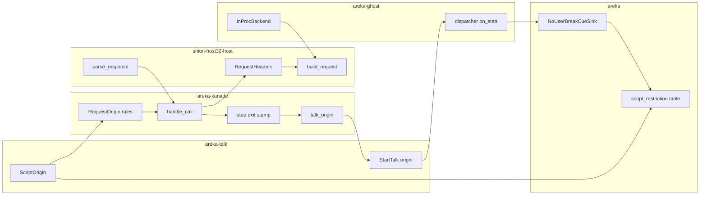

# 設計書: areka-P0-script-security-level

## Overview

**目的**: 台本とイベントに「出どころ」（ゴースト自身・MCP の SEND・MCP の NOTIFY。下流の spec が `\![raise]`・`\![embed]`・プロパティシステム・SSTP の受信を足す）を付けて再生の終わりまで運び、SHIORI へ正典どおりの `SecurityLevel`・`SecurityOrigin`・`Sender`・`SenderType` を渡し、応答の `SecurityLevel` を読み、ukadoc が出どころで実行を制限するタグを外部扱いの台本で止めて記録に残す。

**使う人**: ゴーストの作者は、SHIORI へ届く `SecurityLevel`・`SenderType` で外から来た呼び出しを見分け、応答に `SecurityLevel: external` を付けて自分の台本の権限を下げられる。利用者は、外部扱いの台本に `\![enter,nouserbreakmode]` でダブルクリックの中断を奪われない。下流の spec（`property-query-channels`・`sakura-embed-directive`・`mcp-shiori-query`・`script-impact-tiers`）は、この spec の出どころの型と追加のヘッダの入れ物を使う。

**変わること**: SHIORI への要求の文は `SecurityLevel` を `ID` より前へ移し、`SecurityOrigin`・`SenderType` を足す。応答の `SecurityLevel` を読む。台本の起動の約束 `StartTalk` に出どころが載り、受け口が出どころを見てタグを止める。

### Goals

- 出どころを 1 つの値の型で表し、SHIORI の要求のヘッダと台本の再生の両方を同じ値から導く。
- 32bit の仲介の経路と同じプロセスの経路で、同じ要求に同じヘッダが同じ順で付く。
- 応答の `SecurityLevel` は台本の実効のセキュリティレベルを下げるだけで、上げない。
- 判定の表（5 行）を 1 つ持ち、実装済みの行（今は `\![enter,nouserbreakmode]`）を実際に止める。表と実装の食い違いはフルテストで赤になる。
- 止めた・下げた・読めなかったの全部を記録に残す。

### Non-Goals

- SSTP の受信そのもの・`x-ukagaka-link`・影響の段（`script-impact-tiers`）。
- 未実装のタグ（`\![execute,filewatch]`・`\![execute,schedule-add]`・`\![execute,schedule-delete]`・`\m[…]`）とその失敗イベントの実装。
- `\![raise]`・`\![embed]` が起こすイベントへの引き継ぎの決め事。
- Owned SSTP の「`\t` の中でも割り込む」扱い。
- MCP の `check_script` の出どころの診断。
- 網羅台帳への `\![execute,…]` 3 行の追加（`ukadoc-catalog-refresh` の持ち物）。

## Boundary Commitments

### This Spec Owns

- **出どころの型**（`areka-talk` の `ScriptOrigin` と部品）: `SenderType` の 9 語・Owned かどうか・`local`／`external` の組。「外部扱い」と「SSTP の出どころか」の判定。
- **要求の出どころ**（kanade の `RequestOrigin`）: `Sender` の名前と出どころの組。送るイベントの出所カテゴリ（`EventId`）から要求の出どころを導く規則と、4 つのヘッダの文字列への写し。
- **追加のヘッダの入れ物**（host32 の `RequestHeaders`）と、それを受ける `ShioriBackend` の既定の実装つきの新しいメソッド 2 つ。
- **要求の文のヘッダの並び**（`build_request`）と、応答の `SecurityLevel` の生の値の読み取り（`parse_response`）。応答の値の解釈（大文字小文字を無視・読めない値の warn）。
- **台本の実効のセキュリティレベル**: SHIORI の応答で始まるトークへの付与（運行表の出口）、`OnTranslate` の応答による引き下げ、外からの台本と選択肢の `script:` への付与。
- **`StartTalk` の出どころの欄**と、配送が受け口へ出どころを渡す口（`BootCueSink::begin_talk`）。
- **判定の表**（5 行）と、`\![enter,nouserbreakmode]` の受け口の止め。
- 網羅台帳 2 つの該当行と `doc/COMPAT_ARCHITECTURE.md` §8 の登記。

### Out of Boundary

- SSTP の受信と、そこで使う `Sender`・`SecurityOrigin`・Owned かどうかの判定（`EventId` の出所カテゴリを足すのはその spec）。
- `x-ukagaka-link`・影響の段・未実装のタグの実装・`notauthorized` の失敗イベント。
- `\![raise]`・`\![embed]` が起こすイベントの出どころの引き継ぎ（その spec が決める。本 spec は表せる型を用意するだけ）。
- 記録の種別の表示（`Ghost`・`SSTP(Local,Auth)` など）の決め方。今の `ScriptSource` から導くまま変えない。`ActiveTalk::origin`（記録用の名札）と strict の控え `StrictNote` も変えない。
- MCP のツールの振る舞い・`check_script`。
- `crates/areka/src/emo2_boot/consumer_ledger.rs` の編集（C10 の約束。読むだけ）。本 spec は受け口を新しく足さないので、台帳の行も足さない。
- 網羅台帳の写し（`catalog.toml`）の取り直し。

### Allowed Dependencies

- 依存の向き: `areka-talk`（依存 0）← `shiori-host32-host`（`areka-talk` に依存しない）← `areka-kanade` ← `areka-sakura`／`areka-ghost` ← `areka`。新しいクレートの依存は足さない。
- `areka-talk` は std だけ。host32 は出どころの語彙を持たず、文字列を書いて読むだけ（`Status` と同じ扱い）。
- kanade の中で host32 の型を使ってよいのは今どおり `shiori/real.rs` だけ。出どころの規則（`request_origin.rs`）は host32 の型を使わない。
- `areka` の判定の表のテストは `consumer_ledger.rs` の `ConsumerLedger::canonical()`・`consumer_of` と、`areka-parsers` の台本の読みを**読むだけ**で使う。

### Revalidation Triggers

- `ScriptOrigin`・`SecurityLevel`・`SenderType` の形が変わる → `script-impact-tiers`・`sakura-embed-directive`・`property-query-channels` が照合する。
- `RequestHeaders` に欄が増える・`ShioriBackend` の新しいメソッドの形が変わる → `mcp-shiori-query`・`property-query-channels` と、上書きしている本物 2 つ（`ShioriConnection`・`InProcBackend`）。
- `EventId` に出所カテゴリが増える → `request_origin.rs` の写しの照合（`match` に既定の腕を置かないので、足した時点でコンパイラが求める）。
- `StartTalk` の欄・`BootCueSink::begin_talk` の形が変わる → `areka-sakura`・`areka-ghost`・`areka` の受け口。
- 判定の表の行が変わる → 表を固定するテストと網羅台帳の注記。

## Architecture

### Existing Architecture Analysis

- 要求の文を組むのは `crates/shiori-host32-host/src/shiori3.rs` の `build_request` だけで、32bit の仲介（`client.rs` の `Shiori3Client`）と同じプロセス（`crates/areka-ghost/src/shiori_inproc.rs` の `build_input`）の両方がここを通る。今は `SecurityLevel: local` を `Reference*` の後ろに固定で書き、`Sender` は `"areka"` 固定。
- kanade は送るイベントの出所カテゴリを `EventId`（`Static`＝運行表・`Choice`＝選択肢とアンカー・`Sstp`＝MCP の `raise_event`）で既に区別している（DD-1）。翻訳の出どころは `ScriptSource`（`Event`／`SstpSend`）で区別し、`OnTranslate` の Reference1 は既に要件 2.4〜2.6 のとおりに出ている。
- SHIORI の応答で始まるトークは、運行表の `step` の出口（`schedule/translate.rs` の `before`／`after`）で 1 か所に捕まえられる。腕ごとの再生の開始（`boot.rs`・`change.rs`・`close.rs`・`steady.rs`）に触らずに済む。
- 配送（`crates/areka-ghost/src/dispatcher.rs` の `on_start`）はトークごとに受け口を複製し、`BootCueSink::begin_talk` を 1 回呼ぶ。番号の要る受け口は `Clone` を持たず `BootCueSink` を自分で実装する（先例 `BalloonLifecycleSink`）。
- `ShioriBackend` には既定の実装を持つメソッドの先例が 2 つある（`on_idle`・`unblock_handle`）。実装は 22 か所（本物 2・中身なしの `EmptyShiori`・中身へ渡す包み 4＝`crates/areka-ghost/tests/ghost/recorder.rs` の `Recorder<B>` と `inproc_e2e_test.rs`・`snapshot_capture_test.rs`・`real_pasta_online.rs` の `BoxedBackend`・残りはテストの偽物）。

### Architecture Pattern & Boundary Map



**Architecture Integration**:
- 選んだ形: **関所と出口で導く**（ギャップ分析の案 B に、応答のレベルを `ShioriOutcome` で正面から運ぶ点を足したもの）。要求の出どころは `EventId` の出所カテゴリから導き、`ShioriCall`・`ShioriMsg` の形は変えない。台本の出どころは運行表の出口の規則で一括に付ける。
- 責任の分け方: 出どころの**語彙**は `areka-talk`、**導く規則**は kanade、**線の書き読み**は host32、**止める判断**は受け口（`\!` は汎用キャリア 1 本・消費側が名前で選ぶ、の決まりどおり）。
- 守る先例: `EventId` の出所カテゴリ（DD-1）・`Status` の「host32 は解釈しない」（DD-IT-6）・既定の実装つきメソッド（`on_idle`）・`StartTalk::new` の既定（`epilogue`）・受け口の自己選別と複製の境界。
- 新しい部品の理由: 出どころの型（3 つのクレートを貫く値）・要求の出どころの規則（1 か所で 4 つのヘッダを決める）・追加のヘッダの入れ物（3 本の spec が同じ口を使う）・トークの出どころの付与（運行表の出口）・判定の表（ukadoc の 5 行の単一の権威）。
- steering: 1 ファイル 1,000 行以内（新しい処理は新しい兄弟ファイルへ）・テストは兄弟ファイル・ログの無い失敗の経路を作らない・決定論のテストは x64 の偽の境界で。

### Technology Stack

| Layer | Choice / Version | Role in Feature | Notes |
|-------|------------------|-----------------|-------|
| 型（依存 0） | `areka-talk`（std のみ） | 出どころの型・`StartTalk` の欄 | 新しい依存なし |
| SHIORI の線 | `shiori-host32-host` | 要求のヘッダの並び・応答の `SecurityLevel` の生の値 | 文字列を書いて読むだけ |
| 運行 | `areka-kanade` | 要求の出どころの規則・応答のレベルの運搬・トークへの付与 | `tracing` で記録 |
| 再生と配送 | `areka-sakura`・`areka-ghost` | `StartTalk` の運搬・受け口へ出どころを渡す | sakura は出どころを解釈しない |
| 受け口 | `areka`（`emo2_boot`） | 判定の表・`\![enter,nouserbreakmode]` の止め | `consumer_ledger.rs` は読むだけ |

## File Structure Plan

### Directory Structure

```
crates/
├── areka-talk/src/
│   ├── origin.rs                         # 新規: 出どころの型（SecurityLevel・SenderHead・SenderWord・SenderType・SstpKind・ScriptOrigin）
│   └── origin_tests.rs                   # 新規: 語のつなぎ方・大小無視の読み・下げるだけ・外部扱いの判定
├── shiori-host32-host/src/
│   ├── request_headers.rs                # 新規: 追加のヘッダの入れ物 RequestHeaders・Value つき応答 ValueReply・要求の組み立ての共通の手
│   └── request_headers_tests.rs          # 新規: ヘッダの並び（2.1）・2 つの経路で同じバイト列（2.8）・応答の生の値
├── areka-kanade/src/
│   ├── request_origin.rs                 # 新規: SenderName・RequestOrigin・EventId から導く規則・4 つのヘッダの文字列・応答のレベルの解釈
│   ├── request_origin_tests.rs           # 新規: 2.2〜2.7・3.3・3.4
│   ├── shiori/real_headers_tests.rs      # 新規: handle_call が入れ物を渡し応答のレベルを ShioriOutcome へ載せる
│   └── schedule/
│       ├── talk_origin.rs                # 新規: 応答で始まるトークへの付与・選択肢の script: の引き継ぎ・引き下げの記録
│       └── talk_origin_tests.rs          # 新規: 1.1〜1.7・3.1・3.2（運行表の段）
├── areka-ghost/src/
│   └── shiori_inproc_headers_tests.rs    # 新規: 同じプロセスの経路のヘッダと応答のレベル
└── areka/src/emo2_boot/
    ├── script_restriction.rs             # 新規: 判定の表（5 行）・照会・許すかの判定
    ├── script_restriction_tests.rs       # 新規: 表の固定（4.8）・台帳と読みとの照合（4.7）・判定の真理表
    ├── user_break_cue_origin_tests.rs    # 新規: 外部扱いで enter を止める・leave は止めない・記録（4.2〜4.5）
    └── script_security_e2e_tests.rs      # 新規: 偽の SHIORI が external を返すと区間に入らない・local では今のまま
crates/areka/tests/
└── script_security_real_run.rs           # 新規: 本物の起動の道で 4 つのヘッダの記録と MCP の台本の区間を確かめる（real-run-kit）
```

### Modified Files

- `crates/areka-talk/src/lib.rs` — `mod origin` と再輸出。`StartTalk` に `origin: ScriptOrigin` を足し、`StartTalk::new` は `ScriptOrigin::GHOST` を既定にする。
- `crates/areka-sakura/src/contract.rs` — 出どころの型を再輸出（`TalkId` と同じ道）。`drive.rs` — `StartTalk` の分解に新しい欄を足す（使わない）。
- `crates/shiori-host32-host/src/shiori3.rs` — `ShioriRequest` の `sender` を `headers: RequestHeaders` に替え、`build_request` の並びを要件 2.1 にする。`ParsedResponse` に `security_level`（生の値）と読みの腕を足す。中のテストの字面を新しい並びへ。
- `crates/shiori-host32-host/src/client.rs` — `get_with_headers`／`notify_with_headers` を足し、今の `get`／`notify` はゴースト自身の既定のヘッダで新しい手を呼ぶ。`lib.rs` — 新しい型の輸出。`shiori3_charset_tests.rs` — 字面の追随。
- `crates/areka-kanade/src/msg.rs` — `EventId::Translate(RequestOrigin)` を足す。`ShioriOutcome::Value(String)` を `Value(String, SecurityLevel)` にする。
- `crates/areka-kanade/src/shiori/real.rs` — `ShioriBackend` に既定の実装つきの 2 メソッド。`ShioriConnection` が上書き。`handle_call` が要求の出どころから入れ物を作り、応答のレベルを解釈して `ShioriOutcome` へ載せる。
- `crates/areka-kanade/src/actor.rs` — `EventId::Translate` の腕（受理の判定・欠番の印・記録の名札）と、`shiori_request` の記録に出どころの 3 項目を足す。
- `crates/areka-kanade/src/schedule/events.rs` — `on_translate`／`on_translate_sstp` が `EventId::Translate` を作る。
- `crates/areka-kanade/src/schedule/translate.rs` — `Replied` が応答のレベルを持つ。`read_reply` と `TranslateResult` が `OnTranslate` の応答のレベルを運ぶ（`Translated`）。`on_done` がトークの出どころを下げる。
- `crates/areka-kanade/src/actor_translate.rs` — 翻訳の結果に応答のレベルを載せる。
- `crates/areka-kanade/src/schedule/mod.rs` — `step` が出口で `talk_origin::stamp` を呼ぶ。`start_talk` が出どころを受け取る。`mod talk_origin`。
- `crates/areka-kanade/src/schedule/sstp.rs` — 外からの台本は `MCP_SEND`、外から頼まれたイベントの台本は `MCP_NOTIFY` を渡す。
- `crates/areka-kanade/src/schedule/steady_choice_script.rs` — 元のトークの出どころを引き継ぐ。
- `crates/areka-kanade/src/schedule/balloon_events.rs` — `ShownTalk` に `origin` を足す（最後に始めたトークの出どころの控え）。
- `crates/areka-kanade/src/lib.rs` — `mod request_origin`。
- `crates/areka-ghost/src/sink.rs` — `BootCueSink::begin_talk` に出どころを足す。`dispatcher.rs` — `StartTalk` の出どころを渡す。
- `crates/areka-ghost/src/shiori_inproc.rs` — `InProcBackend` が新しい 2 メソッドを上書き。`build_input` が入れ物を受ける。`map_get_outcome` が応答の生の値も返す。
- `crates/areka-ghost/tests/ghost/recorder.rs`（`Recorder<B>`）・`crates/areka-ghost/tests/ghost/{inproc_e2e_test,snapshot_capture_test}.rs`・`crates/areka-ghost/tests/real_pasta_online.rs`（`BoxedBackend`）— 新しい 2 メソッドを中身へ渡す。
- `crates/areka/src/emo2_boot/user_break_cue.rs` — `Clone` をやめて `BootCueSink` を自分で実装し、出どころを控えて止める。`talk_lifecycle.rs` — `begin_talk` の形の追随。`mod.rs` — 新しいモジュールの宣言。
- 機械的な追随（テストの字面）: `ShioriOutcome::Value(` の 133 か所・`StartTalk {` の約 85 か所・`TranslateDone(` の約 30 か所・`ShioriRequest {` の約 20 か所・`ParsedResponse {` の 11 か所・`begin_talk(` の 6 か所・`ShownTalk {` の 7 か所・`EventId::Static("OnTranslate")` を確かめるテスト 4 か所・`user_break_cue_tests.rs` の `.clone()` 5 か所。`schedule/steady.rs`（957 行）は `ShioriOutcome::Value` の 4 か所の型の追随だけで、行は増やさない。
- `doc/ukadoc-coverage/ledger/shiori.toml`・`doc/ukadoc-coverage/ledger/sakura-script.toml`・`doc/COMPAT_ARCHITECTURE.md` §8。

## System Flows

### SHIORI の応答で始まる台本（翻訳あり）

```mermaid
sequenceDiagram
    participant Step as kanade step
    participant Shell as kanade shell
    participant Actor as shiori actor
    participant Backend as backend
    participant Disp as dispatcher
    participant Sink as NoUserBreakCueSink
    Step->>Shell: ShioriRequest GET with EventId
    Shell->>Actor: ShioriMsg Request
    Actor->>Backend: get_with_headers with RequestHeaders
    Backend-->>Actor: ValueReply with raw SecurityLevel
    Actor-->>Shell: Value script and level
    Shell->>Step: ShioriReply
    Step->>Step: stamp StartTalk origin then capture to translate
    Step->>Shell: Translate request
    Shell->>Actor: OnTranslate GET with EventId Translate
    Actor-->>Shell: Value translated and level
    Shell->>Step: TranslateDone with level
    Step->>Step: on_done lowers origin
    Step->>Disp: StartTalk with origin
    Disp->>Sink: begin_talk with talk id and origin
    Sink->>Sink: refuse enter when external treated
```

- 付与は「元のイベントの出所カテゴリの基本の出どころ」を「応答のレベル」で下げた値。翻訳の応答で、さらに下げるだけ（上げない）。
- `OnTranslate` の要求のヘッダは、元のイベントの**要求の**出どころから作る（応答で下がる前・要件 2.5）。台本の実効のレベルとは別の値である。
- 外からの台本（`Input::SstpSend`）は `start_talk` が `MCP_SEND` を付け、同じ翻訳の道で下がりうる。選択肢の `script:` は元のトークの出どころをそのまま写す（翻訳しない今の道のまま）。

## Requirements Traceability

| Requirement | Summary | Components | Interfaces | Flows |
|-------------|---------|------------|------------|-------|
| 1.1 | ゴースト自身のイベントの応答の台本は「ゴースト自身」・`local` | RequestOrigin・talk_origin | `RequestOrigin::base_of`・`talk_origin::stamp` | 応答で始まる台本 |
| 1.2 | MCP の `sakurascript` は「MCP の SEND」・`local` | sstp.rs・ScriptOrigin | `start_talk(.., MCP_SEND)` | 外からの台本 |
| 1.3 | MCP の `raise_event` の応答の台本は「MCP の NOTIFY」・`local` | RequestOrigin・talk_origin | `base_of(EventId::Sstp)` | 応答で始まる台本 |
| 1.4 | 出どころとレベルを最後のタグまで保つ | StartTalk・NoUserBreakCueSink | `StartTalk.origin`・`begin_talk` | 配送 |
| 1.5 | 翻訳された台本は元の出どころを引き継ぐ | translate.rs | `on_done` の引き下げ | 応答で始まる台本 |
| 1.6 | 選択肢の `script:` は元の台本の出どころとレベルを引き継ぐ | talk_origin・ShownTalk | `talk_origin::of_shown` | 選択肢 |
| 1.7 | 選択肢の ID・アンカーのイベントは「ゴースト自身」 | RequestOrigin | `of_event(EventId::Choice / Static)` | — |
| 1.8 | 9 語・Owned・`local`／`external` で表せる | ScriptOrigin | `SenderType`・`SstpKind`・`SecurityLevel` | — |
| 2.1 | 4 つのヘッダを付け、決まった順に並べる | build_request・RequestHeaders | `ShioriRequest.headers` | 要求 |
| 2.2 | ゴースト自身: `local`・`null`・`areka`・`internal` | RequestOrigin | `of_event`・`wire` | 要求 |
| 2.3 | `raise_event`: `local`・`null`・`MCP`・`external,sstp` | RequestOrigin | `of_event(EventId::Sstp)` | 要求 |
| 2.4 | `sakurascript` の `OnTranslate`: `MCP`・`internal`・`sstp-send,owned` | events.rs・RequestOrigin | `on_translate_sstp` | 翻訳 |
| 2.5 | 応答の `OnTranslate` は元の要求の値を引き継ぎ `Sender: areka` | events.rs・RequestOrigin | `RequestOrigin::for_translated` | 翻訳 |
| 2.6 | `raise_event` の応答の `OnTranslate`: `external,sstp`・`local`・Ref1 は今のまま | events.rs・RequestOrigin | `for_translated(EventId::Sstp)` | 翻訳 |
| 2.7 | 語は `internal`／`external` を先頭にカンマでつなぐ | SenderType | `SenderType::render` | — |
| 2.8 | 2 つの経路で同じヘッダを同じ順 | request_headers.rs・client・InProcBackend | `request_of`（共通の手） | 要求 |
| 2.9 | `Charset`・`Status`・`ID`・`Reference*` の値は今のまま | build_request | 既存テスト | — |
| 3.1 | 応答（`OnTranslate` を含む）の `external` で実効を `external` に | handle_call・talk_origin・translate.rs | `ShioriOutcome::Value(_, level)`・`Translated.level` | 応答で始まる台本 |
| 3.2 | `local`・無しなら変えない（上げない） | SecurityLevel | `lowered_by` | — |
| 3.3 | 値の大文字小文字を区別しない | SecurityLevel | `SecurityLevel::parse` | — |
| 3.4 | 読めない値は無いものとして warn | request_origin.rs | `read_response_level` | — |
| 3.5 | `Value`・`ErrorLevel`・`ErrorDescription` の読み方は今のまま | parse_response・map_get_result | 既存テスト | — |
| 4.1 | 5 つのタグを区分と注記とともに 1 つの表に | script_restriction.rs | `RESTRICTIONS` | — |
| 4.2 | 外部扱いでは enter に入らず残りを続ける | NoUserBreakCueSink | `permits` | 配送 |
| 4.3 | 3 つの出どころで `local` なら今のまま | NoUserBreakCueSink・ScriptOrigin | `is_external_treated` | 配送 |
| 4.4 | 止めたらタグ・出どころ・レベルを warn | NoUserBreakCueSink | `script_tag_refused` の記録 | — |
| 4.5 | leave は止めない | NoUserBreakCueSink | 表に leave が無い | — |
| 4.6 | 未実装の行の扱いは変えない | script_restriction.rs | `enforced: false` | — |
| 4.7 | 実装済みなのに止めが無ければ赤 | script_restriction_tests.rs | `ConsumerLedger::canonical`・台本の読み | — |
| 4.8 | 5 行から欠けるか増えたら赤 | script_restriction_tests.rs | 表の固定 | — |
| 5.1 | 記録の種別の表示は今のまま | script_log.rs（変えない） | 既存テスト | — |
| 5.2 | `shiori.toml` の 4 行を書き換える | 網羅台帳 | — | — |
| 5.3 | `sakura-script.toml` の 2 行の注記 | 網羅台帳 | — | — |
| 5.4 | 沈黙ルール対応表に裁量を登記 | `doc/COMPAT_ARCHITECTURE.md` §8 | — | — |

## Components and Interfaces

| Component | Domain/Layer | Intent | Req Coverage | Key Dependencies | Contracts |
|-----------|--------------|--------|--------------|------------------|-----------|
| ScriptOrigin ほか | areka-talk | 出どころの語彙と判定 | 1.8, 2.7, 3.2, 3.3 | なし | Service, State |
| StartTalk.origin | areka-talk | 台本 1 つの出どころの運搬 | 1.4 | ScriptOrigin (P0) | State |
| RequestHeaders・ValueReply | host32 | 追加のヘッダの入れ物と応答の生の値 | 2.1, 2.8, 3.5 | なし | Service |
| build_request・parse_response | host32 | 線の書き読み | 2.1, 2.9, 3.5 | RequestHeaders (P0) | Service |
| ShioriBackend の新メソッド | kanade | 入れ物を渡し応答の値を返す口 | 2.1, 2.8, 3.1 | RequestHeaders (P0) | Service |
| RequestOrigin | kanade | 要求の出どころの規則と写し | 1.1, 1.3, 1.7, 2.2〜2.7, 3.4 | ScriptOrigin (P0), EventId (P0) | Service |
| handle_call | kanade | 入れ物を作り応答のレベルを載せる | 2.1〜2.6, 3.1, 3.4 | RequestOrigin (P0), ShioriBackend (P0) | Service |
| talk_origin | kanade 運行表 | トークへの付与・引き継ぎ・引き下げの記録 | 1.1〜1.6, 3.1, 3.2 | ScriptOrigin (P0) | State |
| 翻訳の道 | kanade 運行表 | 翻訳の応答のレベルで下げる | 1.5, 2.4〜2.6, 3.1 | RequestOrigin (P0) | State |
| begin_talk の出どころ | areka-ghost | 受け口へ出どころを渡す | 1.4 | StartTalk (P0) | Event |
| InProcBackend | areka-ghost | 同じプロセスの経路の上書き | 2.8, 3.1 | RequestHeaders (P0) | Service |
| 判定の表 | areka | 5 行の単一の権威 | 4.1, 4.6〜4.8 | ScriptOrigin (P0), ConsumerLedger (P1・読むだけ) | State |
| NoUserBreakCueSink | areka | 外部扱いで enter を止める | 4.2〜4.5 | 判定の表 (P0) | Event |

### areka-talk（出どころの語彙）

#### ScriptOrigin ほか

| Field | Detail |
|-------|--------|
| Intent | 台本とイベントの出どころを ukadoc の語で表し、「外部扱い」を判定する |
| Requirements | 1.8, 2.7, 3.2, 3.3 |

**Responsibilities & Constraints**
- `SenderType` の 9 語を「先頭の 2 語（`internal`／`external`）」と「後ろの 7 語」に分けた型で持ち、先頭が必ず 1 つ在ることを型で保証する（2.7）。
- 「Owned かどうか」は SSTP 系の出どころだけが持つ値として 3 値で持つ。
- 値はすべて `Copy`・定数で作れる（後ろの語は `&'static [SenderWord]`）。
- 依存 0 のまま（std だけ）。

**Contracts**: Service [x] / State [x]

##### Service Interface
```rust
#[derive(Debug, Clone, Copy, PartialEq, Eq)]
pub enum SecurityLevel { Local, External }
impl SecurityLevel {
    /// 線の綴り（"local"／"external"）。
    pub fn wire(self) -> &'static str;
    /// 英字の大文字小文字を区別せずに読む。どちらでもなければ None（3.3）。
    pub fn parse(raw: &str) -> Option<SecurityLevel>;
    /// 下げるだけ: どちらかが External なら External（3.1・3.2）。
    pub fn lowered_by(self, other: SecurityLevel) -> SecurityLevel;
}

#[derive(Debug, Clone, Copy, PartialEq, Eq)]
pub enum SenderHead { Internal, External }
#[derive(Debug, Clone, Copy, PartialEq, Eq)]
pub enum SenderWord { SakuraApi, Embed, Raise, Property, Plugin, Sstp, Communicate }

#[derive(Debug, Clone, Copy, PartialEq, Eq)]
pub struct SenderType { pub head: SenderHead, pub rest: &'static [SenderWord] }
impl SenderType {
    /// 先頭の語の後ろに残りをカンマでつなぐ（例 "internal,raise"・2.7）。
    pub fn render(&self) -> String;
}

/// SSTP 系の出どころか、Owned か（ukadoc の Owned SSTP）。
#[derive(Debug, Clone, Copy, PartialEq, Eq)]
pub enum SstpKind { NotSstp, Owned, NotOwned }

#[derive(Debug, Clone, Copy, PartialEq, Eq)]
pub struct ScriptOrigin {
    pub sender_type: SenderType,
    pub sstp: SstpKind,
    pub level: SecurityLevel,
}
impl ScriptOrigin {
    /// ゴースト自身: internal・SSTP でない・local（1.1）。
    pub const GHOST: ScriptOrigin;
    /// MCP の SEND（Owned SSTP 相当）: internal・Owned・local（1.2・SSP の実測で OnTranslate の SenderType は internal）。
    pub const MCP_SEND: ScriptOrigin;
    /// MCP の NOTIFY（Owned SSTP 相当）: external,sstp・Owned・local（1.3）。
    pub const MCP_NOTIFY: ScriptOrigin;
    pub fn lowered_by(self, level: SecurityLevel) -> ScriptOrigin;
    /// 外部扱い: 実効のレベルが External か、Owned でない SSTP（要件の用語の定義）。
    pub fn is_external_treated(&self) -> bool;
    /// SSTP 系の出どころか（`\m[…]` の判定に使う）。
    pub fn is_sstp(&self) -> bool;
}
```
- 不変条件: `lowered_by` は `External` を `Local` に戻さない。
- 下流は語の組を定数で足す（例 `internal,raise`・`internal,embed`・`internal,property`）。型の形は変えない（1.8）。

#### StartTalk.origin

| Field | Detail |
|-------|--------|
| Intent | 台本 1 つの出どころと実効のレベルを再生の終わりまで運ぶ |
| Requirements | 1.4 |

- `pub origin: ScriptOrigin` を足す。`StartTalk::new` は `ScriptOrigin::GHOST`（今の挙動そのもの）を入れ、製品の呼び手を据え置く（`epilogue` と同じ先例）。
- kanade が送った後は誰も書き換えない。sakura は運ぶだけで読まない。配送は受け口へ値を渡す。

### shiori-host32-host（線の書き読み）

#### RequestHeaders・ValueReply・build_request・parse_response

| Field | Detail |
|-------|--------|
| Intent | 追加のヘッダを決まった順で書き、応答の `SecurityLevel` の生の値を返す |
| Requirements | 2.1, 2.8, 2.9, 3.5 |

**Responsibilities & Constraints**
- 値は解釈しない文字列（`Status` と同じ扱い・DD-IT-6）。出どころの語彙は持たない。
- 並び: 要求行・`Charset`・`SecurityLevel`・`SecurityOrigin`・`Sender`・`SenderType`・`Status`（在るとき）・`ID`・`Reference*`。末尾の `SecurityLevel: local` は消す（2.1）。
- `Charset`・`Status`・`ID`・`Reference*`（欠番の印を含む）の書き方は変えない（2.9）。
- 応答の `SecurityLevel` はヘッダ名を大文字小文字を無視して拾い、前後の空白を落とした生の値だけを返す。`Value`・`ErrorLevel`・`ErrorDescription` の読み方と、`map_get_result` の判定順は変えない（3.5）。

**Contracts**: Service [x]

##### Service Interface
```rust
/// 追加のヘッダの入れ物（wire 値・解釈しない）。後続の spec が欄を足す（例 X-MCP-PassThru）。
#[derive(Debug, Clone, Copy, PartialEq, Eq)]
pub struct RequestHeaders<'a> {
    pub security_level: &'a str,
    pub security_origin: &'a str,
    pub sender: &'a str,
    pub sender_type: &'a str,
}
impl<'a> RequestHeaders<'a> {
    /// 今の get／notify の既定（local・null・sender・internal）。
    pub const fn internal(sender: &'a str) -> RequestHeaders<'a>;
}

/// GET の Value つき応答（応答の SecurityLevel の生の値・無ければ None）。
#[derive(Debug, Clone, PartialEq, Eq)]
pub struct ValueReply { pub value: String, pub security_level: Option<String> }

/// 2 つの経路が共に使う要求の組み立て（2.8 を構造で満たす）。
pub fn request_of<'a>(method: Method, id: &'a str, references: &'a [String],
    status: Option<&'a str>, headers: RequestHeaders<'a>, charset: Charset) -> ShioriRequest<'a>;

pub struct ShioriRequest<'a> {
    pub method: Method, pub id: &'a str, pub references: &'a [String],
    pub headers: RequestHeaders<'a>,          // 旧 sender を含む
    pub status: Option<&'a str>, pub charset: Charset,
}
pub struct ParsedResponse { /* 既存の欄 */ pub security_level: Option<String> }

impl Shiori3Client<'_> {
    pub fn get_with_headers(&mut self, id: &str, references: &[String], status: Option<&str>,
        headers: &RequestHeaders<'_>) -> Result<Option<ValueReply>, RequestError>;
    pub fn notify_with_headers(&mut self, id: &str, references: &[String], status: Option<&str>,
        headers: &RequestHeaders<'_>) -> Result<(), RequestError>;
}
```
- 今の `get`／`notify` は `RequestHeaders::internal(self.sender)` で新しい手を呼び、`ValueReply` から `value` だけを返す（host32 の既存の呼び手は振る舞いが変わらない。並びは 2.1 の形になる）。
- 誤り: 今と同じ `RequestError`。新しい種類は足さない。

### areka-kanade（要求の出どころ）

#### ShioriBackend の新しいメソッド

| Field | Detail |
|-------|--------|
| Intent | 追加のヘッダを渡し、応答の `SecurityLevel` の生の値を受け取る口 |
| Requirements | 2.1, 2.8, 3.1 |

```rust
pub trait ShioriBackend {
    // 既存の get・notify・unload・status・on_idle・unblock_handle はそのまま。

    /// ヘッダつきの GET。既定はヘッダを使わず get を呼び、応答のレベルは無し。
    fn get_with_headers(&mut self, id: &str, references: &[String], status: Option<&str>,
        headers: &RequestHeaders<'_>) -> Result<Option<ValueReply>, RequestError> {
        Ok(self.get(id, references, status)?
            .map(|value| ValueReply { value, security_level: None }))
    }
    /// ヘッダつきの NOTIFY。既定は notify を呼ぶ。
    fn notify_with_headers(&mut self, id: &str, references: &[String], status: Option<&str>,
        _headers: &RequestHeaders<'_>) -> Result<(), RequestError> {
        self.notify(id, references, status)
    }
}
```
- 上書きするのは本物の 2 つ（`ShioriConnection`・`InProcBackend`）と、中身へ渡す包み 4 つ（`Recorder<B>`・テストの `BoxedBackend` 3 つ）。包みは新しい 2 メソッドも中身へそのまま渡す。既定のままだと、本物の pasta を通すテスト（`real_pasta_online.rs`・`inproc_e2e_test.rs`）でヘッダと応答のレベルが黙って落ちるため。テストの偽物と `EmptyShiori`（常に 204）は既定のまま＝振る舞いは今と同じ。
- `handle_call` は今後この 2 メソッドだけを呼ぶ。

#### RequestOrigin（`crates/areka-kanade/src/request_origin.rs`）

| Field | Detail |
|-------|--------|
| Intent | 送るイベントの出所カテゴリから要求の出どころを導き、4 つのヘッダの文字列にする |
| Requirements | 1.1, 1.3, 1.7, 2.2〜2.7, 3.4 |

**Responsibilities & Constraints**
- host32 の型を使わない（文字列だけを返す）。`EventId` の `match` に既定の腕を置かない（カテゴリが増えたらコンパイラが求める）。
- `SecurityOrigin` は今は常に `null`（SSTP の受信が来るまで情報が無い）。

```rust
#[derive(Debug, Clone, Copy, PartialEq, Eq)]
pub enum SenderName { Areka, Mcp }            // "areka"／"MCP"

#[derive(Debug, Clone, Copy, PartialEq, Eq)]
pub struct RequestOrigin { pub sender: SenderName, pub origin: ScriptOrigin }

impl RequestOrigin {
    /// 送るイベントの要求の出どころ。
    /// Static・Choice → (Areka, GHOST)／Sstp → (Mcp, MCP_NOTIFY)／Translate(o) → o
    pub fn of_event(id: &EventId) -> RequestOrigin;
    /// そのイベントへの応答の台本の基本の出どころ。
    /// Static・Choice → GHOST／Sstp → MCP_NOTIFY／Translate(o) → o.origin
    pub fn base_of(id: &EventId) -> ScriptOrigin;
    /// SHIORI の応答の台本の OnTranslate: (Areka, base_of(元のイベント))（2.5・2.6）。
    pub fn for_translated(source: &EventId) -> RequestOrigin;
    /// 外からの台本の OnTranslate: (Mcp, MCP_SEND)（2.4）。
    pub const MCP_SEND_TRANSLATE: RequestOrigin;
    /// 4 つのヘッダの文字列（SecurityOrigin は "null"）。
    pub fn wire(&self) -> OriginWire;
}

pub struct OriginWire {
    pub security_level: &'static str, pub security_origin: &'static str,
    pub sender: &'static str, pub sender_type: String,
}

/// 応答の SecurityLevel の生の値を読む（3.3・3.4）。
/// 無い → Local（下げない）／local・external（大小無視）→ その値／
/// それ以外 → warn!(event = "response_security_level_unreadable", id, value) して Local。
pub fn read_response_level(raw: Option<&str>, id: &str) -> SecurityLevel;
```

- `EventId` に `Translate(RequestOrigin)` を足す。`as_str` は `"OnTranslate"`。作るのは `on_translate`・`on_translate_sstp` の 2 か所だけ（不変条件）。受理の判定は今の `OnTranslate` と同じ（許可表の `OnTranslate`）。欠番の印を通すのも `Translate` に替える。
- 決めた写し（要件の値と一致）:

| 要求 | Sender | SenderType | SecurityLevel | SecurityOrigin | Reference1 |
|---|---|---|---|---|---|
| areka の中で起きたイベント（運行表・選択肢・アンカー） | areka | internal | local | null | イベントのまま |
| MCP の `raise_event` | MCP | external,sstp | local | null | 呼び手のまま |
| MCP の `sakurascript` の `OnTranslate` | MCP | internal | local | null | sstp-send,owned（今のまま） |
| ゴースト自身の応答の `OnTranslate` | areka | internal | local | null | 欠番（今のまま） |
| `raise_event` の応答の `OnTranslate` | areka | external,sstp | local | null | 欠番（今のまま） |

- 要件 2.5・2.6 の「空」は今と同じ欠番の印（行を出さない）と読む。要件 2.9（`Reference*` の値は今のまま）と一致する。

#### handle_call と記録

| Field | Detail |
|-------|--------|
| Intent | 出どころから入れ物を作って新しいメソッドを呼び、応答のレベルを `ShioriOutcome` に載せる |
| Requirements | 2.1〜2.6, 3.1, 3.4 |

- `ShioriCall::Get` → `RequestOrigin::of_event(&id).wire()` から `RequestHeaders` を作り `get_with_headers`。`Ok(Some(reply))` → `ShioriOutcome::Value(reply.value, read_response_level(reply.security_level.as_deref(), id))`。`Ok(None)`・`Err` は今のまま。
- `ShioriCall::Notify` → 同じ入れ物で `notify_with_headers`。NOTIFY の応答は今どおり読まない。
- `ShioriOutcome::Value(String)` は `Value(String, SecurityLevel)` になる。運行表は 2 つ目を `before` で読むだけで、他の腕は無視する。
- 送る直前の記録 `shiori_request`（`actor.rs` の `round_trip_raw`・`trace!`）に `sender`・`sender_type`・`security_level` を足す（同じ `of_event` から導く）。areka 側で SSP の実測と同じヘッダが出たことを記録で確かめられるようにする。

### areka-kanade（運行表のトークの出どころ）

#### talk_origin（`crates/areka-kanade/src/schedule/talk_origin.rs`）

| Field | Detail |
|-------|--------|
| Intent | SHIORI の応答で始まるトークに出どころを付け、選択肢の `script:` に引き継がせ、下げたことを記録する |
| Requirements | 1.1〜1.6, 3.1, 3.2 |

**Responsibilities & Constraints**
- `step` の出口で、`route` の後・`translate::after` の前に 1 回呼ぶ（翻訳へ預ける前に付ける）。腕（`boot.rs`・`change.rs`・`close.rs`・`steady.rs`）は触らない。
- 付ける条件: 入力が SHIORI の応答で結果が台詞（`Value`）であること。そのとき一括の中の全ての `Action::StartTalk` の `origin` を `RequestOrigin::base_of(元のイベント).lowered_by(応答のレベル)` で置き換える。翻訳の出口の規則（`capture`）と同じ前提（一括の再生の開始はその応答の台詞）に立つ。
- 元のイベントが分からない応答（構造上は起きない）では、腕が付けた値（`StartTalk::new` の `GHOST`）を残す。その場合の記録は今の `translate_source_missing`（`error!`）が受け持つ。
- `External` に下がったトークは `info!`（event = `script_security_lowered`・`talk_id`・`by`＝`response`／`translate`）を 1 件残す（付与の時点は `stamp`、翻訳の時点は `on_done` が出す）。

**Contracts**: State [x]

```rust
/// 出口の付与（Replied が応答の台詞と元のイベントと応答のレベルを持つ）。
pub(super) fn stamp(reply_origin: Option<ScriptOrigin>, actions: Vec<Action>) -> Vec<Action>;
/// 選択肢の script: の引き継ぎ: ShownTalk の talk_id が prev と一致すればその origin。
/// 一致しない（構造上は起きない）→ error!(event = "choice_script_origin_missing") して
/// GHOST.lowered_by(External)（外部扱いへ倒す＝止める側）。
pub(super) fn of_shown(state: &State, prev_talk_id: TalkId) -> ScriptOrigin;
```

- `translate::Replied` に応答のレベルを足し、`reply_origin()`（台詞の応答のときだけ `Some`）を出す。
- `start_talk(state, label, script, origin)` に出どころを足す。呼び手は 3 つ: `sstp::on_send` → `MCP_SEND`、`sstp::on_notify_reply` → `MCP_NOTIFY`（出口の付与が応答のレベルを重ねる）、`steady_choice_script::begin` → `of_shown`。
- `ShownTalk`（最後に再生を始めたトークの控え）に `origin` を足す。`balloon_events::settle` が `StartTalk` から最終の値（翻訳の後）を写す。
- 選択肢の ID・アンカーのイベントは `EventId::Choice`／`Static` のまま送るので、要求も応答の台本も「ゴースト自身」になる（1.7）。元の台本が外部扱いでも変わらない。

#### 翻訳の道（`translate.rs`・`actor_translate.rs`・`events.rs`）

| Field | Detail |
|-------|--------|
| Intent | `OnTranslate` の要求のヘッダを元の要求から作り、翻訳の応答のレベルでトークを下げる |
| Requirements | 1.5, 2.4〜2.6, 3.1 |

- `on_translate(expanded, source, status)` は `EventId::Translate(RequestOrigin::for_translated(&source.id))`、`on_translate_sstp` は `EventId::Translate(RequestOrigin::MCP_SEND_TRANSLATE)` を作る。Reference の並びは変えない。
- `read_reply` は `Value(script, level)` で `Proceed(script, level)`、204・エラー応答・起きない結果は `Proceed(展開済みの元の台詞, Local)`。
- `TranslateResult` は `Result<Translated, ShioriFailure>`、`Translated { script: String, level: SecurityLevel }`。MAKOTO の口は今どおり台詞だけを受ける。
- `on_done` は預けた `StartTalk` の台詞を差し替えるのと同じ所で `origin = origin.lowered_by(level)` とする（翻訳の結果で上がることはない）。

### areka-ghost（配送と同じプロセスの経路）

#### begin_talk の出どころ

```rust
pub trait BootCueSink: CueSink + Send {
    fn clone_box(&self) -> Box<dyn BootCueSink>;
    /// 複製の直後に 1 回: このトークの番号と出どころ。既定は何もしない。
    fn begin_talk(&mut self, _talk_id: TalkId, _origin: ScriptOrigin) {}
}
```
- 配送の `on_start` は `start.origin` を全ての複製へ渡す。上書きしている `BalloonLifecycleSink` は出どころを使わない（引数の追随だけ）。

#### InProcBackend

- `get_with_headers`／`notify_with_headers` を上書きし、`build_input` が `request_of(.., headers, Charset::UTF_8)` で組む（32bit の経路と同じ共通の手・2.8）。
- `map_get_outcome` は `ValueReply`（応答の生の値つき）を返す。HRESULT の写しと誤りの写しは変えない。
- 今の `get`／`notify` は `RequestHeaders::internal("areka")` で新しい手を呼ぶ。

### areka（判定の表と受け口）

#### 判定の表（`crates/areka/src/emo2_boot/script_restriction.rs`）

| Field | Detail |
|-------|--------|
| Intent | ukadoc が出どころで実行を制限する 5 つのタグの単一の権威 |
| Requirements | 4.1, 4.6, 4.7, 4.8 |

```rust
pub(crate) enum RestrictedTag {
    /// `\![name,selector,…]`
    Command { name: &'static str, selector: &'static str },
    /// `\m[umsg,wparam,lparam]`
    Umsg,
}
pub(crate) enum Restriction {
    /// 外部扱いの台本では実行しない。
    RefusedWhenExternal,
    /// SSTP 以外の出どころでは実行しない（SSTP 専用）。
    SstpOnly,
}
pub(crate) struct RestrictionRow {
    pub tag: RestrictedTag,
    pub display: &'static str,      // 記録と台帳に出す綴り
    pub restriction: Restriction,
    pub note: &'static str,         // ukadoc の注記の要旨
    pub source: &'static str,       // ukadoc の URL
    pub enforced: bool,             // 実装済みで止めがある
}
pub(crate) const RESTRICTIONS: [RestrictionRow; 5];
pub(crate) fn command_row(name: &str, selector: &str) -> Option<&'static RestrictionRow>;
pub(crate) fn permits(row: &RestrictionRow, origin: &ScriptOrigin) -> bool;
```

| タグ | 区分 | ukadoc の注記の要旨 | enforced |
|---|---|---|---|
| `\![execute,filewatch,…]` | 外部扱いでは実行しない | SSTP など外部から送られたスクリプトでは実行できない | false |
| `\![execute,schedule-add,…]` | 同上 | 同上 | false |
| `\![execute,schedule-delete,…]` | 同上 | 同上 | false |
| `\![enter,nouserbreakmode]` | 同上 | 通常の SSTP では使用不可（Owned SSTP は可） | true |
| `\m[umsg,wparam,lparam]` | SSTP 専用 | SSTP 専用 | false |

- 出典は `https://ssp.shillest.net/ukadoc/manual/list_sakura_script.html` の各項目（`source` に項目の位置まで書く）。網羅台帳に `\![execute,…]` の 3 行が無いのは `ukadoc-catalog-refresh` の持ち物で、表の出典は台帳ではなく URL で書く。
- `permits`: `RefusedWhenExternal` は `!origin.is_external_treated()`、`SstpOnly` は `origin.is_sstp()`。
- `\![leave,nouserbreakmode]` は表に載せない（4.5）。

#### NoUserBreakCueSink

| Field | Detail |
|-------|--------|
| Intent | 外部扱いのトークで `\![enter,nouserbreakmode]` の合図を送らず、記録して続ける |
| Requirements | 4.2, 4.3, 4.4, 4.5 |

**Contracts**: Event [x]

- `Clone` の一括の実装をやめ、`BootCueSink` を自分で実装する（`clone_box` は今の `clone` と同じ「状態を引き継がない複製」）。`begin_talk` で番号と出どころを控える。登録の原本は `GHOST`。
- 自己選別で `Enter` に当たったら `command_row("enter", "nouserbreakmode")` を引き、`permits` が偽なら `Enter` を送らずに `warn!`（event = `script_tag_refused`・`tag`＝表の綴り・`talk_id`・`sender_type`・`sstp`・`level`）を 1 件残して戻る。台本の残りはそのまま流れる（4.2・4.4）。
- `TalkStarted`・`Leave`・`TalkEnded` は今どおり送る。区間に入っていないときの `Leave` は、UI の旗の畳み込み（`fold_no_user_break`）が既に「旗を変えず `debug!` を 1 件」で無害に扱う（4.5）。
- 3 つの出どころで `local` のトーク（`GHOST`・`MCP_SEND`・`MCP_NOTIFY`）は `is_external_treated` が偽なので、全部のタグが今と同じに通る（4.3）。

**Implementation Notes**
- Integration: 受け口の名簿（`consumer_ledger.rs`）には触らない。担当の組は今のまま `UserBreakSink`。
- Validation: `user_break_cue_origin_tests.rs`（単体）と `script_security_e2e_tests.rs`（起動の道を通す通し）。
- Risks: 運ぶ道のどこかで既定の `GHOST` に落ちても黙って通る → 通しのテストを 1 本必ず置く（下の Testing Strategy）。

## Data Models

### Domain Model

- **出どころ**（`ScriptOrigin`）: 値オブジェクト。`SenderType`（先頭の語＋残りの語）・`SstpKind`・`SecurityLevel` の組。
- **要求の出どころ**（`RequestOrigin`）: `SenderName` と出どころの組。送るイベントごとに `EventId` から導く。翻訳の要求だけは `EventId::Translate` が元の要求の出どころを抱える。
- **台本の実効のレベル**: `StartTalk.origin.level`。基本の値（元のイベントのカテゴリ・外からの台本・選択肢の元のトーク）に、応答のレベルと翻訳の応答のレベルを `lowered_by` で重ねた結果。
- 不変条件: ⑴ 実効のレベルは下がるだけ ⑵ `StartTalk` を送った後は書き換えない ⑶ `OnTranslate` の要求のレベルは元の要求の値（台本の実効のレベルとは別）。

## Error Handling

### Error Strategy

| 場面 | 扱い | 記録 |
|---|---|---|
| 応答の `SecurityLevel` が `local`／`external` 以外 | 無いものとして扱う（下げない） | `warn!` `response_security_level_unreadable`（イベントの ID・値）（3.4） |
| 外部扱いのトークが `\![enter,nouserbreakmode]` に届く | 合図を送らず台本は続ける | `warn!` `script_tag_refused`（タグ・番号・出どころ・レベル）（4.4） |
| 応答・翻訳の応答でトークが `External` に下がる | 下げて続ける | `info!` `script_security_lowered` |
| 選択肢の `script:` の元のトークの控えが見つからない（構造上は起きない） | 外部扱いへ倒す | `error!` `choice_script_origin_missing` |
| 台詞の応答の元のイベントが分からない（構造上は起きない） | 腕の値（`GHOST`）のまま | 今の `translate_source_missing`（`error!`） |

- 新しい誤りの種類（`RequestError`・`ShioriFailure`）は足さない。

### Monitoring

- 送る直前の `shiori_request`（`trace!`）に `sender`・`sender_type`・`security_level` を載せる。実機の確かめは `RUST_LOG` で `kanade=trace` を開けて読む。

## Testing Strategy

決定論のテストはすべて x64 の偽の境界で書く（実 GPU・実 SHIORI・32bit の仲介を要さない）。本物の起動の道を通すのは、末尾の「実機の確かめ」の 1 本だけ。

### Unit Tests

- `origin_tests.rs`: `SenderType::render`（`internal`・`external,sstp`・`internal,raise`）・`SecurityLevel::parse`（`LOCAL`・`External`・`Local `・`remote`→`None`）・`lowered_by` の 4 通り（上がらない）・`is_external_treated`／`is_sstp` の真理表（3 定数と `NotOwned`）（1.8・2.7・3.2・3.3）。
- `request_headers_tests.rs`・`shiori3.rs` の中のテスト: ヘッダの並びの字面（`Status` の有無の 2 通り・`ID` より前の `SecurityLevel`）・`Charset`／`Reference*`／欠番の印の不変・応答の `SecurityLevel` の生の値（大小無視のヘッダ名・無いとき `None`）・`Value`／`ErrorLevel` の読みの不変（2.1・2.9・3.5）。
- `request_origin_tests.rs`: 要件 2.2〜2.6 の表の 5 行を値で固定・`base_of` の 4 カテゴリ・`read_response_level` の 4 通り（無い・local・EXTERNAL・読めない値で warn が 1 件）（1.1・1.3・1.7・2.2〜2.6・3.3・3.4）。
- `script_restriction_tests.rs`: 表が 5 行で、綴りが要件 4.1 の 5 つと一致（違えば「ukadoc を引き直して表を直す」の文で赤）（4.8）。`permits` の真理表（4.1）。

### Integration Tests

- `shiori/real_headers_tests.rs`: ヘッダを記録する偽の backend（新しい 2 メソッドを上書き）を `run_shiori_loop` に挿し、`EventId::Static`・`Choice`・`Sstp`・`Translate` の要求で渡った入れ物を確かめる。偽の backend が `security_level: Some("external")` を返すと `ShioriOutcome::Value(_, External)`（2.1〜2.6・3.1）。
- `schedule/talk_origin_tests.rs`: 運行表の `step` で ⑴ ゴースト自身のイベントの応答のトークは `GHOST` ⑵ `EventId::Sstp` の応答は `MCP_NOTIFY` ⑶ 外からの台本は `MCP_SEND` ⑷ 応答の `External` で下がり、翻訳の応答の `Local` で上がらない ⑸ 翻訳の応答の `External` で下がる ⑹ 選択肢の `script:` は元のトークの値（`External` を含む）を写す ⑺ 選択肢の ID のイベントの応答は元が外部扱いでも `GHOST`（1.1〜1.7・3.1・3.2）。
- `actor_translate_tests.rs` の追加: 翻訳の要求が `EventId::Translate` で、ゴースト自身・`raise_event`・外からの台本の 3 つで出どころが要件 2.4〜2.6 のとおり。
- `shiori_inproc_headers_tests.rs`: 同じヘッダで `build_input` の出力と `request_of(.., UTF-8)` を `build_request` したバイト列が一致（2.8）。`map_get_outcome` が応答の生の値を返す（3.1）。
- `user_break_cue_origin_tests.rs`: `begin_talk` で `External` を渡した複製は `Enter` を送らず `script_tag_refused` の warn が 1 件・`TalkStarted`／`Leave`／`TalkEnded` は今どおり。`GHOST`・`MCP_SEND`・`MCP_NOTIFY` では今どおり `Enter`（4.2〜4.5）。記録の捕捉は `log-capture-kit` を通す。
- `script_restriction_tests.rs` の照合: `Command` の行は `ConsumerLedger::canonical().consumer_of(name, Some(selector)).is_some()` と `enforced` が一致。`Umsg` の行は `areka-parsers` の台本の読みで `\m[umsg,0,0]` が `Instruction::Raw` になること（未実装）と `enforced == false` が一致。食い違えば赤（4.6・4.7）。
- 同じファイルの振る舞いの照合（4.7 を旗だけで済ませない）: `enforced` が真の行ごとに、台帳が返す担当の組から受け口を作り、`begin_talk` で外部扱いの出どころを渡してその行のタグを流し、そのタグの合図が出ないことを確かめる。担当の組 → 受け口の `match` には既定の腕を置かない（後の spec が行を実装済みにしたら、受け口の照合を足すまでコンパイルが通らない）。`consumer_ledger.rs` は読むだけ（先例 `consumer_ledger_agreement_tests.rs`）。

### E2E（x64 の偽の SHIORI）

- `script_security_e2e_tests.rs`: `runtime_boot_tests.rs` と同じ組み方（`ShioriWiring::Custom` に偽の backend・受け口は `NoUserBreakCueSink`）で起動し、`OnBoot` の台本 `\![enter,nouserbreakmode]…` を ⑴ 応答の `SecurityLevel: external` つきで返すと線に `Enter` が出ない ⑵ `local`（または無し）では今どおり `Enter` が出る。kanade → talk → 配送 → 受け口の運ぶ道が既定の値に落ちていないことを 1 本で確かめる（1.4・3.1・4.2・4.3）。`external` の応答は、このテストのファイルの中で `ScriptedShioriBackend` を包み、`get_with_headers` だけを上書きして `OnBoot` の応答に `security_level: Some("external")` を添えて作る（`spine.rs` は触らない）。
- 既存の全体テスト（記録の種別の表示・`Status`・翻訳・MCP の 2 つの道）が緑のままであること（2.9・3.5・5.1）。

### 実機の確かめ（本物の起動の道・2026-10-22 設計の討議で足した）

- `crates/areka/tests/script_security_real_run.rs`（新規）: 窓口 `real-run-kit` で書く（手引き `doc/testing.md`・先例 `crates/areka/tests/mcp_get_log_real_run.rs`）。`Launch::Sample { name: "emo2", .. }` を `RUST_LOG` で `kanade=trace` を開けて起こし、⑴ MCP の `raise_event` で送ったイベントの `shiori_request` の記録が `sender=MCP`・`sender_type=external,sstp`・`security_level=local` ⑵ MCP の `sakurascript` の `OnTranslate` の記録が `sender=MCP`・`sender_type=internal` ⑶ 起動の道のゴースト自身のイベントが `sender=areka`・`sender_type=internal` ⑷ MCP の `sakurascript` で流した `\![enter,nouserbreakmode]` が今どおり区間に入る（MCP は Owned＝`local`）ことを、記録を読んで確かめて閉じる。記録は `get_log` か子の出力のどちらか、窓口が読める方で読む。
- 狙い: 偽の SHIORI の檻では見えない、本物の pasta.dll（同じプロセスの経路の `InProcBackend`）の結線で、出どころが既定の値に落ちていないこと。SSP の実測（要件の出典）と同じ値が本物の道で出ることを 1 本で確かめる。決定論のテストの代わりではない（両方を置く）。

## Security Considerations

- 守るのは「外から流された台本にゴーストの操作を奪われない」こと。今の areka で外部扱いの台本が生じる道は SHIORI の応答の `SecurityLevel: external` だけ（MCP は SSP と同じく Owned SSTP 相当＝`local`）。
- 下げるだけで上げない。応答の値が読めないときは下げないが、warn を残す（3.4 の要件どおり）。控えが見つからない構造上の異常では外部扱いへ倒す（止める側）。
- 止めの判断は受け口が表で行い、再生の層（sakura）は `\!` の名前を知らない（汎用キャリアの決まり）。

## Supporting References

### 規模の見立て（タスクの数）

| # | まとまり | 数 |
|---|---|---|
| 1 | 出どころの型と単体テスト（`areka-talk`） | 1 |
| 2 | `StartTalk.origin` と字面の追随（sakura・ghost・seriko・kanade のテスト） | 1 |
| 3 | host32: 入れ物・`ShioriRequest`・並び・字面の追随 | 1 |
| 4 | host32: 応答の生の値・`Shiori3Client` の新しい手・共通の組み立て | 1 |
| 5 | `ShioriBackend` の新メソッドと `ShioriConnection`／`InProcBackend` の上書き・2.8 の照合 | 2 |
| 6 | `request_origin.rs`・`EventId::Translate`・`handle_call`・記録の項目 | 1 |
| 7 | `ShioriOutcome::Value` の 2 つ目と追随（133 か所） | 1 |
| 8 | 翻訳の道（`OnTranslate` のヘッダ・`Translated`・`on_done` の引き下げ・`TranslateDone` の追随） | 2 |
| 9 | `talk_origin.rs`（出口の付与・`start_talk`・`sstp.rs`）と運行表のテスト | 1 |
| 10 | 選択肢の `script:` の引き継ぎ（`ShownTalk.origin`）と 1.7 のテスト | 1 |
| 11 | `begin_talk` の出どころ（配送・`BalloonLifecycleSink`・テスト） | 1 |
| 12 | 判定の表と表の固定・照合のテスト | 1 |
| 13 | `NoUserBreakCueSink` の止めと単体テスト | 1 |
| 14 | 通しのテスト（偽の SHIORI の external／local） | 1 |
| 15 | 網羅台帳 2 つと §8 | 1 |
| 16 | 実機の確かめ（`real-run-kit`・本物の起動の道） | 1 |

- 合計 **18**（予備を見て 18〜20）。20 を超えない見込みなので切らない。数え直して 20 を超えたら、brief の切り方（⒜ 1・3〜8＝ヘッダと応答の読み取り・入れ物 → ⒝ 2・9〜15＝台本の印とタグの止め）で切る。

### 網羅台帳と §8 に書くこと

- `doc/ukadoc-coverage/ledger/shiori.toml`: `ukadoc:spec_shiori3:SecurityLevel:1`（要求）・`SecurityLevel_20_5bSSP_62e1_5f35_5d:1`（応答）・`SecurityOrigin_20_5bSSP_62e1_5f35_5d:1`・`SenderType_20_5bSSP_202.5.05_7e_62e1_5f35_5d:1` の 4 行を実装の状態と持ち主（本 spec）に合わせる。`SecurityOrigin` は「今は常に `null`・SSTP の受信の spec が値を持つ」と注記する。群 10・11 の説明の行も合わせる（5.2）。
- `doc/ukadoc-coverage/ledger/sakura-script.toml`: `\![enter,nouserbreakmode]` の行に「外部扱いの台本では合図を送らず warn（本 spec）」、`\m[umsg,wparam,lparam]` の行に「SSTP 専用・判定の表に載せた（未実装のため扱いは変えない）」を書く（5.3）。
- `doc/COMPAT_ARCHITECTURE.md` §8: `Sender: areka`（SSP は `SSP`）・選択肢の ID とアンカーのイベントを「ゴースト自身」とする・応答の `SecurityLevel` でレベルを上げない・`SecurityOrigin` を常に `null` とする・読めない応答のレベルを無いものとする、の 5 つを登記する（5.4）。
