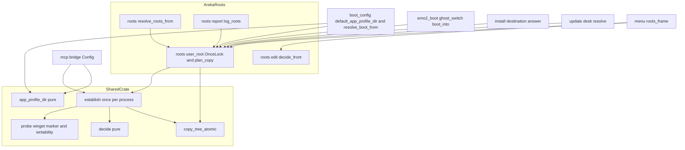
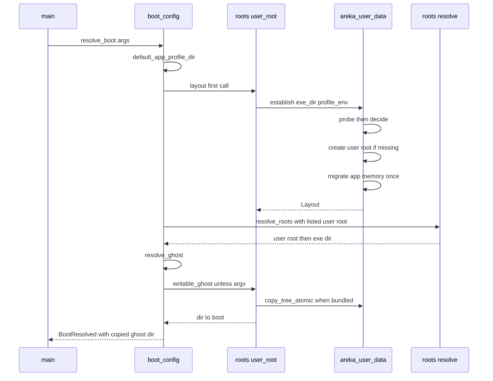
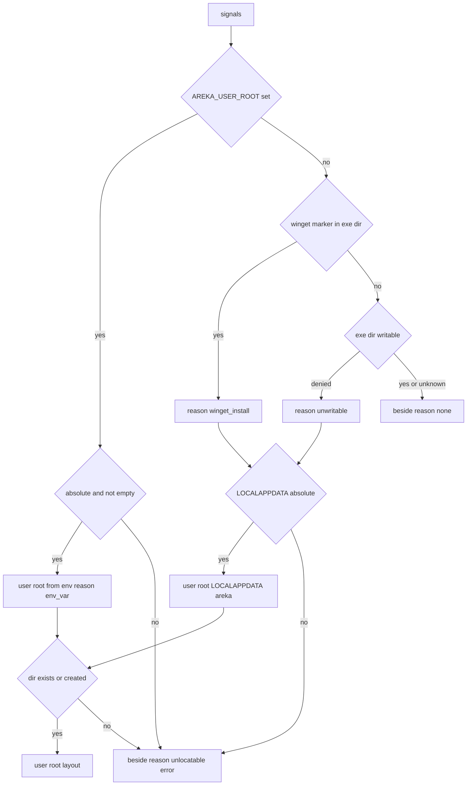
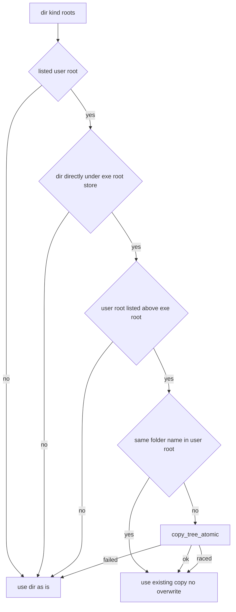

# 設計: areka-P0-user-data-root

> 実測は 2026-10-16・この枝（main `0bb51d42` の上）。コードは関数名・型名＋ファイルパスで指す。
> 入力: `requirements.md`（要件 1〜10・2026-10-16 の討議の裁定を含む）・`research.md`（ギャップ分析と設計の調べ）・`brief.md`・steering（`product.md`・`tech.md`・`structure.md`・`logging.md`）。

## Overview

**目的**: winget で入れた利用者と、`areka.exe` のフォルダに書けない利用者の物（後から入れたゴースト・バルーン、areka の記憶、ゴーストの記憶、中継の控え）を、入れ先のフォルダの外の「書ける根」（既定 `%LOCALAPPDATA%\areka\`）に置き、winget の上げ直し・外し方で消えないようにし、機械の全員向けでも普段の権限で書けるようにする。

**利用者**: winget（利用者向け・機械の全員向け）で入れた利用者、書けない場所へ zip を展開した利用者。zip を展開して書ける場所で使う今の利用者は、何も変わらない（記録の行 2 つとメニューの項目 1 つだけ増える）。

**変えること**: 起動のはじめに「書ける根を使う形か」を 1 回だけ決め（新しい小さなクレート `areka-user-data`）、使う形なら ⑴ 根の並びの先頭に書ける根を差し込み、⑵ areka の記憶と中継の控えを書ける根の `profile\areka\` へ移し（初回は実行ファイルの隣の記憶を写す）、⑶ 実行ファイルの隣の根の物へ書く必要が出る直前（起こす・入れ直す・更新する）に、その物を書ける根へ丸ごと写して写しの方を使う。メニューに「置き場を先頭へ ▸」を足す。

### Goals

- 書ける根を使う形では、areka と中継が実行ファイルのフォルダの下に作る・書き換える物が 0（要件 4.1）。
- 書ける根を使う形かどうかの判断・場所・並び・写す判断・記憶の置き場を、値だけで赤にできる（要件 10.1〜10.6）。
- zip を展開して書ける場所で使う形は、記録の行とメニューの項目のほかは変わらない（要件 1.4・7.1）。

### Non-Goals

- 書けないときに利用者へ知らせること（`areka-P0-write-failure-notice`）。
- `.nar` の展開・ネットワーク更新の手続きの中身（宛先の答え方だけを変える）。
- SHIORI がゴーストのフォルダの中のどこへ書くか（写しから起こすことで写しの中へ書かれる）。
- 設定画面・本体の設定ファイル・メッセージボックス・インストーラー版・`dist/winget/**`。
- 書ける根に残った作業フォルダの残骸（プロセスが写す途中で落ちたとき）の自動の片付け（下の「Open Questions / Risks」）。

## Boundary Commitments

### This Spec Owns

- 書けるかの確かめの部品 `areka_user_data::open_dir_for_add`（`write-failure-notice` も自前の確かめを作らずこれを呼ぶ・2026-10-16 打ち合わせ）。
- 書ける根を使う形かどうかの判断（winget の入れ先・書けない・環境変数 `AREKA_USER_ROOT`・どれでもない）と、その理由の記録。
- 書ける根の場所の決め方（`AREKA_USER_ROOT` → `%LOCALAPPDATA%\areka\`）と、書ける根のフォルダを作ること。
- areka の記憶の置き場の既定（`AREKA_PROFILE_DIR` が無いとき）と、実行ファイルの隣の記憶の一度きりの引き継ぎ。
- 中継の控えの置き場の決め方を、areka と同じ関数で決めること。
- 既定の根の並びへの書ける根の差し込み（既定の腕・記憶の腕）と、並びの記録の「書ける根」の印。
- 「実行ファイルの隣の根の物を、書く前に書ける根へ写す」判断と写す手続き（作業フォルダで組んで 1 手で入れ替える）。フックは 4 か所（最初の起動・切替・インストールの宛先・バルーンの更新の対象）。
- メニューの「置き場を外す ▸」で書ける根を選べなくすること、「置き場を先頭へ ▸」の項目と並びの判断。
- `dist/README.txt` の「■ 右クリックメニュー」「■ 置き場」「■ 記憶の置き場」の該当行、`doc/COMPAT_ARCHITECTURE.md` §8 の根と記憶の行、後続 spec の brief への申し送り、実機の確かめの記録。

### Out of Boundary

- 根の並びの値の形・上から探す規則・隠れの規則・「置き場を追加…」（完了 `areka-P0-baseware-root-list`）。記憶の綴り `<exe>`・`|` は変えない。
- 並びを記憶へ書けなかったときの扱いと知らせ（`write-failure-notice`。`roots/edit.rs` の `apply` の形〔`fn apply(world, roots, exe_dir)`・戻り値 `()`〕は変わらず、書けなかった結果は `apply` の中で向こうの致命の道 `write_failure::fatal` へ渡る＝2026-10-16 向こうの設計の討議・コミット `0af52066`）。
- 記憶を書ける根の `profile\areka\` へ書けないときの起動の止め方（`write-failure-notice` の書けるかの確かめ。こちらの写しの後に走る）。
- `.update-work`・`.nar-work` の中身と片付け（宛先の根が変わるだけ）。
- winget が残す PATH の項目・`dist/winget/**`・`InstallationNotes` を外す作業（`winget-release-automation`）。
- ゴーストの記憶とシェルの記憶の場所の規則（`areka-ghost` の `profile_areka_root`）。変えない。

### Allowed Dependencies

- 新しいクレート `crates/areka-user-data` は `std` と `tracing`（ワークスペースの版）だけに依存する。`areka`・`areka-ghost`・`areka-mcp` には依存しない。
- `areka` → `areka-user-data`（path 依存）。`areka-mcp-bridge` → `areka-user-data`（path 依存）。外部（crates.io）の依存は増えない（要件 7.6）。
- `areka` の側の写す判断は `areka_ghost::{BasewareRoots, StoreKind, same_root}` を使う。
- 「書ける根だ」の印 `RootMark` は `areka-ghost`（`catalog.rs` の `BasewareRoot`）に置く。`areka-ghost` は `areka-user-data` に依存しない（印は `from_env: bool` だけを持つ）。
- テストは `temp-path-kit`（ワークスペースの `target\` の下の一時フォルダ）を使う。
- 依存の向き: `areka-user-data`（型・判断・手続き） → `areka::roots::user_root`（プロセスに 1 つの形と写す判断） → 呼び手（`boot_config`・`roots`・`menu`・`install`・`update`・`emo2_boot`）。逆向きの import は誤り。

### Revalidation Triggers

- `areka-user-data` の公開の型（`Layout`・`Reason`・`UserRoot`）や `app_profile_dir` の規則が変わる → 中継（`areka-mcp-bridge`）と areka の両方のテストを通し直す。
- `open_dir_for_add` の形（引数・`std::io::Result<()>`）が変わる → `write-failure-notice` の `write_failure::probe_dir` が照らし直す（向こうの「起動の前の確かめ」のタスクはこの口が main に在ることを待つ）。
- `write-failure-notice` が `roots/edit.rs` の `apply` の形を変える → 「置き場を先頭へ ▸」のタスク（最後）を新しい形に合わせる。
- `resolve_roots_from` の引数が変わる → `dev-folder-alias`（同じ `roots/{mod,resolve}.rs`）が照らし直す。
- `BasewareRoot` に印 `RootMark` が足される → `BasewareRoot` を等しさで比べるテストと、並びを組み直す呼び手（今の項目を複写せず `BasewareRoot::new` で作り直すと印が消える）を照らし直す。
- 書ける根の中のフォルダの並び（`ghost\`・`balloon\`・`.nar-work\`・`.copy-work\`・`profile\`・`mcp-bridge\`）が変わる → 説明書と `winget-release-automation` の申し送りを直す。
- winget の控えのファイルの名前の規則（`<名乗り>_<出どころ>.db`）が変わる → winget の入れ先の見分けを照らし直す。

## Architecture

### Existing Architecture Analysis

- 根の並びは `crates/areka/src/roots/resolve.rs` の `resolve_roots_from(env, memory, exe_dir)`（純粋）で決まり、`roots/mod.rs` の `resolve_roots` だけがプロセスの環境変数と記憶を読む。新しく入れる物は `areka_ghost::catalog_roots::install_root` が「見えている根・無ければ見つかるいちばん上の根」と答え、作業フォルダ（`areka-nar` の `.nar-work`）もその根の下になる。＝書ける根を並びの先頭に置き、かつ実在させておけば、新しく入れる物と作業フォルダは何も足さずに書ける根へ行く（要件 4.2）。
- areka の記憶の置き場は `crates/areka/src/boot_config.rs` の `default_app_profile_dir()` が呼ぶたびに決める。`main.rs` はこれを呼んで `BootContext.app_profile_dir` を詰めるだけ＝関数の中身を替えれば `main.rs` に触らずに全部の読み手（起動・ゴーストの起動入力・SHIORI の受け口・並びの読み書き）がそろう（要件 5.6）。
- 実行ファイルの場所は `boot_config::exe_location()` が `OnceLock` で 1 回だけ解く。「1 回だけ決めて覚える」の前例として、書ける根の形も同じ型で覚える。
- ゴーストの記憶・シェルの記憶は、渡されたゴーストのフォルダから導かれる（`areka_ghost::sylphya_wiring::profile_areka_root`）。写しから起こせば写しの中になる（要件 7.3）。
- 中継（`crates/areka-mcp-bridge/src/config.rs` の `Config::from_values`）は、areka の記憶の置き場の決め方を自分で写し持っている。これを共有の関数に替える。
- `crates/areka/src` には `lib.rs` が無く、モジュールは `main.rs` で宣言する。新しい areka の側のモジュールは `main.rs` に触らないよう `roots/` の下（`roots/mod.rs` が宣言）に置く。

### Architecture Pattern & Boundary Map



**Architecture Integration**:
- 選んだ形: ギャップ分析の案 C（判断・場所・記憶の引き継ぎ・写す手続きは共有の小さなクレート、プロセスに 1 つの形と写す判断は `roots/user_root.rs`、並びは `resolve_roots_from` の入力を 1 つ足す、フックは 4 か所に 1 行ずつ）。
- 共有のクレートにする理由: 要件 6.1 は中継に「areka と同じ規則」を求める。判断を 2 か所に写すと食い違いが黙って生まれる（中継の今の `from_values` がその前例）。中継は `areka` に依存できない（別の exe・依存は `areka-mcp` だけ）ので、両方が依存できる葉のクレートに置く。`areka-mcp` は MCP の部品で意味がずれるので使わない。
- 写す判断をフック 4 か所で同じ 1 つの関数 `writable_copy` に通す（呼び手ごとに条件を書かない）。
- 守る前例: `OnceLock` で 1 回だけ決める（`exe_location`）・作業フォルダで組んで `rename` で入れ替える（`areka-nar`）・上の根が下の同じフォルダ名を隠す（`catalog_roots`）・純粋な判断と薄い読み口を分ける（`resolve_roots_from`／`resolve_roots`）。
- steering: ログ優先（失敗は `error!`／`warn!`＋値で返す）・メッセージボックス 0・環境変数は `AREKA_` で始めドメインの語で名付ける・1 ファイル 1,000 行以下・テストは兄弟ファイル。

### Technology Stack

| Layer | Choice / Version | Role in Feature | Notes |
|-------|------------------|-----------------|-------|
| 判断と手続き | 新クレート `areka-user-data`（Rust 2024・ワークスペースの版） | 形の判断・場所・記憶の置き場・写す手続き | 依存は `std`・`tracing` だけ。`publish = false` |
| OS の入口 | `std::os::windows::fs::OpenOptionsExt`（`access_mode`・`custom_flags`） | 実行ファイルのフォルダに書けるかを、何も作らずに確かめる | `windows` クレートの機能は足さない（定数は 3 つの数値） |
| 利用者ごとの場所 | 環境変数 `LOCALAPPDATA` | 書ける根の既定 | 中継の今の前例と同じ読み方 |
| 記録 | `tracing`（ワークスペースの版） | 形・理由・写し・引き継ぎの記録 | 共有のクレートの文は ASCII（中継が標準エラーへ出すため） |

新しい外部依存は 0（要件 7.6）。

## File Structure Plan

### Directory Structure

```
crates/areka-user-data/              # 新: 書ける根の形の判断と手続き（areka と中継が共有する葉のクレート）
├── Cargo.toml                       # std と tracing だけ・publish = false
└── src/
    ├── lib.rs                       # 定数・型・decide（純粋）・app_profile_dir（純粋）
    ├── lib_tests.rs                 # 判断・場所・記憶の置き場の決定論テスト
    ├── establish.rs                 # probe（薄い I/O）・establish（1 プロセス 1 回・引き継ぎ）・open_dir_for_add（実装で lib.rs から分けた）
    ├── establish_tests.rs           # 見分け・準備・引き継ぎの決定論テスト（target\ の下）
    ├── copy.rs                      # copy_tree_atomic（作業フォルダで組んで rename・半端を残さない）
    └── copy_tests.rs                # 写す手続きの決定論テスト（target\ の下）

crates/areka/src/roots/
├── user_root.rs                     # 新: プロセスに 1 つの形（OnceLock）・並びに入れる書ける根・写す判断 plan_copy（純粋）と writable_copy
└── user_root_tests.rs               # 新: plan_copy の分岐・AREKA_ROOT のときの扱いの決定論テスト

crates/areka/src/
└── boot_config_copy_tests.rs        # 新（実装で足した）: 最初の起動のゴーストを写しへ替えるテスト（BootHook）

crates/areka/src/emo2_boot/
├── switch_copy.rs                   # 新: 切替の写しを背景のスレッドで走らせ、写し終わりを UI スレッドへ知らせる（段「写し待ち」）
└── switch_copy_tests.rs             # 新: 写す要の有無・写し終わりの前後で前のゴーストが止まったときの決定論テスト

.kiro/specs/areka-P0-user-data-root/verification/
└── winget-user-data-check.md        # 新: winget で入れた形と zip の形の実測の記録（要件 9.1・10.8〜10.10）
```

### Modified Files

- `crates/areka-ghost/src/catalog.rs` — `BasewareRoot` に印 `mark: RootMark`（`Plain`／`UserRoot { from_env: bool }`）と口 `BasewareRoot::user_root(dir, from_env)`・`mark()` を足す。`new(dir)` は `Plain`（今の呼び手は変わらない）。
- `crates/areka/Cargo.toml` — `areka-user-data = { path = "../areka-user-data" }` を足す。
- `crates/areka/src/roots/mod.rs` — `pub(crate) mod user_root;` を宣言し、`resolve_roots` が `user_root::listed_user_root()` を `resolve_roots_from` へ渡す（プロセスの形を読むのはここと `default_app_profile_dir` だけ）。
- `crates/areka/src/roots/resolve.rs` — `resolve_roots_from` に第 4 引数 `user_root: Option<&UserRoot>` を足し、既定の腕と記憶の腕で先頭へ差し込み、その項目に印を付ける（要件 3.1・3.2・3.4）。
- `crates/areka/src/roots/resolve_tests.rs` — 既存の呼び出しへ `None` を足し、差し込みと印の分岐のテストを足す。
- `crates/areka/src/roots/report.rs` — `log_roots` の口は今のまま。`root_listed` の行に、項目の印から `user_root` 欄（`default`／`env_var`）を足す（`edit.rs` の呼び出しを変えずに印が付く）。
- `crates/areka/src/roots/report_tests.rs` — 印の付く行・付かない行のテスト。
- `crates/areka/src/boot_config.rs` — `default_app_profile_dir` の中身を共有の `app_profile_dir` に替える。`resolve_boot_from` に写しの口 `prepare_ghost: fn(&BasewareRoots, &Path) -> PathBuf` を足し、argv でない経路のゴーストを写しへ替える。`resolve_boot` は `user_root::writable_ghost` を渡す。
- `crates/areka/src/boot_config_roots_tests.rs` — `resolve_boot_from` の呼び出しへ写しの口（素通し）を足し、「argv では写しの口を呼ばない」「argv でなければ写した先のフォルダでバルーンと構成入力を決める」のテストを足す。
- `crates/areka/src/emo2_boot/ghost_switch.rs` — 受理の直後に `switch_copy::start` を呼んで予約に持たせ、`switch_to` の先頭で写し待ちなら段を「写し待ち」にして戻る（数行・本体は `switch_copy.rs`）。`switch_to_default`（既定への戻し・非常口）は `boot_into` の前に同期の `writable_copy` を通す。
- `crates/areka/src/emo2_boot/mod.rs` — `switch_copy` の宣言だけ。写し終わりは、今の取り出しの系 `drain_change_requests`（`ghost_switch.rs` の中）の先頭で `switch_copy::poll(world)` を呼んで受け取る（系は増やさない＝「入力の段の系はちょうど 1 つ」のテストを保つ）。
- `crates/areka/src/install/destination.rs` — `CatalogDestinations::answer` が、見えている物が実行ファイルの隣の根に在るとき `writable_copy` を通してから根を答える（インストールは背景のスレッド）。
- `crates/areka/src/update/mod.rs`・`update/worker.rs`・`update/procedure.rs` — `update/desk.rs` の `resolve` は値の関数のまま（触らない）。`update/mod.rs` の `judge` が更新の仕事 `UpdateJob` に並び（`roots`）と実行ファイルのフォルダ（`exe_dir`）を持たせ、`update/procedure.rs` の `run_order` が照会（リソースの照会）の後・対象を扱う前に口 `UpdatePorts::prepare_targets` を呼ぶ。本番の口（`update/worker.rs`）が、`homeurl` を持つバルーンの対象を `copy_for_write(&roots, exe_dir, StoreKind::Balloon, &dir)` へ通して答えのフォルダへ替える（実装で確定した分け方）。
- `crates/areka/src/menu/roots_frame.rs` — 「置き場を外す ▸」の子のうち書ける根（印の付いた項目）を選べない形にする（要件 3.3）。「置き場を先頭へ ▸」の供給関数 `front_item` を足す（要件 3.7・3.8・最後のタスク）。
- `crates/areka/src/menu/mod.rs`・`menu/captions.rs`・`menu/plan.rs` — 枠 `Frame::RootFront`（「置き場を追加…」と「置き場を外す」の間）・既定名「置き場を先頭へ」・区切りの群 1（最後のタスク）。並び順を固定しているテスト（`menu/mod_registry_tests.rs`・`menu/plan_tests.rs`・`menu/roots_frame_tests.rs`）を 10 枠に直す。
- `crates/areka/src/roots/edit.rs`・`roots/edit_tests.rs` — **約束の外（下の節）**。`decide_front`（純粋）と UI スレッドの入口 `move_to_front` を足し、今の `apply` を呼ぶ（最後のタスク）。
- `crates/areka-mcp-bridge/Cargo.toml`・`src/config.rs`・`src/config_tests.rs` — `from_env` が隣に `areka.exe` が在るとき `areka_user_data::establish` と `app_profile_dir` で置き場を決め、`from_values` は `exe`・`areka_beside` の代わりに決まった記憶の置き場 `beside_profile: Option<PathBuf>` を受ける。
- `dist/README.txt` — 「■ 右クリックメニュー」（10 項目・「置き場を先頭へ」・並べ替えの行）・「■ 置き場」・「■ 記憶の置き場」。**見出し「■ 記憶の置き場」の綴りは変えない**（`write-failure-notice` の知らせがこの見出しを指す）。
- `doc/COMPAT_ARCHITECTURE.md` — §8 の「ベースウェアの格納フォルダ（根）を複数持つ形」の行に、書ける根・既定の並び・写しの規則・記憶の置き場を足す。
- `.kiro/specs/winget-release-automation/brief.md` — 申し送りの節を足す（要件 9.2）。

### 約束の外で触るファイル（ウェーブ C8 の約束: `main.rs`・`boot_resolve.rs`・`roots/edit.rs` に触らない）

| ファイル | 触る理由 | 置き方 |
|---|---|---|
| `crates/areka/src/roots/edit.rs`（と `edit_tests.rs`） | 「置き場を先頭へ ▸」（要件 3.7〜3.9）は並びを変える手続き＝今の `decide_add`／`decide_remove` と同じ所に判断を置き、同じ `apply` で起動の文脈・記憶・記録を書き換えるのが本質の形。メニューの側で並びを組み替えて `apply` を迂回すると、記憶へ書く口と「書けなかった結果」の受け渡し（要件 3.9）が 2 つに割れる | **最後のタスク**（向こうの着地は待たない）。`apply` の形は変わらない（向こうの設計の討議で確定）ので、今の `apply` を呼ぶだけで要件 3.9 を満たす。着地の順はこちらが先（向こうの「起動の前の確かめ」のタスクがこちらの `open_dir_for_add` を待つ片向きの待ち。こちらが向こうを待つと互いに待ち合う）。触るのは `apply` の外（`decide_front`・`move_to_front` を足すだけ）で、向こうは `apply` の中身を変える＝後に着地する側が main を取り込んで合わせる。「置き場を先頭へ ▸」のメニューの項目（`menu/*`）も同じタスクに入れる（入口が無いまま項目だけ出さない） |
| `crates/areka/src/main.rs` | 触らない | 記憶の置き場は `default_app_profile_dir` の中身で替わり、書ける根は `OnceLock` の口から読む。新しいモジュールは `roots/` の下に置く |
| `crates/areka/src/boot_resolve.rs` | 触らない | 写しのフォルダを渡せば `ghost_roots`・`read_last_balloon`・`decide_boot_shell` は今のまま写しを読む |

## System Flows

### 起動の流れ（形の決定 → 並び → ゴースト → 写し）



- 形はプロセスで 1 回だけ決まる（最初の呼び手は `resolve_boot` の `default_app_profile_dir`）。書ける根のフォルダは並びを組む前に作る（`RootStatus.found` が `is_dir` で決まり、作る前に組むと書ける根が「見つからない」になって新しく入れる物が実行ファイルの隣へ行くため）。
- `write-failure-notice` の書けるかの確かめは、`resolve_boot` の後（`main` の中）に走る＝こちらの写しの後になる（打ち合わせのとおり）。

### 形の判断（要件 1・2）



### 写す判断（要件 4.3〜4.9）



- 「書ける根が実行ファイルの隣の根より上に在る」を条件にするのは、写しが上の根として下の同梱の物を隠す（`catalog_roots` の隠れの規則）ときだけ写しが一覧・切替・更新と食い違わないため。メニューでは実行ファイルの隣が書ける根より上に来る道は無い（足すのは末尾・書ける根は外せない・「置き場を先頭へ ▸」で実行ファイルの隣を選べない＝要件 3.8）。この条件は、記憶を手で書き替えた場合の守りとして残す。
- 「書ける根」は並びの項目の印（`RootMark::UserRoot`）で見分ける。印の無い並び（テスト・`AREKA_ROOT`・今の形）では、どのフックも写さない。

## Requirements Traceability

| Requirement | Summary | Components | Interfaces | Flows |
|-------------|---------|------------|------------|-------|
| 1.1 | winget の入れ先なら書ける根を使う | UserDataCore | `probe`・`decide`（`Reason::WingetInstall`） | 形の判断 |
| 1.2 | 書けなければ書ける根を使う | UserDataCore | `exe_dir_writability`・`decide`（`Reason::Unwritable`） | 形の判断 |
| 1.3 | 環境変数で書ける根を使う | UserDataCore | `decide`（`Reason::EnvVar`） | 形の判断 |
| 1.4 | どれでもなければ今と同じ | UserDataCore・UserRootContext | `Layout.user_root == None`・`listed_user_root() == None` | 形の判断 |
| 1.5 | 形と理由を info に残す | UserDataCore | `establish` の `user_data_layout` | 起動の流れ |
| 1.6 | 尋ねない | UserDataCore | 画面・ダイアログ 0（`establish` は値と記録だけ） | — |
| 2.1 | 既定は `%LOCALAPPDATA%\areka\` | UserDataCore | `decide`（`UserRootOrigin::Default`） | 形の判断 |
| 2.2 | 無ければ作って info | UserDataCore | `establish` の `user_root_created` | 起動の流れ |
| 2.3 | `AREKA_USER_ROOT` で上書き | UserDataCore | `USER_ROOT_ENV` | 形の判断 |
| 2.4 | 決められない・作れないなら今の形で error | UserDataCore | `Reason::Unlocatable`・`user_root_unavailable` | 形の判断 |
| 2.5 | ほかの根と同じ形 | RootsResolveExt | `BasewareRoot::new(user_root.dir)` | — |
| 3.1 | 既定は「書ける根 → 実行ファイルの隣」 | RootsResolveExt | `resolve_roots_from` 第 4 引数 | 起動の流れ |
| 3.2 | 記憶の並びに無ければ先頭へ・在れば記憶の順 | RootsResolveExt | 同上（記憶の腕） | — |
| 3.3 | 「置き場を外す ▸」で書ける根を選べない | RootsMenu | `remove_item` | — |
| 3.4 | `AREKA_ROOT` では足さず写さない | UserRootContext・RootsResolveExt | `listed_user_root()`・環境変数の腕 | 写す判断 |
| 3.5 | 既定の並びを記憶に書かない | RootsResolveExt | 書く口を足さない（今のまま） | — |
| 3.6 | 並びの記録に書ける根の出どころ | RootsReportExt | `log_roots` の `user_root` 欄（項目の印から） | — |
| 3.7 | 「置き場を先頭へ ▸」で先頭へ動かし記憶に書き info | RootsFront・RootsMenu | `decide_front`・`move_to_front`・`apply` | — |
| 3.8 | 子は全部・今の先頭は選べない・env と 1 つは項目ごと選べない・両方の形で出す | RootsMenu | `front_item` | — |
| 3.9 | 書けなかった結果を受け口へそのまま | RootsFront | 今の `apply` を呼ぶ（書けなかった結果は `apply` の中で `write_failure::fatal` へ渡る） | — |
| 4.1 | 実行ファイルの下に作る物 0 | 全フック・BridgeConfig | 下の「書く経路の表」 | 写す判断 |
| 4.2 | 新しく入れる物と作業フォルダは書ける根へ | RootsResolveExt | `install_root` の「いちばん上」（今のまま） | — |
| 4.3 | 起こす前に写して写しを起こす | BootHook・SwitchHook・UserRootContext | `writable_ghost`・`writable_copy` | 起動の流れ・写す判断 |
| 4.4 | 書く前に写して写しへ書く | InstallHook・UpdateHook | `writable_copy` | 写す判断 |
| 4.5 | 表示だけのバルーンは写さない | — | `resolve_balloon_for_ghost` にフックを置かない | — |
| 4.6 | 写した元と先を info | CopyTree・UserRootContext | `user_data_copied` | — |
| 4.7 | 途中の失敗で半端を残さず元を使い error | CopyTree・UserRootContext | `CopyError`・`user_data_copy_failed` | 写す判断 |
| 4.8 | 書ける根に在れば写さず使う | UserRootContext | `CopyPlan::UseExisting` | 写す判断 |
| 4.9 | 写しを上書きしない | UserRootContext | 写すのは同じフォルダ名が無いときだけ | 写す判断 |
| 5.1 | `AREKA_PROFILE_DIR` は今どおり | UserDataCore | `app_profile_dir` の第 1 段 | — |
| 5.2 | 書ける根の `profile\areka\` | UserDataCore | 同上の第 2 段 | — |
| 5.3 | 使わない形は実行ファイルの隣 | UserDataCore | 同上の第 3 段 | — |
| 5.4 | 実行ファイルの隣の記憶を一度だけ写す | UserDataCore・CopyTree | `establish` の引き継ぎ | 起動の流れ |
| 5.5 | 写せなければ書ける根を置き場に error | UserDataCore | `app_memory_migrate_failed` | — |
| 5.6 | 置き場は全部の読み手で 1 つ | ProfileDirHook | `default_app_profile_dir`（`OnceLock` の形から導く） | — |
| 6.1 | 中継は areka と同じ規則で `mcp-bridge\` | BridgeConfig | `establish`・`app_profile_dir` | — |
| 6.2 | 隣に `areka.exe` が無ければ今どおり | BridgeConfig | `from_values` の第 3 段（`%LOCALAPPDATA%\areka`） | — |
| 6.3 | 決められなければ控えなしで warn | BridgeConfig | 今の `from_env` の warn | — |
| 7.1 | 使わない形は今と同じ | 全体 | `listed_user_root() == None`＝並びに印の付いた項目が無く、全フックが素通し | — |
| 7.2 | 実行ファイルの隣の根を残し、物を移さない | RootsResolveExt | 並びに残す・写しは書く前だけ | — |
| 7.3 | ゴースト・シェルの記憶の場所の規則を変えない | — | `profile_areka_root` を変えない | — |
| 7.4 | argv の起動は写さない | BootHook | `route == GhostRoute::Argv` で写しの口を呼ばない | — |
| 7.5 | 名乗り `Areka.Areka.Portable` に関わる物を変えない | UserDataCore | 控えの見分けは名乗りを読むだけ | — |
| 7.6 | 外部依存・設定画面・設定ファイル・メッセージボックス 0 | 全体 | Technology Stack | — |
| 8.1 | 「■ 置き場」と「置き場を先頭へ」 | Docs | `dist/README.txt` | — |
| 8.2 | 「■ 記憶の置き場」の 2 つの形 | Docs | 同上 | — |
| 8.3 | シェルの記憶の行を確かめて書く | Docs | `PersistScope::Shell` の書き手の確かめ | — |
| 8.4 | 0.0.2 からの最初の上げ直しの注意 | Docs | 同上（9.1 の結果） | — |
| 8.5 | `doc/COMPAT_ARCHITECTURE.md` | Docs | §8 の行 | — |
| 9.1 | 最初の上げ直しで消える物を数える | Verification | `verification/winget-user-data-check.md` | — |
| 9.2 | 後続 brief への申し送り | Docs | `winget-release-automation/brief.md` | — |
| 9.3 | `dist/winget/**` を書き替えない | — | 触るファイルに入れない | — |
| 10.1 | 形の判断のテスト | UserDataCore | `lib_tests.rs` | — |
| 10.2 | 場所の決め方のテスト | UserDataCore | `lib_tests.rs` | — |
| 10.3 | 並びのテスト | RootsResolveExt・RootsMenu・RootsFront・UserRootContext | `resolve_tests.rs`・`roots_frame_tests.rs`・`edit_tests.rs`・`user_root_tests.rs` | — |
| 10.4 | 写す判断のテスト | UserRootContext・CopyTree | `user_root_tests.rs`・`copy_tests.rs` | — |
| 10.5 | 記憶の置き場と引き継ぎ・中継のテスト | UserDataCore・BridgeConfig | `lib_tests.rs`・`config_tests.rs` | — |
| 10.6 | 値の注入・環境変数を書き換えない・`target\` の下 | 全テスト | `Signals`・並びの項目の印（`RootMark`）・`temp-path-kit` | — |
| 10.7 | 判断の分岐に限る | 全テスト | 下の Testing Strategy | — |
| 10.8 | winget で入れた形の実測 | Verification | 実測の記録 | — |
| 10.9 | zip の形の実測 | Verification | 同上 | — |
| 10.10 | 自分が起こしたプロセスだけ止める | Verification | 手順の縛り | — |

### 書く経路の表（要件 4.1 の「0」の根拠）

書ける根を使う形（`AREKA_ROOT` 無し・既定の並び）で、areka と中継が書く物の行き先。

| 書く物 | 行き先を決める所 | 行き先 |
|---|---|---|
| areka の記憶（最後のゴースト・印・並び） | `default_app_profile_dir` | `<書ける根>\profile\areka\` |
| 中継の控え | `areka-mcp-bridge` の `Config::from_env` | `<書ける根>\profile\areka\mcp-bridge\` |
| 新しく入れるゴースト・バルーンと `.nar-work` | `install_root`（先頭の見つかる根） | `<書ける根>\` |
| 同梱の物の入れ直し・シェル・supplement | `CatalogDestinations::answer` → `writable_copy` | `<書ける根>\` の写し |
| 起こしたゴーストの記憶・SHIORI の書き残し・シェルの記憶 | 起こしたフォルダ（`writable_ghost`／`boot_into` の `writable_copy`） | 写しの中 |
| ゴースト・シェルのネットワーク更新（`.update-work` を含む） | 起こしたフォルダ | 写しの中 |
| バルーンのネットワーク更新（`.update-work` を含む） | `update/procedure.rs` の `run_order` が照会の後に呼ぶ `UpdatePorts::prepare_targets`（本番は `update/worker.rs`）→ `copy_for_write` | `<書ける根>\balloon\` の写し |
| 書けるかの確かめ | `exe_dir_writability`（中は `open_dir_for_add`） | 何も作らない（ハンドルを開いて閉じるだけ） |
| 写しの作業 | `copy_tree_atomic` | `<書ける根>\.copy-work\` |

例外（数に入れない・要件の字面どおり）: `AREKA_ROOT` の並び（要件 3.4・4.1）、argv の起動（要件 7.4）、写しに失敗したときの元の場所（要件 4.7）。「置き場を先頭へ ▸」で実行ファイルの隣を書ける根より上へ動かすことはできない（要件 3.8）ので、例外に入らない。

## Components and Interfaces

| Component | Domain/Layer | Intent | Req Coverage | Key Dependencies (P0/P1) | Contracts |
|-----------|--------------|--------|--------------|--------------------------|-----------|
| UserDataCore | `areka-user-data`（lib.rs・establish.rs） | 形の判断・場所・記憶の置き場・一度きりの準備 | 1.1〜1.6, 2.1〜2.4, 5.1〜5.5, 6.1, 7.5 | std (P0), tracing (P1) | Service, State |
| CopyTree | `areka-user-data`（copy.rs） | 木を半端なく写す | 4.6, 4.7, 5.4, 5.5 | std (P0) | Service |
| UserRootContext | `areka::roots::user_root` | プロセスに 1 つの形・並びに入れる書ける根・写す判断 | 1.4, 3.4, 4.3〜4.9, 7.1 | UserDataCore (P0), areka-ghost (P0) | Service, State |
| RootsResolveExt | `areka::roots::resolve` | 書ける根を並びへ差し込む | 2.5, 3.1, 3.2, 3.4, 3.5, 4.2, 7.2 | UserDataCore 型 (P0) | Service |
| RootsReportExt | `areka::roots::report` | 並びの記録に書ける根の印 | 3.6 | UserRootContext (P1) | Service |
| ProfileDirHook | `areka::boot_config` | 記憶の置き場を 1 つに | 5.1〜5.3, 5.6 | UserDataCore (P0), UserRootContext (P0) | Service |
| BootHook | `areka::boot_config::resolve_boot_from` | 最初の起動のゴーストを写しへ | 4.3, 7.4 | UserRootContext (P0) | Service |
| SwitchHook | `areka::emo2_boot::ghost_switch::boot_into`・`emo2_boot::switch_copy` | 切替・既定への戻しのゴーストを写しへ | 4.3 | UserRootContext (P0) | — |
| InstallHook | `areka::install::destination` | 入れ直し・シェル・supplement の宛先を写しへ | 4.4 | UserRootContext (P0), areka-nar (P1) | — |
| UpdateHook | `areka::update::procedure`（`UpdatePorts::prepare_targets`・本番は `update::worker`） | バルーンの更新の対象を写しへ | 4.4 | UserRootContext (P0) | — |
| RootsMenu | `areka::menu::roots_frame` 他 | 書ける根を外せない・「置き場を先頭へ ▸」 | 3.3, 3.8 | UserRootContext (P1), RootsFront (P0) | — |
| RootsFront | `areka::roots::edit` | 先頭へ動かす判断と適用 | 3.7, 3.9 | `apply`（形は今のまま・中で `write_failure::fatal`） (P0) | Service |
| BridgeConfig | `areka-mcp-bridge::config` | 控えの置き場を areka と同じ関数で | 6.1〜6.3 | UserDataCore (P0) | Service |
| Docs | `dist/README.txt` 他 | 説明書・互換表・申し送り | 8.1〜8.5, 9.2, 9.3 | — | — |
| Verification | `verification/winget-user-data-check.md` | 実測の記録 | 9.1, 10.8〜10.10 | 開発者の手 (P0) | — |

### areka-user-data（共有の葉のクレート）

#### UserDataCore

| Field | Detail |
|-------|--------|
| Intent | 書ける根を使う形かどうかと場所を値で決め、プロセスのはじめに 1 回だけ書ける根を作り記憶を引き継ぐ |
| Requirements | 1.1, 1.2, 1.3, 1.4, 1.5, 1.6, 2.1, 2.2, 2.3, 2.4, 5.1, 5.2, 5.3, 5.4, 5.5, 6.1, 7.5 |

**Responsibilities & Constraints**
- 判断（`decide`）と記憶の置き場（`app_profile_dir`）は純粋（値だけ）。プロセスの環境変数と実行ファイルのフォルダを読むのは `probe` だけ。
- `establish` は 1 プロセスで 1 回呼ぶ（呼び手が覚える）。書ける根を作る・記憶を引き継ぐ・記録を残す。利用者には何も尋ねない（要件 1.6）。
- 記録の文は ASCII（中継が標準エラーへ出すため）。`event` 欄の名前は下の表のとおり。

**Contracts**: Service [x] / State [x]

##### Service Interface

```rust
/// 書ける根の場所を指す環境変数（要件 2.3）。在れば 1.1・1.2 に関わらず書ける根を使う（要件 1.3）。
pub const USER_ROOT_ENV: &str = "AREKA_USER_ROOT";
/// areka の記憶の置き場を指す環境変数（今のまま・要件 5.1）。
pub const PROFILE_DIR_ENV: &str = "AREKA_PROFILE_DIR";
/// winget の控えのファイルの名前の頭（`<名乗り>_<出どころ>.db`・要件 1.1・7.5）。
pub const WINGET_MARKER_PREFIX: &str = "Areka.Areka.Portable_";
/// 既定の書ける根の、`LOCALAPPDATA` の下のフォルダ名（要件 2.1）。
pub const USER_ROOT_DIR_NAME: &str = "areka";
/// 写しの作業フォルダの棚（書ける根の直下）。
pub const COPY_WORK: &str = ".copy-work";

/// 実行ファイルのフォルダに書けるか（何も作らずに確かめた結果）。
pub enum Writability {
    Writable,
    /// 権限が無い（`PermissionDenied`）。
    Denied,
    /// 確かめられなかった（理由の文）。今の形のまま（書ける扱い）にして warn を残す。
    Unknown(String),
}

/// 判断の入力（すべて値）。`probe` が本物を詰め、テストは直接組む（要件 10.6）。
pub struct Signals {
    pub user_root_env: Option<std::ffi::OsString>,
    pub local_app_data: Option<std::ffi::OsString>,
    /// 実行ファイルのフォルダの直下に在った winget の控えのファイルの名前（`None`＝無い）。
    pub winget_marker: Option<String>,
    pub writability: Writability,
}

pub enum UserRootOrigin { Default, EnvVar }

pub struct UserRoot {
    /// 絶対パス。
    pub dir: std::path::PathBuf,
    pub origin: UserRootOrigin,
}

/// 書ける根を使う形にした理由（要件 1.5）。
pub enum Reason {
    WingetInstall { marker: String },
    Unwritable,
    EnvVar,
    /// どれでもない（zip を展開して書ける形）。
    Neither,
}

/// 書ける根を決められない理由（要件 2.4・作れないは `create` が記録する）。
pub enum Unlocatable {
    EnvEmpty,
    EnvRelative { value: std::path::PathBuf },
    LocalAppDataMissing,
    LocalAppDataRelative { value: std::path::PathBuf },
}

/// 判断の結果。
pub enum Decision {
    Beside { reason: Reason },                        // reason は Neither
    UserRoot { root: UserRoot, reason: Reason },
    /// 使う形に当たったが場所を決められない → 今の形で続ける（error）。
    Fallback { reason: Reason, error: Unlocatable },
}

/// プロセスに 1 つの形（`establish` の答え）。
pub struct Layout {
    /// `None`＝今の形（実行ファイルの隣）。
    pub user_root: Option<UserRoot>,
    pub reason: Reason,
}

/// 純粋な判断（要件 1.1〜1.4・2.1・2.3・2.4 の「決められない」）。作るのは establish。
/// 順: 環境変数 → winget の控え → 書けない → どれでもない。場所: 環境変数の値（空・相対は Unlocatable）
/// → `LOCALAPPDATA\areka`（無い・相対は Unlocatable）。
pub fn decide(signals: &Signals) -> Decision;

/// 本物の入力を読む薄い口（環境変数 2 つ・控えのファイル・書けるかの確かめ）。
pub fn probe(exe_dir: Option<&std::path::Path>) -> Signals;

/// フォルダに物を足せるかを、何も作らずに OS へ尋ねる（書けるかの確かめの唯一の部品）。
/// `access_mode(FILE_ADD_FILE | FILE_ADD_SUBDIRECTORY)`＋`custom_flags(FILE_FLAG_BACKUP_SEMANTICS)` で開いてすぐ閉じ、
/// OS の結果をそのまま返す。呼び手は `exe_dir_writability`（`Writability` へ写すだけ）と
/// `write-failure-notice` の `write_failure::probe_dir`（在るいちばん深いフォルダを選んで呼ぶ）。
pub fn open_dir_for_add(dir: &std::path::Path) -> std::io::Result<()>;

/// プロセスのはじめに 1 回: probe → decide → 書ける根を作る → 記憶の引き継ぎ → 記録。
/// `profile_env` は `AREKA_PROFILE_DIR` の値（在れば引き継がない＝記憶はそちら）。
pub fn establish(exe_dir: Option<&std::path::Path>, profile_env: Option<&std::ffi::OsStr>) -> Layout;

/// areka の記憶の置き場（要件 5.1〜5.3・6.1）。純粋。
/// `profile_env` → `<書ける根>\profile\areka` → `<exe_dir>\profile\areka` → `None`（exe_dir も無い）。
pub fn app_profile_dir(
    profile_env: Option<&std::ffi::OsStr>,
    layout: &Layout,
    exe_dir: Option<&std::path::Path>,
) -> Option<std::path::PathBuf>;
```

- Preconditions: `exe_dir` は実行ファイルの本当の場所の親（areka は `exe_location`、中継は `current_exe`）。
- Postconditions: `establish` が `user_root: Some` を返したとき、そのフォルダは実在する（作れなければ `None` にして error を残す）。
- Invariants: `decide` の答えは `Signals` だけで決まる。`Reason::Neither` のときは `user_root` が必ず `None`。

**probe の中身**
- winget の控え: `read_dir(exe_dir)` の直下のファイルで、名前が `WINGET_MARKER_PREFIX` で始まり `.db` で終わるもの（大小無視）。winget は zip の入れ先へ `<名乗り>_<出どころ>.db`（隠し属性・SQLite）を置く。綴りの頭が名乗りなので、手元のマニフェスト（`__DefaultSource`）・winget-pkgs（`_Microsoft.Winget.Source_8wekyb3d8bbwe`）・入れ先の根の付け替え（`portablePackageUserRoot`／`MachineRoot`）・`--location` のどれでも当たる。読めなければ「無い」として warn。
- 書けるか: `open_dir_for_add(exe_dir)`＝`OpenOptions` に `access_mode(FILE_ADD_FILE | FILE_ADD_SUBDIRECTORY)`（`0x2 | 0x4`）と `custom_flags(FILE_FLAG_BACKUP_SEMANTICS)`（`0x0200_0000`）を付けてフォルダのハンドルを開き、すぐ閉じる。`exe_dir_writability` はその結果を `Writability` へ写すだけ。権限の確かめは開くときに OS が行うので、何も作らない（要件 1.4・4.1）。`PermissionDenied` → `Denied`、ほかの失敗 → `Unknown`。
- winget の控えが在れば書けるかは確かめない（理由は先に当たった 1 つを載せる）。

**establish の中身（記録の event）**

| 段 | 成功 | 失敗 |
|---|---|---|
| 判断 | info `user_data_layout`（`mode`=`user_root`／`beside`・`reason`・`user_root`・`origin`・`marker`） | error `user_root_unavailable`（`reason`・`tried`・`error`）→ `Layout { user_root: None }` |
| 書けるかが分からない | — | warn `user_data_writability_unknown`（`exe_dir`・`error`） |
| 書ける根を作る（無いときだけ・`create_dir_all`） | info `user_root_created`（`dir`） | error `user_root_unavailable`（`reason=create_failed`）→ `Layout { user_root: None }` |
| 記憶の引き継ぎ（`profile_env` 無し・`<書ける根>\profile\areka` が無く・`<exe_dir>\profile\areka` がフォルダのとき） | info `app_memory_migrated`（`from`・`to`・`files`） | error `app_memory_migrate_failed`（`from`・`to`・`error`）。置き場は書ける根の `profile\areka` のまま（要件 5.5） |
| 同時に別のプロセスが先に引き継いだ | info `app_memory_migrated`（`raced=true`） | — |

- 引き継ぎは `profile\areka\` を丸ごと（中の `mcp-bridge\` を含む）`copy_tree_atomic` で写す。実行ファイルの隣は読むだけ（要件 5.4）。「記憶が在る」は「`<exe_dir>\profile\areka` がフォルダ」で、書ける根の側に `profile\areka` が在れば何もしない（2 回目以降・中継が先に作った場合を含む。中継も同じ `establish` を通るので、中継が先に起きても引き継ぎが先に済む）。

##### State Management
- 形はプロセスごとに 1 回決まる（呼び手が覚える）。起動している間に環境変数や控えのファイルが変わっても形は変わらない。
- 書ける根のフォルダと記憶の引き継ぎは、複数のプロセス（areka と中継）が同時に走っても壊れない: 作るのは `create_dir_all`（在れば成功）、引き継ぎは作業フォルダで組んで `rename`（先に入れ替えた方が勝ち、負けた方は自分の作業フォルダを消して勝った方の物を使う）。

**Implementation Notes**
- Integration: `crates/areka-user-data/Cargo.toml` は `temp-path-kit` のと同じワークスペースの型（`publish = false`・`description` に spec 名）。ワークスペースの `members = ["crates/*"]` で自動で入る。
- Validation: 判断・場所・記憶の置き場は `lib_tests.rs` で値だけで確かめる。`establish` の引き継ぎは `target\` の下に組んだ実行ファイルのフォルダと書ける根で確かめる（`probe` を通さない内側の関数 `establish_from(signals, exe_dir, profile_env)` を対象にする）。
- Risks: winget が控えのファイルの名前の規則を変えると見分けが外れる（Revalidation Triggers）。外れても機械の全員向けは「書けない」で拾える。

#### CopyTree

| Field | Detail |
|-------|--------|
| Intent | フォルダの木を、作業フォルダで組んでから 1 手で置き場へ入れ替える（半端な写しを見せない） |
| Requirements | 4.6, 4.7, 5.4, 5.5 |

**Contracts**: Service [x]

##### Service Interface

```rust
pub struct CopyStats { pub files: u64, pub bytes: u64, pub millis: u64 }

pub enum CopyError {
    /// 読み・書き・作業フォルダの作成の失敗（どのパスか・理由）。
    Io { path: std::path::PathBuf, error: std::io::Error },
    /// 木の中にリンク（シンボリックリンク・ジャンクション）が在った（辿らない）。
    Link { path: std::path::PathBuf },
}

pub enum CopyDone {
    Copied(CopyStats),
    /// 入れ替えの時に `to` がすでに在った（別のプロセスが先に写した）。自分の作業は捨てた。
    Raced,
}

/// `from` の木を `<work_root>\.copy-work\<pid>-<連番>\` に組み、`to` へ `rename` する。
/// `to` の親は作る。`to` がすでに在れば書かない（上書きしない）。
/// 失敗したら作業フォルダを消し（消せなければ warn `user_data_copy_work_left`）、`to` は作らない。
pub fn copy_tree_atomic(
    from: &std::path::Path,
    to: &std::path::Path,
    work_root: &std::path::Path,
) -> Result<CopyDone, CopyError>;
```

- Preconditions: `work_root` と `to` は同じボリューム（どちらも書ける根の下）。`from` は別のボリュームでもよい（`fs::copy` で写す）。
- Postconditions: `Ok(Copied)` なら `to` に `from` の全部が在る。`Err` なら `to` は呼ぶ前と同じ（無い）。
- Invariants: `from` は読むだけ。写した各ファイルの読み取り専用の属性は落とす（`areka-nar` の `copy_existing` と同じ。写しへ後で書けるようにするため）。
- 手続きは標準ライブラリだけで書く（`read_dir`・`create_dir`・`fs::copy`・`rename`）。`areka-nar` の写す部品は非公開で、`.nar` の手続きの部品を公開して借りると境界が広がるため借りない。

### areka の側

#### UserRootContext（`crates/areka/src/roots/user_root.rs`）

| Field | Detail |
|-------|--------|
| Intent | プロセスに 1 つの形を覚え、並びに入れる書ける根と、写す判断を 1 か所で答える |
| Requirements | 1.4, 3.4, 4.3, 4.4, 4.5, 4.6, 4.7, 4.8, 4.9, 7.1, 7.4 |

**Responsibilities & Constraints**
- `layout()` は `OnceLock` で 1 回だけ `areka_user_data::establish(exe_dir, AREKA_PROFILE_DIR)` を呼んで覚える（`exe_location` と同じ型）。読み手は `resolve_roots`（`listed_user_root()` 経由）と `default_app_profile_dir` の 2 つだけ（どちらも本番の薄い口・2026-10-16 設計の討議 議題 3）。
- `listed_user_root()` は、`AREKA_ROOT` が在るとき `None`（要件 3.4: 並びに足さない・写さない）、ほかは `layout().user_root`。`AREKA_ROOT` を見るのはここで、`ROOTS_ENV` の定数を使う。記憶の置き場は `layout()` から決める（`AREKA_ROOT` に関わらず要件 5 のとおり）。
- 「どれが書ける根か」は並びの項目の印（`RootMark::UserRoot`）で見る。写す判断・記録・メニュー・インストールの宛先・更新の対象は、どれも並びの値だけを読み、プロセスの形を読まない。
- 写す判断 `plan_copy` は純粋。写すのは `copy_for_write` だけ。

**Contracts**: Service [x] / State [x]

##### Service Interface

```rust
// crates/areka-ghost/src/catalog.rs（足す）
#[derive(Clone, Copy, Debug, PartialEq, Eq, Default)]
pub enum RootMark {
    #[default]
    Plain,
    /// 書ける根（`from_env`＝`AREKA_USER_ROOT` で決まった）。付けるのは `resolve_roots_from` だけ。
    UserRoot { from_env: bool },
}
impl BasewareRoot {
    pub fn new(dir: PathBuf) -> Self;                         // 今のまま・Plain
    pub fn user_root(dir: PathBuf, from_env: bool) -> Self;   // 足す
    pub fn mark(&self) -> RootMark;                           // 足す
}
impl BasewareRoots {
    /// 印の付いた項目（無ければ None）。
    pub fn user_root(&self) -> Option<&BasewareRoot>;        // 足す
}

// crates/areka/src/roots/user_root.rs
pub(crate) fn layout() -> &'static areka_user_data::Layout;
/// 並びに入れる書ける根（`AREKA_ROOT` が在るとき・今の形のときは None）。読み手は resolve_roots だけ。
pub(crate) fn listed_user_root() -> Option<&'static areka_user_data::UserRoot>;

pub(crate) enum CopyPlan {
    /// 写さない（印の付いた項目が無い・実行ファイルの隣の根の直下の物でない・書ける根が並びで下）。
    AsIs,
    /// 写す（`to` は `<書ける根>\<ghost|balloon>\<フォルダ名>`・書ける根の綴りは並びの `dir()` のまま）。
    Copy { from: std::path::PathBuf, to: std::path::PathBuf },
}

/// 純粋な判断（要件 4.3・4.4・3.4・7.1）。`Copy` になるのは次のすべてのとき:
/// 並びに印の付いた項目が在る／`dir` の親が `<exe_dir>\<kind の置き場>`（`same_root`）／
/// 並びで書ける根が実行ファイルの隣の根より上に在る（実行ファイルの隣の根が並びに無ければ AsIs）。
pub(crate) fn plan_copy(
    roots: &areka_ghost::BasewareRoots,
    exe_dir: Option<&std::path::Path>,
    kind: areka_ghost::StoreKind,
    dir: &std::path::Path,
) -> CopyPlan;

/// 判断して写し、使うフォルダを返す（すべてのフックが通る 1 つの口）。
/// `Copy` で `to` が在れば写さずに `to`（要件 4.8・4.9）。写せたら `to`（info `user_data_copied`・
/// `kind`・`from`・`to`・`files`・`bytes`・`ms`）。`Raced` なら `to`（info `user_data_copy_raced`）。
/// 失敗なら `dir` のまま（error `user_data_copy_failed`・要件 4.7）。
pub(crate) fn copy_for_write(
    roots: &areka_ghost::BasewareRoots,
    exe_dir: Option<&std::path::Path>,
    kind: areka_ghost::StoreKind,
    dir: &std::path::Path,
) -> std::path::PathBuf;

/// 本番の口: `copy_for_write(roots, exe_location の親, …)`（`exe_location` は環境変数を読まず物も作らない
/// `OnceLock`・`roots/edit.rs` の `exe_dir` と同じ読み方）。
pub(crate) fn writable_copy(
    roots: &areka_ghost::BasewareRoots,
    kind: areka_ghost::StoreKind,
    dir: &std::path::Path,
) -> std::path::PathBuf;

/// `resolve_boot_from` へ渡す口（ゴースト用・`writable_copy(roots, StoreKind::Ghost, dir)`）。
pub(crate) fn writable_ghost(
    roots: &areka_ghost::BasewareRoots,
    dir: &std::path::Path,
) -> std::path::PathBuf;
```

- 写しの作業の棚は `<書ける根>\.copy-work\`（`copy_tree_atomic` の `work_root` に並びの書ける根の `dir()` を渡す）。`.nar-work` は使い回さない（`areka-nar` の棚の片付けが他の走行の作業フォルダを消すため）。
- 印は並びと一緒に `BootContext.roots` に入る。`decide_add`／`decide_remove`／`decide_front` はどれも今の項目を複写する（`to_vec`）ので印は消えない。記憶から読み直すときは `resolve_roots_from` が付け直す（記憶の綴り `[baseware] roots` は変えない）。

##### State Management
- 形は `OnceLock`。テストは印の付いた並びを自分で組んで `plan_copy`／`copy_for_write` を直接使い、プロセスの形（`layout()`）に頼らない。印の無い並びで組んだテスト（今の全テスト）は、どのフックを通っても写さず記録の欄も空＝`AREKA_USER_ROOT` を開けた端末で回しても結果は変わらない（要件 10.6）。

**Implementation Notes**
- Integration: フックの 4 か所はどれも「使うフォルダを写しの口の答えに替える」1〜数行。切替は予約の時点で背景のスレッド（`switch_copy`）、バルーンの更新は作業スレッド、インストールは背景のスレッド、最初の起動は窓の前（2026-10-16 設計の討議 議題 2）。
- Validation: `user_root_tests.rs` で `plan_copy` の各分岐（下の Testing Strategy）と、`copy_for_write` の「在れば写さない」「失敗で元を返し半端を残さない」。

#### RootsResolveExt（`roots/resolve.rs`・`roots/mod.rs`）

| Field | Detail |
|-------|--------|
| Intent | 既定の並びと記憶の並びに書ける根を差し込む |
| Requirements | 2.5, 3.1, 3.2, 3.4, 3.5, 4.2, 7.2 |

**Contracts**: Service [x]

```rust
pub(crate) fn resolve_roots_from(
    env: Option<std::ffi::OsString>,
    memory: Option<String>,
    exe_dir: Option<std::path::PathBuf>,
    user_root: Option<&areka_user_data::UserRoot>,   // 足す
) -> Result<ResolvedRoots, RootError>;
```

- 環境変数の腕: `user_root` を見ない（要件 3.4）。
- 記憶の腕（読める項目が 1 つ以上）: 項目に `user_root.dir` と同じ根（`same_root`）が在れば記憶の順のまま、無ければ先頭に足す（要件 3.2）。どちらでも、その項目を `BasewareRoot::user_root(dir, from_env)` にする（印を付ける）。
- 既定の腕（記憶が無い・読める項目が 0）: `[user_root.dir（印付き）, exe_dir]`（要件 3.1）。`exe_dir` が取れないときは `[user_root.dir]` で続け、`RootError::ExeLocationUnavailable` にしない（書ける根だけでも新しく入れる物は使える）。
- 出どころ（`RootsOrigin`）は今のまま（既定の腕は `Default`、記憶の腕は `Memory`）。既定の並びを記憶に書く口は足さない（要件 3.5）。
- 重複の除去・`status`・`NoneFound` は今の処理をそのまま通る（2 回並べない）。
- `ResolvedRoots` の欄は増やさない（`roots/edit.rs` の `apply` が組み立てるため・約束の外を増やさない）。

#### RootsReportExt（`roots/report.rs`）

| Field | Detail |
|-------|--------|
| Intent | 並びの記録の各根の行に、書ける根の出どころを足す |
| Requirements | 3.6 |

```rust
pub(crate) fn log_roots(resolved: &ResolvedRoots, occasion: ReportOccasion); // 今の口のまま
```

- `root_listed` の行に欄 `user_root`（項目の印が `UserRoot { from_env: false }` なら `default`、`true` なら `env_var`、`Plain` は空の文字列）を足す。値は並びの項目だけから読む（プロセスの形を読まない）ので、`edit.rs` の `apply` からの呼び出しも変えずに印が付き、テストは並びを組むだけで確かめられる。

#### ProfileDirHook と BootHook（`boot_config.rs`）

| Field | Detail |
|-------|--------|
| Intent | 記憶の置き場を共有の規則で 1 つに決め、最初の起動のゴーストを写しへ替える |
| Requirements | 4.3, 5.1, 5.2, 5.3, 5.6, 7.4 |

```rust
/// 今の名前・今の戻りの型のまま中身を替える（呼び手 main.rs・ghost_session.rs・shiori_host.rs は変えない）。
/// app_profile_dir(env AREKA_PROFILE_DIR, user_root::layout(), exe_location の親)、None のときは今どおり "." の下。
pub(crate) fn default_app_profile_dir() -> std::path::PathBuf;

pub(crate) fn resolve_boot_from(
    resolved: Result<crate::roots::ResolvedRoots, crate::roots::RootError>,
    args: &[String],
    app_profile_dir: &std::path::Path,
    pick: fn(usize) -> usize,
    prepare_ghost: fn(&areka_ghost::BasewareRoots, &std::path::Path) -> std::path::PathBuf, // 足す
) -> Result<BootResolved, crate::alert::AlertScene>;
```

- `resolve_ghost` の後、経路が `GhostRoute::Argv` でなければ `ghost.dir = prepare_ghost(&resolved.roots, &ghost.dir)`。その後のバルーンの解決（`resolve_balloon_for_ghost`）と `ConfigInputs.ghost_root` は写しのフォルダで決まる＝`BootContext.current`・`GhostSession::ghost_dir()`・更新の対象・入れ直しの `running_root` がそろって写しになる。
- 前回きれいに終わらなかったときの既定ゴースト（`resolve_ghost` の既定の段）も同じ経路を通る。
- `resolve_boot` は `crate::roots::user_root::writable_ghost` を渡す。`main.rs` は `resolve_boot(&args)` を呼ぶだけで変わらない。
- `layout()` は `OnceLock` なので、どの呼び手が先に呼んでも、並びを組む前に書ける根は作られている。

#### SwitchHook・InstallHook・UpdateHook（呼び手の 1〜数行）

| フック | 場所 | 変えること | 要件 |
|---|---|---|---|
| SwitchHook | `emo2_boot/ghost_switch.rs`・`emo2_boot/switch_copy.rs` | 下の「切替の写し」。`switch_to`（メニュー・`\![change,ghost,…]`・更新の後の読み直し）は背景で写し、`switch_to_default`（既定への戻し・非常口）は `boot_into` の前に同期の `writable_copy` | 4.3 |
| InstallHook | `install/destination.rs` の `CatalogDestinations::answer` | `install_root` の答えが「見えている物」のとき（`find_ghost`／`find_balloon` の項目）、その項目のフォルダを `writable_copy` に通し、答えが変われば写しの根を答える。答える綴りは並びの中の書ける根の `dir()` そのまま（`areka-nar` は作業フォルダを根の綴りの完全一致でまとめるため・`destination.rs` の冒頭の注記）。`running_root` の腕は変えない（起動中のゴーストはすでに写し）。`areka-nar` は配置ごとに 1 回だけ尋ねる（`InstallRoots` の約束）ので、写すのも 1 配置 1 回。インストールは背景のスレッドで走る | 4.4 |
| UpdateHook | `update/mod.rs`・`update/procedure.rs`・`update/worker.rs` | `update/desk.rs` の `resolve` は値の関数のまま（写さない・触らない）。`update/mod.rs` の `judge` が更新の仕事 `UpdateJob` に並び（`roots`）と `exe_dir` を持たせ、`update/procedure.rs` の `run_order` がリソースの照会の後・対象を扱う前に口 `UpdatePorts::prepare_targets`（既定は何もしない）を呼ぶ。本番の口（`update/worker.rs`）が、`homeurl` を持つ `TargetKind::Balloon` の対象を `copy_for_write(&roots, exe_dir, StoreKind::Balloon, &dir)` へ通し、答えのフォルダへ替える。照会で依頼をやめたときは写さない。ゴースト・シェルは起こしたフォルダ（写し）なので通さない | 4.4 |

- 表示だけのバルーン（`resolve_balloon_for_ghost`・バルーンの切替）にはフックを置かない（要件 4.5）。

**切替の写し（`emo2_boot/switch_copy.rs`・2026-10-16 設計の討議 議題 2）**

```rust
/// 写しの見込み（予約 `SwitchInFlight` に持たせる）。
pub(crate) enum SwitchCopy {
    /// 写す要が無い（plan_copy が AsIs・写しが在る）。
    None,
    /// 背景のスレッドで写している（答えのフォルダが届く受信端）。
    Running(std::sync::mpsc::Receiver<std::path::PathBuf>),
    /// 写し終えた（写しのフォルダ・失敗なら元のフォルダ）。
    Done(std::path::PathBuf),
}
/// 受理の直後に呼ぶ。plan_copy が Copy なら std::thread で copy_for_write を走らせる。
pub(crate) fn start(roots: &BasewareRoots, exe_dir: Option<&Path>, dir: &Path) -> SwitchCopy;
/// drain_change_requests の先頭で毎回呼ぶ。Running が届けば Done にし、段が「写し待ち」なら switch_to の続きを呼ぶ。
pub(crate) fn poll(world: &mut World);
```

- 写しは前のゴーストの別れの台詞（`OnGhostChanging` 等）と並んで走る。前のゴーストが止まった時点（`switch_to`）で `Done` なら、そのフォルダから起こす。`Running` なら段を「写し待ち」にして戻り（前のゴーストの窓はそのまま・UI スレッドは止まらない）、`poll` が受け取った時点で続きを走らせる。
- 写しの失敗は `copy_for_write` が元のフォルダを返すので、続きは元から起こす（要件 4.7）。
- 「写し待ち」の間に届いた切替の要求は、今の予約の規則どおり `ghost_switch_busy` で退ける。
- `ghost_switch.rs` の変更は、受理の直後の `start` 1 行・`SwitchInFlight` の欄 1 つ・`switch_to` の先頭の分岐数行（余裕 83 行の内）。
- バルーンの更新で写した後は、更新の後の読み直し（同じゴーストへの切替）でバルーンが並びから引き直され、上の根の写しが使われる。

#### RootsMenu（`menu/roots_frame.rs`・`menu/mod.rs`・`menu/captions.rs`・`menu/plan.rs`）

| Field | Detail |
|-------|--------|
| Intent | 「置き場を外す ▸」で書ける根を選べなくし、「置き場を先頭へ ▸」を出す |
| Requirements | 3.3, 3.8 |

- `remove_item`: 子のうち印の付いた項目（`RootMark::UserRoot`）の子は `enabled: false`（ほかの子は今どおり「根が 2 つ以上」で選べる）。`roots/edit.rs` の `remove_root` は変えない（要件 3.3）。
- `front_item`（最後のタスク）: 見出し「置き場を先頭へ」・子は並びの全部の根（並びの順・絶対パス）・先頭の子は `enabled: false`・並びに印の付いた項目が在るときは実行ファイルの隣の根（`exe_location` の親と `same_root`）の子も `enabled: false`（要件 3.8・2026-10-16 設計の討議 議題 1）・見出しは `roots_origin != EnvVar && roots.len() > 1` のときだけ選べる。子の動作は `roots::move_to_front(world, dir)`。書ける根を使う形でも使わない形でも出す。
- `Frame::RootFront` は `RootAdd` と `RootRemove` の間（`ORDER` は 10 枠）。区切りの群は 1（`Update`〜`RootRemove` と同じ）。SHIORI のリソース名は無い（`caption_resource: None`）。

#### RootsFront（`roots/edit.rs`・約束の外・最後のタスク）

| Field | Detail |
|-------|--------|
| Intent | 選んだ置き場を並びの先頭へ動かし、今の `apply` で起動の文脈・記憶・記録を書き換える |
| Requirements | 3.7, 3.9 |

```rust
pub(crate) enum FrontVerdict {
    /// 先頭へ動かした（ほかの順は保つ）。
    Moved { roots: areka_ghost::BasewareRoots },
    /// すでに先頭（変えない・warn）。
    AlreadyFront,
    /// `AREKA_ROOT` で渡している（変えない・warn）。
    EnvLocked,
    /// 並びに無い（メニューを出した後に並びが変わった・warn）。
    Stale,
}
pub(crate) fn decide_front(
    roots: &areka_ghost::BasewareRoots,
    origin: crate::roots::RootsOrigin,
    dir: &std::path::Path,
) -> FrontVerdict;
/// UI スレッドの入口。`Moved` なら info `roots_moved_to_front`（`path`）を残して `apply`。
/// ほかは warn `roots_front_refused`（`path`・`reason`）。
pub(crate) fn move_to_front(world: &mut bevy_ecs::world::World, dir: std::path::PathBuf);
```

- 今のゴースト・バルーンには触らない（`apply` の今の約束＝要件 3.7 の「切り替えない」）。
- 3.9: `apply` の形は変わらない（`fn apply(world, roots, exe_dir)`・戻り値 `()`）。書けなかった結果は `apply` の中で `write-failure-notice` の致命の道（`write_failure::fatal` → 正規の終了 → 告知）へ渡るので、`move_to_front` は戻り値を受けず分岐も書かずに今の `apply` を呼ぶ（`add_root`・`remove_root` と同じ扱い・2026-10-16 向こうの設計の討議・コミット `0af52066`）。

#### BridgeConfig（`areka-mcp-bridge/src/config.rs`）

| Field | Detail |
|-------|--------|
| Intent | 控えの置き場を areka と同じ関数で決める |
| Requirements | 4.1, 6.1, 6.2, 6.3 |

```rust
impl Config {
    /// 隣に areka.exe が在れば establish(exe_dir, AREKA_PROFILE_DIR) と app_profile_dir で
    /// areka の記憶の置き場を決め、from_values の beside_profile に渡す。
    pub fn from_env() -> Config;
    /// 控えの置き場: profile_dir → beside_profile → local_app_data\areka → なし（それぞれの下の mcp-bridge）。
    pub fn from_values(
        port_value: Option<&str>,
        profile_dir: Option<std::path::PathBuf>,
        beside_profile: Option<std::path::PathBuf>,   // exe と areka_beside の代わり
        local_app_data: Option<std::path::PathBuf>,
    ) -> Config;
}
```

- 中継の `exe_dir` は今どおり `current_exe` の親（リンクを辿らない）。winget の入れ先の `areka.exe`・中継は実ファイル（リンクではない）なので areka の `exe_location` と同じフォルダになる。
- 隣に `areka.exe` が無い中継（開発の机で `cargo install`）は今どおり `%LOCALAPPDATA%\areka\mcp-bridge\`（要件 6.2）＝書ける根の直下に `mcp-bridge\` が並ぶ。そろえ直さない（開発の机だけの形・要件 6.2 の字面）。
- 決められなければ今どおり控えなしで warn（要件 6.3）。

#### Docs と Verification

- `dist/README.txt`（平易な語・符牒を使わない）:
  - 「■ 右クリックメニュー」: 項目を 10 に（「置き場を先頭へ」を「置き場を追加…」と「置き場を外す」の間）。「置き場を先頭へ」の説明（選んだ置き場が並びのいちばん上になり、新しく入れる物がそこへ入る・今のゴーストは替わらない）。「並びの順を変える画面はありません…足し直します」の行を改める。「置き場を外す」に「利用者ごとの置き場は外せない」を足す。`AREKA_ROOT` の行に「置き場を先頭へ」を足す。
  - 「■ 置き場」: winget で入れたとき・areka.exe のフォルダに書けないときは、利用者ごとの置き場（`%LOCALAPPDATA%\areka\`）が並びの先頭に入り、新しく入れる物はそこへ入ること。同梱の物は areka.exe の隣から使い続けること。同梱のゴーストを起こす・入れ直す・更新する前に、利用者ごとの置き場へ写して写しを使うこと。環境変数 `AREKA_USER_ROOT` で場所を変えられること。中のフォルダ（`ghost`・`balloon`・`profile`・作業用の `.nar-work`・`.copy-work`）。
  - 「■ 記憶の置き場」（見出しは変えない）: zip を展開して使うときと、利用者ごとの置き場を使うときの 2 つの形で、areka の記憶・ゴーストの記憶・シェルの記憶・中継の控えの場所。初回は areka.exe の隣の記憶を写して使う（隣のは消さない）。同梱のゴーストの写しは areka を上げ直しても上書きされず、新しい版はゴーストのネットワーク更新で受け取る。winget で外しても利用者ごとの置き場は残り、すべて消したいときはそのフォルダを手で消す。0.0.2 を winget で入れた人の最初の上げ直しでは後から入れた物が消えうる（areka の側からは守れない）ので、その前に写しておく（9.1 の実測の結果で書き方を決める）。
  - シェルの記憶の行（要件 8.3）: 実装のタスクで `PersistScope::Shell` へ書く本番の呼び手を確かめる（設計の時点の見立ては「読むだけで書く呼び手は 0」＝`areka-sylphya` の `build_initial_image` が読むだけ）。0 なら「今の版には、シェルの記憶を作る操作はありません」と書く。
- `doc/COMPAT_ARCHITECTURE.md` §8: 「ベースウェアの格納フォルダ（根）を複数持つ形」の行に、書ける根を使う形の 3 つの場合・既定の並び・写しの規則（書ける根が上に在るときだけ・同じフォルダ名が無いときだけ・上書きしない）・記憶の置き場を足す。
- `.kiro/specs/winget-release-automation/brief.md`: 節「user-data-root からの申し送り」を足す。注意書き（`InstallationNotes`）を外してよい条件＝この spec の版からの上げ直しで消える物が 0（実測 10.8）。外せない場合＝9.1 で 0.0.2 からの最初の上げ直しで消える物が 1 以上なら、その人たち向けの知らせを残す所（Release の説明・説明書の該当の行）を向こうで決める。
- `verification/winget-user-data-check.md`: 出どころの spec（`areka-P0-winget-manifest-submission` の `verification/winget-local-check.md`）と同じ手順と物差しで、10.8 の 3 つ（利用者向けの上げ直し・外す・機械の全員向け）と 9.1（0.0.2 からの最初の上げ直し）と 10.9（zip の形）を数える。足す数: `%LOCALAPPDATA%\VirtualStore\` の下に areka の物ができていないこと（32bit の SHIORI の helper が逸らされて書いていないこと）。機械の全員向け（`Program Files`）は winget の控えが在るので `reason=winget_install` になる（判断の順は 控え → 書けない。2026-10-17 の実測）。書けるかの確かめが `PermissionDenied`（`reason=unwritable`）になることは、`target\` の下の「物を足す」権限を外したフォルダで `user_data_layout` の行を 1 度確かめる。確かめ専用のマニフェスト・`AREKA_USER_ROOT` で向ける根は `target\` の下。winget と OS の設定を変えるのは開発者の手だけ。止めるのは自分が起こしたと確認できたプロセスだけ（要件 10.10）。

## Data Models

### 書ける根の中の形

```
%LOCALAPPDATA%\areka\                 （AREKA_USER_ROOT で替えられる）
├── ghost\<フォルダ名>\                新しく入れたゴースト・同梱のゴーストの写し（中に ghost\master\profile\areka\ など）
├── balloon\<フォルダ名>\              新しく入れたバルーン・書く前に写した同梱のバルーン
├── .nar-work\                        .nar を入れるときの作業（areka-nar・今のまま）
├── .copy-work\                       写すときの作業（この spec）
├── profile\areka\                    areka の記憶（sylphya.toml）・中継の控え mcp-bridge\
└── mcp-bridge\                       隣に areka.exe が無い中継の控え（開発の机だけ・今のまま）
```

- 記憶の値（`[baseware] roots`）の綴りは変えない。書ける根は絶対パスで書かれる（`encode_memory` の今の規則。`<exe>` の印は実行ファイルのフォルダだけ）。
- 写しの判断に版や印は持たない（要件 4.9 の討議の裁定: 同じフォルダ名が在れば写さない、だけ）。

## Error Handling

### Error Strategy

どの失敗も「今の形（実行ファイルの隣）へ倒すか、元の物を使って続ける」で、起動を止めない。止めるかどうかと利用者への知らせは `write-failure-notice` の持ち物（要件 2.4・5.5）。失敗の経路はすべて記録を残す（黙った失敗 0）。

| 失敗 | 倒れ先 | 記録 |
|---|---|---|
| 書ける根を決められない（環境変数が空・相対／`LOCALAPPDATA` が無い・相対） | 今の形 | error `user_root_unavailable`（`reason`・`tried`） |
| 書ける根を作れない | 今の形 | error `user_root_unavailable`（`reason=create_failed`・`dir`・`error`） |
| 書けるかを確かめられない | 今の形（書ける扱い） | warn `user_data_writability_unknown` |
| winget の控えを探すフォルダを読めない | 控えは無い扱い | warn `user_data_marker_unreadable` |
| 記憶を引き継げない | 書ける根の `profile\areka\` を置き場に続ける | error `app_memory_migrate_failed` |
| 写せない（読み・書き・リンク） | 元のフォルダを使う | error `user_data_copy_failed`（`kind`・`from`・`to`・`error`） |
| 写しの作業フォルダを消せない | 続ける | warn `user_data_copy_work_left`（`dir`） |
| 切替の写しのスレッドが答えを返さずに終わった | 元のフォルダから起こす | error `ghost_switch_copy_lost`（`ghost`） |
| 「写し待ち」で預けた握手の中身が無い | 続きを走らせない | error `ghost_switch_copy_wait_lost` |
| 「置き場を先頭へ」を受け付けない | 変えない | warn `roots_front_refused`（`reason`） |
| 並びを記憶へ書けない（先頭へ） | `apply` の中で向こうの致命の道へ（`write_failure::fatal`） | `apply` が残す（向こうの持ち物） |

### Monitoring

- 起動ごとに info `user_data_layout` が 1 行（形と理由）と、`root_listed` の各行の `user_root` 欄。実機の確かめはこの 2 つと `user_data_copied`（`ms`）を grep する。
- 切替の写しが前のゴーストの停止に間に合わなかったときは info `ghost_switch_copy_wait`（`ghost`）が 1 行（段「写し待ち」へ入った印）。

## Testing Strategy

すべて x64 の決定論テスト（偽の値・`target\` の下の一時フォルダ・プロセスの環境変数を書き換えない）。足すのは判断の分岐だけで、上から探す規則・インストールの手続き・更新の手続きは再テストしない（要件 10.7）。

### 単体（`crates/areka-user-data`）

- `lib_tests.rs`（10.1・10.2・10.5）:
  - `decide`: winget の控え在り（利用者向けの綴り `__DefaultSource`・winget-pkgs の綴り）→ `WingetInstall`／書けない → `Unwritable`／環境変数 → `EnvVar`（控え在り・書けないと重なっても `EnvVar`）／どれでもない → `Beside`／`Unknown` → `Beside`。
  - 場所: 既定（`LOCALAPPDATA\areka`）・環境変数・環境変数が空・相対 → `Fallback`・`LOCALAPPDATA` が無い・相対 → `Fallback`。
  - `app_profile_dir`: `AREKA_PROFILE_DIR`（書ける根を使う形でも優先）・書ける根の `profile\areka`・実行ファイルの隣・どれも無い。
  - 引き継ぎ（`establish_from`・`target\` の下）: 隣に記憶在り・書ける根に無し → 写る（隣は消えず変わらない）／書ける根に在り → 写さない／`AREKA_PROFILE_DIR` 在り → 写さない／写せない（読めない木）→ 置き場は書ける根のまま・隣は変わらない／書ける根を作れない → 今の形。
- `copy_tests.rs`（10.4）: 写す（中身と読み取り専用の属性の落とし）／`to` が在れば書かない（`Raced`）／途中の失敗（読めないファイル）で `to` が現れず作業フォルダが残らない／リンクが在れば失敗。

### 単体（areka）

- `roots/user_root_tests.rs`（10.3・10.4）: `plan_copy` の分岐＝印の付いた項目なし → `AsIs`／実行ファイルの隣の根の直下のゴースト・バルーン → `Copy`／実行ファイルの隣でない根の物・シェルのフォルダ → `AsIs`／書ける根が並びで下（記憶を手で書き替えた場合）→ `AsIs`。`copy_for_write`＝書ける根に同じフォルダ名が在れば写さずそれを返す（同梱が新しくなっていても・写しが更新されていても上書きしない）／写せなければ元を返す。`listed_user_root` の `AREKA_ROOT` の扱いは値の関数に分けて確かめる。
- `roots/resolve_tests.rs`（10.3）: 既定の 2 つ（書ける根 → 実行ファイルの隣）／記憶の並びに無ければ先頭へ・在れば記憶の順（先頭へ動かした順を次の起動でも守る）・重ねない／`AREKA_ROOT` では足さない／書ける根なしは今と同じ。
- `roots/report_tests.rs`（3.6）: 印の付いた項目の行にだけ `user_root` 欄（`default`／`env_var`）が付く。
- `roots/edit_tests.rs` の既存の足す・外す（10.3）: 印の付いた項目が並びの複写で残る（足した後・外した後も `RootMark::UserRoot`）。
- `emo2_boot/switch_copy_tests.rs`（10.4）: 写す要が無ければ `None`／前のゴーストが止まる前に写し終えた → そのまま写しから起こす／止まった後に写し終えた → 段「写し待ち」を経て写しから起こす／写しの失敗 → 元から起こす／「写し待ち」の間の切替の要求は `ghost_switch_busy`。
- `update` の作業スレッド（10.4）: バルーンの対象は取り込みの前に写しへ替わる・印の無い並びでは写さない。
- `boot_config_roots_tests.rs`（10.3・7.4）: argv の起動では写しの口が呼ばれない／argv でなければ写した先でバルーンと構成入力が決まる。
- `menu/roots_frame_tests.rs`（10.3）: 「置き場を外す ▸」の書ける根の子は選べない／「置き場を先頭へ ▸」の今の先頭の子は選べない・印の付いた項目が在るとき実行ファイルの隣の子は選べない（無いときは選べる）・置き場が 1 つと `AREKA_ROOT` で見出しが選べない・書ける根を使わない形でも出る。
- `roots/edit_tests.rs`（10.3・最後のタスク）: `decide_front` が先頭へ動かしてほかの順を保つ／すでに先頭・`EnvLocked`・`Stale`。`move_to_front` が今のゴーストを替えない（`BootContext.current` が変わらない）。
- `areka-mcp-bridge/src/config_tests.rs`（10.5）: `from_values` の段の順（`profile_dir` → `beside_profile` → `LOCALAPPDATA` → なし）。共有の関数の入力の組は `areka-user-data` のテストが持つ。

### 実機（開発者の手・要件 9.1・10.8〜10.10）

- winget で入れた形 3 つ（利用者向けの上げ直し・外す・機械の全員向け）と 0.0.2 からの最初の上げ直し・zip の形。数える物は Docs と Verification の節のとおり。記録 `user_data_layout`・`root_listed`・`user_data_copied` を grep する。

## Security Considerations

- 書けるかの確かめはハンドルを開くだけで、権限を上げない・何も作らない。`FILE_FLAG_BACKUP_SEMANTICS` はフォルダを開くための指定で、バックアップの特権を有効にしない（普段の権限の確かめのまま）。
- 写しはリンクを辿らない（ジャンクション経由で書ける根の外へ書かない）。

## Performance & Scalability

- 写しは同梱のゴースト・バルーン 1 つにつき一生に 1 回（以後は写しが在るので写さない）。最初の起動の写しは窓を開く前（同期）。切替の写しは予約の時点から背景のスレッドで走り、前のゴーストの別れの台詞と重なる。バルーンの更新の写しは更新の作業スレッド、インストールの写しはインストールの背景のスレッド。UI スレッドの上で同期に写すのは、既定ゴーストへの戻し（非常口・emo2 は大きさが分かり、ほとんど初回に写し済み）だけ。所要は `user_data_copied` の `ms` で実測する。
- 判断の確かめは起動に 1 回（フォルダの一覧 1 回・ハンドル 1 回）。

## Open Questions / Risks

2026-10-16 設計の討議で決着（3 件とも推奨案で承認）:

- 議題 1: 書ける根を使う形では「置き場を先頭へ ▸」の実行ファイルの隣の子を選べない（要件 3.8 に 1 文を足した）。要件 4.1 の「0」は例外なし。
- 議題 2: 切替の写しは予約の時点から背景のスレッド（`switch_copy.rs`・段「写し待ち」）、バルーンの更新の写しは作業スレッド。最初の起動と既定への戻しは同期。
- 議題 3: 「書ける根だ」の印を並びの項目に持たせ（`RootMark`）、プロセスの形を読むのは `resolve_roots` と `default_app_profile_dir` だけ。

設計で決めた（議題にしない）:

1. （欠番・議題 2 で決着）
2. （欠番・議題 1 で決着）
3. **書けるかが分からない（`Unknown`）とき**は今の形（書ける扱い）にする。代わりの案は書ける根を使う形にする。
4. **写しの作業フォルダの残骸**: 写す途中でプロセスが落ちると `<書ける根>\.copy-work\` に残る（実行ファイルの隣ではない・次の写しの邪魔はしない）。自動の片付けは足さない（ponytail: 片付けが要るなら `establish` で古い項目を消す）。
5. **winget の控えのファイルの見分け**は winget の作り（`PortableInstaller` の `<製品コード>.db`）に頼る。winget が規則を変えたら外れる（機械の全員向けは「書けない」で拾える）。レジストリの入れ先の記録（ARP の `InstallLocation`）は `windows` の機能の追加と 3 つの鍵の見方が要るので採らなかった。
