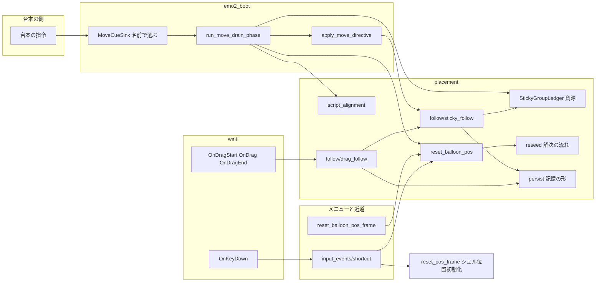
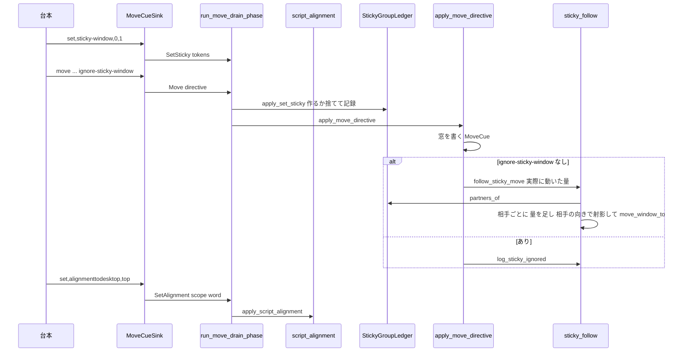
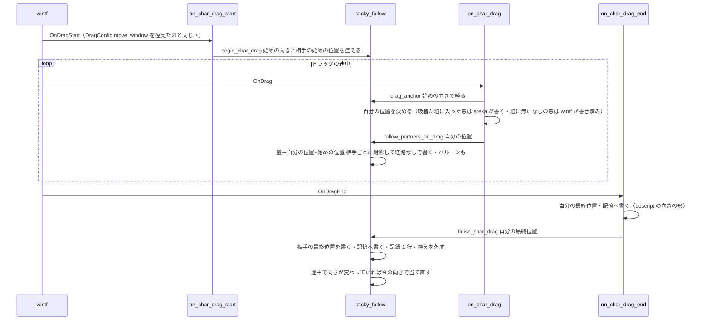
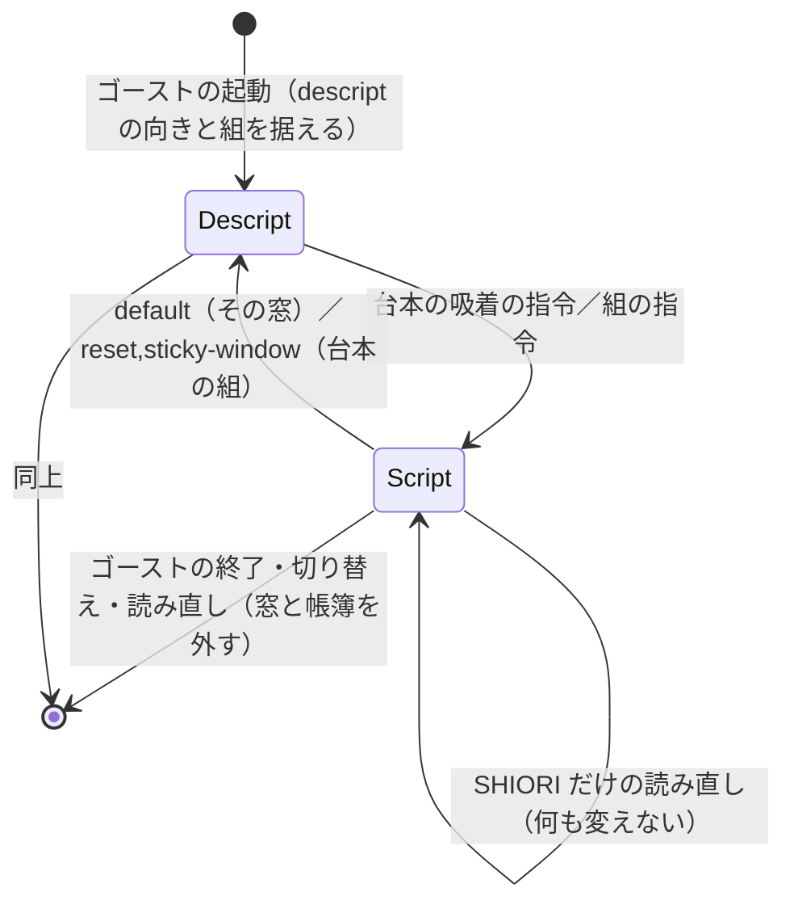

# 設計: areka-P0-window-link-directives

## Overview

**目的**: ゴースト作者が台本で書く吸着の指令 `\![set,alignmenttodesktop,方向]`、窓の組の指令 `\![set,sticky-window,…]`／`\![reset,sticky-window]`、シェルの descript の `seriko.sticky-window`、`\![move]` の `--option=ignore-sticky-window` を、ukadoc の正典どおりに効かせる。あわせて、完了 spec `areka-P0-move-canon` から申し送られた `\![execute,resetballoonpos]`・右クリックのメニューの「バルーン位置初期化」・位置初期化の 2 つのキーボードの近道（Ctrl＋Shift＋F12／F10）を入れる。

**利用者**: ゴースト作者は台本で窓を画面の端に貼り付けたり、複数の窓を 1 つの組にして一緒に動かしたりする。利用者は組になった窓をドラッグで一緒に動かし、ずれたバルーンをメニューや近道で元の位置へ戻す。v0.1.0 のゴール「ぱすたが SSP と同じレベルで動く」は、ゴースト「窓際のぱすたさん」の窓の枠（`\1`）とぱすた（`\0`）が重なったまま一緒に動くことを待っている。

**変えること**: 今の窓の位置の受け口（`MoveCueSink` と 1 本の線 `PositionCue`）に 4 種類の荷物を足し、画面の側の取り出しの相で適用する。窓の組の帳簿は World の資源として新しく置く。連れ動きはドラッグと `\![move]` の 2 つの道にだけ差し込む。吸着は今ある部品（`Anchored`・`project_anchor`・`resize_window_to`・`DragConfig.move_window`）をそのまま使い、「descript の向き」と「台本で変えた」印だけを窓に足す。

### Goals

- 吸着の指令の 6 つの語と古い綴りを受け、ドラッグと `\![move]` の縛りへすぐ反映する（要件 1・2）。
- 窓の組を台本と descript の両方で作り、ドラッグと瞬間の `\![move]` で組の相手を同じ量だけ動かす。`ignore-sticky-window` で 1 つだけ動かす（要件 3〜5）。
- 寿命を正典と「要件の段での裁定」どおりにする（要件 6）。
- バルーン位置初期化を台本・メニュー・近道の 3 つの入口から同じ関数で行い、起動の直後とシェルの切り替えの後で同じ結果にする（要件 7・8）。
- すべての分かれ目を記録し、決定論のテストで確かめ、ぱすたで実機の証跡を残す（要件 9・10）。

### Non-Goals

- 時間つきの移動（`--time` の補間）と `\![moveasync]` での組の連れ動き（dola の改造の後の時間の spec）。
- ほかのアプリの窓への吸着（`window-snap`）。3 人目以降のキャラクターの窓（`extra-character-windows`）。
- プロパティ `currentghost.seriko.sticky-window` の読み書き（`currentghost-property-tree`）。
- 拡大率が変わった後の詰め直しから組の窓を外すこと（`dpi-realign-remembered-chain`・裁定 7）。
- 吸着の向きが上・左・右のときに、作業領域の変化で辺へ当て直すこと（今どおり下だけ）。
- `\![set,zorder]` の台本の組がシェルの切り替えで捨てられる食い違いを直すこと（本 spec の完了の作業で起票するだけ・要件 10.6）。

## Boundary Commitments

### This Spec Owns

- 台本の吸着の指令の読み取り（語・綴り・読めない値・欠けた値）と、窓への適用（`Anchored`・`DragConfig.move_window`・当て直し）。
- キャラクターの窓ごとの「descript の吸着の向き」と「台本で変えた」印（部品 `AnchorSource`）、およびシェルの切り替えでのその読み分け。
- 窓の組の帳簿（World の資源 `StickyGroupLedger`）: 作る・捨てる・解く・descript の組の据え付けと取り替え。組の中身を他の機能が読む口（`group_of`・`partners_of`）。
- ドラッグと瞬間の `\![move]` での組の相手の連れ動き、`ignore-sticky-window` の効き目、ドラッグを始めたときの吸着の向きの控え。
- キャラクターの窓の位置を記憶へ書くときの形（descript の向きで書く）。
- バルーン位置初期化の関数・材料（`DefaultPlacementBasis` の中身の統一）・メニューの枠「バルーン位置初期化」・2 つの近道。
- wintf の「キーの押下をアプリへ知らせる口」（`OnKeyDown`）。
- 受け手の表の 5 行・SHIORI リソースの許可表の 1 名・COMPAT §8 と網羅台帳の該当行。

### Out of Boundary

- 時間つきの移動・`\![moveasync]` の連れ動き、ほかのアプリの窓への吸着、3 人目以降の窓、プロパティ `currentghost.seriko.sticky-window`。
- 詰め直し（`placement/chain_realign.rs`）の中身。本 spec は帳簿を読む口を出すだけで、`chain_realign.rs` に触らない。
- 作業領域の変化での当て直しの範囲（`work_area_sync.rs` は下の吸着だけのまま）。
- 吸着の当て直し・表情の切り替えによる大きさの変化・作業領域の変化・位置の初期化での組の連れ動き（裁定 6・要件 4.7・5.6）。
- 重なりの組（`ZOrderGroupLedger`）の寿命と振る舞い。本 spec が触るのは、私有の関数 `parse_scope_id` を crate の中へ公開する 1 語だけ。
- 経路の語 `PlacementRoute` の一覧と `placement/follow/window_move.rs`・`placement/diag.rs`。新しい語は足さない。
- descript の `seriko.alignmenttodesktop` の 4 段の優先の読み方（完了 `areka-P0-window-placement`）。

### Allowed Dependencies

- `placement::follow` の公開の部品: `Anchored`・`project_anchor`・`resize_window_to`・`move_window_to`・`follow_balloon`・`MonitorSnapshot`。`sticky_follow.rs` は `follow` の中に置くので `enqueue_window_set_pos`（`pub(super)`）を使ってよい。
- `placement::reseed` の解決の流れ（関数を 1 つ切り出して共有する）・`placement::persist` の書き込み口（`char_pos_entries`・`balloon_offset_entries`・`persist_entries`）。
- `emo2_boot` の受け口と取り出しの相（`MoveCueSink`・`run_move_drain_phase`）。依存の向きは `emo2_boot → placement` のまま。`placement` から `emo2_boot` を参照しない。
- wintf の窓の手続き（`window_proc`）とコールバックの部品の型（`OnFilesDropped` と同じ形）。wintf は areka の近道の組み合わせを知らない。
- 新しい外部のクレートは足さない。

### Revalidation Triggers

- `StickyGroupLedger` の読む口（`group_of`・`partners_of`・`StickyGroup` の形）が変わったとき → `dpi-realign-remembered-chain`・`extra-character-windows`・`currentghost-property-tree` が読み直す。
- `AnchorSource` の意味（descript の向き・台本の印）や、記憶へ書く形の規則が変わったとき → `window-snap`・`descript-window-keys`。
- `DefaultPlacementBasis` の中身が変わったとき → 完了 `move-canon` の並べ直しのテスト・`resident-ghost-rotation`（`reset_pos_frame.rs`）。
- `PositionCue` の種類が増えたとき・受け手の表の行が変わったとき → `move_cue*.rs` を触る後の spec（`shell-balloon-scale-setting`・`surfaces-basepos`）と、受け手の表に行を足す v0.1.0 の各 spec。
- wintf の `OnKeyDown` の形が変わったとき → キーを使う後の spec。

## Architecture

### Existing Architecture Analysis

- **受け口と線**: `MoveCueSink`（`emo2_boot/move_cue.rs`）が `\!` の名前と最初の引数で荷物を選び、`std::sync::mpsc` の 1 本の線で `PositionCue` を送る。画面の側は毎フレーム `run_move_drain_phase`（`emo2_boot/frame/drain_resnap.rs`）が届いた順に `&mut World` で適用する。同じ台本の中の並び（組を作ってから `\![move]`）は、この 1 本の線の中で保たれる。
- **吸着**: 窓ごとの `Anchored(Anchor)`・純関数 `project_anchor`。吸着した窓は `DragConfig.move_window=false` で、ドラッグ中は areka が射影した位置を書く。なしの窓は wintf が動かし、areka は動いた後の `WindowPos` を読む（wintf は `WM_MOUSEMOVE` の中で窓を動かして `WindowPos` を先に書き、`OnDrag` はその後のフレームで届く）。wintf は `DragConfig.move_window` をドラッグの始めにだけ読む。
- **向きが変わったときの本番の道**: シェルの切り替えの `apply_shell_descript` が `Anchored` と `DragConfig.move_window` を書き、`reanchor_char_windows` が今の大きさのまま `resize_window_to(…, AnchorChange)` で当て直す。`anchor_changed_system` は本番の予定表に載っていない（本 spec も載せない）。
- **経路の語**: `MoveCue` は可視の見張り・既定の位置の追従・拡大率の整合待ちの監視のどれも掛からない。`AnchorChange` は 3 つとも掛かり、整合待ちの窓へ書くと `debug_assert` が鳴る。ドラッグは経路なし（`None`）。
- **記憶**: キャラクターの窓の位置は「下の吸着だけ x を下端の中央へ直す」形で書き、次の起動は descript の向きで読み戻す。記憶を消す口は無い。
- **寿命**: ゴーストの切り替え・読み直しは窓を閉じて（`close_windows_for_restart`）起こし直す。SHIORI だけの読み直しは窓・World の資源・結線を残す。

### Architecture Pattern & Boundary Map



**Architecture Integration**:
- 選んだ形: 研究の案 C。受け口は今の線へ相乗りし、帳簿と連れ動きは新しいファイルに置く。
- 境目: 台本の荷物は `emo2_boot`、窓への適用・帳簿・連れ動き・記憶の形は `placement`、入口（メニュー・近道）は `menu` と `input_events`、キーの受け口は wintf。
- 保つ型: 1 本の線で届いた順に適用する・拒否は値で返して記録は呼び手・単一の書き手 `enqueue_window_set_pos`・兄弟のテストファイル・1,000 行の目安。
- 新しい部品の理由: 帳簿（組の持ち主が今は無い）・`AnchorSource`（シェルの切り替えと `default` と記憶の形が descript の向きを要る）・ドラッグの控え（組の相手の始めの位置と、始めの吸着の向き）・キーの口（wintf にキーを知らせる口が無い）。

### Technology Stack

| 層 | 選んだもの | 役目 | 注 |
|---|---|---|---|
| アプリ | `crates/areka`（Rust・bevy_ecs の World） | 受け口・適用・帳簿・連れ動き・初期化・メニュー・近道 | 新しい依存なし |
| 窓 | `crates/wintf` | キーの押下の受け口 `OnKeyDown`（`WM_KEYDOWN`・`WM_SYSKEYDOWN`） | `OnFilesDropped` と同じ形 |
| 記憶 | `areka-sylphya` の `persist_put`（今のまま） | キャラクターの窓の位置・バルーンのずらしを書く | 形式は変えない |
| SHIORI | `areka-kanade` の許可表 | `resetballoonpositionbutton.caption` を引けるようにする | 1 名足す |

## File Structure Plan

### Directory Structure

```
crates/areka/src/
├── placement/
│   ├── sticky_group_ledger.rs        # 新: 窓の組の帳簿（純）・引数の読み・拒否の型・
│   │                                 #     台本／descript の指令を World に当てる薄い関数と記録
│   ├── sticky_group_ledger_tests.rs  # 新: 作る・拒否・解く・descript の据え付けと取り替え
│   ├── script_alignment.rs           # 新: 吸着の語の読み取りと窓への適用・記録
│   ├── script_alignment_tests.rs     # 新
│   ├── reset_balloon_pos.rs          # 新: バルーン位置初期化（3 つの入口が呼ぶ 1 つの関数）
│   ├── reset_balloon_pos_tests.rs    # 新
│   └── follow/
│       ├── sticky_follow.rs          # 新: 組の相手の位置の計算（純）・ドラッグの控え
│       │                             #     （始めの吸着の向き・相手の始めの位置）・ドラッグと
│       │                             #     `\![move]` での相手の書き込みと記録
│       └── sticky_follow_tests.rs    # 新
├── menu/
│   ├── reset_balloon_pos_frame.rs    # 新: 枠「バルーン位置初期化」
│   └── reset_balloon_pos_frame_tests.rs # 新
└── input_events/
    ├── shortcut.rs                   # 新: 近道の組み合わせの判定（純）と受け手
    └── shortcut_tests.rs             # 新
crates/wintf/src/ecs/
├── window/components.rs              # 変: `KeyDown`・`OnKeyDown` を足す
└── window_proc/
    ├── keyboard.rs                   # 変: `WM_KEYDOWN` の受け渡し・`WM_SYSKEYDOWN` を足す
    ├── keyboard_tests.rs             # 変: 受け渡しの 4 つの分かれ目
    └── mod.rs                        # 変: 振り分け表に `WM_SYSKEYDOWN` の 1 行
```

### Modified Files

- `crates/areka/src/emo2_boot/move_cue.rs` — `PositionCue` に `SetAlignment{scope, word}`・`SetSticky{tokens}`・`ResetSticky`・`ResetBalloonPos` を足し、`emit` の選び方に 5 組（`set,alignmenttodesktop`・`set,alignmentondesktop`・`set,sticky-window`・`reset,sticky-window`・`execute,resetballoonpos`）を足す。スコープの読み（数でない実行者は `warn!` で捨てる）は `move` と同じ道を使う。語の読み取りは `script_alignment::parse_alignment_word` を呼ぶ。
- `crates/areka/src/emo2_boot/frame/drain_resnap.rs` — `run_move_drain_phase` の振り分けに 4 つの腕を足す（各 1 行で `placement` の関数を呼ぶ）。
- `crates/areka/src/emo2_boot/move_cue_place.rs` — `apply_move_directive` が窓を書けた後、`ignore_sticky_window` を読み、偽なら `sticky_follow::follow_sticky_move`、真なら `sticky_follow::log_sticky_ignored` を呼ぶ。「読まない」の注記を改める。
- `crates/areka/src/emo2_boot/consumer_ledger.rs` — 5 行を `MoveSink` で登記（31 → 36 行）。`consumer_ledger_tests.rs`（数と一覧）・`consumer_ledger_agreement_tests.rs`（`samples()` に 5 組）を改める。
- `crates/areka/src/emo2_boot/zorder_cue.rs` — 注記だけ: `set`／`reset` の新しい持ち主が増えても、正しい形の荷物はここへ届かず、開けない形の警告の持ち主はここ 1 つのまま、と書く。
- `crates/areka/src/emo2_boot/frame/switch.rs` — `finish_shell` で、`DefaultPlacementBasis` を新しい形（descript の値＋バルーンの材料）で置き、`sticky_group_ledger::replace_sticky_descript` を呼ぶ。
- `crates/areka/src/placement/follow/anchor.rs` — 部品 `AnchorSource { descript, by_script }` を足す。
- `crates/areka/src/placement/follow.rs` — `sticky_follow` の宣言と公開・`AnchorSource` の公開・テストの接続。
- `crates/areka/src/placement/follow/drag_follow.rs` — `on_char_drag`・`on_char_drag_end` が窓の向きを `sticky_follow::drag_anchor` から読み（ドラッグの始めの向き）、書いた後に組の相手を動かす 1 行ずつ。「wintf が動かした位置を読む」か「areka が射影して書く」かの分かれ目を、今の「向きが `Free` か」から「このドラッグで wintf が窓を動かすか」（`sticky_follow::drag_wintf_moves`・ドラッグの始めに控えた値）へ改める（組に入った `Free` の窓は areka が書く側へ入る・射影は恒等）。記憶へ書く形を `persist::saved_form_anchor` で決める。数行の足し（937 → 950 行ほど）。
- `crates/areka/src/input_events/drag.rs` — `on_char_drag_start` で `sticky_follow::begin_char_drag` を呼ぶ 1 行。
- `crates/areka/src/placement/persist.rs` — `saved_form_anchor(world, window) -> Option<Anchor>`（`AnchorSource.descript`、無ければ `Anchored`）を足し、`persist_unremembered_char_positions` もこれで形を決める。
- `crates/areka/src/placement/spawn.rs` — キャラクターの窓に `AnchorSource { descript: p.anchor, by_script: false }` を付ける 1 行。
- `crates/areka/src/placement/reseed.rs` — 解決の流れ（スコープごとに窓の DPI で換算・合流して解く）を `resolve_standard_scopes` として切り出し、`apply_shell_descript` とバルーン位置初期化が共有する（私有の `RunningScope` は `pub(crate)` にする）。`apply_shell_descript` は今 1 回で入れている `Anchored` と `BalloonFollow` を分け、台本の印のあるスコープでは `Anchored` を書かず、`DragConfig.move_window` の直書き（今の 146 行）は `sticky_follow::sync_drag_writer` の 1 回の呼び出しに置き換える（`BalloonFollow`・キーワードの素材・バルーンの置き直しは今どおりどのスコープにも行う）。どのスコープでも `AnchorSource.descript` を新しい値にする。
- `crates/areka/src/placement/reset_pos.rs` — `DefaultPlacementBasis` を `{ source: DescriptSource, balloon: BalloonPlacementInputs }` に改め、`reset_window_positions` は `build_placement_config(source)` で設定を組む。
- `crates/areka/src/placement/mod.rs` — 新しいモジュールの宣言。起動の準備で読んだバルーンの `windowposition` と作者の DPI を `PreparedPlacement.default_basis`（新しい形）へ載せる。`seriko.sticky-window` の生の値（`PlacementConfig.sticky_window_raw` に既に在る）を、`zorder_raw` と同じ形で `PreparedPlacement` まで運ぶ。
- `crates/areka/src/placement/zorder_group_ledger.rs` — `parse_scope_id` を `pub(crate)` にする（1 語）。
- `crates/areka/src/ghost_session.rs` — 窓を作る閉包で `StickyGroupLedger` を descript から据える。`attach_file_drop_receivers` の隣で `shortcut::attach_shortcut_receivers` を呼ぶ。
- `crates/areka/src/app_exit.rs` — `close_windows_for_restart` で `StickyGroupLedger` と `CharDragSession` を外す 2 行。
- `crates/areka/src/menu/mod.rs`（`Frame::ResetBalloonPosition`・`ORDER` 12 個）・`menu/captions.rs`（1 行）・`menu/plan.rs`（群に 1 つ）・`menu/captions_tests.rs`（11 → 12）・`menu/reset_pos_frame.rs`（選べるかの式を `reset_position_enabled` として出す）・`ghost_session_runtime.rs`（枠の登記 1 行）。
- `crates/areka-kanade/src/schedule/resources.rs` — 許可表に `resetballoonpositionbutton.caption`（13 → 14 名・テストも）。
- `doc/COMPAT_ARCHITECTURE.md` §8・`doc/ukadoc-coverage/ledger/sakura-script.toml`・`shiori.toml`・`assets.toml` — 要件 10 の行。

## System Flows

### 台本の指令の流れ



- 線は 1 本なので、同じ台本の中の並びが画面の側でもそのまま保たれる（議題 8）。
- 窓がまだ無いあいだ（`GhostWindows` が無い）は、今どおり取り出しの相が線を読まずに貯める。

### ドラッグでの連れ動き



- 量は「始めからの量」で取る（1 回ごとの差を足さない）。ドラッグした窓の始めの位置も相手の始めの位置も、`OnDragStart` のときの `WindowPos` を `CharDragSession` に控える（wintf はまだ窓を動かしていない）。wintf の `DraggingState` は読まない（多窓のときドラッグの終わりにもう無いことが実機で起きている＝`drag_follow.rs:155-176` の注記。読むと終わりに相手の位置が記憶に残らない）。控えが無いときは相手を動かさず `warn!` を残す。
- 量はドラッグした窓の縛りの後の位置から取るので、ドラッグした窓が動かなかった軸では相手も動かない（要件 4.3）。
- 取り消し（Esc など）で終わったドラッグは、wintf が始めの位置で `OnDragEnd` を出すので、量 0 で相手も始めの位置へ戻る。

### 寿命



## Requirements Traceability

| 要件 | 要約 | 部品 | 口 | 流れ |
|---|---|---|---|---|
| 1.1 | 上下左右へすぐ沿わせ、もう一方の軸は保つ | script_alignment | `apply_script_alignment`・`resize_window_to(MoveCue)` | 台本の指令 |
| 1.2 | `free` で外して留める | script_alignment | 同上（射影が恒等） | 台本の指令 |
| 1.3 | `default` で descript の向きへ戻す | script_alignment・AnchorSource | `AnchorSource.descript` | 台本の指令 |
| 1.4 | 古い綴り | MoveCueSink | `emit` の 2 組 | 台本の指令 |
| 1.5 | 以後は descript と同じ扱い | Anchored（今のまま） | `resize_window_to`・`apply_move_directive` が `Anchored` を読む | — |
| 1.6 | バルーンは付いて動き、記憶に書かない | script_alignment | `resize_window_to` の `follow_balloon`・経路 `MoveCue` は記憶に書かない | — |
| 1.7 | 読めない語は外す・記録・続ける | script_alignment | `AlignmentWord::Unknown` → `Free`・`warn!` | — |
| 1.8 | 窓が無い | script_alignment | `warn!(alignment_skipped)` | — |
| 1.9 | 値が欠ける | script_alignment | `AlignmentWord::Missing`・`warn!` | — |
| 2.1〜2.3 | 吸着とドラッグの縛り | drag_follow（今のまま）・sticky_follow | `drag_anchor` | ドラッグ |
| 2.4 | 次のドラッグから | script_alignment・sticky_follow | `DragConfig.move_window`・始めの向きの控え | ドラッグ |
| 3.1〜3.3 | 組を作る・順序に意味なし・複数 | StickyGroupLedger | `try_add_script_group`・`BTreeSet<u32>` | 台本の指令 |
| 3.4 | 重なった ID | StickyGroupLedger | `StickyReject::AlreadyGrouped` | — |
| 3.5 | 2 未満・重複・数でない | StickyGroupLedger | `parse_sticky_tokens` | — |
| 3.6 | 窓の無いスコープ | sticky_group_ledger・sticky_follow | 受け付けて `warn!(sticky_member_absent)` | — |
| 3.7 | `reset` | StickyGroupLedger | `reset_to_descript` | — |
| 3.8・3.9 | descript の組 | StickyGroupLedger・ghost_session | `seed_sticky_descript` | 寿命 |
| 4.1〜4.4 | ドラッグの連れ動き・相手の吸着・量・バルーン | sticky_follow | `follow_partners_on_drag`・`partner_target`・`follow_balloon` | ドラッグ |
| 4.5 | 終わりに相手も記憶へ | sticky_follow | `finish_char_drag`・`char_pos_entries` | ドラッグ |
| 4.6 | バルーンのドラッグ | drag_follow（今のまま） | — | — |
| 4.7 | 当て直し等では相手を動かさない | （差し込まない） | 差し込む所はドラッグと `\![move]` だけ | — |
| 4.8 | 台本の向きのまま書いても次の起動でずれない | persist | `saved_form_anchor` | ドラッグ |
| 5.1〜5.2 | `\![move]` の連れ動き・相手の吸着 | sticky_follow・move_cue_place | `follow_sticky_move` | 台本の指令 |
| 5.3 | `ignore-sticky-window` | move_cue_place・sticky_follow | `log_sticky_ignored` | 台本の指令 |
| 5.4 | 相手のバルーン・記憶に書かない | sticky_follow | `move_window_to`（`MoveCue`） | — |
| 5.5 | 時間つきもすぐ置く | sticky_follow | 動かす窓と同じ即時の道 | — |
| 5.6 | 並べ直しでは組に関わらず置く | reset_pos（今のまま） | 差し込まない | — |
| 5.7 | 組に無い窓は今のまま | sticky_follow | 相手 0 なら何もしない | — |
| 6.1〜6.2 | 終了・切り替えで descript から | app_exit・spawn | 窓と一緒に `AnchorSource`、帳簿を外す | 寿命 |
| 6.3 | SHIORI だけの読み直しで保つ | （今の寿命） | 窓と資源を残す | 寿命 |
| 6.4 | シェルの切り替えで台本の向きを保つ | reseed | `AnchorSource.by_script` の読み分け | 寿命 |
| 6.5 | シェルの切り替えで台本の組を保つ | StickyGroupLedger・switch | `replace_sticky_descript` | 寿命 |
| 7.1〜7.4 | バルーン位置初期化 | reset_balloon_pos・reseed・reset_pos | `reset_balloon_positions`・`resolve_standard_scopes`・`DefaultPlacementBasis` | — |
| 7.5〜7.7 | メニューの項目 | reset_balloon_pos_frame・captions・kanade の許可表 | `Frame::ResetBalloonPosition` | — |
| 8.1〜8.4 | 近道 | wintf `OnKeyDown`・shortcut | `shortcut_of`・`on_ghost_key_down` | — |
| 9.1〜9.5 | 記録 | 各部品 | 「Error Handling」の記録の表 | — |
| 9.6 | 決定論のテスト | 各 `_tests.rs` | 「Testing Strategy」 | — |
| 9.7・9.8 | 実機の証跡 | real-run-kit・検体 `pasta-in-windows` | 「Testing Strategy」の実機 | — |
| 10.1〜10.5 | COMPAT と台帳 | 文書 | 「互換の記録」 | — |
| 10.6 | `\![set,zorder]` の食い違いの起票 | 完了の作業 | `/kiro-discovery` | — |

## Components and Interfaces

| 部品 | 層 | 役目 | 要件 | 主な依存 | 契約 |
|---|---|---|---|---|---|
| MoveCueSink（変） | emo2_boot | 5 組を選んで線へ送る | 1.4・3.1・3.7・7.1 | script_alignment（読み） | Event |
| run_move_drain_phase（変） | emo2_boot | 届いた順に適用 | 1・3・7 | placement の各関数 | Batch |
| script_alignment（新） | placement | 吸着の語と適用 | 1.1〜1.9・2.4・9.1 | follow, AnchorSource | Service |
| AnchorSource（新） | placement/follow | descript の向きと台本の印 | 1.3・4.8・6.4 | — | State |
| StickyGroupLedger（新） | placement | 組の帳簿 | 3.1〜3.9・6.5・9.2 | `parse_scope_id` | Service, State |
| sticky_follow（新） | placement/follow | 連れ動き・ドラッグの控え | 2.4・3.6・4.1〜4.5・5.1〜5.5・5.7・9.3・9.4 | Ledger, `enqueue_window_set_pos` | Service, State |
| persist（変） | placement | 記憶へ書く形 | 4.8 | AnchorSource | Service |
| reseed（変）・reset_pos（変） | placement | 解決の流れの共有・材料の統一 | 6.4・7.4 | — | Service |
| reset_balloon_pos（新） | placement | バルーン位置初期化 | 7.1〜7.4・9.5 | reseed, persist | Service |
| reset_balloon_pos_frame（新） | menu | 枠 | 7.5〜7.7 | reset_balloon_pos | Service |
| OnKeyDown（新） | wintf | キーの押下を知らせる | 8.1〜8.4 | — | Event |
| shortcut（新） | input_events | 近道の判定と実行 | 8.1〜8.4 | reset_pos_frame, reset_balloon_pos_frame | Service |

### emo2_boot

#### MoveCueSink と PositionCue

| 欄 | 内容 |
|---|---|
| Intent | 窓の位置の荷物を名前で選んで 1 本の線へ送る |
| Requirements | 1.4・1.7・1.9・3.1・3.5・3.7・7.1 |

**Responsibilities & Constraints**
- 選ぶ組（名前・最初の引数）: `set,alignmenttodesktop`・`set,alignmentondesktop`（同じ扱い）→ `SetAlignment`。`set,sticky-window` → `SetSticky`。`reset,sticky-window` → `ResetSticky`。`execute,resetballoonpos` → `ResetBalloonPos`。ほかの組は今どおり `debug!` で捨てる。
- `SetAlignment` の `scope` は `move` と同じく実行者（`cue.actor`）を数として読み、読めなければ `warn!` で捨てる。ほかの 3 種は実行者を読まない。
- `SetSticky` は ID の読み取りをしない（引数の文字列をそのまま運ぶ）。読みと拒否は帳簿が持つ（拒否の記録の場所を 1 つにする）。
- 開けない形の `set`／`reset` の荷物は今どおり `debug!`（警告の持ち主は `ZOrderCueSink` 1 つ・二重の警告を出さない）。

```rust
pub enum PositionCue {
    Move(MoveDirective),
    ResetWindowPos,
    /// `\![set,alignmenttodesktop|alignmentondesktop,方向]`（実行者のスコープ）。
    SetAlignment { scope: u32, word: AlignmentWord },
    /// `\![set,sticky-window,…]` の ID の並び（読まずに運ぶ）。
    SetSticky { tokens: Vec<String> },
    ResetSticky,
    ResetBalloonPos,
}
```

#### run_move_drain_phase

- 腕を 4 つ足す: `SetAlignment` → `script_alignment::apply_script_alignment(world, scope, &word)`、`SetSticky` → `sticky_group_ledger::apply_set_sticky(world, &tokens)`、`ResetSticky` → `sticky_group_ledger::apply_reset_sticky(world)`、`ResetBalloonPos` → `reset_balloon_pos::reset_balloon_positions(world, BalloonResetTrigger::Script)`。戻り値は今の腕と同じく捨てる（記録は各関数の中）。
- 重なりの取り出しの相（`run_zorder_drain_phase`）より後・連鎖の確定より前という今の順のまま。

#### apply_move_directive（変）

- 窓を書けた（`move_window_to` が真）後に、`delta = to − from`（`from` は書く前の窓の左上）を求める。
- `directive.ignore_sticky_window` が偽なら `sticky_follow::follow_sticky_move(world, directive.scope, delta)`、真なら `sticky_follow::log_sticky_ignored(world, directive.scope)`。書けなかったときは連れ動かさない。

### placement

#### script_alignment

| 欄 | 内容 |
|---|---|
| Intent | 吸着の語を読み、現スコープのキャラクターの窓へ当てる |
| Requirements | 1.1〜1.9・2.4・9.1 |

```rust
#[derive(Debug, Clone, PartialEq, Eq)]
pub enum AlignmentWord {
    /// top・bottom・left・right・free。
    Anchor(Anchor),
    /// default（descript の向きへ戻す）。
    Default,
    /// 6 つの語のどれでもない値（受け取った値をそのまま持つ）。
    Unknown(String),
    /// 方向の引数が無い。
    Missing,
}

/// 最初の引数（`alignmenttodesktop`）より後ろの引数を受け、先頭を向きとして読む。前後の空白を除き、
/// 大文字小文字は区別しない（descript の読み `Anchor::from_alignment` と同じ）。空や空白だけの値は
/// 欠けた値（1.9）。2 つ目以降（指令の 3 つ目以降の引数）は `debug!(alignment_extra_args)`。
pub fn parse_alignment_word(args: &[&str]) -> AlignmentWord;

/// 現スコープの窓へ当てる。当てたら真。
pub fn apply_script_alignment(world: &mut World, scope: u32, word: &AlignmentWord) -> bool;
```

**手順**（`apply_script_alignment`）:
1. `Missing` → `warn!(event="alignment_skipped", scope, reason="missing_value")` で何も変えない（1.9）。
2. 窓が無い（`GhostWindows` が無い・`char_window` が無い・`AnchorSource` が無い）→ `warn!(alignment_skipped, reason=…)`（1.8）。
3. 新しい向きと印を決める: `Anchor(a)` → `(a, 台本)`。`Unknown(w)` → `warn!(event="alignment_unknown_word", scope, word=w)` の後 `(Free, 台本)`（1.7・裁定 3）。`Default` → `(AnchorSource.descript, descript に従う)`（1.3）。
4. `Anchored(新)` を書き、`AnchorSource.by_script` を印に合わせ、`sticky_follow::sync_drag_writer(world)` で `DragConfig.move_window` を付け直す（2.4・wintf は次のドラッグの始めに読む・「ドラッグの書き手」の節）。
5. 今の窓の大きさで `resize_window_to(world, 窓, 大きさ, PlacementRoute::MoveCue)` を呼ぶ。辺の向きなら沿わせ（もう一方の軸は `project_anchor` が保つ）、`Free` なら射影が恒等なので動かない（1.1・1.2）。バルーンは `resize_window_to` の中の `follow_balloon` で付いて動く（1.6）。大きさが読めなければ向きだけ変えて `warn!(alignment_reanchor_skipped)`。
6. `info!(event="alignment_changed", scope, from, to, source)`（`source` は `script`／`descript`（default のとき））（9.1）。

**経路の語を `MoveCue` にする理由**（議題 2）: 台本が明示に窓を動かす操作で、`\![move]` と同じ扱い（記憶に書かない・既定の位置を連れて行かない＝台本で動いた窓として扱う）が要件 1.6 と今の決まりに合う。`AnchorChange` だと拡大率の整合待ちの窓へ書いたときに `debug_assert` が鳴り、新しい語を足すと `window_move.rs`・`diag.rs` に触れる。

#### AnchorSource（`placement/follow/anchor.rs`）

```rust
/// 窓の吸着の向きの出どころ。キャラクターの窓に必ず付く（`Anchored` と同じ時に付ける）。
#[derive(Component, Debug, Clone, Copy, PartialEq, Eq)]
pub struct AnchorSource {
    /// 今のシェルの descript の吸着の向き（4 段の優先で決めたもの）。
    pub descript: Anchor,
    /// 台本の吸着の指令で向きを変えたなら真（`default` で偽に戻る）。
    pub by_script: bool,
}
```

- 不変条件: `by_script == false` なら `Anchored.0 == descript`。
- 付ける所: 窓を作るとき（`spawn.rs`）。シェルの切り替えでは `descript` を新しい値にし、`by_script == false` のスコープだけ `Anchored`・`DragConfig.move_window` を取り替える（6.4）。取り替えで向きが変わったスコープは `info!(alignment_changed, source="shell_switch")`（9.1）。
- 窓と一緒に消えるので、ゴーストの終了・切り替え・読み直しで自然に descript から始まる（6.1・6.2）。保存しない。

#### 記憶へ書く形（`placement/persist.rs`）

```rust
/// キャラクターの窓の位置を記憶へ書くときの形を決める向き。次の起動はこの窓を descript の向きで
/// 読み戻すので、今の向きではなく descript の向きで書く（要件 4.8）。`AnchorSource` が無い窓
/// （テストの組み立てなど）は `Anchored` を使う。どちらも無ければ `None`。
pub fn saved_form_anchor(world: &World, window: Entity) -> Option<Anchor>;
```

- 使う所: ドラッグの終わり（`on_char_drag_end`）・組の相手の記憶（`finish_char_drag`）・並べ終えた時点の保存（`persist_unremembered_char_positions`）。射影（ドラッグの縛り）には今の向きを使い、形にだけ descript の向きを使う。
- 例: descript が下、台本で `free` にした窓（幅 200）をドラッグして左上 (100, 300) で離す。今は形を `free`（恒等）で書くので (100, 300) が残り、次の起動は下の形として読み戻して x を 100−100＝0 にずらす。新しい規則では下の形 (200, 300) で書くので、次の起動は x＝100 に戻る（y は descript の向きの射影で下端へ寄る＝6.1 の「descript から始める」のとおり）。

#### StickyGroupLedger（`placement/sticky_group_ledger.rs`）

| 欄 | 内容 |
|---|---|
| Intent | 窓の組の持ち主。拒否を値で返し、記録は World の側の薄い関数が出す |
| Requirements | 3.1〜3.9・6.5・9.2 |

```rust
#[derive(Debug, Clone, Copy, PartialEq, Eq)]
pub enum StickySource { Script, Descript }

#[derive(Debug, Clone, PartialEq, Eq)]
pub struct StickyGroup {
    /// 並び順に意味を持たせない（3.2）。
    pub members: BTreeSet<u32>,
    pub source: StickySource,
}

#[derive(Debug, Clone, PartialEq, Eq)]
pub enum StickyReject {
    UnparsableToken { token: String },
    DuplicateScope { scope: u32 },
    TooFewScopes { count: usize },
    /// 既にほかの組（descript の組を含む）に入っている ID（3.4）。
    AlreadyGrouped { scopes: Vec<u32> },
}

/// ID の並びを読む。各 ID は前後の空白を除いて `parse_scope_id`（ASCII の数字だけ・あふれは拒否）で
/// 読む。検査の順: 数でない → 同じ ID の重ね書き → 異なる ID が 2 つ未満（3.5）。上限は置かない（議題 11）。
pub fn parse_sticky_tokens<S: AsRef<str>>(tokens: &[S]) -> Result<BTreeSet<u32>, StickyReject>;

#[derive(Resource, Debug, Clone, Default, PartialEq, Eq)]
pub struct StickyGroupLedger { /* groups: Vec<StickyGroup>（作った順） */ }

impl StickyGroupLedger {
    /// 台本の組を足す。重なりがあれば何も変えずに拒否（3.1・3.4）。
    pub fn try_add_script_group(&mut self, members: BTreeSet<u32>) -> Result<(), StickyReject>;
    /// 台本の組をすべて解く。解いた組の数を返す（3.7）。
    pub fn reset_to_descript(&mut self) -> usize;
    /// descript の組を取り替える（起動は空の帳簿へ、シェルの切り替えは今の帳簿へ）。値が無い・
    /// 空なら組なし。台本の組と重なれば作らず拒否を返す（3.8・3.9・6.5）。台本の組は触らない。
    pub fn replace_descript(&mut self, raw: Option<&str>) -> Result<(), StickyReject>;
    pub fn groups(&self) -> &[StickyGroup];
    /// 他の機能が「この窓はどの組か」を確かめる口（裁定 7・詰め直しの spec が読む）。
    pub fn group_of(&self, scope: u32) -> Option<&StickyGroup>;
    /// 組の相手（自分を除く・昇順）。組に無ければ空。
    pub fn partners_of(&self, scope: u32) -> Vec<u32>;
}

// World の側の薄い関数（記録を出す）
pub fn apply_set_sticky(world: &mut World, tokens: &[String]) -> bool;   // SetSticky
pub fn apply_reset_sticky(world: &mut World) -> bool;                    // ResetSticky
pub fn seed_sticky_descript(world: &mut World, raw: Option<&str>);       // 起動（資源を据える）
pub fn replace_sticky_descript(world: &mut World, raw: Option<&str>);    // シェルの切り替え
```

- descript の値は `,` で区切って `parse_sticky_tokens` へ渡す（同じ規則・3.8）。descript のキーは 1 つなので descript の組は高々 1 つ。
- 拒否・作成・解除のたびに、その時点のすべての組の中身と出どころを `info!(event="sticky_groups", action, groups=?)` で記録する。拒否は `warn!(event="sticky_group_rejected", source, tokens=?, reason=?)`（9.2）。
- 作った組に窓の無いスコープがあれば `warn!(event="sticky_member_absent", scope)`（受け付けたまま・3.6）。
- 帳簿が無い（窓がまだ無い）ときに指令が来ることは起きない（取り出しの相は `GhostWindows` が無いと読まない）。起きたら `warn!` で捨てる。
- 置き場: World の資源（議題 1）。窓を作る閉包で `GhostWindows` と一緒に据え、`close_windows_for_restart` で外す。SHIORI だけの読み直しは触らない（6.3）。

#### sticky_follow（`placement/follow/sticky_follow.rs`）

| 欄 | 内容 |
|---|---|
| Intent | 組の相手を同じ量だけ動かす。ドラッグの始めの向きと相手の始めの位置を控える |
| Requirements | 2.4・3.6・4.1〜4.5・5.1〜5.5・5.7・9.3・9.4 |

```rust
/// 相手の新しい位置（純）: 始めの位置＋量を、相手の向きで射影する（4.2・5.2）。
pub fn partner_target(
    start: PointPx, delta: PointPx, anchor: Anchor, size: SizePx,
    snapshot: Option<&MonitorSnapshot>,
) -> PointPx;

/// 今のキャラクターの窓のドラッグの控え（1 つだけ・wintf も同時に 1 つしかドラッグしない）。
#[derive(Resource, Debug, Clone)]
pub(crate) struct CharDragSession {
    dragged: Entity,
    /// ドラッグした窓の始めの位置（`OnDragStart` のときの `WindowPos`・量の起点）。
    dragged_start: PointPx,
    /// このドラッグで wintf が窓を動かすか（wintf が `move_window` を控えたのと同じ回に読む）。
    wintf_moves: bool,
    /// ドラッグを始めたときの向き（wintf が `move_window` を控えたのと同じ回に読む）。
    anchor: Anchor,
    /// 組の相手（窓の無い相手は入れない）とその始めの位置。
    partners: Vec<PartnerStart>,
}
struct PartnerStart { scope: usize, window: Entity, start: PointPx }

pub(crate) fn begin_char_drag(world: &mut World, dragged: Entity);
/// ドラッグ中の窓の縛りの向き（控えがあれば始めの向き・無ければ `Anchored`）。
pub(crate) fn drag_anchor(world: &World, window: Entity) -> Option<Anchor>;
pub(crate) fn follow_partners_on_drag(world: &mut World, dragged: Entity, pos: PointPx);
pub(crate) fn finish_char_drag(world: &mut World, dragged: Entity, final_pos: PointPx);

/// `\![move]` の連れ動き（相手の位置は今の位置から）。
pub fn follow_sticky_move(world: &mut World, target_scope: u32, delta: PointPx);
pub fn log_sticky_ignored(world: &World, target_scope: u32);
```

**ドラッグ**（議題 3・4）:
- `begin_char_drag`: ドラッグした窓自身の今の位置と、帳簿の `partners_of` から相手の窓と今の位置を控え、窓の無い相手は `warn!(sticky_member_absent)` で外す（3.6）。組に無い窓でも向きは控える（2.4 のため）。
- `follow_partners_on_drag`: `delta = pos − CharDragSession.dragged_start`。相手ごとに `partner_target` で位置を出し、`enqueue_window_set_pos(world, 相手, x, y, None, None)`（ドラッグと同じ経路なし）の後 `follow_balloon(world, 相手, 位置, BalloonFollowTrigger::Drag)`（4.4）。途中の 1 回ごとは記録しない（9.3）。控えが無い・控えが別の窓のものなら相手を動かさず、帳簿に組の相手がいるときだけ `warn!(sticky_follow_skipped, reason=no_session／other_window)` を残す（黙って離さない）。`finish_char_drag` も同じ控えから量を取るので、wintf の `DraggingState` がドラッグの終わりに無くても相手の最終位置と記憶は書かれる。
- `finish_char_drag`: 最終の量で相手を書き、相手ごとに `char_pos_entries(scope, char_pos_to_origin_x(saved_form_anchor(相手), 位置, 大きさ))` を `persist_entries` で書く（4.5）。`info!(event="sticky_follow", trigger="drag", scope, partners=?, dx, dy)` を 1 行（9.3）。控えを外す。控えた向きと今の `Anchored` が違えば（ドラッグ中に台本が向きを変えた）、今の向きで `resize_window_to(…, MoveCue)` を 1 度呼んで当て直す。
- 書き込みの経路を「経路なし」にする理由: ドラッグした窓自身（吸着している窓）と同じ扱い。可視の見張り・既定の位置の追従・整合待ちの監視のどれも掛けない（利用者の操作の結果）。

**ドラッグの書き手**（設計の検証の問題 2・設計ディスカッションの議題 1 で案 A に確定）:

```rust
/// このキャラクターの窓のドラッグで、wintf に窓を動かさせるか（純）。吸着なしで、しかも
/// 組に入っていない窓だけが真。組に入った窓は吸着なしでも areka が書く（相手と同じ回に書いて
/// ずらさないため）。
pub fn wintf_moves_window(anchor: Anchor, grouped: bool) -> bool { anchor.is_free() && !grouped }

/// すべてのキャラクターの窓の `DragConfig.move_window` を、今の `Anchored` と帳簿から付け直す。
pub(crate) fn sync_drag_writer(world: &mut World);

/// 今のドラッグで wintf が窓を動かすか（`begin_char_drag` で控えた値。控えが無ければ今の
/// `DragConfig.move_window`）。
pub(crate) fn drag_wintf_moves(world: &World, window: Entity) -> bool;
```

- 問題: 2 つとも吸着なしの組（ぱすたはこれ）で、ドラッグした窓は wintf がマウスの動きの中ですぐ動かすが、相手は areka が後のフレームで書く。重ねた窓がドラッグ中だけずれて見える（要件 4.1）。
- 決め: 組に入った窓は `move_window=false` にし、ドラッグした窓も相手も areka が同じ回に書く（今の吸着した窓と同じ道・`Free` の射影は恒等）。1 フレーム遅れを受け入れず、状態の持ち方（誰が書くか）を変えてずれを 0 にする。
- `sync_drag_writer` を呼ぶ所: 吸着の指令の適用・組を作る／解く／descript の組の据え付けと取り替えの後（`apply_set_sticky`・`apply_reset_sticky`・`seed_sticky_descript`・`replace_sticky_descript`）・シェルの切り替えで `Anchored` を取り替えた後。窓を作るとき（`spawn.rs`）は今どおり `anchor.is_free()` で付け、直後の `seed_sticky_descript` が付け直す。`DragConfig.move_window` を直接書く所は `sync_drag_writer` だけにする（`reseed.rs:146` の直書きもこれに置き換える）。
- `begin_char_drag` は、wintf が `move_window` を控えるのと同じ回に、その値を `CharDragSession.wintf_moves` に控える。ドラッグ中に組や向きが変わっても、そのドラッグの終わりまで書き手は変わらない（2.4 と同じ考え方）。
- 利用者から見える変化: 組に入った吸着なしの窓は、カーソルにぴったり付く動きから、吸着した窓と同じ「areka が書く」動きになる。組の窓どうしは常にそろう。

**`\![move]`**:
- `follow_sticky_move`: 量が 0 なら何もしない。相手ごとに今の位置と大きさから `partner_target` を出し、`move_window_to`（`MoveCue`・バルーンも付いて動く・記憶に書かない）（5.1・5.2・5.4）。時間つきでも動かす窓と同じく即時（5.5）。相手が無ければ何もしない（5.7）。窓の無い相手は `warn!(sticky_member_absent)`。`info!(event="sticky_follow", trigger="move", …)`（9.3）。
- `log_sticky_ignored`: 相手がいるときだけ `info!(event="sticky_follow_ignored", scope, partners=?)`（9.4）。組は解かない（5.3）。

#### 解決の流れの共有と材料の統一（`reseed.rs`・`reset_pos.rs`・`mod.rs`）

```rust
/// 走っているスコープごとに、その窓の DPI で作者の空間のずらしを換算し、バルーンの
/// `windowposition` を合流し、全スコープを昇順で 1 度に解いて自分の要素を取る（記憶は重ねない）。
pub(crate) fn resolve_standard_scopes(
    world: &World, windows: &GhostWindows,
    src: &DescriptSource, balloon: &BalloonPlacementInputs,
) -> Vec<StandardScope>;
pub(crate) struct StandardScope { pub running: RunningScope, pub placement: ScopePlacement }

#[derive(Resource, Debug, Clone)]
pub struct DefaultPlacementBasis {
    pub(crate) source: DescriptSource,
    pub(crate) balloon: BalloonPlacementInputs,
}
```

- `apply_shell_descript` は `resolve_standard_scopes` の結果へ記憶を重ねて（`apply_restored_placements`）から部品を入れる（振る舞いは今のまま・台本の印の読み分けだけ足す）。
- `DefaultPlacementBasis` は起動でもシェルの切り替えでも「descript の値＋バルーンの材料」という同じ形で置く（議題 7）。起動の準備（`prepare_stages_for_shell`）は読み込んだ `DescriptSource` とバルーンの `windowposition`・作者の DPI を運ぶ（ファイルを読み直さない）。
- `reset_window_positions` は `build_placement_config(&source.ghost_kv, &source.shell_kv)` で設定を組む。キャラクターの窓の位置（P1〜P4）はバルーンの欄を読まないので、並べ直しの結果は変わらない。

#### reset_balloon_pos（`placement/reset_balloon_pos.rs`）

```rust
#[derive(Debug, Clone, Copy, PartialEq, Eq)]
pub enum BalloonResetTrigger { Script, Menu, Shortcut }

/// すべてのバルーンを各キャラクターの窓に対する標準の位置へ戻し、記憶へ書く。1 つでも戻せたら真。
pub fn reset_balloon_positions(world: &mut World, trigger: BalloonResetTrigger) -> bool;
```

- 手順: `DefaultPlacementBasis`・`GhostWindows` が無ければ `warn!(event="balloon_pos_reset_skipped", reason)`。`resolve_standard_scopes` の結果ごとに、`BalloonFollow::new(バルーン, placement.balloon_offset_base)` を入れ、キーワードの素材（`BalloonKeywordBase`）を結果どおりに入れるか外し、`follow_balloon(…, Placement(PlacementRoute::Restore))` でバルーンを置き、`balloon_offset_entries(scope, base.offset)` を `persist_entries` で書く（7.1・7.3・裁定 8）。`info!(event="balloon_pos_reset", scope, to_x, to_y, offset_x, offset_y, trigger)`（9.5）。
- キャラクターの窓・`Anchored`・`AnchorSource`・帳簿には触らない（7.2）。
- 起動の直後とシェルの切り替えの後で材料が同じで、同じ関数を窓の今の DPI で通すので、同じシェル・同じ拡大率なら同じ位置になる（7.4）。
- バルーンを置く経路の語は、シェルの切り替えでバルーンを置き直すときと同じ `Restore`（明示の配置・見張りなし・整合待ちの監視の外）。

### menu

#### reset_balloon_pos_frame（`menu/reset_balloon_pos_frame.rs`）

- 枠 `Frame::ResetBalloonPosition` を `Frame::ResetPosition` のすぐ後・同じ群に置く（議題 10）。`ORDER` は 12 個。
- 項目名: 表 `FRAME_CAPTIONS` に `(Some("resetballoonpositionbutton.caption"), Frame::ResetBalloonPosition, "バルーン位置初期化")`。kanade の許可表に同じ名前を足す（足さないとゴーストの名前が引けない・7.6）。
- 選べる場面: `reset_balloon_enabled(world) = GhostWindows と DefaultPlacementBasis が在る`。「シェル位置初期化」は窓の組が在る場面で出る項目なので、同じ場面で出る。シェル位置初期化の灰色（`OnResetWindowPos` の答え待ち）はバルーンの側には無い（対のイベントが無い・7.7）。
- 選んだら `reset_balloon_positions(world, BalloonResetTrigger::Menu)`。ゴーストへ知らせを送らない（7.7）。
- `menu/reset_pos_frame.rs` は今の式を `reset_position_enabled(world: &World) -> bool` に切り出す（近道が同じ式を使う）。

### input_events と wintf

#### OnKeyDown（wintf）

```rust
#[derive(Debug, Clone, Copy, PartialEq, Eq)]
pub struct KeyDown { pub vk: u16, pub ctrl: bool, pub shift: bool, pub alt: bool, pub repeat: bool }

/// 窓がキーの押下を受けたときにアプリへ知らせる（`OnFilesDropped` と同じ形）。
/// 真を返すと wintf はその押下を消費し（`Some(LRESULT(0))`）、`DefWindowProc` へ渡さない。
#[derive(Component, Clone, Copy)]
pub struct OnKeyDown(pub fn(world: &mut World, entity: Entity, key: KeyDown) -> bool);
```

- `WM_KEYDOWN` は今の Esc（ドラッグの取り消し）を先に行い、その後で受け渡す。`WM_SYSKEYDOWN` を振り分け表に足し、同じ受け渡しを通す（議題 9）。修飾キーは窓の手続きの入口で `GetKeyState` から読み、受け渡しの関数には値で渡す（テストは値を直接作る）。`repeat` は `lparam` の 30 ビット目。
- 受け渡しの分かれ目は `deliver_dropped_files` と同じ 4 つ: World が使用中 → `warn!` で渡さない（`None`）、窓が消えた → `debug!`、部品が無い → `None`、あれば呼んで真なら `Some(LRESULT(0))`。
- F10 が `WM_KEYDOWN` と `WM_SYSKEYDOWN` のどちらで届いても受けるので、届き方の実機の確かめを待たずに作れる。消費した押下は `DefWindowProc` へ渡らないので、F10 のメニューの起動（`SC_KEYMENU`）や Shift＋F10 の `WM_CONTEXTMENU` は起きない。消費しない押下（Alt＋F4 など）は今どおり `DefWindowProc` へ渡る。

#### shortcut（`input_events/shortcut.rs`）

```rust
#[derive(Debug, Clone, Copy, PartialEq, Eq)]
pub(crate) enum PositionShortcut { ResetShellPosition, ResetBalloonPosition }

/// Ctrl と Shift が押され Alt が押されていない・繰り返しでない F12／F10 だけを拾う（純）。
pub(crate) fn shortcut_of(key: KeyDown) -> Option<PositionShortcut>;
pub(crate) fn on_ghost_key_down(world: &mut World, entity: Entity, key: KeyDown) -> bool;
pub(crate) fn attach_shortcut_receivers(world: &mut World);
```

- `attach_shortcut_receivers` はゴーストのすべての窓（`GhostWindowMarker`・キャラクターの窓とバルーンの窓）に `OnKeyDown(on_ghost_key_down)` を付ける。`attach_file_drop_receivers` の隣で呼ぶ。窓の手続きはその窓がキーの入力先のときだけキーを受けるので、ほかのアプリでの同じキーは横取りしない（8.4・裁定 9）。全体の近道（`RegisterHotKey`）は使わない。
- `ResetShellPosition` → `reset_position_enabled` が真なら `raise_reset_window_pos(world)`（メニューと同じ・`OnResetWindowPos` の往復を含む）（8.1）。`ResetBalloonPosition` → `reset_balloon_enabled` が真なら `reset_balloon_positions(world, Shortcut)`（8.2）。選べない場面なら何もせず `info!(event="position_shortcut_ignored", shortcut, reason="not_selectable")`（8.3）。組み合わせが合えば、選べない場面でも真を返して消費する。
- 窓の手続きの中で呼ぶ（World は借りた状態で `&mut World` が渡る）。ゴーストへ知らせを送る点も含め、ファイルの投げ込み（`OnFilesDropped`）と同じ扱い。

## Data Models

### Domain Model

- **窓の組**: `StickyGroup { members: BTreeSet<u32>, source }`。不変条件: どの ID も高々 1 つの組に入る。`members.len() >= 2`。descript の組は高々 1 つ。
- **吸着の出どころ**: `AnchorSource { descript, by_script }`（窓ごと）。不変条件は上記。
- **ドラッグの控え**: `CharDragSession`（同時に 1 つ）。`OnDragStart` で作り、`OnDragEnd` で外す。ゴーストの窓を閉じるときも外す。
- **バルーン位置初期化の材料**: `DefaultPlacementBasis { source, balloon }`（ゴーストに 1 つ・起動とシェルの切り替えで置き直す）。

### 保存するもの

- 形式は変えない。キャラクターの窓の位置（`areka.window.scope(ID).x|y`）は descript の向きの形で書く（議題 6）。バルーンのずらし（`areka.balloon.offset.scope(ID).x|y`）はキャラクターの窓の左上からの物理 px（今のまま）。
- 台本の吸着の向き・組は保存しない（6.1）。

## Error Handling

### 方針

- 台本の書き方の誤り・窓の無いスコープ・材料の欠けは、どれも「その指令の分だけ何もしない（または組を作らない）・`warn!` に受け取った値と理由・トークは止めない」。帳簿と読みは拒否を値で返し（`Result<_, StickyReject>`・`AlignmentWord::Unknown`／`Missing`）、記録は World の側の関数が 1 か所で出す（二重に出さない）。
- 致命の誤りは無い（`error!` を使う道は無い）。`panic` しない。
- 線への送りの失敗は今どおり `MoveCueSink::send` が `warn!`。

### 記録の表（target は既定の `areka`・`event` を grep の鍵にする）

| event | 級 | 欄 | 要件 |
|---|---|---|---|
| `alignment_changed` | info | scope, from, to, source（script／descript／shell_switch） | 9.1 |
| `alignment_unknown_word` | warn | scope, word | 1.7 |
| `alignment_skipped` | warn | scope, reason（missing_value／no_ghost_windows／no_char_window／no_anchor_source） | 1.8・1.9 |
| `alignment_extra_args` | debug | extra（指令の 3 つ目以降の引数） | 1.9 |
| `alignment_reanchor_skipped` | warn | scope, reason（char_size_unknown） | 1.1 |
| `sticky_groups` | info | action（set／reset／descript_seed／descript_replace）, groups（中身と出どころ） | 9.2 |
| `sticky_group_rejected` | warn | source, tokens, reason | 3.4・3.5・3.9・6.5・9.2 |
| `sticky_skipped` | warn | directive, reason（no_ledger） | 9.2 |
| `sticky_member_absent` | warn | scope, when（set／seed／drag／move） | 3.6 |
| `sticky_follow` | info | trigger（drag／move）, scope, partners, dx, dy | 9.3 |
| `sticky_follow_ignored` | info | scope, partners | 9.4 |
| `sticky_follow_skipped` | warn | scope, reason（no_session／other_window） | 4.1 |
| `balloon_pos_reset` | info | scope, to_x, to_y, offset_x, offset_y, trigger | 9.5 |
| `balloon_pos_reset_skipped` | warn | reason（no_default_basis／no_ghost_windows／not_resolved＝スコープ単位で scope 付き）, trigger（script／menu／shortcut） | 7.1 |
| `position_shortcut_ignored` | info | shortcut, reason | 8.3 |
| `key_down_dropped`（wintf） | warn | vk, reason（world_busy） | 8.1 |

記録は `.kiro/steering/logging.md` の級の使い分けに従い、テストで記録を確かめるときは `log-capture-kit` を通す。

## Testing Strategy

すべて実際の画面を使わない決定論のテスト（9.6）。窓は偽の取っ手と `follow_test_support.rs`・`input_events/drag_test_support.rs`（`Rig`）・`placement_shared_test_support.rs` で組む。

### 単体（純関数）

- `parse_alignment_word`: 6 つの語・大文字小文字と空白・読めない語・欠けた値（1.1〜1.4・1.7・1.9）。
- `parse_sticky_tokens` と帳簿: 2 つ以上で作る・順序に意味なし（`1,0` と `0,1` が同じ）・複数の組・重なった ID（descript の組との重なりを含む）で何も変えない・2 未満・重複・数でない・`reset` で台本の組だけ消える・`replace_descript` が台本の組を保ち重なる descript の組を拒否する（3.1〜3.9・6.5）。
- `partner_target`: 下・上・左・右・なしの相手で、吸着した軸に量が乗らない（4.2・5.2）。
- `saved_form_anchor` と書く形: descript が下・今の向きが free の窓の保存値を、次の起動の読み戻し（`char_pos_from_origin_x`＋`project_restore`）へ通すと、x がドラッグを終えた位置に戻る（4.8）。
- `shortcut_of`: Ctrl＋Shift＋F12／F10 だけを拾い、Alt つき・片方の修飾だけ・繰り返しは拾わない（8.1・8.2）。

### 結合（World を使う）

- 吸着の指令: 下 → 上・左・右へ変えたとき窓が辺へ沿い、もう一方の軸が残る・`free` で動かない・`default` で descript の向きへ戻る・窓の無いスコープ・`DragConfig.move_window` が切り替わる・バルーンが付いて動き記憶に書かない（1.1〜1.9・2.4）。
- ドラッグの連れ動き（`Rig` でスコープ 0・1）: 組の片方をドラッグすると相手とそのバルーンが同じ量動く・相手が下に吸着していれば横にだけ動く・ドラッグした窓が吸着で動かなかった軸では相手も動かない・終わりに両方の位置が記憶に書かれる・取り消しで相手も始めの位置へ戻る・ドラッグの終わりに wintf の `DraggingState` が無くても相手の最終位置と記憶が書かれる・ドラッグ中に向きを変えてもそのドラッグは始めの向きで縛られ、終わりに新しい向きで当て直る・2 つとも吸着なしの組をドラッグすると両方が同じ回に areka から書かれ、どの回でも位置の関係が変わらない・組を作る／解く／向きを変えると `DragConfig.move_window` が `wintf_moves_window` どおりに付け直される（2.4・4.1〜4.5）。`wintf_moves_window` は 4 通り（吸着の有無×組の有無）を単体で確かめる。
- 当て直し・大きさの変化・作業領域の変化・`resetwindowpos` で相手が動かない（4.7・5.6）。バルーンのドラッグで相手が動かない（4.6）。
- `\![move]`: 組の相手が実際に動いた量だけ動く・相手の吸着の軸は動かない・`ignore-sticky-window` で相手が動かず組が残る・相手を記憶に書かない・時間つきでも即時・組の無い窓は今のまま（5.1〜5.5・5.7）。
- 受け口と表: 5 組が `MoveSink` に届き、ほかの受け口に届かない・掛け合わせの組（`reset,alignmenttodesktop` など）はどこにも届かない（`consumer_ledger_agreement_tests.rs`）。同じ台本の `set,sticky-window` → `move` が届いた順に当たる（議題 8）。
- 寿命: SHIORI だけの読み直しで帳簿と `AnchorSource` が残る・`close_windows_for_restart` で帳簿と控えが外れる・シェルの切り替え（`apply_shell_descript`）で台本の印のある窓の向きが残り、印の無い窓が新しい向きになる・descript の組だけが取り替わる（6.1〜6.5）。
- バルーン位置初期化: ドラッグで動かしたバルーンが標準の位置に戻り、キャラクターの窓と向きと組が変わらない・記憶に標準のずらしが書かれる・起動で置いた材料とシェルの切り替えで置いた材料で同じ結果になる・キーワードの素材が戻る（7.1〜7.4）。
- メニュー: 12 個の枠の並び・項目名の既定と SHIORI の名前・選べる場面・選ぶと初期化しゴーストへ送らない（7.5〜7.7）。kanade の許可表の 14 名。
- wintf: `WM_KEYDOWN`・`WM_SYSKEYDOWN` で部品が呼ばれ、真なら `Some(LRESULT(0))`・偽や部品なしなら `None`・World が使用中なら `warn!` で渡さない・Esc の取り消しが今どおり（`keyboard_tests.rs`）。近道の受け手: 選べない場面で何もせず記録する（8.3）。

### 実機（9.7・9.8）

- 検体 `pasta-in-windows` を `sample fetch` で作業ツリーの `target\` の下へ取り寄せ、根も `target\` の下に置く（9.8）。排他テストの机で `real-run-kit` を使う。確かめの間は拡大率を変えない（拡大率が変わった後の詰め直しが重ねた窓を並べ直す問題は `dpi-realign-remembered-chain` の持ち分・裁定 7）。
- 確かめること: ①起動して `sticky_groups`（descript_seed・`{0,1}`）が出る。②本体側の窓をドラッグ（入力の送り込みは画面のロックが無いときだけ）すると、相方側の窓とバルーンが同じ量動き、ドラッグの途中でも 2 つの窓の位置の関係が変わらず（途中で 2 つの矩形を読んで比べる）、`sticky_follow`（drag）が出る。③辞書の「窓あわせ」（MCP の `raise_event` か `sakurascript`）で `\![move,…,--option=ignore-sticky-window]` が出て、相方側だけが動き `sticky_follow_ignored` が出る。④終了して起動し直すと、2 つの窓が重なったまま出る（窓の矩形の比べ）。
- 起動の連鎖の確定が記憶の無い 2 つの窓を並べた後に辞書の `\![move]` で重ねる流れと、記憶から 2 つを戻すときの作業領域への寄せ直しは、この実機の確かめで見る（研究 1.7 の調べ 5・6）。食い違いが出たら原因をこの spec の中で直すか、持ち主の spec を確かめて起票する。
- 近道の届き方（F10 が `WM_KEYDOWN` か `WM_SYSKEYDOWN` か・入力先）は、ぱすたの窓をクリックしてから 2 つの近道を押し、`balloon_pos_reset`（trigger=shortcut）と `reset_pos_menu_outcome` が出ることで確かめる。

## 互換の記録（要件 10）

- COMPAT §8 に足す行: 読めない向きは外す・欠けた値は変えない（裁定 3）／組の捨て方（裁定 4）／連れ動きはドラッグと瞬間の `\![move]` だけ（裁定 6）／ドラッグの相手も記憶に書く・書く形は descript の向き（裁定 5・要件 4.8）／寿命（裁定 1・2・`\![set,zorder]` の組との食い違いを含む）／バルーン位置初期化は記憶に書く・対のイベントなし（裁定 8）／近道はゴーストの窓が入力先のときだけ（裁定 9）／ドラッグ中に向きが変わったときはそのドラッグの終わりまで始めの向き／組に入った吸着なしの窓は、ドラッグで areka が書く（相手とずらさないため・設計の決め 12）。
- 網羅台帳: `sakura-script.toml` の 6 行・`shiori.toml` の `resetballoonpositionbutton.caption`・`assets.toml` の `seriko.sticky-window` と `seriko.alignmenttodesktop` 系を実装済みに改める。`property.toml` の `currentghost.seriko.sticky-window` は変えない（10.5）。
- 完了の作業で `\![set,zorder]` の食い違いを `/kiro-discovery` で起票する（10.6）。

## 設計の決め（研究 1.6 の 11 議題）

| # | 議題 | 決め | 理由 |
|---|---|---|---|
| 1 | 組の帳簿の置き場 | World の資源 `StickyGroupLedger`。窓を作る閉包で据え、`close_windows_for_restart` で外す | ドラッグの受け手（`&mut World` だけ）と詰め直しの spec（裁定 7）が読める。`Emo2Wiring` は `placement` から読めない（層の向き）。寿命は外す 1 行で裁定 1 どおり |
| 2 | 吸着の指令が窓を書く経路の語 | `MoveCue`（`resize_window_to` に渡す） | 台本の明示の操作で `\![move]` と同じ扱い（記憶に書かない・台本で動いた窓）が要件 1.6 に合う。`AnchorChange` は整合待ちの窓で `debug_assert`。新しい語は `window_move.rs`・`diag.rs` に触れる |
| 3 | 連れ動きの書き込みの経路の語 | ドラッグの相手は経路なし（ドラッグと同じ）、`\![move]` の相手は `MoveCue`（`move_window_to`） | 動かす窓と同じ扱いにする。新しい語を足さないので `window_move.rs` に触れない |
| 4 | ドラッグの差分の取り方 | 「始めからの量」。ドラッグした窓の始めも相手の始めも `OnDragStart` で控える（資源 `CharDragSession`）。wintf の `DraggingState` は読まない | wintf はなしの窓の `WindowPos` を `OnDrag` の前に書く（コードで確かめた）。始めからの量は丸めや射影の誤差を積まない。`DraggingState` は多窓のときドラッグの終わりに無いことがある（設計の検証の問題 1）。`OnDragStart` は wintf が `move_window` を控えるのと同じ回なので、始めの向きもそこで控えられる（要件 2.4） |
| 5 | 台本で変えた印と `default` の戻り先 | 窓の部品 `AnchorSource { descript, by_script }`。作るときとシェルの切り替えで `descript` を書く | 窓と一緒に消えるので寿命が自然に正典どおり。`DefaultPlacementBasis` から引き直すとスコープごとの 4 段の優先をもう一度解く手間が要る |
| 6 | 台本で変えた向きのまま書いた記憶の形 | descript の向きで書く（`saved_form_anchor`）。ドラッグの終わり・組の相手・並べ終えた時点の保存の 3 か所 | 次の起動は descript の向きで読み戻すので、書く形も同じにすれば窓の幅の半分のずれが起きない（要件 4.8） |
| 7 | バルーン位置初期化の材料をそろえる方法 | `DefaultPlacementBasis` を「descript の値＋バルーンの材料」に改め、シェルの切り替えと同じ関数（`resolve_standard_scopes`）を窓の今の DPI で、記憶を重ねずに通す。キーワードのバルーンは結果どおりに素材を入れ直す | 起動とシェルの切り替えで材料と計算が同じになり、要件 7.4 を構造で満たす（move-canon の申し送り 2.2 も解ける）。控えておく案は控えた後の拡大率の変化で丸めがずれうる |
| 8 | 受け口の分け方 | `MoveCueSink` に相乗り。`zorder_cue.rs` の警告の決まりはコードを変えず注記だけ | 1 本の線で台本の並びが保たれる。正しい形の `set`／`reset` の荷物は `ZOrderCueSink` の警告に当たらず、開けない形は今どおり `ZOrderCueSink` だけが警告する |
| 9 | キーボードの近道の土台 | wintf に一般の `OnKeyDown`（`WM_KEYDOWN`・`WM_SYSKEYDOWN`）。組み合わせの判定は areka の純関数 | wintf はライブラリなので areka の近道を知らない。両方のメッセージで受けて消費すれば F10 の届き方に依らず、Shift＋F10 の `WM_CONTEXTMENU` とも重ならない |
| 10 | メニューの枠 | 新しい枠 `ResetBalloonPosition` を「シェル位置初期化」のすぐ後・同じ群へ。選べるのは窓の組と材料が在るとき | 正典どおり並ぶ。答え待ちの灰色はバルーンの側に無い |
| 11 | ID の上限 | 置かない（`u32` に入る数なら受ける）。窓の無い ID は受けて記録し、連れ動きから外す | 正典は 3 人目以降も書ける。3 人目以降の窓の spec が来たとき、帳簿を変えずに効く |
| 12 | 吸着なしの窓どうしの組のドラッグ中のずれ（設計の検証の問題 2・2026-10-22 設計ディスカッションで開発者が承認） | 組に入った窓は吸着なしでも `move_window=false` にし、ドラッグした窓も相手も areka が同じ回に書く（`wintf_moves_window`・`sync_drag_writer`） | 1 フレーム遅れを受け入れず、誰が書くかを変えてずれを 0 にする。今の吸着した窓の道をそのまま使うので新しい仕組みが要らない。遅れを受け入れる案は SSP 並みに届かず、wintf に組を教える案はライブラリが areka を知ってしまう |

## Risks

- **ドラッグ中の向きの変更**: 始めの向きの控えで縛りは一貫するが、終わりに新しい向きで当て直すので、利用者には離した後に窓が辺へ飛ぶように見える。正典は黙っており、COMPAT §8 に書く。
- **キーの受け渡しの World の使用中**: 窓の手続きの再入で World が使用中だと押下を渡せない（`warn!`）。ファイルの投げ込みと同じ扱いで、押し直せば効く。
- **`drag_follow.rs`（937 行）**: 足すのは呼び出し数行だけにし、中身は `sticky_follow.rs` に置く。1,000 行を超えそうなら、テストではなく本番の側をファサードの形で分ける。
- **起動の連鎖と記憶の寄せ直し**: 実機でしか見えない食い違いがありうる（研究 1.7 の調べ 5・6）。実機の確かめの段で見る。
