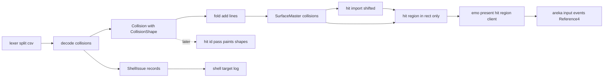
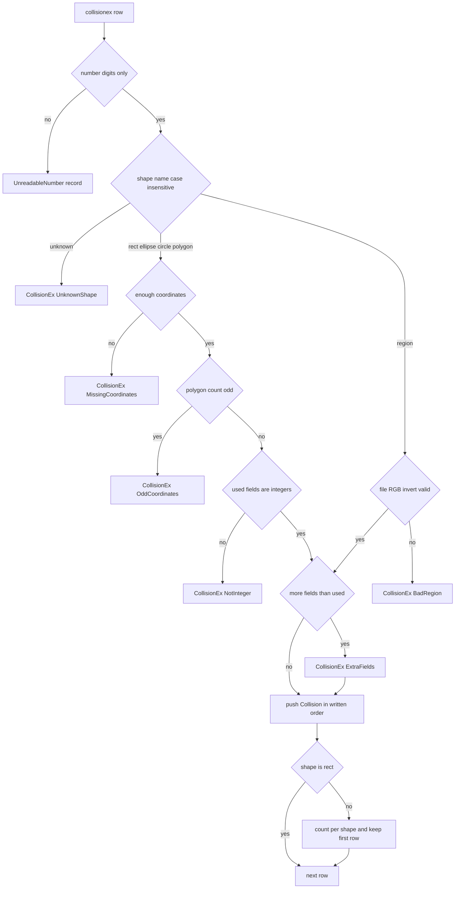

# Design Document: collisionex-regions

## Overview

**Purpose**: シェルの `surfaces.txt` に書いた不定形当たり判定 `collisionex*`（`rect`・`ellipse`・`circle`・`polygon`・`region`）を読み手が値にし、5 つの形を全部型へ運ぶ。当たり判定の解決は `rect` だけを今の矩形の規則で当て、ほかの 4 つの形は当たらずに下を続ける。これにより `collisionex` の `rect` で書いたシェル（クローディアの `Head`・`Face`・`Bust`・`Hair`・`Tray`・`Body`）を触ったとき、その名前がマウスのイベントの Reference4 に載る。

**Users**: 利用者（撫で・クリック・ドラッグに部位ごとの台詞が返る）と、ゴーストの作者（書き損じた行がどれで、なぜ使われなかったか、どの形がまだ働かないかが記録に残る）。後の仕様 `hit-id-pass` は、型へ運んだ 5 つの形の欄と並びの位置を使い、読み手に触れずに形を ID の描き先へ塗る（開発者 2026-11-17「形は ID で塗る」・要件の決め 7）。

**Impact**: 転記層の `Collision` を「矩形の 4 欄」から「形の列挙」へ置き換える。合成の畳み込み（`fold.rs`）は、同じサーフェスの同じ collision番号の前の行を除く今の振る舞いを改め、SSP と同じく両方を残して警告する。形の内外を CPU の式で判定するコードは書かない。areka 本体（`crates/areka/`）・emo-present の判定の口・マウスのイベントの送り方は変えない。

### Goals
- `collisionex*` の 5 つの形を読み、`collision*` と書いた順に 1 つの並びへ置く（1.1〜1.9・5.1〜5.2）。
- `rect` は今の矩形の閉区間の規則で当て、楕円・円・多角形・`region` は当たらずに下を続ける（2.1〜2.5・5.3）。
- 重なりの順（画家の順）・追記・入れ子の持ち込みを形を保ったまま今と同じ規則で扱い、同じ collision番号は両方を残して警告する（3.1〜3.7）。
- 読めない行と、まだ働かない形の行を理由つきで記録する（4.1〜4.10）。
- 台帳・§8・決定論の檻・実機で着地を確かめる（7.1〜7.6・8.1〜8.8）。

### Non-Goals
- 楕円・円・多角形・`region` を当たり判定にすること（形を ID の描き先に塗る・`region` の画像を読む）＝`hit-id-pass`。楕円・円・多角形の境界・大きさ 0・反転と負の半径の決めも `hit-id-pass`（決め A8・決め 7）。
- 予算（`VISIT_BUDGET`・`IMPORT_BUDGET`・`MAX_COPIED_LINES`）の数え方を変えること（多角形も 1 件 1 のまま・research.md 11 節）。
- `animation*.collision*`・`animation*.collisionex*`・`collision-sort` の忠実な解決・カーソルの形（`The Hand`）。
- マウスのイベントの種類・送る時・ほかの Reference。
- areka 本体のファイル（`crates/areka/src/input_events/mod.rs` の説明の 1 行は `audit-areka-input-menu` へ申し送り済み）。

## Boundary Commitments

### This Spec Owns
- 転記層の当たり判定の型 `Collision { index, shape, name }`・形の列挙 `CollisionShape`（5 つの腕）・`CollisionBounds`・`CollisionRegion`（`areka-parsers`）。
- `collisionex*` の行の読みと、読めない行の線引き・記録の種類（`ShellIssue::CollisionEx`・`ShellIssue::ShapesInactive`・理由の列挙 `CollisionExFault`・形ごとの数 `ShapeCounts`）。
- 当たり判定の解決 `hit_region_in` の述語の差し替え（`rect` は今の規則・ほかの 4 つの形は偽・入出力の形は変えない）。
- 子の当たり判定の持ち込み `hit_import.rs` の形ごとのずらし（飽和の足し算・5 つの腕）。
- 同じサーフェスの同じ collision番号の扱い（両方を残す・波括弧が足す行だけ警告する）。
- 網羅台帳の 2 行（`collision*`・`collisionex*`）・`doc/COMPAT_ARCHITECTURE.md` §8 の追記と 1 行の書き直し・実機の確かめの記録。
- `hit-id-pass` の brief への申し送り（7.6・設計の討議で書いた。済み）。

### Out of Boundary
- 楕円・円・多角形・`region` の内外の判定・塗り方・`region` の画像を開くこと（`hit-id-pass`）。この仕様は欄を運ぶだけで、判定は常に「当たらない」。
- 予算の数え方と値（`budget.rs`・`fold.rs` の `body_lines`・`hit_import.rs` の `IMPORT_BUDGET`／`HitMemo`）。多角形も今と同じく 1 件 1 として数える。
- `collision-sort` の値による並び替え・`RegionPriority` の新しい規則。
- 表示の拡大率の戻し方（`hit_region_scaled_in`・`ScaleRatio`）・emo-present の `presenter/hit.rs`・areka 本体の `input_events/`（名前の文字列を受け取るだけで変えない）。
- 字句の段（`lexer.rs`）。記録の「行」は欄を `,` で繋いだもの（4.9）とし、字句の段から原文を運ぶ変更はしない。
- `crates/log-capture-kit/tests/file_length_guard_test.rs`（ウェーブ C22 の約束 ⑵）・`Cargo.lock`・emo-text（約束 ⑸）。

### Allowed Dependencies
- `areka-emo-compose` → `areka-parsers::shell` の公開型（`Collision`・`CollisionShape`・`CollisionBounds`・`CollisionRegion`）。今と同じ向き。
- 依存の向き: `model ← lexer ← decode ← parse`（parsers の中）→ `fold`・`hit_import`・`hit`（emo-compose）→ emo-present → areka 本体。逆向きの参照を作らない。
- 依存を足さない。新しいソースファイルは parsers の檻 1 本と emo-compose の檻 1 本だけ（本番のファイルは足さない）。

### Revalidation Triggers
- `Collision` の欄・`CollisionShape` の腕・`CollisionBounds`／`CollisionRegion` の欄を変えたとき（`hit-id-pass` が形の欄と置く位置を読む契約）。
- `hit.rs` の形の `match`（`rect` だけが当たり、ほかは偽）を変えたとき。`hit-id-pass` が偽の腕を ID の描き先の読みへ替えるときもこれに当たる。
- `hit_region_in`／`hit_region_scaled_in` の入出力の形を変えたとき（emo-present と areka 本体の Reference4・カーソルの形の行）。
- `hit_import.rs` のずらしの規則（どの欄をずらすか）を変えたとき（`hit-id-pass` は親の座標のまま塗る）。
- `ShellIssue` の腕を足し引きしたとき（`shell_target.rs` が `severity()`／`message()` で出す）。
- 同じ collision番号の扱い（両方を残す・警告の範囲）を変えたとき（§8 の【上書き】の行・`fold_merge_tests.rs`）。

## Architecture

### Existing Architecture Analysis
- 読み手は 1 本の `Vec<Collision>`（書いた順）を `Surface`／`SurfaceAppend` に持ち、`decode_collisions` が本体の行を 1 回なめて作る。`collisionex` の行は `strip_prefix("collision")` の残り `ex0` が数字だけでないので、記録なしに飛んでいる（`decode.rs` 245〜271 行）。
- 合成は `fold.rs` が登場順に畳み込み、後の `surface*`ブレスの同じ collision番号の前の行を `Numbers.cuts` で最後に 1 度除く。追記は重ねて足す。
- 当たり判定の解決 `hit_region_in` は列を逆順になめ、最初に当たった矩形の名前を返す（画家の順・閉区間・反転は当たらない）。`hit_region_scaled_in` は ÷k の後に委譲する。
- 子の当たり判定の持ち込み `hit_import.rs::import` は、子の列を element定義の X,Y だけ飽和でずらして親の列へ足し、親に直接書いた名前と同じ名前の子の領域を落とす。
- 予算は当たり判定を 1 件 1 として数える（`budget::surface_rows`・`fold::body_lines`・`IMPORT_BUDGET`・`HitMemo`）。animation の pattern は数に入れるが、文字列の長さ（名前・ファイル名）は数えない。
- 記録の出口は `ShellIssue` → `areka-emo-present` の `shell_target.rs` が読み込みのたびに `warn!`／`error!` で出す。新しい腕も自動で出る。

### Architecture Pattern & Boundary Map



**Architecture Integration**:
- Selected pattern: ギャップ分析の候補 A に近い形（既存ファイルへ足す）。読みは `decode.rs` の兄弟の関数、形の `match` は `hit.rs` の述語の中、ずらしは `hit_import.rs` の `import` の隣。決め 7 で形の算術が無くなったので、ギャップ分析の候補 C の新しい `hit_shape.rs` は作らない（research.md 11 節）。
- Domain/feature boundaries: 読み手は欄の検査と値への写しだけを持ち、幾何を持たない。`hit.rs` は「どの形が今当たるか」を 1 つの網羅の `match` で持ち、`hit_import.rs` は「どの欄をずらすか」を 1 つの網羅の `match` で持つ。
- Existing patterns preserved: 1 本の並び・逆順の `find`・`RegionPriority` の網羅 match・`ShellIssue` を積んで出口で出す流れ・element番号の二重定義の `warn!` の書き方・飽和の足し算によるずらし・予算の 1 件 1 の数え方。
- New components rationale: 本番の新しいファイルは無い。新しい檻は structure.md の規律で兄弟ファイルへ置く（`decode_collisionex_tests.rs`・`hit_order_tests.rs`）。
- Steering compliance: 新しい檻は兄弟ファイル・1 ファイル 1,000 行以下・依存なし・沈黙する失敗なし（読めない行も働かない形も必ず記録）・1 フレーム遅らせる解なし・`match` にワイルドカードを置かない。

### Technology Stack

| Layer | Choice / Version | Role in Feature | Notes |
|-------|------------------|-----------------|-------|
| 読み手 | `areka-parsers`（ワークスペース内・Rust 2024） | `collisionex*` の行を `Collision` にし、記録を積む | 変更は `shell/{model,decode,parse,mod}.rs` |
| 合成・判定 | `areka-emo-compose`（ワークスペース内） | 重なり・持ち込みのずらし・畳み込み | 変更は `{hit,hit_import,fold}.rs` |
| 記録 | `tracing`（既存） | `fold.rs` の二重定義の `warn!`・`shell_target.rs` の出口 | 新しい依存なし |
| 台帳 | `ukadoc-survey`（既存の道具） | 台帳の検査と報告の作り直し | `cargo run -p ukadoc-survey -- report`・`report-summary` |

## File Structure Plan

### Directory Structure
```
crates/areka-parsers/src/shell/
├── model.rs                       # Collision・CollisionShape・CollisionBounds・CollisionRegion・ShapeCounts・ShellIssue の 2 腕・CollisionExFault
├── decode.rs                      # collisionex の行の読み（兄弟の関数）・Reading のまだ働かない形の数え・記録の口・檻の接続宣言
├── decode_collisionex_tests.rs    # 新: collisionex の読み・線引き・記録・5 つの形の欄の檻（1.x・4.x・5.1・5.2・8.3・8.4）
├── parse.rs                       # parse_all の輪の後に reading.finish()（まだ働かない形の記録を 1 件）
└── mod.rs                         # 新しい型の pub use
crates/areka-emo-compose/src/
├── hit.rs                         # hit_region_in の述語を形の match へ（rect だけが当たる）・檻の接続宣言
├── hit_order_tests.rs             # 新: parse からの通しで、混ぜた並びの重なり・追記・まだ働かない形の素通り・拡大率（2.x・3.1・3.2・5.3・8.1・8.2）
├── hit_import.rs                  # import のずらしを形ごとの shifted へ
└── fold.rs                        # Numbers.cuts を除く・collision番号の二重定義の warn!
.kiro/specs/completed/collisionex-regions/verification/
└── real-machine.md                # 新: 実機の確かめの手順と記録（8.5〜8.7）
```

### Modified Files
- `crates/areka-parsers/src/shell/model.rs` — `Collision` の 4 欄を `shape: CollisionShape` へ置き換え、`CollisionShape`・`CollisionBounds`・`CollisionRegion`・`ShapeCounts`・`CollisionExFault` と `ShellIssue` の 2 腕を足す。`UnreadableNumber.text` の説明を「飛ばした欄の原文（`collisionex` の行では欄を `,` で繋いだ行）」へ直す（356 行 → 約 460 行）。
- `crates/areka-parsers/src/shell/decode.rs` — `decode_collisions` に `collisionex` の枝を `collision` の枝より先に足し、1 行を読む兄弟の関数 `decode_collisionex_row` を置く。`Reading` に `collision_ex`・`inactive`・`finish` の口と数えの欄を足す。モジュールと `decode_collisions` の説明と `dispatch_block` の注記から「collisionex を値にしない」を除く。末尾に `decode_collisionex_tests` の接続宣言（680 行 → 約 800 行）。
- `crates/areka-parsers/src/shell/parse.rs` — 輪の後に `reading.finish()` を 1 行。
- `crates/areka-parsers/src/shell/mod.rs` — `CollisionShape`・`CollisionBounds`・`CollisionRegion`・`CollisionExFault`・`ShapeCounts` を `pub use` に足す。
- `crates/areka-parsers/src/shell/{decode_charset_tests,decode_tests_append_tests,decode_tests_element_collision_tests,parse_tests}.rs` — `Collision {` の直書きを `shape: CollisionShape::Rect(CollisionBounds { .. })` へ書き換える（振る舞いは変えない）。
- `crates/areka-parsers/src/shell/decode_tests_lenient_input_tests.rs`・`validation_tests.rs` — `collisionex` を「値にしない」と固定した檻（名前を最後の欄に書いた誤った書式・`decode_tests_lenient_input_tests.rs` 83・226 行・`validation_tests.rs` 553 行の辺り）を、正しい書式（名前が 2 番目の欄）で新しい振る舞いを固定する檻へ書き直す（8.8）。直書きと `.left` の読み（`validation_tests.rs` 612 行）も書き換える。156 行（未知のブレスの中）は読まれないので変えない。
- `crates/areka-emo-compose/src/hit.rs` — `RegionPriority::Painter` の述語を私的な関数 `hits(&c.shape, x, y)`（形の網羅の `match`）へ。モジュールと関数の説明に「`rect` だけが当たり、ほかの形は `hit-id-pass` まで下を続ける」を足す。末尾に `hit_order_tests` の接続宣言。中の檻（`mod tests`）は `coll` 経由なので直さない（677 行 → 約 700 行）。
- `crates/areka-emo-compose/src/hit_import.rs` — `import` のずらしを私的な関数 `shifted(shape, dx, dy)` へ（289 行 → 約 310 行）。
- `crates/areka-emo-compose/src/fold.rs` — `Numbers.cuts` と最後の除きを消し、`add_lines` が波括弧（`Source::Brace`）の行を足すときだけ collision番号の二重定義の `warn!` を足す。`add_lines` と `Numbers` の説明の collision の段を書き直す（572 行から増減わずか）。
- `crates/areka-emo-compose/src/plan_test_support.rs` — `coll` の中身を `CollisionShape::Rect` へ（呼び手は直さない）。
- `crates/areka-emo-compose/src/{fold_merge_tests,row_budget_tests}.rs` — 前の行を除くと固定した檻（`later_brace_adds_same_element_number_and_drops_same_animation_number`・`append_and_second_brace_match_the_ssp_2_9_29_measurements`・`brace_drops_earlier_same_numbered_collisions_and_keeps_written_order`）を、両方を残す振る舞いと警告 1 行へ書き直し、`.right` の読み（`fold_merge_tests.rs` 164 行）を書き換える。
- `crates/areka-emo-compose/src/hit_import_tests.rs` — 子から持ち込む 5 つの形のずらしと、親の同じ名前の `region` が子を落とす檻を足す（3.4・3.5・8.2）。
- `crates/areka-parsers/src/shell/decode_tests_element_collision_tests.rs` — 19 行の説明「collisionex はここでは扱わない」を、`collisionex` の檻の置き場（`decode_collisionex_tests.rs`）を指す説明へ直す。
- `crates/areka-emo-present/src/shell_target_element_base_tests.rs` — クローディアを読む `claudia_base_surfaces_are_full_size_without_warnings` に、warn 以上が `ShapesInactive` の 1 行（楕円 32・円 0・多角形 28・`region` 0）と `draw-methods-canon` が持つ surface28 の `base` の pattern 3 行だけで、同じ collision番号の警告が 0 行である検査（実装の段で数え直した・設計の「ちょうど 1 行」は数え違い）を数行足し、名前と説明（「警告は 0 件」）を事実に合わせて直す（8.6 の決定論の側）。
- `crates/areka-emo-present/src/presenter_test_support.rs` — `hit_coll` の中身を `CollisionShape::Rect` へ。658 行の直書きは `hit_coll(..)` の呼び出しへ替える（890 行のまま・行は増やさない）。
- `doc/ukadoc-coverage/ledger/assets.toml`・`doc/ukadoc-coverage/report/assets.md`・`doc/ukadoc-coverage/report/summary.md` — 2 行の書き直しと報告の作り直し（報告は機械で作る）。
- `doc/COMPAT_ARCHITECTURE.md` — §8 に行を足し、【上書き】の行の collision の決めを書き直す。
- `.kiro/specs/hit-id-pass/brief.md` — 申し送りの節（7.6）は設計の討議で書いた。実装の段では触らない。

ウェーブ C22 の表の「触るファイル」との違い: 表にある「形の検査の新しいファイル」は作らない（決め 7）。表に無いのは parsers の `parse.rs`・`mod.rs`（記録のまとめ 1 行と `pub use`）と emo-compose の `fold.rs` とその檻（同じ collision番号の扱い）。同じウェーブのほかの 5 本は parsers と emo-compose に触らない（要件の Boundary Context の注記）。

触らないことを確かめるファイル: `crates/areka-emo-compose/src/{budget,lib,plan,nesting,outline_walk}.rs`・`crates/areka-emo-present/src/presenter/hit.rs`・`crates/areka/` 全部・`crates/areka-parsers/src/shell/lexer.rs`。

## System Flows



- 判定の順は図のとおりで固定する（1 行に複数の理由が当てはまっても記録は 1 件・決定論）。`region` の欄は「ファイル名が空でない・R・G・B が 0〜255 の整数・領域反転の欄が無いか `true`／`false`」を 1 つの検査とし、どれかが外れたら `BadRegion`。
- `UnknownShape`〜`BadRegion` の行は並びに入れない。`ExtraFields` の行は前から求める数だけを使って並びに入れる（4.5）。`polygon` には上限が無いので `ExtraFields` は出ない。
- 並びに入れた `ellipse`・`circle`・`polygon`・`region` の行は形ごとに数え、最初の行を控え、`parse_all` の最後に 1 件の `ShapesInactive` にまとめる（4.7）。`ExtraFields` の行も並びに入るので数える。
- 楕円・円の値は読んだまま運ぶ（反転した囲み・負の半径も記録しない＝決め A8 で `hit-id-pass` が決める）。

## Requirements Traceability

| Requirement | Summary | Components | Interfaces | Flows |
|-------------|---------|------------|------------|-------|
| 1.1 | `collisionex` に数字の番号が続く行を 1 件にする | CollisionExReader・ShellModel | `decode_collisionex_row` | 読みの流れ |
| 1.2 | `rect`・`ellipse` は 4 欄 | CollisionExReader・ShellModel | `CollisionBounds` | 読みの流れ |
| 1.3 | `circle` は中心と半径 | CollisionExReader・ShellModel | `CollisionShape::Circle` | 読みの流れ |
| 1.4 | `polygon` は書いた順の頂点 | CollisionExReader・ShellModel | `CollisionShape::Polygon` | 読みの流れ |
| 1.5 | `region` の欄・領域反転の既定 `false` | CollisionExReader・ShellModel | `CollisionRegion` | 読みの流れ |
| 1.6 | 名前は書いたまま | CollisionExReader | `CollisionName::new` | — |
| 1.7 | 形の名前は ASCII の大小文字を区別しない | CollisionExReader | `eq_ignore_ascii_case` | 読みの流れ |
| 1.8 | `collision*` と書いた順に 1 つの並び | CollisionExReader | `decode_collisions` の 1 回の走査 | — |
| 1.9 | `collision*` の読みを変えない | CollisionExReader | `decode_collisions` の既存の枝 | — |
| 1.10 | 行の末尾の空の欄 1 つは数えない | CollisionExReader | `decode_collisionex_row` | 読みの流れ |
| 2.1 | `rect` は閉区間で当たる（`collision*` と同じ判定） | HitResolve | `hits` の `Rect` の腕 | — |
| 2.2 | 反転した `rect` は当たらない | HitResolve | `hits` の `Rect` の腕（並べ直さない） | — |
| 2.3 | 楕円・円・多角形・`region` は当たらず下を続ける | HitResolve | `hits` の偽の腕・逆順の `find` | — |
| 2.4 | 同じ並びと点に常に同じ結果 | HitResolve | `hit_region_in`（純関数） | — |
| 2.5 | 拡大率が 1 でないときは戻してから判定 | HitResolve | `hit_region_scaled_in`（変更なし） | — |
| 3.1 | 区別なく後に書いたものが手前 | HitResolve | `hit_region_in` | — |
| 3.2 | 追記は後ろ（手前）に置く | FoldCollisions | `add_lines`（`Source::Append`） | — |
| 3.3 | 同じ番号は 1 つの並びで両方を残す | FoldCollisions・CollisionExReader | `add_lines`・`Collision.index` | — |
| 3.4 | 子の形を element定義の X,Y だけずらす（5 つの形） | HitImport | `shifted`・`import` | — |
| 3.5 | 持ち込みの順と同じ名前の規則は今と同じ・`region` も同じ | HitImport | `names_of`（変更なし） | — |
| 3.6 | `collision-sort` で並びを変えない | HitResolve | `RegionPriority::Painter`（変更なし） | — |
| 3.7 | 同じ番号の重なりを警告（追記は対象外） | FoldCollisions | `add_lines` の `warn!` | — |
| 4.1 | 未知の形は記録して使わない | CollisionExReader・IssueRecords | `CollisionExFault::UnknownShape` | 読みの流れ |
| 4.2 | 座標が足りない | CollisionExReader・IssueRecords | `CollisionExFault::MissingCoordinates` | 読みの流れ |
| 4.3 | 整数として読めない | CollisionExReader・IssueRecords | `CollisionExFault::NotInteger` | 読みの流れ |
| 4.4 | 多角形の座標の数が奇数 | CollisionExReader・IssueRecords | `CollisionExFault::OddCoordinates` | 読みの流れ |
| 4.5 | 多すぎる欄は前から使い記録 | CollisionExReader・IssueRecords | `CollisionExFault::ExtraFields` | 読みの流れ |
| 4.6 | `region` の欄が不正 | CollisionExReader・IssueRecords | `CollisionExFault::BadRegion` | 読みの流れ |
| 4.7 | まだ働かない形は読み込みごとに 1 件・形ごとの数と最初の行 | CollisionExReader・IssueRecords | `ShellIssue::ShapesInactive`・`ShapeCounts`・`Reading::finish` | 読みの流れ |
| 4.8 | 番号が読めない | CollisionExReader・IssueRecords | `ShellIssue::UnreadableNumber` | 読みの流れ |
| 4.9 | 見出しと欄を `,` で繋いだ行・警告の重さ | IssueRecords | `ShellIssue::message`・`severity` | — |
| 4.10 | 読めない行で止めない | CollisionExReader | `decode_collisions` の `continue` | — |
| 5.1 | 4 つの形の欄を書いた位置に置く | CollisionExReader・ShellModel | `CollisionShape` | — |
| 5.2 | `region` のファイルを開かない | CollisionExReader | I/O なし（`parse` は純関数） | — |
| 5.3 | まだ当たらない形を並びから除かない | HitResolve・HitImport | `hit_region_in`・`import` | — |
| 6.1 | `rect` の名前が Reference4 に載る | HitResolve（下流は変更なし） | `hit_region_in` の戻り値の形 | — |
| 6.2 | イベントの送り方を変えない | 境界（areka 本体に触らない） | — | — |
| 6.3 | カーソルの形の行は名前で同じに引く | 境界（下流は変更なし） | `ClientHit.region` | — |
| 6.4 | `collision*` だけのシェルは同じ番号のときだけ変わる | FoldCollisions・CollisionExReader | `add_lines` | — |
| 7.1 | 台帳の `collisionex*` を `degraded`・担当・説明 | LedgerAndDocs | `assets.toml` | — |
| 7.2 | 台帳の `collision*` の説明と理由 | LedgerAndDocs | `assets.toml` | — |
| 7.3 | §8 に沈黙の決めを足す | LedgerAndDocs | `COMPAT_ARCHITECTURE.md` | — |
| 7.4 | §8 の【上書き】の行を書き直す | LedgerAndDocs | `COMPAT_ARCHITECTURE.md` | — |
| 7.5 | areka 本体を書き換えない | 境界 | — | — |
| 7.6 | `hit-id-pass` の brief へ申し送る | LedgerAndDocs | `.kiro/specs/hit-id-pass/brief.md` の最後の節（済み） | — |
| 8.1 | `rect` の中・外・辺・反転と、ほかの形の素通りの檻 | 檻 | `hit_order_tests.rs` | — |
| 8.2 | 混ぜた並び・追記・同じ番号・持ち込みの檻と既存の檻の書き直し | 檻 | `hit_order_tests.rs`・`hit_import_tests.rs`・`fold_merge_tests.rs`・`row_budget_tests.rs` | — |
| 8.3 | 読めない行とまだ働かない形の記録の檻 | 檻 | `decode_collisionex_tests.rs` | — |
| 8.4 | 5 つの形の欄が型に運ばれる檻 | 檻 | `decode_collisionex_tests.rs` | — |
| 8.5 | 実機でクローディアの撫でとドラッグに矩形の名前 | RealMachineCheck | `verification/real-machine.md` | — |
| 8.6 | 楕円・多角形だけの所は名前が載らず、記録に数が出る | RealMachineCheck・檻 | `verification/real-machine.md`・`shell_target_element_base_tests.rs`（クローディアの `ShapesInactive` の数） | — |
| 8.7 | 排他テストの机で順を取る | RealMachineCheck | `areka-impl-watch` の机 | — |
| 8.8 | 誤った書式の既存の檻を書き直す | 檻 | `decode_tests_lenient_input_tests.rs`・`validation_tests.rs` | — |

## Components and Interfaces

| Component | Domain/Layer | Intent | Req Coverage | Key Dependencies (P0/P1) | Contracts |
|-----------|--------------|--------|--------------|--------------------------|-----------|
| ShellModel | parsers / model.rs | 形を持つ当たり判定の型と記録の型 | 1.1〜1.5・5.1 | なし | State |
| CollisionExReader | parsers / decode.rs | `collisionex*` の 1 行を値または理由にする | 1.1〜1.9・3.3・4.1〜4.10・5.1・5.2・6.4 | ShellModel (P0) | Service |
| IssueRecords | parsers / model.rs・decode.rs・parse.rs | 理由つきの記録とまだ働かない形のまとめ | 4.1〜4.9 | ShellModel (P0)・shell_target の出口 (P1) | Service |
| HitResolve | emo-compose / hit.rs | 並びの逆順で最初に当たった名前（`rect` だけが当たる） | 2.1〜2.5・3.1・3.6・5.3・6.1 | ShellModel (P0) | Service |
| HitImport | emo-compose / hit_import.rs | 子の形を形ごとにずらして持ち込む | 3.4・3.5・5.3 | ShellModel (P0) | Service |
| FoldCollisions | emo-compose / fold.rs | 同じ番号を両方残して警告 | 3.2・3.3・3.7・6.4 | tracing (P1) | Service |
| LedgerAndDocs | `doc/ukadoc-coverage/`・`doc/COMPAT_ARCHITECTURE.md`・`.kiro/specs/hit-id-pass/brief.md` | 台帳・報告・§8・申し送り | 7.1〜7.6 | ukadoc-survey (P1) | — |
| RealMachineCheck | `.kiro/specs/completed/collisionex-regions/verification/real-machine.md` | クローディアの実機の確かめ | 8.5〜8.7 | impl-watch の机 (P0)・real-run-kit (P1) | — |

### parsers / model

#### ShellModel

| Field | Detail |
|-------|--------|
| Intent | 当たり判定 1 件を「番号・形・名前」で持ち、形を 5 つの腕で表す |
| Requirements | 1.1, 1.2, 1.3, 1.4, 1.5, 5.1 |

**Responsibilities & Constraints**
- `collision*` と `collisionex*` を同じ型で持つ。由来（どちらの綴りで書いたか）は持たない（要件が区別を求めず、使い手が居ない・決め 8）。
- `CollisionShape` に `#[non_exhaustive]` を付けない。5 つの形は ukadoc が閉じて定める集合で拡張の継ぎ目ではなく、別 crate の emo-compose の `match`（`hits`・`shifted`）をワイルドカードなしの網羅に保ち、腕を足したときに漏れをコンパイルで見つけるため（`ShellIssue` の前例・`RegionPriority` と同じ理由）。
- 型は値を運ぶだけで、幾何のメソッドを持たない（ずらしは emo-compose の `hit_import.rs`）。
- `CollisionRegion` は `region` の行の欄と、画像を置く位置 `x`・`y` を持つ。構文に置く位置の欄は無く、読みでは `(0, 0)`。子のサーフェスから持ち込むと element定義の X,Y だけずれる（3.4）。

**Contracts**: State [x]

##### State Management
```rust
#[derive(Clone, Debug, PartialEq)]
pub struct Collision {
    pub index: u32,             // collision*・collisionex* の * （1 つの番号の並び）
    pub shape: CollisionShape,
    pub name: CollisionName,    // 書いたまま（空も大小文字もそのまま）
}

#[derive(Clone, Debug, PartialEq)] // #[non_exhaustive] を付けない（網羅の match を保つ）
pub enum CollisionShape {
    Rect(CollisionBounds),                       // collision* と collisionex*,…,rect（当たる）
    Ellipse(CollisionBounds),                    // 囲みの長方形（hit-id-pass まで当たらない）
    Circle { x: i64, y: i64, radius: i64 },      // 中心と半径（負も運ぶ）
    Polygon(Vec<(i64, i64)>),                    // 書いた順の頂点（読みでは 3 つ以上）
    Region(CollisionRegion),
}

#[derive(Clone, Copy, Debug, PartialEq, Eq)]
pub struct CollisionBounds { pub left: i64, pub top: i64, pub right: i64, pub bottom: i64 }

#[derive(Clone, Debug, PartialEq)]
pub struct CollisionRegion {
    pub file: String,   // 書いたまま（区切りも大小文字も変えない・開かない）
    pub red: u8, pub green: u8, pub blue: u8,
    pub invert: bool,   // 領域反転（欄が無ければ false）
    pub x: i64, pub y: i64, // 画像を置く位置（読みでは 0,0・持ち込みでずれる）
}
```
- Invariants: `Polygon` の頂点の数は読み手が作る値では 3 つ以上。`CollisionBounds` は並べ直さない（反転のまま運ぶ）。

### parsers / decode

#### CollisionExReader

| Field | Detail |
|-------|--------|
| Intent | `surface*`・`surface.append*` の本体の `collisionex*` の行を、書いた順に `Collision` へ写すか、理由つきで記録する |
| Requirements | 1.1〜1.9, 3.3, 4.1〜4.10, 5.1, 5.2, 6.4 |

**Responsibilities & Constraints**
- `decode_collisions` の 1 回の走査の中で、行の頭が `collisionex` なら新しい枝、そうでなく `collision` なら今の枝を通す（新しい枝を先に置く）。どちらも同じ `Vec` へ書いた順に積む（1.8）。`collision*` の枝は変えない（1.9）。
- 番号の読み（数字だけ・`u32` に収まる）は `collision*` と同じ。数字だけでない残り（`collisionexfoo` など）は今の `collision*` と同じく記録なしに飛ばす（要件 4.8 は番号が無い・桁あふれだけを言う）。番号が読めない行は `ShellIssue::UnreadableNumber` を積み、`text` に欄を `,` で繋いだ行を入れる（4.8・4.9）。
- 欄の位置: 0＝`collisionexN`・1＝名前・2＝形・3 以降＝座標（または `region` の欄）。名前の欄が無ければ空の名前。
- 座標は `i64` として読む（`str::parse::<i64>`・字句の段が前後の空白を除いた後）。読めない欄は `NotInteger`（`collision*` の「0 にする」とは別の規則・1.9 は変えない）。
- 判定の順と理由は「System Flows」の図のとおり。`region` の領域反転は ASCII の大小文字を区別せずに `true`・`false` と読む（決め 8）。行が `,` で終わる（最後の欄が空）ときは、その空の欄 1 つを数える前に除く（要件 1.10・決め 8・SSP の測り）。
- 読めた `ellipse`・`circle`・`polygon`・`region` の行は、並びに積んだうえで `Reading::inactive` で数える（4.7）。`rect` は数えない。
- ファイルを開かず、記録も出さない（記録は `Reading` に積むだけ・5.2）。

**Dependencies**
- Inbound: `dispatch_block`・`decode_append_block` — 本体の行（P0）
- Outbound: ShellModel・`Reading` — 値と記録（P0）

**Contracts**: Service [x]

##### Service Interface
```rust
/// collisionex の 1 行（番号は読めた後）を値にする。Err の行は並びに入れない。
fn decode_collisionex_row(index: u32, fields: &[String])
    -> Result<(Collision, Option<CollisionExFault>), CollisionExFault>;
// Ok((c, Some(CollisionExFault::ExtraFields))) は「使ったうえで記録する」行。

impl Reading {
    fn collision_ex(&mut self, fields: &[String], fault: CollisionExFault); // CollisionEx を積む
    fn inactive(&mut self, shape: &CollisionShape, fields: &[String]); // rect 以外を形ごとに数え、最初の行を控える
    pub(crate) fn finish(&mut self); // 数の合計が 1 以上なら ShapesInactive を 1 件積む
}
```
- Preconditions: `fields` は字句の段の 1 行（前後の空白を除いた欄）。
- Postconditions: 同じ入力に同じ結果。`Err` のときも `Ok(.., Some(ExtraFields))` のときも、呼び手が記録を 1 件だけ積む。
- Invariants: パニックしない・I/O なし・`collision*` の枝の結果を変えない。`inactive` の `match` はワイルドカードなし（`Rect` は何もしない腕）。

**Implementation Notes**
- Integration: `decode.rs` の頭の説明（「collisionex は値にしない」）と `decode_collisions`・`dispatch_block` の注記を書き直す。`decode.rs` は約 800 行で 1,000 行を越えない。
- Validation: `decode_collisionex_tests.rs` が形ごと・大小文字・混ぜた順・理由ごとの記録と「並びに入るか」を固定する。
- Risks: 除くのは末尾の空の欄 1 つだけ。途中の空の欄（`10,,20`）は欄として数え、整数として読めないので `NotInteger`。

### parsers / model・decode・parse

#### IssueRecords

| Field | Detail |
|-------|--------|
| Intent | `collisionex` の行を使わなかった（または一部だけ使った）理由と、まだ働かない形のまとめを記録の型で運ぶ |
| Requirements | 4.1〜4.9 |

**Contracts**: Service [x]

##### Service Interface
```rust
pub enum ShellIssue {
    // …既存の 6 腕…
    /// collisionex の行を使わなかった、または前から求める数だけを使った（理由つき）。
    CollisionEx { heading: String, text: String, fault: CollisionExFault },
    /// 楕円・円・多角形・region の行を型へ運んだが、まだ当たり判定として働かない（読み込みごとに 1 件）。
    ShapesInactive { heading: String, text: String, counts: ShapeCounts },
}

#[derive(Clone, Copy, Debug, PartialEq, Eq)] // #[non_exhaustive] を付けない（ShellIssue と同じ）
pub enum CollisionExFault {
    UnknownShape, MissingCoordinates, OddCoordinates, NotInteger, BadRegion,
    ExtraFields, // この理由だけは行を使う
}

/// まだ働かない形の行の数（読み込み 1 回ぶん）。
#[derive(Clone, Copy, Debug, Default, PartialEq, Eq)]
pub struct ShapeCounts { pub ellipse: usize, pub circle: usize, pub polygon: usize, pub region: usize }
```
- `heading` はブレスの見出しの原文（`Reading.heading`）、`text` は行の欄を `,` で繋いだもの（4.9・既存の `UnreadableNumber.text` と同じ名前。既存の腕の `line` は行の番号なので使わない）。`ShapesInactive` の `heading`・`text` は、最初に並びに入れたまだ働かない形の行（形を問わず 1 つ）のもの。
- `severity()` は新しい 2 腕とも `WARN`（4.9）。`message()` は見出し・行・理由を名指し、`ExtraFields` は「前から求める数だけを使った」、ほかは「当たり判定にしない」と書く。`ShapesInactive` は「楕円 {ellipse}・円 {circle}・多角形 {polygon}・region {region} 行を型へ運んだが、まだ当たり判定として働かない（ID の描き先に塗るのは hit-id-pass）」と最初の行を書く。
- 数えは飽和の足し算（`saturating_add`）。
- `parse_all` は字句の輪の後で `reading.finish()` を呼ぶので、`ShapesInactive` は記録の列の最後に 1 件だけ入る（4.7）。箱の側の `box_reading` は崩れを捨てるので `finish` を呼ばない。

### emo-compose / hit

#### HitResolve

| Field | Detail |
|-------|--------|
| Intent | 並びを逆順になめ、最初に当たった当たり判定の名前を返す。今当たるのは `rect` だけ |
| Requirements | 2.1〜2.5, 3.1, 3.6, 5.3, 6.1 |

**Responsibilities & Constraints**
- `RegionPriority::Painter` の腕の述語を、私的な関数 `hits` に替える。`hits` は形の網羅の `match`（ワイルドカードなし）で、`Rect` は今の閉区間の式（`left <= x <= right && top <= y <= bottom`・反転は並べ直さず当たらない＝2.1・2.2）、`Ellipse`・`Circle`・`Polygon`・`Region` は `false`（2.3）。
- まだ働かない形は述語が偽なので、並びに残ったまま下を続ける（2.3・5.3）。`hit_region_scaled_in` は委譲のままなので、拡大率の戻しは形によらず同じ（2.5）。`collision-sort` は今と同じく見ない（3.6）。
- 置き場は `hit.rs` の中（新しいファイルを作らない）。`hit-id-pass` が偽の腕を替えるときの的は、この 1 つの `match` になる。

**Contracts**: Service [x]

##### Service Interface
```rust
// 入出力の形は変えない（emo-present と areka 本体の契約）。
pub fn hit_region_in(collisions: &[Collision], x: i64, y: i64, priority: RegionPriority) -> Option<&str>;
pub fn hit_region_scaled_in<'a>(collisions: &'a [Collision], x: i64, y: i64, k: ScaleRatio, priority: RegionPriority) -> ScaledHit<'a>;

/// 形 shape が今の判定で点 (x, y) に当たるか（rect だけ・ほかは hit-id-pass まで false）。
fn hits(shape: &CollisionShape, x: i64, y: i64) -> bool;
```
- 下流（`presenter/hit.rs` → `ClientHit.region` → areka 本体の `input_events`・カーソルの形の行）は名前の文字列だけを受け取るので、`collisionex` の `rect` の名前も `collision*` と同じに届く（6.1〜6.3）。

### emo-compose / hit_import

#### HitImport

| Field | Detail |
|-------|--------|
| Intent | 子の当たり判定を形を保ったまま element定義の X,Y だけずらして持ち込む |
| Requirements | 3.4, 3.5, 5.3 |

**Responsibilities & Constraints**
- `import` は名前の規則（`names_of`・親に直接書いた名前と同じ子の領域を落とす）と順を変えず、ずらしだけを私的な関数 `shifted` に替える（3.4・3.5）。親の同じ名前が `region` でも同じ規則を当て、特別扱いを作らない（決め 6）。まだ働かない形も並びから除かない（5.3）。
- `shifted` は形の網羅の `match`（ワイルドカードなし）で、どの腕も飽和の足し算（`saturating_add`）: `Rect`・`Ellipse` は 4 欄、`Circle` は中心（半径はそのまま）、`Polygon` は全部の頂点、`Region` は置く位置 `x`・`y`。形の腕は変えない。
- 予算（`IMPORT_BUDGET`・`HitMemo`・持ち越し）は今と同じく件数で数える（多角形も 1 件）。

**Contracts**: Service [x]

##### Service Interface
```rust
/// 形 shape を (dx, dy) だけ飽和の足し算でずらした形（腕は変えない）。
fn shifted(shape: CollisionShape, dx: i64, dy: i64) -> CollisionShape;
// import の map は Collision { shape: shifted(r.shape, dx, dy), ..r } になる。
```
- Postconditions: パニックしない（`i64::MIN`・`i64::MAX` で飽和）。多角形は頂点の並びの順を保つ。

### emo-compose / fold

#### FoldCollisions

| Field | Detail |
|-------|--------|
| Intent | 同じサーフェスの同じ collision番号を前の行を除かずに両方残し、element番号の二重定義と同じ書き方で警告する |
| Requirements | 3.2, 3.3, 3.7, 6.4 |

**Responsibilities & Constraints**
- `Numbers.cuts` と、畳み込みの最後に前の行を除く処理を消す。波括弧も追記も、後の行を書いた順に末尾へ足す（後に書いた方が手前・3.2・3.3）。
- 警告（3.7）: element番号の二重定義と同じ仕組みで、`add_lines` が波括弧（`Source::Brace`）の行を足すとき、その面にすでにある collision番号（前の波括弧・追記で足した番号＝`numbers.collisions`）を持つ行を数え、1 件以上なら記述子 1 つにつき（面ごとに）1 行の `warn!` を出す。欄は `surface_id`・`collision`（最初に重なった番号）・`count`（重なった行の数）、文言は「collision番号の二重定義: 前の行も残して両方を足す（SSP と同じ）」。追記（`Source::Append`）が足す行は数えず警告しない（3.7）。`records` が `Quiet` なら出さない。
- 同じ波括弧の中だけで番号が重なる行は、今と同じく両方を残し、警告しない（決め 8・§8 に areka の裁量として書く）。
- `body_lines` は変えない（件数で数える）。

**Contracts**: Service [x]

##### Service Interface
- `add_lines(master, later, source, records, numbers)` の形は変えない（`Numbers` から `cuts` が消えるだけ）。警告は element の警告と同じく関数の中に書く。

**Implementation Notes**
- Integration: `add_lines` と `Numbers` の説明の collision の段を「両方を足す・波括弧が足す行の重なりだけ警告」に書き直す。
- Validation: `fold_merge_tests.rs` の `later_brace_adds_same_element_number_and_drops_same_animation_number`・`append_and_second_brace_match_the_ssp_2_9_29_measurements` と `row_budget_tests.rs` の `brace_drops_earlier_same_numbered_collisions_and_keeps_written_order` を新しい振る舞い（全部が書いた順に残る・警告 1 行）へ書き直し、SSP の測りの形（`collision4` と後の `collisionex4`・`collision5` どうし）を固定入力で写す。檻の名前と説明に「警告 1 行」は 2 つのブレスの重なりの期待値だと書く。
- Risks: 同じ番号を書き直す前提で書いたシェルでは警告が増え、前の行も当たる。SSP と同じ振る舞いで、開発者の裁定（2026-11-17）による。

### doc / verification

#### LedgerAndDocs（summary-only）
- `assets.toml` の `collisionex*` の行: `status = "degraded"`・`owner = "collisionex-regions"`・`note` は「`rect` は働く・楕円・円・多角形・`region` は型へ運び記録だけ（ID の描き先に塗るのは `hit-id-pass`）」（7.1）。`collision*` の行: `degraded` のまま・「`collisionex` を読み飛ばす」旨を除き、理由を「重なりの順が正典（先に書いた方が上位）と逆」へ（7.2）。どちらも `implemented` にしないので証拠のコメントは要らない（決め A7）。`cargo run -p ukadoc-survey -- report` と `report-summary` で報告を作り直し、`cargo test -p ukadoc-survey` で台帳の検査を通す。
- §8（7.3）に足す行: ⑴ 形の名前の大小文字を区別しない（SSP の測り） ⑵ `collision*` と `collisionex*` は 1 つの番号の並び（SSP の測り） ⑶ 読めない行の線引き（決め A4・判定の順と 1 行 1 件） ⑷ 楕円・円・多角形・`region` は型へ運び当たらずに下を続ける・読み込みごとに 1 件の記録（決め A6・決め 7・塗るのは `hit-id-pass`）。各行に ukadoc の `collisionex*` の節の URL と逐語の引用を添える。
- §8 の【上書き】の行（7.4）: 当たり判定の段を「同じ collision番号の前の行を除かず両方を残し、後の波括弧が足す行が重なったら `warn!`（collision番号の二重定義）を出す（SSP 2.9 の測り・`research.md` 9 節）。同じブレスの中だけの重なりは警告しない（areka の裁量・SSP では測っていない）」へ書き直し、上書きした旨と根拠を添える。判定している檻の名前も書き直した檻へ付け替える。
- `hit-id-pass` の brief（7.6）: 最後の節「`collisionex-regions` からの申し送り（2026-11-17・設計の討議）」に、議題 2 の決め・SSP の測り（巻き数の規則・凸包ではなく辺どおり）・境界と大きさ 0 と反転の決めが残ること・型の契約を書いた（済み）。型の欄の名前はこの設計が正本。
- areka 本体は書き換えない（7.5）。

#### RealMachineCheck（summary-only）
- 手順は完了 `areka-P0-mouse-drag-events` の `verification/real-machine.md` の雛形（ワークツリーの `target\` の下の根・`real-machine-run.ps1 -Prepare`・`RUST_LOG=info,areka=debug,…`）に倣い、`.kiro/specs/completed/collisionex-regions/verification/real-machine.md` に手順と結果を書く。
- クローディア（`sample-ghost-kit` の `claudia`）の `surface0` で、矩形（`Head`・`Bust` など）の中の点と、楕円（`Foot`）または多角形（`Fan`・`Skirt`）だけがある所の点を、表示の拡大率込みで先に求める。`SendInput` で撫で（`OnMouseMove`）とドラッグ（`OnMouseDragStart`／`OnMouseDragEnd`）を起こし、areka の記録（`hit_region_client` の `debug!` の region と、イベントの Reference4）で、矩形の名前が載り、楕円・多角形だけの所では空になることを確かめる（8.5・8.6）。
- 読み込みの記録に `ShapesInactive` が 1 行（楕円 32・多角形 28・円 0・region 0）出ることも記録で確かめる（8.6）。`circle`・`region` はクローディアに無いので決定論の檻だけ。
- 画面を使う間は排他テストの机で順を取り、終わったらすぐ返す（8.7）。

## Data Models

### Domain Model
- 当たり判定（`Collision`）は面（`SurfaceMaster`）の並びの 1 要素で、番号（`index`）・形（`shape`）・名前（`name`）を持つ。並びの位置が重なりの順（後ろほど手前）。
- 番号は `collision*` と `collisionex*` で 1 つの並び。同じ面に同じ番号が複数あってよい（両方を残す）。番号は重なりの順にも判定にも使わず、畳み込みの警告にだけ使う。
- 楕円・円・多角形・`region` は判定では当たらないが並びに残る。持ち込みでは形ごとにずれる。

### Data Contracts & Integration
- `hit-id-pass` への契約（この設計が正本・brief の申し送りと同じ）:
  - 当たり判定は 1 本の並び（書いた順・後ろほど手前）に `Collision { index, shape, name }` で並ぶ。並びの位置が重なりの順。同じ collision番号は両方が残る。
  - 形の欄: `Rect`・`Ellipse` は `CollisionBounds`（反転のまま）、`Circle` は中心と半径（負のまま）、`Polygon` は書いた順の頂点（3 つ以上）、`Region` は `file`（書いたまま・開いていない）・`red`・`green`・`blue`・`invert`・置く位置 `(x, y)`。
  - 座標はサーフェスの座標（作者の座標・表示の拡大率の戻しの後と同じ空間）。子から持ち込んだものは element定義の X,Y だけずれた親の面の座標（`EmoWorld::hit_regions` の列）。`Region` の `(x, y)` は親の面の座標での画像の左上。
  - 今まだ当たらない形を偽にしているのは `hit.rs` の `hits` の 1 つの `match` だけ。ID の描き先の読み方・判定の口の形（`hit_region_in` を残すか替えるか・画像を渡すか）は `hit-id-pass` の設計が決め、そのときこの設計の Revalidation Triggers に当たる。この仕様が約束するのは型・並びの位置・ずらしの規則だけ。

## Error Handling

### Error Strategy
- 読み手は失敗を `Result` で返さず、行を飛ばすか前から使って `ShellIssue` を 1 件積む（4.10・沈黙しない）。まだ働かない形も読み込みごとに 1 件記録する。出口は既存の `shell_target.rs`（読み込みのたびに `warn!`）。
- 判定は失敗しない。反転した `rect` とまだ働かない形はどれも「当たらない」という決まった結果（2.2・2.3）。ずらしは飽和の足し算でパニックしない。
- 畳み込みの同じ番号は失敗ではなく、SSP と同じ振る舞いとして両方を残し `warn!`（3.7）。

### Error Categories and Responses
| 入力 | 結果 | 記録 |
|------|------|------|
| 番号が無い・桁あふれ | 行を使わない | `UnreadableNumber`（warn） |
| 形の名前が未知 | 行を使わない | `CollisionEx { UnknownShape }`（warn） |
| 座標が足りない | 行を使わない | `CollisionEx { MissingCoordinates }` |
| 多角形の座標が奇数 | 行を使わない | `CollisionEx { OddCoordinates }` |
| 使う欄が整数でない | 行を使わない | `CollisionEx { NotInteger }` |
| `region` の欄が不正 | 行を使わない | `CollisionEx { BadRegion }` |
| 欄が多い | 前から求める数だけ使う | `CollisionEx { ExtraFields }` |
| 読めた楕円・円・多角形・`region` | 並びに置く・当たらない | 読み込みごとに `ShapesInactive` 1 件（形ごとの数と最初の行） |
| 同じ面の同じ collision番号（後の波括弧） | 両方を残す | 記述子ごとに `warn!` 1 行 |

### Monitoring
- 実機の確かめでは `hit_region_client` の `debug!`（k・座標・region）と、マウスのイベントの記録の Reference4、`shell_target.rs` の `ShapesInactive` の `warn!` を grep する。

## Testing Strategy

### Unit Tests
- `decode_collisionex_tests.rs`: 5 つの形の欄の読み（1.2〜1.5・5.1・8.4）、`Ellipse`・`RECT` が読める（1.7）、名前の空と大小文字が書いたまま（1.6）、`collision*` と `collisionex*` を交互に書いた並びが書いた順（1.8）、`surface.append*` の中の `collisionex`（1.1）、`region` の領域反転の省略が `false`（1.5）。
- 同じファイルで Requirement 4 の各行について「並びに入るか」と「記録が 1 件か・理由・見出し・行の綴り」を固定（4.1〜4.6・4.8〜4.10・8.3）。楕円・円・多角形・`region` を混ぜて読んだシェルで `ShapesInactive` が記録の列の最後に 1 件・形ごとの数・最初の行（4.7）、`rect` と `collision*` だけのシェルでは出ない（6.4）。4.7 の檻は `parse_all` を通す（`decode(lex(..))` の道は `Reading::finish` を呼ばないので `ShapesInactive` が出ない）。
- `shell_target_element_base_tests.rs`: 実のクローディアのシェルで warn 以上が `ShapesInactive` 1 行と `draw-methods-canon` が持つ surface28 の `base` の pattern 3 行だけ・`ShapesInactive` に楕円 32・円 0・多角形 28・`region` 0（8.6 の決定論の側・実の検体での数え方の退行を赤にする）。
- `decode_tests_lenient_input_tests.rs`・`validation_tests.rs`: 名前を最後の欄に書いた誤った書式の檻を、正しい書式（名前が 2 番目の欄）で「値になる」ことを固定する檻へ書き直す（8.8）。`collision*` の欠けた座標が 0 になる今の振る舞いはそのまま固定（1.9）。
- `hit_import_tests.rs`: 子のサーフェスの 5 つの形を element定義の X,Y だけずらして持ち込み、それぞれの欄がずれている（`Circle` の半径はそのまま・`Polygon` は全部の頂点・`Region` は `x`・`y`）・`i64::MAX` の近くで飽和する・親の同じ名前（`region` を含む）が子を落とす（3.4・3.5・8.2）。ずらした子の `rect` の中の点で子の名前が返る。

### Integration Tests
- `hit_order_tests.rs`（`parse` → `EmoWorld::build` → `hit_regions` → `hit_region_in` の通し）: `collisionex` の `rect` の中・外・辺の上・反転（2.1・2.2・8.1）、`rect` の上に後から書いた楕円・円・多角形・`region` があっても下の `rect` の名前が返り、上に何も無ければ「当たり無し」（2.3・5.3・8.1）、`collision*` の矩形の上に後から書いた `collisionex` の `rect` が手前（とその逆）（3.1）、`surface.append*` の当たり判定が手前（3.2）、k が 1 でないときの `hit_region_scaled_in` が `collisionex` の `rect` でも同じ戻し（2.5）、同じ入力を 2 回引いて同じ結果（2.4）。
- `fold_merge_tests.rs`・`row_budget_tests.rs`: 同じ番号を 2 つのブレスと同じブレスの中に書いた並びで、全部が書いた順に残り後の方が手前・警告は後の波括弧の記述子ごとに 1 行（`collision`・`count`）・同じブレスの中だけの重なりと追記の重なりは警告しない（3.3・3.7・6.4・8.2）。SSP の測りの形（`collision4`＋後の `collisionex4`・`collision5` どうし）で両方の名前が当たる。

### E2E / 実機
- クローディアの撫でとドラッグで矩形の名前が Reference4 に載り、楕円・多角形だけの所では載らず、読み込みの記録に形ごとの数が出る（8.5・8.6）。排他テストの机で順を取る（8.7）。

## Performance & Scalability
- 点 1 つの判定の仕事は今と同じ（並びの件数に比例・まだ働かない形は定数で偽）。
- 予算の数え方と値は変えない。多角形を持ち込み・範囲の見出しで写すと、メモリは頂点の数だけ増えるが、今の予算も名前やファイル名の長さを数えておらず、同じ種類の増え方（research.md 11 節）。クローディアは多角形 28 行・5〜7 頂点。

## 設計の討議の決め（2026-11-17）

設計の討議で開発者が全議題を推奨案で承認した（要件の決め 8）。初版の Open Questions はすべて閉じた。

1. 同じ波括弧の中だけで collision番号が重なる行は警告しない（両方は残す）。要件 3.7 に 1 文足した。
2. 行の末尾の `,`（最後の空の欄）は欄として数えない。SSP で測って決めた（`research.md` 12 節）。要件 1.10。
3. `region` の領域反転は大小文字を区別しない。要件 4.6。
4. 由来は型に残さない。

## Supporting References
- ukadoc [descript_shell_surfaces の collisionex*](https://ukatech.shillest.net/ukadoc-spec/descript_shell_surfaces.html#collisionex-star)・[caption_z-axis](https://ukatech.shillest.net/ukadoc-spec/descript_shell_surfaces.html#caption_z-axis)。
- SSP の測り: `research.md` 9 節・`evidence/ssp-probe-surfaces.txt`。
- 設計の決めの経緯と退けた案: `research.md` 10 節（初版）・11 節（決め 7 の後の改め）。
- `hit-id-pass` への申し送り: `.kiro/specs/hit-id-pass/brief.md` の最後の節。
