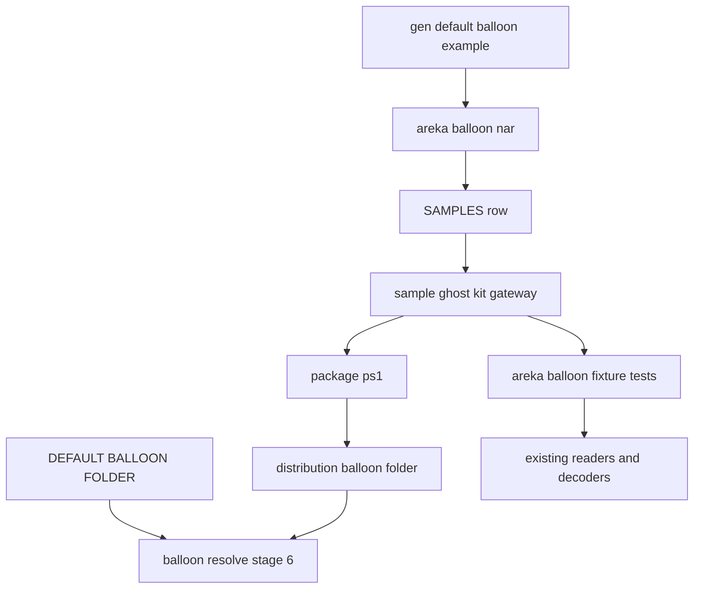
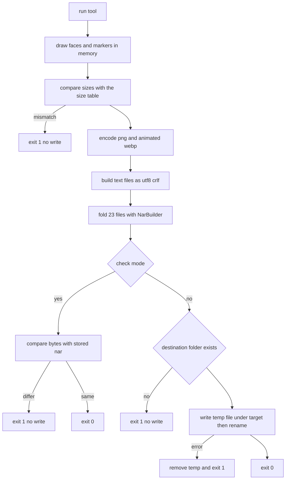
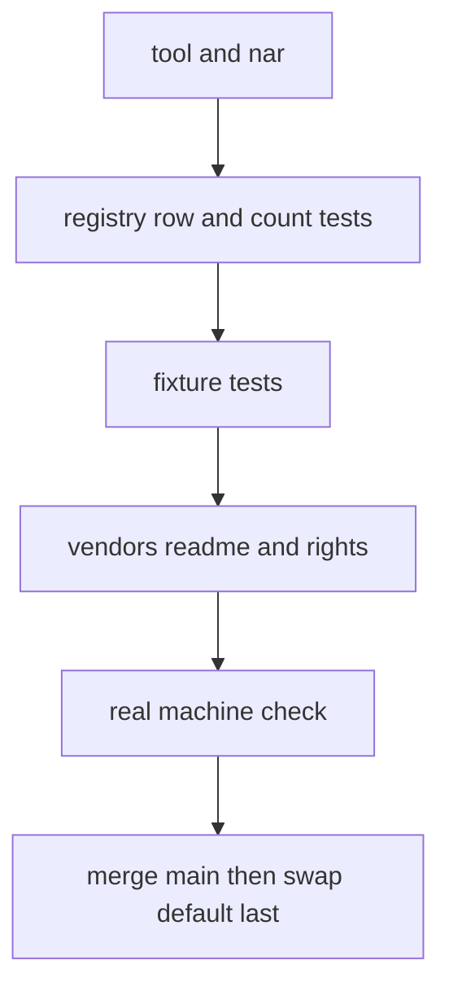

# 設計: default-balloon-selfmade

> 2026-10-29 `/kiro-spec-design -y`（ワークツリー `claude/kiro-start-default-balloon-selfmade-3aaac2`・main `932d2c30` の上）。要件は requirements.md（議題 1〜10 を確定済み・SSP の測りを記録済み）。調べと決めの経緯は research.md（1〜9 節＝ギャップ分析、10 節＝設計の段）。

## Overview

**目的**: areka 自前の既定バルーン `areka-balloon` を、リポジトリの中の絵の道具で描いて `.nar` に畳み、検体として登記し、最後に既定を `StayseeBalloon` から差し替える。手本「ボトル（でふぉ改）」から引き継ぐのは寸法と設定の数値だけで、絵は案 A「白と灰」で新しく描く。

**使う人**: バルーンを持たないゴーストを areka で動かす利用者（既定のバルーンで喋る）、絵を直したくなった開発者（道具を回し直して `.nar` を作り直す）、印を出す後の spec（`balloon-markers`・1 枚の動く絵のオンラインの印の検体として使う）。

**変わること**: 本番コードで変わるのは、既定の名前の定数の値 1 つ（`crates/areka/src/boot_resolve.rs` 34 行目）と検体の登記表の 1 行（`crates/sample-ghost-kit/src/lib.rs`）だけ。あとは、道具（example）・書庫（`.nar`）・テスト・配布の道具（`tools/package.ps1`）・文書を足すか直す。

### Goals

- 手本と同じ寸法・同じ設定値の、α 付きの簡素なバルーンを 1 本、同じ入力からは同じバイト列で作り直せる形で持つ。
- 文字の描画範囲が SSP でも areka でも同じに解け、潰れない（`validrect.right,326`）。
- 中身を毎回のテストで固定し、実機で 1 度確かめる。
- 既定を差し替え、既定を書いていた所をすべて新しいバルーンへ向ける。`StayseeBalloon` は選べるバルーンとして配布物に残す。

### Non-Goals

- 印と数字を画面に出すこと・1 枚の動く絵の印を読むこと（`balloon-markers`）。
- `.webp` の名前の面を拾うこと（`balloon-webp-names`）。入力の箱を出すこと（`inputbox-user-input`・`balloon-canon-residue`）。面 1 以降の面別の設定を効かせること（`balloon-canon-residue`）。
- areka の `validrect` の 0 の読みを直すこと（要件 6.4。2026-10-29 に `real-run-log-noise` が引き受けた）。
- 縦書きの面・2 倍の絵・シェルの中のバルーン。
- バルーンの解決の段の順を変えること。

## Boundary Commitments

### This Spec Owns

- バルーン `areka-balloon` の中身（面と印の絵・`descript.txt`・面別の設定・`install.txt`・`readme.txt`）と、その権利の書き（CC0）。
- 絵の道具 `gen_default_balloon`（`areka-emo-atlas` の example）と、その出力 `vendors/sample_ghost/areka-balloon.nar`。
- 登記表の `areka-balloon` の行と、登記の数を固定するテストの 10 → 11。
- 中身を固定するテスト `areka_balloon_fixture` 一式（読み戻しのテストを含む）。
- 既定の名前の定数の値・既定の名前に頼るテスト（research.md 3.1 の A と B）・配布の道具の既定の行・既定と書いている文書と steering の書き換え。
- 実機の確かめの記録（`verification/`）と、`balloon-markers` の brief への申し送り。

### Out of Boundary

- バルーンの読み手（`areka-parsers`）・面の解決（`areka-emo-present`）・合成器・文字の層（`areka-emo-text/src/`）。足りない所は直さず起票する（要件 13.4）。
- `crates/areka-emo-text/src/region.rs`（`real-run-log-noise` の持ち物・要件 13.3）。
- `crates/areka/src/boot_resolve.rs` の書き込みの関数と段の並び、`crates/areka-ghost/src/catalog.rs`（要件 13.2・11.2）。
- `StayseeBalloon.nar` の中身と `staysee_balloon_fixture` の実行行（要件 10.5。入口のファイルの説明に注記を 1 段だけ足す＝下の決め 6）。
- 研究 3.1 の C に当たるテスト（名前として使うだけ・要件 11.3）。
- 完了 spec の文書、`roadmap.md`・`roadmap-history.md`（要件 11.8）、`THIRD-PARTY-NOTICES.md`（要件 9.4）。

### Allowed Dependencies

- `areka-emo-atlas` が既に持つ `image 0.25.10`（`png`・`webp`）と dev-dependency `sample-ghost-kit`（`NarBuilder`・`install_txt`）。道具はこの 2 つと std だけを使う。
- `areka-emo-text` が既に持つ dev-dependency（`sample-ghost-kit`・`areka-emo-atlas`・`log-capture-kit`）と通常の依存（`areka-parsers`・`areka-emo-present`・`windows`・`bevy_ecs`）。中身のテストはこれらの公開 API だけを読む。
- 新しい依存・`Cargo.toml` の変更・`Cargo.lock` の変更は 0（要件 8.3・13.5）。example とテストは cargo の自動収集（`examples/<名>/main.rs`・`tests/*.rs`）で拾わせる。

### Revalidation Triggers

- `image`・`image-webp` の版が変わる（根の `Cargo.toml` の固定コミットを含む）→ ずれの見張りのテスト（と道具の `--check`）が赤になりうる。赤なら道具を回し直して `.nar` を作り直し、中身のテストを回す。
- `areka-balloon` のファイルの集合・オンラインの印の名前や書き方が変わる → `balloon-markers` の前提が変わる（申し送りを直す）。
- 既定の名前の定数の名前か値が変わる → 既定に頼るテスト・`tools/package.ps1`・文書。
- `real-run-log-noise` などで areka の `validrect` の 0 の読みが変わる → このバルーンは 0 を書かないので影響しないが、中身のテストを回して確かめる。
- `balloon-webp-names`・`balloon-markers`・`balloon-canon-residue` が着地する → `readme.txt` の「まだ出ないもの」の書きを見直す（その spec の側の作業）。

## Architecture

### Existing Architecture Analysis

- 既定の名前は定数 1 つで、使うのは解決の段 6 だけ（research.md 2.1）。段の順と当たり方は変えない。
- 検体は `.nar` のまま `vendors/sample_ghost/` に置き、テストと配布の道具は窓口 `sample-ghost-kit`（`SampleRoot::acquire`・`nar-sample-path`）から名前で引く。展開した木は追跡しない。
- 見張り `sample_path_guard_test.rs` は、登記した名前について `vendors/sample_ghost/<名前>/` と `vendors/sample_ghost/<名前>"` の綴りを `.rs` の実行行で禁じる。
- 動く WebP の組み方の前例は `crates/areka-emo-atlas/examples/gen_animated_samples.rs`（可逆の `VP8L` を `VP8X`・`ANIM`・`ANMF` で包む・8×8 決め打ち）。
- 動く絵の読み手は公開の `WicDecoderArm`（`ElementDecoder::probe_animation`・`decode_frames`）から外のテストで呼べる（先頭の署名で WebP を選び `image` で読む）。
- 面の名前は `.png` だけを拾い、面 0 の面別の設定だけを通す。印・`balloonc*`・`.webp` は黙って読み飛ばす（research.md 3.4）。

### Architecture Pattern & Boundary Map



- 形: **作り物（道具が書く書庫）と登記と窓口**。道具は書庫を書くだけで、読む側（テスト・配布の道具・areka）は今までどおり窓口から名前で引く。新しい読み口は作らない。
- 依存の向き: 道具 → `image`・`sample-ghost-kit`（書く側）。テスト → 窓口 → 書庫、テスト → 既存の読み手（読む側）。道具とテストは互いを参照しない（テストは書庫の中身だけを見る）。本番コードは道具にもテストにも依存しない。
- 新しく作るものは道具と中身のテストだけ。どちらも既存の型（`NarBuilder`・`SampleRoot`・`ElementDecoder`・`BalloonModel`）をそのまま使う。

### Technology Stack

| 層 | 選んだもの | この仕様での役 | 備考 |
|---|---|---|---|
| 道具 | Rust の example（`areka-emo-atlas`） | 絵を描き、PNG と動く WebP に書き、文と一緒に `.nar` に畳む | 新しい依存 0 |
| 絵の書き出し | `image 0.25.10` の `PngEncoder`・`WebPEncoder::new_lossless` | α 付き PNG・可逆の VP8L のコマ | 動く WebP の包みは手で組む（前例と同じ） |
| 書庫 | `sample-ghost-kit` の `NarBuilder`・`install_txt` | 名前順・固定の中身で同じバイト列の書庫 | dev-dependency |
| テスト | `areka-emo-text` の統合テスト | 中身・定義・焼き込み・折り返し・読み戻しを固定 | 既存の公開 API だけ |
| 配布 | `tools/package.ps1`（PowerShell） | 窓口から引いて配布物の `balloon/areka-balloon/` へ写す | 既存の形のまま 1 行ずつ足す |

## File Structure Plan

### Directory Structure

```
crates/areka-emo-atlas/examples/gen_default_balloon/
├── main.rs      # 入口: 引数（--check）・書庫の書き出し（一時名→名前替え）・ASCII の出力
├── build.rs     # 組み立て: 23 ファイルの（名前, バイト列）を名前順で返す・寸法の照合（ずれの見張りのテストも #[path] で読む）
├── draw.rs      # 絵柄の値（色・縁・角の丸み・しっぽ・印の動き）と、距離関数による 4×4 標本の描画（面・入力の箱・矢印・SSTP・オンラインのコマ）
├── webp.rs      # 動く WebP の組み立て（VP8L のコマを VP8X・ANIM・ANMF で包む・大きさは引数）
└── texts.rs     # descript.txt・面別の設定 6 つ・install.txt・readme.txt の行（CRLF で連結して UTF-8 のバイト列にする）

crates/areka-emo-atlas/tests/
└── default_balloon_drift_test.rs   # ずれの見張り: build.rs（と子）を #[path] で読み、組んだ 23 ファイルと登記した書庫の中身をバイトで比べる

vendors/sample_ghost/
└── areka-balloon.nar   # 道具の出力（23 ファイル・リポジトリが追跡する）

crates/areka-emo-text/tests/
├── areka_balloon_fixture_test.rs   # 入口（接続宣言だけ・staysee_balloon_fixture_test.rs と同じ形）
└── areka_balloon_fixture/
    ├── test_support.rs   # 検体の取得（窓口から名前で）・期待値の表（ファイル名・寸法・鍵と値）・共有の読み口
    ├── assets.rs         # ファイル名の集合・面と印の寸法・WebP の名前の 1 枚だけ・.pna と GIF が無いこと
    ├── definition.rs     # 文字コードと charset の行・鍵と値の表の一致・読み込みの記録 0 件・描画範囲の解け方
    ├── bake.rs           # 面 0 を両 scope で焼き込み、不透明・透明・半透明の 3 種がそろうこと
    ├── online.rs         # online0.webp を areka の動く絵の読み手で読み、77×36・3 コマ・各 300 ミリ秒・無限・灯る点の α
    └── wrapping.rs       # 半角・全角・混ぜた本文の折り返しと内包を、拡大率 1.0 と 1.25 で
```

> テーマを `tests/` 直下でなくディレクトリに置くのは、`tests/*.rs` が別のテストのターゲットとして自動で拾われるため（`staysee_balloon_fixture_test.rs` の説明と同じ理由）。

### Modified Files

- `crates/sample-ghost-kit/src/lib.rs` — `SAMPLES` に `areka-balloon`（`SampleKind::Balloon`・同梱なし・`SampleSource::Vendored`）を 1 行足す。
- `crates/sample-ghost-kit/src/lib_tests.rs` — 登記の数 10 → 11 の 4 か所（Vendored の並び 9 → 10・`SAMPLES.len()`・既知の名前の並びとテスト名の `ten`・バルーンの種類の並び・`every_sample_nar_installs...` の数）。
- `crates/areka/src/boot_resolve.rs` — 34 行目 `DEFAULT_BALLOON_FOLDER` の値を `"areka-balloon"` に。ほかの行は触らない（**最後のタスク**）。
- `crates/areka/src/boot_resolve_tests.rs`・`boot_resolve_balloon_tests.rs`・`boot_config_balloon_tests.rs`・`main_config_input_tests.rs`・`boot_config_roots_tests.rs`・`boot_config_option_tests.rs`・`boot_config_copy_tests.rs` — 研究 3.1 の A と B。既定の意味で綴る所を定数 `crate::boot_resolve::DEFAULT_BALLOON_FOLDER` の参照に替え、名前を文字で比べるテストを 1 本だけ残す（決め 3）。記憶に `StayseeBalloon` が残る利用者の起動を固定するテストを 1 本足す（要件 11.6）。
- `crates/areka-emo-text/tests/staysee_balloon_fixture_test.rs` — 入口の説明に「既定バルーン」の語が 2026-10 までの役名である旨の注記を 1 段足す。実行行とテーマ別ファイルは変えない（決め 6）。
- `tools/package.ps1` — 検体を引く行・必須の項目・`balloon/` 直下の許可の表・写す行に `areka-balloon` を足す（`StayseeBalloon` の行は残す）。
- `dist/README.txt` — 同梱しているバルーンの節と同梱物とライセンスの節に `areka-balloon` の項を足し、既定の書きを替える（402 行目の `use_self_alpha` の例は残す）。
- `README.md`（根）48 行目 — 既定のバルーンの書き。
- `vendors/sample_ghost/README.md` — 書庫を置く行の数（9 → 10）と表の行、`StayseeBalloon.nar` の行と出どころの節の「既定バルーン」の書き、`areka-balloon.nar` の出どころと権利と作り直しの手順の節。
- `.kiro/steering/product.md` 81 行目・`.kiro/steering/structure.md` 426 行目（顔ぶれ 10 → 11）・`.kiro/steering/tech.md` 166 行目 — 既定バルーンの書き。
- `doc/COMPAT_ARCHITECTURE.md` 381 行目 — 段の並びの「既定（`StayseeBalloon`）」。
- `doc/pasta-real-run.md` 56〜84 行目 — 実機の根を配布物と同じ形にするため、`areka-balloon` を引いて写す行と、根の一覧の書き（4 つ → 5 つ）を足す。`StayseeBalloon` の行は残す（決め 8）。
- `.kiro/specs/balloon-markers/brief.md` — 1 枚の動く絵のオンラインの印の検体ができたことの申し送り（要件 3.7）。
- `.kiro/specs/completed/default-balloon-selfmade/verification/` — 実機の確かめの記録・`real-run-log-noise` への相談の結果。

## System Flows

### 道具の流れ（作り直しの手順）



- すべてをメモリの上で作ってから書く。寸法の照合・書き出し先の確認・一時名への書き込みのどれで失敗しても、今の `.nar` はそのまま残る（要件 8.4・8.5）。
- `--check` は書かない。同じ入力からは同じバイト列が出るので、作り直した後の `--check` が「同じ」なら、追跡している `.nar` が道具の今の入力から作られたことの証になる（要件 8.2）。

### 実装の順（並走の都合）



- 既定の差し替え（定数・既定に頼るテスト・配布の道具・既定と書く文書・steering・`dist/README.txt`）は 1 つのタスクにまとめて最後に置き、その直前に main を取り込む（要件 11.9）。カタログの鎖の spec が `boot_resolve.rs` とそのテストを作り直していたら、その形の上で直す。
- 実機の確かめは差し替えの前に、引数かメニューで `areka-balloon` を被せて行う（既定にしなくても見られる）。差し替えの後の既定の段の当たりは単体テストが持つ。

## Requirements Traceability

| 要件 | 要約 | 担う所 | 確かめ |
|---|---|---|---|
| 1.1・1.2・1.3・1.4 | 絵柄を案から開発者が選ぶ（案の絵は `target\balloon-draft\` だけ・手本の画素を使わない） | 要件の討議（2026-10-29 済み・議題 2）。道具 `draw.rs` が選んだ案 A の値を持つ | requirements.md の記録 |
| 2.1 | 面の数 4・2・4 | 道具 `main.rs` の面の表 | `assets.rs` |
| 2.2 | 面の寸法 | 面の表と寸法の照合 | `assets.rs`（PNG の見出し） |
| 2.3 | 偶数は右・奇数は左のしっぽ・絵柄をそろえる | `draw.rs` の 1 つの絵柄の値・しっぽの向きの表 | 実機の目視・`bake.rs` |
| 2.4 | α 付き・抜き色なし・`.pna` なし | `draw.rs`（4×4 標本で半透明の縁）・ファイルの表 | `assets.rs`・`bake.rs` |
| 2.5 | 飾りなし・案 A | `draw.rs` | 実機の目視 |
| 2.6 | 等倍だけ | ファイルの表（2 倍の絵なし） | `assets.rs`（名前の集合） |
| 2.7 | 入力の箱の絵を持つ | `draw.rs` の入力の箱・`readme.txt` | `assets.rs` |
| 3.1 | 矢印 11×10・SSTP 7×9 | 印の表 | `assets.rs` |
| 3.2 | オンライン 77×36 の動く WebP 1 枚 | `webp.rs`・印の表 | `assets.rs`・`online.rs` |
| 3.3 | 無限・点が 3 つ順に灯る・3 コマ・300 ミリ秒 | `draw.rs` のコマ・`webp.rs` の繰り返し 0 | `online.rs` |
| 3.4 | GIF を使わない | ファイルの表 | `assets.rs` |
| 3.5 | `online0.webp`・`onlinemarker.filename`／`interval` を書かない | `texts.rs` | `definition.rs`（鍵の集合の一致） |
| 3.6 | 印と数字がまだ出ないことを説明書に | `texts.rs` の `readme.txt` | 文面の読み合わせ（タスクの確かめ） |
| 3.7 | `balloon-markers` へ申し送り | 同 spec の brief | 着地のタスク |
| 4.1 | 面と動かない印は PNG・オンラインだけ WebP | ファイルの表 | `assets.rs` |
| 4.2 | 差し替えを `balloon-webp-names` に縛らない | 実装の順（待ちなし） | — |
| 5.1 | フォルダ名と `id` が `areka-balloon`・`name`・`craftman` | `texts.rs`・登記の行 | `definition.rs`・窓口の照合 |
| 5.2 | 名前が他と重ならない | 名前 `areka-balloon` | `assets.rs`（登記の名前と大小を無視して重ならない） |
| 5.3 | UTF-8・各ファイル先頭が `charset,UTF-8` | `texts.rs` | `definition.rs` |
| 5.4 | 全体の値を手本の数値で（`validrect.right` は 326） | `texts.rs` の `descript.txt` | `definition.rs`（鍵と値の表） |
| 5.5 | 面別の設定 6 つ | `texts.rs` | `definition.rs` |
| 5.6 | 書体・カーソル・SSTP・数字の値 | `texts.rs` | `definition.rs` |
| 5.7 | `windowpos.*` を写さない | `texts.rs` | `definition.rs`（鍵の集合の一致） |
| 5.8 | 文字化けせず読め、読み込みの警告 0 | 既存の読み手 | `definition.rs`（記録の捕捉） |
| 5.9 | `use_self_alpha,1` | `texts.rs` | `definition.rs`・`bake.rs`（`load_balloon_use_self_alpha`） |
| 6.1 | SSP で 0 の読みを測る | 要件の討議（2026-10-29 済み） | requirements.md「SSP での測り」 |
| 6.2 | 範囲が空でなく origin と折り返し基準を含む | `texts.rs`（`validrect` 0・0・326・-20／相方側の下 -14） | `definition.rs` |
| 6.3 | `validrect.right,0` を写さない | `texts.rs` | `definition.rs` |
| 6.4 | 0 の読みの直しは外へ | 2026-10-29 に `real-run-log-noise` が引き受けた（決め 9） | requirements.md 6.4 の結果 |
| 6.5 | 潰れ・origin・折り返し基準の警告 0 | 範囲の値 | `definition.rs`（警告の条件と同じ判定）・実機の記録の grep |
| 6.6 | どっとさくらで文字がバルーンの中 | 範囲の値 | 実機の確かめ |
| 7.1 | `install.txt`・`readme.txt` | `texts.rs` | `assets.rs`・窓口の照合 |
| 7.2・7.3 | 説明書の中身 | `texts.rs` の `readme.txt` | 文面の読み合わせ |
| 8.1 | 道具と絵柄の値 | `draw.rs`・`webp.rs` | — |
| 8.2 | 同じ入力から同じバイト列 | 道具の作り（下の決め）・`--check` | `default_balloon_drift_test.rs`（毎回の全体テスト）・作り直しの手順で `--check` |
| 8.3 | 新しい依存 0・`Cargo.lock` 不変 | example の置き場 | 全体テスト・`git diff Cargo.lock` |
| 8.4 | 寸法の合わない絵を書かない | `build.rs` の照合 | 道具の失敗の経路 |
| 8.5 | 失敗で今の絵を上書きしない | 一時名→名前替え・書き出し先の確認 | 道具の失敗の経路 |
| 8.6 | 端末の文は ASCII だけ | `main.rs` の出力の決め | 道具の出力の読み合わせ |
| 8.7 | 手順の説明 | `vendors/sample_ghost/README.md` の節 | — |
| 8.8 | 1 ファイル 1,000 行以下 | 4 ファイルに分ける | 1,000 行の番人 |
| 8.9 | 動く WebP を areka の読み手で読める | — | `online.rs` |
| 9.1・9.2 | 権利と「数値だけ」を 2 か所に | `readme.txt`・`vendors/sample_ghost/README.md` | — |
| 9.3 | `dist/README.txt` の同梱物とライセンス | 差し替えのタスク | — |
| 9.4 | `THIRD-PARTY-NOTICES.md` を触らない | 境界 | — |
| 10.1 | `.nar` に畳み登記 10 → 11 | 道具・登記の行・数のテスト | `lib_tests.rs` |
| 10.2 | リポジトリの中に持つ | `SampleSource::Vendored` | `lib_tests.rs` |
| 10.3 | 窓口から引ける | 既存の窓口 | `test_support.rs`（`SampleRoot::acquire`） |
| 10.4 | 検体の README の表 | `vendors/sample_ghost/README.md` | — |
| 10.5 | `StayseeBalloon.nar` とそのテストを変えない | 境界（注記だけ・決め 6） | — |
| 11.1 | 段 6 で新しい既定を選ぶ | 定数の値 | 既定に頼るテスト（名前を文字で比べる 1 本） |
| 11.2 | 段の順を変えない | 境界 | 既存の解決のテスト |
| 11.3 | A と B を直し C は変えない | 既定に頼るテスト（決め 3） | 全体テスト |
| 11.4 | 配布の道具が新しい既定を入れる | `tools/package.ps1` | 配布の道具の項目の確かめ（必須・許可の表） |
| 11.5 | `StayseeBalloon` を入れ続ける | `tools/package.ps1` | 同上 |
| 11.6 | 記憶に `StayseeBalloon` の利用者が止まらない | 解決の段 2（記憶） | 足す 1 本のテスト・`verification/` に記録 |
| 11.7 | 文書と steering の書き換え | 差し替えのタスク | — |
| 11.8 | 完了 spec を直さない | 境界 | — |
| 11.9 | 差し替えは最後・直前に main | 実装の順 | — |
| 12.1 | 同じ形の新しいテスト・窓口から名前で | `areka_balloon_fixture` | — |
| 12.2 | 名前の集合と寸法 | `assets.rs` | — |
| 12.3 | 面 0 を両 scope で焼き込み 3 種 | `bake.rs` | — |
| 12.4 | 値と範囲 | `definition.rs` | — |
| 12.5 | 折り返しと内包を拡大率 1 と 1.25 で | `wrapping.rs` | — |
| 12.6〜12.8 | 実機で確かめて記録 | 実機のタスク | `verification/real-machine.md` |
| 12.9 | 崩れの振り分けと記録 | 実機のタスク | 同上 |
| 13.1 | 本番コードは定数と登記の行だけ | 境界 | 差分の確かめ |
| 13.2・13.3・13.4 | 触らない所 | 境界 | 差分の確かめ |
| 13.5 | 新しい依存 0 | 境界 | `git diff Cargo.lock` |
| 13.6 | 1,000 行以下 | ファイルの分け方 | 1,000 行の番人 |
| 13.7 | 全体テストが緑 | 完了の段 | 全体テスト |
| 13.8 | 根と一時のファイルは `target\` の下 | 道具（作業は全部メモリ・一時名は `target\gen-default-balloon\`）・実機の根 | — |
| 13.9 | SSP で測る前に許しを取る | 実機のタスク（SSP で見比べるときだけ） | — |

> 要件 7.3 の参照は設計の討議で「要件 3.6 と 2.7」に直した（もとは無い番号 4.3）。説明書に「入力の箱は areka ではまだ出ない」と書く。

## Components and Interfaces

| 部品 | 層 | 役 | 要件 | 主な依存 | 契約 |
|---|---|---|---|---|---|
| 絵の道具 `gen_default_balloon` | 道具（example） | 描いて書庫を書く・`--check` | 2・3・4・5・6.2・6.3・7・8・9.1・9.2・10.1 | `image`（P0）・`sample-ghost-kit`（P0） | Batch |
| 書庫 `areka-balloon.nar` | データ | 23 ファイルのバルーン | 2・3・4・5・7・10.1・10.2 | 道具が書く | State |
| 登記の行 | 窓口 | 名前で引けるようにする | 10.1〜10.3 | `SAMPLES` | — |
| 中身のテスト `areka_balloon_fixture` | テスト | 中身・値・焼き込み・折り返し・読み戻しの固定 | 5.3〜5.9・6.2・6.3・6.5・8.9・12.1〜12.5 | 窓口（P0）・既存の読み手（P0） | — |
| 既定の差し替え | 本番 1 行＋テスト＋配布＋文書 | 既定を新しいバルーンへ | 9.3・11 | 定数（P0）・窓口（P0） | — |
| 記録と申し送り | 文書 | 実機・相談・申し送り | 3.7・6.4・11.6・12.6〜12.9 | — | — |

### 道具の層

#### 絵の道具 `gen_default_balloon`

| 項目 | 中身 |
|---|---|
| 役 | 選んだ絵柄の値から面と印の絵を描き、文と一緒に `vendors/sample_ghost/areka-balloon.nar` を書く |
| 要件 | 2.1〜2.7・3.1〜3.5・4.1・5.1〜5.7・5.9・6.2・6.3・7.1〜7.3・8.1〜8.8・9.1・9.2・10.1 |

**責務と制約**

- 絵柄の値・面と印の寸法・文の行は道具の中の値だけが持つ（要件 8.1）。ほかの所から読まない。
- 作業はすべてメモリの上で行う。リポジトリに書くのは書庫 1 つだけ。一時名は `target\` の下に置き、名前替えか失敗の後始末で消える（展開した絵を見たいときは窓口 `nar-sample-path areka-balloon` で取り出す）。
- 書庫の名前は `Path::join` を重ねて組む（`"vendors"`・`"sample_ghost"`・`format!("{NAME}.nar")`）。見張りの形 ⑵ の綴り（`vendors/sample_ghost/areka-balloon/` と `…areka-balloon"`）を書かない。
- 端末へ出す文は ASCII だけ（要件 8.6）。`std::io::Error` の `Display`（Windows では日本語の文になる）を出さず、`ErrorKind` の名前と OS のエラー番号だけを出す。パスは書庫のファイル名だけを出す。`expect`・`panic!` の文も ASCII で書く。

**依存**

- 外: `image`（`PngEncoder`・`WebPEncoder::new_lossless`・`ExtendedColorType::Rgba8`）— 絵の書き出し（P0）。
- 外: `sample-ghost-kit`（`NarBuilder::new().file(..).done()`・`bytes()`・`install_txt`）— 書庫と CRLF の行（P0）。

**契約**: Batch

##### Batch の契約

- 呼び方: `cargo run -p areka-emo-atlas --example gen_default_balloon`（書く）／`… -- --check`（書かずに比べる）。ほかの引数は `error: unknown argument` で終了コード 2。
- 入力: 道具の中の値だけ（ファイルを読まない。`--check` のときだけ今の書庫を読む）。
- 出力: 書くときは `vendors/sample_ghost/areka-balloon.nar`。端末へ 1〜3 行（例 `wrote areka-balloon.nar: 23 files, <n> bytes`・`check: areka-balloon.nar is identical`・`error: <理由>`）。
- 終了コード: 0＝書いた／同じ。1＝失敗（寸法が合わない・書き出し先のフォルダが無い・書けない・`--check` で違う・`--check` で書庫が無い）。2＝引数の誤り。
- 冪等: 何度回しても同じバイト列。書き出しは「ワークツリーの `target\gen-default-balloon\areka-balloon.nar.tmp` へ書く → `std::fs::rename` で書き出し先へ替える」（一時のファイルは `target\` の下だけ・要件 13.8。根は `fold-samples` と同じく `CARGO_MANIFEST_DIR` から 2 つ上をリポジトリ根とし、`target` はその直下＝書き出し先と同じドライブ）。失敗したら一時名を消して終える。書き出し先のフォルダ `vendors\sample_ghost\` が無いときは作らずに失敗する。

**作りの決め（同じバイト列のため・要件 8.2）**

- 画素は 4×4 の標本の平均で決める。距離の計算は `f32` の四則と `sqrt` だけで書き、`hypot` を使わない（`sqrt` は正しく丸められるが `hypot` は環境の数学ライブラリに依る）。
- 色は α で重みを付けて平均し、0〜255 に丸める（下書き `target\balloon-draft\src\main.rs` の `raster` と同じ式）。完全に外の画素は `[0,0,0,0]`。
- PNG は全部 `Rgba8` で `PngEncoder::new` の既定の設定で書く。WebP のコマは `WebPEncoder::new_lossless`・`Rgba8`。
- 書庫のファイルの並びは名前順に固定し、`NarBuilder` で書く（時刻などの揺れる値を持たない）。`NarBuilder::bytes()` は足した順を保つので、道具が名前で並べてから足す（design-validation.md の注記）。
- 同じ版の `image`・`image-webp` の範囲で同じバイト列になる（版は Revalidation Triggers）。

**実装の注記**

- 動く WebP の包みは前例 `gen_animated_samples.rs` の `riff_chunk`・`u24`・`encode_vp8l`・`animated_webp` を、大きさを引数にして `webp.rs` へ写す（example 同士で共有できないため。前例は書き換えない＝検体の `testdata` のバイト列を動かさない）。写した所に `shortcut:` の注記は要らない（前例の書き換えをしない理由を 1 行書く）。
- `build.rs` は寸法の表（下の「データの形」）と描いた絵の寸法を比べ、1 つでも違えば `Err` を返す。`main.rs` はそれを受けて書かずに終了コード 1 にする。

### データの層

#### 書庫 `areka-balloon.nar`

| 項目 | 中身 |
|---|---|
| 役 | 既定バルーンの唯一の保管形 |
| 要件 | 2・3・4・5・7・10.1・10.2 |

**状態の契約**

- 中身は 23 ファイル（下の表）・フォルダのエントリなし（全部が根の直下）。`install.txt` が `type,balloon`・`directory,areka-balloon` を名乗る。
- 追跡は `.nar` だけ。`vendors/sample_ghost/.gitattributes` の `* -text` で改行の変換を受けない。
- 作り直しは道具を回すことだけで行い、手で中を直さない。

## Data Models

### 絵柄の値（`draw.rs`・議題 2 の案 A）

| 値 | 中身 |
|---|---|
| 地 | 白 (255,255,255)・不透明 |
| 縁 | 灰 (150,154,164)・幅 1.5 px（距離が −1.5〜0 の帯） |
| 角の丸み | 8 px（入力の箱も 8） |
| 箱の外形 | 面の端から 0.5 px 内側。しっぽ側の辺はさらにしっぽの幅だけ内側 |
| しっぽ | 三角。底辺は箱の縁から 6 px 内側の縦の線（y 20〜38）、先は面の端（y 23）。偶数の面は右・奇数の面は左。幅は本体側 9・相方側 10 |
| 印の色 | 矢印＝縁の灰・SSTP とオンライン＝青 (22,143,231) |
| 矢印 | 11×10。上（`arrow0`）は (1,8.5)・(10,8.5)・(5.5,1.5) の三角、下（`arrow1`）は上下を返した三角 |
| SSTP | 7×9。外形から 0.5 px 内側の角丸 2 の箱を青で塗る |
| オンライン | 77×36。中心 (26,18)・(38.5,18)・(51,18)・半径 4 の点 3 つ。コマ k では点 k を α 1、ほかを α 0.25。3 コマ・各 300 ミリ秒・繰り返し 0（無限）。コマは全面 (0,0)・重ねない（`NO_BLEND`）・`ANIM` の背景は透明 (0,0,0,0)・`VP8X` の α の旗を立てる |

### ファイルの表（書庫の中身・23 ファイル）

| ファイル | 寸法・中身 |
|---|---|
| `balloons0.png`・`balloons1.png` | 326×169・しっぽ右／左・幅 9 |
| `balloons2.png`・`balloons3.png` | 326×348・しっぽ右／左・幅 9 |
| `balloonk0.png`・`balloonk1.png` | 326×96・しっぽ右／左・幅 10 |
| `balloonc0.png`〜`balloonc3.png` | 400×63・しっぽなし（4 枚とも同じ絵） |
| `arrow0.png`・`arrow1.png` | 11×10 |
| `sstp.png` | 7×9 |
| `online0.webp` | 77×36・動く WebP |
| `descript.txt` | 全体の設定 |
| `balloons0s.txt`〜`balloons3s.txt`・`balloonk0s.txt`・`balloonk1s.txt` | 面別の設定 |
| `install.txt` | `charset,UTF-8`・`type,balloon`・`name,areka バルーン`・`directory,areka-balloon` |
| `readme.txt` | 説明書 |

### 文のファイル（`texts.rs`）

- どれも UTF-8（印なし）・行は CRLF・最終行の後ろにも CRLF（`install_txt` と同じ連結）。1 行目は `charset,UTF-8`（要件 5.3）。
- `descript.txt` の鍵と値（手本の `descript.txt` を引き写し、次の 4 点だけを替える）:
  - 先頭に `charset,UTF-8`。`name,areka バルーン`・`id,areka-balloon`・`craftman,ekicyou`。
  - `use_self_alpha,1` を足す（要件 5.9）。
  - `validrect.right,326`（手本は 0・要件 6.2・6.3）。`validrect.left,0`・`top,0`・`bottom,-20` は手本のまま。
  - `onlinemarker.filename`・`onlinemarker.interval` は書かない（手本にも無い・要件 3.5）。
  - そのほか（`origin` 14,11・`wordwrappoint` -20,0・書体・字の色・カーソル・矢印・オンライン・SSTP の印とメッセージ・数字・入力の箱）は手本の数値のまま（要件 5.4・5.6）。
- 面別の設定は要件 5.5 の値を書き、手本の `windowpos.x`・`windowpos.y` を写さない（要件 5.7）。`wordwrappoint.y,0` は手本どおり書く。
- `readme.txt` に書くこと（要件 7.2・7.3・9.1・9.2）: areka の既定バルーンであること・作り手 ekicyou・絵と設定ファイルは CC0（絵を描く道具のコードはリポジトリと同じ MIT）・寸法と設定の数値は開発者自作のバルーン「ボトル（でふぉ改）」から引き継ぎ、絵は写していないこと・areka でまだ出ないもの（矢印・オンライン・SSTP の印と数字、入力の箱、面 1 以降の面別の設定）は areka の今後の版で出ること（spec の名前は書かない）。

### 描画範囲の解け方（要件 6.2・`definition.rs` が固定する）

| scope・面 0 | 面の寸法 | 範囲（左・上・右・下） | origin | 折り返し基準 x |
|---|---|---|---|---|
| 本体側 `balloons0` | 326×169 | 0・0・326・149 | (14,11) | 296（326 − 30） |
| 相方側 `balloonk0` | 326×96 | 0・0・326・82 | (14,14) | 296（326 − 30） |

- どちらも空でなく、origin と折り返し基準を内に含む。`validrect.right` は正の値なので SSP と areka で同じ所に解ける。`left`・`top` の 0 はどちらの読みでも左端・上端。

## Error Handling

- **道具**: 失敗は終了コード 1 と ASCII の `error:` の 1 行で知らせ、今の `.nar` を上書きしない（上の Batch の契約）。寸法の照合は書く前に全部の絵で行う。
- **中身のテスト**: 読めない・空・面 0 が無いときは名指しで落とす（「対象 0 件で緑」を作らない・`staysee_balloon_fixture` と同じ規律）。期待値は要件の数値から手で書き、実測に合わせて緩めない。
- **既定の差し替え**: 段の順は変えないので、記憶の先が無いときの `last_balloon_not_found` の `warn!` と次の段への進み方は今のまま。`StayseeBalloon` を配布物に残すので、記憶に `StayseeBalloon` を持つ利用者は段 2 で当たる（要件 11.6）。
- **実機**: 崩れが見つかったら、バルーンの絵か設定の誤りは本仕様で直し、areka の欠陥は境界の外として `/kiro-discovery` で起票するか生きている spec に申し送る（要件 12.9）。どちらにしたかを `verification/` に書く。

## Testing Strategy

### 中身のテスト（`crates/areka-emo-text/tests/areka_balloon_fixture/`）

- **`test_support.rs`**: `SampleRoot::acquire("areka-balloon")` をプロセス寿命で持つ（`staysee_balloon_fixture` の `LazyLock` と同じ）。期待値の表（23 のファイル名・面と印の寸法・各文ファイルの鍵と値の並び）を要件 2.2・3.1・3.2・5.4〜5.6 から手で書く。道具の `texts.rs` を参照しない（独立に要件と突き合わせるため）。
- **`assets.rs`**（12.2・2.1・2.2・2.4・2.6・2.7・3.1・3.2・3.4・4.1・5.2・7.1）: フォルダのファイル名の集合が表と一致（`.pna`・`.gif`・2 倍の絵・`online1` 以降が無いことはここで決まる）。PNG は見出し（IHDR）の寸法、`online0.webp` は `WicDecoderArm::probe_animation` の幅と高さ。名前 `areka-balloon` が、`SAMPLES` のほかの行の名前と同梱バルーンの名前（`emo2-kakukaku`・`bottle`・`claudia` ほか）のどれとも、大小を無視して重ならない。
- **`definition.rs`**（12.4・5.1・5.3〜5.9・6.2・6.3・6.5）:
  - 各文ファイルが UTF-8 として読め、印が無く、1 行目が `charset,UTF-8`。
  - `areka_parsers::kv` で読んだ鍵と値の並びが期待値の表と**鍵の集合ごと**一致（`windowpos.*`・`onlinemarker.filename`・`validrect.right,0` が無いことを含む）。
  - 本番の `resolve_balloon_faces` と `load_scope_balloon_model`（面 0 の面別の設定を重ねる経路）を `log-capture-kit` の捕捉の中で両 scope 呼び、出てよい記録は相方側の面 2・3 が本体側の系列へ縮退した `WARN` 2 件だけ（相方側は面 0・1 しか持たない＝要件 2.2・欄まで固定する）で、ほかの `WARN` 以上は 0 件。モデルの値（origin・validrect・wordwrappoint・書体）が表のとおり。`load_balloon_use_self_alpha` が 1。
  - `ResolvedBalloonText::resolve` で解いた範囲が上の「描画範囲の解け方」の表と同じ。警告の条件と同じ判定が偽: `TextRegion::is_collapsed()` が偽、`wrap_threshold() <= inline_limit()`、解いた origin が宣言どおり（範囲の外で捨てられていない）。
- **`bake.rs`**（12.3・2.4・5.9）: `staysee_balloon_fixture/bake.rs` と同じ手順（COM を MTA で張り、`build_balloon_target_from_faces` で面 0 を焼く）で両 scope を焼き、走査した画素の総数が面積と一致し、不透明・透明・半透明の 3 種がどれも 1 つ以上ある。
- **`online.rs`**（8.9・3.2・3.3）: 取り出した `online0.webp` を `WicDecoderArm` の `probe_animation` と `decode_frames` で読む。見出しが 77×36・3 コマ、コマが 3 枚・各 `delay_ms` 300・`loop_count` が `LoopCount::Infinite`・`has_alpha` が真。コマ k で点 k の中心の α が 255、ほかの点の中心の α が 64（0.25 × 255 を最も近い整数へ丸める＝道具の `round()`。切り捨てなら 63 になるので、道具と期待値の丸めをそろえる）、点の外（例 (2,2)）の α が 0。`WicDecoderArm::new()` の前に COM を MTA で張る（`assets.rs` も同じ・`bake.rs` と同じ手順）。
- **`wrapping.rs`**（12.5）: 本体側の面 0 の範囲と書体（`ＭＳ ゴシック` 12）で、本番の折り返しの入口（`staysee_balloon_fixture/wrapping.rs` と同じ `LayoutEngine::layout`）へ半角だけ・全角だけ・混ぜた本文を流す。行数と各行の字数を、範囲（0〜326）・origin 14・折り返し基準 296 と送り幅（半角 6・全角 12）から手で導いた値に固定し（導き方を説明に書く）、すべてのグリフの矩形が範囲の内側に収まることを確かめる。拡大率は `staysee_balloon_fixture/scale.rs` と同じ形で 1.0 と 1.25 を与え、画像の座標での行の並びが同じで、物理の寸法への変換が k 倍になることを見る。相方側は高さだけが違うので、行数が下の辺で止まらない長さの本文 1 本だけ通す。

### ずれの見張り（`crates/areka-emo-atlas/tests/default_balloon_drift_test.rs`・設計の討議の議題 1）

- 道具の `build.rs`（と子の `draw.rs`・`webp.rs`・`texts.rs`）を `#[path]` で読み、組んだ 23 ファイルの（名前, バイト列）と、`SampleRoot::acquire("areka-balloon")` で取り出した木の全ファイルを比べる。名前の集合と各バイト列がすべて一致すること（1 バイトでも違えば、違うファイルの名前を出して赤）。
- 捕まえるもの: 道具を直して `.nar` を作り直し忘れた・`image`／`image-webp` の版が上がって出力が変わった（要件 8.2）。中身のテスト（手書きの期待値）とは役が違う＝こちらは「保管物が道具の今の出力か」、中身のテストは「保管物が要件どおりか」。
- `build.rs` は端末へ出さず、ファイルも書かない（書くのは `main.rs` だけ）。`#[path]` で読むので、子のファイルは `crate::` でなく `super::` で互いを参照する形にそろえる。`Cargo.toml` は変えない（`areka-emo-atlas` は dev-dependency の `sample-ghost-kit` を既に持つ）。見張り ⑵ の綴りは書庫の名前を `Path::join` で組むので当たらない。

### 既定に頼るテスト（`crates/areka/src/`）

- 研究 3.1 の A の 6 本・B の 4 本: 既定の意味で綴る所を `DEFAULT_BALLOON_FOLDER` の参照に替える（決め 3）。答えが `BalloonRoute::Default` のテストが緑のまま。
- 名前を文字で比べる 1 本（`balloon_default_staysee_when_listed_among_many` を `…areka_balloon…` に改名し、期待値を `"areka-balloon"` と文字で書く）。定数の値を誤ると赤になる。
- 足す 1 本（要件 11.6）: 根に `areka-balloon` と `StayseeBalloon` が在り、記憶が `StayseeBalloon` のとき、経路が記憶の段で `StayseeBalloon` に決まる。`boot_resolve_tests.rs` に足す（研究 3.1 の B の「記憶が既定より先」のテストを直した形がこれと同じになるなら、足さずにそれを 11.6 の判定として記録する）。
- `dist/README.txt`・根の `README.md` は並走の spec（`startup-install-option`・`bridge-store-user-root`・`winget-release-automation`）も別の行を触る。差し替えの直前に main を取り込み、その形の上で直す。

### 登記と配布

- `lib_tests.rs` の数のテスト（10 → 11）と、全検体の書庫が登記どおりに入るテストが `areka-balloon` を含めて緑。
- `tools/package.ps1` の必須の項目と許可の表が `balloon/areka-balloon/` と `balloon/StayseeBalloon/` の両方を含む配布物で通る。差し替えのタスクで配布の道具を 1 回回して、中身の検査（必須の項目・許可の表）が通ることを確かめる（重いので所要時間を先に伝える）。

### 実機（要件 12.6〜12.8・1 度だけ）

- `areka-balloon` を被せた emo2 と、`areka-balloon` を被せたどっとさくら（どちらも引数かメニューで被せる）を、拡大率 100% と 125% で喋らせ、文字がバルーンの中に描かれ、欠けもはみ出しもないことを見る。根と記録はワークツリーの `target\` の下（要件 13.8）。
- 台本の `\b[2]` で本体側の大の面へ切り替えたときの見え方を見て、面 1 以降の面別の設定が効かないことによる崩れが在れば記録し起票する（要件 12.7）。
- 起動の記録を grep して、「文字の描画範囲が潰れている」「折返し基準が描画範囲の外」「宣言された origin 成分が文字を描いてよい範囲の外」の行が 0 件（要件 6.5 の実機の側）。
- 記録（ゴースト・拡大率・日付・見えたこと・撮った画像）を `verification/real-machine.md` に書く。SSP で見比べるときは、その都度開発者の許しを取る（要件 13.9）。

## 設計で決めたこと（要件の討議から回された 6 件・research.md 9.3）

1. **絵の道具の置き場** → `crates/areka-emo-atlas/examples/gen_default_balloon/`（`main.rs`＋3 つの子）。根拠: `image`（`png`・`webp`）と `sample-ghost-kit` を両方持つのはこの crate だけで、ほかへ置くと `Cargo.lock` が変わる。ディレクトリにしたのは 1 ファイル 1,000 行の上限に余裕を持たせるため（cargo は `examples/<名>/main.rs` を自動で拾う）。
2. **書庫までの道と文の持ち方** → 道具が書庫まで直に書く（research.md 4.2 の案 1）。文（`descript.txt` など）は道具の中に行の並びとして持ち、`install_txt` と同じ CRLF の連結でバイト列にする。根拠: 直す所が道具 1 か所で済み、元の木を追跡しない（「展開した木は追跡しない」の決まりに合う）。行の並びで持つので、git の改行の変換や `.gitattributes` に左右されない。見張り ⑵ と `fold-samples` の `git ls-files` の決まりには、展開形を書かないので当たらない。往復の確かめは `fold-samples` の代わりに、道具の `--check`（同じバイト列か）と中身のテスト（窓口から取り出した木を全部読む）が持つ。
3. **既定に頼るテストの直し方** → research.md 3.1 の案 2: A と B は定数 `crate::boot_resolve::DEFAULT_BALLOON_FOLDER` を参照し、名前を文字で比べるテストを 1 本だけ残す。根拠: 次に既定を替えるときに定数 1 か所で済み、`boot_config_option_tests.rs` が既に `DEFAULT_GHOST_FOLDER` をこの形で使っている。文字で比べる 1 本が「定数の値を誤っても気付かない」穴を塞ぐ。C（手で組んだ `Default` の札を含む）は変えない（要件 11.3）。
4. **動く WebP の読み戻しのテストの置き場** → `crates/areka-emo-text/tests/areka_balloon_fixture/online.rs`。公開の `WicDecoderArm`（`ElementDecoder::probe_animation`・`decode_frames`）が `image` の読み手を通るので、`pub(crate)` の `read_frames` に頼らずに外から読める。根拠: 道具が書いたばかりの絵でなく、**登記した書庫の中の絵**を areka の読み手で読むので、保管物そのものを確かめられる。`areka-emo-atlas` の中に置く案は、書庫を窓口から引く綴りがその crate に増えるだけで得が無い。
5. **配布物の確かめに既定の段の当たりを足すか** → 足さない。根拠: 配布物の初回起動の確かめは `emo2` を起動し、`emo2` は同梱の `emo2-kakukaku` に当たるので、既定の段を通すにはバルーンを持たないゴーストを配布物に足す必要がある（配布物の形が変わる）。既定の段の当たりは単体テスト（名前を文字で比べる 1 本）が持ち、配布物に `balloon/areka-balloon/descript.txt` が在ることは必須の項目の確かめが持つ。
6. **`staysee_balloon_fixture_test.rs` の説明の「既定バルーン」** → 入口のファイルの説明に注記を 1 段だけ足す（例「本ファイル群で『既定バルーン』とあるのは 2026-10 までの役名で、今は配布物に同梱する選べるバルーンである（既定は `areka-balloon`・spec `default-balloon-selfmade`）」）。実行行とテーマ別ファイルは変えない。根拠: 要件 10.5 が守るのは中身を固定するテストの働きで、説明の注記はそれを変えない。いっぽう要件 11 の目的（既定を書いていた所がすべて新しいバルーンを指す）から見て、入口の説明が嘘のまま残るのは避けたい。テーマ別ファイルの説明まで直すと差分が広がるので、入口の 1 段で済ませる。

設計の討議（2026-10-29・開発者「承認」）で決めたこと:

10. **道具と保管した `.nar` のずれの見張り** → 毎回の全体テストで突き合わせる（design-validation.md の大事な指摘 1 の案 A）。組み立てを `build.rs` へ出し、`crates/areka-emo-atlas/tests/default_balloon_drift_test.rs` が `#[path]` で読んで登記した書庫とバイトで比べる。根拠: 作り直し忘れと `image` の版の上がりに、人が `--check` を回し忘れても全体テストで気付ける。`Cargo.toml`・依存・見張りの綴りは変わらない。手で `--check` を回すだけの案 B は、回し忘れを捕まえられないので採らない。

ほかに設計で決めたこと:

7. **入力の箱の 4 枚** → 同じ絵を 4 枚（バイト列も同じ）。要件 2.1 は面の数だけを求め、手本の 4 枚の違いは飾りの差なので、案 A では描き分ける値が無い。
8. **`doc/pasta-real-run.md`** → `areka-balloon` を引いて根へ写す行と、根の一覧の書きを足す（`StayseeBalloon` の行は残す）。根拠: 同書の手順は「配布物と同じ形の根」を組むと書いており、差し替えの後の配布物には `areka-balloon` が入るため（要件 11.7 の「必要があれば足す」）。
9. **`validrect.right,0` の読みの直しの扱い（要件 6.4）** → 済み。2026-10-29 の設計の段で `real-run-log-noise` のセッションへ相談し、同 spec が開発者の承認（「入れる」）を得て、right・bottom の 0 の読みの直しを自分の要件と設計に足して `region.rs` で直すと決めた。起票は要らない。記録は requirements.md 6.4 の結果。本仕様のタスクは無い（このバルーンは 0 を書かないので、向こうの着地の前後で中身のテストの答えは変わらない）。

## Supporting References

- 手本 `bottle` の `descript.txt`・面別の設定の全文と、寸法と値の出どころ: research.md 10.2。
- 下書きの道具（リポジトリに入れない）: `target\balloon-draft\src\main.rs`。描き方（距離関数・4×4 標本・しっぽの形）は本設計の「絵柄の値」に写した。
