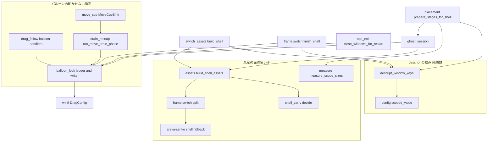
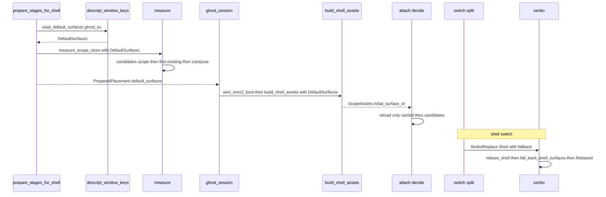
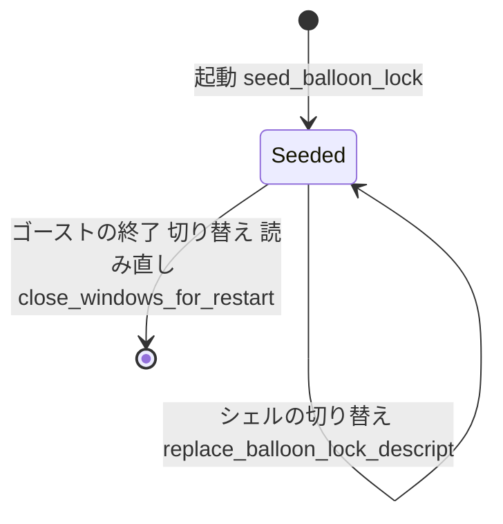

# Design Document: descript-window-keys

> 2026-10-23・main を取り込んだワークツリー `claude/kiro-start-descript-window-keys-451069`（`d545bb70`）で行番号と行数を測り直した。要件は確定済みの `requirements.md`、調べの記録は `research.md`（1〜10 節がギャップ分析と要件の討議、11 節が本設計の調べ）。

## Overview

**Purpose**: ゴーストの作者が descript に書いた窓の決まり 2 つ（スコープごとの既定の面 `*.seriko.defaultsurface` と、利用者にバルーンを動かさせない指定 `balloon.dontmove`・`*.balloon.dontmove`・`\![lock,balloonmove]`）を areka が読み、窓の大きさの測り・戻り先の面・バルーンのドラッグに効かせる。

**Users**: ゴーストの作者（着せ替えの面を既定にする・絵に重ねたバルーンを固定する）と利用者（ぱすたの窓が画面の下端を越えない・バルーンが絵からずれない）。

**Impact**: 今は既定の面が 3 か所（`emo2_boot/assets.rs` 36・341〜345 行目、`placement/measure.rs` 43・173〜205 行目、手本 `examples/window-placement.rs` 123・296〜309 行目）で 0／10 に決め打ちされ、バルーンの窓はいつでもドラッグで動く。本設計の後は、既定の面の決め方が新しい 1 ファイルにまとまり、測り・読み直しの戻り先・シェルの切り替えの戻り先が同じ値と同じ「在るか」の基準を使う。バルーンの窓の `DragConfig.move_window` は新しい 1 か所の書き手が、descript の段と台本の lock から付け直す。

### Goals

- 各スコープの窓の大きさを、最初から descript の既定の面で測る（要件 2）。
- ゴーストの読み直しとシェルの切り替えで、それまでの面が無いとき descript の既定の面 → 組み込みの既定の面 → 出さない、の順に戻す。表示・seriko の「今の面」・文字の層の今の面（文字の箱の行き先）を食い違わせない（要件 3）。
- descript の段と台本の lock の間、利用者のドラッグでバルーンを動かさない。追従・`\![move]`・位置初期化・クリックは今どおり（要件 4〜6）。
- 判断の分かれ目をすべて実機なしの決定論のテストで確かめる（要件 7）。

### Non-Goals

- プロパティ `currentghost.scope(ID).seriko.defaultsurface`（`currentghost-property-tree`）。
- 3 人目からの窓（`extra-character-windows`）。本設計はスコープ 2 以降の値を読む形だけ渡す。
- 台本の `\s` が無い面を指したときの扱い（要件の段の裁定 11・完了のときに起票）。
- 右クリックのメニューの「バルーン位置補正有効」の項目と、利用者が禁止を切り替える口。
- 測りに既定の着せ替えを載せること（11.2 節の R2 の答えのとおり、ぱすたでは要らない）。

## Boundary Commitments

### This Spec Owns

- ゴーストの descript の `sakura.`・`kero.`・`char<n>.seriko.defaultsurface` の読みと、組み込みの既定の面（0・10）の定義。この 2 つを持つのは新しい `placement/descript_window_keys.rs` だけにする。
- 「戻り先の候補の並び」（descript の既定の面、違えば続けて組み込みの既定の面）と、その並びから在る面を選ぶ決め方。使い手は測り・読み直しの戻り先・シェルの切り替えの戻り先の 3 つ。
- ゴーストの `balloon.dontmove` とシェルの `sakura.`・`kero.`・`char<n>.balloon.dontmove` の読みと段の優先。
- スコープごとの「バルーンの動かせない指定」の帳簿（descript の段＋台本の lock）と、その寿命（起動で据える・シェルの切り替えで descript の段だけ取り替える・窓を閉じて起こし直すときに外す）。
- 窓を作った後のバルーンの窓の `DragConfig.move_window` の書き手（1 か所）と、バルーンのドラッグの入口の見張り（このドラッグを止めたかを、wintf がドラッグの始まりに控えた値から読む）。
- `\![lock,balloonmove]`・`\![unlock,balloonmove]` の受け手（`MoveCueSink` の 2 つの名前の選別）と、受け手の表の 2 行。
- 網羅台帳 `assets.toml`・`sakura-script.toml` の該当行と、`doc/COMPAT_ARCHITECTURE.md` §8 の行。

- シェルの切り替えで、文字の層（areka-emo-text）の各スコープの今の面の番号を、seriko と同じ戻り先の並びで引き直すこと（面の中の文字の箱の行き先を、出ている面にそろえる）。

### Out of Boundary

- 面の合成・アニメーション・着せ替えの決め方（seriko と emo の既存の働き）。本設計は seriko と文字の層に「シェルの差し替えのときの戻り先の並び」を渡すだけで、面の解決の規則は変えない。
- 台本の `\![move]`・`balloonoffset`・窓の追従・位置初期化・位置の記憶の書式（どれも `DragConfig` を読まないので変えない）。
- wintf（`crates/wintf`）。`DragConfig` と `WindowDragContextResource` の公開の口を使うだけで、中は触らない。
- `placement/spawn.rs`・`placement/{persist,chain_realign,chain_finalize}.rs`・`placement/follow/window_move.rs`・`emo2_boot/frame.rs`・`emo2_boot/frame/dpi.rs`（同じウェーブの ⑥ ほかの持ち物）。バルーンの窓の `DragConfig` の初期値は `spawn.rs` の `DragConfig::default()` のままにし、窓を作った後に書き手が付け直す。
- `mcp/check_script_judge.rs` と `ConsumerLedger::consumer_of` の働き（⑦ `mcp-strict-errors` との約束）。
- 吸着の無い窓が後で大きい面へ替わったときの位置（`window-work-area-clamp`）。

### Allowed Dependencies

- 依存の向き: `placement::descript_window_keys`（純関数・`config.rs` の `scoped_value` だけを使う）→ `placement::measure`・`emo2_boot::{assets, shell_carry, frame::switch}` → `ghost_session`。`placement::balloon_lock` は `wintf::ecs::drag` と `placement::spawn::BalloonWindowMarker` に依存し、`emo2_boot::frame::{drain_resnap, switch}`・`placement::follow::drag_follow`・`ghost_session`・`app_exit` から呼ばれる。`placement` は `crate::` を参照しない（手本 `examples/window-placement.rs` が `#[path]` で取り込むため）。
- `areka-seriko` は `areka` を知らない。戻り先の並びは素の `u32` の列として `SerikoReplace::Shell` に載せる。
- `areka-emo-text` は `areka-seriko` を知らない（今も依存していない）。戻り先の並びは素の `u32` の列と `ActorKey` の表で渡す。emo-text に新しいソースファイルは足さない（このウェーブの emo-text の席を使わない）。
- 新しい外部の依存（crate）は足さない。

### Revalidation Triggers

- `SerikoReplace::Shell` に欄が増える（`areka-seriko` の公開の型）。この型を組む所（`emo2_boot/frame/switch.rs` の `split`・`areka-seriko/src/actor_replace_tests.rs`）を持つ spec は追随する。
- `build_shell_assets`・`build_boot_assets_with_shell`・`measure_scope_sizes`・`wire_emo2_boot` の引数が 1 つずつ増える。`StartupDescriptValues` に欄が 1 つ増える。`ShellCarry` の `decide` の引数の形が変わる。
- `PositionCue` に腕が 1 つ増える（`run_move_drain_phase` の照合は網羅なので、腕を足す他の spec は合流で気付く）。
- 受け手の表の手書きの数が 36 から 38 になる（⑦ と同時に行を足す spec は数を合わせる）。
- バルーンの窓のドラッグの入口（`on_balloon_drag`・`on_balloon_drag_end`）に見張りが 1 行ずつ入る。見張りは wintf の `WindowDragContextResource`（ドラッグの始まりに控えた `hwnd` と `move_window`）を読むので、wintf がこの控えを書く・消す時機（`drag/dispatch.rs`）を変える spec は追随する。バルーンの窓に受け手は足さない（`OnDragStart` は今どおり付かない）。
- 文字の層に `TextLayerRuntime::fall_back_box_surfaces` と型 `SurfaceFallback` が増える（`ShellBoxAssets::hand_to` の 1 か所から呼ぶ）。`ShellBoxAssets` に欄が 1 つ増える（組む所: `assets.rs` と 3 つのテスト）。
- `extra-character-windows` は `DefaultSurfaces::surface(scope)` をスコープ 2 以降の最初の面に使う。

## Architecture

### Existing Architecture Analysis

- 測りは起動・ゴーストの切り替え・ゴーストの読み直しのどれでも `placement::prepare_stages_for_shell`（`placement/mod.rs` 419〜479 行目）の中の `measure::measure_scope_sizes` を通る。シェルの切り替えは測り直さない（窓の大きさは出した面の大きさで決まる）。
- 「準備が 1 度だけ読んだ値を配る」型がある: `PreparedStages` → `PreparedPlacement`（`placement/mod.rs` 260〜325 行目）→ `ghost_session::prepare_ghost_windows`（205〜330 行目）→ `StartupDescriptValues`（99 行目）→ `wire_emo2_boot`（`emo2_boot/mod.rs` 412 行目）→ `build_boot_assets_for`（311 行目）。窓の組の descript の値（`sticky_window_raw`）は同じ型で運ばれ、窓を作る閉包の中で `seed_sticky_descript` が帳簿へ据える。本設計は既定の面とバルーンの動かせない指定をこの型にそのまま載せる。
- 読み直しの戻り先は `emo2_boot/shell_carry.rs` 103〜115 行目の `decide(carried, initial, exists)`（1 段）。`exists` は `EmoWorld::surface(id).is_some()`。
- シェルの切り替えでは seriko が `actor.rs` 312〜326 行目で定義を差し替え、`rebased()`（364〜392 行目）が「今の面」をそのまま `RebasedShow` に載せる。新しいシェルに無い面は `apply_show` で `error!` になり、窓は次の `\s` まで表示なしで残る。
- バルーンの窓は `spawn.rs` で `DragConfig::default()`（`move_window: true`）を持ち、wintf が wndproc で窓を動かした後に `on_balloon_drag`（`drag_follow.rs` 510 行目）・`on_balloon_drag_end`（652 行目）が呼ばれる。wintf はドラッグの始まり（`drag/dispatch.rs` 136 行目）に `move_window` を読み、`WindowDragContextResource` に控えてドラッグ中はその控えを使う。キャラクターの窓には先例がある（`placement/follow/sticky_follow.rs` の書き手 `sync_drag_writer` と控え `CharDragSession`）。
- 窓の組の帳簿（`placement/sticky_group_ledger.rs`）の寿命の型: 起動で据える（`ghost_session.rs` 280 行目）・シェルの切り替えで descript の分だけ取り替える（`frame/switch.rs` 468 行目）・`app_exit::close_windows_for_restart`（201〜217 行目）で外す。SHIORI だけの読み直しはここを通らない。
- 台本の窓の指令は `MoveCueSink`（`emo2_boot/move_cue.rs` 259〜282 行目の名前の選別）→ `PositionCue` の線 → `run_move_drain_phase`（`frame/drain_resnap.rs` 140〜192 行目）で台本の並びのまま UI スレッドへ届く。

### Architecture Pattern & Boundary Map



**Architecture Integration**:
- 選んだ形: 既存の「準備が 1 度読んで配る」型と「帳簿＋書き手 1 か所」型をそのまま延ばす。ドラッグを止めたかは、areka で控えを持たず wintf の控え（`WindowDragContextResource`）を読む。新しい仕組みは作らない。
- 新しい部品の理由: `descript_window_keys.rs` は 3 か所に散った決め打ちを 1 か所にする（`config.rs` を太らせない）。`balloon_lock.rs` は窓の組の帳簿と同じ寿命を持つ別の帳簿で、`drag_follow.rs`（958 行）の外に置く。`areka-seriko` の戻り先は seriko の「今の面」を表示とそろえるため seriko の中で決める。
- Steering: 1 ファイル 1,000 行以下・テストは兄弟の `*_tests.rs`・黙った失敗を作らない（`warn!`／`info!` に構造化の欄）・1 フレーム遅らせる解を取らない。

### Technology Stack

| Layer | Choice / Version | Role in Feature | Notes |
|-------|------------------|-----------------|-------|
| UI 基盤 | wintf（ワークスペース内） | `DragConfig.move_window`・`WindowDragContextResource`・`WindowHandle` の公開の口 | 中は触らない |
| ECS | bevy_ecs（ワークスペースのピン） | 帳簿を `Resource` で持つ（ドラッグの控えは wintf のもの） | 既存と同じ |
| 面の状態 | areka-seriko（ワークスペース内） | シェルの差し替えの戻り先を seriko の状態で決める | 公開の型 `SerikoReplace::Shell` に欄 1 つ |
| 記録 | tracing（ワークスペースのピン） | `event =` 付きの `warn!`・`info!` | `.kiro/steering/logging.md` の規約 |

新しい依存は足さない。

## File Structure Plan

### Directory Structure

```
crates/areka/src/placement/
├── descript_window_keys.rs          # 新: 既定の面とバルーンの動かせない指定の descript の読み（純関数）・戻り先の候補の並び
├── descript_window_keys_tests.rs    # 新: 上の決定論のテスト（要件 7.1・7.3 の descript の段）
├── balloon_lock.rs                  # 新: 動かせない指定の帳簿・バルーンの DragConfig の書き手・入口の見張り（wintf の控えを読む）
├── balloon_lock_tests.rs            # 新: 帳簿の段・台本の lock・寿命・書き手（要件 7.3）
├── balloon_lock_drag_tests.rs       # 新: 止めたドラッグで位置と記憶が変わらない・キャラクターの窓のドラッグでは付いて動く（要件 7.4）
└── measure_default_surface_tests.rs # 新: 測りが descript の面・組み込みの面・どちらも無いの 3 通り（要件 7.2）

crates/areka-seriko/src/
├── shell_fallback.rs                # 新: シェルの差し替えの戻り先の型と純関数（今の面 → 候補の並び → 出さない）
└── shell_fallback_tests.rs          # 新: 上の決定論のテスト（要件 7.2 の切り替えの腕）

crates/areka/src/emo2_boot/
└── move_cue_balloon_lock_tests.rs   # 新: lock・unlock の名前の選別と実行者のスコープ（要件 5.1・5.2）
```

### Modified Files

- `crates/areka/src/placement/config.rs` — `scoped_value` を `pub(super)` にする（1 語）。本体の読みは足さない。
- `crates/areka/src/placement/mod.rs`（939 行）— `mod descript_window_keys;`・`pub(crate) mod balloon_lock;` の 2 行。`PreparedStages` と `PreparedPlacement` に `default_surfaces: DefaultSurfaces`・`balloon_dontmove: BTreeSet<u32>` の 2 欄。`prepare_stages_for_shell` で 2 つを読み（`build_placement_config` の直後）、`measure_scope_sizes` へ `&default_surfaces` を渡す 1 行。`resolve` で 2 欄を写す 2 行。合わせて 15 行ほど。
- `crates/areka/src/placement/placement_prepare_tests.rs` — `PreparedStages` を手で組む `stages_with_shell`（648 行目）に 2 欄を足す（タスクの点検で見つけた組む所）。
- `crates/areka/src/placement/measure.rs` — `measure_scope_sizes`・`measure_native_scope_sizes` に引数 `default_surfaces: &DefaultSurfaces` を足す。`KERO_INITIAL_SURFACE_ID` と「scope n≥2 は正典既定なし」の `warn!`（196〜200 行目）を外し、スコープごとに候補の並びから `shell_world.surface(id).is_some()` で在る面を選んで合成する。モジュールと関数の注記の決め打ちの記述を直す。新しいテスト兄弟の `#[path]` 宣言 1 つ。
- `crates/areka/src/placement/measure_tests.rs`（993 行）— `measure_scope_sizes` の呼び出しは 14 か所で、どれも 1 引数 1 行。そのまま引数を足すと 1,000 行を越えるので、ファイルの頭にテスト用の小さな関数 `measure_builtin(..)`（`&DefaultSurfaces::builtin()` を渡すだけ）を 1 つ置き、14 か所をそれで呼ぶ（行は増えない・期待値は変わらない）。`measure_template_tests.rs` は呼び出しが無く、35 行目の注記の定数名を直すだけ。`measure_template_tests.rs` 35 行目の注記の定数名を直す。
- `crates/areka/src/placement/follow/drag_follow.rs`（958 行）— `on_balloon_drag` と `on_balloon_drag_end` の、`ev.target != entity` の見張りの直後に 1 行ずつ（下の「入口の見張り」）と `use` 1 行。足すのは 4 行ほど。
- `crates/areka/src/emo2_boot/assets.rs` — `KERO_INITIAL_SURFACE_ID` を外し、`build_shell_assets`・`build_boot_assets_with_shell` に引数 `default_surfaces: &DefaultSurfaces` を足して `initial_surface_id = default_surfaces.surface(scope)` にする。`build_boot_assets`（テストと手本の入口）は `DefaultSurfaces::builtin()` を渡す。
- `crates/areka/src/emo2_boot/assets_tests.rs`・`assets_shell_tests.rs`・`crates/areka/src/offline_dump/offline_dump_tests.rs` — 呼び出しに `&DefaultSurfaces::builtin()` を足す。
- `crates/areka/src/emo2_boot/mod.rs`（789 行）— `build_boot_assets_for` と `wire_emo2_boot` に引数 `default_surfaces: &DefaultSurfaces` を足し、そのまま下へ渡す。同じファイルのテスト（718・767 行目）の呼び出しを合わせる。
- `crates/areka/src/emo2_boot/switch_assets.rs` — `build_shell` が `read_default_surfaces(&source.ghost_kv)` を読んで `build_shell_assets` へ渡す（2 行）。
- `crates/areka/src/emo2_boot/shell_carry.rs` — `decide` の 2 つ目の引数を候補の並び `&[u32]` にし、`CarriedShow::FellBack` に `passed_over: Option<u32>`（descript の既定の面が無くて組み込みへ落ちたときの descript の面）を足す。`reload_shell_fell_back`・`reload_shell_skipped` の記録に候補の番号を載せる。
- `crates/areka/src/emo2_boot/shell_carry_tests.rs` — `decide` の 3 か所を新しい形に合わせ、2 段目へ落ちる場合を足す。
- `crates/areka/src/emo2_boot/frame/attach.rs` — 285 行目の `decide` の呼び出し 1 行を `fallback_candidates(scope, item.initial_surface_id)` に替える。
- `crates/areka/src/emo2_boot/frame/switch.rs`（666 行）— `split` で `SerikoReplace::Shell` に `fallback`（`assets.boxes` の `surface_ids` と `fallback_candidates` の写し＝文字の層へ渡す値と同じ源）を載せる。`finish_shell` の `Some(windows)` の腕（`apply_shell_descript` の後）で `replace_balloon_lock_descript(world, &read_balloon_dontmove(&source.ghost_kv, &source.shell_kv, &windows.scopes().collect::<Vec<_>>()))` を 1 行。窓の正本が無い腕は今の `reseed_skipped` の記録のまま帳簿も触らない。
- `crates/areka/src/emo2_boot/shell_box_assets.rs`（72 行）— `ShellBoxAssets` に `fallback_candidates: BTreeMap<ActorKey, Vec<u32>>`（スコープごとの戻り先の候補の並び）の欄。`hand_to` は `set_box_layout` の後に `runtime.fall_back_box_surfaces(&SurfaceFallback { surface_ids: surface_ids の写し, candidates })` を呼ぶ（2 行ほど）。
- `crates/areka/src/emo2_boot/assets.rs` の `build_shell_assets` — `ShellBoxAssets` を組む所（356 行目）で、各スコープの `default_surfaces.candidates(scope)` を `fallback_candidates` に入れる。起動・読み直し・切り替えのどれでも同じ値を入れ、呼び手で分けない（起動では文字の層にまだ面が無いので何も起きない。読み直しでは `shell_carry::decide` と同じ材料なので同じ答えになり、続く `replay` の `\s` も同じ番号を送る）。
- `ShellBoxAssets` を手で組むテスト 3 か所（`frame/switch_finish_tests.rs` 769 行目・`frame_shell_box_integration_tests.rs` 95 行目・`spine_text_scale_tests.rs` 230 行目）— `fallback_candidates: BTreeMap::new(),` を 1 行ずつ。
- `crates/areka-emo-text/src/state_route.rs`（190 行）— 型 `SurfaceFallback { surface_ids: BTreeSet<u32>, candidates: BTreeMap<ActorKey, Vec<u32>> }` と `TextLayerState::fall_back_surfaces(&mut self, fallback: &SurfaceFallback) -> bool`（替えたスコープがあれば `true`）。今の面が `Some(id)` で `surface_ids` に無いスコープだけを見て、候補の最初に在る面で `route_surface(actor, SurfaceKeyOutcome::Show(to))`、どれも無ければ `route_surface(actor, SurfaceKeyOutcome::Hide)` を呼ぶ（行き先の引き直しは今の `route_surface` に任せる）。20 行ほど。
- `crates/areka-emo-text/src/state.rs`（751 行）— 59 行目の再公開に `SurfaceFallback` を足す（1 語）。
- `crates/areka-emo-text/src/actor_box.rs`（470 行）— `TextLayerRuntime::fall_back_box_surfaces(&mut self, fallback: &SurfaceFallback)`: `state.fall_back_surfaces` が `true` を返したときだけ `rehearse_again()` を呼ぶ（区間の全文を求め直す）。`set_box_layout` の引数は変えない（呼び出し 24 か所のテストを触らない）。10 行ほど。
- `crates/areka-emo-text/src/state_route_tests.rs`（537 行）— 下の Testing Strategy の 5 本。
- `crates/areka/src/emo2_boot/move_cue.rs`（354 行）— `PositionCue::BalloonMoveLock { scope: u32, locked: bool }` の腕と、名前の選別に `("lock" | "unlock", Some("balloonmove"))` の 1 組（実行者は `actor_scope`）。テストの兄弟の `#[path]` 宣言 1 つ。
- `crates/areka/src/emo2_boot/frame/drain_resnap.rs` — `run_move_drain_phase` の照合に `PositionCue::BalloonMoveLock { scope, locked } => { apply_script_balloon_lock(world, scope, locked); continue; }` の 1 腕と `use` 1 行（⑥ と調整済み・下の「並走ウェーブとの調整」）。
- `crates/areka/src/emo2_boot/consumer_ledger.rs` — 吸着・組・初期化の 5 組の並びに `("lock", "balloonmove")`・`("unlock", "balloonmove")` を足す（`CommandConsumer::MoveSink`）。注記の登記の一覧も合わせる。`consumer_of` と未登録の扱いは変えない。
- `crates/areka/src/emo2_boot/consumer_ledger_tests.rs` — 手書きの数 36 → 38（294〜342 行目の 3 か所）と注記の一覧（⑦ との約束どおり、数と見本だけ。新しい檻は足さない。2 組が窓の位置の受け口に届くことは `consumer_ledger_agreement_tests.rs` の見本が確かめる）。
- `crates/areka/src/emo2_boot/consumer_ledger_agreement_tests.rs` — `samples()` に `("lock", Some("balloonmove"), vec!["balloonmove"])`・`("unlock", Some("balloonmove"), vec!["balloonmove"])` の 2 件。
- `crates/areka/src/ghost_session.rs`（917 行）— `StartupDescriptValues` に `default_surfaces: placement::DefaultSurfaces` の 1 欄。`prepare_ghost_windows` で `prepared` から 2 つを写す 2 行、窓を作る閉包の `seed_sticky_descript` の直後に `placement::balloon_lock::seed_balloon_lock(world, &balloon_dontmove)` の 1 行、`StartupDescriptValues` を組む所に 1 行、`wire_emo2_boot` の呼び出し（838 行目）に `&descript.default_surfaces` の 1 引数。合わせて 6 行ほど。
- `StartupDescriptValues` を手で組むテスト 9 か所（`emo2_boot/ghost_switch_test_support.rs`・`ghost_session_reload_tests.rs`×2・`ghost_session_restart_tests.rs`×2・`ghost_session_strict_tests.rs`・`main_session_mark_tests.rs`・`main_session_mark_write_tests.rs`・`write_failure_sites_tests.rs`）— `default_surfaces: DefaultSurfaces::builtin(),` を 1 行ずつ。
- `crates/areka/src/app_exit.rs` — `close_windows_for_restart` で `BalloonLockLedger` を外す 1 行と注記（ドラッグの控えは wintf のものなので外す物は無い）。
- `crates/areka-seriko/src/actor.rs` — `SerikoReplace::Shell` に `fallback: ShellSurfaceFallback` の欄。差し替えの腕で `states.rebase_shell(static_binds)` の直後に `states.fall_back_shell_surfaces(&fallback)` を呼び、結果を 1 件ずつ記録する。
- `crates/areka-seriko/src/state.rs`（728 行）— `ScopeStates::fall_back_shell_surfaces(&mut self, fallback: &ShellSurfaceFallback) -> Vec<ShellFallbackOutcome>`（今の面が表示中のスコープだけを見て、`shell_fallback::decide` の答えで `Shown(id)` か `Hidden` に書き換える・20 行ほど）。
- `crates/areka-seriko/src/lib.rs` — `mod shell_fallback;` と型の再公開。
- `crates/areka-seriko/src/actor_replace_tests.rs` — `SerikoReplace::Shell` を組む 100 行目に `fallback: ShellSurfaceFallback::default()` を足し、無い面が戻り先へ替わって `Rebased` に載る場合を足す。
- `crates/areka/examples/window-placement.rs` — `KERO_INITIAL_SURFACE_ID` と 296〜309 行目の決め打ちを外し、準備の戻り値の `default_surfaces.surface(scope)` を使う。
- `doc/ukadoc-coverage/ledger/assets.toml`・`doc/ukadoc-coverage/ledger/sakura-script.toml`・`doc/COMPAT_ARCHITECTURE.md` §8 — 下の「網羅台帳と対応表」。

## System Flows

### 既定の面: 測りと戻り先



- 測り（要件 2.1・2.3〜2.6）: スコープごとに `default_surfaces.candidates(scope)` を `shell_world.surface(id).is_some()` で前から調べ、最初に在る面で合成する。descript の面が無く組み込みの面を使ったときは `warn!(event = "default_surface_missing", scope, missing, to)`。どちらも無いときは組み込みの面の番号で今の合成を行い、今と同じ扱いになる（本体側は `PlacementError::Measure`、相方側は本体側の大きさで代える。どちらも今ある `error!`／`warn!` が残る）。測るのは窓を作る前の 1 回だけで、置き直しは無い（2.5）。
- 読み直し（要件 3.1・3.3〜3.5）: 窓を作り直す装着の相で、控えた面が在れば持ち越し、無ければ候補の並びの最初の在る面、どれも無ければ出さない。今と同じく装着の前の `EmoWorld` で決め、`replay` が seriko へ `\s` と同じ合図で送るので、seriko と表示はそろう。
- シェルの切り替え（要件 3.2〜3.5）: 背景のスレッドの `build_shell` が descript の既定の面で資産を組み、`split` が新しいシェルの面の番号の集合と候補の並びを `SerikoReplace::Shell.fallback` に載せる。seriko は定義を差し替えた直後に、表示中のスコープの今の面が集合に無ければ候補の並びで書き換えてから `Rebased` を出す。置き換えの命令 `ReplaceTarget { show }` は最初から戻り先の面を載せるので、1 フレームも空の窓にならない。seriko の「今の面」と出ている面は同じ。
- 「在る」の基準は 3 つとも「新しいシェルの面の表に番号が在る」（`EmoWorld::surface(id).is_some()`・`surface_ids` の集合はそれと同じ源）にそろえる（ギャップ分析の R5）。

### バルーンの動かせない指定



```mermaid
sequenceDiagram
    participant User as 利用者
    participant Wintf as wintf
    participant Drag as on_balloon_drag
    participant End as on_balloon_drag_end
    User->>Wintf: バルーンを押して閾値を越える
    Wintf->>Wintf: DragConfig move_window を WindowDragContextResource に控える
    User->>Wintf: 動かす
    Wintf->>Drag: DragEvent
    Drag->>Drag: 控えの move_window が false なら何もしない
    User->>Wintf: 放す
    Wintf->>End: DragEndEvent
    End->>End: 控えの move_window が false なら記録 1 件だけで終わる
    Wintf->>Wintf: 配り終えてから控えを消す
```

- 書き手（要件 4.1〜4.4・5.1〜5.3）: `sync_balloon_drag_writer` が、バルーンの窓ごとに `move_window = ledger.reason(scope).is_none()` を書く。呼ぶのは `seed_balloon_lock`・`replace_balloon_lock_descript`・`apply_script_balloon_lock` の 3 つだけ。
- ドラッグの途中の lock（要件 5.6）: wintf はドラッグの始まりに控えた `move_window` でドラッグの最後まで窓を動かす（または動かさない）。areka の入口の見張りも同じ控え（`WindowDragContextResource` の `move_window`）だけを読む。途中で書き手が `DragConfig` を書き換えても、効くのは次のドラッグから。
- 止めたドラッグ（要件 6.1・6.6）: wintf は窓を動かさない。`on_balloon_drag` は追従のずれの引き直しと `reestablish` を行わない。`on_balloon_drag_end` は記憶の書き込み・キーワードの素材の退役・解放の補正を行わず、`info!(event = "balloon_drag_held", scope, descript, script)` を 1 件だけ残す。
- 寿命（要件 5.4・5.5）: トークの終わりは帳簿に触れない。シェルの切り替えは descript の段だけ取り替え、台本の lock は保つ。`close_windows_for_restart`（ゴーストの切り替え・読み直し・自分自身への切り替え）が帳簿と控えを外す。SHIORI だけの読み直し（`\![reload,shiori]`）はここを通らないので残る。ゴーストの終了は窓と一緒に World が終わる。

## Requirements Traceability

| Requirement | Summary | Components | Interfaces | Flows |
|-------------|---------|------------|------------|-------|
| 1.1 | 本体側の既定の面・既定 0 | DescriptWindowKeys | `read_default_surfaces`・`builtin_default_surface` | 既定の面 |
| 1.2 | 相方側の既定の面・既定 10 | DescriptWindowKeys | 同上 | 既定の面 |
| 1.3 | `char0.`・`char1.` の別名 | DescriptWindowKeys・config | `scoped_value` | — |
| 1.4 | スコープ 2 以降は読むだけ | DescriptWindowKeys | `DefaultSurfaces::surface` | — |
| 1.5 | 読めない値は組み込み＋記録 | DescriptWindowKeys | `warn!(event = "descript_value_unreadable")` | — |
| 1.6 | ゴーストの descript だけから読む | DescriptWindowKeys | `read_default_surfaces(ghost_kv)`（シェルの KV を受け取らない） | — |
| 1.7 | シェルの切り替えで変えない | SwitchAssets | `build_shell` が同じゴーストの descript から同じ関数で読む | 既定の面 |
| 2.1 | 測りに descript の既定の面 | Measure・PlacementPrep | `measure_scope_sizes(.., default_surfaces, ..)` | 既定の面 |
| 2.2 | 測りと戻り先で同じ値 | DescriptWindowKeys・PlacementPrep・GhostSession | 同じ `DefaultSurfaces` を `PreparedPlacement` → `StartupDescriptValues` で配る | 既定の面 |
| 2.3 | 無ければ組み込みで測る＋記録 | Measure | `candidates`・`first_existing`・`warn!(event = "default_surface_missing")` | 既定の面 |
| 2.4 | 組み込みも無ければ今と同じ | Measure | 今の `PlacementError::Measure`／本体側の大きさで代える | 既定の面 |
| 2.5 | 置き直しをしない | Measure・PlacementPrep | 測りは窓を作る前の 1 回 | 既定の面 |
| 2.6 | 書いていなければ今と同じ | DescriptWindowKeys | `DefaultSurfaces::builtin()` | — |
| 3.1 | 読み直しの戻り先 | ShellCarry・Attach・Assets | `decide(carried, &candidates, exists)` | 既定の面 |
| 3.2 | シェルの切り替えの戻り先 | SerikoShellFallback・SwitchSplit・TextBoxFallback | `SerikoReplace::Shell.fallback`・`fall_back_shell_surfaces`・`fall_back_box_surfaces` | 既定の面 |
| 3.3 | 2 段の戻り先と記録 | ShellCarry・SerikoShellFallback | `CarriedShow::FellBack { passed_over }`・`ShellFallbackOutcome` | 既定の面 |
| 3.4 | 在る面は持ち越す | ShellCarry・SerikoShellFallback | 今の面を最初に調べる | 既定の面 |
| 3.5 | 最初から出す | ShellCarry・SerikoShellFallback・TextBoxFallback | 装着の前・`Rebased` の前・`finish_shell` の `hand_to` の中で決める | 既定の面 |
| 4.1 | ゴーストの `balloon.dontmove` | DescriptWindowKeys・BalloonLock | `read_balloon_dontmove`・`sync_balloon_drag_writer` | 動かせない指定 |
| 4.2 | シェルのスコープ個別が優先・別名 | DescriptWindowKeys | `scoped_value(shell_kv, scope, ["balloon.dontmove"])` | — |
| 4.3 | どちらも無ければ動かせる | DescriptWindowKeys・BalloonLock | 帳簿が空＝`move_window: true` | — |
| 4.4 | シェルの切り替えで決め直す | SwitchFinish・BalloonLock | `replace_balloon_lock_descript` | 動かせない指定 |
| 4.5 | 読めない値は次の段＋記録 | DescriptWindowKeys | `warn!(event = "descript_value_unreadable")` | — |
| 5.1 | lock は書いた所のスコープだけ | MoveCueSink・BalloonLock | `PositionCue::BalloonMoveLock { scope, locked: true }` | 動かせない指定 |
| 5.2 | unlock は書いた所のスコープだけ | MoveCueSink・BalloonLock | `locked: false` | 動かせない指定 |
| 5.3 | descript の段は unlock で解けない | BalloonLock | `reason` が descript を持つ間は `move_window: false` | 動かせない指定 |
| 5.4 | トークの終わり・シェルの切り替えで解けない | BalloonLock・SwitchFinish | `replace_balloon_lock_descript` は台本の分を保つ | 動かせない指定 |
| 5.5 | 終了・切り替え・読み直しで解く／SHIORI だけでは解かない | AppExit・BalloonLock | `close_windows_for_restart` が帳簿を外す | 動かせない指定 |
| 5.6 | 途中の lock は次のドラッグから | BalloonLock・DragFollow | `balloon_drag_held`（wintf の始まりの控え） | ドラッグ |
| 5.7 | `check_script` が知らない指令と言わない | ConsumerLedger | 受け手の表の 2 行 | — |
| 5.8 | lock・unlock・解けなかったことの記録 | BalloonLock | `info!(event = "balloon_move_locked" ／ "balloon_move_unlocked" ／ "balloon_move_unlock_held")` | — |
| 6.1 | 位置と記憶を変えない | BalloonLock・DragFollow | `move_window: false`・入口の見張り | ドラッグ |
| 6.2 | クリック・選択肢・リンク・スクロール | BalloonLock | ドラッグの判定は今のまま（`enabled` を落とさない） | — |
| 6.3 | キャラクターの窓のドラッグで付いて動く | DragFollow（変えない） | `on_char_drag` は `DragConfig` を見ない | — |
| 6.4 | `\![move]`・追従・位置初期化を止めない | （変えない） | どれも `DragConfig` を見ない | — |
| 6.5 | 記憶した位置を使う | （変えない） | 復元は帳簿を見ない | — |
| 6.6 | 1 回のドラッグにつき 1 件 | BalloonLock | `end_balloon_drag` の `info!(event = "balloon_drag_held")` | ドラッグ |
| 7.1 | 既定の面の決まり方のテスト | descript_window_keys_tests | — | — |
| 7.2 | 測りと戻り先の 3 通りのテスト | measure_default_surface_tests・shell_carry_tests・shell_fallback_tests・actor_replace_tests | — | — |
| 7.3 | 動かせない指定の決まり方のテスト | descript_window_keys_tests・balloon_lock_tests | — | — |
| 7.4 | ドラッグのテスト | balloon_lock_drag_tests | — | — |
| 8.1 | `assets.toml` の行 | Ledger docs | — | — |
| 8.2 | `sakura-script.toml` の行 | Ledger docs | — | — |
| 8.3 | 注記を「利用者の移動操作の禁止」に | Ledger docs | — | — |
| 8.4 | §8 の行 | Compat docs | — | — |
| 9.1 | ぱすたの窓の大きさと下端 | Measure（実走で確かめる） | `doc/pasta-real-run.md` 段 1 | — |
| 9.2 | 起動の関門でバルーンを寄せない | Measure（実走で確かめる） | 同上 | — |
| 9.3 | 裁定 11 の起票 | 完了の手順 | `/kiro-discovery` | — |
| 9.4 | ぱすたのバルーンが動かない | BalloonLock（実走で確かめる） | 同上 | — |

## Components and Interfaces

| Component | Domain/Layer | Intent | Req Coverage | Key Dependencies | Contracts |
|-----------|--------------|--------|--------------|------------------|-----------|
| DescriptWindowKeys | placement（純関数） | descript の 2 種のキーの読みと戻り先の候補の並び | 1.1〜1.7・2.2・2.6・4.1〜4.3・4.5 | `config::scoped_value`（P0） | Service |
| Measure | placement（I/O） | 既定の面で窓の大きさを測る | 2.1・2.3〜2.5 | DescriptWindowKeys（P0）・`load_shell_target`（P0） | Service |
| PlacementPrep | placement | 1 度読んだ値を `PreparedPlacement` に載せる | 2.1・2.2・4.1 | DescriptWindowKeys（P0） | State |
| GhostSession | アプリの結線 | 値を資産と帳簿へ配る | 2.2・3.1・4.1 | PlacementPrep（P0） | State |
| Assets・SwitchAssets | emo2_boot | 資産の `initial_surface_id` を descript の値にする | 1.7・3.1・3.2 | DescriptWindowKeys（P0） | Service |
| ShellCarry・Attach | emo2_boot | 読み直しの戻り先 | 3.1・3.3〜3.5 | DescriptWindowKeys（P0） | Service |
| SwitchSplit・SerikoShellFallback | emo2_boot・areka-seriko | シェルの切り替えの戻り先を seriko の状態で決める | 3.2〜3.5 | DescriptWindowKeys（P0）・seriko（P0） | Service・State |
| TextBoxFallback | emo2_boot・areka-emo-text | シェルの切り替えで文字の層の今の面を同じ戻り先へ替える | 3.2・3.5 | ShellBoxAssets（P0）・`route_surface`（P0） | State |
| BalloonLock | placement（World） | 帳簿・書き手・入口の見張り | 4.1・4.3〜4.4・5.1〜5.6・5.8・6.1・6.2・6.6 | wintf drag（P0）・`BalloonWindowMarker`（P0） | Service・State |
| DragFollow | placement::follow | 入口の見張りの呼び出しだけ | 5.6・6.1 | BalloonLock（P0） | — |
| MoveCueSink・Drain | emo2_boot | 台本の lock を台本の並びで UI へ運ぶ | 5.1・5.2 | `PositionCue` の線（P0） | Event |
| ConsumerLedger | emo2_boot | `check_script` の担当の表に 2 行 | 5.7 | — | State |
| SwitchFinish・AppExit | emo2_boot・アプリ | 帳簿の寿命の時機 | 4.4・5.4・5.5 | BalloonLock（P0） | — |

### placement

#### DescriptWindowKeys（`placement/descript_window_keys.rs`）

| Field | Detail |
|-------|--------|
| Intent | ゴーストの descript の既定の面と、ゴースト・シェルの descript のバルーンの動かせない指定を読む |
| Requirements | 1.1〜1.7・2.2・2.6・4.1〜4.3・4.5 |

**Responsibilities & Constraints**
- 組み込みの既定の面（本体側 0・それ以外 10）を持つ唯一の所。`assets.rs`・`measure.rs`・手本の定数はここへ置き換える。
- 既定の面はゴーストの KV だけを受け取る（シェルの KV を引数に持たない＝要件 1.6 を型で守る）。
- 読めない値は `warn!(event = "descript_value_unreadable", scope, key, value)` を残して次の段へ進む。panic しない。
- I/O を持たない。`crate::` を参照しない（手本が取り込む）。

**Contracts**: Service [x]

##### Service Interface

```rust
/// 組み込みの既定の面（ukadoc の既定の値・本体側 0・それ以外 10）。
pub const fn builtin_default_surface(scope: usize) -> u32;

/// スコープごとの descript の既定の面（書かれていなければ組み込みの既定の面）。
#[derive(Debug, Clone, Default, PartialEq, Eq)]
pub struct DefaultSurfaces {
    /// descript に読める値が書かれていたスコープだけ（スコープ 2 以降を含む）。
    written: BTreeMap<usize, u32>,
}

impl DefaultSurfaces {
    /// どのスコープも書かれていない値（`Default` と同じ・テストと手本の入口）。
    pub fn builtin() -> Self;
    /// スコープの descript の既定の面。
    pub fn surface(&self, scope: usize) -> u32;
    /// 戻り先の候補の並び（`fallback_candidates(scope, self.surface(scope))`）。
    pub fn candidates(&self, scope: usize) -> Vec<u32>;
}

/// 戻り先の候補の並び: descript の既定の面、それが組み込みの既定の面と違えば続けて組み込みの既定の面。
pub fn fallback_candidates(scope: usize, descript_default: u32) -> Vec<u32>;

/// 候補の並びのうち、前から最初に在る面。
pub fn first_existing(candidates: &[u32], exists: impl Fn(u32) -> bool) -> Option<u32>;

/// ゴーストの descript から既定の面を読む（`sakura.`＞`char0.`、`kero.`＞`char1.`、`char<n>.`（n≥2）の
/// `seriko.defaultsurface`）。値は前後の空白を除いて `u32` として読む。
pub fn read_default_surfaces(ghost_kv: &BTreeMap<String, String>) -> DefaultSurfaces;

/// `scopes` のうち、descript の段が利用者のドラッグを禁止するスコープ。
/// 段の優先: シェルの `<スコープ>.balloon.dontmove`（`sakura.`＞`char0.`・`kero.`＞`char1.`・`char<n>.`）
/// ＞ ゴーストの `balloon.dontmove` ＞ 禁止しない。値は `0`・`1`・`true`・`false` だけを読む。
pub fn read_balloon_dontmove(
    ghost_kv: &BTreeMap<String, String>,
    shell_kv: &BTreeMap<String, String>,
    scopes: &[usize],
) -> BTreeSet<u32>;
```

- Preconditions: KV は `kv::parse_kv` の出力（`DescriptSource.ghost_kv`・`shell_kv`）。
- Postconditions: `surface(scope)` は常に値を返す。`candidates(scope)` は 1 つか 2 つの、重ならない番号の並び。
- Invariants: スコープ 2 以降の値は読むが、ここでは窓もスコープも作らない（`PlacementConfig.scopes` は変えない）。

**Implementation Notes**
- スコープ 2 以降は `ghost_kv` の鍵のうち `char<n>.seriko.defaultsurface`（n は 10 進の 2 以上）を拾う。
- 値の読み: 既定の面は `trim` の後に `u32::from_str`（負・数でない・桁あふれは読めない）。動かせない指定は `trim` の後に `"0" | "false"` → 許す・`"1" | "true"` → 禁止・それ以外 → 読めない。
- 1 つの段が読めないときはその段を書かれていないものとして次の段へ進む（シェルの値が読めなければゴーストの値を見る）。

#### Measure（`placement/measure.rs` の改め）

| Field | Detail |
|-------|--------|
| Intent | 既定の面で各スコープの窓の大きさを測る |
| Requirements | 2.1・2.3〜2.5 |

```rust
pub fn measure_scope_sizes(
    shell_dir: &Path,
    balloon_root: &Path,
    scope_ids: &[usize],
    default_surfaces: &DefaultSurfaces,
    scaling: &MeasureScaling,
) -> Result<MeasuredSizes, PlacementError>;
```

- スコープごとに `let id = first_existing(&default_surfaces.candidates(scope), |s| shell_world.surface(s).is_some()).unwrap_or(builtin_default_surface(scope))` で測る面を決める。候補の先頭と違えば `warn!(event = "default_surface_missing", scope, missing, to)`。
- スコープ 0 の測りが通らないときは今と同じく `PlacementError::Measure`。スコープ 1 以降が通らないときは今と同じくスコープ 0 の大きさで代える（要件 2.4）。
- スコープ 0 の測りを他のスコープより先に行う形（代わりの大きさを先に持つ）は保つ。合成は今と同じく着せ替えなし（`BindSet::default()`）。

#### PlacementPrep（`placement/mod.rs` の改め）

- `prepare_stages_for_shell` で `build_placement_config` の直後に `read_default_surfaces(&src.ghost_kv)` と `read_balloon_dontmove(&src.ghost_kv, &src.shell_kv, &scope_ids)` を 1 回ずつ読み、前者を `measure_scope_sizes` へ渡し、両方を `PreparedStages` → `PreparedPlacement` に載せる。
- `PreparedPlacement` の新しい欄:

```rust
pub struct PreparedPlacement {
    // 既存の欄はそのまま
    /// 測りに使った descript の既定の面（資産の最初の面と読み直しの戻り先へ同じ値を配る）。
    pub default_surfaces: DefaultSurfaces,
    /// descript の段がドラッグを禁止するスコープ（窓を作る閉包が帳簿へ据える）。
    pub balloon_dontmove: BTreeSet<u32>,
}
```

#### BalloonLock（`placement/balloon_lock.rs`）

| Field | Detail |
|-------|--------|
| Intent | スコープごとの動かせない指定の帳簿・バルーンの窓の `DragConfig.move_window` の書き手・入口の見張り |
| Requirements | 4.1・4.3〜4.4・5.1〜5.6・5.8・6.1・6.2・6.6 |

**Responsibilities & Constraints**
- 窓を作った後に、バルーンの窓の `DragConfig.move_window` を書くのはこのファイルの `sync_balloon_drag_writer` だけ（先例 `sticky_follow::sync_drag_writer`）。`enabled` と閾値は触らない（6.2）。
- 帳簿は descript の段と台本の lock を分けて持つ。unlock は台本の分だけを解く（5.3）。
- ドラッグを止めるかは、ドラッグの始まりの値だけで決める（5.6）。

**Dependencies**
- Inbound: `ghost_session` 窓を作る閉包（据える・P0）、`frame/switch.rs` の `finish_shell`（取り替える・P0）、`frame/drain_resnap.rs` の `run_move_drain_phase`（台本の lock・P0）、`drag_follow.rs`（見張り・P0）、`app_exit.rs`（外す・P0）
- Outbound: `wintf::ecs::drag::{DragConfig, WindowDragContextResource}`・wintf の `WindowHandle`（P0）、`placement::spawn::BalloonWindowMarker`（P0）

**Contracts**: Service [x] / State [x]

##### Service Interface

```rust
/// 止めた理由（記録に出す）。
#[derive(Debug, Clone, Copy, PartialEq, Eq)]
pub(crate) struct HoldReason {
    pub descript: bool,
    pub script: bool,
}

/// スコープごとの動かせない指定の帳簿。
#[derive(Resource, Debug, Default)]
pub(crate) struct BalloonLockLedger {
    descript: BTreeSet<u32>,
    script: BTreeSet<u32>,
}

impl BalloonLockLedger {
    /// 動かせないなら理由、動かせるなら `None`。
    pub(crate) fn reason(&self, scope: u32) -> Option<HoldReason>;
}

/// 起動（窓を作る閉包・`seed_sticky_descript` の直後）: 帳簿を新しく据え、書き手を呼ぶ。
/// 窓に受け手は付けない（バルーンの窓の受け手は今の `OnDrag`・`OnDragEnd` のまま）。
pub(crate) fn seed_balloon_lock(world: &mut World, descript: &BTreeSet<u32>);

/// シェルの切り替えの後始末: descript の段だけを取り替え、台本の lock は保ち、書き手を呼ぶ。
pub(crate) fn replace_balloon_lock_descript(world: &mut World, descript: &BTreeSet<u32>);

/// 台本の lock（`locked: true`）・unlock（`false`）を `scope` にだけ当て、記録し、書き手を呼ぶ。
/// 帳簿が無ければ空の帳簿を据えてから当てる。
pub(crate) fn apply_script_balloon_lock(world: &mut World, scope: u32, locked: bool);

/// すべてのバルーンの窓の `DragConfig.move_window` を帳簿から付け直す（書き手は 1 か所）。
pub(crate) fn sync_balloon_drag_writer(world: &mut World);

/// `on_balloon_drag` の入口の見張り: このドラッグを止めているか。
/// wintf がドラッグの始まりに控えた `WindowDragContextResource::get()` を読み、控えの `hwnd` が
/// この窓の `WindowHandle` と同じなら `!move_window` を返す。控えが無い（消された後は `hwnd` が
/// `None`）・別の窓のものなら、この窓の今の `DragConfig.move_window` で決める
/// （先例 `sticky_follow::drag_wintf_moves` と同じ縮退）。
pub(crate) fn balloon_drag_held(world: &World, entity: Entity) -> bool;

/// `on_balloon_drag_end` の入口の見張り: `balloon_drag_held` と同じ見方で止めたドラッグなら、
/// 終わりのときの帳簿の理由（記録のためだけ）で記録を 1 件残して `true`。
pub(crate) fn end_balloon_drag(world: &World, entity: Entity) -> bool;
```

- wintf の控えの寿命（`crates/wintf/src/ecs/drag/dispatch.rs` で確かめた）: ドラッグの始まり（`DragTransition::Started` の腕）で `DragConfig.move_window` を読み（135〜137 行目）、147 行目で `WindowDragContextResource` に書いてから、202 行目で `DragStartEvent` を配る。途中の `DragEvent` は 373 行目で配る（控えは残ったまま）。終わり（`DragTransition::Ended` の腕）は 242 行目で `DragEndEvent` を配り、そのあと 329〜334 行目で控えを消す。だから `on_balloon_drag`・`on_balloon_drag_end` の中では、いつもそのドラッグの始まりの値が読める。消した後の控えは `hwnd: None`・`move_window: false`（`context.rs` の `clear`）なので、`move_window` だけを見ると「止める」と取り違える。見張りは `hwnd` で見分けて縮退する。
- 記録（要件 5.8・6.6）:
  - lock を受けた: `info!(event = "balloon_move_locked", scope)`
  - unlock を受けた: `info!(event = "balloon_move_unlocked", scope, was_locked)`
  - unlock を受けたが descript の段で動かせないまま: `info!(event = "balloon_move_unlock_held", scope)`（上の記録に続けて 1 件）
  - 止めたドラッグ: `info!(event = "balloon_drag_held", scope, descript, script)`（`end_balloon_drag` で 1 回だけ。`descript`・`script` は終わりのときの帳簿の理由）
  - 帳簿が無い所へ台本の lock が来た: `warn!(event = "balloon_lock_ledger_missing", scope)` の上で空の帳簿を据える

##### State Management

- State model: `BalloonLockLedger`（descript の段の集合＋台本の lock の集合）の `Resource` 1 つ。ドラッグの控えは wintf の `WindowDragContextResource` をそのまま読み、areka の側には持たない。
- 寿命: 上の「バルーンの動かせない指定」の状態図。`close_windows_for_restart` が帳簿を外す。
- Concurrency: UI スレッドの `&mut World` だけで読み書きする。

**Implementation Notes**
- 入口の見張り（`drag_follow.rs`）:
  - `on_balloon_drag`: `if ev.target != entity { return false; }` の直後に `if balloon_drag_held(world, entity) { return false; }`
  - `on_balloon_drag_end`: 同じ見張りの直後に `if end_balloon_drag(world, entity) { return false; }`
- バルーンの窓には受け手を足さない。`input_events/mod.rs`（② `mouse-click-wheel-events` の持ち物）の注記「バルーン窓には何も付けない（要件 3.3）」と、その檻 `input_events/drag_tests.rs` 161 行目の言い分は今のまま正しく、本設計はどちらのファイルにも触らない。

### emo2_boot

#### ShellCarry・Attach（`emo2_boot/shell_carry.rs`・`frame/attach.rs`）

```rust
pub(crate) enum CarriedShow {
    Carried(u32),
    /// `passed_over` は、descript の既定の面も無くて組み込みの面へ落ちたときの descript の面。
    FellBack { missing: u32, to: u32, passed_over: Option<u32> },
    Skipped { missing: u32, descript: u32 }, // descript は記録で候補の並びを組み直すための descript の既定の面
}

/// 在れば持ち越し、無ければ候補の並びの最初に在る面、どれも無ければ出さない（純粋）。
pub(crate) fn decide(carried: u32, candidates: &[u32], exists: impl Fn(u32) -> bool) -> CarriedShow;
```

- 呼び出し（`frame/attach.rs` 285 行目）は `shell_carry::decide(id, &fallback_candidates(scope as usize, item.initial_surface_id), |s| shell_world.surface(s).is_some())`。
- 記録: `reload_shell_fell_back` に `passed_over` を、`reload_shell_skipped` に `candidates` を足す（要件 3.3）。

#### Assets・SwitchAssets（`emo2_boot/assets.rs`・`switch_assets.rs`・`mod.rs`）

```rust
pub fn build_shell_assets(
    ghost_root: &Path,
    shell: Option<&str>,
    scopes: &[u32],
    author_dpi: u16,
    default_surfaces: &DefaultSurfaces,
    decoder: &WicDecoderArm,
) -> Result<ShellAssets, BootWiringError>;
```

- `initial_surface_id = default_surfaces.surface(scope as usize)`。`ScopeAssets.initial_surface_id` の意味は「descript の既定の面」になる（欄の名前は変えない・注記を直す）。
- 起動: `wire_emo2_boot(.., default_surfaces: &DefaultSurfaces, ..)` → `build_boot_assets_for` → `build_boot_assets_with_shell` → `build_shell_assets`。値は `StartupDescriptValues.default_surfaces`＝準備が測りに使ったもの（要件 2.2）。
- シェルの切り替え: `build_shell` が `read_default_surfaces(&source.ghost_kv)` を読む。ゴーストの descript は同じファイルなので値は起動と同じ（要件 1.7）。配置の値のゴーストの段も切り替えのたびに同じファイルから読み直している（`finish_shell` の `build_placement_config(&source.ghost_kv, ..)`）ので、それと同じ扱いになる。

#### SwitchSplit・SerikoShellFallback（`emo2_boot/frame/switch.rs`・`areka-seriko`）

```rust
// areka-seriko/src/shell_fallback.rs
/// シェルの差し替えで、今の面が新しいシェルに無いときの戻り先。
#[derive(Debug, Clone, Default)]
pub struct ShellSurfaceFallback {
    /// 新しいシェルの面の表に在る番号。
    pub surface_ids: BTreeSet<u32>,
    /// スコープごとの戻り先の候補の並び（前から試す）。載っていないスコープは候補なし。
    pub candidates: BTreeMap<ActorKey, Vec<u32>>,
}

#[derive(Debug, Clone, PartialEq, Eq)]
pub enum ShellFallbackOutcome {
    /// 今の面が無く、候補の `to` へ替えた。
    FellBack { scope: ActorKey, missing: u32, to: u32 },
    /// 今の面も候補も無く、出さない（`Hidden`）。
    Hidden { scope: ActorKey, missing: u32, tried: Vec<u32> },
}

/// 1 スコープ分の答え。
#[derive(Debug, Clone, Copy, PartialEq, Eq)]
pub enum SurfaceKeep {
    /// 今の面が新しいシェルに在る（替えない）。
    Keep,
    /// 候補のこの面へ替える。
    FallBack(u32),
    /// 今の面も候補も無い（出さない）。
    Hide,
}

/// 1 スコープ分の決め方（純粋）: 今の面が在れば `Keep`、無ければ候補の最初に在る面、どれも無ければ `Hide`。
pub fn decide(current: u32, candidates: &[u32], surface_ids: &BTreeSet<u32>) -> SurfaceKeep;
```

- `SerikoReplace::Shell` に `fallback: ShellSurfaceFallback` を足す。actor の差し替えの腕は `states.rebase_shell(static_binds)` の直後に `states.fall_back_shell_surfaces(&fallback)` を呼び、結果を `warn!(event = "shell_switch_surface_fell_back", scope, missing, to)`／`warn!(event = "shell_switch_surface_hidden", scope, missing, ?tried)` で 1 件ずつ残す。その後に今の `rebased()` を出す。
- `ScopeStates::fall_back_shell_surfaces` はシェルの面で `Shown(id)` のスコープだけを見る（非表示・未表示のスコープは替えない）。 `surface_ids` が空の戻り先（`default()`・emo_world の無い資産）は材料なしとして何も替えず、記録もしない。
- `split` は `assets.boxes` の `surface_ids` と `fallback_candidates` の写しから `ShellSurfaceFallback` を組む（`boxes` を `SwapFinish` へ動かす前に写す）。文字の層は同じ `boxes` を `finish_shell` の `hand_to` で受け取るので、seriko と文字の層は同じ材料・同じ決め方（今の面 → 候補の最初に在る面 → 出さない）で答える。
- これで `Rebased` → `send_rebased` → `ReplaceTarget { show }` が最初から戻り先の面を載せ、seriko の今の面も同じになる（ギャップ分析の案 2・R3 は起きない）。
- 文字の層: 今は `set_box_layout`（`set_box_index`）が各スコープの今の面の番号を保ったまま行き先を引き直すので、戻り先の面を出しても文字の層は前の番号のまま残り、面の中の文字の箱へ字が入らない（設計の検証の問題 2）。`hand_to` が `set_box_layout` の直後に `fall_back_box_surfaces` を呼び、seriko と同じ答えで文字の層の今の面を替えてから区間の全文を求め直す。`finish_shell` の中の 1 回の呼び出しで済み、1 フレーム遅らせない。

#### MoveCueSink・Drain（`emo2_boot/move_cue.rs`・`frame/drain_resnap.rs`）

**Contracts**: Event [x]

- 増える腕: `PositionCue::BalloonMoveLock { scope: u32, locked: bool }`。
- 名前の選別（`move_cue.rs` 259 行目の照合）に 1 組:

```rust
(cmd @ ("lock" | "unlock"), Some("balloonmove")) => {
    if let Some(scope) = actor_scope(&cue, &format!("{cmd},balloonmove")) {
        self.send(PositionCue::BalloonMoveLock { scope, locked: cmd == "lock" });
    }
    return;
}
```

- 余分な引数（`\![lock,balloonmove,foo]`）は読まずに受ける（SSP 2.9 も誤りにしない・`research.md` 10.1 節）。第 1 引数が `balloonmove` 以外の `lock`・`unlock`（`\![lock,repaint]` など）は今と同じく担当外。
- 届け方: `run_move_drain_phase` の 1 腕が `apply_script_balloon_lock(world, scope, locked)` を呼ぶ。台本の並び（`\![move]`・窓の組と同じ線）が保たれる。窓が無い間は線が控えを兼ねる（今の作り）。

#### ConsumerLedger（`emo2_boot/consumer_ledger.rs`）

- `("lock", Some("balloonmove"))`・`("unlock", Some("balloonmove"))` を `CommandConsumer::MoveSink` で登記する。`check_script` はこの表の答えを写すだけなので、2 つの指令を知らない指令と報告しなくなる（要件 5.7）。`check_script_judge.rs` と `consumer_of` は触らない（⑦ との約束）。

## Data Models

### Domain Model

- **DefaultSurfaces**: スコープ → descript の既定の面（書かれていなければ組み込み）。値の出所はゴーストの descript だけ。起動では準備が 1 度読み、測り・資産・読み直しの戻り先へ同じ値を配る。
- **戻り先の候補の並び**: `[descript の既定の面]` か `[descript の既定の面, 組み込みの既定の面]`。「在る」はどの使い手でも「新しいシェルの面の表に番号が在る」。
- **BalloonLockLedger**: スコープ → { descript の段で禁止, 台本の lock }。動かせないのはどちらかが真のとき。
- **ドラッグの控え**: areka は持たない。wintf の `WindowDragContextResource`（始まりの `hwnd` と `move_window`）を読む。

## Error Handling

### Error Strategy

| 事象 | 扱い | 記録 |
|---|---|---|
| 既定の面の値が読めない（1.5） | そのスコープは組み込みの既定の面 | `warn!(event = "descript_value_unreadable", scope, key, value)` |
| `balloon.dontmove`／`*.balloon.dontmove` が読めない（4.5） | その段は書かれていないものとして次の段 | 同上 |
| descript の既定の面がシェルに無い・測り（2.3） | 組み込みの既定の面で測る | `warn!(event = "default_surface_missing", scope, missing, to)` |
| 組み込みの既定の面もシェルに無い・測り（2.4） | 今と同じ（本体側は `PlacementError::Measure`・相方側は本体側の大きさ） | 今ある `error!`／`warn!` |
| 読み直しの戻り先（3.3） | 候補の並びの最初に在る面・無ければ出さない | `reload_shell_fell_back`（`passed_over` 付き）／`reload_shell_skipped`（`candidates` 付き） |
| シェルの切り替えの戻り先（3.3） | 同上（seriko の状態を書き換える） | `shell_switch_surface_fell_back`／`shell_switch_surface_hidden` |
| 文字の層の今の面の引き直し（3.2） | seriko と同じ答えで替える | 正本の記録は seriko の上の 2 つ（同じ材料・同じ答え）。文字の層は `debug!(actor, missing, ?to, "シェルの切替で今の面が無い——戻り先へ引き直す")` を 1 行（今の `route_surface` の記録と同じ段） |
| 台本の lock の帳簿が無い | 空の帳簿を据えて当てる | `warn!(event = "balloon_lock_ledger_missing", scope)` |
| 実行者が数でない lock・unlock | 捨てる（今の `actor_scope` の扱い） | 今ある `warn!` |

致命の扱いを新しく足すものは無い。panic は足さない。

### Monitoring

- ぱすたの確かめ（要件 9）は `RUST_LOG` に `areka=info` を開けて走らせ、`default_surface_missing` が出ないこと・`balloon_drag_held` が 1 回のドラッグにつき 1 件出ることを記録で読む。

## Testing Strategy

### Unit Tests（実機なし・決定論）

- `descript_window_keys_tests.rs`（7.1・7.3）: `sakura.`／`char0.` の優先・`kero.`／`char1.`・書かれていない（0・10）・`char2.`・`char7.` だけ書かれた・読めない値（`-1`・`abc`・空・`4294967296`）で組み込み＋`warn!` 1 件（`log-capture-kit` で数える）・シェルの KV に同じ名前の鍵があっても使わない。`read_balloon_dontmove` の段: シェルのスコープ個別 `0` がゴーストの `true` に勝つ・シェルの `char1.` が相方の別名・ゴーストだけ・どちらも無い・シェルが読めずゴーストへ進む・ゴーストも読めず禁止しない。`fallback_candidates` が重ならない・`first_existing` の 3 通り。
- `shell_carry_tests.rs`（7.2）: 持ち越し・descript の面へ戻る・組み込みの面へ落ちる（`passed_over` が載る）・どれも無い。
- `areka-seriko/src/shell_fallback_tests.rs`（7.2）: 今の面が在る・descript の面・組み込みの面・どれも無い（`Hidden`）・非表示のスコープは替えない。
- `balloon_lock_tests.rs`（7.3）: descript の段だけ・台本の lock は書いた所のスコープだけ（`\0` の lock で `\1` は動かせる）・unlock は台本の分だけ解く・descript の段の間は unlock で解けず `balloon_move_unlock_held` が 1 件・`replace_balloon_lock_descript` が台本の分を保つ・`close_windows_for_restart` で帳簿が無くなる・書き手が `move_window` だけを書き `enabled` と閾値を変えない。
- `move_cue_balloon_lock_tests.rs`（5.1・5.2）: `\0`・`\1` の実行者のスコープで `BalloonMoveLock` が 1 件・`\![lock,repaint]` は送らない・余分な引数を受ける。

### Integration Tests（World と wintf の偽のドラッグ）

- `balloon_lock_drag_tests.rs`（7.4・6.1・6.6・5.6）: `follow_drag_end_gate_tests.rs` と同じ組み立て（`dispatch_drag_events`＋`WindowDragContextResource`）で、止めたバルーンのドラッグの後に `BalloonFollow.offset`・位置の記憶の書き込み・キーワードの素材が変わらず `balloon_drag_held` が 1 件。止めていないスコープは今どおり書かれる。控えが消えた後（`hwnd: None`）・別の窓の控えでは、その窓の今の `DragConfig.move_window` へ縮退する。ドラッグの途中で lock を当てても、そのドラッグは今の扱いで終わり（記憶が書かれ）、次のドラッグから止まる。キャラクターの窓のドラッグではバルーンが付いて動く（6.3）。
- `measure_default_surface_tests.rs`（7.2・2.1・2.3・2.4・2.6）: 検体のシェルに在る別の面の番号を descript の既定の面にするとその面の大きさになる・無い番号なら組み込みの面の大きさと `warn!` 1 件・書かれていなければ今の期待値と同じ。組み込みの面も無い場合は今の `measure_tests.rs` の檻（本体側の失敗・相方側の代わり）がそのまま確かめる。
- `actor_replace_tests.rs`（3.2・3.5）: 無い面を出していたスコープの `Rebased` が最初から戻り先の面を載せる。
- `areka-emo-text/src/state_route_tests.rs`（3.2）: `fall_back_surfaces` が ⑴ 今の面が在れば替えない（`false`） ⑵ descript の面へ替える ⑶ 組み込みの面へ落ちる ⑷ どれも無ければ非表示（行き先は普通のバルーン） ⑸ 替えた面に箱があれば行き先がその面の既定の箱になる、の 5 本。
- `consumer_ledger_tests.rs`・`consumer_ledger_agreement_tests.rs`（5.7）: 38 件・2 組が窓の位置の受け口にだけ届く。

### 実機（着地の後・排他テストの机）

- ぱすたの手順書 `doc/pasta-real-run.md` の段 1（9.1・9.2・9.4）。窓の大きさ 1108×1368（200%）・下端が作業領域の中・起動の関門の `Clamp` が出ない・バルーンだけのドラッグで rect が変わらない。
- `drain_resnap.rs` の 1 腕は配線なので別の檻を作らない（照合は網羅なので抜ければ組み立てが通らない・受け手と帳簿はそれぞれの檻が見る）。

## 並走ウェーブとの調整

- **⑥ `dpi-realign-remembered-chain`（解決済み・2026-10-23）**: 台本の lock を UI へ運ぶ道は道 P（`PositionCue`／`MoveCueSink` に腕を足し、`emo2_boot/frame/drain_resnap.rs` の `run_move_drain_phase` に 1 腕）を採る。`\![move]` と同じ線で台本の並びが保たれ、新しい線や相を作らない。⑥ の答え: 意味の上の衝突は無い。⑥ が触るのは同じファイルの別の関数（`collect_chain_states`・`finalize_chain_once_with`・`realign_chain_once` の呼び出し所）と `frame.rs` のテストの宣言だけで、`frame.rs` の呼び順（`run_move_drain_phase` → `finalize_chain_once` → `realign_chain_once`）は変わらない。⑥ は `move_cue_place.rs` に 1 行足すことがある（向こうの T3 の案）が、`run_move_drain_phase` の腕には触らない。着地の順は問わず、後から着地する方が先の方を取り込む。本設計は `emo2_boot/frame.rs` に触らない。
- **⑤ `vertical-choice-hover-band`（重なり 0）**: ⑤ の持ち物は emo-text の `choice.rs`・`viewbox_draw_choice_hover_tests.rs`（原因しだいで `viewbox_draw_render.rs`・`draw_metrics.rs`・`layout_styled.rs`）。本設計が触る emo-text のファイル（`state_route.rs`・`state.rs` の再公開の 1 語・`actor_box.rs`・`state_route_tests.rs`）とは重ならない。新しいソースファイルを足さないので、emo-text の席も使わない。
- **⑦ `mcp-strict-errors`（約束どおり）**: `consumer_ledger.rs` は 2 行を足すだけ、`consumer_ledger_tests.rs` の手書きの数は 36 → 38、見本は 2 件。`consumer_of` と未登録の指令の扱い、`check_script_judge.rs` は触らない。
- **触らないと約束したファイル**: `placement/{spawn,persist,chain_realign,chain_finalize}.rs`・`placement/follow/window_move.rs`・`emo2_boot/frame.rs`・`emo2_boot/frame/dpi.rs`・wintf。② `mouse-click-wheel-events` の `input_events/mod.rs` とその檻 `input_events/drag_tests.rs` にも触らない（バルーンの窓に受け手を足さない）。バルーンの `DragConfig` は窓を作った後に `balloon_lock.rs` の書き手 1 つが書く。

## 網羅台帳と対応表（要件 8）

- `assets.toml`: ゴーストの `sakura.seriko.defaultsurface`・`kero.seriko.defaultsurface` を「効く・持ち主 descript-window-keys」、`char*.seriko.defaultsurface` を「読むだけ（窓が無い・`extra-character-windows` が使う）」、ゴーストの `balloon.dontmove` とシェルの `sakura.`・`kero.`・`char*.balloon.dontmove` を「効く」にする。ゴーストの `balloon.dontmove` の行の注記（「追従を止める」読み）を「利用者のドラッグでの移動を禁止する・追従は止めない（SSP 2.9 で測った）」に直す。
- `sakura-script.toml`: `\![lock,balloonmove]`・`\![unlock,balloonmove]` を「効く・持ち主 descript-window-keys」にし、注記を「指令を書いた所のスコープのバルーンの、利用者のドラッグでの移動を禁止／解く・descript の段は解けない」に直す。
- `doc/COMPAT_ARCHITECTURE.md` §8 に、要件の段の裁定のうち ukadoc が黙る点を 1 行ずつ: ⑴ ゴーストの `balloon.dontmove` はドラッグの禁止（裁定 1）⑵ 既定の面が無いときは組み込みへ落とす（裁定 2・6）⑶ lock のスコープと寿命（裁定 4・5）⑷ 記憶した位置を使う（裁定 7）⑸ ドラッグの途中の lock は次から（裁定 8）⑹ 読めない値（裁定 9・10）。どれも根拠（SSP 2.9 の測り・ukadoc の引用）と持ち主の spec を載せる。

## 調べること（実装の段へ）

SSP・areka の MCP・画面の操作は設計の段では使わない（他のセッションが持っている）。残る確かめは実装の段で行う。

- **I1（静的）**: バルーンの窓に `WindowDragging` の印が付いたままの止めたドラッグが、`balloon_visibility_phase.rs` 447〜470 行目（ドラッグ中はバルーンを消さない）以外に効かないこと。消さないのは今のドラッグと同じ扱いで、利用者が触っている間なので害は無い見込み。
- **I3（実機・排他テストの机・着地の後）**: ぱすたの段 1（要件 9.1・9.2・9.4）。SSP は使わない。
- **I5（決定論のテスト）**: 止めたドラッグを放したとき、選択肢・リンクの上でもクリックとして届かないこと（今のドラッグと同じ）。`enabled` を落とさないので変わらない見込み。
