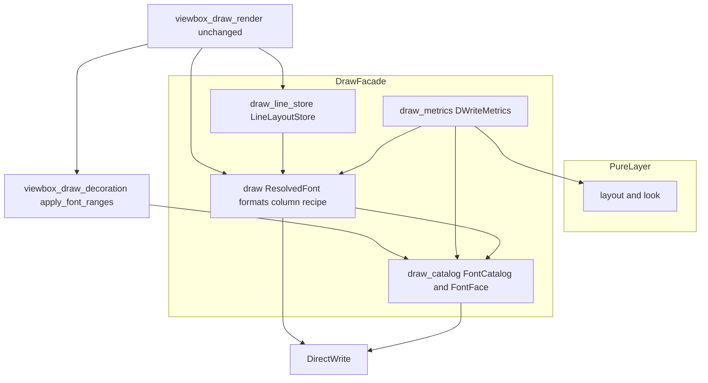
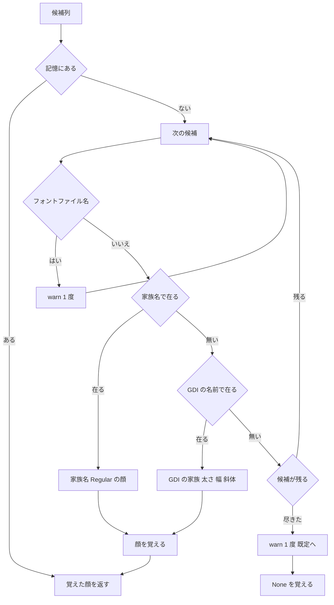

# Design Document: emo-text-dwrite-fidelity

## Overview

**Purpose**: バルーンの文字の描き方を SSP と同じに揃える。縦書きの開き括弧類を続く字の側（字の枠の下半分）に描き（件 1）、SSP の流儀のフォント名（「游ゴシック Medium」のような GDI の名前）をその太さ・斜体で当て（件 2）、縦書きの列を areka の覚えている行の矩形の真ん中に描く（件 3）。あわせて、バルーン定義の `font.bold`／`font.italic` が既定の字に効かない穴を塞ぐ（要件 4.8・4.9）。

**Users**: ぱすたさん（v0.1.0 の検体「窓際のぱすたさん」）を見る人と、ゴースト・バルーンの作者。ぱすたの縦書きバルーン（`font.name,游ゴシック Medium,Yu Gothic Medium,游ゴシック,Yu Gothic,BIZ UDPゴシック,メイリオ`）は、書き替えずに中太で、括弧が正しい位置に、列が行の矩形の真ん中に描かれる。

**Impact**: `areka-emo-text` の COM 層（`draw` ファサードとその子・装飾の範囲指定）だけを変える。純粋層（`layout.rs` ほか）のコードは変えない（doc だけ直す）。本番の描画の段（`viewbox_draw_render.rs`）は束縛書式の記憶の鍵の 1 行だけを変える。新しいソースファイル・新しい依存は 0。縦書きの列のレシピは横書きに何もしない。横書きの見た目が変わるのは、GDI の名前で当たる候補（中太など）を書いたバルーンと、`font.bold`／`font.italic` を宣言したバルーンだけ（要件 3・4 の意図どおり）。

原因は設計の段で測って特定した（research.md §10）。件 1 は「DirectWrite の TextLayout が、typography を付けないときの既定の機能の組で、游ゴシックの縦書きに `vpal` と同じ位置の調整（送り幅は変えない）を当てる」こと。件 3 は「DirectWrite の既定の行間（書体の ascent＋descent＋lineGap）で組んだ列の箱が、em の幅の行の矩形の書き始めの辺に揃う」こと。どちらも縦書きの TextLayout の設定で直る（要件 2.2）。字を個別にずらす最後の手段（要件 2.3）は使わない。

### Goals

- 縦書き 2 方向で、開き括弧類の墨が字の枠の下半分に、閉じ括弧類の墨が上端寄りに来る（1.1・1.2・1.5）。横書きは 1 画素も変えない（1.7・5.5）。
- `font.name`・`\f[name]` の各候補を、家族名で見つからなければ GDI の名前として引き直し、その家族・太さ・幅・斜体で描画と計測の両方を行う（3.x・4.1〜4.6）。
- 縦書きの列の字の em の箱の左右の中心を、行の矩形の左右の中心に ±1 画素で合わせる（5.1）。
- バルーン定義の太字・斜体を既定の字の描画と計測に効かせる（4.8・4.9）。
- 上のすべてを、実 GPU の読み戻しと、機械のフォントに頼らない決定論のテストで固定する（6.1〜6.5）。

### Non-Goals

- 約物の詰め・ぶら下げ・禁則・縦中横・字の向き（`text-typesetting`）。`vhal`／`vchw`／`halt` などの詰めの機能は当てない。
- 小書きかなの下の空き（書体の縦書き用の字形どおり）。
- 同梱のフォントファイルの読み込み（`balloon-font-file`）。ファイル名の候補は今のまま読み飛ばす。
- `menu.font.name`、`number`／`sstpmessage`／`communicatebox` の表示そのもの（4.7 は「同じ解決を通せば効く」形を保つだけ）。
- 太さを書く areka だけの新しい書き方・切り替えの設定（3.8・3.9）。

## Boundary Commitments

### This Spec Owns

- **名前 → 顔の解決**: 候補列から「家族名・太さ・幅・斜体」の組（`FontFace`）を 1 つ選ぶ規則（家族名 → GDI の名前の順・書いた順・記憶・記録の 1 度化）。`FontCatalog`（`draw_catalog.rs`）が唯一の実装点。
- **太字・斜体の重ね方の規則**: 名前から引いた太さ・斜体に、見た目の太字・斜体の指定を重ねる規則（`FontFace::weight_with`／`style_with`）。束縛書式・計測鍵ごとの試験用書式・装飾の範囲指定の 3 か所が同じ規則を通る。
- **縦書きの列の組み方（列のレシピ）**: areka が作る縦書きの TextLayout すべてに当てる設定＝「行間を行の箱の幅に揃え、基線をその真ん中に置く」と「`vpal` を含まない機能の組を明示する」。TextLayout を作る唯一の関数（`create_line_layout`・`draw.rs`）が持つ。
- **既定の見た目の太字・斜体の束縛書式への焼き込み**（4.8・4.9）。
- 上の各点を固定する檻（決定論のテスト・実 GPU の読み戻し）と、網羅台帳 `assets.toml` の `font.name` の行の注記。

### Out of Boundary

- 行の矩形の決め方・行送り・折り返し（純粋層 `layout.rs` 系）。本書は変えない。`GlyphMetrics::vertical_em_box_left` の既定の実装（純粋層の偽の計測器の模型）もそのまま残す。
- 本番の描画の段（`viewbox_draw_render.rs` の原点・`DrawTextLayout`）。本書は変えない（`FormatKey` の鍵の中身だけは書式を決める値に合わせて替える）。
- 選択肢の反転の帯の置き方（完了 `vertical-choice-hover-band`）。帯は今のまま「測った em の箱の位置」に置かれ、本書の直しで測った比が 0 になることで帯も行の矩形に重なる。帯の式は変えない（5.4 は壊さないことだけを持つ）。
- 書体の集まりへファイルの書体を足すこと（`balloon-font-file`）。GDI の引き当てに書体の集まりを渡す口（`IDWriteGdiInterop1`）も下流の持ち物。
- 約物の詰め・字の向きの選び（`text-typesetting`）。下流が詰めの機能を足すときは、本書の機能の組（`VERTICAL_FEATURES`）へ足す。
- SSP の振る舞いの測り（要件 6.6・6.7 の見比べは開発の進め方で行う・コードの持ち物ではない）。

### Allowed Dependencies

- `windows` 0.62（ワークスペースのピン）の `Win32_Graphics_DirectWrite`（`IDWriteGdiInterop`・`IDWriteFont`・`IDWriteFontFamily`・`IDWriteLocalizedStrings`・`IDWriteTypography`・`DWRITE_FONT_FEATURE`・`DWRITE_LINE_SPACING_METHOD_UNIFORM`）と `Win32_Graphics_Gdi`（`LOGFONTW`・`DEFAULT_CHARSET`）。どちらもワークスペースの機能で既に有効。新しい依存・機能の追加は 0。
- crate 内の依存の向き（下の「依存の向き」）。純粋層（`layout`・`look`）は COM 層を知らない。`FontFace` は DirectWrite の型を持つので COM 層（`draw` 配下）に置き、純粋層へ出さない。
- 既存の `wintf::com::dwrite` の拡張トレイト（`create_text_format`・`create_text_layout`・`get_cluster_metrics`）。

### Revalidation Triggers

- `FontCatalog` の公開の形（`face_for`／`face_or_default`／`family_for`／`pick` の戻り値・`FamilySource`）が変わる → 下流 `balloon-font-file`（同じ台帳にファイルの書体を足す）が引き直す。
- `VERTICAL_FEATURES`（縦書きの機能の組）や列のレシピ（行間）が変わる → 縦書きの読み戻しの檻（`tests/decoration_readback/vertical.rs` の固定値）・`vertical-choice-hover-band` の帯の檻・下流 `text-typesetting` が確かめ直す。
- `create_line_layout` を通らない TextLayout の生成が増える → 1 字の計測と行の送り幅の一致（2.4）が構造で保たれなくなる（檻 L2 が赤になる）。
- `ResolvedFont` に `face` が足される → `ResolvedFont` を組む crate 内のテスト補助が追随する（構築口は `resolve_with_background` の 1 か所のまま）。

## Architecture

### Existing Architecture Analysis

- `draw.rs` は COM 層のファサードで、子 `draw_catalog.rs`（フォント候補の解決）・`draw_metrics.rs`（計測）・`draw_line_store.rs`（行 TextLayout の保持）を `#[path]` で持つ。子は `super::` でファサードの定数・型を辿る。
- 書式（`IDWriteTextFormat`）を作る所は 2 か所: `create_text_format`→`try_create_format`（束縛書式・描画と既定の計測で共用）と `DWriteMetrics::probe_format_for`（既定でない計測鍵ごと・`try_create_format` の設定を字面で写している）。太さ・斜体は前者が NORMAL 決め打ち、後者が太字・斜体の 2 値。
- TextLayout を作る所は 3 か所: 行（`LineLayoutStore::line_layout_with_strokes`）・1 字の計測（`DWriteMetrics::probe_advance`）・縦書きの em の箱の測り（`measure_vertical_em_box_left_ratio`）。縦書きの設定は方向レシピ（`DirectionRecipe`）の 4 点だけで、typography も行間の指定も無い。
- 装飾の区間の範囲指定は `viewbox_draw_decoration.rs::apply_font_ranges` が行 TextLayout の生成時に 1 度だけ焼く（家族名・大きさ・太さ・斜体・打ち消し線）。
- 本番の束縛書式は `viewbox_draw_render.rs` が `create_text_format(&self.dwrite, &self.fonts.pick(font), mode)` で作る。`pick` の戻り値（`ResolvedFont`）に解決した顔を載せれば、この行は変えずに済む。

### Architecture Pattern & Boundary Map



**Architecture Integration**:
- 採る形: 今ある部品の拡張（research.md 案 A）。名前 → 顔の解決は `FontCatalog` に、太字・斜体の重ね方は `FontFace` に、縦書きの列の組み方は TextLayout を作る 1 つの関数に、それぞれ 1 か所ずつ置く。
- 境目: 名前の解決（`draw_catalog.rs`）・書式と TextLayout の作り方（`draw.rs`）・計測（`draw_metrics.rs`）・行の保持（`draw_line_store.rs`）・装飾の範囲指定（`viewbox_draw_decoration.rs`）。同じ振る舞いを 2 か所が持たない（重複していた試験用書式の設定は `try_create_format` へ寄せる）。
- 保つ形: ファサード＋子・log-first（`error!`＋`Err`）・記録の 1 度化の鍵（`WarnKey`）・計測鍵ごとの書式の記憶・行 TextLayout の再利用の鍵。
- 新しい部品の理由: `FontFace`（顔の値と重ね方の規則）・`create_line_layout`（列のレシピの唯一の当て場所）・`VERTICAL_FEATURES`（機能の組）。どれも今あるファイルの中に置く。
- steering の守り: 依存の追加 0・1 ファイル 1,000 行未満・テストは兄弟のファイル・GPU の檻は実 GPU。

**依存の向き（違反は誤り）**: 純粋層（`look`・`layout`・`writing`） → `draw_catalog`（`FontFace`・`FontCatalog`） → `draw`（`ResolvedFont`・`try_create_format`・`create_text_format`・`create_line_layout`） → `draw_metrics`・`draw_line_store` → `viewbox_draw_decoration` → `viewbox_draw_render`。左は右を知らない。例外は今からある `draw_catalog` → `draw` の定数・型（`DEFAULT_FONT_NAME`・`ResolvedFont`・`device_err`）の参照で、ファサードの子が親を辿る今の形のまま。

### Technology Stack

| Layer | Choice / Version | Role in Feature | Notes |
|---|---|---|---|
| 文字の並べ | DirectWrite（`windows` 0.62.2） | GDI の名前の引き当て（`IDWriteGdiInterop::CreateFontFromLOGFONT`）・機能の組の明示（`IDWriteTypography`）・行間（`SetLineSpacing(UNIFORM)`） | どれも Windows 7 から在る口。新しい依存なし |
| GDI の型 | `Win32_Graphics_Gdi`（`LOGFONTW`） | GDI の名前を渡す入れ物 | ワークスペースで有効 |
| テスト | `cargo test -p areka-emo-text`・実 GPU の読み戻し（`tests/decoration_readback`） | 檻 | 游ゴシックの無い机では今の型（`assert_real_font_present`）どおり赤で止める |

## File Structure Plan

### Modified Files（本番）

- `crates/areka-emo-text/src/draw_catalog.rs`（208 行 → 約 330 行）— `FontFace`（顔の値・`regular`・`weight_with`・`style_with`）を足す。`FontCatalog` の記憶を `Option<FontFace>` にし、`face_for`・`face_or_default`・`face_or` を足し、`family_for` を `face_for` の家族名だけを返す薄い口にする。候補ごとに「家族名 → GDI の名前」の順で引く `lookup`・GDI の名前を引く `gdi_face` を足す。`FamilySource::System` に `IDWriteGdiInterop` を持たせ、`#[cfg(test)]` の `Fake` に「GDI の名前（小文字）→ 顔」の表を足す。`pick` は解決した顔を `ResolvedFont::face` に、家族名を `name` に入れる。
- `crates/areka-emo-text/src/draw.rs`（761 行 → 約 830 行）— `ResolvedFont` に `pub face: FontFace` を足す（`resolve_with_background` は `FontFace::regular(&name)`）。`try_create_format` を「顔＋太字・斜体の指定」で書式を作る形にし（`pub(super)`）、`create_text_format` は既定の見た目の太字・斜体を渡す（既定フォントでの再試行も同じ規則）。縦書きの機能の組 `VERTICAL_FEATURES` と、TextLayout を作る唯一の関数 `create_line_layout`（縦書きに行間と機能の組を当てる）を足す。モジュール doc の該当行を直す。
- `crates/areka-emo-text/src/draw_metrics.rs`（480 行 → 約 470 行）— `new_shared` で束縛の顔（`picked.face`）を覚え、`probe_format_for` は `fonts.face_or(&key.name, &self.bound_face)` と `try_create_format` を呼ぶ形にし、設定の写しを消す。`probe_advance` と `measure_vertical_em_box_left_ratio` は `create_line_layout` で TextLayout を作る。em の箱の比が測れないときの縮退を 0（行の矩形の真ん中）にする。doc の実測例（∓0.1650・−0.3013）を「列のレシピの下では 0」に直す。
- `crates/areka-emo-text/src/draw_line_store.rs`（233 行 → 約 225 行）— 行の TextLayout を `create_line_layout` で作る（箱の寸法の場合分けを関数へ移す）。
- `crates/areka-emo-text/src/viewbox_draw_decoration.rs`（333 行 → 約 360 行）— `apply_font_ranges` を顔で考える形にする（区間の名前が既定と違えば `face_for` で顔を引き、家族名・幅を焼く。太さ・斜体は「区間の顔＋区間の太字・斜体」と「束縛の顔＋既定の太字・斜体」を同じ規則で比べ、違えば焼く）。署名は変えない。
- `crates/areka-emo-text/src/viewbox_draw_render.rs`（661 行・1 行と型 1 つ）— 束縛書式の記憶の鍵（`ensure_format` の `FormatKey`）を `(font.name, height, mode)` から `(font.looks.default.font_key(), mode)` へ替える。本書の後は候補列全体から解いた顔と既定の見た目の太字・斜体でも書式が変わるので、鍵がそれを見ないと同じ実行部でフォントを替えたときに古い書式を黙って使い続ける（設計の確かめの指摘 1）。今の本番は `actor_attach.rs` が resolved の変化で描画資源ごと作り直すので起きないが、鍵が書式を決める値をすべて含むのが本来の形。ウェーブの約束で触らないと決めたファイルなので、触る前に同じウェーブのほかのセッションへ知らせる（要件 5.3・C12 のほかの 7 本は触らない＝重なり 0）。
- `crates/areka-emo-text/src/viewbox_draw.rs`（型 1 つとテストの宣言 1 つ）— `FormatKey` を `(FontKey, WritingMode)` の別名にする（上の記憶の鍵の型）。区間の顔の試験 `viewbox_draw_decoration_face_tests.rs` を `#[cfg(test)]` の `decoration_face_tests` として宣言する。
- `crates/areka-emo-text/src/layout.rs`（doc だけ・コードは変えない）— `GlyphMetrics::vertical_em_box_left` の trait の doc（130〜135 行・158〜161 行あたり）が語る「本番の em の箱は列の箱の真ん中から ±s/2 ずれる」を、「本番（DirectWrite）は列のレシピで真ん中（0）・既定の実装は純粋層の偽の計測器の模型」へ直す（設計の確かめの指摘 3）。触る前に知らせる（同上）。
- `doc/ukadoc-coverage/ledger/assets.toml` — `font.name` の行（`entry."ukadoc:descript_balloon:font.name_…:1"`）の注記に GDI の名前の引き直しを書く（7.1）。

### Modified Files（テスト）

- `crates/areka-emo-text/src/draw_catalog_tests.rs`（318 行 → 約 480 行）— 偽の集合での引き直し（U1〜U8）と、実際の書体の集まりでの中太（R1）。
- `crates/areka-emo-text/src/draw_metrics_styled_tests.rs`（379 行 → 約 480 行）— 束縛書式・試験用書式の太さ・斜体（F1〜F4）。`vertical_em_box_left_is_measured_from_the_column_baseline` の期待値を 0 へ直す（列のレシピの下の実測）。
- `crates/areka-emo-text/src/draw_line_store_tests.rs`（399 行 → 約 480 行）— 列のレシピ（L1〜L3）。`line_layout_produces_the_same_line_as_a_bare_factory_call` は突き合わせ先を `create_line_layout` に直す。
- `crates/areka-emo-text/src/viewbox_draw_decoration_face_tests.rs`（新規・約 350 行）— 区間の顔（D1〜D3）と区間の行と 1 字の計測の一致（F3・F4 後半）。`viewbox_draw_decoration_tests.rs`（859 行）が 1,000 行を超えるので兄弟へ分けた（最終検証の是正）。
- `crates/areka-emo-text/src/draw_format_metrics_tests.rs`（922 行・**足さない**）— `font_family_reaches_directwrite_only_as_author_name_or_default_retry` の照らす字面を新しい呼び方へ**直すだけ**（行は増やさない・増えるなら照らす役ごと `draw_line_store_tests.rs` へ移す）。
- `crates/areka-emo-text/tests/decoration_readback/mod.rs`（335 行 → 約 360 行）— バルーン定義を「書体名・大きさ・追加の行」で組める口（`model_with`）と、それで撮る `run_with` を足す（`run` は委譲）。
- `crates/areka-emo-text/tests/decoration_readback/vertical.rs`（274 行 → 約 460 行）— 括弧の位置・列の真ん中・太字・斜体の読み戻し（G1〜G5）。今日の固定値（`COLUMN_RL`・`COLUMN_LR`・下線と打ち消し線の帯）を、列のレシピで動いた値へ理由を添えて改める（6.5）。
- 列のレシピで固定値が動きうる兄弟の読み戻しの試験（Yu Gothic UI・游ゴシックを縦書きで描くもの）: `src/viewbox_draw_underline_tests.rs`・`src/actor_underline_present_tests.rs`・`src/viewbox_draw_vertical_band_readback_tests.rs`・`src/viewbox_draw_vertical_band_scroll_tests.rs`・`src/viewbox_draw_choice_hover_tests.rs`・`src/viewbox_dirty_tests.rs`・`src/viewbox_draw_live_diff_tests.rs`。赤になったものだけを 6.5 の手順で直す（向きが手本と同じ＝列の真ん中の側へ動いたことを確かめ、理由を添える）。ＭＳ ゴシック・BIZ UDPゴシックは測りで動かない（research.md §10.3）。

### 触らないファイル・ウェーブの約束との照合

- **約束の所に及ぶもの（2026-10-29 設計の討議で足した）**: `viewbox_draw_render.rs`（束縛書式の記憶の鍵の 1 行と型）・`layout.rs`（doc だけ）。列のレシピと顔の受け渡しそのものはどちらにも置かない（TextLayout を作る所と `pick` の戻り値で通す）。実装の担当は触る前に同じウェーブのほかのセッションへ知らせる（要件 5.3）。新しいソースファイルは 0（`lib.rs` の一覧は変わらない）。`actor_decoration.rs`・`region.rs`・`actor_attach.rs`・`choice.rs`（④ `real-run-log-noise` の持ち物）にも触らない（`FontCatalog::new` の署名は変えない）。
- **roadmap の ③ の一覧の外で触るファイル**（進行役がほかのセッションへ知らせる用）:
  1. `crates/areka-emo-text/src/viewbox_draw_decoration.rs`（要件の段で足すと決めた所・C12 のほかの 7 本は触らない）
  2. `crates/areka-emo-text/src/viewbox_draw_decoration_tests.rs`（上の兄弟のテスト）
  3. `crates/areka-emo-text/tests/decoration_readback/mod.rs`（読み戻しの試験の土台・`src` の外）
  4. 赤になった場合だけ: 上に挙げた縦書きの読み戻しの兄弟のテスト 7 本（どれも C12 のほかの 7 本の持ち物ではない）
  5. `crates/areka-emo-text/src/viewbox_draw_render.rs`（記憶の鍵）と、その兄弟のテスト（鍵の試験 K1 を足す）・`crates/areka-emo-text/src/layout.rs`（doc だけ）
  - `draw_format_metrics_tests.rs` は字面を直すだけで行を足さない（約束「足さない」の内）。

## System Flows



- 「家族名で在る」は今の `FindFamilyName`（どの言語の家族名にも大小を問わず当たる）。「GDI の名前で在る」は `CreateFontFromLOGFONT` が成功すること（見つからない名前は `DWRITE_E_NOFONT` で失敗し、置き換えは起きない＝research.md §10.2）。
- 顔が決まった後の流れ: 束縛書式＝`face.weight_with(既定の太字)`・`face.style_with(既定の斜体)`・`face.stretch`。試験用書式＝計測鍵の顔と鍵の太字・斜体。区間の範囲指定＝区間の顔と区間の太字・斜体を、束縛の側と同じ規則で比べる。TextLayout はすべて `create_line_layout` を通り、縦書きなら列のレシピが当たる。

## Requirements Traceability

| Requirement | Summary | Components | Interfaces | Flows |
|---|---|---|---|---|
| 1.1 | 縦書きの開き括弧類を下半分へ | ColumnRecipe | `create_line_layout`・`VERTICAL_FEATURES` | TextLayout の生成 |
| 1.2 | 閉じ括弧類は今のまま | ColumnRecipe | 同上（閉じ括弧のずらしは既定でも 0） | 同上 |
| 1.3 | 開き括弧類を列の左右の真ん中に | ColumnRecipe | 同上（ずらしは送りの向きだけ） | 同上 |
| 1.4 | 「「→繋」の空きを手本と ±1px | ColumnRecipe・檻 G3 | 同上 | 記録＋G3 |
| 1.5 | どの太さでも下半分 | ColumnRecipe・檻 G1 | 同上 | 同上 |
| 1.6 | ほかの字の動きを確かめ記録 | 記録（research.md §10.1）・実装の測り直し | — | 記録 |
| 1.7 | 横書きを変えない | ColumnRecipe（横書きは何もしない） | `create_line_layout` | 横書きの既存の読み戻し |
| 2.1 | 原因を特定し記録 | 記録（research.md §10.1） | — | — |
| 2.2 | 設定で直す | ColumnRecipe | `VERTICAL_FEATURES` | — |
| 2.3 | 最後の手段は設定で直らないときだけ | 不使用の決定（測りの根拠） | — | — |
| 2.4 | 送り幅が変わるなら計測と行で同じ | ColumnRecipe・DWriteMetrics・LineLayoutStore | `create_line_layout`（唯一の生成口） | 檻 L2・L3 |
| 2.5 | 言語は日本語のまま | 方向レシピ・書式（変えない） | `LOCALE_JA_JP` | — |
| 3.1 | 家族名で無ければ GDI の名前で引く | FontCatalog | `face_for`・`gdi_face` | 名前の解決 |
| 3.2 | GDI の名前が指す家族・太さ・斜体で描く | FontCatalog・FormatFactory・FontRanges | `FontFace`・`try_create_format`・`apply_font_ranges` | 同上 |
| 3.3 | 家族名で当たれば今と同じ | FontCatalog | `FontFace::regular` | 同上 |
| 3.4 | 書いた順・両方を「入っている」扱い | FontCatalog | `face_for` | 同上 |
| 3.5 | 日本語名・英語名・大小無視 | FontCatalog | `FindFamilyName`・`CreateFontFromLOGFONT` | 同上 |
| 3.6 | 全滅は 1 度記録して既定 | FontCatalog | `WarnKey::AllMissing`・`face_or_default` | 同上 |
| 3.7 | ファイル名は読み飛ばす | FontCatalog | `is_font_file`・`WarnKey::FontFile` | 同上 |
| 3.8 | 切り替えの設定を設けない | FontCatalog（常に引く） | — | — |
| 3.9 | 新しい書き方を設けない | FontCatalog（名前の字面を解かない） | — | — |
| 3.10 | ぱすたの descript で中太 | FontCatalog・FormatFactory | `pick`・`create_text_format` | 檻 R1・F1・G1 |
| 3.11 | 2 度目は記憶を使う | FontCatalog | `memo` | 同上 |
| 4.1 | 描画と計測に同じ太さ・斜体 | FormatFactory・DWriteMetrics・FontRanges | `try_create_format`（共用）・`FontFace` の規則 | 檻 F3・L3 |
| 4.2 | 太字の指定が勝つ | FontFace | `weight_with` | 檻 U7・F2 |
| 4.3 | 太字が無い・切りなら名前の太さ | FontFace・FontRanges | `weight_with`・`apply_font_ranges` | 檻 U7・D2 |
| 4.4 | 斜体の指定で斜体 | FontFace | `style_with` | 檻 U7・F2 |
| 4.5 | 斜体が無い・切りなら名前の斜体 | FontFace | `style_with` | 檻 U7 |
| 4.6 | `\f[name]` の区間を GDI の顔で | FontRanges | `apply_font_ranges` | 檻 D1・D3 |
| 4.7 | number ほかも同じ解決を通せば効く | FontCatalog（共有の唯一の入口） | `face_for` | 今は読む経路が無い（何もしない） |
| 4.8 | `font.bold` を既定の字の描画と計測へ | FormatFactory | `create_text_format` | 檻 F1・G5 |
| 4.9 | `font.italic` を既定の字の描画と計測へ | FormatFactory | 同上 | 檻 F1・G5 |
| 4.10 | `\f[name]` の候補が全滅なら描画も計測も束縛の顔 | FontCatalog・DWriteMetrics・FontRanges | `face_or` | 檻 D3・F4 |
| 5.1 | 列の em の箱の中心を行の矩形の中心へ | ColumnRecipe | `create_line_layout`（行間） | 檻 G4・M |
| 5.2 | 直す前後のずれを記録 | 記録（research.md §10.3＋実装の画素の測り直し） | — | 記録 |
| 5.3 | 約束の所に及ぶなら知らせる | 実装の進め方（`viewbox_draw_render.rs` の記憶の鍵・`layout.rs` の doc に触る前に知らせる） | — | — |
| 5.4 | 選択肢の帯を em の箱に重ねたまま | DWriteMetrics（測った比 0・縮退も 0） | `vertical_em_box_left` | 帯の既存の檻 |
| 5.5 | 横書きの行の位置を変えない | ColumnRecipe（横書きは何もしない） | `create_line_layout` | 横書きの既存の読み戻し |
| 6.1 | 括弧の上下を実 GPU で固定 | 檻 G1 | — | — |
| 6.2 | 引き直しを機械に頼らず固定 | 檻 U1〜U8・D1〜D3 | `FontCatalog::with_faces` | — |
| 6.3 | 実機の集まりで 500 | 檻 R1 | `FontCatalog::new` | — |
| 6.4 | 横書きの既存の読み戻しを緑のまま | 既存の檻 | — | — |
| 6.5 | 縦書きの固定値が動けば向きを確かめ改める | 檻の固定値の改め | — | — |
| 6.6 | SSP と並べて揃うことを記録 | 開発の進め方（実機の確かめのタスク） | — | — |
| 6.7 | SSP の MCP で測る前に知らせる | 開発の進め方 | — | — |
| 6.8 | 実機の確かめは `doc/pasta-real-run.md` の入れ方で | 開発の進め方 | — | — |
| 7.1 | 台帳の注記 | Ledger | `assets.toml` | — |

## Components and Interfaces

| Component | Domain/Layer | Intent | Req Coverage | Key Dependencies (P0/P1) | Contracts |
|---|---|---|---|---|---|
| FontFace | COM 層（`draw_catalog.rs`） | 名前が指す顔の値と、太字・斜体の重ね方の規則 | 3.2・4.2〜4.5 | DirectWrite の型（P0） | Service |
| FontCatalog | COM 層（`draw_catalog.rs`） | 候補列 → 顔の解決・記憶・記録の 1 度化 | 3.1〜3.11・4.7・6.2・6.3 | `IDWriteFontCollection`・`IDWriteGdiInterop`（P0） | Service・State |
| FormatFactory | COM 層（`draw.rs`） | 顔と太字・斜体から書式を作る唯一の関数・既定の見た目の焼き込み | 3.2・3.10・4.1〜4.5・4.8・4.9 | FontFace（P0）・DirectWrite（P0） | Service |
| ColumnRecipe | COM 層（`draw.rs`） | TextLayout を作る唯一の関数・縦書きの列のレシピ | 1.1〜1.7・2.2・2.4・5.1・5.5 | `IDWriteTypography`（P0） | Service |
| DWriteMetrics（変更） | COM 層（`draw_metrics.rs`） | 計測鍵の書式と probe を上の 2 つへ寄せる | 2.4・4.1・5.4 | FontCatalog・FormatFactory・ColumnRecipe（P0） | Service |
| LineLayoutStore（変更） | COM 層（`draw_line_store.rs`） | 行の TextLayout を ColumnRecipe で作る | 2.4・5.1 | ColumnRecipe（P0） | State |
| FontRanges（変更） | COM 層（`viewbox_draw_decoration.rs`） | 区間の顔・太さ・斜体の範囲指定 | 3.2・4.1・4.3・4.6 | FontCatalog・FontFace（P0） | Service |
| Ledger | 文書（`assets.toml`） | `font.name` の対応の範囲の注記 | 7.1 | — | — |

### COM 層: フォントの顔

#### FontFace

| Field | Detail |
|---|---|
| Intent | 名前が指す顔（家族名・太さ・幅・斜体）と、太字・斜体の指定の重ね方 |
| Requirements | 3.2・4.2・4.3・4.4・4.5 |

**Responsibilities & Constraints**
- 値は DirectWrite が返す形のまま持つ（太さ・幅・斜体は `DWRITE_FONT_*`）。
- 太字・斜体の重ね方はこの型のメソッドだけが持つ。書式・試験用書式・範囲指定はこれを呼ぶ（自前で 2 値の決め打ちを書かない）。

**Contracts**: Service [x]

##### Service Interface
```rust
#[derive(Clone, Debug, PartialEq)]
pub struct FontFace {
    /// DirectWrite の家族名（`CreateTextFormat`／`SetFontFamilyName` へそのまま渡せる名前）。
    pub family: String,
    pub weight: DWRITE_FONT_WEIGHT,
    pub stretch: DWRITE_FONT_STRETCH,
    pub style: DWRITE_FONT_STYLE,
}

impl FontFace {
    /// 家族名で当たった候補の顔（太さ NORMAL・幅 NORMAL・斜体 NORMAL＝今と同じ・3.3）。
    pub fn regular(family: &str) -> FontFace;
    /// 太字の指定を重ねた太さ。指定が真なら max(BOLD, 名前の太さ)、偽なら名前の太さ（4.2・4.3）。
    pub fn weight_with(&self, bold: bool) -> DWRITE_FONT_WEIGHT;
    /// 斜体の指定を重ねた斜体。指定が真なら ITALIC、偽なら名前の斜体（4.4・4.5）。
    pub fn style_with(&self, italic: bool) -> DWRITE_FONT_STYLE;
}
```
- Invariants: `family` は空でない。`weight_with(false) == weight`・`style_with(false) == style`。
- 太字が名前の太さより軽くならないよう `max` を取る（「Arial Black」900＋太字は 900・GDI も同じ名前の中の顔を選ぶ）。「中太＋太字」は 700（4.2）。2026-10-29 設計の討議 議題 2「承認」で確定。

#### FontCatalog

| Field | Detail |
|---|---|
| Intent | 候補列から最初に入っている顔を選ぶ（家族名 → GDI の名前の順）・記憶・記録の 1 度化 |
| Requirements | 3.1〜3.11・4.7・6.2・6.3 |

**Responsibilities & Constraints**
- 候補ごとに、ファイル名なら読み飛ばし（記録 1 度）→ 家族名で在れば `FontFace::regular(候補)` → 無ければ GDI の名前として引き、在ればその顔 → 無ければ次の候補。最初に当たった候補を採る（3.4）。
- 結果（`Option<FontFace>`）は候補列ごとに覚え、2 度目は問い合わせない（3.11・観測点 `lookup_count` は今のまま）。
- 全滅は `WarnKey::AllMissing` で 1 度だけ `warn!`（3.6・今のまま）。
- 本番・計測・描画で台帳を 1 つ共有する形は今のまま（`actor_decoration.rs` が作って渡す・署名を変えない）。`number`／`sstpmessage`／`communicatebox` の表示を作る spec が同じ台帳を通せば 4.7 が効く。
- 切り替えの設定は持たない（3.8）。名前の字面を自前で解かない（3.9）。

**Dependencies**
- External: `IDWriteFontCollection::FindFamilyName`（家族名）・`IDWriteGdiInterop::CreateFontFromLOGFONT`（GDI の名前）・`IDWriteFont::GetFontFamily`／`GetFamilyNames`／`GetWeight`／`GetStretch`／`GetStyle`（P0）
- Inbound: `pick`（束縛書式）・`DWriteMetrics::probe_format_for`・`apply_font_ranges`・テストの `font_is_installed`（P0）

**Contracts**: Service [x] / State [x]

##### Service Interface
```rust
impl FontCatalog {
    /// システムの書体の集まりと GDI 互換の口を 1 度だけ取って台帳を作る（失敗は error!＋Err）。
    pub fn new(factory: &IDWriteFactory2) -> Result<FontCatalog, TextLayerError>;
    /// 記述順に問い合わせて最初に入っている顔。空列は None（記録なし）。全滅は warn! 1 度＋None。
    pub fn face_for(&self, candidates: &[String]) -> Option<FontFace>;
    /// `face_for` の家族名だけ（今の呼び手とテストの口・意味は「入っているか」へ広がる）。
    pub fn family_for(&self, candidates: &[String]) -> Option<String>;
    /// `face_for`、全滅なら `FontFace::regular(DEFAULT_FONT_NAME)`（束縛書式と計測鍵の書式の唯一の規則）。
    pub fn face_or_default(&self, candidates: &[String]) -> FontFace;
    /// `face_for`、全滅なら `fallback`（`\f[name]` の区間と計測鍵の規則＝束縛の顔・要件 4.10）。
    pub fn face_or(&self, candidates: &[String], fallback: &FontFace) -> FontFace;
    /// バルーン定義の候補列を解決した顔を `face` に、その家族名を `name` に入れた複製。
    pub fn pick(&self, font: &ResolvedFont) -> ResolvedFont;
    /// テスト用: 家族名の集合と「GDI の名前 → 顔」の表で作る偽の台帳（機械のフォントに頼らない・6.2）。
    #[cfg(test)]
    pub(super) fn with_faces(families: &[&str], gdi: &[(&str, FontFace)]) -> FontCatalog;
}
```
- 既存の `#[cfg(test)] with_families(&[&str])` は `with_faces(families, &[])` への委譲として残す（今あるテストを書き替えない）。
- GDI の名前を引く内部の手順（`gdi_face`）: `LOGFONTW { lfFaceName = 候補, lfWeight = 400, lfCharSet = DEFAULT_CHARSET, 他は 0 }` を渡す。候補が 31 単位を超えるときは引かない（GDI の名前になりえない・`debug!`）。成功したら `GetFontFamily().GetFamilyNames()` の先頭の名前を家族名に、`GetWeight`／`GetStretch`／`GetStyle` を顔にする。

##### State Management
- 状態: `memo: RefCell<HashMap<Vec<String>, Option<FontFace>>>`・`warned: RefCell<BTreeSet<WarnKey>>`・`lookups: Cell<usize>`。
- 並行: UI スレッド専有（今のまま）。

**Implementation Notes**
- Integration: `FamilySource::System { collection, gdi }`・`#[cfg(test)] FamilySource::Fake { families: BTreeSet<String>, gdi: BTreeMap<String, FontFace> }`（鍵は小文字）。
- Validation: 家族名の照合と GDI の照合はどちらも大小を問わない（3.5・実機は OS の規則・偽は小文字化）。
- Risks: 下流 `balloon-font-file` がファイルの書体を足すとき、GDI の照合にも同じ集まりを渡す必要がある（`IDWriteGdiInterop1::CreateFontFromLOGFONT(logfont, collection)`・research.md §10.2）。引き直しの口は `gdi_face` の 1 か所に閉じてある。

### COM 層: 書式と TextLayout

#### FormatFactory（`ResolvedFont`・`try_create_format`・`create_text_format`）

| Field | Detail |
|---|---|
| Intent | 顔と太字・斜体の指定から書式を作る唯一の関数と、束縛書式への既定の見た目の焼き込み |
| Requirements | 3.2・3.10・4.1〜4.5・4.8・4.9 |

**Responsibilities & Constraints**
- `ResolvedFont` に `pub face: FontFace` を足す。`resolve_with_background` は `FontFace::regular(&name)`（未解決の名前・Regular）を入れ、`FontCatalog::pick` が解決した顔へ差し替える。構築口は今のまま 1 か所。
- `try_create_format` は書式の設定（コレクション既定・locale ja-JP）の唯一の持ち主で、束縛書式（`create_text_format`）と計測鍵の書式（`probe_format_for`）が共用する（設定の字面の写しをやめる）。
- `create_text_format` は `font.looks.default.bold`／`italic` を渡す（4.8・4.9）。生成に失敗したら今のまま `warn!` を残して `FontFace::regular(DEFAULT_FONT_NAME)` で同じ太字・斜体を渡して再試行し、なお失敗は `error!`＋`Device`。
- 書字方向は今のまま方向レシピの 1 行だけで効く（`writing_mode_selects_only_the_direction_recipe_not_the_font_name` の檻を保つ）。

**Contracts**: Service [x]

##### Service Interface
```rust
pub struct ResolvedFont {
    // 既存の name・fallback_chain・height・color・effects・looks に加えて
    /// 名前が指す顔（`resolve` は未解決の Regular・`FontCatalog::pick` が解決した顔へ差し替える）。
    pub face: FontFace,
}

/// 顔と太字・斜体の指定から書式を 1 回作る（太さ・斜体は FontFace の規則・幅は顔のまま・locale ja-JP）。
/// 可視性は `pub(super)`（子モジュール `metrics` と、`viewbox_draw` の区間の顔の試験が辿る）。
pub(super) fn try_create_format(
    factory: &IDWriteFactory2,
    face: &FontFace,
    bold: bool,
    italic: bool,
    font_size: f32,
) -> windows::core::Result<IDWriteTextFormat>;

/// 束縛書式（既定の見た目の太字・斜体を焼く・方向レシピを焼く・失敗は既定フォントで再試行）。
pub fn create_text_format(
    factory: &IDWriteFactory2,
    font: &ResolvedFont,
    mode: WritingMode,
) -> Result<IDWriteTextFormat, TextLayerError>;
```
- Preconditions: `font.height > 0`（`resolve` が保証）。
- Postconditions: 書式の `GetFontWeight() == font.face.weight_with(font.looks.default.bold)`、`GetFontStyle() == font.face.style_with(font.looks.default.italic)`、`GetFontStretch() == font.face.stretch`。

**Implementation Notes**
- Integration: 本番の `viewbox_draw_render.rs` は `create_text_format(&self.dwrite, &self.fonts.pick(font), mode)` のまま顔を受け取る（行を変えない）。比較専用オラクル `DrawExecutor` は `pick` を通さない（`face` は Regular）＝今と同じ。
- Validation: 字面の檻（`draw_format_metrics_tests.rs`）は「家族名が DirectWrite へ渡る入口は `try_create_format` と範囲指定だけで、渡る名前は台帳の解決か既定名だけ」という狙いのまま、照らす字面を新しい呼び方へ直す。
- Risks: `measure_line_box_ratio` は書式の太さ・幅・斜体から字面を辿るので、中太の書式では中太の字面の寸法になる（自動で追いつく・研究 §2.2）。

#### ColumnRecipe（`create_line_layout`・`VERTICAL_FEATURES`）

| Field | Detail |
|---|---|
| Intent | areka が作る TextLayout の唯一の生成口。縦書きなら列のレシピ（行間と機能の組）を当てる |
| Requirements | 1.1〜1.7・2.2・2.4・2.5・5.1・5.5 |

**Responsibilities & Constraints**
- 箱の寸法: 横書き＝（`PROBE_MAX_EXTENT`, `block_extent`）・縦書き＝（`block_extent`, `PROBE_MAX_EXTENT`）（今の `LineLayoutStore` の場合分けを移す）。
- 縦書きだけ:
  1. `SetLineSpacing(DWRITE_LINE_SPACING_METHOD_UNIFORM, block_extent, block_extent / 2)` — 列の箱の幅を行の箱の幅に揃え、列の基線をその真ん中に置く（5.1・research.md §10.3）。
  2. `CreateTypography` に `VERTICAL_FEATURES` を値 1 で足し、`SetTypography(全文字範囲)` — 既定の機能の組の `vpal` 相当の位置の調整を外す（1.1・2.2・research.md §10.1）。
- 横書きは何もしない（1.7・5.5）。書式の言語・方向レシピは変えない（2.5）。
- 行（`LineLayoutStore`）・1 字の計測（`probe_advance`）・em の箱の測り（`measure_vertical_em_box_left_ratio`）の 3 つの TextLayout がすべてここを通る＝計測と行は同じ設定（2.4）。

**Contracts**: Service [x]

##### Service Interface
```rust
/// 縦書きの TextLayout に明示する機能の組（DirectWrite の既定の組から `vpal` 相当を外したもの・
/// `vert` は入れない＝DirectWrite が立てる並びにだけ自分で当てる）。
const VERTICAL_FEATURES: [DWRITE_FONT_FEATURE_TAG; 10]; // ccmp locl mark mkmk rlig calt clig liga kern rclt

/// TextLayout を作る唯一の口（縦書きは列のレシピを当てる）。失敗は error!＋Device Err。
pub(crate) fn create_line_layout(
    factory: &IDWriteFactory2,
    text: &str,
    format: &IDWriteTextFormat,
    block_extent: f32,
    mode: WritingMode,
) -> Result<IDWriteTextLayout, TextLayerError>;
```
- Preconditions: `block_extent > 0`（呼び手は行の箱の幅＝既定は `font.height`・装飾のある行は行内最大 em・計測は鍵の大きさ）。
- Postconditions（縦書き）: `GetLineSpacing` が（UNIFORM・`block_extent`・`block_extent/2`）、全文字範囲の `GetTypography` が `VERTICAL_FEATURES` の 10 個（値 1）を持ち `vpal` を持たない。横書きでは typography 無し・行間は既定。
- Invariants: crate の本番のコードで `create_text_layout(` を呼ぶのはこの関数だけ（檻 L2）。

**Implementation Notes**
- Integration: 装飾の範囲指定（`apply_font_ranges`）は生成の後に焼くので、区間の家族名・大きさを変えても機能の組と行間は保たれる。大きさの違う字が混じる行は行内最大 em の行間になり、どの字の em の箱も列の真ん中の基線に揃う。
- Validation: 送り幅は変わらない（測りで 20.00 のまま）。それでも 3 つの TextLayout が同じ口を通ることで、将来の機能の追加（下流 `text-typesetting`）が送り幅を変えても計測と行は揃う。
- 要件 2.3 の扱い: 設定で直ることは測りで確かめ済み（research.md §10.1）なので、字を個別にずらす手は設計に入れない。実装の檻 G1 が列のレシピの後も赤なら、実装の段で字をずらして繕わず、測りの値を添えて設計へ戻す。
- Risks: 機能の組は「既定と同じ結果になる 10 個」を測りで選んだ（游ゴシック・Yu Gothic UI・メイリオ・BIZ UDPゴシック・ＭＳ ゴシック・Segoe UI）。アラビア文字などの複雑な文字を縦書きで描く場合の既定の機能は確かめていない（バルーンでの縦書きの複雑な文字は想定の外）。typography の生成は TextLayout ごとに 1 回（行は保持庫が、計測は記憶が再利用するので回数は少ない）。

#### DWriteMetrics（変更）

| Field | Detail |
|---|---|
| Intent | 計測鍵の書式を台帳の顔と共用の生成関数で作り、probe と em の箱の測りを ColumnRecipe で作る |
| Requirements | 2.4・4.1・5.4 |

**Responsibilities & Constraints**
- `probe_format_for(key)`: 顔＝`self.fonts.face_or(&key.name, &self.bound_face)`（全滅は束縛の顔＝描画の `apply_font_ranges` と同じ・要件 4.10。束縛の顔は `new_shared` の `pick` が解いたもので、束縛の候補列が全滅なら ＭＳ ゴシック）、書式＝`try_create_format(&self.factory, &face, key.bold, key.italic, size)`＋方向レシピ。計測鍵（候補列・大きさ・太字・斜体）が顔を一意に決めるので、鍵と書式の記憶の形は変えない。
- `probe_advance(text, format, block_extent)`: `create_line_layout(..., block_extent = 鍵の大きさ, self.mode)`。行内の軸は今のまま `PROBE_MAX_EXTENT`（未折返し）。
- `measure_vertical_em_box_left_ratio`: 引数に `mode` を足し（呼び手は `new_shared` の縦書きの枝の中）、「あ」の TextLayout を `create_line_layout(..., font_height, mode)` で作る＝本番の列と同じレシピで測る。列のレシピの下の実測は全書体 0（research.md §10.3）。
- 測れないときの縮退は 0（行の矩形の真ん中＝列のレシピが保証する置き場）。`warn!` は今のまま。束縛と違う縦書きの向きを問われたとき（`mode != self.mode`）も 0 を返す（列のレシピはどちらの向きでも em の箱を真ん中に置く＝古い ±s/2 の既定の実装へ落とさない・設計の確かめの指摘 3）。横書きを問われたときは今のまま。
- `new_shared` の `let picked = fonts.pick(font);` の行は変えない（字面の檻がある）。

**Implementation Notes**
- Validation: 選択肢の帯（`choice.rs`）は `vertical_em_box_left` の丸めを読むだけなので、比が 0 になれば帯は行の矩形に重なる（5.4・帯の式は変えない）。
- Risks: doc に書いてある実測例（Yu Gothic UI ∓0.1650・游ゴシック −0.3013）は列のレシピの前の値なので、「列のレシピの下では 0・前の値は research.md §10.3」へ直す。

#### LineLayoutStore（変更）

- 行の TextLayout を `create_line_layout(&self.factory, text, format, block_extent, mode)` で作る。再利用の鍵・生成回数・`decorate` の順・はみ出しの実測は今のまま（2.4・5.1）。
- はみ出しの実測（`GetOverhangMetrics`）は列のレシピの後の列から測るので、描き替えの範囲は自動で新しい置き場に合う。

#### FontRanges（`apply_font_ranges` の変更）

| Field | Detail |
|---|---|
| Intent | 区間の顔（GDI の名前を含む）と太字・斜体を、束縛と同じ規則で範囲指定に焼く |
| Requirements | 3.2・4.1・4.3・4.6 |

**Responsibilities & Constraints**
- 束縛の顔＝`fonts.face_or_default(&default.name)`（`pick` と同じ規則・記憶で引くだけ）。
- 区間ごと（既定の区間は今のまま飛ばす）:
  - 区間の顔: 名前が既定と違い、`face_for(&look.name)` が当たれば、その顔（家族名を `SetFontFamilyName`・幅が束縛と違えば `SetFontStretch`）。当たらなければ束縛の顔のまま（今の「既定の家族名のまま描く」を保つ）。名前が同じなら束縛の顔。
  - 太さ: `区間の顔.weight_with(look.bold)` が `束縛の顔.weight_with(default.bold)` と違えば `SetFontWeight`（`\f[name,Yu Gothic Medium]` は 500・既定が太字の行の `\f[bold,0]` は名前の太さ＝4.3・4.6）。
  - 斜体: 同じ形で `style_with`。
  - 大きさ・打ち消し線は今のまま。
- 範囲指定の発行の数え方（`note_range_call`）・失敗の扱い（`error!`＋`Err`）は今のまま。署名は変えない。

**Implementation Notes**
- Validation: 計測の側（試験用書式）は同じ `FontFace` の規則を通るので、区間の太さ・斜体は描画と計測で一致する（4.1）。
- 区間の名前が全滅のときは、描画も計測も束縛の顔に区間の太字・斜体を重ねる（`face_or(&look.name, &束縛の顔)`・要件 4.10）。完了 spec が計測の側に決めていた「全滅は ＭＳ ゴシックで測る」（research.md §10.6 の R11.3）を、描画の側に揃えて上書きする（2026-10-29 設計の討議 議題 1）。

#### Ledger（`assets.toml` の `font.name` の行）

- 注記の流れの文（「`FontCatalog::family_for` が記述順に問い合わせて…」）を「`FontCatalog::face_for` が記述順に、家族名で、無ければ GDI の名前（家族名＋太さ・斜体・幅。例「游ゴシック Medium」）として問い合わせ、最初に当たった顔（家族・太さ・幅・斜体）で描画と計測を行う」へ改める（7.1）。`status`・`owner`・⒜ のファイル名の扱いは変えない。

## Data Models

### Domain Model

- **顔（`FontFace`）**: 値オブジェクト。家族名・太さ・幅・斜体。家族名で当たった候補は Regular、GDI の名前で当たった候補は OS が返す値。
- **見た目（`TextLook`・純粋層）**: 候補列・大きさ・太字・斜体など。変えない。顔は見た目の候補列から COM 層で導く（純粋層へ顔を持ち込まない）。
- **計測鍵（`FontKey`）**: 候補列・大きさ・太字・斜体。顔は候補列から一意に決まるので鍵は変えない。
- 不変条件: 同じ候補列 → 同じ顔（台帳の記憶）。同じ（顔・太字・斜体）→ 同じ書式の太さ・斜体（`FontFace` の規則）。

## Error Handling

### Error Strategy

| 場面 | 扱い |
|---|---|
| `GetGdiInterop` の失敗（台帳の生成） | `error!`＋`Err(Device)`（`GetSystemFontCollection` の失敗と同じ・装着の失敗） |
| `CreateFontFromLOGFONT` が `DWRITE_E_NOFONT` | 「その名前は無い」＝次の候補へ（記録しない。全滅したときだけ今の `warn!` 1 度） |
| `CreateFontFromLOGFONT` のそれ以外の失敗・`GetFontFamily`／`GetFamilyNames`／`GetString` の失敗 | `error!`（`device_err`）を残して「無い」扱いで次の候補へ（`FindFamilyName` の失敗と同じ形） |
| 候補が 31 単位を超える | GDI の名前として引かない（`debug!`・失敗ではない） |
| `CreateTypography`・`AddFontFeature`・`SetTypography`・`SetLineSpacing` の失敗 | `error!`＋`Err(Device)`（TextLayout の生成の失敗＝当該フレームを見送る・今の `CreateTextLayout` の失敗と同じ） |
| 束縛書式の生成の失敗 | 今のまま `warn!`→既定フォント（同じ太字・斜体）で再試行→`error!`＋`Err` |
| em の箱の測りの失敗 | 今のまま `warn!`、縮退は 0（行の矩形の真ん中） |

- panic しない。記録の無い失敗の経路を作らない（`logging.md`）。

### Monitoring

- 新しい記録: GDI の照合の想定外の失敗（`error!`）と、長すぎる候補の読み飛ばし（`debug!`）だけ。毎フレームの記録は足さない（台帳は記憶する・行と計測は再利用する）。

## Testing Strategy

機械のフォントに頼る檻は、今の型（`assert_real_font_present`・游ゴシック／Yu Gothic UI が無ければ赤で止める）に倣う。GPU の檻は実 GPU。

### 決定論の単体（機械のフォントに頼らない・偽の台帳）— `draw_catalog_tests.rs`

- U1（3.3）: 家族名で当たる候補は `FontFace::regular(候補)`（太さ・幅・斜体 NORMAL）。
- U2（3.1・3.2）: 家族名に無く GDI の表に在る候補は、表の顔（家族名「Yu Gothic」・500）。
- U3（3.4）: 書いた順。`[GDI の名前, 家族名]` は GDI の顔、`[無い名前, GDI の名前, 家族名]` は GDI の顔、`[家族名, GDI の名前]` は家族名の顔。
- U4（3.5）: GDI の表の照合が大小を問わない（「YU GOTHIC MEDIUM」「yu gothic medium」）。
- U5（3.6・3.7）: 全滅は None・`warn!` 1 度（2 度目の解決でも増えない）・`face_or_default` は ＭＳ ゴシック Regular。ファイル名の候補は GDI の表に同じ名前があっても引かない。
- U6（3.11）: 同じ候補列の 2 度目は問い合わせない（`lookup_count` が増えない・GDI で当たった列も同じ）。
- U7（4.2〜4.5）: `weight_with`／`style_with` の表（Regular・Medium・Light・Black × 太字の有無、Regular・斜体の顔 × 斜体の有無）。
- U8（3.10）: ぱすたの候補列（偽の GDI の表に「游ゴシック medium」）で `pick` が `name`＝家族名・`face.weight`＝500。

### 実際の書体の集まり（游ゴシックの有無を確かめてから）— `draw_catalog_tests.rs`

- R1（3.5・3.10・6.3）: `FontCatalog::new` で「Yu Gothic Medium」「游ゴシック Medium」「yu gothic medium」が太さ 500・家族名で引き直せる顔になる。ぱすたの候補列が 500。「NoSuchFontXYZ」だけの列は None。

### 書式（実 DirectWrite・GPU 不要）— `draw_metrics_styled_tests.rs`

- F1（3.10・4.8・4.9）: ぱすたの候補列に束縛した `DWriteMetrics` の束縛書式の `GetFontWeight` が 500。バルーン定義に `font.bold,1` を足すと 700、`font.italic,1` を足すと `GetFontStyle` が ITALIC。
- F2（4.2・4.4）: 計測鍵（候補列「Yu Gothic Medium」）の試験用書式が 500、同じ鍵の太字が 700、斜体が ITALIC。
- F3（4.1）: GDI の名前の計測鍵で測った英字の送り幅が、同じ書式で作った行の cluster の幅と一致する（中太の英字の送り幅は Regular と違うので、太さが片方だけに効くと赤）。
- M（5.4・既存の改め）: `vertical_em_box_left` の実測が、Yu Gothic UI・游ゴシックの 2 方向で 0（±0.001×em）になる（今の期待値 ∓0.1650・−0.3013 を改める・理由＝列のレシピ）。

### 列のレシピ（実 DirectWrite・GPU 不要）— `draw_line_store_tests.rs`

- L1（1.7・2.2・5.1・5.5）: 縦書き 2 方向の行の TextLayout が `GetLineSpacing`＝（UNIFORM・箱の幅・箱の幅の半分）と、`GetTypography(0)` に `VERTICAL_FEATURES` の 10 個（`vpal`・`vert` を含まない）を持つ。横書きの行は typography 無し・行間は既定。装飾のある行（箱の幅＝行内最大 em）でも同じ形。
- L2（2.4）: crate の `src` の本番のファイル全部（`_tests.rs` を除く・試験の中で `src` を走査する）で、`create_text_layout(`／`CreateTextLayout(` を呼ぶのは `create_line_layout` の 1 か所だけ（字面の檻。3 ファイルに限ると「crate で唯一の生成口」という不変条件と範囲がずれる＝設計の確かめの補足）。
- L4（1.7・2.2）: 縦書きで、絵文字の ZWJ 列（例「👨‍👩‍👧」）と国旗（例「🇯🇵」）の字形番号と送り幅が、typography 無しの既定と列のレシピで一致する（明示した 10 個の機能で合成の絵文字が崩れないこと）。
- L3（2.4）: 游ゴシック 20px の縦書きで、「…「繋がってる」」の 1 字ずつの計測（`DWriteMetrics::advance`）と行の cluster の幅が全部一致する。
- 既存の `line_layout_produces_the_same_line_as_a_bare_factory_call` は突き合わせ先を `create_line_layout` に直す（縦書きの箱の寸法の檻 `line_layout_keeps_the_vertical_box_extents` は今のまま）。

### 区間の顔（実 DirectWrite の TextLayout・偽の台帳）— `viewbox_draw_decoration_face_tests.rs`

- D1（3.2・4.6）: `\f[name,X Medium]`（偽の GDI の表で「Yu Gothic」500）の区間は、家族名「Yu Gothic」・`GetFontWeight`＝500。区間の外は束縛のまま。
- D2（4.3）: 束縛の顔が中太で既定が太字の行で、`\f[bold,0]` の区間は 500（Regular の 400 へ戻らない）。束縛が中太で区間が Regular の家族名なら 400（中太を受け継がない）。
- D3（4.6・幅）: GDI の顔の幅が束縛と違えば `GetFontStretch` がその幅。全滅の区間名は束縛の顔のまま（範囲指定 0 回）。
- F4（4.10・`draw_metrics_styled_tests.rs`）: 束縛が中太（偽の GDI の表）の `DWriteMetrics` で、候補が全滅した計測鍵の試験用書式が束縛の家族名・太さ 500（太字の鍵は 700）になる（ＭＳ ゴシック 400 で測らない）。あわせて、その区間を含む行の cluster の幅と 1 字の計測が一致する。

### 実 GPU の読み戻し — `tests/decoration_readback/vertical.rs`（`mod.rs` の `run_with`）

バルーン定義はぱすたと同じ形（`font.name,游ゴシック Medium,Yu Gothic Medium,游ゴシック,…`・`font.height,20`）を基にする。字の枠＝行の矩形の中で 20px ごと。

- G1（1.1・1.2・1.5・6.1）: 縦書き 2 方向で、「「」「『」「（」だけの台本の墨の行が字の枠の下半分（枠の上端＋10 以上）にあり、「」」だけの台本の墨が上半分にある。太さは 3 通り（`游ゴシック`＝Regular・`游ゴシック Medium`＝中太・`font.bold,1`＝太字）。
- G2（1.3）: 「「」の墨の列の左右の中心と「繋」の墨の列の左右の中心の差が ±1px。
- G3（1.4）: 「…「繋」の「「」の墨の下端と「繋」の墨の上端の空きが、書体の寸法から決まる空き（縦書き用の字形の下の余白 1.1px＋「繋」の上の余白 1.0px＝約 2.1px・research.md §10.1・手本の並べは位置をずらさないのでこの空きになる）と ±1px。期待値は固定値で書き、出どころを注記する。
- G4（5.1）: かなと漢字だけの列（「あ亜繋国」）の墨の左右の中心が、最初の列の行の矩形の左右の中心と ±1px。行の矩形は面の `validrect` と字の大きさから求まる値を試験の中で書く（右から左は右端から 20px・左から右は左端から 20px）。求め方の較正として、直す前から真ん中にある ＭＳ ゴシック の列でも同じ式が ±1px で合うことを同じ試験で確かめる（式が外れていれば ＭＳ ゴシック の側が赤になる）。
- G5（4.8・4.9）: `font.bold,1` を足したバルーンの既定の字は、無いものより墨の画素が多い。`font.italic,1` を足したものは画素が違う（斜体の傾き）。
- 既存の固定値（`COLUMN_RL`・`COLUMN_LR`・`UNDERLINE_BAND_*`・`STRIKE_BAND_*`・Yu Gothic UI 28px）は、列のレシピで列が行の矩形の真ん中へ寄った分（Yu Gothic UI は 28px で約 4.6px）動く。動いた向きが列の真ん中の側であることを確かめ、理由を添えて改める（6.5）。線の側（`UNDERLINE_SIDE`・`STRIKE_SIDE`）は変わらない見込み。

### 束縛書式の記憶の鍵 — `viewbox_draw_render.rs` の兄弟のテスト

- K1: 同じ実行部で、候補列の先頭が同じで既定の見た目の太字（または斜体・後ろの候補）だけが違う `ResolvedFont` を続けて描くと、`ensure_format` が組み直しを返し、2 度目の束縛書式の太さ・斜体が新しい値になる。

### 緑のまま保つ既存の檻

- 横書きの読み戻し（`decoration_readback_test.rs` の入口ほか）・`draw_oracle_tests.rs` の送り幅の一致（1.7・5.5・6.4）。
- 選択肢の帯の読み戻し（`viewbox_draw_vertical_band_readback_tests.rs`・`viewbox_draw_vertical_band_scroll_tests.rs`）＝帯が列の字の墨に重なる（5.4）。固定値が動いたものは 6.5 の手順で改める。
- `writing_mode_selects_only_the_direction_recipe_not_the_font_name`（`create_text_format` の本文で書字方向に触れる行は 2 行のまま）。

### 記録と実機（檻ではない）

- 1.4・1.6・2.1・5.2: research.md §10 に測りの値を記録済み。実装の後、ぱすたと同じ形の縦書きで画素の位置（括弧の墨の行・列の墨の中心と行の矩形の中心の差・動いた字）を測り直して spec の記録に足す（直す前の値は起票の実測と research.md §10）。
- 6.6・6.7: ぱすたさんの縦書きの台詞を SSP と並べ、括弧の位置と字の太さを記録する。SSP の MCP で測る前に、同じウェーブのほかのセッションへ知らせる。「中太の名前＋太字の指定」の SSP の振る舞いは、このついでに見るだけ（ぱすたは太字を使わない見込み・research.md §9.1）。
- 6.8: 実機の確かめは `doc/pasta-real-run.md` の入れ方で、排他の机を取って行う。
- 7.1: 台帳の注記。

## Implementation Order（タスクの段への申し送り）

1. `FontFace` と `FontCatalog` の顔の解決（偽の台帳の檻 U1〜U8・実機の R1）。
2. `ResolvedFont::face`・`try_create_format`・`create_text_format`・`probe_format_for`（檻 F1〜F3・字面の檻の改め）。
3. `apply_font_ranges`（檻 D1〜D3）。
4. `create_line_layout` と 3 つの TextLayout の生成口の付け替え・em の箱の縮退（檻 L1〜L3・M）。
5. 読み戻しの檻（G1〜G5）と既存の縦書きの固定値の改め（6.5）。
6. 台帳の注記・画素の測り直しの記録・SSP との見比べと実機の確かめ。

1〜3 と 4 は触るファイルが分かれる（4 は `draw.rs` の別の関数・`draw_metrics.rs` の別の関数・`draw_line_store.rs`）。`draw.rs`・`draw_metrics.rs` は両方が触るので、同じ担当が順に行う。

## Supporting References

- 縦書きの機能の組（`VERTICAL_FEATURES`・値はすべて 1）: `ccmp`（字の合成と分解）・`locl`（地域の字形）・`mark`・`mkmk`（記号の位置）・`rlig`（必須の合字）・`calt`（文脈の代替）・`clig`（文脈の合字）・`liga`（標準の合字）・`kern`（詰め・横倒しの英字に効く）・`rclt`（必須の文脈の代替）。入れない物: `vpal`（原因）・`vert`（横倒しの並びにまで当たる）・`vkrn`（手本に無い）・`vhal`／`vchw`／`halt`／`palt`（約物の詰め＝`text-typesetting`）。
- 測りの値と比べた案の詳細は research.md §10（件 1 の原因の表・機能の組の確かめ・GDI の名前の表・行間の表）。
