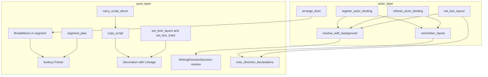
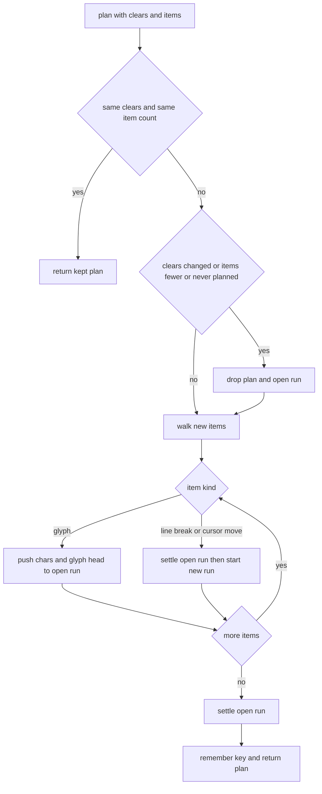
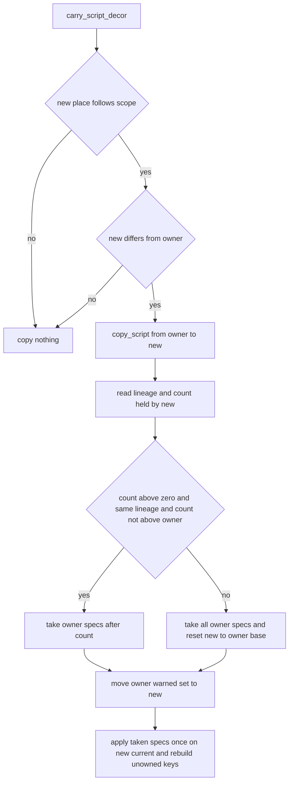

# 設計: emo-text-reveal-incremental（届いた字の区切りと見た目の当て直しを積み増しにし、書字方向の警告を登録口へ移す）

## Overview

**目的**: 文字の層（`crates/areka-emo-text/`）で長い台詞を見せるときの 2 乗の手間 2 件を消し、書字方向の宣言の警告の置き場を直す。件 1 は、先渡しの全文が無い文節の折返しで、字が届くたびに届いた全文を BudouX で区切り直している所（`actor_present.rs` の `BreakMemo`）を、前の区切りを残して後ろだけ区切り直す形にする。件 2 は、文字の行き先が替わるたびにスコープの `\f` の指定を丸ごと写して丸ごと当て直している所（`state_decoration.rs` の `copy_script`・`take_script`・`rebase`）を、新しい行き先がまだ当てていない指定だけを写して当てる形にし、2 層が前と同じ値なら当て直さない。件 3 は、書字方向の解決（`writing.rs` の `WritingDirectionDecision::resolve`）が出していた `warn!` と矛盾併記の `debug!` を、普通のバルーンの装着・再追従と箱の表の受け取りへ移す。

**使う人**: ゴーストの利用者（長い台詞の終わりほど 1 フレームが重くなることが無い）と、ゴーストの作者・開発者（書字方向の宣言の誤りの警告が装着ごとに 1 件だけ出る）。

**変わること**: 区切りの結果・見た目の結果・字の表示の時刻は変わらない（要件 4.1）。変わるのは、区切りにかける字の数と当てる指定の数（どちらも試験の作りの数えでだけ見える）と、書字方向の警告の出る時（解決のたびではなく登録口で 1 回）だけである。

### Goals

- 件 1: 字が届くたびに区切りにかける字の数を「新しく届いた字（`char`）の数＋5」以下にする。数千字のひと続きを 1 字ずつ届けた合計が届いた字の数の定数倍以下であることを、見た数の数えで固定する。
- 件 2: 行き先の替わりの写しで当てる指定の数を、新しい行き先がまだ当てていない指定の数にする。2 層が同じ値の差し込みでは当て直さない。写しと当て直しの合計を数えで固定する。
- 件 3: 解決は記録を出さない。普通のバルーンの装着で 1 件、再追従は宣言の生の値が変わったキーだけ 1 件、箱の表の受け取りで箱の名前ごとに 1 件。
- 新しいソースファイルはテストの 3 本だけ。`crates/areka/` に触らない。公開の形は変えない。

### Non-Goals

- BudouX の区切りの規則そのもの・`budouy` の中身・先渡しの全文の道（`lookahead.rs`）の作り。
- 字が届くたびの配置（`layout_styled`）と全文の道の頭の比べ（`lookahead.rs` の `begins_with`）の手間。今も 1 フレームあたり届いた量に比例する（要件の Boundary Context のとおり、この spec の外）。
- `\f` の解き方（`look.rs` の `apply_font_tag`）・書字方向の決め方・`region.rs` の解決の中に残っている `debug!`。
- 警告の文言と欄の変更（書字方向の警告に `balloon` の欄を足すことも含む）。

## Boundary Commitments

### This Spec Owns

- 届いた字の区切りの覚え `BreakMemo`（`actor_present.rs` から `segment.rs` へ移す）と、その伸ばし方・作り直しの規則。
- `Decoration`（`state_decoration.rs`）の、行き先が替わるときの写しの形（系列の印 `Lineage` と当てた数による差分）と、2 層の差し込みで値が同じなら当て直さない規則。
- 書字方向の宣言の記録の置き場（`writing.rs` の記録の関数と、普通のバルーンの `remember_inputs`・箱の `set_box_layout` の呼び出し）。
- 試験の作りだけの数え 3 つ（区切りにかけた字の数・写しで当てた指定の数・当て直しで当てた指定の数）と、前と後を比べるための試験だけの切り替え 1 つ。
- 上の 3 件の決定論のテスト（新しい 3 ファイルと、移し替える 2 ファイルの中身）。

### Out of Boundary

- `budouy`（外のクレート・そのまま使う・要件 4.6）。
- `lookahead.rs`・`layout*.rs`・`look.rs`（998 行・触らない）・`region.rs`・`state_route.rs`・`state.rs`。
- `crates/areka/` の全部（要件 4.3）。
- 書字方向の警告の文言と欄・`WritingDirectionDecision` の公開の読み口の形。
- `register_actor`（公開の直の登録口）での書字方向の記録（要件 3.7: この口は登録口に含めない）。

### Allowed Dependencies

- 今の依存だけ。`budouy` 0.2.2 の公開の `Parser::parse_boundaries`（字の番号で境目を返す）と `Parser::parse`（今の `segment_plan` が使う）。標準ライブラリ（`std::sync::atomic::AtomicU64`・`std::cell::Cell`・`slice::partition_point`）。テストは `log-capture-kit`・`bevy_ecs::World`（予約スロットの entity のためだけ）。
- 依存の向きは今のまま: `segment.rs`・`state_decoration.rs`・`writing.rs` は純粋層（`windows` 系 crate を import しない・`lib.rs` の構造の檻）。`actor_*` が純粋層を呼ぶ。純粋層は `actor_*` を呼ばない。
- `budouy` を使うのは `segment.rs` だけ（今の決まりを保つ）。

### Revalidation Triggers

- `budouy` の版を上げる（`Cargo.toml` は `version = "0.2.2"` で、互換の版へ上がりうる）→ 件 1 の伸ばしの定数（決め直す所＝前の長さの 2 字前から・左の文脈 3 字）は 0.2.2 の特徴量（字 `i` の前の境目を字 `i−3`〜`i+2` の 6 字で決める）から導いた。特徴量の窓が変わると結果が黙って変わる。`segment_grow_tests.rs` の前と後を比べるテストが見張りで、版を上げたら必ず緑を確かめる。
- `TextItem` に後から書き換わる項目や、消す回数（`clears`）を進めずに項目を消す道が増える → `BreakMemo` の「消した回数が同じなら項目は後ろへ足されるだけ」の前提が崩れる。
- `Decoration` の台本の指定（`applied`）へ、行き先でない場所が書き込む道が増える → 件 2 の「1 つの系列に書き込むのは今の持ち主だけ」の前提が崩れる。
- `apply_font_tag` が `Note::Unowned` をキー以外（値・今の見た目・2 層）で決めるようになる → 件 2 の「所有外のキーの保持は当てた指定の列を当て直せば同じものが出る」の前提が崩れる（`look.rs` は `is_unowned(key)` だけで決めている）。
- 普通のバルーンの登録で `remember_inputs` を通らない道が増える → 件 3 の記録が漏れる。

## Architecture

### Existing Architecture Analysis

- **件 1**: `arrange_lines`（`actor_present.rs` 718 行）は、文節の折返しで先渡しの全文が無いか食い違うとき（`Basis::Arrived`）だけ `BreakMemo::plan(state.clears_at(place), arrived.items())` を呼ぶ。覚えの鍵は（消した回数, 項目の数）で、外れると `segment_plan(items)` で全部を区切る。項目は `apply_cue` が後ろへ足すだけで、消すのは `clear_content`（`\c`・台本の先頭）だけ、そのとき `clears` が必ず進む（`state.rs` 557〜657 行・`state_decoration.rs` 246 行）。箱の場所の `clears` は `set_box_index` で消えるが、同じ `set_box_layout` が箱の `ActorRender`（`BreakMemo` の持ち主）を捨てる（`actor_box.rs` 52〜62 行）。普通のバルーンの `clears` は消さない（`forget_pristine_places` も残す）。
- **件 2**: `\f` の 1 件は `apply_font_args` が今の見た目（`current`）へ積み増し、成功した指定だけを `applied` へ足す。行き先が替わると `carry_script_decor` → `copy_script` が元の場所の `Decoration` を丸ごと複製し、`take_script` が 4 欄（`base`・`applied`・`unowned`・`warned`）を再び複製して `rebase`（土台の層から `applied` を全部当て直す）。2 層の差し込み（`set_look_layers`・`set_box_traits`）は値を比べずに `rebase` する。スコープに従う場所に `\f` が入るのは、その場所が持ち主（`route.shared`）で今の行き先のときだけで、箱に閉じる箱は写しの元にも先にもならない。
- **件 3**: 解決は `ResolvedBalloonText::resolve_with_background`（`actor_decoration.rs` 214 行）の 1 か所から呼ばれる。普通のバルーンは装着（`register_actor_binding` → `finish_registration` → `register_actor`＋`remember_inputs`）と再追従（上の段は解かない・中の段は解いて `remember_inputs` だけ・下の段は解いて `finish_registration`）、箱は `set_box_layout` が名前ごとに 1 度解く。生の値で前と比べる先例は `warn_cursor_fallback`（`remember_inputs` から呼ぶ・前の値は記憶の入力 `ResolveInputs` から取り出す）。

### Architecture Pattern & Boundary Map



**Architecture Integration**:

- 選んだ形: 3 件とも「今ある型の持ち方を変える」だけで、新しい層も新しい公開の型も作らない。件 1 は覚えに開いているひと続き（run）の状態を持たせる（案 1-B）。件 2 は場所ごとの `Decoration` を保ったまま、写しを系列の印と当てた数による差分にする（案 2-A の変形・列を分け合わない）。件 3 は `warn_cursor_fallback` と同じ置き場（`remember_inputs`）と同じ比べ方（生の値）を取る（案 3-A）。
- 境界: 区切りの覚えは `segment.rs`（`budouy` を使う唯一の所）、装飾の写しは `state_decoration.rs`、記録の中身は `writing.rs`、記録の呼び出しは `actor_attach.rs`・`actor_box.rs`。どの直しも互いのファイルを触らない。
- 保つもの: `SegmentPlan` の形と `segment_plan`（先渡しの全文の道が使う・件 1 の正にもなる）、`Decoration` の 2 層と寿命の 2 系統（表は `state_decoration.rs` のモジュールの説明）、`state_route.rs` の呼び方、`WritingDirectionDecision` の公開の読み口。
- steering: 1 ファイル 1,000 行・テストは兄弟ファイル・純粋層の構造の檻・log-first（記録の無い失敗の道を足さない）・時刻は正確に（区切りを次のフレームへ遅らせない）。

### Technology Stack

| 層 | 使うもの / 版 | この spec での役目 | 備考 |
|---|---|---|---|
| 区切り | `budouy` 0.2.2（`default-features = false`・`std`・`vendored-models`） | 件 1 の伸ばしで `Parser::parse_boundaries`（字の番号）を使う | 依存は増えない・`Cargo.lock` 不変 |
| 記録 | `tracing` | 件 3 の `warn!`・`debug!` を登録口から出す | 文言と欄は今のまま |
| テスト | `log-capture-kit`・`bevy_ecs` | 件数と文言の捕捉・予約スロットの entity | 今ある使い方のまま |

## File Structure Plan

### Directory Structure

```
crates/areka-emo-text/src/
├── segment.rs                              # 件 1: BreakMemo（actor_present.rs から移す）・開いている run の状態・伸ばし・区切りにかけた字の数え
├── segment_grow_tests.rs                   # 新: 件 1 の檻（数千字 1 字ずつ・前と後の一致・作り直し）
├── actor_present.rs                        # 件 1: BreakMemo の定義を消し、segment.rs から使う
├── state_decoration.rs                     # 件 2: Lineage・差分の写し・同じ 2 層なら当て直さない・数えと試験の切り替え
├── state_decoration_incremental_tests.rs   # 新: 件 2 の檻（数え・全部当て直す形との一致・寿命と記録）
├── writing.rs                              # 件 3: 解決から記録を外す・DirectionDecl・note_direction_declarations
├── writing_decision_tests.rs               # 件 3: 件数の主張を「解決は記録 0 件」へ替える（結果の主張は保つ）
├── actor_attach.rs                         # 件 3: remember_inputs で記録を書く・前の宣言を渡す
├── actor_box.rs                            # 件 3: set_box_layout の解決の隣で記録を書く
├── actor_writing_warn_tests.rs             # 新: 件 3 の檻（登録口を通す件数と文言）
├── actor.rs                                # 件 3: 新しいテストの接続宣言だけ
└── lib.rs                                  # 3 つの新しいファイルを一覧へ・PURE_SOURCES の母数 88 → 90
```

### Modified Files

- `crates/areka-emo-text/src/segment.rs`（566 → 約 700 行）— `BreakMemo` と `OpenRun`（下の Components）を置く。`segment_plan` は中身を変えず、区切りにかけた字の数えの 1 行（`#[cfg(test)]`）だけを足す。モジュールの説明の「何で区切るか」に、届いた字の列を区切るのは `BreakMemo` で、後ろだけ区切り直すことを書く。`#[cfg(test)] #[path = "segment_grow_tests.rs"] mod grow_tests;` を足す。
- `crates/areka-emo-text/src/actor_present.rs`（896 → 約 875 行）— `BreakMemo` の定義と `impl` を消し、`pub(super) use crate::segment::BreakMemo;` を置く（`actor.rs` の `present::BreakMemo` と `actor_decoration.rs` の `Default::default()` はそのまま通る）。`segment_plan` の import を外す。`arrange_lines` の呼び方（`breaks.plan(state.clears_at(place), arrived.items())`）は変えない。
- `crates/areka-emo-text/src/state_decoration.rs`（649 → 約 740 行）— `Lineage` と `Decoration::lineage`、`copy_script` の差分の写し（`ScriptDelta`）、`set_look_layers`・`set_box_traits` の値の比べ、数え 2 つと試験の切り替え 1 つ（`#[cfg(test)]`）。`#[cfg(test)] #[path = "state_decoration_incremental_tests.rs"] mod incremental_tests;` を足す。
- `crates/areka-emo-text/src/writing.rs`（400 → 約 450 行）— `classify_vertical`・`classify_writing_mode`・`resolve` から記録を外す（分類と結果は今のまま）。`DirectionDecl` と `note_direction_declarations` を足す（`pub(crate)`）。`resolve` と型の説明の「記録は内側で発行する」を「記録は登録口が書く」へ直す。ファイルの中の `mod tests` の 4 本のうち警告を数える 2 本は、結果の主張と「解決は記録 0 件」を残し、件数と文言の主張を `actor_writing_warn_tests.rs` へ移す。
- `crates/areka-emo-text/src/writing_decision_tests.rs`（361 行・ほぼ同じ）— 11 本の結果（`mode`・`source`・2 つの分類・`conflicting`・`.vertical` の導出）の主張は保つ。`warn` と `debug` の件数の主張は「解決は 0 件」（捕捉窓の生存の対照つき）へ替え、件数と文言は `actor_writing_warn_tests.rs` が登録口で同じ値を確かめる。モジュールの説明の 1・3 を直す。
- `crates/areka-emo-text/src/actor_attach.rs`（439 → 約 470 行）— `ResolveInputs::direction_decl`・`TextLayerRuntime::direction_decl_at` を足す。`remember_inputs` に引数 `previous_direction: Option<DirectionDecl>` を足し、`warn_cursor_fallback` の隣で `writing::note_direction_declarations(model, previous_direction.as_ref())` を呼ぶ。`finish_registration` にも同じ引数を足す（装着は `None`、再追従の下の段は呼ぶ前に取り出した値）。再追従の中の段は `direction_decl_at` の値を渡す。`register_actor` の説明に「書字方向の宣言は記録しない（解決済みの値を受け取る試験の口・記録は解決させた側が持つ）」を書く。
- `crates/areka-emo-text/src/actor_box.rs`（536 → 約 538 行）— `set_box_layout` の名前ごとの解決（`resolve_with_background(&def.model, …)`）の直後に `writing::note_direction_declarations(&def.model, None)` を呼ぶ。今ある説明「解決の中の作者向けの警告は、ここで名前ごとに 1 度だけ出る」に書字方向が含まれることを書く。
- `crates/areka-emo-text/src/actor.rs`（917 → 約 920 行）— `#[cfg(test)] #[path = "actor_writing_warn_tests.rs"] mod writing_warn_tests;` だけ。
- `crates/areka-emo-text/src/lib.rs` — `PURE_SOURCES` に `segment_grow_tests.rs`・`state_decoration_incremental_tests.rs` を足し、母数の行を 88 → 90 にする。`SOURCES_OUTSIDE_THE_PURE_SCAN` に `actor_writing_warn_tests.rs` を足す（先例の `actor_region_warn_tests.rs` と同じ側）。

触らないファイル: `look.rs`・`lookahead.rs`・`layout*.rs`・`region.rs`・`state.rs`・`state_route.rs`・`actor_decoration.rs`・`actor_frame_memo_tests.rs`（期待値をそのまま保つ）・`crates/areka/` の全部。

## System Flows

### 件 1: 届いた字の区切りを伸ばす



**ひと続きを決める（settle）の規則**（前に決めたときの run の字の数を `L`、今の字の数を `L'` とする。`L' = L` なら何もしない）:

1. 決め直す境目の頭 `p = max(1, L − 2)`、左の文脈の頭 `s = p − 3`（0 未満なら 0）。
2. 覚えた境目のうち `p` 以上を捨て、`chars[s..L']` を 1 本の文字列にして `parse_boundaries` にかけ、答えの番号に `s` を足したもののうち `p` 以上を足す。区切りにかけた字の数は `L' − s`（`≤ (L' − L) + 5`）。
3. 決め直す最初のグリフ `J` を決める。`L = 0`（新しく始まった run・まだ塊が無い）なら `J = 0`。`L ≥ 1` なら、頭の字が `p` 以上の最初のグリフを `J` とする（`partition_point`）。`J ≥ 1` のときだけ、計画の塊のうち頭が `run の頭 + J` 以上のものを捨て、残った最後の塊（グリフ `J−1` を含む・この run のもの）の長さを `J` の手前までに詰める（`L = 0` では捨てる塊も詰める塊も無い）。
4. グリフ `J` から後ろを順に、`j = 0` か境目が（グリフ `j−1` の頭の字, グリフ `j` の頭の字］に 1 つでもあれば新しい塊、無ければ前の塊へ足す。
5. run の字が 1 つも無ければ塊を作らない（`segment_plan` の「空 run は塊を生まない」と同じ）。

**なぜ結果が全部を区切ったときと同じか**（`budouy` 0.2.2 の `parse_boundaries_from_chars` を読んで確かめた）: 字 `i` の前に境目を置くかは、13 の特徴が読む `chars[i−3..i+3)` と、端での切り詰めだけで決まる。後ろへ字を足して答えが変わりうるのは `i + 3 > L` の位置、つまり `i ≥ L − 2` だけである。`s = p − 3` から渡せば `i ≥ p` の位置の左の文脈は全文のときと同じになり（`s = 0` なら左端も同じ）、右端は全文と同じ所で終わる。グリフから塊への写しは、今の `assign_items_to_chunks`（グリフの頭のバイトが属する塊で決める）と同じ規則を字の番号で言い直したもので、グリフ `j` の扱いが変わりうるのは頭の字が `p` 以上のグリフだけである（前の run の終わりの高々 2 グリフと新しいグリフ）。改行と `\_l` で区切った run は独立に区切るので、閉じた run の区切りは後から変わらない。

**作り直し（要件 1.3）**: 消した回数が変わった（`\c`・台本の先頭）・項目が前より少ない・まだ区切っていない、のどれかなら、覚えを空にしてから同じ道で全部を伸ばす（空の覚えから伸ばすのは、run ごとに `p = 1`・`s = 0` で全部を区切ることで、`segment_plan` と同じ）。箱の表の替え・再追従の作り直し・拡大率や描画の装置の作り直しでは `ActorRender` ごと `BreakMemo` が捨てられるので、次の 1 回は空の覚えから全部を区切る。

### 件 2: 行き先が替わるときの写し



**決め**:

- **系列の印 `Lineage`**: 一括の戻し（`reset_look_to`＝`\f[default]`・`\f[disable]`・台本の先頭・`reset_decoration`）のたびと、場所が生まれるとき（`Decoration::default`・`with_layers`）に、場所をまたいで一意の新しい番号を振る。生まれたての場所どうしが同じ番号を持つことは無い（台詞の途中で生まれた場所が `\f` を受けても、別の場所の系列の頭とみなされない。「箱の種類 `font.follow` は箱の場所を捨てる `set_box_index` と組でしか替わらない」という前提に頼らない）。写しは元の印を先へ写す。だから「同じ印で、先の数が元の数以下」なら、先の `applied` は元の `applied` の頭そのものである（1 つの系列へ書き込むのは、その系列を今持つ持ち主＝今の行き先だけだから。持ち主でないスコープに従う場所は、写しで持ち主になるまで `\f` を受けない。箱に閉じる箱は写しの元にも先にもならない）。この前提は `debug_assert`（先の最後の指定と元の同じ位置の指定が同じ）で試験の作りで確かめる（`segment.rs` の指摘 33 と同じ流儀）。
- **差分の道**: 元の `applied[先の数..]` だけを複製し、先の今の見た目へ `apply_font_tag` で 1 度ずつ当て、先の `applied` へ足す。
- **全部の道**（先の数が 0・印が違う・先が元より長い）: 先の土台を元の土台にし、`applied` と `unowned` を空にし、今の見た目を土台の層の見た目にしてから、元の `applied` を全部 1 度ずつ当てる。このとき先は元の系列の指定を 1 件も当てていない（印が違えば、先の指定は別の系列のものだから）ので、要件 2.1 の「まだ当てていない指定だけ」に当たる。
- **所有外のキー（`unowned`）は写さない**: 当てるときの答えが `Note::Unowned` なら、その場でキーと値の列を `unowned` へ入れる。`unowned` は今も「成功して `applied` に入った指定のうち所有外のものを順に入れた結果」に等しく（入れるのは `apply_font_args` の `Ok(Some(Note::Unowned))` の腕だけ・空にするのは `applied` と同じ一括の戻しだけ）、`Note::Unowned` はキーだけで決まる（`look.rs` の `is_unowned(key)`）ので、当て直せば元と同じものが出る。
- **記録済みの印（`warned`）は動かす（複製しない）**: 元から `std::mem::take` で取り出して先へ入れる。`warned` を読むのは今の行き先（`warn_once`・`warn_script_once`）だけで、スコープに従う今の行き先はいつも持ち主なので、持ち主でなくなった場所の `warned` は二度と読まれない（読まれる前に、持ち主から写しを受けて置き換わる）。記録の件数（キーと値ごとに 1 台詞 1 度）は今と同じになる。
- **元の場所が無い**ときは今と同じく空の指定を写す（先が無ければ作らない・先が在れば全部の道で空にする）。元の指定が空で先が無いときも今と同じく作らない。
- **シェルの切替で捨てられた箱の場所**（`set_box_index`）は、次に生まれたときは別の場所である（印 0・指定 0）。次に行き先になったとき、その時点の持ち主の指定を全部の道で 1 度ずつ当てる。要件 2.7 の「行き先になった場所の数」はこの生まれ直しを 1 つと数える。

### 件 2: 2 層の差し込み

`set_look_layers`（装着・再追従の `register_actor` から）と `set_box_traits`（箱の表の受け取りから）は、場所の今の 2 層と新しい 2 層を比べ（`LookLayers` は `PartialEq`）、同じなら何もしない（要件 2.2）。違えば今と同じく 2 層を差し替えて `rebase` する（要件 2.3）。`rebase` を呼ぶのはこの 2 か所だけになる（要件 2.4）。

### 件 3: 書字方向の宣言の記録

```mermaid
sequenceDiagram
    participant Wire as caller
    participant Rt as TextLayerRuntime
    participant Res as resolve_with_background
    participant Note as note_direction_declarations
    Wire->>Rt: register_actor_binding
    Rt->>Res: resolve silently
    Rt->>Rt: register_actor
    Rt->>Note: remember_inputs with previous none
    Wire->>Rt: refresh_actor_binding
    Rt->>Rt: top stage returns without resolve
    Rt->>Res: middle or lower stage resolves silently
    Rt->>Note: remember_inputs with previous raw values
    Wire->>Rt: set_box_layout
    Rt->>Res: resolve once per box name
    Rt->>Note: previous none
```

**決め**:

- 前の宣言は記憶の入力（`ResolveInputs` の `model`）から取り出す。再追従の下の段は `register_actor` が記憶を消すので、`finish_registration` を呼ぶ**前に**取り出す（`warn_cursor_fallback` の前の値と同じ順）。
- 比べはキーごとの生の値。`vertical` の生の値が前と違い、今の値が不正なら `vertical` の警告を 1 件。`writing_mode` も同じ。片方のキーだけが変わった再追従で、変わらなかったキーの警告はもう 1 度出さない。
- 矛盾併記の `debug!` は、両キーが有効で方向が違い、前が無いか、どちらかの生の値が前と違うときに 1 件。
- 記憶が無い場所の再追従（直の `register_actor` の後）は前が無いので 1 件出る（`warn_cursor_fallback` と同じ・本番の結線は直の口を使わない）。

## Requirements Traceability

| 要件 | 要約 | 持ち場 | 口 | 流れ |
|---|---|---|---|---|
| 1.1 | 区切りにかけ直す字は新しい字＋定数 | `BreakMemo`・`OpenRun` | `BreakMemo::plan` | 件 1（settle の規則 1・2） |
| 1.2 | そのフレームで全部を区切ったのと同じ区切りを使う | `BreakMemo` | `arrange_lines` から同じフレームで呼ぶ（呼び方は不変） | 件 1（なぜ同じか） |
| 1.3 | 消えた・覚えが捨てられたら作り直す | `BreakMemo` | `plan` の作り直しの判定・`ActorRender` ごとの破棄 | 件 1（作り直し） |
| 1.4 | 1 字ずつと全文の道は今のまま | `arrange_lines`（触らない腕） | — | — |
| 1.5 | 字の数えと数千字の檻 | `SEGMENTED_CHARS`・`segment_grow_tests.rs` | `BreakMemo::plan` を直に呼ぶ | Testing Strategy |
| 1.6 | 各時点の区切りが全部を区切った結果と一致 | `segment_grow_tests.rs` | `segment_plan` を正にする | Testing Strategy |
| 2.1 | 写しの手間を総数に比例させない・各指定は 1 場所 1 度 | `Decoration`・`Lineage`・`ScriptDelta` | `copy_script` | 件 2（写し） |
| 2.2 | 同じ値の 2 層では当て直さない | `set_look_layers`・`set_box_traits` | 値の比べ | 件 2（2 層） |
| 2.3 | 違う値なら 1 度ずつ当て直す | `Decoration::rebase` | — | 件 2（2 層） |
| 2.4 | 当て直しは 2 層の変わり目だけ | `rebase` の呼び手 2 か所 | — | 件 2（2 層） |
| 2.5 | 今の見た目＝土台から全部当て直した結果 | `Decoration` の不変条件 | — | 件 2（写し・全部の道） |
| 2.6 | 戻し・`\c`・`\n`・`\_l`・記録は今のまま | `reset_look_to`（印を振るだけ足す）・`warned` を動かす | — | 件 2（写し） |
| 2.7 | 写しと当て直しの数えと檻 | `COPIED_SPECS`・`REBASED_SPECS`・`state_decoration_incremental_tests.rs` | — | Testing Strategy |
| 2.8 | 混ぜた台本で全部当て直す形と一致 | `REPLAY_ALL`・`state_decoration_incremental_tests.rs` | — | Testing Strategy |
| 3.1 | 解決は記録を出さず結果は今のまま | `writing.rs` の `classify_*`・`resolve` | `WritingDirectionDecision::resolve` | 件 3 |
| 3.2 | 装着で 1 件・前に依らない | `remember_inputs`・`note_direction_declarations` | `previous_direction = None` | 件 3 |
| 3.3 | 再追従は生の値が違うときだけ・中の段も通る | `remember_inputs`・`direction_decl_at` | 前の宣言を渡す | 件 3 |
| 3.4 | 箱の表で名前ごとに 1 件 | `set_box_layout` | `note_direction_declarations(&def.model, None)` | 件 3 |
| 3.5 | 矛盾併記の `debug!` も同じ時に 1 件 | `note_direction_declarations` | — | 件 3 |
| 3.6 | 試験を登録口の側へ移す・解決は 0 件・繰り返さない | `actor_writing_warn_tests.rs`・`writing_decision_tests.rs`・`writing.rs` の tests | — | Testing Strategy |
| 3.7 | 本番の登録口で記録の無い道を作らない・直の口は含めない | `remember_inputs`（装着・中の段・下の段の全部が通る）・`set_box_layout`・`register_actor` の説明 | — | 件 3 |
| 4.1 | 結果と時刻を変えない | 全部 | — | 件 1・件 2 の「なぜ同じか」 |
| 4.2 | 既にあるテストを期待値を変えずに緑 | 全部（`actor_frame_memo_tests.rs` の `runs` の 3 本を含む） | — | Testing Strategy |
| 4.3 | `crates/areka/` に触らず公開の形は足すだけ | File Structure Plan | 新しい口は `pub(crate)` だけ | — |
| 4.4 | 新しいファイルを一覧へ | `lib.rs` | — | — |
| 4.5 | 1,000 行を超えない・`look.rs` を触らない | File Structure Plan の行数の見込み | — | — |
| 4.6 | `budouy` をそのまま使う | `BreakMemo` | `Parser::parse_boundaries`（公開） | — |
| 4.7 | 記録の無い失敗の道を足さない | 3 件とも新しい失敗の腕を作らない | — | Error Handling |
| 4.8 | 数えは試験の作りでだけ | `#[cfg(test)]` の数え 3 つと切り替え 1 つ | — | — |

## Components and Interfaces

| 持ち場 | 層 | 役目 | 要件 | 主な依存 | 契約 |
|---|---|---|---|---|---|
| `BreakMemo`（`segment.rs`） | 純粋層 | 届いた字の区切りを後ろだけ伸ばして覚える | 1.1〜1.5, 4.6 | `budouy`（P0）・`TextItem`（P0） | Service・State |
| `SEGMENTED_CHARS`（`segment.rs`・試験だけ） | 純粋層 | 区切りにかけた字の数 | 1.5, 4.8 | — | State |
| `Decoration` の写し（`state_decoration.rs`） | 純粋層 | 行き先の替わりで差分だけを写して当てる・同じ 2 層なら当て直さない | 2.1〜2.6 | `apply_font_tag`（P0） | Service・State |
| 数えと切り替え（`state_decoration.rs`・試験だけ） | 純粋層 | 写しと当て直しの数・全部当て直す形への切り替え | 2.7, 2.8, 4.8 | — | State |
| `note_direction_declarations`（`writing.rs`） | 純粋層 | 書字方向の宣言の誤りと矛盾併記の記録 | 3.1〜3.5 | `BalloonModel`（P0）・`tracing`（P0） | Service |
| 記録の呼び出し（`actor_attach.rs`・`actor_box.rs`） | actor 層 | 登録口から記録の関数を呼ぶ・前の宣言を渡す | 3.2〜3.4, 3.7 | `ResolveInputs`（P0） | Service |

### 純粋層

#### BreakMemo（`segment.rs`）

| 項目 | 内容 |
|---|---|
| Intent | 届いた字の列の区切りを、前の区切りを残して後ろだけ区切り直して返す |
| Requirements | 1.1, 1.2, 1.3, 1.4, 1.5, 4.6 |

**Responsibilities & Constraints**

- 返す計画は、いつも `segment_plan(items)` と同じ（要件 1.2・4.1）。
- 1 回の `plan` で区切りにかける字の数は「前の呼び出しから増えた字（`char`）の数＋5」以下（開いていた run の分。新しく始まった run は自分の字だけ）。
- 前提: 消した回数が同じ間、`items` は後ろへ足されるだけ（今の `BreakMemo` の鍵と同じ前提）。消した回数が変わるか、項目が前より少なければ作り直す。
- `budouy` を使うのはこのファイルだけ（モジュールの決まり）。

**Dependencies**

- Inbound: `arrange_lines`（`actor_present.rs`）— `Basis::Arrived` の腕で毎フレーム呼ぶ（P0）
- Outbound: `TextItem`（`state.rs`）— 読むだけ（P0）
- External: `budouy::Parser::parse_boundaries`（0.2.2・公開）— 字の番号の境目（P0）

**Contracts**: Service [x] / State [x]

##### Service Interface

```rust
/// 届いた字の区切りの覚え（audit-emo-text-state-actor 指摘 8 を伸ばしの形へ）。
#[derive(Default)]
pub(crate) struct BreakMemo {
    /// 覚えた区切りの（消した回数, 項目の数）。まだ区切っていなければ `None`。
    key: Option<(u64, usize)>,
    /// 全部の run の塊（閉じた run と開いている run）。
    plan: SegmentPlan,
    /// 開いている run（最後の改行か `\_l` の後ろ）。
    open: OpenRun,
    /// 区切りを計算した回数（伸ばしも 1 回・試験だけの数・今の意味のまま）。
    #[cfg(test)]
    pub(crate) runs: u32,
}

impl BreakMemo {
    /// 鍵が前と同じなら覚えた区切り、項目が増えたなら後ろだけ伸ばした区切り、
    /// 消した回数が変わったか項目が減ったなら作り直した区切りを返す。
    pub(crate) fn plan(&mut self, clears: u64, items: &[TextItem]) -> &SegmentPlan;
}
```

- Preconditions: 同じ `BreakMemo` には同じ場所の `items` を渡す（`ActorRender` ごとに 1 つ・今と同じ）。
- Postconditions: 戻り値は `segment_plan(items)` と等しい。`runs` は鍵が変わった呼び出しでだけ 1 増える（今の 3 本の期待値 1・2・作り直しで増える、を保つ）。
- Invariants: `open.boundaries` は昇順・`open.glyph_heads` は昇順・`plan.segments` は今の不変条件（昇順・互いに素・全グリフを被覆・各塊は単一 run 内）。

##### State Management

```rust
/// 開いている run の状態（`BreakMemo` の中だけ）。
#[derive(Default)]
struct OpenRun {
    /// run の頭のグリフ通し番号（全 items の Glyph だけを数えた番号）。
    start: usize,
    /// run の字（`budouy` に渡す単位＝`char`）。
    chars: Vec<char>,
    /// run の各グリフの頭の字の位置（`chars` の添字・昇順）。
    glyph_heads: Vec<usize>,
    /// run の境目（字の位置・昇順・`budouy` の答え）。
    boundaries: Vec<usize>,
    /// 前に決めたときの `chars` の長さ（決め直す所の頭の目安）。
    settled: usize,
}
```

- 持つ量は開いている run の長さに比例する（項目と計画もすでに台詞の長さに比例して持っている）。`BreakMemo` は複製しない（`Clone` を持たない・今と同じ）。

**Implementation Notes**

- Integration: `actor_present.rs` は `pub(super) use crate::segment::BreakMemo;` で今の名前のまま使う。`actor_frame_memo_tests.rs` の `.break_memo.runs` と `Default::default()` はそのまま通る。
- Validation: 前と後の一致は `segment_grow_tests.rs` が `segment_plan` を正にして確かめる。`budouy` の版を上げたらこのテストを必ず回す。
- Risks: 窓の定数（2 と 3）は `budouy` 0.2.2 の特徴量に依る（Revalidation Triggers）。

#### SEGMENTED_CHARS（`segment.rs`・試験だけ）

```rust
#[cfg(test)]
thread_local! {
    /// 区切りにかけた字の数（`budouy` に渡した `char` の数・伸ばしと `segment_plan` の両方で足す）。
    pub(crate) static SEGMENTED_CHARS: std::cell::Cell<usize> = const { std::cell::Cell::new(0) };
}
```

- `BreakMemo` の `parse_boundaries` の呼び出しと、`segment_plan` の `flush_run` の `parser.parse` の呼び出しの両方で足す。`BreakMemo::plan` が届くたびに `segment_plan(items)` を呼ぶ形へ戻すと、数千字の檻の合計が 2 乗になって赤になる（要件 1.5）。

#### Decoration の写し（`state_decoration.rs`）

| 項目 | 内容 |
|---|---|
| Intent | 行き先が替わるとき、新しい行き先がまだ当てていない指定だけを写して 1 度ずつ当てる。同じ値の 2 層では当て直さない |
| Requirements | 2.1, 2.2, 2.3, 2.4, 2.5, 2.6 |

**Responsibilities & Constraints**

- 今の見た目は、どの出来事の後でも「土台の層から一括の戻しの後の指定を全部順に当て直した結果」に等しい（要件 2.5）。
- 1 回の写しの手間は、写す指定の数（新しい行き先がその系列でまだ当てていない数）に比例し、それまでに当てた総数には比例しない。`warned` は動かすだけ、`unowned` は写さず当てるときに作る（要件 2.1）。
- 寿命の 2 系統（`\c`・`\n`・`\_l` で保つ・台本の先頭と `\f[default]`・`\f[disable]` で戻す）と記録（キーと値ごとに 1 台詞 1 度）は今のまま（要件 2.6）。
- `state_route.rs` の呼び方（`carry_script_decor`・`copy_script` の名前と引数）は変えない。

**Dependencies**

- Inbound: `carry_script_decor`（`set_dest`・`fold_shared_into_balloon` から）（P0）、`set_look_layers`（`register_actor`）・`set_box_traits`（`set_box_layout`）（P0）
- Outbound: `crate::look::apply_font_tag`・`LookLayers`・`Note`（呼ぶだけ）（P0）

**Contracts**: Service [x] / State [x]

##### Service Interface

```rust
/// 台本の指定の系列の印（一括の戻しのたびと場所が生まれるときに、場所をまたいで一意の番号を振る）。
/// 比べ（`PartialEq`）には入らない——同じ見た目と同じ指定の列を持つ装飾状態は同じとみなす
/// （`forget_pristine_places` の「作りたてと同じか」を変えないため）。`PartialEq` は手書きで、いつも真を返す。
/// 写しの判定は中の番号を直に比べる（`same_as`）。
#[derive(Clone, Copy, Debug, Default)]
struct Lineage(u64);

/// 写しの材料（持ち主から差分だけを取り出したもの）。
struct ScriptDelta {
    lineage: Lineage,
    base: BaseLayer,
    /// 真なら先を元の土台から作り直してから `specs` を当てる（全部の道）。
    from_start: bool,
    /// 先がまだ当てていない指定（元の `applied` の後ろの部分の複製）。
    specs: Vec<Vec<String>>,
    /// 元から動かした記録済みの印。
    warned: BTreeSet<(u8, String, Vec<String>)>,
}

impl Decoration {
    /// 先が持つ（系列の印, 当てた数）。
    fn held(&self) -> (Lineage, usize);
    /// 元（持ち主）から、`held`（先が持つ印と数・先が無ければ `None`）に足りない差分を取り出し、`warned` を動かす。
    fn delta_for(&mut self, held: Option<(Lineage, usize)>) -> ScriptDelta;
    /// 先へ差分を受け取る（全部の道なら土台から作り直す）。`specs` を 1 度ずつ当て、所有外のキーを入れる。記録は出さない。
    fn take_script(&mut self, delta: ScriptDelta);
}

impl TextLayerState {
    /// 今の名前と引数のまま。中身を「先の印と数を読む → 元から差分を取り出す → 先が受け取る」にする。
    pub(super) fn copy_script(&mut self, actor: &ActorKey, from: &TextPlace, to: &TextPlace);
    /// 2 層が今と同じなら何もしない。違えば差し替えて当て直す（今のまま）。
    pub fn set_look_layers(&mut self, actor: &ActorKey, layers: LookLayers);
    /// 箱の場所ごとに同じ比べをする。
    pub fn set_box_traits(&mut self, traits: BTreeMap<BoxName, BoxTraits>);
}
```

- Preconditions: `copy_script` の `from` は持ち主（`route.shared`）。
- Postconditions: 先の `applied` は元の `applied` に等しく、先の `unowned` は元の `unowned` に等しく、先の `warned` は元が持っていた集合、元の `warned` は空。先の今の見た目は、先の 2 層の上で元の土台から元の `applied` を全部当てた結果に等しい。
- Invariants: 1 つの系列（印が 0 でないもの）の指定を足すのは、その系列を持つ今の行き先だけ。同じ印を持つ 2 つの場所の `applied` は、短い方が長い方の頭。

##### State Management

- `Decoration` に `lineage: Lineage` を足す（ほかの欄は今のまま）。`reset_look_to` と `Decoration::default`・`with_layers`（どちらも今ある手書きの作り口）が `lineage` を新しい番号にする。番号は `static NEXT_LINEAGE: AtomicU64`（1 から）で振る。`TextLayerState` を写す空回し（`rehearsal_copy`）の中で振っても、本番と番号が重ならない（番号は比べにも結果にも出ない）。
- `take_script` の今の形（4 欄を写して `rebase`）は消える。`rebase` を呼ぶのは `set_look_layers` と `set_box_traits` の、値が違うときだけ。

##### 試験の作りだけの数えと切り替え

```rust
#[cfg(test)]
thread_local! {
    /// 写しで当てた指定の数（`take_script` が当てた `specs` の数の合計）。
    pub(super) static COPIED_SPECS: std::cell::Cell<usize> = const { std::cell::Cell::new(0) };
    /// 当て直しで当てた指定の数（`rebase` が当てた `applied` の数の合計）。
    pub(super) static REBASED_SPECS: std::cell::Cell<usize> = const { std::cell::Cell::new(0) };
    /// 真なら、この spec の前の作りそのもの（写しは元の 4 欄 `base`・`applied`・`unowned`・`warned` を複製して `rebase`、
    /// 2 層の差し込みは値に依らず `rebase`）で動く（前と後の比べの正）。
    pub(super) static REPLAY_ALL: std::cell::Cell<bool> = const { std::cell::Cell::new(false) };
}
```

- `REPLAY_ALL` が真のときは、新しい作りの全部の道ではなく、前の作りのコード（4 欄の複製と `rebase`）をそのまま通る。だから、直した 2 つの意味（所有外のキーを当てながら作ること・`warned` を複製でなく動かすこと）も、前の作りと比べて確かめられる。本番の作り（`cfg(test)` でない）には現れない（要件 4.8）。

**Implementation Notes**

- Integration: `state_route.rs`・`state.rs`・`look.rs` は触らない。`state_decoration_carry_tests.rs:400` の `has_script()` は持ち主でない場所の `warned` が空になっても、そのテストの見ている台本の先頭の後の状態では変わらない。
- Validation: `state_decoration_incremental_tests.rs` の前と後の比べ（`REPLAY_ALL`）と数えの檻。既にある `state_decoration_*_tests.rs` と `state_route_tests.rs` は期待値を変えずに緑。
- Risks: 「1 つの系列への書き手は 1 つ」の前提が将来の変更で崩れると、見た目が黙って変わる（Revalidation Triggers）。`debug_assert` と前と後の比べが見張る。

#### note_direction_declarations（`writing.rs`）

| 項目 | 内容 |
|---|---|
| Intent | 書字方向の宣言の誤り（`vertical` の不正値・`writing_mode` の未知値）と矛盾併記を、登録口が決めた時に記録する |
| Requirements | 3.1, 3.2, 3.3, 3.4, 3.5 |

**Contracts**: Service [x]

##### Service Interface

```rust
/// 書字方向の宣言の生の値（前の装着・再追従と比べるため）。
#[derive(Clone, Debug, PartialEq, Eq)]
pub(crate) struct DirectionDecl {
    vertical: Option<String>,
    writing_mode: Option<String>,
}

impl DirectionDecl {
    pub(crate) fn of(model: &BalloonModel) -> DirectionDecl;
}

/// 宣言の誤りと矛盾併記を記録する（解決は記録しない・要件 3.1）。
///
/// `previous` は前の装着・再追従の宣言（装着と箱の表の受け取りは `None`＝必ず 1 回目）。
/// キーごとに「前が無いか、生の値が前と違う」ときだけ、そのキーの警告を書く。
/// 矛盾併記の `debug!` は、両キーが有効で方向が違い、前が無いかどちらかの生の値が違うときに書く。
pub(crate) fn note_direction_declarations(model: &BalloonModel, previous: Option<&DirectionDecl>);
```

- 文言と欄は今の `classify_vertical`・`classify_writing_mode`・`resolve` の併記の腕のものを 1 文字も変えずに移す（`warn!` は `value`、`debug!` は `vertical`・`writing_mode`）。
- 分類は今の `classify_vertical`・`classify_writing_mode`（記録を外したもの）と `WritingDirectionDecision::resolve` の `conflicting()` を使い、判定を写さない。
- `WritingDirectionDecision::resolve`・`WritingMode::resolve` は公開のまま、記録を出さなくなる。説明の「副作用はログのみ」「文字列を要する記録は内側で発行する」を「記録は出さない・記録は登録口が `note_direction_declarations` で書く」へ直す。

### actor 層

#### 記録の呼び出し（`actor_attach.rs`・`actor_box.rs`）

| 項目 | 内容 |
|---|---|
| Intent | 普通のバルーンは装着・再追従が合流する `remember_inputs`、箱は `set_box_layout` から記録の関数を呼ぶ |
| Requirements | 3.2, 3.3, 3.4, 3.7 |

```rust
impl ResolveInputs {
    /// 覚えた入力の書字方向の宣言（前の値）。
    fn direction_decl(&self) -> DirectionDecl;
}

impl TextLayerRuntime {
    /// 場所の記憶の入力から取り出した書字方向の宣言（記憶が無ければ `None`）。
    fn direction_decl_at(&self, place: &PlaceKey) -> Option<DirectionDecl>;
    /// 引数 `previous_direction` を足す（装着は `None`・再追従の下の段は呼ぶ前に取り出した値）。
    fn finish_registration(&mut self, actor: &ActorKey, binding: TextSlotBinding, model: &BalloonModel,
        background: (u8, u8, u8), resolved: ResolvedBalloonText, previous_direction: Option<DirectionDecl>);
    /// 引数 `previous_direction` を足し、`warn_cursor_fallback` の隣で記録の関数を呼ぶ。
    fn remember_inputs(&mut self, actor: &ActorKey, place: PlaceKey, model: &BalloonModel, image_size: (u32, u32),
        background: (u8, u8, u8), previous: Option<CursorFallback>, previous_direction: Option<DirectionDecl>);
}
```

| 道 | 解くか | 記録の関数へ渡す前の宣言 | 件数 |
|---|---|---|---|
| 装着 `register_actor_binding`（切り替えを含む） | 解く | `None` | 不正なキーごとに 1 件 |
| 再追従の上の段 | 解かない | 呼ばない | 0 件（入力が同じなので生の値も同じ） |
| 再追従の中の段 | 解く | 記憶の入力の宣言 | 生の値が変わった不正なキーだけ 1 件 |
| 再追従の下の段 | 解く | `finish_registration` の前に取り出した記憶の入力の宣言 | 同上 |
| 箱の表の受け取り `set_box_layout` | 名前ごとに 1 度解く | `None` | 名前ごとに不正なキーごとに 1 件 |
| 直の登録口 `register_actor`（公開） | 解かない（解決済みの値を受け取る） | 呼ばない | 0 件（説明に書く・要件 3.7） |

- `remember_inputs` は装着・中の段・下の段のどれでも通る（`warn_cursor_fallback` と同じ）ので、`vertical` が `0` から `2` に変わっても書字方向は横書きのまま（中の段）という再追従でも記録が漏れない（要件 3.7）。

## Error Handling

### Error Strategy

- 3 件とも新しい失敗の腕を作らない（要件 4.7）。`budouy` の `parse_boundaries` は失敗しない。`apply_font_tag` を当て直すときの答えは今の `rebase` と同じく捨てる（記録すべきものは 1 回目に記録済み）。
- 前提の破れ（件 1 の「項目は後ろへ足されるだけ」・件 2 の「1 つの系列への書き手は 1 つ」）は構造で起きない。件 1 は消した回数と項目の数で作り直しへ落ちる。件 2 は `debug_assert` で試験の作りでだけ確かめる（`segment.rs` の指摘 33 と同じ流儀・本番で記録を出さない）。

### Monitoring

- 書字方向の警告の文言と欄は今のまま（実機の記録を grep する手順はそのまま使える）。出る時だけが「解決のたび」から「装着 1 回・値の変わる再追従 1 回・箱の表の受け取りで名前ごとに 1 回」へ変わる。

## Testing Strategy

### 単体テスト（純粋層）

- `segment_grow_tests.rs`（新・`PURE_SOURCES`）
  1. **数千字の檻（要件 1.5）**: 改行の無い 1 つの run で 4,000 グリフの日本語の台本を 1 グリフずつ届け、届くたびに `BreakMemo::plan` を 1 回呼ぶ。`SEGMENTED_CHARS` の合計が `6 × 4,000` 以下（この台本は 1 グリフ 1 字で作る。「か゚」のような 2 字のグリフでは 1 グリフあたり 7 字まで増えるので、結合文字は下の 2 の一致のテストで扱う）。届くたびに `segment_plan(items)` を呼ぶ形なら約 800 万になり赤になる。数グリフずつ届ける版も置く。
  2. **前と後の一致（要件 1.2・1.6）**: 漢字・かな・カタカナ・英数・約物・結合文字（「か゚」）を混ぜ、改行（`\n`）と `\_l`（`TextItem::CursorMove`）を挟んだ台本を、1 グリフずつ・不揃いな数ずつ（決まった列）届け、各時点の `plan` が `segment_plan(&items[..k])` と等しい。run の終わりの 1〜2 字の所で届く場面（`L = 1, 2, 3, 4`）を必ず含める。
  3. **作り直し（要件 1.3）**: `\c` を模して消した回数を進め項目を空から書き直すと、各時点で `segment_plan` と等しく、`runs` が増える。消した回数が同じで項目が少ない列を渡しても `segment_plan` と等しい。
- `state_decoration_incremental_tests.rs`（新・`PURE_SOURCES`）
  1. **写しと当て直しの檻（要件 2.7）**: 普通のバルーンと、スコープに従う箱 2 つ（`state_decoration_carry_tests.rs` と同じ `parse_boxes` → `fold_boxes` の構成）の間を、`\b[名前]` と `\s` で 200 回行き来しながら `\f` を 300 件当てる台本。`COPIED_SPECS + REBASED_SPECS` が `300 × 3`（行き先になった場所の数）に 2 層の差し替えの当て直しの数を足した数の 2 倍以下。写しのたびに全部当て直す形（`REPLAY_ALL`）では約 3 万になり赤になる。
  2. **全部当て直す形との一致（要件 2.5・2.8）**: 行き先の替わり・`\f[default]`・`\f[disable]`・台本の先頭・`reset_decoration(None)`・2 層の差し替え（違う値と同じ値）・箱に閉じる箱・所有外のキー・相対値（`\f[height,+4]`）・`\f[キー,default]` を混ぜた台本を、同じ手順で `REPLAY_ALL` が偽と真の 2 つの状態に流し、各時点で全部の場所の今の見た目・装飾番号列・装飾の表・所有外のキーの保持・記録の件数が等しい。あわせて各時点の全部の場所で、テストの側が一から計算した値と比べる: 「今の見た目＝その場所の 2 層の上で土台から `applied` を `apply_font_tag` で順に当てた結果」「`unowned`＝`applied` のうち `Note::Unowned` を返す指定を順に入れた結果」（要件 2.5 の不変条件を、どちらの作りにも依らずに確かめる）。
  3. **同じ値の 2 層では当て直さない（要件 2.2・2.4）**: 同じ値で `set_look_layers`・`set_box_traits` を繰り返しても `REBASED_SPECS` が増えない。違う値では `applied` の数だけ増える（要件 2.3）。字の届き・`\f` の 1 件・行き先の替わりでは増えない。
  4. **記録が今のまま（要件 2.6）**: 不正な `\f` を当てた後に行き先を何度替えても、同じ指定の警告は 1 台詞 1 度（`warned` が持ち主と一緒に動く）。持ち主でなくなった場所がもう一度行き先になってから同じ不正な指定を当てても 1 度のまま。台本の先頭の後はもう 1 度出る。
  5. **台詞の途中で生まれた場所（要件 2.5）**: 台詞の途中で生まれた箱の場所が `\f` を受けてから行き先が替わっても、別の場所の系列の頭とみなされず、一から計算した値と等しい（印が場所の生まれで振られることの檻）。
- `writing_decision_tests.rs`（直す）: 11 本の結果の主張を保ち、`warn` と `debug` の件数は「解決は 0 件」（捕捉窓の生存の対照つき・要件 3.1・3.6）。
- `writing.rs` の tests（直す）: 未知値と近い綴りの 2 本は結果と「解決は 0 件」を確かめ、文言の主張は `actor_writing_warn_tests.rs` へ移す。

### 結合テスト（登録口）

- `actor_writing_warn_tests.rs`（新・`SOURCES_OUTSIDE_THE_PURE_SCAN`・`actor_region_warn_tests.rs` と同じ部品＝`spawn_reserved_slot`・`capture_checked`）
  1. **装着の件数と文言（要件 3.2・3.6）**: `writing_decision_tests.rs` が固定していた 11 の宣言の形（不正な `vertical`・未知の `writing_mode`・両方壊れて 2 件・一致の併記 0 件・矛盾の併記で `debug!` 1 件・宣言なし 0 件ほか）を、`register_actor_binding` を通して同じ件数・文言・欄（`value`・`vertical`・`writing_mode`）で確かめる。未知値の文言が「指定なしとして扱う」を含み「フォールバック」を含まないことも移す。
  2. **同じ値の再追従で繰り返さない（要件 3.3・3.6）**: 不正な宣言で装着した後、入力の同じ再追従（上の段）を 3 回、背景か画像の大きさだけが違って解いた値が同じ再追従（中の段）、結線が違う再追従（下の段）で、どれも追加 0 件。
  3. **値の変わる再追従（要件 3.3・3.7）**: `vertical` が `0` → `2`（書字方向は同じ＝中の段）で 1 件、`2` → `3` で新しい値で 1 件、`writing_mode` だけが変わったとき `vertical` の警告は出ない。矛盾の併記の生の値が変わったとき `debug!` 1 件（要件 3.5）。
  4. **装着は前に依らず 1 件（要件 3.2）**: 同じ不正な宣言のバルーンで装着をし直す（切り替え）と、もう 1 件出る。
  5. **箱の表（要件 3.4）**: 不正な `vertical` を持つ箱の `balloon.*`ブレスで `set_box_layout` を呼ぶと、箱の名前ごとに 1 件（同じ名前が 2 つのサーフェスに在っても 1 件）。もう 1 度表を受け取るとまた 1 件（今と同じ）。
  6. **直の登録口（要件 3.7）**: `register_actor` を直に呼んでも書字方向の記録は出ない（説明どおり）。
- 既にある `actor_frame_memo_tests.rs` の `runs` の 3 本と読み戻しの 1 本（要件 4.2）・`actor_region_warn_tests.rs`・`lookahead_tests.rs`・`state_*_tests.rs` は期待値を変えずに緑。

### 性能の檻

- 上の 2 つの数えの檻（`SEGMENTED_CHARS`・`COPIED_SPECS + REBASED_SPECS`）が性能の檻である。時間ではなく見た数で固定するので、機械の速さに依らず決定論で、2 乗へ戻すと赤になる。
