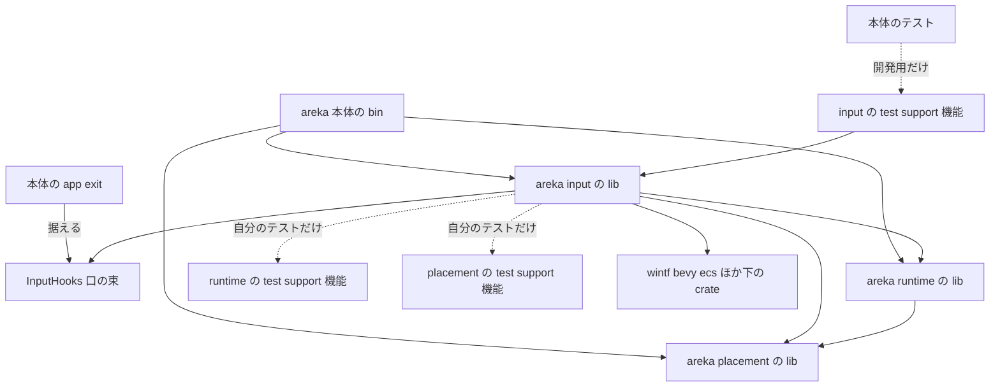
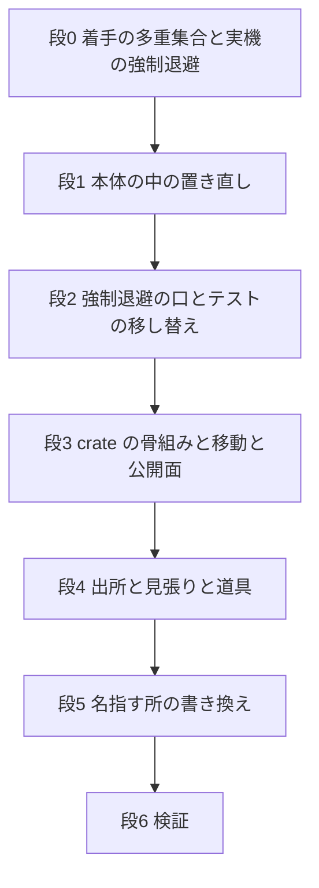
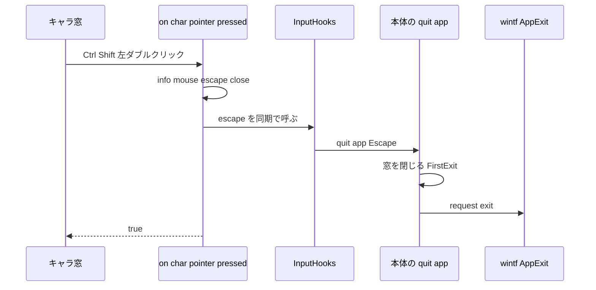

# 設計書: input-crate-split

## 概要

**目的**: 本体の bin crate の中にある入力の出来事のモジュール（`crates/areka/src/input_events/`・50 ファイル）のうち、本体を引かない 44 ファイル（`mod.rs` を含む）を新しい lib crate `crates/areka-input/` へそのまま移す。本体を引く 2 本（`shortcut.rs`・`file_drop.rs` とそのテスト）は本体の中で置き直し、強制退避が本体の `quit_app` を直に呼ぶ所は、本体が据える口を通す形に逆にする。入力の中身は直さない。

**使う人**: areka の開発者。入力を直す人と、見直し（ponytail の audit・受け手は `audit-areka-input-menu`）を受け持ちごとに回す人。

**変わること**: 本体は入力を path 依存で使い、`main.rs` の `use areka_input as input_events;` で今の呼び手のパス（`crate::input_events::…`）をそのまま通す。入力の公開面は外から使われる分だけ `pub` になり、本体のテストだけが使う支えは `test-support` 機能で開く。強制退避は `areka-input` の口の束 `InputHooks` を通して本体の `quit_app(Escape)` を同じハンドラの中で呼ぶ。動く ukagaka のアプリとしての振る舞いは変えない（ログの出所の名前だけが `areka::input_events::…` から `areka_input::…` に変わる）。

### 目標

- 入力の本番とテストが `crates/areka-input/` にあり、本体は依存として使う。依存は `areka` → `areka-input` → `areka-runtime` → `areka-placement` の一方向（1.1〜1.11）。
- `areka-input` の本番のコードが本体の項目を 1 つも参照しない（2.4・4.1）。
- 外から使われない項目は外から見えない。テストのためだけに開く項目は `test-support` のときだけ見える（3.1〜3.8・5.5）。
- 古いパス・古い出所の名前が、決めた範囲で 0 件になる（6.7・7.6）。
- テストの名前の多重集合（説明のつく差を除く）・警告 0・全体テスト・実機 2 本・強制退避の実機の記録の順が、移す前と同じ合否を示す（8.1〜8.10）。

### 目標でないこと

- 入力の振る舞いの直し・古い説明の直し（`lib.rs` 冒頭の「現状は `throttle` のみ」・「The Hand／collisionex は実装しない（7.4）」ほか）。`audit-areka-input-menu` へ申し送る（8.1）。
- menu の crate 化・session の集め直しと crate 化（`session-module-gather`・`session-crate-split`）。
- 出し直し `use areka_input as input_events;` を外すこと（`session-module-gather` の持ち物・6.10）。
- 外から使われない `pub(crate)` の削除（3.2）。
- 本体の `Cargo.toml` の、移した後に本体が直に使わなくなる依存の行の整理（前例どおり `audit-areka-app` の持ち物・`Cargo.lock` は変わらない）。

## 境目の約束

### この仕様が持つもの

- 新しい crate `crates/areka-input/` の骨組み（`Cargo.toml`・`lib.rs`・`test-support` 機能・テストの実行ファイルの落ちの報告）と、同梱のカーソルの絵の置き場 `crates/areka-input/cursor/`。
- 入力の公開面の付け替えと、テストのために開けた項目の記録。
- 強制退避の口の束 `InputHooks`（型は `areka-input`・中身と据え付けは本体の `app_exit.rs`）。
- 本体の中の置き直し: `crates/areka/src/menu/shortcut.rs`（＋テスト）・`crates/areka/src/file_drop.rs`（＋テスト 3 本）・本体へ移す強制退避のテスト `crates/areka/src/app_exit_escape_tests.rs`。
- 入力を名指すパス・出所の名前の書き換え（説明・文書・網羅台帳・実機の手順書・`structure.md`・`audit-areka-input-menu` の brief）と、ソースの木を歩く本体の見張り 4 本の根に `areka-input` を足すこと。
- 道具の 2 か所: `tools/load-flake.ps1` の `-Binary` に `areka-input-lib`・`tools/cursor-art.ps1` の置き場のパス。
- 検証の手順（多重集合・警告・全体テスト・実機 2 本・強制退避の実機・`get_log` の分け方・`THIRD-PARTY-NOTICES.md`）。
- steering の追記は `structure.md` だけ。`roadmap.md` の新旧のパスの対応表の行は完了の段（`/kiro-complete`）で書く。

### この仕様が持たないもの

- 入力の振る舞い（8.1）。直したくなった所は `audit-areka-input-menu` へ申し送る。理由の文が移した後に事実でなくなる `#[allow(...)]` は、測った範囲で 0 件（入力の唯一の `#[allow(dead_code)]`〔`RegionSource::Mock`〕の理由「本番からは構築されない」は移した後も事実）。0 件を申し送りに明記する。
- 同じウェーブの約束で触らないファイル: `crates/areka-runtime/src/frame*`・本体の `runtime_tests/`・`session/runtime_boot.rs`・`session/runtime_boot_tests.rs`・`session/ghost_quit*`（3.5）。`frame/wiring.rs` の説明の古い input のパス 3 か所（295・319・326 行）は `audit-emo2-boot-frame` が同 spec の要件 5.1 で 3 か所とも直す（同 spec のコミット `e73cb0e2e`）＝この仕様の仕事ではない。向こうが直さずに着地した場合だけ、完了の申し送りへ回す（6.9）。
- `log-capture-kit/tests/file_length_guard_test.rs` の例外表（約束 ⑸・input のパスは 0 件）。
- input に触れると書いているほかの約 30 本の brief と、歴史の文書（`roadmap-history.md`・`.kiro/specs/completed/`）・日付つきの写し `doc/roadmap-overview-2026-10-16.html`。
- `shortcut.rs`・`file_drop.rs` を見直しの範囲に残すかの判断（`audit-areka-input-menu` の要件の段の持ち物・6.6）。

### 使ってよい依存

- `areka-input` の本番の依存は次の 12 個に限る（1.8・段 3 で `cargo tree -p areka-input -e normal` と照らして確定）: tracing・wintf・bevy_ecs・windows・areka-runtime・areka-placement・areka-emo-text・areka-kanade・areka-sakura・areka-emo-compose・areka-ghost・areka-emo-present。`areka-nar` は入れない（`file_drop.rs` だけが使う）。
- `areka-input` の開発用の依存は次に限る（1.9・5.3）: log-capture-kit・areka-parsers・areka-sylphya・areka-seriko・areka-emo-atlas・areka-runtime（`test-support` つき）・areka-placement（`test-support` つき）。どれもワークスペースの中（1.7）。番人の 3 つの crate は本番の依存表（optional を含む）に書かない（5.4）。temp-path-kit・sample-ghost-kit は移す分では使わないので書かない。
- `areka-input` の `test-support` は他の crate の機能を連鎖させない（`test-support = []`）。開ける支えは wintf・bevy_ecs・`areka-placement`・`areka-runtime` の公開面と std だけに頼る。
- `areka-input` は `areka` に依存しない（1.5）。コードでも説明のリンクでも本体を引かない（2.4・3.8）。

### 見直しの引き金

- `areka-input` の公開面か `test-support` の中身が変わる → 本体の使い手（`ghost_session*`・`menu/`・`app_exit*`・`runtime_tests/`・`session/runtime_boot*`）を見直す。
- `InputHooks` の欄か据え方が変わる → 本体の `app_exit::install_input_hooks` と `ghost_session::register_systems`・本体へ移した強制退避のテストを見直す。
- `hit-id-pass` が `areka_runtime::hit_region::resolve_hit_region` の形を変える → 呼び手は `crates/areka-input/src/lib.rs`（旧 `input_events/mod.rs`）の 37 行の `use`・`MouseWiring::resolve_region`（174〜200 行）・`resolve_hit_owned`（446〜455 行）。設計の討議 6 で `hit-id-pass` に「このウェーブのあいだは入口の形を保つ・変えるならこの仕様の着地の後に `crates/areka-input/src/lib.rs` の呼び手を直す（約束 ⑶ の「本体」に `areka-input` は入らない）」と伝えた。
- `session-module-gather` が出し直しを外す → 本体の呼び手を `areka_input::…` へ書き換える（同 spec の持ち物）。
- ログの出所の名前が変わる → `RUST_LOG` の文字列・出所を名前で読むテスト・`log_history` のテストを見直す。

### 同じウェーブとの重なり

- `hit-id-pass`: この仕様は旧 `input_events/mod.rs` を `git mv` で `crates/areka-input/src/lib.rs` へ移すが、当たり判定の入口の行（37 行の `use areka_runtime::hit_region::{HitRegion, resolve_hit_region};`・174〜200 行の `MouseWiring::resolve_region`・446〜455 行の `resolve_hit_owned`）の中身は 1 字も変えない（変えるのは 34 行の `use` の削除・可視性の付け替え・強制退避の分岐 543〜553 行・説明の 505 行だけ）。`crates/areka-runtime/src/hit_region.rs` で書き換えるのは冒頭の説明の 8・18・20 行だけで、`hit-id-pass` が `hit_region_client` の形を変えるときに触る 14・36 行とは 3 行以上離れ、別の差分の塊になる。向こうは 2026-11-20 時点で要件の段（設計の前）であり、候補 A-1 を選ぶと入口の形が変わる。設計の討議 6（2026-11-20）で、次の扱いを向こうのセッションへ伝えた: このウェーブのあいだは入口の形を保つ。どうしても変えるなら、呼び手の追従はこの仕様の着地の後に `crates/areka-input/src/lib.rs` で行う（約束 ⑶ の「本体に触らない」の「本体」に `areka-input` は入らない読み）。向こうが本体の `input_events/mod.rs` に触ることはない。返事は下の「設計の討議で決めたこと」に記録する。
- `audit-emo2-boot-frame`: `frame/wiring.rs` の 3 か所は向こうが直す（上）。こちらは `session/ghost_quit*`・`frame*`・`runtime_tests/` に触らない。`doc/pasta-real-run.md` は、向こうがログの語を変える裁定を出したときだけ同じファイルの別の行に触る（今は 0）。
- `balloon-flip-ssp-review`: `doc/COMPAT_ARCHITECTURE.md` §8 は向こうが 438 行の行を書き直し、こちらは §8 の別の行のパスだけ（153・181・182・370〜375・395・399・415・419〜421・426〜428・431・432・447 行）。`areka-placement/src/follow.rs` は向こうの案 ⑵ が次のウェーブへ回るので 0。
- roadmap の C23 の行の「触るファイル」に無く、この設計で足したファイル（行では兄弟と重ならない）: `crates/areka/src/app_exit_escape_tests.rs`（新設）・`menu/shortcut.rs`・`file_drop.rs` の置き場・`placement_tests/mod.rs`・`log_history_tests.rs`・見張り 4 本（`readme_tests.rs`・`session_end_deadline_tests.rs`・`tick_gate_config_producers_tests.rs`・`update/worker_tests.rs`）・`tools/cursor-art.ps1`・`tools/load-flake.ps1`・`crates/areka/cursor/`。設計の確定のときに棚卸のセッションへ伝える（設計の討議 7）。
- `Cargo.lock` の席はこの仕様だけ（新しい crate の 1 項目と本体の依存の 1 行）。

## 構成

### 今の形

- 入力は本体の中の `mod input_events;`（`main.rs` 68 行）で、本番から本体のほかの部分を引くのは `mod.rs:34` の `use crate::app_exit::{ExitOrigin, quit_app};`・`shortcut.rs` の `crate::menu::…` 2 行・`file_drop.rs` の `crate::ghost_session::GhostSlot`・`crate::install::…` だけ。`shortcut.rs`・`file_drop.rs` は入力のほかのファイルを使わない。
- 子のモジュールは平らに並び、`#[path]` で親につながる（`char_watch.rs` → `cursor_answer.rs` ほか）。`#[path]` は宣言したファイルの置き場から解くので、同じ平らな並びのまま `src/` へ移せば解け方は変わらない。
- 本体のテストを組むとき、依存の `areka-input` は `cfg(test)` を立てずに組まれる（立てられるのは機能だけ）。本体のテストが使う `#[cfg(test)]` の項目（`UserBreakWiring::flag_rx`・`flag_source_connected`）は `test-support` で開ける。
- 強制退避のテスト 3 本（`input_events_tests.rs` の `handler_ctrl_shift_left_double_click_despawns_all_ghost_windows_without_sending`・`escape_works_without_mouse_wiring`・`only_escape_terminates_ghost_windows`）は、本物の `quit_app` の結果（`GhostWindowMarker` の窓が消える・`wintf::AppExit::is_requested()`）を見る。入力のほかのテストと本体のテストで強制退避の枝に入るものは 0。
- 本体の見張りのうち 4 本（`readme_tests.rs`・`session_end_deadline_tests.rs`・`tick_gate_config_producers_tests.rs`・`update/worker_tests.rs`）は「分ける前に本体の `src` が覆っていた範囲」として本体と `areka-runtime` の 2 つの `src` を歩く。入力が本体の `src` から出ると、足さなければ黙って範囲が縮む。

### 依存の図



- 実線は本番、点線は開発用の依存（dev-dependency）だけ。本体 → input → runtime → 配置 → 下の crate の一方向。input から本体へは、コードでも説明のリンクでも引かない。
- `InputHooks` は `areka-input` の型で、本体の `app_exit.rs` が中身（`quit_app(world, ExitOrigin::Escape)`）を据える。`SessionHooks` の型が使い手の `areka-runtime` に在り、中身を本体が据えるのと同じ向き。

**構成の決め**:

- 形: 今のモジュールの境目をそのまま crate の境目にする。新しい層や包みは作らない。足す仕組みは `InputHooks` 1 つだけ。
- 本体の呼び手のパスは出し直しで今のまま通す（約束 ⑴）。出し直しで通らないのは置き直す 2 本を指す `ghost_session.rs` の 2 行だけ。
- steering との合致: ルートの `Cargo.toml` を変えない・外の依存を足さない・1,000 行の例外表の項目を増やさない（1.6・1.7・1.10）。

### 技術の表

| 層 | 選んだもの | この仕様での役 | 備考 |
|---|---|---|---|
| ビルド | Cargo（`members = ["crates/*"]`・resolver 2） | 新しい crate を自動で拾う・`test-support` 機能 | 根の `Cargo.toml` は不変 |
| 言語 | Rust 2024（`edition.workspace = true`） | `pub` の付け替え・`cfg(any(test, feature = "test-support"))`・根の `use <crate> as <名>;` | 出し直しは 2026-11-20 に作業の木の外の使い捨ての 2 crate で確かめた（`crate::<名>::…`・子の `use crate::<名>;`・dev-dependency の機能つきの項目がどれも解け、`cargo check --all-targets` は警告 0。`use` の上の `///` も警告しない） |
| ログ | tracing・tracing-subscriber（EnvFilter の出所は文字の前方一致） | 出所の名前が `areka_input::…` になる | `areka=…` は `areka_input` も覆う・`areka::input_events=…` は何も覆わなくなる |
| テストの支え | log-capture-kit | 開発用の依存だけで使う | 番人の決まりは不変 |
| 道具 | `cargo about`・`tools/test-all.ps1`・`tools/load-flake.ps1`・`tools/cursor-art.ps1`・`ukadoc-survey` | 第三者の表・全体テスト・揺れの繰り返し・カーソルの絵・網羅の報告 | `test-all.ps1` は直さない |

### 設計の段で決めたこと

| # | 決めること | 決め | 主な代案 |
|---|---|---|---|
| D1 | 強制退避の口の形（4.1） | `areka-input` に口の束 `InputHooks`（`#[derive(Resource, Clone, Copy)]`・欄 `escape: fn(&mut World)` の 1 つ）を置く。本体の `app_exit.rs` に `install_input_hooks(world)` を置き、中身は `quit_app(world, ExitOrigin::Escape)`。`ghost_session::register_systems` の先頭、`session::hooks::install` の直後で 1 回呼ぶ（設計の討議 1 で確定） | B: `SessionHooks` に欄を足す（runtime の口の束に入力の都合が入り、`NO_BODY` の「何もしない」が 4.6 の「黙って何もしない」に当たる）／C: `quit_app` と `ExitOrigin` を下へ降ろす（`session/ghost_quit*` が使う・範囲が広がる・推さない） |
| D2 | 口が据わっていないとき（4.6） | `error!(event = "input_hooks_missing")` を 1 行残し、World に `wintf::AppExit` が在れば `request_exit()` で終わりを指示する（`run()` が戻り main の後始末で窓も終わる＝「必ず終われる」を崩さない）。窓を先に閉じる・`FirstExit` を書くことはしない（`quit_app` の写しになる）。ハンドラは前と同じく `true` を返す（設計の討議 2 で確定） | 記録だけで終わる（強制退避が唯一の抜け口なのに何も起きない）／`quit_app` の一部を写す（写しが増える） |
| D3 | 強制退避のテスト 3 本の置き場（4.7・5.1・5.5） | 3 本は本物の `quit_app` を見るので、境をまたぐテストとして本体の `crates/areka/src/app_exit_escape_tests.rs`（`app_exit.rs` の子）へ移す。中身は、World を組んだ直後に `crate::app_exit::install_input_hooks(&mut world)` を呼ぶ 1 行を足すほかは変えない。3 本が使う小道具（`bubble_pointer`・`bubble_pointer_mods`・`ghost_count`・`world_with_wiring`・`stepping_clock`）は、写しを作らず `input_events_tests.rs` から `areka-input` の `pointer_test_support`（`#[cfg(any(test, feature = "test-support"))] pub mod`）へ移し、入力のテストも本体のテストもそこから使う。`MouseWiring::with_clock` は `#[cfg(any(test, feature = "test-support"))] pub(crate)` にする（設計の討議 3 で確定） | 入力に残して口に記録用の関数を据える（5.1 の「本体の部品を偽物に替えない」に当たる）／小道具を本体に写す（写しが増える） |
| D4 | `file_drop.rs` の置き場（2.2・2.5） | 本体の src 直下 `crates/areka/src/file_drop.rs`（テスト 3 本も同じ所の兄弟）。出所は `areka::file_drop` で、`log_history` のどの決まりにも当たらない＝前と同じ（今の `areka::input_events::file_drop` も当たらない）。`file_drop_wiring_tests.rs` の `include_str!("file_drop.rs")` は兄弟のまま解ける（設計の討議 4 で確定） | `install/` の下（出所が `areka::install::file_drop` になり Update に当たる＝`UNKEPT_TARGETS` に 1 行足す手当てが要る）／`ghost_session/` の下（Status に当たる） |
| D5 | `shortcut.rs` の置き場（2.1） | `crates/areka/src/menu/shortcut.rs`（テストは `menu/shortcut_tests.rs`）。`menu/mod.rs` に `pub(crate) mod shortcut;` を足す。中の `crate::menu::…` はそのまま解けるので中身は変えない。出所 `areka::menu::shortcut` は決まりに当たらない＝前と同じ | ― |
| D6 | 出し直しの形（3.4） | `main.rs` の `mod input_events;`（68 行）を `use areka_input as input_events;` に替える。上の 4 行の説明は変えない（古い文の直しは 8.1 で申し送る）。`mod file_drop;` を `mod install;` の近くに説明なしで足す（`main.rs` は 989 行 → 990 行） | ― |
| D7 | 自分を指すパス（3.3） | `crate::input_events::` → `crate::`（20 か所）。`pub(in crate::input_events)`（`cursor_pick.rs` 7 か所）は、根が crate になると `pub(crate)` と同じ意味なので字面を `pub(crate)` にする | `pub(in crate)` のまま（意味は同じ・見慣れない字面が残る） |
| D8 | 同梱のカーソルの絵（1.11） | `crates/areka/cursor/`（`hand.cur`・`grip.cur`・`hand.svg`・`grip.svg`・`README.md`）を `git mv` で `crates/areka-input/cursor/` へ。`cursor_answer.rs` の `include_bytes!("../../cursor/…")` は、ファイルが `src/` 直下へ 1 段浅くなるので `include_bytes!("../cursor/…")`（自分の置き場からの相対のまま）。絵のバイトは変えない | 置き場を変えず `../../areka/cursor/…` を読む（input の crate が本体の置き場を読む・要件の討議で退けた） |
| D9 | 落ちの報告（5.6） | 前例（runtime-crate-split D6）の形をそのまま使う。`crates/areka-input/src/crash_report_tests.rs`（`lib.rs` の `#[cfg(test)]` の子）に初期化子の `static`（`#[used]`・`#[unsafe(link_section = ".CRT$XCU")]`・`areka_runtime::crash_report_test_support::install` を指す）3 行と、確かめのテスト `crash_filter_is_installed_before_the_tests_start` 1 本を置く。中身の写しは作らない | 写しを置く（写しの統合は `test-crash-report-merge` の持ち物で、増やさない） |
| D10 | `spawn_assembly_tests.rs` の置き場（5.2） | 本体の `placement_tests/spawn_assembly_tests.rs` を `git mv` で `crates/areka-input/src/spawn_assembly_tests.rs` へ（`lib.rs` の `#[cfg(test)] mod`）。中の `crate::input_events::` 2 か所を `crate::` へ。本体の `placement_tests/mod.rs` から宣言を外す | `crates/areka-input/src/placement_tests/` の下（`mod.rs` が 1 つ増えるだけ） |
| D11 | ソースの木を歩く見張り（5 の目的「どのテストの実行ファイルも前と同じ守り」・前例 runtime-crate-split 要件 5.4） | 本体と `areka-runtime` の 2 つの `src` を歩く 4 本の根の並びに `("areka-input", crate_path("areka-input", "src"))` を足す（数え上げの型 `[(&str, PathBuf); 2]` は 3 へ）。説明の「2 つの `src`」を「3 つ」へ。許可表と期待値は変えない（入力の本番に当たりは無い見込み・段 4 の緑で確かめる） | 足さない（入力の 44 ファイルが見張りの外へ黙って出る） |
| D12 | `get_log` の分け方の確かめ（8.9） | `log_history_tests.rs` の既にあるテスト `unrelated_info_is_not_kept` に、`areka_input`・`areka_input::char_watch::cursor_answer`・`areka::file_drop`・`areka::menu::shortcut` の info が `None`、`areka_input::user_break` の warn が `Error` になる行を足す（前例 `areka::install::install_cue` と同じ所）。テストの名前は増えない | 新しいテストを足す（多重集合の差が増える） |
| D13 | 実機の強制退避の取り方（8.7） | 着手のときと完了の前に、同じ使い捨ての手順（作業の木の `target\input-crate-split\escape\` に置く SendInput の小さな PowerShell。Ctrl と Shift を押したまま左ボタンを 2 回押し放し、`finally` で全部放す）で、emo2 を絶対パスで起こした areka のキャラ窓に Ctrl+Shift+左ダブルクリックを 1 回入れ、標準エラーの記録の順を比べる。排他テストの机を取り、開発者の SendInput の許しの下で行う。手順の中身は検証の記録に写す。`tools/` には足さない（設計の討議 5 で確定） | `tools/mouse-input.ps1` に修飾キーつきのダブルクリックを足す（要件の範囲の外の道具に触る・自分の検査を足す要がある）／手の操作（採らない） |

## ファイルの置き場

### 新しい crate

```
crates/areka-input/
├── Cargo.toml                       # lib・publish = false・test-support 機能（ComponentInputCrate）
├── cursor/                          # 旧 crates/areka/cursor/ を git mv（hand.cur・grip.cur・*.svg・README.md）
└── src/
    ├── lib.rs                       # 旧 input_events/mod.rs（公開面・強制退避の分岐が InputHooks を通る）
    ├── hooks.rs                     # 新設: InputHooks と口が無いときの倒れ方（D1・D2）
    ├── pointer_test_support.rs      # 新設: input_events_tests.rs から移す小道具 5 つ（D3・test-support）
    ├── crash_report_tests.rs        # 新設: 落ちの報告の初期化子と確かめ 1 本（D9・cfg(test)）
    ├── hooks_tests.rs               # 新設: 口が無いときの倒れ方のテスト 1 本（D2・cfg(test)）
    ├── spawn_assembly_tests.rs      # 本体の placement_tests/ から git mv（D10）
    ├── balloon*.rs・char_watch*.rs・choice_drain.rs・click*.rs・cursor_answer*.rs・cursor_pick*.rs・
    │   drag*.rs・hover_region*.rs・input_events_*_tests.rs・shell_box*.rs・throttle.rs・
    │   user_break*.rs・wheel*.rs   # 旧 input_events/ の 43 ファイルを同じ名前・同じ平らな並びで git mv
```

- 旧 `input_events/` の 50 ファイルのうち、`mod.rs`（→ `lib.rs`）と 43 ファイルの計 44 を移す。残る 6 本（`shortcut.rs`・`shortcut_tests.rs`・`file_drop.rs`・`file_drop_tests.rs`・`file_drop_mime_tests.rs`・`file_drop_wiring_tests.rs`）は本体の中で置き直す。
- `input_events_tests.rs`・`input_events_menu_tests.rs`・`input_events_char_clamp_tests.rs` の名は変えない（`lib.rs` の `#[path]` がそのまま指す・テストのモジュールの名 `tests`・`menu_tests`・`char_clamp_tests` も同じ）。

### 本体の新しい置き場

```
crates/areka/src/
├── file_drop.rs                     # 旧 input_events/file_drop.rs（D4・中身は不変）
├── file_drop_tests.rs               # 同じく兄弟のテスト 3 本
├── file_drop_mime_tests.rs
├── file_drop_wiring_tests.rs
├── app_exit_escape_tests.rs         # 新設: input_events_tests.rs から移す強制退避のテスト 3 本＋据え付けの確かめ 1 本（D3）
└── menu/
    ├── shortcut.rs                  # 旧 input_events/shortcut.rs（D5・中身は不変）
    └── shortcut_tests.rs
```

### 変えるファイル

- `Cargo.lock` — `areka-input` の 1 項目と本体の依存の 1 行（`cargo` が書く）。
- `crates/areka/Cargo.toml` — `[dependencies]` に `areka-input = { path = "../areka-input" }`、`[dev-dependencies]` に `areka-input = { path = "../areka-input", features = ["test-support"] }`（前例の `areka-runtime` の 2 行と同じ形・理由の注つき）。
- `crates/areka/src/main.rs` — D6。
- `crates/areka/src/ghost_session.rs` — 332 行を `crate::file_drop::attach_file_drop_receivers(world)`、335 行を `crate::menu::shortcut::attach_shortcut_receivers(world)` へ（2.3）。`register_systems` の 67 行の直後に `crate::app_exit::install_input_hooks(world);` を 1 行（D1）。
- `crates/areka/src/app_exit.rs` — `install_input_hooks` を足し、`#[cfg(test)] #[path = "app_exit_escape_tests.rs"] mod escape_tests;` を足す（D1・D3）。
- `crates/areka/src/menu/mod.rs` — `pub(crate) mod shortcut;`（D5）。
- `crates/areka/src/placement_tests/mod.rs` — `mod spawn_assembly_tests;` を外し、説明の「本体の部品（`input_events` ほか）」を今の部品の名へ（D10）。
- `crates/areka/src/log_history_tests.rs` — D12。
- `crates/areka/src/{readme_tests,session_end_deadline_tests,tick_gate_config_producers_tests}.rs`・`crates/areka/src/update/worker_tests.rs` — D11。
- `crates/areka/tests/emo2_mcp_real_run.rs`（10・40・115 行）・`crates/areka/tests/window_link_real_run.rs`（49 行） — 出所の名前（7.3）と説明のパス（6.7）。
- `crates/areka/src/install/mod.rs`（3 行）・`readme.rs`（93 行） — 説明のパス（6.3）。
- `crates/areka-runtime/src/{balloon_hover,hit_region,shell_box_hover}.rs`・`examples/collision-probe.rs`・`examples/collision-probe/setup.rs`・`crates/areka-placement/src/{spawn,follow,follow/drag_follow,follow_drag_end_gate_tests,placement_char_clamp_tests}.rs`・`examples/window-placement.rs`・`crates/areka-emo-text/src/choice.rs` — 説明のパスと名前（6.2）。
- `crates/log-capture-kit/src/event.rs`（150 行）・`event_tests.rs`（20・21・123 行） — 説明のパス（6.1）。
- `doc/COMPAT_ARCHITECTURE.md`・`doc/ukadoc-coverage/ledger/{assets,sakura-script,shiori}.toml`・`doc/anchor-compat.md`・`doc/pasta-real-run.md`・`doc/ideas/` の 6 ファイル — パス（6.4）・出所の名前（7.3）・カーソルの置き場（1.11）。`doc/ukadoc-coverage/report/` は `cargo run -p ukadoc-survey -- report`・`report-summary` で作り直す。
- `tools/load-flake.ps1`（49・55・71・72・209・275 行の付近） — `areka-input-lib`（`-p areka-input --lib`）を `ValidateSet`・切り替え・自分の検査の表の 3 か所と説明に足す（5.8）。
- `tools/cursor-art.ps1`（3・6・48 行） — `crates/areka/cursor` → `crates/areka-input/cursor`（1.11）。
- `.kiro/steering/structure.md` — `areka-input` の節を足す・本体の節の 281 行（`input_events/`）と 288 行（`input_events/file_drop.rs`）・443 行の `log-capture-kit` の使い手の数（21 → 22 crate・名に `areka-input`）（6.5）。
- `.kiro/specs/audit-areka-input-menu/brief.md` — 「受け持つファイル」（11 行）と Upstream の文（6.6）。
- `THIRD-PARTY-NOTICES.md` — `cargo about generate` で作り直す（8.10）。

### パスの書き換えの対応

| 旧 | 新 |
|---|---|
| `crates/areka/src/input_events/mod.rs` | `crates/areka-input/src/lib.rs` |
| `crates/areka/src/input_events/<名>.rs`（44 のうち `mod.rs` 以外） | `crates/areka-input/src/<名>.rs` |
| `crates/areka/src/input_events/shortcut{,_tests}.rs` | `crates/areka/src/menu/shortcut{,_tests}.rs` |
| `crates/areka/src/input_events/file_drop{,_tests,_mime_tests,_wiring_tests}.rs` | `crates/areka/src/file_drop{,_tests,_mime_tests,_wiring_tests}.rs` |
| `crates/areka/src/placement_tests/spawn_assembly_tests.rs` | `crates/areka-input/src/spawn_assembly_tests.rs` |
| `crates/areka/cursor/` | `crates/areka-input/cursor/` |
| モジュールの形 `input_events::<子>`（本体の外の crate の説明・文書・台帳） | `areka_input::<子>`（`file_drop`・`shortcut` は `areka::file_drop`・`areka::menu::shortcut`） |
| 出所 `areka::input_events[::<子>]` | `areka_input[::<子>]` |

- 文書の中の `src/` を付けない書き方（`input_events/x.rs`）も、上の新しいパスの書き方へ（6.7）。本体の中の `crate::input_events::…` は出し直しで通るので書き換えない（6.8）。

## 流れ

### 移す段



| 段 | すること | 段の終わりに緑であるもの |
|---|---|---|
| 0 | 枝の先頭で `cargo test --workspace --no-fail-fast -- --list` を取り `target/input-crate-split/tests-before.txt` に残す。D13 の手順で実機の強制退避を 1 回取り、記録を `target/input-crate-split/escape-before.stderr.log` に残す | （取るだけ） |
| 1 | `shortcut.rs`＋テストを `menu/` へ、`file_drop.rs`＋テスト 3 本を src 直下へ `git mv`。`input_events/mod.rs` の 2 つの宣言を外し、`menu/mod.rs`・`main.rs` に宣言を足し、`ghost_session.rs` の 2 行を直す | `cargo check -p areka --all-targets`・`cargo test -p areka --bin areka -- shortcut file_drop` |
| 2 | まだ本体の中で: `input_events/hooks.rs`（`InputHooks`）・`pointer_test_support.rs`・`hooks_tests.rs` を作り、強制退避の分岐を口へ通し、`mod.rs:34` の `use` と 505 行の説明のリンクを地の文へ。`app_exit.rs` の `install_input_hooks` と `register_systems` の 1 行。強制退避のテスト 3 本を `app_exit_escape_tests.rs` へ移し、据え付けの確かめ 1 本を足す | `cargo test -p areka --bin areka`（赤が出たら赤のテストだけ回し直す）・`grep "crate::app_exit" crates/areka/src/input_events/` が 0 件 |
| 3 | `crates/areka-input/Cargo.toml` を作り、44 ファイルを `git mv`（`mod.rs` → `lib.rs`）、`crates/areka/cursor/` を `git mv`、`include_bytes!` の相対パス（D8）、`crate::input_events::` → `crate::`・`pub(in …)` → `pub(crate)`（D7）、`main.rs` の出し直し（D6）、本体の `Cargo.toml` の 2 行。コンパイラのエラー（E0603・E0616・E0624・E0364・`private_interfaces`）を 1 件ずつ見て `pub` にし、3.7 の連れて開く型に印の説明を付ける。`test-support` の印（`flag_rx`・`flag_source_connected`・`with_clock`・`pointer_test_support`）。`spawn_assembly_tests.rs` の移動（D10）。落ちの報告（D9） | `cargo check --workspace --all-targets` 警告 0・`cargo check -p areka-input --lib --features test-support`（機能だけが立つビルド）・`cargo test -p areka-input`・`cargo test -p areka --bin areka`（赤のテストだけ回し直す） |
| 4 | 出所を名前で読む 4 か所（7.3）・`log_history_tests.rs`（D12）・見張り 4 本（D11）・`tools/load-flake.ps1`（5.8）・`tools/cursor-art.ps1`（1.11） | `cargo test -p areka --bin areka -- log_history only_the_os_port session_end_deadline tick_gate_config winhttp`・`pwsh -NoProfile -File tools/load-flake.ps1 -SelfTest`・`pwsh -NoProfile -File tools/cursor-art.ps1 -SelfTest`（どちらも今の自分の検査の呼び方で） |
| 5 | 説明・文書・台帳・`structure.md`・`audit-areka-input-menu` の brief（6.1〜6.6）・網羅の報告の作り直しと `ukadoc-survey -- check` | 6.7・7.6 の grep が 0 件（除いた所の一覧つき）・`cargo test -p log-capture-kit`・`cargo run -p ukadoc-survey -- check` |
| 6 | 完了の多重集合・警告・`tools/test-all.ps1`・実機 2 本（8.6）・実機の強制退避（D13・8.7）・`cargo about generate` | 8.2〜8.10 のすべて |

- 段 1・2 は crate を作る前に本体の中で済ませる（brief の Boundary Candidates の順）。段 2 の終わりで「入力が本体を引くのは置き直した 2 本だけ」が本体の中で成り立ち、段 3 は移すだけになる。
- 段 3 の `git mv` は内容の書き換えと同じコミットに入れてもよいが、書き換えは行の単位に留める（git が移動として追える類似度を保つ・`hit-id-pass` が旧 `mod.rs` を直したときに取り込みやすい）。
- どの段もコミットを分け、PR は 1 本。

### 強制退避の流れ



- 口は同じハンドラの呼び出しの中で同期で呼ぶ（4.2）。記録の順は `mouse_escape_close`（出所 `areka_input`）→ `quit_app` の中の `log_stay_on_top_discard` の記録 → `app_exit`（`areka::app_exit`）→ `run()` の復帰 → 終了の系列で、前と同じ（4.5）。変わるのは 1 行目の出所の名前だけ。
- 受け付ける条件 `state.ctrl_down && state.double_click == DoubleClick::Left && (!wired || state.shift_down)` は 1 字も変えない（4.3・4.4）。
- 口が無いとき（本番では起こらない）は D2 の倒れ方。

## 要件の対応表

| 要件 | 要約 | 部品 | 口 | 流れ |
|---|---|---|---|---|
| 1.1 | lib・`publish = false`・慣習 | InputCrate | `Cargo.toml` | 段 3 |
| 1.2 | 履歴を残す移動 | InputCrate | `git mv` 44 ファイル | 段 3 |
| 1.3 | `mod.rs` → `lib.rs` | InputCrate | `lib.rs` | 段 3 |
| 1.4 | 本体が path 依存で使う・`input_events/` を持たない | InputCrate・BodyRewire | 本体の `Cargo.toml` | 段 3 |
| 1.5 | runtime と placement に依存・本体に依存しない | InputCrate | `cargo tree` | 段 3 |
| 1.6 | 根の `Cargo.toml` を変えない | InputCrate | ― | 段 3 |
| 1.7 | 外の依存を足さない | InputCrate | `Cargo.lock` の差分 | 段 3 |
| 1.8 | 本番の依存 12 個 | InputCrate | 使ってよい依存 | 段 3 |
| 1.9 | テストだけの crate は本番に入れない | InputCrate・InputTestSupport | 番人 | 段 3 |
| 1.10 | 1,000 行・例外表を増やさない | InputCrate | `file_length_guard_test` | 段 3・6 |
| 1.11 | カーソルの絵の置き場（D8） | InputCrate・PathRewrite | `include_bytes!`・`cursor-art.ps1` | 段 3・4・5 |
| 2.1 | `shortcut.rs` → `menu/`（D5） | BodyRelocate | `menu/mod.rs` | 段 1 |
| 2.2 | `file_drop.rs` の置き場（D4） | BodyRelocate | src 直下 | 段 1 |
| 2.3 | 呼び手が同じ時・同じ窓に付ける | BodyRelocate | `ghost_session.rs` 332・335 行 | 段 1 |
| 2.4 | input の本番が本体を参照しない（grep） | InputCrate・EscapeHook | grep | 段 2・3・6 |
| 2.5 | 2 本のログが同じ種別 | BodyRelocate・LogTargets | D4・D5・D12 | 段 4 |
| 2.6 | 近道と投げ込みの振る舞い | BodyRelocate | 中身不変・テスト | 段 1・6 |
| 3.1 | 外から使われる項目だけ `pub` | PublicSurface | 公開の一覧 | 段 3 |
| 3.2 | 使われない `pub(crate)` は残す | PublicSurface | ― | 段 3 |
| 3.3 | 自分を指すパス（D7） | PublicSurface | `crate::` | 段 3 |
| 3.4 | 出し直し（D6） | BodyRewire | `use areka_input as input_events;` | 段 3 |
| 3.5 | 約束のファイルを変えない | BodyRewire | 触らない一覧 | 全段 |
| 3.6 | 出し直しで通らない呼び手（`flag_rx`） | InputTestSupport | `test-support` | 段 3 |
| 3.7 | 連れて開く型の記録 | PublicSurface | 印の説明 | 段 3 |
| 3.8 | 本体へのリンクを地の文へ | EscapeHook・PublicSurface | 505 行 | 段 2 |
| 4.1 | 口を通して `quit_app(Escape)`（D1） | EscapeHook | `InputHooks` | 段 2 |
| 4.2 | 同じ呼び出しの中・`true` | EscapeHook | 同期の呼び出し | 段 2 |
| 4.3 | 結線前も受け付ける・口は窓より先 | EscapeHook | `register_systems` の先頭 | 段 2 |
| 4.4 | 結線済み・Shift 無しは普通のダブルクリック | EscapeHook | 条件不変 | 段 2 |
| 4.5 | 記録の順 | EscapeHook・Verification | 流れの図 | 段 0・6 |
| 4.6 | 口が無ければ `error!`・据わることを決定論で示す（D2） | EscapeHook・EscapeTests | `input_hooks_missing`・据え付けの確かめ | 段 2 |
| 4.7 | 強制退避の振る舞いを前と同じ合否で固定（D3） | EscapeTests | 3 本のテスト | 段 2 |
| 5.1 | テストの置き場を 1 本ずつ記録・偽物に替えない | TestPlacement・EscapeTests | テストの置き場の表 | 段 2・3 |
| 5.2 | `spawn_assembly_tests.rs` を input へ（D10） | TestPlacement | `git mv` | 段 3 |
| 5.3 | 下の crate の支えを dev-dependency の機能で | InputCrate | dev-dependency | 段 3 |
| 5.4 | 番人の 3 crate の決まり | InputCrate | 番人 | 段 3・6 |
| 5.5 | input の `#[cfg(test)]` の支えを `test-support` で | InputTestSupport | `pointer_test_support`・`flag_*` | 段 2・3 |
| 5.6 | MTA と落ちの報告（D9） | TestBinaryGuard | `.CRT$XCU` | 段 3 |
| 5.7 | 数え方と `test-all.ps1` | TestBinaryGuard | ― | 段 6 |
| 5.8 | `load-flake.ps1` に `areka-input-lib` | ToolUpdate | `-Binary` | 段 4 |
| 6.1 | `log-capture-kit` の説明 | PathRewrite | 対応表 | 段 5 |
| 6.2 | 本体の外の crate の説明 | PathRewrite | 対応表 | 段 5 |
| 6.3 | 本体の説明（`install/mod.rs`・`readme.rs`） | PathRewrite | 対応表 | 段 5 |
| 6.4 | 文書・台帳・`report/` の作り直し | PathRewrite | `ukadoc-survey` | 段 5 |
| 6.5 | `structure.md` | PathRewrite | 節の追記 | 段 5 |
| 6.6 | `audit-areka-input-menu` の brief | PathRewrite | 受け持つファイル | 段 5 |
| 6.7 | 古いパスの grep 0 件 | Verification | grep | 段 5・6 |
| 6.8 | 本体の `crate::input_events::…` を当たりにしない | Verification | grep の除外 | 段 5 |
| 6.9 | `frame/wiring.rs` は向こうが直す・直らなければ申し送り | Handover | 完了の申し送り | 完了 |
| 6.10 | `session-module-gather` の brief への申し送り | Handover | 完了の申し送り | 完了 |
| 7.1 | 出所が `areka_input::…` | LogTargets | crate の名前 | 段 3 |
| 7.2 | 直書きの出所（0 件） | LogTargets | ― | 段 3 |
| 7.3 | 名前で読む 4 か所 | LogTargets | `rust_log`・`RUST_LOG`・`TARGET` | 段 4 |
| 7.4 | `areka_input=debug` で同じだけ出る | LogTargets | EnvFilter | 段 6 |
| 7.5 | `get_log` の分け方が同じ | LogTargets | D12 | 段 4 |
| 7.6 | 古い出所の grep 0 件 | Verification | grep | 段 5・6 |
| 7.7 | ログの本文を変えない | LogTargets・EscapeHook | ― | 全段 |
| 8.1 | 振る舞いを変えない・申し送り | Handover | 申し送りの一覧 | 全段 |
| 8.2 | 多重集合の前後 | Verification | `--list` | 段 0・6 |
| 8.3 | 差の対応表 | Verification | 差の表 | 段 6 |
| 8.4 | 警告 0 | Verification | `cargo check` | 段 3・6 |
| 8.5 | `test-all.ps1` 緑 | Verification | ― | 段 6 |
| 8.6 | 実機 2 本 | Verification | 実機テスト | 段 6 |
| 8.7 | 実機の強制退避の前後（D13） | Verification | 使い捨ての手順 | 段 0・6 |
| 8.8 | 実機は 8.6・8.7 だけ | Verification | ― | 段 6 |
| 8.9 | `log_history` のテスト（D12） | LogTargets | 既にあるテストへの行 | 段 4 |
| 8.10 | `THIRD-PARTY-NOTICES.md` を作り直す | Verification | `cargo about generate` | 段 6 |

## 部品と口

### 部品の一覧

| 部品 | 層 | 役 | 要件 | 主な依存 | 口の種類 |
|---|---|---|---|---|---|
| InputCrate | 新しい crate | 入力を lib として持ち、本体へ公開面を出す | 1.1〜1.11・2.4・5.3・5.4 | areka-runtime（P0）・areka-placement（P0） | Cargo の約束 |
| PublicSurface | 新しい crate | 外から使われる項目だけ `pub` | 3.1〜3.3・3.7・3.8 | 本体の使い手（P0） | 公開の型と関数 |
| EscapeHook | 新しい crate＋本体 | 強制退避を口で本体へ渡す | 2.4・3.8・4.1〜4.6・7.7 | 本体の `app_exit`（P0） | 状態（Resource） |
| InputTestSupport | 新しい crate | 本体のテストが使う支えを `test-support` で開く | 1.9・3.6・5.5 | ― | 機能つきの関数 |
| TestBinaryGuard | 新しい crate | テストの実行ファイルに MTA と落ちの報告 | 5.6・5.7 | `areka_runtime::crash_report_test_support`（P0） | 初期化子 |
| BodyRelocate | 本体 | `shortcut.rs`・`file_drop.rs` の置き直し | 2.1〜2.3・2.5・2.6 | menu・install・ghost_session（P0） | ― |
| BodyRewire | 本体 | 出し直しと依存の行 | 1.4・3.4・3.5 | areka-input（P0） | `use … as …` |
| EscapeTests | 本体 | 強制退避のテストを本物の `quit_app` で | 4.6・4.7・5.1 | InputTestSupport（P0）・`app_exit`（P0） | テスト |
| TestPlacement | 両方 | テストの置き場を 1 本ずつ決める | 5.1・5.2 | ― | 表 |
| LogTargets | 両方 | 出所の名前と読み手 | 2.5・7.1〜7.7・8.9 | `log_history`（P1） | 文字列 |
| WalkGuards | 本体 | 見張り 4 本の根に `areka-input` | 5 の目的 | `crate_source_test_support`（P1） | テスト |
| ToolUpdate | 道具 | `load-flake.ps1`・`cursor-art.ps1` | 1.11・5.8 | ― | 道具の引数 |
| PathRewrite | 文書と説明 | 古いパスを新しいパスへ | 1.11・6.1〜6.6 | ― | 対応表 |
| Handover | 完了 | 申し送り | 6.9・6.10・8.1 | ― | brief |
| Verification | 手順 | 前後が同じことの証跡 | 4.5・6.7・6.8・7.6・8.2〜8.10 | ― | 手順 |

### 新しい crate

#### InputCrate

| 項目 | 中身 |
|---|---|
| 役 | 入力を lib として持ち、本体へ公開面を出す |
| 要件 | 1.1〜1.11・2.4・5.3・5.4 |

**責務と約束**

- `crates/areka-input/Cargo.toml` は `areka-runtime` の型に揃える: `name = "areka-input"`・`workspace = "../.."`・`description`・`version`／`edition`／`authors`／`license`／`repository` は `.workspace = true`・`publish = false # areka 本体の部品・areka の中でしか意味を持たない` を同じ行に（1.1）。
- `lib.rs` は旧 `input_events/mod.rs` の中身（1.3）。宣言の並びは今のまま（`file_drop`・`shortcut` の 2 行が消え、`hooks`・`pointer_test_support`・`crash_report_tests`・`hooks_tests`・`spawn_assembly_tests` の宣言が増える）。
- `cursor_answer.rs` の `BUNDLED` は `include_bytes!("../cursor/hand.cur")`・`include_bytes!("../cursor/grip.cur")`（D8）。
- 1,000 行: 一番長い `input_events_tests.rs`（890 行）は小道具 5 つと強制退避の 3 本が出て短くなる。`lib.rs`（612 行）は `hooks.rs` を外に置くので増えない。例外表に項目を足さない（1.10）。
- 2.4 の grep: `crates/areka-input/src` の本番のファイル（`*_tests.rs`・`*_test_support.rs` を除く）のコードの行（`//` で始まる説明の行を除く）で `crate::app_exit`・`crate::menu`・`crate::install`・`crate::ghost_session`・`crate::session`・`areka::` が 0 件。

**口の種類**: Cargo の約束 [x]

```toml
[features]
# 本体のテストだけが使う支え。本体は dev-dependency でだけ付ける。
test-support = []

[dependencies]
wintf = { path = "../wintf" }
areka-runtime = { path = "../areka-runtime" }
areka-placement = { path = "../areka-placement" }
areka-emo-compose = { path = "../areka-emo-compose" }
areka-emo-present = { path = "../areka-emo-present" }
areka-emo-text = { path = "../areka-emo-text" }
areka-ghost = { path = "../areka-ghost" }
areka-kanade = { path = "../areka-kanade" }
areka-sakura = { path = "../areka-sakura" }
bevy_ecs = { workspace = true }
tracing = { workspace = true }
windows = { workspace = true }

[dev-dependencies]
log-capture-kit = { path = "../log-capture-kit" }   # 上に番人の注を写す（[dependencies] へは決して置かない）
areka-parsers = { path = "../areka-parsers" }
areka-sylphya = { path = "../areka-sylphya" }
areka-seriko = { path = "../areka-seriko" }
areka-emo-atlas = { path = "../areka-emo-atlas" }
areka-runtime = { path = "../areka-runtime", features = ["test-support"] }
areka-placement = { path = "../areka-placement", features = ["test-support"] }
```

- `windows` は `{ workspace = true }`（`Win32_UI_WindowsAndMessaging`・`Win32_System_Com`・`Win32_Foundation` はワークスペースの表に在る）。足りない機能をコンパイラが言ったときだけ、本体と同じく crate の側で `features = [...]` を上乗せする（根は変えない）。
- 各行の上には、ほかの crate と同じ型の理由の注を写す。

**実装の注**

- 1.11 のうち `crates/areka-input/cursor/README.md`: 2026-11-20 の測りで置き場のパスも `input_events` の語も持たない＝書き換えは 0 件（移すだけ）。
- 確かめ: `cargo tree -p areka-input -e normal` に `areka` と番人の 3 crate が出ない（1.5・1.9）。`Cargo.lock` の差分が `areka-input` の 1 項目と本体の依存の 1 行だけ（1.7）。`git log --follow` で移したファイルの履歴が追える（1.2）。
- 危うさ: resolver 2 では `cargo test`・`cargo check --all-targets` のとき本体の dev-dependency が付けた `test-support` が同じビルドの `areka-input` にも効き、実機テストが起こす本体の exe も機能つきの rlib を結ぶ。機能の下の項目（小道具と 2 つのメソッド）は呼ばれなければ動かず、動くものを持つ落ちの報告の初期化子は `#[cfg(test)]` の下だけに置く（D9）ので、実機テストの exe の振る舞いは変わらない。

#### PublicSurface

| 項目 | 中身 |
|---|---|
| 役 | 外から使われる項目だけを `pub` にし、本体の道をそろえる |
| 要件 | 3.1・3.2・3.3・3.7・3.8 |

**責務と約束**

- 「外」は本体の本番・本体のテスト（`runtime_tests/`・`session/runtime_boot_tests.rs`・移した `app_exit_escape_tests.rs` を含む）。`pub` にするのは、2026-11-20 の作業の木の測り（`git grep` で本体の `input_events::…` の参照を全部拾った）で次のもの。確定は段 3 のコンパイラのエラーに数えさせる。
  - モジュール 9（`pub(crate) mod` → `pub mod`）: `balloon`・`balloon_wheel`・`char_watch`・`char_watch::cursor_answer`・`choice_drain`・`click`・`shell_box`・`shell_box_handler`・`user_break`。新しく `pub mod hooks`・`#[cfg(any(test, feature = "test-support"))] pub mod pointer_test_support`。`throttle` は `pub(crate)` のまま。
  - 根の項目 8: `MouseWiring`・`PendingDoubleClick`・`RegionSource`・`wire_mouse_input`・`attach_char_pointer_handlers`・`char_scope`・`on_char_pointer_pressed`・`on_char_pointer_moved`（D3 で本体へ移す `only_escape_terminates_ghost_windows` が使う）。
  - 子の項目 18: `click::on_char_pointer_released`／`user_break::{UserBreakWiring, register_user_break_drain, wire_user_break, drain_no_user_break_signals, on_left_press}`／`balloon::{BalloonWiring, ChoiceSelection, register_balloon_leave_system, attach_balloon_pointer_handlers, wire_balloon_choice}`／`shell_box::ShellBoxHover`（再輸出を `pub use` へ）／`shell_box_handler::register_box_leave_system`／`choice_drain::{register_choice_drain, wire_choice_drain}`／`char_watch::{register_char_watch, char_watch_with}`／`char_watch::cursor_answer::register_char_cursor`／`balloon_wheel::register_balloon_wheel`。
  - メソッド 7: `MouseWiring::{new, send_close_request, defer_right_double_click, take_pending_right_double_click, send_pending_right_double_click}`・`UserBreakWiring::new`・`BalloonWiring::new`。
- 外から使われない `pub(crate)`（`throttle`・`ChoiceSelectionInbox`・`ChoiceForwarder`・`hover`／`set_hover`・`send_selection` ほか）はそのまま（3.2）。lib で crate の中から使われない `pub(crate)` が死んだコードの警告を出したら、外から使われているかを確かめて `pub` にする（消さない）。
- 3.7: `pub` にした関数が `pub(crate)` の型を名指して `private_interfaces` が出たら、その型を `pub` にする（コードに説明は書かない。開けた項目と理由は Handover ⑶ の一覧に記録する）。測った範囲で署名に出る入力の型は `RegionSource`・`PendingDoubleClick`・`ChoiceSelection`（どれも上の一覧に入る）だけで、見込みは 0 件。
- 3.3: D7。3.8: 旧 `mod.rs` 505 行の説明のリンク `[`quit_app`]` を「本体の終了の統合操作 `app_exit::quit_app`（出所 `Escape`）を [`InputHooks`](hooks::InputHooks) 経由で呼び」の地の文へ。ほかに本体の項目を指すリンクは測った範囲で 0（`[`crate::…`]` 0 件）。段 3 で `cargo doc -p areka-input --no-deps` の解けないリンクの警告に本体の名が 0 件であることも見る。
- 記録: 3.7 と `test-support` で開けた項目の一覧を、`audit-areka-input-menu` の brief の申し送りに載せる。

**口の種類**: 公開の型と関数 [x]（中身は今の定義のまま・可視性だけを変える）

#### EscapeHook

| 項目 | 中身 |
|---|---|
| 役 | 強制退避が本体を名指さずに本体の終了の統合操作を呼ぶ |
| 要件 | 2.4・3.8・4.1〜4.6・7.7 |

**責務と約束**

- `crates/areka-input/src/hooks.rs`（新設・約 40 行）が型と倒れ方を持ち、本体の `app_exit.rs` が中身と据え付けを持つ。`SessionHooks` と同じく関数のポインタの束で、同期で呼ぶ（新しい知らせの仕組みは作らない）。
- 旧 `mod.rs` 543〜553 行の分岐は、`quit_app(world, ExitOrigin::Escape);` の 1 行を `hooks::escape(world);` に替えるだけ。条件・`info!` の記録・`return true` は変えない（4.2〜4.5・7.7）。
- 据え付けは `ghost_session::register_systems` の先頭（67 行の `session::hooks::install` の直後）。`main.rs` 261 行で窓を開くより前、ゴーストの起動の成否の分岐より前に 1 回だけ（4.3）。`register_systems` を通らない本番の道は無い（呼び手は `main.rs` だけ・ほかはテスト）。

**口の種類**: 状態 [x]

```rust
// crates/areka-input/src/hooks.rs
/// 本体が据える強制退避の口（本体の `app_exit::install_input_hooks` が `register_systems` で据える）。
#[derive(Resource, Clone, Copy)]
pub struct InputHooks {
    /// 全窓を閉じて終了を指示する（本体の終了の統合操作・出所 `Escape`）。
    pub escape: fn(&mut World),
}

/// 据えられた口で強制退避する。口が無ければ `error!(input_hooks_missing)` を残し、
/// `wintf::AppExit` が在れば終わりを指示する（D2）。
pub(crate) fn escape(world: &mut World);

// crates/areka/src/app_exit.rs
/// 入力の強制退避の口を据える（`register_systems` から窓を開く前に 1 回）。
pub(crate) fn install_input_hooks(world: &mut World); // insert_resource(InputHooks { escape: |w| { quit_app(w, ExitOrigin::Escape); } })
```

- 事前条件: 本番では `register_systems` が呼ばれている。事後条件: 口が在れば、呼ぶ前後の World の変化は今の `quit_app(world, ExitOrigin::Escape)` と同じ。口が無ければ `error!` が 1 行（出所 `areka_input::hooks`・`get_log` では error の種別）と、`AppExit` が在れば `request_exit()`。
- 不変: 入力の crate は `ExitOrigin`・`quit_app` の名を持たない（2.4）。

**実装の注**

- 確かめ: `app_exit_escape_tests.rs` の 3 本（D3）と据え付けの確かめ 1 本、`hooks_tests.rs` の倒れ方の 1 本。
- 危うさ: 据え忘れは本番で `input_hooks_missing` の `error!` として見える（黙っては失わない）。据え付けの確かめのテストが `register_systems` を通すので、`register_systems` から外れれば赤になる。

### テストの支え

#### InputTestSupport

| 項目 | 中身 |
|---|---|
| 役 | 本体のテストが使う入力の支えを、写しを作らず `test-support` で開く |
| 要件 | 1.9・3.6・5.5 |

**責務と約束**

| 項目 | 立つ条件 | 頼る相手 | 使い手 |
|---|---|---|---|
| `pointer_test_support::{bubble_pointer, bubble_pointer_mods, ghost_count, world_with_wiring, stepping_clock}` | `#[cfg(any(test, feature = "test-support"))] pub mod`・中は `pub fn` | wintf・bevy_ecs・`areka-placement`（`GhostWindowMarker`）・`areka-runtime`（`HitRegion`）・std | `input_events_tests.rs`・本体の `app_exit_escape_tests.rs` |
| `MouseWiring::with_clock` | `#[cfg(any(test, feature = "test-support"))] pub(crate) fn` | ― | `pointer_test_support::world_with_wiring`・入力のテスト |
| `UserBreakWiring::{flag_rx, flag_source_connected}` | `#[cfg(any(test, feature = "test-support"))] pub fn` | ― | 本体の `session/runtime_boot_tests.rs`（変えない）・`ghost_session_{restart,switch}_tests.rs`・`shell_balloon_switch_session_lap_tests.rs` |

- 番人の crate（log-capture-kit ほか）に頼る支え（`balloon_test_support`・`drag_test_support`・`choice_drain` のテストの `capture_logs`）は `#[cfg(test)]` のまま。本体のテストはそれらを使っていない（測って 0）。
- 機能だけが立つビルドで死んだコードの警告を出さない（`with_clock` は `pointer_test_support` が使う）。

**口の種類**: 機能つきの関数 [x]（中身は今のまま・立つ条件と可視性だけを変える）

#### TestBinaryGuard

| 項目 | 中身 |
|---|---|
| 役 | `areka-input` のテストの実行ファイルに、プロセスの寿命の MTA と落ちの報告を 1 つ入れる |
| 要件 | 5.6・5.7 |

**口の種類**: 初期化子 [x]

```rust
// crates/areka-input/src/crash_report_tests.rs（lib.rs が #[cfg(test)] で宣言）
#[used]
#[unsafe(link_section = ".CRT$XCU")]
static INSTALL: extern "C" fn() = areka_runtime::crash_report_test_support::install;

#[test]
fn crash_filter_is_installed_before_the_tests_start(); // areka_runtime::crash_report_test_support::installed() が真
```

- 初期化子は `#[cfg(test)]` の下だけ（本体の bin と `test-support` だけのビルドには入らない）。確かめ: `crash_report_test_support::install` を指す初期化子の `static` を grep し（針は `crash_report_test_support::install`。`.CRT$XCU` で数えると `areka-placement`・`wintf` の自前の `test_crash_report.rs` も当たるので使わない）、当たった所がどれも、宣言の連なりが `#[cfg(test)]` の下にあること（例: `runtime_tests/mod.rs` は `main.rs` の `#[cfg(test)] mod runtime_tests;` の下・`crash_report_tests.rs` は `lib.rs` の `#[cfg(test)] mod` の下）を示す。
- 5.7: `areka-input` の lib のテストの実行ファイルは `cargo test --workspace -- --list` で拾われ、`tools/test-all.ps1`（crate の名を持たない）は直さずに走る。

### 本体の側

#### BodyRelocate

| 項目 | 中身 |
|---|---|
| 役 | 本体を引く 2 本を本体の中に置き直す |
| 要件 | 2.1・2.2・2.3・2.5・2.6 |

**責務と約束**

- D4・D5 のとおり `git mv` するだけで中身は変えない。`file_drop.rs` の `#[path = "file_drop_*_tests.rs"]` は src 直下の兄弟を指し、`shortcut.rs` の `#[path = "shortcut_tests.rs"]` は `menu/` の兄弟を指す（どちらも宣言したファイルの置き場から解く）。
- 呼び手は `ghost_session.rs` の 2 行だけ（2.3）。同じ閉包の同じ順（`attach_balloon_pointer_handlers` の後・`scopes` の前）に残るので、付ける時と窓は前と同じ。
- 2.5: 置き直した 2 本の info の行（`file_drop.rs` の 78・148 行・`shortcut.rs` の 60 行）の出所は `areka::file_drop`・`areka::menu::shortcut` で、どの決まりにも当たらない（`areka` は完全一致・`areka::install` と `areka::ghost_session` は前方一致で、どちらにも入らない）。warn の行は出所に依らず error で前と同じ。D12 で固定する。

#### BodyRewire

| 項目 | 中身 |
|---|---|
| 役 | 本体が `areka-input` を依存として使い、呼び手のパスを今のまま通す |
| 要件 | 1.4・3.4・3.5 |

**責務と約束**

- D6 の 1 行で、本体の `crate::input_events::…`・子の `use crate::input_events;`・`input_events::…` がそのまま解ける（作業の木の外で確かめた）。書き換えるのは `ghost_session.rs` の 2 行（置き直した 2 本を指す）だけ。
- 3.5 の触らないファイル（`crates/areka-runtime/src/frame*`・`runtime_tests/`・`session/runtime_boot.rs`・`session/runtime_boot_tests.rs`・`session/ghost_quit*`）の差分が 0 であることを、段 6 で `git diff --stat main...HEAD -- <それらのパス>` が空であることで示す。`runtime_boot_tests.rs` の `flag_rx` は InputTestSupport で通る（3.6）。

#### EscapeTests

| 項目 | 中身 |
|---|---|
| 役 | 強制退避の振る舞いを本物の `quit_app` で前と同じ合否に固定する |
| 要件 | 4.6・4.7・5.1 |

**責務と約束**

- `crates/areka/src/app_exit_escape_tests.rs`（`app_exit.rs` の `#[cfg(test)]` の子・約 170 行）に、`input_events_tests.rs` から次の 3 本を名前を変えずに移す: `handler_ctrl_shift_left_double_click_despawns_all_ghost_windows_without_sending`・`escape_works_without_mouse_wiring`・`only_escape_terminates_ghost_windows`。変えるのは World を組んだ直後の `crate::app_exit::install_input_hooks(&mut world);` 1 行と、`use` の行（`crate::input_events::{on_char_pointer_pressed, on_char_pointer_moved, pointer_test_support::*}` ほか）だけ。表明は 1 字も変えない（4.7）。
- 新しく 1 本 `register_systems_installs_the_escape_hook`: `World::new()` に `Schedules` と `wintf::AppExit` を入れて `crate::ghost_session::register_systems` を呼び（前例 `ghost_session_reload_tests.rs` と同じ組み方）、`InputHooks` が据わっていることと、結線前の Ctrl+左ダブルクリックで `GhostWindowMarker` の窓が消え `AppExit::is_requested()` が真になることを見る（4.6 の「本番の組み立ての道で口が据わる」）。
- 入力に残る「強制退避の枝へ落ちない」側のテスト 3 本（`input_events_tests.rs` の `handler_wired_ctrl_left_double_click_…`・`handler_left_double_click_without_ctrl_…`・`input_events_menu_tests.rs` の `wired_ctrl_left_double_click_…_partner_window`）は中身を変えない。入力の crate のテストの World には口が据わらないので、誤って枝へ落ちても窓は消えず、説明の「窓が消えて件数が落ちる」は移した後に事実でなくなる。枝へ落ちたことを捕まえるのは残る `try_recv` の表明で、合否の力は保たれる。古くなる説明は直さず、Handover ⑶ の一覧に載せる（8.1）。
- `areka-input` 側の `hooks_tests.rs` に 1 本 `escape_without_hooks_logs_and_still_requests_exit`: 口の無い World で `hooks::escape` を呼び、`log_capture_kit::capture` で `input_hooks_missing` の error が 1 行・`AppExit::is_requested()` が真（D2）。

#### TestPlacement

| 項目 | 中身 |
|---|---|
| 役 | テストの置き場を 1 本ずつ決めて記録する |
| 要件 | 5.1・5.2 |

| テスト | 置き場 | 理由 |
|---|---|---|
| 移す 44 ファイルの中のテスト（下の 3 本を除く） | `areka-input` | 本体を引かない（`crate::` の本体の項目 0） |
| 強制退避の 3 本 | 本体 `app_exit_escape_tests.rs` | 本物の `quit_app` を見る（D3） |
| `shortcut_tests.rs` | 本体 `menu/` | `crate::ghost_session`・`crate::menu` を引く |
| `file_drop_tests.rs`・`file_drop_mime_tests.rs`・`file_drop_wiring_tests.rs` | 本体 src 直下 | `crate::ghost_session`・`crate::install`・`crate::crate_source_test_support` を引く |
| `placement_tests/spawn_assembly_tests.rs` | `areka-input` | 配置と入力だけを使う（5.2・D10） |
| 本体の `ghost_session_*_tests.rs`・`shell_balloon_switch_session_*_tests.rs`・`app_exit_tests.rs`・`menu/*_tests.rs`・`runtime_tests/` の 8 本・`session/runtime_boot_tests.rs` | 本体（変えない） | 出し直しで通る |

- どの行も本体の部品を偽物に替えない（5.1）。この表を検証の記録に写す。

#### WalkGuards

| 項目 | 中身 |
|---|---|
| 役 | 本体の `src` を覆っていた見張りが、入力の 44 ファイルを見失わない |
| 要件 | 5（目的「どのテストの実行ファイルも前と同じ守り」）・8.2 |

- `readme_tests.rs` の `only_the_os_port_spells_shell_execute`・`session_end_deadline_tests.rs` の走査の根（451 行付近）・`tick_gate_config_producers_tests.rs` の `walk_roots`・`update/worker_tests.rs` の `winhttp_is_spelled_only_in_two_production_files` の 4 本の根に `areka-input` を足す（D11）。テストの名前・許可表・期待値は変えない。全部の crate を歩く見張り（`session_end_sync_send_tests.rs`・`readonly_tests.rs` 130 行・`log-capture-kit` の走査）は自動で拾うので変えない。

### 出所と道具と文書

#### LogTargets

| 項目 | 中身 |
|---|---|
| 役 | 出所の名前を新しい crate にそろえ、名前で読む所を追従させる |
| 要件 | 2.5・7.1〜7.7・8.9 |

| 所 | 旧 | 新 |
|---|---|---|
| `crates/areka/tests/emo2_mcp_real_run.rs` 115 行（10 行の説明も） | `areka::input_events::user_break=debug` | `areka_input::user_break=debug` |
| `crates/areka/tests/window_link_real_run.rs` 49 行 | `areka::input_events=debug` | `areka_input=debug` |
| `doc/pasta-real-run.md` 127・141・214・217 行 | `areka::input_events=debug`・`areka::input_events` の行 | `areka_input=debug`・`areka_input` の行 |
| `crates/areka-input/src/cursor_answer_tests.rs` 27 行 | `"areka::input_events::char_watch::cursor_answer"` | `"areka_input::char_watch::cursor_answer"` |

- 7.1: 出所はモジュールのパスから自動で付く。7.2: 入力の本番に `target:` の直書きは 0 件（`hooks.rs` の新しい記録も直書きしない）。
- 7.4: `areka_input=debug` は前の `areka::input_events=debug` と同じ 44 ファイルの記録を開く。置き直した 2 本は debug・trace の記録を持たない（info と warn だけ）ので、手順書と実機テストの土台の `info` で前と同じ行が見える。
- 7.5・8.9: D12。

#### ToolUpdate

- `tools/load-flake.ps1`: `ValidateSet` に `'areka-input-lib'`、切り替えに `'areka-input-lib' { return '-p areka-input --lib' }`、自分の検査の表 `$want` に同じ対、説明の 55・71 行の列挙に 1 つ（5.8）。
- `tools/cursor-art.ps1`: 3・6 行の説明と 48 行の `Join-Path … 'crates/areka/cursor'` を `crates/areka-input/cursor` へ。自分の検査は今の呼び方で緑（1.11）。

#### PathRewrite

- 上の「パスの書き換えの対応」の表を、「変えるファイル」の一覧に当てる。網羅台帳は別々の行だけを書き換え（`assets.toml` の `system:grip`・`system:hand` の根拠は `crates/areka-input/cursor/…`・`areka_input::char_watch::cursor_answer の BUNDLED`）、`report/` は `ukadoc-survey` で作り直す（6.4）。
- `structure.md`: 新しい節「`areka-input`」（役・依存の向き・`test-support`・`cursor/`・テストの置き場）を `areka-runtime` の節の後に足す。本体の節の `input_events/` の行は「入力は `areka-input`（本体は `use areka_input as input_events;` で出し直す・`session-module-gather` まで）」へ、`install/` の節の `input_events/file_drop.rs` は `file_drop.rs` へ。`log-capture-kit` の使い手は 22 crate（6.5）。
- `audit-areka-input-menu` の brief: 受け持つファイルを「`crates/areka-input/`（`src/`・`cursor/`・`Cargo.toml`）・本体の `menu*`（`menu/shortcut.rs`・`shortcut_tests.rs` を含む）・本体の `file_drop.rs`・`file_drop_*tests.rs`・`app_exit_escape_tests.rs`」へ。`shortcut.rs`・`file_drop.rs` を範囲に残すかは向こうの要件の段が決める旨を 1 行（6.6）。

#### Handover

- 完了の申し送り（`/kiro-complete` のとき）: ⑴ `session-module-gather` の brief へ、本体の呼び手を `areka_input::…` へ書き換えて出し直しを外すのは同 spec の持ち物（6.10） ⑵ `frame/wiring.rs` の 3 か所が直っていなければ、`audit-emo2-boot-frame` の着地の前後に応じた受け手へ（6.9） ⑶ `audit-areka-input-menu` へ、古い説明の一覧（`lib.rs` 冒頭・「The Hand／collisionex」ほか・入力に残る強制退避の枝へ落ちない側のテスト 3 本の「窓が消えて件数が落ちる」の説明〔EscapeTests〕）・3.7 と `test-support` で開けた項目・理由の文が古くなる `#[allow]` は 0 件であること（8.1）。

#### Verification

| 要件 | 手順 | 証跡 |
|---|---|---|
| 8.2・8.3 | 段 0 と段 6 で `cargo test --workspace --no-fail-fast -- --list` の `: test$` の行から名前の末尾の多重集合を作り比べる | 見込みの差は +3: `crash_filter_is_installed_before_the_tests_start`（+1・同名は本体・runtime ほかにも在る）・`register_systems_installs_the_escape_hook`（+1）・`escape_without_hooks_logs_and_still_requests_exit`（+1）。移したテストは名前を変えないので差に出ない。差の対応表で 1 件ずつ説明する |
| 8.4 | `cargo check --workspace --all-targets` | 警告 0 |
| 8.5 | `pwsh -NoProfile -File tools/test-all.ps1` | 緑 |
| 8.6 | `emo2_mcp_real_run.rs`・`window_link_real_run.rs` を今の手順で 1 回ずつ | 緑（新しい出所の名前で行を拾う） |
| 8.7・4.5 | D13 の手順を段 0 と段 6 で 1 回ずつ | 2 つの記録で、`mouse_escape_close` → `log_stay_on_top_discard` の記録 → `app_exit origin=Escape` → `run()` の復帰 → 終了の系列の順と中身が、1 行目の出所の名前を除いて同じ |
| 8.8 | 実機は 8.6・8.7 だけ | ほかは構造の証跡 |
| 6.7・6.8・7.6 | `git grep` で `crates/areka/src/input_events/`・`src/` を付けない `input_events/<名>.rs`・モジュールの形 `input_events::<名>`（`doc/` と本体の外の crate）・`areka::input_events` を 6.7・7.6 の範囲で数える | 0 件。除いた所（`roadmap-history.md`・`.kiro/specs/completed/`・`roadmap.md`・`doc/roadmap-overview-2026-10-16.html`・`audit-emo2-boot-frame` がまだ直していなければ `crates/areka-runtime/src/frame/wiring.rs` の 3 か所）を一覧で残す。本体の `crate::input_events::…` は当たりにしない |
| 2.4 | 部品 InputCrate の grep | 0 件 |
| 3.5 | `git diff --stat main...HEAD -- crates/areka-runtime/src/frame* crates/areka/src/runtime_tests crates/areka/src/session/runtime_boot.rs crates/areka/src/session/runtime_boot_tests.rs 'crates/areka/src/session/ghost_quit*'` | 空 |
| 8.10 | `cargo about generate`（今の呼び方） | `areka-input 0.1.0` の 1 行が増える見込み・手で書かない |

## 失敗の扱い

- 口が据わっていない: D2（`error!` 1 行＋終わりの指示）。本番では起こらない。
- 強制退避の中の失敗（`AppExit` が無い）: 今の `quit_app` の `error!(app_exit_unwired)` のまま（変えない）。
- 新しい `panic!` は足さない。テストの支えの `expect` の文言は移す前と同じ。

## テストの方針

### 決定論のテスト（今あるものを移す・新しく足すのは 3 本）

- 入力のテストは中身を変えずに `areka-input` で走る（`crate::input_events::` → `crate::` と、小道具の `use` の行だけが変わる）。
- 強制退避: `app_exit_escape_tests.rs` の移した 3 本（4.3・4.4・4.7）と `register_systems_installs_the_escape_hook`（4.6）。`hooks_tests.rs` の `escape_without_hooks_logs_and_still_requests_exit`（4.6・D2）。
- 近道と投げ込み: 置き直した `shortcut_tests.rs`・`file_drop_*tests.rs` が中身を変えずに通る（2.6）。
- `get_log` の分け方: `unrelated_info_is_not_kept` に足す行（2.5・7.5・8.9）。
- 落ちの報告: `crash_filter_is_installed_before_the_tests_start`（5.6）。

### 文字で読むテストと番人

- `file_drop_wiring_tests.rs` の `include_str!("file_drop.rs")` は兄弟のまま。見張り 4 本は D11。番人（`with_default_guard_test`・`sample_path_guard_test`・`file_length_guard_test`）は無変更で緑（1.9・1.10・5.4）。

### 全体と実機

- `tools/test-all.ps1` を 1 回（8.5）。実機は 8.6 の 2 本と 8.7 の強制退避だけ（8.8）。高負荷の回し直しは赤のテストだけに絞る。

## 移し方

- 段 1〜6 の順で、各段の終わりに上の表の緑を確かめてからコミットする。PR は 1 本（squash）。
- 戻し方: 段ごとのコミットを戻せばよい（データの移行は無い）。

## 申し送りと危うさ

- **危うさ 1（中）**: `hit-id-pass` が同じウェーブで入口の形を変えると、旧 `mod.rs` の行がこの仕様の `git mv` と重なる。対策: 入口の行の中身は変えず、書き換えを行の単位に留める（rename の検出が効く）。この仕様が先に着地し、向こうは着地の後に `crates/areka-input/src/lib.rs` で直す（設計の討議 6）。
- **危うさ 2（低）**: 公開面の取りこぼし。対策: コンパイラが E0603 ほかで出す（段 3）。
- **危うさ 3（低）**: `test-support` のときだけ組まれるビルドの警告。対策: 段 3 で `cargo check -p areka-input --lib --features test-support` を回す。
- **危うさ 4（低）**: 見張り 4 本に入力の本番の当たりが在れば許可表が合わない。対策: 段 4 の緑で確かめる。当たりが出たら許可表に足さず、何を見つけたかを開発者へ報告する（見張りの期待値は変えない約束）。
- 申し送り: Handover のとおり。

## 設計の討議で決めたこと（2026-11-20・開発者「設計を承認」）

設計の議題 6 件を推奨どおり確定した。

1. **強制退避の口の形（D1）**: `areka-input` に `InputHooks { escape: fn(&mut World) }` を置き、本体の `app_exit::install_input_hooks` を `register_systems` の先頭（`session::hooks::install` の直後）で呼ぶ。
2. **口が無いときの倒れ方（D2）**: `error!(input_hooks_missing)` を 1 行残し、`wintf::AppExit` が在れば `request_exit()`。窓を先に閉じない・`FirstExit` を書かない。
3. **強制退避のテスト 3 本の置き場（D3）**: 本体の `app_exit_escape_tests.rs` へ名前を変えずに移し、小道具 5 つを `areka-input` の `pointer_test_support`（`test-support`）へ出す。
4. **`file_drop.rs` の置き場（D4）**: 本体の src 直下。
5. **実機の強制退避の取り方（D13）**: 作業の木の `target\input-crate-split\escape\` の使い捨ての SendInput の手順を段 0 と段 6 で同じく使う。`tools/` に足さない。走らせるのは排他テストの机を取り、開発者の SendInput の許しを得てから。
6. **`hit-id-pass` との重なり**: このウェーブのあいだは入口の形を保つよう `hit-id-pass` のセッションへ伝える。変えるなら、この仕様の着地の後に `crates/areka-input/src/lib.rs` の呼び手を直す（約束 ⑶ の「本体」に `areka-input` は入らない読み）。
7. **コードのコメント**（2026-11-20 の main の取り込みで入った `CLAUDE.md` の Comments 節）: 足す・変えるコメントに spec・要件の番号・タスクの番号を書かない。理由が名前や型で示せないときだけ 1 行の「なぜ」を書く（`publish = false` の理由・`test-support` の用途）。公開の `///`・`//!` は正確で短く保つ。移すファイルの既にあるコメントは中身を変えない（振る舞いと説明を直さない・8.1）。
8. **`hit-id-pass` の返事**（2026-11-20）: 了解。このウェーブのあいだ向こうは本体の `input_events/mod.rs` に触らない。署名を変えると決まったら、この仕様の着地の後に `crates/areka-input/src/lib.rs` で呼び手を直し、決まった時点で知らせてくる。約束 ⑶ の「本体」に `areka-input` は入らない読みにも合意。向こうの実装はこの仕様の着地の後に main を取り込んでから始める見込み。
9. **棚卸への知らせ**: C23 の「触るファイル」に無く、この設計で足したファイル（「同じウェーブとの重なり」の最後の項）は、完了の報告で棚卸のセッションへ伝える。
