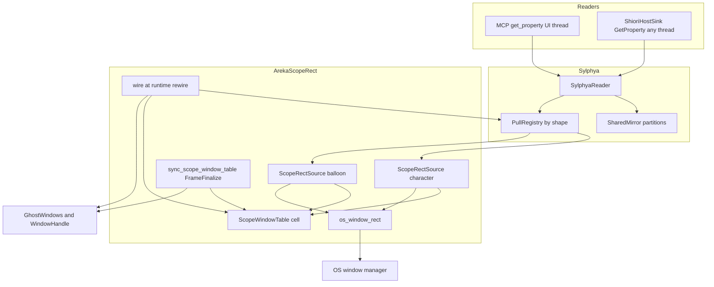
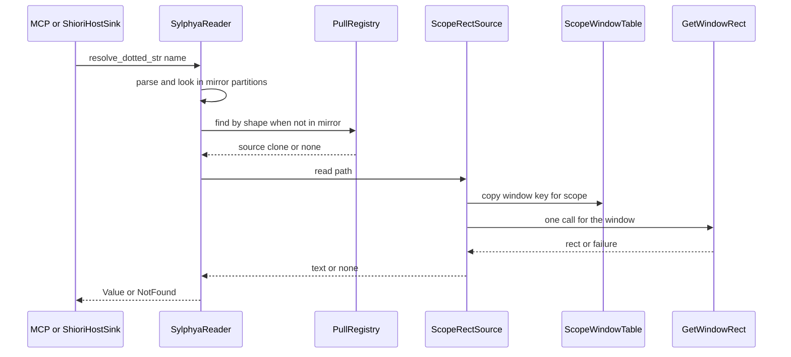
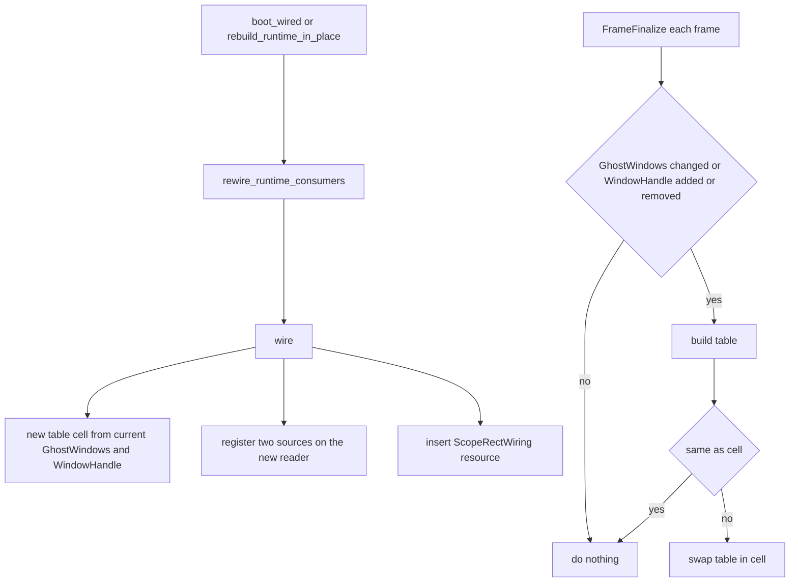

# 設計: mcp-scope-rect-property

> 2026-10-23・本ブランチ（main `15d8b0f3` の上）の実物で書いた。コードは「何の定義か」（関数名・型名＋ファイルパス）で指す。
> 入力: `requirements.md`（要件ディスカッションの決めを含む）・`research.md`（1〜9 節は退けた案 A の記録。決まった形は 10 節、設計の段の調べは 11 節）・`brief.md`・steering。

## Overview

**目的**: MCP の `get_property` とゴーストが読むプロパティの道で、`currentghost.scope(ID).rect`（キャラクターの窓）と `currentghost.balloon.scope(ID).rect`（バルーンの窓）を、OS が今その窓に持っている矩形「左,上,右,下」で答える。

**使う人**: AI エージェントで MCP を使う開発者と自動試験の道具（重なり・ドラッグ・画面をまたぐ移動を数で確かめる）と、プロパティの道で自分の窓の位置を聞くゴースト。

**変わること**: 値の置き場 sylphya に「名前の形に登録された読み手を、読まれた時に呼ぶ口」（プル）を足す。areka はその口に、OS の窓の矩形を 1 回で読む読み手を登録し、読み手が使う「スコープ → 窓の印」の表を、窓ができた・外れた・実行系を作り直した時点で差し替える（プッシュ）。読む道（`mcp/get_property.rs`・`shiori_host.rs`）は 1 行も変えない。

### Goals

- 2 つの名前を、MCP とゴーストの道の両方で、同じ時点に同じ値で答える（要件 1・2・6.6）。
- 窓が無い・壊れた・書式が読めないときの答えを SSP に合わせる（要件 3）。
- 読みは待たず、窓が動くたびの仕事を増やさない（要件 5）。
- 後の spec が同じ口に読み手を足せる（要件 7.4）。
- 決定論のテスト・実窓の `#[ignore]` テスト・MCP の実機の確かめ・台帳と手順書の直し（要件 8・9）。

### Non-Goals

- `currentghost.*` の残りの名前・倍率と DPI の名前・`\![get,property]` などの台本から読む道・`currentghost.scope(ID).surface(ID).rect`。
- 窓の置き方そのもの（位置は読むだけで変えない）。
- 完了 spec `areka-P0-sylphya` の文書の書き換え（直すのはコードのコメントだけ）。
- 「画面に出ているか」による答えの切り替え（SSP は切り替えない・`research.md` 7.1 節）。

## Boundary Commitments

### This Spec Owns

- sylphya の**プルの口**: 読み手の型 `PullSource`・名前の形 `PullShape`・登録の表・読み口 `SylphyaReader` での引く順（写しの区画が先・読み手が後）。
- areka の**窓の矩形の読み手** `ScopeRectSource`（キャラクター用とバルーン用の 2 つ）と、その材料の**表** `ScopeWindowTable`（スコープ → キャラクターの窓の印・バルーンの窓の印）。
- 表の**出し方**: 実行系を作るたびの結線（`wire`）と、窓ができた・外れた時点だけ動く系（`sync_scope_window_table`）。
- 本物の OS の読み取り `os_window_rect`（`GetWindowRect` を 1 回）と、その差し替え口 `ScopeRectReadSeam`（テスト用）。
- 4 つの数の文字の形（`左,上,右,下`）と、無いときの答え（`0,0,0,0`・値なし）の決め。
- sylphya のコメントの直し 2 か所（要件 7.8）・網羅台帳の 2 行・手順書の読み替えの所（要件 9.4・9.5）。

### Out of Boundary

- 窓を作る・壊す・動かす側（`placement/spawn.rs` の `spawn_ghost_windows`・`app_exit::close_windows_for_restart`・`placement/follow/window_move.rs`・ドラッグ・`\![move]`）。本 spec は公開の `GhostWindows` と wintf の `WindowHandle` を読むだけ。
- sylphya のアクター・写しの区画・保存（`actor.rs`・`mirror.rs` の区画・`persist/`）。プルの値は写しにも保存にも載らない。
- MCP の答えの文（`NG:Cannot find such property name.`）とゴーストの道の失敗の値（`SHIORI_E_PROPERTY_NOT_FOUND`）。今の文のまま使う（要件 3.4）。
- 名前の書式の読み方（`key.rs` の `parse_dotted`）。今の読み方の上で答えを決める。
- 後の spec の値（倍率・DPI・モニタの矩形など）。口だけを用意する。

### Allowed Dependencies

- `areka-sylphya` は今の依存（std・thiserror・tracing・toml・areka-actor）のまま。OS の型・`windows` クレート・上流の areka のクレートへ依存しない（最下層の規律）。
- areka 本体の新しいファイルは、`areka-sylphya`（`PullSource`・`PullShape`・`PropPath`・`Selector`・`SylphyaReader`）、`areka-ghost`（`GhostRuntime::sylphya_reader`）、`placement::spawn::GhostWindows` の公開の読み取り、wintf の `WindowHandle`、`windows` クレートの既にある機能（`Win32_UI_WindowsAndMessaging` の `GetWindowRect`・`Win32_UI_HiDpi` の `SetThreadDpiAwarenessContext`）だけを使う。新しい依存も新しい機能の指定も足さない。
- 依存の向き: `areka-sylphya`（口）← `areka`（読み手・表・結線）。sylphya が areka を知ることは無い。

### Revalidation Triggers

- `PullSource` の形（引数に問い手を足す・答えの型を変える）や `PullShape` の形の文字の規則を変えた → 読み手を足した後の spec（`shell-scale-linkage` ほか）が確かめ直す。
- 引く順（写しの区画が先）を変えた → 要件 7.5 の檻と、同じ名前を写しへ書く spec が確かめ直す。
- `GhostWindows` の公開の読み取り（`scopes`・`char_window`・`balloon_window`）や、窓が壊れるときの wintf の振る舞い（`WindowHandle` の外し方）を変えた → 本 spec の表の出し方を確かめ直す。
- `rewire_runtime_consumers` を通らずに実行系を置き場へ付ける道ができた → 読み手の登録が漏れる。
- プロセスの DPI の扱い（モニタごとの v2）を変えた → 座標の系（要件 1.3）を確かめ直す。

## Architecture

### Existing Architecture Analysis

- **読む道は 1 本**: MCP の `get_property`（`crates/areka/src/mcp/get_property.rs` の `handle`・UI スレッド）とゴーストの道（`crates/areka/src/shiori_host.rs` の `ShioriHostSink::GetProperty`・どのスレッドからでも）は、どちらも `SylphyaReader::resolve_dotted_str` を呼ぶだけ。本番のゴーストは 32bit の中継越しで `GetProperty` を持たず、`ShioriHostSink` はデモとテストの入口（要件の Introduction の 4）。
- **sylphya は実行系ごとに 1 つ**（`areka-ghost` の `spawn_ghost_sylphya`）。切替と `reload` で作り直され、読み口の複製（MCP が引く `GhostRuntime::sylphya_reader`・`ShioriHostSink` が持つ複製）は同じ `SharedMirror` を共有する。
- **実行系を作るたびに通る口**: `ghost_session_runtime.rs` の `rewire_runtime_consumers`。初回の起動と切替（`ghost_session.rs` の `boot_wired`）、`reload`（`rebuild_runtime_in_place`）の 3 つとも、実行系を置き場 `GhostSlot` へ付ける**前**に呼ぶ。
- **窓の印**: スコープ → 窓の entity は `placement::spawn::GhostWindows`。OS の窓の印は entity に付く wintf の `WindowHandle`（窓が実際にできた時に付く・entity が消えると外れて `WM_CLOSE` が投函される）。先例 `placement::spawn::register_ghost_windows_click_through` が `Added<WindowHandle>` を `FrameFinalize` で読んでいる。
- **守る約束**: 完了 spec `areka-P0-sylphya` の要件 2.7（同期の読みで他のスレッドを待たない・大域の鍵にならない・遅れうる値源を載せない）と 8.3（外の環境は注入できる値源を通す）。

### Architecture Pattern & Boundary Map



**組み立ての決め**:
- **選んだ形**: 「名前の形で引く読み手の登録」（プル）＋「読み手の材料の置き場の差し替え」（プッシュ）。sylphya は誰がどこに居るか（どの形にどの読み手）を知り、中身（HWND）は知らない。
- **値ごとの型（要件 7.7）**: 下の表。

| 値 | いつ変わるか | 型 | 理由 |
|---|---|---|---|
| 窓の矩形（キャラクター・バルーン） | ドラッグの毎フレーム・`\![move]` の途中・拡大率の違う画面への移動・面の替わり・OS の都合 | **プル** | 毎フレーム変わり、変わった時点を一か所で知れない（areka の書く口と OS の返りが印を立てずに `WindowPos` を書く・`research.md` 2.3 節）。写しは 1 回ごとに全区画を写し直すので、出す負荷が読み（まれ）より桁違いに大きい |
| スコープ → 窓の印の表 | 窓ができた・外れた・ゴーストを替えた・`reload` | **プッシュ** | まれで、変わった時点が `rewire_runtime_consumers` と ECS の変更の印で分かる |
| 読み手の登録 | 実行系を作った時 | **プッシュ**（登録） | 実行系ごとに 1 回 |

- **「材料を sylphya へ出す」の読み方**: 表の中身は OS の窓の印（HWND）で、sylphya は OS の型を持たない（要件 7.2）。そこで表は **sylphya に登録した読み手が持つ置き場**へ出す。sylphya は「この形の名前はこの読み手が知っている」までを持ち、中身を読まない。写しへ載せる形（アクター経由）は、出してから載るまでの隙間で実行系の付いた直後に読み手が居ない・表が空の時間ができ（要件 3.3・6.3 に当たる）、HWND を型を消して運ぶことになるので退けた（`research.md` 11.4 節）。
- **新しい部品の理由**: `pull.rs`＝sylphya に OS を持ち込まずに外の一次情報源を読む口が要る（要件 7.1・7.2）。`ghost_session_scope_rect.rs`＝実行系（sylphya）と窓の一式を結ぶ所で、`ghost_session` が両方を持つ。
- **steering の決まり**: sylphya の最下層の規律（依存を足さない）・ログの先出し（失敗の道を黙らせない）・テストは兄弟のファイル・1 ファイル 1,000 行の目安。

### Technology Stack

| 層 | 選んだもの / 版 | 役目 | 備考 |
|---|---|---|---|
| 値の置き場 | `areka-sylphya`（std の `RwLock`・`Arc`・`BTreeMap`） | プルの口と登録の表 | 依存は増やさない |
| アプリ | `areka`（bevy_ecs 0.19 の系・`Res`・`Query`・`RemovedComponents`） | 表を出す系と結線 | 先例 `register_ghost_windows_click_through` と同じ段 `FrameFinalize` |
| OS | `windows` 0.62.2（`Win32_UI_WindowsAndMessaging`・`Win32_UI_HiDpi`・どちらもワークスペースで有効） | `GetWindowRect`・`SetThreadDpiAwarenessContext` | 機能の指定を足さない |

## File Structure Plan

### Directory Structure

```
crates/areka-sylphya/src/
├── pull.rs                      # 新: PullSource・PullShape・PullRegistry（登録の表）・形の文字を作る関数
└── pull_tests.rs                # 新: 口の決定論テスト（形の一致・引く順・複製の共有・再入・置き換え）

crates/areka/src/
├── ghost_session_scope_rect.rs        # 新: 表・読み手・結線・表を出す系・本物の OS の読み取り・差し替え口
└── ghost_session_scope_rect_tests.rs  # 新: 読み手と表の決定論テスト・切替と起動し直し・実窓の #[ignore]
```

> テストが 1,000 行を超えるなら、テーマで `ghost_session_scope_rect_session_tests.rs`（実行系を通すもの）を分け、共有の部品は `ghost_session_scope_rect_test_support.rs` へ置く（`structure.md` の決まり）。

### Modified Files

- `crates/areka-sylphya/src/reader.rs` — `SylphyaReader` に登録の表 `PullRegistry` の欄を足す（`new` の形は変えない）。`register_pull` を足す。`resolve_dotted_canonical` で写しの区画に無いときだけ登録の表を引く。冒頭のコメントを要件 2.7・8.3 の言い方へ直す（要件 7.8）。
- `crates/areka-sylphya/src/mirror.rs` — `SharedMirror::load` の説明を直す（`load` 自身が鍵と複製だけをすることは残し、読み経路全体の約束は要件 2.7・8.3 の言い方にする）。コードは変えない。
- `crates/areka-sylphya/src/lib.rs` — `pub mod pull;` と `pub use pull::{PullShape, PullSource};`。`#[cfg(test)]` の宣言は `pull.rs` の中に置く。
- `crates/areka/src/ghost_session.rs` — `#[path = "ghost_session_scope_rect.rs"] pub(crate) mod ghost_session_scope_rect;` の宣言 1 つ（`pub(crate)` は `mcp/get_property_tests.rs` から差し替え口 `ScopeRectReadSeam` を使うため）と、`register_systems` に `ghost_session_scope_rect::register(world);` の 1 行。理由: 系の登録はプロセスに 1 回で、先例が並ぶ所がここだけ。
- `crates/areka/src/ghost_session_runtime.rs` — `rewire_runtime_consumers` に `super::ghost_session_scope_rect::wire(world, runtime);` の 1 行。理由: 初回の起動・切替・`reload` の 3 つが共に通り、実行系を置き場へ付ける前の唯一の所。
- `crates/areka/src/mcp/get_property_tests.rs` — テストを足すだけ（MCP の `handle` は `mcp` の中からしか呼べないので、両方の道の一致〔要件 6.6・8.3〕と `reload` の後の答え〔要件 6.3〕はここに置く。本番の `mcp/get_property.rs` は変えない）。
- `doc/ukadoc-coverage/ledger/property.toml` — 2 行（`currentghost.scope_28ID_29.rect`・`currentghost.balloon.scope_28ID_29.rect`）を `status = "implemented"` に改め、`note` に実装の場所とテストを書く。証拠は新しいファイルの `// ukadoc:` の行（URL はカタログの形 `…list_propertysystem.html#currentghost.scope_28ID_29.rect:1`・`…#currentghost.balloon.scope_28ID_29.rect:1`）。
- `doc/ukadoc-coverage/report/property.md` — 台帳を直した後、`cargo run -p ukadoc-survey -- report` で作り直す（手で書き換えない・`ukadoc-survey` の一貫性テスト `DomainReportStale` が台帳と食い違いを見る）。束が閉じるかで `linkage.md` など他の報告が動けば、それも生成の結果のまま載せる。全体の `summary.md`（`report-summary`）は統合の担当が作り直す決まりなので触らない。
- `doc/pasta-real-run.md` — 「位置の読み方」の段落を `get_property` で読む形へ戻し、表の段 1・4・5 の本 spec の欄を「着地済み・確かめる」の形に改める。

### ウェーブ C11 の約束との当たり

| ファイル | 触るか | 当たり |
|---|---|---|
| `crates/areka-sylphya/src/{reader,mirror}.rs`・`lib.rs`・新しい `pull.rs` | 触る | ④ の表の内（`lib.rs` は表に無いが、誰の持ち物でもない）。`persist/`（③）には触らない |
| `crates/areka-sylphya/src/actor.rs`・`vocab/dotted.rs` | **触らない** | 表には在ったが要らなくなった |
| `crates/areka-ghost/src/{sylphya_wiring,runtime}.rs` | **触らない** | 公開の `GhostRuntime::sylphya_reader` を使うだけ |
| `crates/areka/src/mcp/get_property.rs`・`shiori_host.rs` | **触らない** | 読む道は変えない |
| `crates/areka/src/mcp/get_property_tests.rs`（139 行） | 触る（テストを足す） | ④ の持ち物の兄弟のテスト。⑦ は `mcp/get_property.rs` に触らない約束で、このテストにも触らない |
| `crates/areka/src/ghost_session.rs`（917 行） | 触る（宣言 1・登録 1 行） | C11 のどの spec の表にも無い。登録の行が隣り合う spec が出れば手で直せる大きさの競合 |
| `crates/areka/src/ghost_session_runtime.rs`（182 行） | 触る（1 行） | C11 のどの spec の表にも無い |
| `main.rs`・`emo2_boot/mod.rs`・`emo2_boot/frame.rs` | **触らない** | 約束どおり |
| ⑥ の持ち物（`placement/{spawn,persist,chain_realign,chain_finalize}.rs`・`emo2_boot/frame/{dpi,drain_resnap}.rs`） | **触らない** | `GhostWindows` の公開の読み取りを使うだけ。⑥ との調整は要らない |
| `placement/follow/window_move.rs` | **触らない** | 窓の位置は OS から読むので `window_rect_of` を使わない（判定の複製も作らない） |

## System Flows

### 読み（プル）



- 鍵（写しの鍵・登録の表の鍵・表の鍵）は、どれも「読みの鍵を取って中身を写し、すぐ外す」だけで、鍵を持ったまま次へ進まない。読み手を呼ぶ時も、OS を呼ぶ時も、鍵は持っていない（読み手の中から同じ読み口を呼び戻しても止まらない）。
- OS への問い合わせは 1 回で、4 つの数はその 1 回の答えから組む（要件 4.7・8.4）。OS は 1 回の問い合わせに、その時点の窓の矩形 1 つを返す。
- 「動き終えた後」（要件 4.1〜4.6）は「OS がその窓を新しい位置と大きさに置いた後」と読む（要件 1.6 の「OS が持っている矩形」）。areka が積んだ移動の命令を OS が当てる前の読みは、OS がまだ持っている前の矩形を返す。写しを持たないので、OS が当てた後の読みが古い矩形を返すことは無い。

### 表の出し方（プッシュ）



- `wire` は実行系を置き場へ付ける前に同期で走るので、実行系が見えた瞬間から読み手が居て、表もその時点のもの（要件 3.3・6.2・6.3）。
- `wire` は毎回**新しい置き場**を作る。前の実行系の読み手は前の置き場を持ったまま捨てられる（前のゴーストの窓を新しい実行系が答えない・要件 6.2）。
- 系は印が立った時だけ表を組む。印が立っても中身（窓の印）が同じなら差し替えない。窓の移動では `GhostWindows` も `WindowHandle` も印が立たない（要件 5.4）。

## Requirements Traceability

| 要件 | 要旨 | 部品 | 口 | 流れ |
|---|---|---|---|---|
| 1.1 | キャラクターの窓の矩形を答える | ScopeRectSource（Character）・PullRegistry | `PullSource::read` | 読み |
| 1.2 | どのスコープも同じ名前の形 | PullShape・ScopeRectSource | 形 `currentghost.scope(*).rect` | 読み |
| 1.3 | 物理の画素・主の画面の左上が原点 | os_window_rect | `GetWindowRect`＋スレッドの DPI を v2 に | 読み |
| 1.4 | `,` でつなぐ・空白も `+` も前ゼロも無し | rect_text | `rect_text` | 読み |
| 1.5 | 右＝左＋幅・下＝上＋高さ | os_window_rect・rect_text | `RECT` の右と下は外の最初の画素 | 読み |
| 1.6 | 読んだ時点の OS の窓の外枠 | os_window_rect | `GetWindowRect`（`WindowPos` を使わない） | 読み |
| 1.7 | 重なった 2 つの窓は同じ数 | ScopeRectSource | 窓ごとに OS へ聞く | 読み |
| 1.8 | 面を隠しても（`\s[-1]`）同じ答え | ScopeRectSource・ScopeWindowTable | 表は可視を持たない | 読み |
| 1.9 | `scope(00)` は `scope(0)` | 今の `parse_dotted`・ScopeRectSource | `Selector::ByIndex(0)` | 読み |
| 2.1 | バルーンの窓の矩形を同じ系と形で | ScopeRectSource（Balloon） | 形 `currentghost.balloon.scope(*).rect` | 読み |
| 2.2 | ID はバルーンが付くスコープ | ScopeWindowTable | `GhostWindows::balloon_window(scope)` | 表の出し方 |
| 2.3 | 大きさが変わった後の矩形 | os_window_rect | OS の今の値 | 読み |
| 2.4 | 出ていないバルーンも窓の矩形 | ScopeWindowTable | 表は可視を持たない | 読み |
| 3.1 | 無い番号・負の番号は `0,0,0,0` | ScopeRectSource | `ByIndex` の表に無い・`ByName` の負の数 | 読み |
| 3.2 | 無いバルーンは値なし | ScopeRectSource | `None` | 読み |
| 3.3 | 窓ができる前は無いときの答え | wire・ScopeWindowTable | 印の無い窓は表で `None` | 表の出し方 |
| 3.4 | 値なしは今の文で | 今の `mcp/get_property.rs`・`shiori_host.rs` | `DottedResolution::NotFound` | 読み |
| 3.5 | 壊れた窓は無いときの答え | ScopeRectSource・sync_scope_window_table | OS の失敗 → 無い・印が外れたら表から外す | 両方 |
| 3.6 | 書式が読めない名前は値なし | 今の `parse_dotted`・PullShape・ScopeRectSource | 形が合わない・`ByName` の負の数でない中身 | 読み |
| 4.1 | ドラッグの後 | os_window_rect | プル | 読み |
| 4.2 | `\![move]` の後 | os_window_rect | プル | 読み |
| 4.3 | 拡大率の違う画面への移動の後 | os_window_rect | プル（スレッドの DPI を v2 に） | 読み |
| 4.4 | 面が替わった後 | os_window_rect | プル | 読み |
| 4.5 | 一緒に動いた窓とバルーン | ScopeRectSource | 窓ごとにプル | 読み |
| 4.6 | 変わる前の矩形を答えない | os_window_rect | 写しを持たない | 読み |
| 4.7 | 混ぜた矩形を答えない | os_window_rect・rect_text | 1 回の問い合わせ | 読み |
| 5.1 | 他のスレッドを待たない | PullRegistry・ScopeRectSource・os_window_rect | 鍵は写すだけ・`GetWindowRect` はメッセージを送らない | 読み |
| 5.2 | ゴーストの処理の途中でも止まらない | PullRegistry | 鍵を持ったまま読み手を呼ばない | 読み |
| 5.3 | 窓の移動・描画を遅らせない | os_window_rect・sync_scope_window_table | UI スレッドの仕事は印が立った時だけ | 両方 |
| 5.4 | 窓が動くたびに作り直さない | sync_scope_window_table | 移動では印が立たない | 表の出し方 |
| 5.5 | 読みで警告以上を残さない | ScopeRectSource・reader.rs | 記録は `debug!` 以下 | 読み |
| 6.1 | 聞いたゴーストの窓 | wire | 実行系ごとの sylphya に登録 | 表の出し方 |
| 6.2 | 替えたら前のゴーストを答えない | wire | 実行系ごとに新しい置き場 | 表の出し方 |
| 6.3 | 読み直しの後の矩形 | wire | `rebuild_runtime_in_place` → `rewire_runtime_consumers` | 表の出し方 |
| 6.4 | 保存しない | PullRegistry | 写しにも保存にも載せない | 読み |
| 6.5 | 起動し直したら前の起動を答えない | wire・ScopeWindowTable | 表はプロセスの中だけ | 表の出し方 |
| 6.6 | 両方の道で同じ値 | SylphyaReader | 同じ読み口・同じ読み手 | 読み |
| 7.1 | 登録された読み手で取りに行く口を 1 つ | PullRegistry・PullSource・PullShape | `SylphyaReader::register_pull` | 読み |
| 7.2 | sylphya は OS のコードを持たない | pull.rs | 読み手は areka が登録 | — |
| 7.3 | 待たず遅れない読み手に限る | PullSource の約束・ScopeRectSource | トレイトの約束と鍵の扱い | 読み |
| 7.4 | 後の spec が読む道を変えずに足せる | PullRegistry | 形を変えて登録するだけ | — |
| 7.5 | ほかの値と混ぜない | reader.rs | 写しの区画が先・読み手は無い時だけ | 読み |
| 7.6 | まれに変わる材料はプッシュ | wire・sync_scope_window_table | 置き場の差し替え | 表の出し方 |
| 7.7 | 値ごとに型を選んで書く | 本書の「値ごとの型」の表 | — | — |
| 7.8 | 言い過ぎのコメントを直す | reader.rs・mirror.rs | コメントのみ | — |
| 8.1 | 偽の読み手で各場面を決定論で | ghost_session_scope_rect_tests・pull_tests | `ScopeRectReadSeam`・偽の `WindowHandle` | — |
| 8.2 | 数の形を負の座標で | ghost_session_scope_rect_tests | `rect_text` | — |
| 8.3 | 両方の道で同じ | mcp/get_property_tests | `handle` と `ShioriHostSink::GetProperty` | — |
| 8.4 | 1 回の問い合わせから組む | ghost_session_scope_rect_tests | 呼んだ回数を数える偽 | — |
| 8.5 | 本物の読み手を実窓で | ghost_session_scope_rect_tests（`#[ignore]`） | `os_window_rect` | — |
| 9.1 | 実機は排他の机を持ってから | 実機の手順（下の Testing Strategy） | — | — |
| 9.2 | 段 1・4・5 で値と記録が一致 | 実機の手順 | MCP `get_property` | — |
| 9.3 | SSP の基準と並べて書き分け | 実機の手順・検証の記録 | — | — |
| 9.4 | 台帳の 2 行を改める | property.toml | `status = "implemented"`・証拠の `// ukadoc:` | — |
| 9.5 | 手順書を戻す | doc/pasta-real-run.md | — | — |

## Components and Interfaces

| 部品 | 層 | 役目 | 要件 | 主な依存 | 契約 |
|---|---|---|---|---|---|
| PullSource・PullShape・PullRegistry | sylphya | 形で引く読み手の登録と呼び出し | 7.1〜7.5・5.1・5.2・6.4 | なし（std） | Service・State |
| SylphyaReader（足し分） | sylphya | 写しの後に読み手を引く・登録の口 | 6.6・7.1・7.5・7.8 | PullRegistry（P0） | Service |
| ScopeRectSource | areka | 名前の選択子 → 表 → OS の矩形 → 文字 | 1・2・3・4・5.5 | ScopeWindowTable（P0）・WindowRectFn（P0） | Service |
| ScopeWindowTable・ScopeRectWiring | areka | スコープ → 窓の印の置き場 | 2.2・3.3・3.5・6.1〜6.5・7.6 | GhostWindows（P0）・WindowHandle（P0） | State |
| wire・sync_scope_window_table・register | areka | 登録と表の出し方 | 3.3・5.3・5.4・6.1〜6.3・7.6 | GhostRuntime（P0）・Schedules（P1） | Batch（段の系） |
| os_window_rect・ScopeRectReadSeam | areka | OS の窓の矩形を 1 回で読む・テストの差し替え | 1.3・1.5・1.6・4.x・8.5 | Win32（P0） | Service |

### sylphya の口

#### PullSource・PullShape・PullRegistry（`crates/areka-sylphya/src/pull.rs`）

| 欄 | 中身 |
|---|---|
| 役目 | 名前の形に登録された読み手を、読まれた時に呼ぶ |
| 要件 | 5.1・5.2・6.4・7.1・7.2・7.3・7.4・7.5 |

**責務と制約**
- sylphya は読み手の中身（OS・HWND）を知らない。登録の表は「形の文字 → 読み手」だけ。
- 形の文字は、名前を `parse_dotted` で読み、**選択子の付いた区切りの選択子を `(*)` に置き換え**、区切りを `.` でつないだもの（`currentghost.scope(0).rect` も `currentghost.scope(*).rect` も `currentghost.scope(*).rect`）。選択子の無い区切りはそのまま（`currentghost.scope.rect` は別の形）。英字は `parse_dotted` が小文字に畳んだもの。
- 同じ形へもう一度登録すると前の読み手を置き換える（実行系の作り直しで登録し直すため）。
- 登録の表の鍵は、引く時に読み手の `Arc` を写してすぐ外す。読み手を呼ぶのは鍵の外（読み手の中から同じ読み口を呼び戻しても止まらない）。鍵が壊れていても（poison）中身を使って続ける（`SharedMirror::load` と同じ）。
- 読み手の答えは写しにも保存にも書かない（要件 6.4）。

**依存**
- Inbound: `SylphyaReader`（引く・登録する）— P0
- Outbound: 登録された読み手（areka の `ScopeRectSource` ほか）— P0
- External: なし

**契約**: Service [x] / State [x]

##### Service Interface

```rust
/// 読まれた時に、外の一次情報源から値を取りに行く読み手（areka の側が実装して登録する）。
///
/// 約束（要件 5.1・7.3）: 窓を持つスレッドやほかのスレッドの返事を待たず、遅れもしない読み取りだけを
/// 行う。メッセージを送る OS の関数・チャネルの受け取り・他のアクターへの問い合わせを使わない。
pub trait PullSource: Send + Sync {
    /// 聞かれた名前（形が登録と合ったもの）に答える。`None` は値なし。
    fn read(&self, path: &PropPath) -> Option<String>;
}

/// 読み手を登録する名前の形（選択子を `(*)` に寄せた正準の文字）。
#[derive(Clone, Debug, PartialEq, Eq, PartialOrd, Ord)]
pub struct PullShape(String);

impl PullShape {
    /// 名前または形の文字から形を作る（`parse_dotted` の誤りはそのまま返す）。
    pub fn parse(pattern: &str) -> Result<PullShape, KeyParseError>;
    /// 読んだ名前の形（引く時に使う）。
    pub fn of(path: &PropPath) -> PullShape;
    pub fn as_str(&self) -> &str;
}

/// 形 → 読み手の表（読み口の複製どうしで共有する）。crate の中だけ。
#[derive(Clone, Default)]
pub(crate) struct PullRegistry {
    inner: Arc<RwLock<BTreeMap<PullShape, Arc<dyn PullSource>>>>,
}

impl PullRegistry {
    pub(crate) fn register(&self, shape: PullShape, source: Arc<dyn PullSource>);
    pub(crate) fn find(&self, path: &PropPath) -> Option<Arc<dyn PullSource>>;
}
```
- 事前条件: `register` の `shape` は `PullShape::parse` で作ったもの。
- 事後条件: `register` の後、同じ `PullRegistry` を共有するどの読み口からも、その形の名前は登録した読み手で答える。
- 不変: 表を書くのは登録の時だけ。読みは表を変えない。

#### SylphyaReader の足し分（`crates/areka-sylphya/src/reader.rs`）

| 欄 | 中身 |
|---|---|
| 役目 | 写しの区画に無い点付きの名前を、登録された読み手に聞く |
| 要件 | 6.6・7.1・7.5・7.8 |

```rust
pub struct SylphyaReader {
    shared: SharedMirror,
    pull: PullRegistry, // new: SylphyaReader::new(shared) は空の表で作る（形は変えない）
}

impl SylphyaReader {
    /// 名前の形に読み手を登録する（同じ形は置き換え）。複製どうしで共有される。
    pub fn register_pull(&self, shape: PullShape, source: Arc<dyn PullSource>);
}
```
- 引く順: 問い手の区画 → 大域の区画（今のまま）→ **どちらにも無い時だけ** `pull.find(path)` → 読み手の `read(path)`。`Some(v)` は `DottedResolution::Value(v)`、それ以外は `NotFound`。
- `resolve_dotted`（`PropPath` を受ける口）と `resolve_dotted_str` の両方がこの順を通る。`resolve_flat`・`talk_snapshot` は変えない（フラットの名前は読み手を引かない）。
- 記録: 「どこにも無い」の `debug!`（今の "dotted resolution not found"）は読み手も無い／値なしの時にだけ出す。
- コメント（要件 7.8）: 冒頭の「チャネルの送受信・ファイル IO・OS 呼出…一切行わない」を、「読みは写しの読みの鍵と `Arc` の複製、登録の表の読みの鍵と複製、登録された読み手の呼び出しだけを行う。他のスレッドを待たない・遅れうる値源を載せない（完了 spec の要件 2.7）。外の環境は外から登録された読み手を通す（同 8.3）。読み手はその約束を守るものだけを登録する」の言い方へ直す。

### areka の読み手と表

#### ScopeRectSource（`crates/areka/src/ghost_session_scope_rect.rs`）

| 欄 | 中身 |
|---|---|
| 役目 | 名前の選択子からスコープを決め、表で窓の印を引き、OS に 1 回聞いて「左,上,右,下」で答える |
| 要件 | 1.1〜1.9・2.1〜2.4・3.1・3.2・3.5・3.6・4.1〜4.7・5.1・5.5 |

**責務と制約**
- 選択子の読み（区切り「scope」の選択子）:
  - `ByIndex(n)` → スコープ `n`。
  - `ByName(s)` で `s` が「`-` と 1 つ以上の半角数字」 → **負の番号**＝窓を持たないスコープ。
  - それ以外の `ByName`（`x`・空・`+1` など）→ **書式の誤り**＝値なし（要件 3.6）。
- 答え:

| 場面 | キャラクター（`currentghost.scope(ID).rect`） | バルーン（`currentghost.balloon.scope(ID).rect`） |
|---|---|---|
| 表に窓の印があり、OS が矩形を返した | `左,上,右,下` | `左,上,右,下` |
| 表に無い番号・負の番号 | `0,0,0,0` | 値なし |
| 表のスコープは在るが印がまだ無い（窓ができる前） | `0,0,0,0` | 値なし |
| OS が失敗した（窓が壊れた） | `0,0,0,0` | 値なし |
| 書式の誤り（上の選択子の読み） | 値なし | 値なし |

- 「画面に出ているか」は見ない（要件 1.8・2.4）。表に可視の欄を持たない。
- 記録: 普通の答えでは記録しない。OS の失敗は `debug!`（`event = "scope_rect_window_gone"`・スコープ・種類）で、警告以上を出さない（要件 5.5）。窓が無い答えは定めた答えで、失敗の道ではない。
- 表の鍵は、窓の印（`WindowKey`）を写す間だけ持つ。OS を呼ぶ時は持たない。

**依存**
- Inbound: `PullRegistry`（sylphya）— P0
- Outbound: `ScopeWindowTable` の置き場 — P0、`WindowRectFn`（本物は `os_window_rect`）— P0
- External: なし

**契約**: Service [x]

##### Service Interface

```rust
/// 窓の印（HWND の生の値）。HWND はスレッドをまたいで送れないので値で持つ。
#[derive(Clone, Copy, Debug, PartialEq, Eq)]
pub(crate) struct WindowKey(pub(crate) isize);

/// 画面の矩形（物理の画素・仮想画面の座標・右と下は外の最初の画素）。
#[derive(Clone, Copy, Debug, PartialEq, Eq)]
pub(crate) struct ScreenRect { pub left: i32, pub top: i32, pub right: i32, pub bottom: i32 }

/// 窓の印から今の矩形を 1 回で読む関数。`None` は窓が無い（壊れた・読めない）。
pub(crate) type WindowRectFn = Arc<dyn Fn(WindowKey) -> Option<ScreenRect> + Send + Sync>;

#[derive(Clone, Copy, Debug, PartialEq, Eq)]
pub(crate) enum RectTarget { Character, Balloon }

pub(crate) struct ScopeRectSource {
    target: RectTarget,
    table: Arc<RwLock<ScopeWindowTable>>,
    read_rect: WindowRectFn,
}

impl areka_sylphya::PullSource for ScopeRectSource {
    fn read(&self, path: &PropPath) -> Option<String>;
}

/// 4 つの数を `左,上,右,下` にする（`i32` の 10 進・空白なし）。
pub(crate) fn rect_text(rect: ScreenRect) -> String;
```
- 事前条件: 登録の形がキャラクターなら `currentghost.scope(*).rect`、バルーンなら `currentghost.balloon.scope(*).rect`（形が合った名前だけが届く）。
- 事後条件: OS への問い合わせは 1 回以下。答えの 4 つの数はその 1 回の答えから組む。

#### ScopeWindowTable・ScopeRectWiring（同じファイル）

| 欄 | 中身 |
|---|---|
| 役目 | スコープ → キャラクターの窓の印・バルーンの窓の印の置き場（実行系ごと） |
| 要件 | 2.2・3.3・3.5・6.1〜6.5・7.6 |

**契約**: State [x]

##### State Management

```rust
#[derive(Clone, Copy, Debug, Default, PartialEq, Eq)]
pub(crate) struct ScopeWindowKeys { pub character: Option<WindowKey>, pub balloon: Option<WindowKey> }

#[derive(Clone, Debug, Default, PartialEq, Eq)]
pub(crate) struct ScopeWindowTable(BTreeMap<usize, ScopeWindowKeys>);

impl ScopeWindowTable {
    /// `GhostWindows` の各スコープについて、窓の entity から窓の印を引いて組む（純粋）。
    pub(crate) fn build(windows: &GhostWindows, key_of: impl Fn(Entity) -> Option<WindowKey>) -> Self;
}

/// 今の実行系の読み手と共有する置き場（`wire` が実行系ごとに作り直す）。
#[derive(Resource)]
pub(crate) struct ScopeRectWiring { table: Arc<RwLock<ScopeWindowTable>> }

/// テスト用の OS の読み取りの差し替え口（本番は入れない＝本物の `os_window_rect`）。
#[derive(Resource, Clone)]
pub(crate) struct ScopeRectReadSeam(pub(crate) WindowRectFn);
```
- 中身: `GhostWindows` が持つスコープだけが鍵になる。窓の entity に `WindowHandle` が付いていなければ `None`（窓ができる前・要件 3.3）。
- 保存: しない（要件 6.4・6.5）。プロセスの中だけ。
- 並行: 書き手は UI スレッドだけ（`wire` と系）。読み手（どのスレッドからでも）は読みの鍵で窓の印を写すだけ。鍵が壊れていても中身で続ける。
- 実行系ごと: `wire` は毎回新しい置き場を作る。前の実行系の読み手は前の置き場を持ったまま捨てられる。

#### wire・sync_scope_window_table・register（同じファイル）

| 欄 | 中身 |
|---|---|
| 役目 | 実行系を作るたびに読み手を登録し、窓ができた・外れた時点で表を差し替える |
| 要件 | 3.3・3.5・5.3・5.4・6.1・6.2・6.3・7.6 |

**契約**: Batch [x]

##### Batch / Job Contract

```rust
/// 実行系に読み手を登録し、今の窓の一式から表を組む（`rewire_runtime_consumers` から・同期）。
pub(crate) fn wire(world: &mut World, runtime: &GhostRuntime);

/// `wire` の中身（テストは sylphya の読み口を直に渡せる）。
pub(crate) fn wire_reader(world: &mut World, reader: &SylphyaReader);

/// 表を出す系（`FrameFinalize`）。
pub(crate) fn sync_scope_window_table(
    windows: Option<Res<GhostWindows>>,
    handles: Query<&WindowHandle>,
    added: Query<(), Added<WindowHandle>>,
    mut removed: RemovedComponents<WindowHandle>,
    wiring: Option<Res<ScopeRectWiring>>,
);

/// 系をプロセスに 1 回だけ載せる（`ghost_session::register_systems` から）。
pub(crate) fn register(world: &mut World);
```
- `wire_reader` の手順: ⑴ World の `GhostWindows` と各窓の `WindowHandle` から表を組む（`GhostWindows` が無ければ空）⑵ 新しい置き場に入れる ⑶ 読み取りの関数を決める（`ScopeRectReadSeam` が在ればそれ、無ければ `os_window_rect`）⑷ キャラクター用とバルーン用の `ScopeRectSource` を作り、`reader.register_pull` で 2 つの形へ登録する ⑸ `ScopeRectWiring` を World へ入れる（前のものを置き換える）。
- 系の起き口: `windows` が在って変わった（入れ直しを含む）、`added` が 1 件以上、`removed` が 1 件以上、のどれか。どれも無ければ何もしない。`wiring` が無い（実行系が無い起動）なら何もしない。
- 系の中身: 表を組み（`windows` が無ければ空）、置き場の今の中身と違う時だけ書きの鍵で差し替える。差し替えた時だけ `debug!`（`event = "scope_rect_table_updated"`・スコープの数）。
- 何度呼んでも同じ（冪等）: 同じ窓の一式なら同じ表になり、差し替えない。
- 移動では起きない: ドラッグ・`\![move]`・拡大率の遷移は `WindowPos` を書くだけで、`WindowHandle` の付け外しも `GhostWindows` の入れ直しもしない。`GhostWindows` の既定位置の追随（システムの置き直しの時だけ）で起きても、窓の印が同じなので差し替えない。

#### os_window_rect（同じファイル）

| 欄 | 中身 |
|---|---|
| 役目 | 窓の印から OS の今の窓の矩形を 1 回で読む（本物） |
| 要件 | 1.3・1.5・1.6・4.1〜4.7・5.1・8.5 |

**契約**: Service [x]

```rust
// ukadoc: https://ssp.shillest.net/ukadoc/manual/list_propertysystem.html#currentghost.scope_28ID_29.rect:1
// ukadoc: https://ssp.shillest.net/ukadoc/manual/list_propertysystem.html#currentghost.balloon.scope_28ID_29.rect:1
pub(crate) fn os_window_rect(key: WindowKey) -> Option<ScreenRect>;
```
- 呼ぶ間だけ、呼んだスレッドの DPI の扱いを `DPI_AWARENESS_CONTEXT_PER_MONITOR_AWARE_V2` にし（`SetThreadDpiAwarenessContext`）、`GetWindowRect` を 1 回呼び、扱いを元へ戻す。`GetWindowRect` は「DPI で仮想化される」（呼んだスレッドの扱いで値が変わる）ため、ゴーストの道の呼び手のスレッドがどの扱いでも物理の画素で返す（要件 1.3）。
- `GetWindowRect` は窓のスレッドへメッセージを送らない読み取りで、窓を持つスレッドを待たない（要件 5.1）。ゴーストの窓は枠の無い `WS_POPUP` なので、窓の矩形は見えている外枠と同じ（見えない縁を含まない）。
- 失敗（壊れた窓の印など）は `None`。
- `unsafe` はこの関数の中に閉じる。

## Data Models

### Domain Model

- **名前の形**（`PullShape`）: 選択子を `(*)` に寄せた名前。登録の鍵。
- **読み手**（`PullSource`）: 形 1 つに 1 つ。値を持たず、読まれた時に一次情報源へ聞く。
- **表**（`ScopeWindowTable`）: スコープ → 窓の印 2 つ。実行系ごとの置き場に 1 つ。
- 不変: 読み手の答えは写しにも保存にも入らない。写しに同じ名前の値が在れば、そちらが答えになる（`currentghost.*` はゴーストが書けないので、今は起きない）。

### Data Contracts & Integration

- 値の文字: `左,上,右,下`。`i32` の 10 進。負の数は `-` を付ける。空白・`+`・前ゼロは付けない（Rust の `i32` の表示どおり）。
- 無いときの答え: キャラクターは `0,0,0,0`（文字の値）、バルーンは値なし（`DottedResolution::NotFound` → MCP は `NG:Cannot find such property name.`・ゴーストの道は `SHIORI_E_PROPERTY_NOT_FOUND`）。

## Error Handling

### Error Strategy

| 場面 | 振る舞い | 記録 |
|---|---|---|
| 窓の印が壊れていた・`GetWindowRect` が失敗 | 窓を持たないスコープと同じ答え | `debug!`（`scope_rect_window_gone`） |
| 表の鍵・登録の表の鍵が壊れていた（poison） | 中身を使って続ける（読みを失敗させない） | なし（`SharedMirror::load` と同じ扱い） |
| 実行系が無い（LogSink の起動） | 読み手を登録しない。MCP は今の「実行系が無い」の答え | 今の `mcp_get_property_unavailable` |
| 書式の誤り | 値なし（`parse_dotted` の誤りは今の `warn!`・`ByName` の誤りは記録なし） | 今のまま |
| `SetThreadDpiAwarenessContext` が元の扱いを返さない（0） | `GetWindowRect` は呼び、戻しは行わない（扱いを変えられていない） | `debug!`（`event = "scope_rect_dpi_context_unchanged"`）。失敗の道を黙らせない。警告以上は出さない（要件 5.5） |

### Monitoring

- 表の差し替え: `debug!(event = "scope_rect_table_updated", scopes)`。窓ができた・外れた・実行系を作り直した時だけ（まれ）。
- 窓が無い答え: `debug!(event = "scope_rect_window_gone", scope, target)`。

## Testing Strategy

偽の OS の読み手（`ScopeRectReadSeam` か `ScopeRectSource` に直に渡す `WindowRectFn`）と偽の窓の印（`fake_handle` の形の `WindowHandle`）で、実の窓・実の画面・実の時計なしに回す（要件 8.1）。

### 単体（`crates/areka-sylphya/src/pull_tests.rs`）
1. 形: `currentghost.scope(0).rect`・`currentghost.scope(00).rect`・`CURRENTGHOST.SCOPE(1).RECT` が同じ形になり同じ読み手に届く。`currentghost.scope.rect`・`currentghost.scope(0).rect.x` は届かない（要件 1.9・3.6・7.1）。
2. 引く順: 大域の区画に同じ名前の値が在れば、読み手を登録しても答えは変わらない。登録の前後で `talk_snapshot` と別の名前の答えが変わらない（要件 7.5）。
3. 共有と置き換え: 登録の前に作った読み口の複製でも登録した読み手で答える。同じ形への 2 度目の登録で答えが替わる（要件 6.3・6.6・7.4）。
4. 再入: 読み手の中から同じ読み口で別の名前を読んでも止まらない（要件 5.2）。
5. 保存しない: 読んだ後も写しの `epoch` が変わらない（要件 6.4）。

### 単体（`crates/areka/src/ghost_session_scope_rect_tests.rs`・読み手と表）
1. 数の形: 主の画面より左上の画面の矩形（例 `-2560,195` から幅 831・高さ 1026）で `-782,201,49,1227` の形になる。右＝左＋幅・下＝上＋高さ・空白なし（要件 1.3〜1.5・8.2）。
2. 無いとき: 表に無い番号・`scope(-1)`・印の無い窓・OS の失敗でキャラクターは `0,0,0,0`、バルーンは値なし。`scope(x)`・`scope()`・`scope(+1)` は両方値なし（要件 3.1〜3.3・3.5・3.6）。
3. 1 回の問い合わせ: 呼ぶたびに違う矩形を返し回数を数える偽で、1 回の読みの呼び出しは 1 回、答えはその 1 回の矩形そのもの（要件 4.7・8.4）。
4. 動いた後: 偽の OS の矩形を替えた後の読みは新しい矩形（ドラッグ・`\![move]`・拡大率の違う画面・面の替わり・一緒に動いた窓とバルーンを、偽の値の替え方で表す）。重なった 2 つの窓は同じ数（要件 1.7・2.3・4.1〜4.6）。
5. 表の出し方（窓なしの World・`spawn_ghost_windows` と偽の `WindowHandle`）: 印が付く前は窓が無い答え、付いた後のフレームで矩形、entity を消したフレームで窓が無い答え。面を隠す相当（可視の変化）では表が替わらない（要件 1.8・2.4・3.3・3.5）。
6. 移動で仕事をしない: 窓の `WindowPos` を毎フレーム書き換える数十フレームの間、`scope_rect_table_updated` が 0 件（記録の捕捉）（要件 5.4）。
7. 記録: 読みを繰り返す間に WARN 以上が 0 件（要件 5.5）。

### 結合（`SwitchRig` で本物の起動〔`boot_ghost` → `rewire_runtime_consumers` → `wire`〕を通す）
起動の前に `ScopeRectReadSeam`（偽の OS の読み取り）と、窓なしで組んだ `GhostWindows` と偽の `WindowHandle` を World に入れておく。
1. 両方の道（`mcp/get_property_tests.rs`）: 同じ時点に MCP の `handle` と、同じ実行系の読み口から作った `ShioriHostSink` の `GetProperty` が同じ値・同じ値なし（`balloon.scope(2)`）を返す（要件 6.6・8.3）。
2. `reload`（`mcp/get_property_tests.rs`）: `rebuild_runtime_in_place` の後、MCP の `handle` が新しい sylphya の読み口で同じ窓の矩形を答える（要件 6.3）。
3. 切替（`ghost_session_scope_rect_tests.rs`）: 別のゴーストへ替えた後、前のゴーストの窓の印の矩形を答えない（要件 6.1・6.2）。
4. 起動し直し（`ghost_session_scope_rect_tests.rs`）: 新しい World と新しい実行系で、前の表を持ち越さない（表を保存しない作りの確かめ・要件 6.5）。

### 実窓（`#[ignore]`・同じテストのファイル）
1. 実の窓を 1 枚（枠の無い `WS_POPUP`・`SetWindowPos` で物理の画素の位置と大きさを決める）作り、`os_window_rect` がその矩形を返す。呼んだスレッドの DPI の扱いを v2 以外にしておいても物理の画素で返す（要件 1.3・1.6・8.5）。順序:
   - テストの実行ファイルにはマニフェストが無く、DPI 非対応のプロセスとして走る。窓を作る前にテストのスレッドを v2 にする（先例 `tests/window_link_real_run.rs`）。
   - 窓の `GetDpiForWindow` が 96 でないことを先に確かめ、96 なら「拡大率 100% より大きい画面が要る」と言って失敗させる（100% の画面では物理と論理の数が同じになり、空振りのまま緑になるため）。
   - `os_window_rect` を呼ぶ直前だけスレッドを DPI 非対応へ替え、呼んだ後に戻す。答えが `SetWindowPos` で決めた物理の画素の矩形と一致し、呼んだ後のスレッドの扱いが非対応のまま（`os_window_rect` が元へ戻した）であることを確かめる。

### 実機（要件 9）
- 排他テストの机を取ってから areka を起こし、終わったらすぐ返す（要件 9.1）。
- 手順書の段 1（起動）・段 4（同じ画面でのドラッグ）・段 5（拡大率の違う画面への移動）で、MCP の `get_property` に `currentghost.scope(0).rect`・`currentghost.scope(1).rect`・`currentghost.balloon.scope(0).rect` を聞き、記録の窓の位置と大きさと比べる（要件 9.2）。無いときの答えも `currentghost.scope(2).rect`（`0,0,0,0`）と `currentghost.balloon.scope(2).rect`（`NG`）で確かめる。
- SSP の基準と並べ、数の形・座標の系・無いときの答えが同じこと、大きさの違いは拡大率への追従の方針によることを分けて書く（要件 9.3）。

## Performance & Scalability

- 読み 1 回の仕事: 読みの鍵 3 つ（写し・登録の表・表）の取り外しと `GetWindowRect` 1 回。どれも待たない。
- UI スレッドの毎フレームの仕事: 系の起き口の印を見るだけ。表を組むのは窓ができた・外れた・`GhostWindows` が入れ直された時だけ（要件 5.3・5.4）。
- 写しは 1 度も書かない（プルの値は写しに載らない）。

## Risks

- **窓の印の使い回し**: 壊れた窓の HWND の値を OS が別の窓に使うと、表の古い値が別の窓を指しうる。表からは同じフレームの `FrameFinalize` で外し、HWND には使い回しを遅らせる数が入っているので受け入れる。
- **閉じかけの窓**: wintf は entity を消す時 `WM_CLOSE` を投函するだけで、OS の窓は数フレーム残りうる。その間に表から外す前の読みが来ると閉じかけの窓の矩形を返しうる。切替の間は実行系が外れているので MCP には届かず、受け入れる。
- **`ghost_session.rs` の登録の行**: C11 のほかの spec が同じ所へ系の登録を足すと、隣り合う行の競合になりうる（手で直せる大きさ）。
