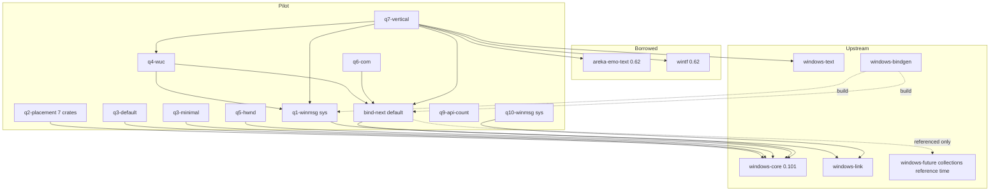
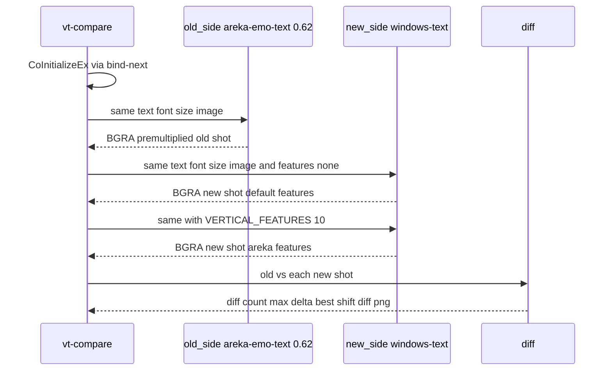
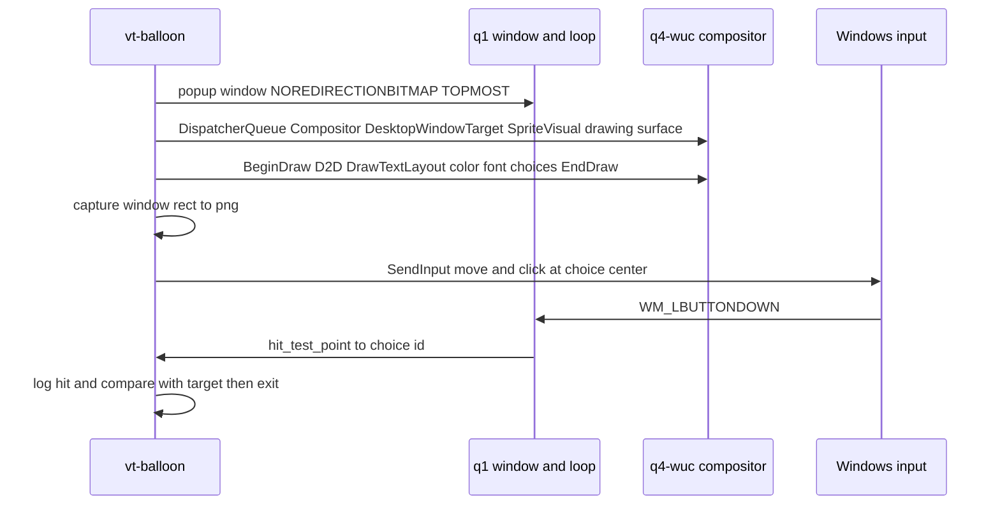

# 設計書: pilot-windows-rs-next

## Overview

**Purpose**: 本仕様は、windows-rs の移行の本体（`windows` クレートをやめ、絞ったクレートの 0.101 と `windows-bindgen` の束縛で Windows の API を呼ぶ形へ移す 6〜8 本）を掘る前に、方向と手順を確かめる先進坑（使い捨て）である。開発者が一次記録を見て go／違う／直す を決められるよう、brief の 10 の問いを小さく縦に通し、知見・刻み方の案・書き換えの対応表・上流へ返す文案を出す。

**Users**: 開発者（go の判定・上流への返事）と、移行の本体の起票者と実装係（刻み方・規模・対応表）が使う。

**Impact**: 本線は何も変わらない。`crates/pilot/examples/pilot-windows-rs-next/` の下に、自分の `[workspace]` と `Cargo.lock` を持つ独立の小さなワークスペースを新しく置くだけである（要件 1）。

### Goals
- 10 の問いのそれぞれに、実物で確かめた見立て（go／違う／直す の候補）と学びと確かめた日を一次記録に書く。
- 移行の本体の刻み方の案を、問い 9 の全数と問い 1・3・4・6 の手間の実数から規模の見立てつきで書く。
- 書き換えの対応表（要件 12）と上流へ返す文案（要件 14）を置き場の中の文書として残す。

### Non-Goals
- 出荷するクレートの書き換え（移行の本体の仕事）。`wintf` 全体が移せるかの確かめ。
- `windows-composition`・`windows-canvas`・`windows-reactor` の採用。`windows-text` の本採用。
- 束縛を作る道具の完成品・束縛をコミットする形・`--package` の分け方の測り（本坑の 1 本目）。
- 上流への投稿（文案まで）。go の判定（開発者）。

## Boundary Commitments

### This Spec Owns
- `crates/pilot/examples/pilot-windows-rs-next/` の下の全部のファイル（独立のワークスペース・写し・新しく書く小さなクレート・一次記録と付きの文書・証拠の小さな絵）。
- 引く上流のコミットの固定: windows-rs の master `f37e2f9046cf9710fe00285436c4d22ad6053d72`（2026-11-14T20:13:16Z「Add submitted-frame input support (#5384)」。2026-11-16 に `gh api` で先頭と確かめた）。
- 10 の問いの確かめ方と、その結果の見立て・学びの文（判定そのものは開発者）。
- 書き換えの対応表・上流へ返す文案・移行の本体の刻み方の案と規模の見立て・段階の移行の可否の材料。

### Out of Boundary
- 根の `Cargo.toml`・`Cargo.lock`・`crates/pilot/Cargo.toml`・`deny.toml`・`tools/`・出荷するどのクレートのファイルも変えない（要件 1.3）。
- `.kiro/steering/two-tunnel.md`・`.kiro/steering/workflow.md` を直さない（要件 1.10）。置き場の形の例外は本書と要件とタスクにだけ書く。
- `crates/areka/src/session_end_sync_send_tests.rs` の `ALLOWED_SYNC_SENDS`（移行の本体の 2 本目）。
- 「公開の前の 0.101 を本線の `Cargo.lock` に入れてよいか」と crates.io の公開との兼ね合い。
- 移行の本体の各本の brief（go の後に `/kiro-discovery`）。

### Allowed Dependencies
- 上流（git・上の 1 コミットだけ・フォークも `[patch]` もしない）: `windows-core`・`windows-result`・`windows-strings`・`windows-link`・`windows-numerics`・`windows-text`・`windows-bindgen`（build の依存）。既定の形の束縛が `Windows.Foundation` の型を暗に回す兄弟のクレート `windows-future`・`windows-collections`・`windows-reference`・`windows-time`（同じ rev・上流 `crates/libs/bindgen/src/lib.rs` の `prepend_default_refs`）も、生成した束縛が名指ししたときに限って許す。実際に要った物を一次記録に書く。
- 本線のクレートを path で借りる（読むだけ・0.62 のまま）: `wintf`・`areka-emo-text`・`areka-parsers`・`areka-sakura`。借りてよいのは問い 7 の比べ役（`q7-vertical`）だけ。
- crates.io: 本線の `Cargo.lock` に在る `bevy_ecs`・`png`・`tracing`・`tracing-subscriber`（`env-filter` は宣言しない）と、問い 9 の `scip` とその依存。問い 1・8 の写し（`q1-winmsg`・`q10-winmsg`）が写し元の `wintf-winmsg-executor` と同じく使う `async-task`（本線の `Cargo.lock` と同じ版・実装の時点で足した）。
- 置き場の中のクレートどうし: 下の「依存の向き」の図のとおりだけ。
- 使わない: `windows` クレート（新しい側のコードからは名指ししない。借りた `wintf` などの推移の依存として木に入るのは許す）・`log-capture-kit`・`sample-ghost-kit`・`real-run-kit`・`temp-path-kit`。

### Revalidation Triggers
- 引くコミットを動かすとき（要件 2.5）: 動かす理由と先のコミットを一次記録に書き、動かした後に確かめ直した問いを記録する。
- 上流が 0.101 を公開したとき: 一次記録の結果が変わりうる（要件 13.3）。移行の本体はその版で確かめ直す。
- 借りた `wintf`・`areka-emo-text` が並走の spec で変わったとき: 問い 7 の比べは借りたときの作業木の中身で行い、その作業木のコミットを一次記録に書く（境界の Adjacent expectations）。
- 本線の見張りの試験（`crates/log-capture-kit/tests/` ほか）の走査の規則が変わったとき: 置き場の決まり（下の表）を見直す。

## Architecture

### Existing Architecture Analysis
- 根の `members = ["crates/*"]` は 1 段だけで、`crates/pilot` の例の自動の発見は `examples/*.rs` と `examples/*/main.rs` だけ。置き場の直下に `main.rs` を置かず、自分の `[workspace]` を持たせれば本線のビルドに乗らない（要件 1.2・1.5）。
- 本線の見張りの試験は `crates/` の下の `.rs` と `Cargo.toml` を深さに関係なく読み、フォルダ名 `target`・`vendors`・`.git` だけを外す。置き場の中身にもそのまま掛かる（下の「置き場の決まり」）。
- 写しの元: `crates/wintf-winmsg-executor/`（問い 1）・`crates/wintf/src/com/dwrite.rs` と `com/d2d/mod.rs`（問い 3）・`crates/wintf/src/com/wuc.rs`（問い 4）・`crates/shiori-abi/src/interface.rs` の 1 組（問い 6）。

### Architecture Pattern & Boundary Map

問いごとに小さなクレートを置き、つながりは図の矢印だけにする。



**Architecture Integration**:
- 選んだ形: 問いごとの小さなクレート＋共有の既定の形の束縛 `bind-next`（問い 4・6・7 の土台）。`bind-next` は問い 2 の案 3 と同じ形だが、問い 2 の比べの材料ではない（比べは `q2-placement` の中だけで行う）と一次記録に書く。
- 依存の向き（強制）: 上流 → `q1-winmsg`／`bind-next` → `q4-wuc` → `q7-vertical`。`q2-placement`・`q3-*`・`q5-hwnd`・`q9-api-count`・`q10-winmsg` はほかの置き場のクレートに頼らず、頼られもしない。本線の借りたクレートへ向かうのは `q7-vertical` だけ。逆向きと、図に無い矢印は誤りとして扱う。
- 二坑モデルの規律: 葉の隔離はより強く保たれる（本線のワークスペースの一員でない）。品質は緩めてよいが、下の「置き場の決まり」は必ず守る（要件 1.9）。コードは本坑へ写さない前提で作る（要件 1.11）。

### Technology Stack

| Layer | Choice / Version | Role in Feature | Notes |
|-------|------------------|-----------------|-------|
| 言語・道具 | Rust 1.100.0・cargo 1.100.0・edition 2024（`q1-winmsg`・`q10-winmsg` だけは元と同じ 2021） | 置き場の全部 | 元の edition を保つのは、書き換えの行数を束縛の差だけにするため |
| 上流 | windows-rs master `f37e2f9046cf9710fe00285436c4d22ad6053d72`（`windows-core`・`windows-numerics`・`windows-text`・`windows-bindgen` 0.101.0／`windows-link`・`windows-result`・`windows-strings` 0.100.1／既定の形の束縛が名指ししたときだけ `windows-future`・`windows-collections`・`windows-reference`・`windows-time`） | 新しい側の全部 | git の依存。`CARGO_HOME` へ丸ごと取り寄せる（確定 10） |
| 束縛 | `windows-bindgen` の builder を各クレートの `build.rs` から呼び、`OUT_DIR` へ書く | 問い 1〜7・10 | 形: `.sys()`（問い 1・10）・既定（問い 2・3・4・6・7）・`.minimal()`（問い 3・5） |
| 借りる本線 | `wintf`・`areka-emo-text`・`areka-parsers`・`areka-sakura`（path・`windows` 0.62.2） | 問い 7 の今の側 | 読むだけ |
| ECS | `bevy_ecs` 0.19.1 | 問い 5・問い 7 の今の側 | 本線と同じ版（`Cargo.lock` の種） |
| 絵 | `png` 0.18.1 | 差の絵・撮った絵 | 本線の `Cargo.lock` に在る |
| 索引 | rust-analyzer の `scip`・crates.io の `scip` クレート | 問い 9 | 版は一次記録に書く |
| ターゲット | `x86_64-pc-windows-msvc`・`i686-pc-windows-msvc`・`aarch64-pc-windows-msvc` | 問い 1・3・8 | クロスのビルドは PowerShell から |

## File Structure Plan

### Directory Structure
```
crates/pilot/examples/pilot-windows-rs-next/
├── Cargo.toml              # [workspace]（resolver 3・members）と [workspace.dependencies]（上流の rev の固定・借りる path）。[package] は持たない
├── Cargo.lock              # 本線の Cargo.lock を写して種にし、上流の git を足した物（要件 2.1）
├── .cargo/config.toml      # [build] target-dir = "../../../../target/pilot-windows-rs-next"（置き場の中で打ったときの保険）
├── README.md               # 一次記録（動機・概要・検証結果の 3 幕）（要件 13）。節 RunCommands（走らせ方・クロスのビルド）・CopyLedger（写した量と手間）・ExitContract（終了コード）を含む
├── REWRITE_TABLE.md        # 書き換えの対応表（要件 12）
├── UPSTREAM_DRAFT.md       # 上流へ返す文案（英語＋日本語の要旨）（要件 14）
├── evidence/               # 一次記録に添える小さな PNG だけ（確定 8）
├── q1-winmsg/              # 問い 1・8: wintf-winmsg-executor の写し（.sys()）
│   ├── Cargo.toml          # [lib] name = "wintf_winmsg_executor"（例を書き換えないため）・edition 2021
│   ├── build.rs            # .sys().flat() で OUT_DIR/bindings.rs
│   ├── filters.txt         # 名指しした API（1 行 1 つ・行数＝要件 3.3 の数）
│   ├── src/lib.rs          # 写し（#[cfg(test)] mod test は写さない）
│   ├── src/util/{mod,window,msg_filter_hook}.rs  # 写し
│   └── examples/{basic,threads}.rs               # 写し（書き換えない）
├── q2-placement/           # 問い 2: 置き場の 3 案（どれも既定の形）
│   ├── shared/draw_body.rs # 3 案が #[path] で読む同じ描く本体（文字を 1 行描いて墨を数える）
│   ├── plan1-wintf/  plan1-emo/          # 案 1: クレートごとに束縛（emo 役の入口で cast）
│   ├── plan2-wintf/  plan2-emo/          # 案 2: wintf 役が束縛を公開（emo 役の要る API も抱える）
│   └── plan3-bind/   plan3-wintf/  plan3-emo/  # 案 3: 共有の束縛のクレート
├── q3-default/             # 問い 3・8: dwrite.rs＋d2d/mod.rs の写し（既定の形）＋確かめの bin
├── q3-minimal/             # 問い 3・8: 同じ写しを .minimal()＋手書きの包みで（同じ確かめの bin）
├── bind-next/              # 問い 4・6・7 の共有の束縛（既定の形）
│   ├── build.rs            # filters/*.txt を全部読み、.implement は下線の描き手の 3 つだけ
│   └── filters/{q4-wuc,q6-renderer,q7-text,common}.txt  # 問いごとのフィルター（行数を問いごとに数える）
├── q4-wuc/                 # 問い 4: wuc.rs の写し（lib）＋q4-demo（bin）＋capture.rs（画面の DC からの撮り）
├── q5-hwnd/                # 問い 5: 既定と .minimal() の HWND を包む型と bevy の Component
├── q6-com/                 # 問い 6: shiori.rs（IShiori の 1 組の写し）・renderer.rs（新しく書く IDWriteTextRenderer1）・main.rs
├── q7-vertical/            # 問い 7・要件 13.5
│   ├── src/bin/vt-compare.rs   # 旧（areka-emo-text 0.62）と新（windows-text）を別々に描いて比べる
│   ├── src/bin/vt-balloon.rs   # 透過の枠なしの窓に縦書きのバルーンと選択肢・SendInput で当てる
│   ├── src/old_side.rs  new_side.rs  diff.rs  choices.rs
├── q9-api-count/           # 問い 9: SCIP の索引を読み、クレートごと・種類ごとに数える
└── q10-winmsg/             # 問い 10: 問い 1 の元の src/ だけをもう 1 つ写し、Sonnet が対応表だけで移す
    └── Cargo.toml          # [lib] name は q1 と同じ・[[example]] q10-basic／q10-threads は ../q1-winmsg/examples を path で指す
```

- 名前の決まり: フォルダ名に本線のクレートと同じ名前を使わない（見張りがフォルダ名でクレートを見分けるため）。
- 生成した束縛は `OUT_DIR`（作業木の `target\pilot-windows-rs-next\` の下）にだけ在り、置き場にはコミットしない（要件 1.6）。
- 実行で出す物（差の絵・撮った絵・ログ）は、実行ファイルの在る target の下の `out\<問い>\` へ書く。`evidence/` へは一次記録に添える小さな PNG だけを手で写す（要件 15.2・確定 8）。

### Modified Files
- 無し（新しいファイルだけ）。

### 置き場の決まり（レビューで見る・要件 1.3〜1.7・15.2）

| 決まり | 理由 |
|---|---|
| 置き場の直下に `main.rs` を置かない・根の `Cargo.toml` は `[package]` の無い仮想の manifest | `crates/pilot` の例として組まれない（1.5） |
| `.rs` は 1 ファイル 1,000 行以下・生成した束縛はコミットしない | `file_length_guard_test.rs`（1.6） |
| `std::env::temp_dir` を呼ばない・OS の一時フォルダ・`C:\` の直下・`C:\tmp` を使わない | `temp_path_guard_test.rs`・15.2 |
| 捕捉先を差す 4 語（`with_default(`・`set_default(`・`set_global_default(`・`install_global_capture_all(`）を綴らない。購読者は `tracing_subscriber::fmt().init()` で据える | `with_default_guard_test.rs` ⑴⑵ |
| manifest に `log-capture-kit`・`sample-ghost-kit`・`real-run-kit` を書かない・`tracing-subscriber` の `env-filter` を宣言しない | ⑶⑷・`sample_path_guard_test.rs` |
| 検体のパスを組まない（バルーンの定義は文字列で組む） | `sample_path_guard_test.rs` |
| `state.actors()` を書かない | `frame_attach_tests.rs` |
| 各 manifest に `publish = false` | 公開の段の取り違えを防ぐ |
| 新しい側のコードで `windows` クレートを名指ししない | 2.3 |
| D3D11 の装置は `D3D_DRIVER_TYPE_HARDWARE` で作る（WARP にしない） | 15.1 |

## System Flows

### 問い 7 の比べ（vt-compare）



- 旧と新は同じ過程の中で別々の装置で描き、COM の型を一度もつながない（要件 8.2）。橋が要った所が出たら生ポインタで渡し、その所を一次記録に書く。
- 比べは 2 通り出す: ⑴ 同じ原点のまま ⑵ ±8 px の平行移動のうち違う画素が最も少ない所。⑴ と ⑵ の差が位置のずれ、⑵ に残る差が字形の差と読める。

### 問い 7 のバルーン（vt-balloon）



- 例は上限時間（`AREKA_APP_SMOKE_EXIT_MS`・既定 30000 ms）の内で自分で終わる（要件 15.4）。終了コード: 0＝当たりが一致・2＝初期化の失敗・3＝窓が外から閉じられた・4＝当たりが食い違った。
- 走らせるのは主の会話が排他テストの机を持つ間だけ（要件 15.3）。

## Requirements Traceability

| Requirement | Summary | Components | Interfaces | Flows |
|-------------|---------|------------|------------|-------|
| 1.1 | 置き場とフォルダ名 | PilotWorkspace | File Structure Plan | — |
| 1.2 | 独立のワークスペース | PilotWorkspace | 根の仮想の manifest | — |
| 1.3 | 本線を変えない | PilotWorkspace | Out of Boundary | — |
| 1.4 | 借りるだけ・逆の依存を足さない | PilotWorkspace・q7-vertical | Allowed Dependencies | — |
| 1.5 | 直下に main.rs を置かない | PilotWorkspace | 置き場の決まり | — |
| 1.6 | 1,000 行・束縛は target の下 | 全クレートの build.rs | BindingBuild | — |
| 1.7 | 見張りを赤にしない | 全クレート | 置き場の決まり | — |
| 1.8 | 写す量 1,500 行前後 | q1-winmsg・q3-*・q4-wuc・q6-com | CopyLedger | — |
| 1.9 | 品質は緩めてよいが隔離は守る | 全クレート | 置き場の決まり | — |
| 1.10 | 共通の文書を直さない | PilotWorkspace | Out of Boundary | — |
| 1.11 | 知見が成果物・本坑へ写さない | README | PrimaryRecord | — |
| 2.1 | 1 コミットの固定 | PilotWorkspace | `[workspace.dependencies]` の rev | — |
| 2.2 | フォークも patch もしない | PilotWorkspace | Allowed Dependencies | — |
| 2.3 | windows クレートを使わない | 全クレート | 置き場の決まり | — |
| 2.4 | WinRT も bindgen | bind-next・q4-wuc | BindingBuild | vt-balloon |
| 2.5 | コミットを動かすときの記録 | README | PrimaryRecord | — |
| 3.1 | 問い 1 の写しと .sys() | q1-winmsg | q1-winmsg の Batch | — |
| 3.2 | x64・i686 で同じ出力 | q1-winmsg | q1-winmsg の Batch | — |
| 3.3 | フィルターの行数・書き換えの行数・手間 | q1-winmsg・CopyLedger | filters.txt・git diff | — |
| 3.4 | 本線の元を変えない | q1-winmsg | Out of Boundary | — |
| 3.5 | 組めないときの記録 | README | PrimaryRecord | — |
| 4.1 | 2 役のクレートで最小の例 | q2-placement | q2-placement の Batch | — |
| 4.2 | 3 案を既定の形で比べる | q2-placement | q2-placement の Batch | — |
| 4.3 | 参照の口の有無の根拠 | README | PrimaryRecord | — |
| 4.4 | dwrite＋d2d の写しで 2 形を比べる | q3-default・q3-minimal | q3-* の Batch | — |
| 4.5 | 推す組み合わせと理由 | README | PrimaryRecord | — |
| 4.6 | 組めない案の記録 | README | PrimaryRecord | — |
| 5.1 | wuc.rs の写しを bindgen へ | q4-wuc・bind-next | q4-wuc の Batch | vt-balloon |
| 5.2 | 各段が通り実の窓に絵 | q4-wuc | q4-wuc の Batch・capture_window_png | — |
| 5.3 | 通らない段の記録 | README | PrimaryRecord | — |
| 6.1 | 2 形の HWND を包み Component に | q5-hwnd | q5-hwnd の Batch | — |
| 6.2 | Send／Sync の根拠 | q5-hwnd・README | q5-hwnd の Batch | — |
| 6.3 | 行き来を対応表に | REWRITE_TABLE | RewriteTable | — |
| 7.1 | SHIORI の 1 組 | q6-com | q6-com の Batch | — |
| 7.2 | IDWriteTextRenderer1 を新しく書く | q6-com・bind-next | q6-com の Batch | — |
| 7.3 | `_Impl` の HRESULT を対応表に | REWRITE_TABLE | RewriteTable | — |
| 7.4 | 組めないときの記録 | README | PrimaryRecord | — |
| 8.1 | 旧と新の画素の比べ | q7-vertical | diff の契約 | vt-compare |
| 8.2 | 型をつながず別々に描く | q7-vertical | diff の契約 | vt-compare |
| 8.3 | 10 個の字形の指定と開き括弧 | q7-vertical | diff の契約 | vt-compare |
| 8.4 | decorations の下線の位置 | q7-vertical | diff の契約 | — |
| 8.5 | SetDrawingEffect の範囲の色 | q7-vertical・bind-next | diff の契約 | — |
| 8.6 | UTF-8 の換算と panic の扱い | q7-vertical・README | diff の契約 | — |
| 8.7 | 透過の窓に縦書きのバルーン | q7-vertical・q4-wuc・q1-winmsg | vt-balloon | vt-balloon |
| 8.8 | クリックの当たりの一致 | q7-vertical | vt-balloon | vt-balloon |
| 8.9 | 無い機能の見立てと文案 | README・UPSTREAM_DRAFT | UpstreamDraft | — |
| 9.1 | i686 と arm64 で組む | q1-winmsg・q3-default・q3-minimal | RunCommands | — |
| 9.2 | 走らせられる的は走らせる | q1-winmsg・q3-* | RunCommands | — |
| 9.3 | 組めないときの記録 | README | PrimaryRecord | — |
| 10.1 | API の全数を種類ごと・クレートごとに | q9-api-count | q9-api-count の Batch | — |
| 10.2 | 同じ数が出る手順と本線のコミット | q9-api-count・README | q9-api-count の Batch | — |
| 10.3 | 1 行・1 API あたりの手間と見積もり | CopyLedger・README | CopyLedger | — |
| 11.1 | 2 つ目の写しを Sonnet が移す | q10-winmsg | q10-winmsg の Batch | — |
| 11.2 | 取りこぼし 3 種を入れて捕まるか | q10-winmsg・q3-default | q10-winmsg の Batch | — |
| 11.3 | 捕まらない種類の一覧 | README | PrimaryRecord | — |
| 12.1 | 対応表を 1 つの文書に | REWRITE_TABLE | RewriteTable | — |
| 12.2 | 載せる項目 | REWRITE_TABLE | RewriteTable | — |
| 12.3 | 前後の例の 1 組 | REWRITE_TABLE | RewriteTable | — |
| 12.4 | `==` の COM の同一性 | q3-default・q3-minimal・REWRITE_TABLE | q3-* の Batch | — |
| 12.5 | 番地の比べに変わるときの包み | REWRITE_TABLE | RewriteTable | — |
| 12.6 | 行ごとの通したか・どの形か | REWRITE_TABLE | RewriteTable | — |
| 13.1 | README 3 幕と本坑の名指し | README | PrimaryRecord | — |
| 13.2 | 問いごとの見立て・学び・日 | README | PrimaryRecord | — |
| 13.3 | コミット番号と日・公開の後の変化 | README | PrimaryRecord | — |
| 13.4 | 刻み方の案と規模の見立て | README | PrimaryRecord | — |
| 13.5 | 段階の移行の可否 | q7-vertical・README | diff の契約 | vt-compare |
| 13.6 | 絶対パスの走らせ方 | README | RunCommands | — |
| 13.7 | go を自分で下さない | README | PrimaryRecord | — |
| 14.1 | 文案を置き場に | UPSTREAM_DRAFT | UpstreamDraft | — |
| 14.2 | 投稿しない | UPSTREAM_DRAFT | UpstreamDraft | — |
| 14.3 | 英語＋日本語の要旨・開き括弧は結果だけ | UPSTREAM_DRAFT | UpstreamDraft | — |
| 15.1 | 実の GPU | q2・q3・q4・q6・q7 | 置き場の決まり | — |
| 15.2 | 出力は作業木の target の下だけ | PilotWorkspace・全 bin | RunCommands | — |
| 15.3 | 画面の操作は排他テストの机 | q4-wuc・q7-vertical | RunCommands | vt-balloon |
| 15.4 | 窓を出す例は自分で終わる | q4-wuc・q7-vertical | ExitContract | vt-balloon |

## Components and Interfaces

| Component | Domain/Layer | Intent | Req Coverage | Key Dependencies (P0/P1) | Contracts |
|-----------|--------------|--------|--------------|--------------------------|-----------|
| PilotWorkspace | 置き場 | 独立のワークスペースと上流の固定 | 1.1〜1.5・1.9・1.10・2.1・2.2・15.2 | 上流の git (P0) | State |
| q1-winmsg | 問い 1・8 | C の関数だけのクレートの `.sys()` の写し | 1.8・3.1〜3.4・9.1・9.2 | windows-link (P0)・windows-bindgen (P0) | Batch |
| q2-placement | 問い 2 | 置き場の 3 案を同じ例で比べる | 4.1・4.2・4.6 | windows-core (P0) | Batch |
| q3-default・q3-minimal | 問い 3・8 | 束縛の形の 2 案を同じ写しで比べる・`==` | 1.8・4.4・9.1・9.2・11.2・12.4 | windows-core (P0) | Batch |
| bind-next | 共有の束縛 | 問い 4・6・7 の既定の形の束縛 | 2.4・5.1・7.2・8.5 | windows-bindgen (P0) | Service |
| q4-wuc | 問い 4 | wuc.rs の写しと合成の各段・画面の撮り | 1.8・5.1・5.2・15.4 | bind-next (P0)・q1-winmsg (P0) | Service・Batch |
| q5-hwnd | 問い 5 | HWND の包みと Component | 6.1・6.2 | bevy_ecs (P1) | Batch |
| q6-com | 問い 6 | SHIORI の 1 組と下線の描き手 | 1.8・7.1・7.2 | bind-next (P0) | Batch |
| q7-vertical | 問い 7・段階の移行 | 旧と新の画素の比べ・バルーンの窓 | 8.1〜8.8・13.5・15.3・15.4 | windows-text (P0)・areka-emo-text (P0)・q4-wuc (P0) | Batch |
| q9-api-count | 問い 9 | API の全数を数える | 10.1・10.2 | rust-analyzer (P0)・scip (P1) | Batch |
| q10-winmsg | 問い 10 | 対応表だけで移せるか | 11.1・11.2 | q1-winmsg の例 (P1) | Batch |
| PrimaryRecord（README.md） | 文書 | 一次記録 3 幕 | 1.11・2.5・3.5・4.3・4.5・4.6・5.3・6.2・7.4・8.6・8.9・9.3・10.2・10.3・11.3・13.1〜13.7 | 全クレートの結果 (P0) | — |
| RewriteTable（REWRITE_TABLE.md） | 文書 | 書き換えの対応表 | 6.3・7.3・12.1〜12.6 | q1・q3・q5・q6 の実物 (P0) | — |
| UpstreamDraft（UPSTREAM_DRAFT.md） | 文書 | 上流へ返す文案 | 8.9・14.1〜14.3 | q7-vertical の結果 (P0) | — |
| CopyLedger | 記録の作法 | 写した量と手間の数え | 1.8・3.3・10.3 | git (P0) | — |

### 置き場

#### PilotWorkspace

| Field | Detail |
|-------|--------|
| Intent | 本線の外に独立のワークスペースを建て、上流を 1 コミットに固定する |
| Requirements | 1.1, 1.2, 1.3, 1.4, 1.5, 1.9, 1.10, 2.1, 2.2, 15.2 |

**Responsibilities & Constraints**
- 根の `Cargo.toml` は仮想の manifest: `[workspace] resolver = "3"`・`members`（上の各クレート）・`[workspace.package] edition = "2024"`・`publish = false`・`[workspace.dependencies]`。
- `[workspace.dependencies]` の上流は全部 `git = "https://github.com/microsoft/windows-rs", rev = "f37e2f9046cf9710fe00285436c4d22ad6053d72"`。借りるクレートは `path = "../../../<名前>"`（置き場の根からの相対）。
- `Cargo.lock` は着手の初めに本線の `Cargo.lock` を写して種にする（写した本線のコミットを一次記録に書く）。その後は置き場の中の cargo だけが更新する。本線の根の `[patch.crates-io] image-webp`（git）は置き場のワークスペースに効かないので、借りる `areka-emo-text` → `areka-emo-compose` → `areka-emo-atlas` → `image` の木の `image-webp` だけは crates.io の版に解き直される（縦書きの画素には効かない。置き場は `[patch]` を持たない＝要件 2.2）。解き直された版を一次記録に書く。
- `.cargo/config.toml` は `[build] target-dir = "../../../../target/pilot-windows-rs-next"` だけ（置き場の根の親の親の親の親＝作業木の根）。

**Contracts**: State [x]

##### State Management
- 固定の不変条件: `Cargo.lock` の windows-rs の `source` は全部 `git+https://github.com/microsoft/windows-rs?rev=f37e2f90…#f37e2f90…` の 1 つ。動かすのは要件 2.5 の手順の後だけ。
- 本線の不変条件: 根の `Cargo.toml`・`Cargo.lock`・`crates/pilot/Cargo.toml`・`deny.toml` の差分が 0。

**Implementation Notes**
- Validation: `git diff --stat main -- Cargo.toml Cargo.lock crates/pilot/Cargo.toml deny.toml tools` が空。本線で `cargo metadata --no-deps` の members に置き場のクレートが出ない。
- Risks: 上流の git の解決が止まる（Research 3.5 の 4・未確認）。止まったら要件 2.5。

### 束縛の作り方（全クレート共通）

#### BindingBuild

| Field | Detail |
|-------|--------|
| Intent | 各クレートの `build.rs` が `windows-bindgen` で `OUT_DIR` に束縛を書く |
| Requirements | 1.6, 2.4 |

```rust
// 各クレートの build.rs の形（形と出力の名前だけがクレートごとに違う）
fn main() {
    println!("cargo:rerun-if-changed=build.rs");
    println!("cargo:rerun-if-changed=filters.txt");
    let out = std::path::PathBuf::from(std::env::var_os("OUT_DIR").unwrap()).join("bindings.rs");
    windows_bindgen::builder()
        .output(out)
        .filter_file("filters.txt")
        /* .sys() | .minimal() | 既定 */ /* .flat() は q1・q10・q5 */
        .write();
}
// 使う側: mod bindings { include!(concat!(env!("OUT_DIR"), "/bindings.rs")); }
```
- 不変条件: フィルターは 1 行 1 つの名指し（`//` の注は数えない）。行数＝名指しした API の数として一次記録に書く。
- 生成した `bindings.rs` の行数も問いごとに一次記録に書く（本坑の 1 本目の材料）。
- `bind-next` だけは `filters/*.txt` を全部読み、`.implements(["Windows.Win32.Graphics.DirectWrite.IDWriteTextRenderer1", "Windows.Win32.Graphics.DirectWrite.IDWriteTextRenderer", "Windows.Win32.Graphics.DirectWrite.IDWritePixelSnapping"])` を付ける（土台も名指しが要る）。

### 問いのクレート

#### q1-winmsg（問い 1・8）

| Field | Detail |
|-------|--------|
| Intent | `wintf-winmsg-executor` の写しを `.sys()` の束縛へ移し、例 2 本を x64・i686 で元と同じに走らせる |
| Requirements | 1.8, 3.1, 3.2, 3.3, 3.4, 9.1, 9.2 |

**Responsibilities & Constraints**
- 写すのは `src/lib.rs`（271 行目から後ろの `#[cfg(test)] mod test` を除く）・`src/util/*.rs`・`examples/basic.rs`・`examples/threads.rs`。例は書き換えない（`[lib] name = "wintf_winmsg_executor"` で元の `use` のまま組む）。
- `use windows::…` を `crate::bindings::…` へ置き換える。束縛は `.sys().flat()`。i686 の `SetWindowLongPtrW` は bindgen が `#[cfg(target_pointer_width = "32")]` の別名を出す見込みで、写しの側で分けない（出なければ「直す」の見立て）。
- 写した直後の状態（元と同じ中身）を 1 コミット、移した後を 1 コミットにする（CopyLedger）。
- 問い 4・7 から窓とメッセージループに借りられる（借りる側は `q1 = { package = "q1-winmsg", path = … }` と名前を変えて引く）。

**Contracts**: Batch [x]

##### Batch / Job Contract
- Trigger: `cargo run --example basic|threads -p q1-winmsg [--target i686-pc-windows-msvc]`。
- 比べ: 元の例（本線で `cargo run -p wintf-winmsg-executor --example …`）と出力と終了コードを比べる。`basic` は全文一致。`threads` は 2 本のスレッドが同時に書くので、`main` で始まる行の並びと終了コードの一致を見て、`thread` の行は出た行の集まりとして並べて書く（元も走らせるたびに変わるため）。
- Output: 一次記録に、比べの結果・フィルターの行数・`git diff --stat` の書き換えの行数・直しの回数と作業の時間。

#### q2-placement（問い 2）

| Field | Detail |
|-------|--------|
| Intent | `ID2D1DeviceContext` などを wintf 役から emo-text 役へ渡し、DirectWrite の文字を Direct2D で描く同じ例を、置き場の 3 案で組んで比べる |
| Requirements | 4.1, 4.2, 4.6 |

**Responsibilities & Constraints**
- 3 案とも束縛は既定の形（確定 2）。参照の口は無いので、案 1 は型が重なり入口で `cast`、案 2 は wintf 役の束縛が emo-text 役の要る API（`IDWriteFactory`・`IDWriteTextFormat`・`IDWriteTextLayout` ほか）まで抱える、案 3 はフィルターが両役の和になる。
- 描く本体 `shared/draw_body.rs` は 3 案で同じ。各案の emo-text 役のクレートが `#[path]` で読み込み、`use` で型の出どころだけを替える。
- wintf 役: D3D11 の装置（ハードウェア）→ D2D の装置と文脈 → 画面の外の `ID2D1Bitmap1`（描く先）と CPU で読む `ID2D1Bitmap1` を作り、読み戻した BGRA を返す。

```rust
// wintf 役の口（3 案で同じ形。型の出どころだけが案ごとに違う）
pub struct Target { pub context: ID2D1DeviceContext, /* 描く先と読み戻しの絵 */ }
pub fn create_target(width: u32, height: u32) -> windows_core::Result<Target>;
pub fn read_back(target: &Target) -> windows_core::Result<Vec<u8>>; // premultiplied BGRA
// emo-text 役の口（案 1 は引数の型が wintf 役の型で、中で自分の型へ cast する）
pub fn draw_line(context: &ID2D1DeviceContext, text: &str) -> windows_core::Result<()>;
```
- 各案の bin（emo-text 役のクレートの `src/main.rs`）は墨の画素の数を出し、3 案で同じ数になることを見る。

**Contracts**: Batch [x]
- Output: 一次記録に、案ごとの「組めたか」「型の受け渡しに要った手当て（`cast` の行・`from_raw` の有無）」「重なった束縛の量（同じ型が 2 つの束縛に出た数・生成した行数）」と、問い 3 と合わせた推す組み合わせ（要件 4.5）。

#### q3-default・q3-minimal（問い 3・8・要件 12.4）

| Field | Detail |
|-------|--------|
| Intent | `com/dwrite.rs`（154 行）と `com/d2d/mod.rs`（158 行）の写しを、既定の形と `.minimal()`＋手書きの包みの 2 形で組んで比べる |
| Requirements | 1.8, 4.4, 9.1, 9.2, 11.2, 12.4 |

**Responsibilities & Constraints**
- 2 つのクレートは同じ元の写しから始める（写す量は元の行で 1 回と数える＝312 行）。`q3-minimal` では `.minimal()` が出さない口（継いだメソッドの転送・取っ手の便利な口・文字列の包み）を手書きの包みで補う。
- 確かめの bin（両方に同じ中身）: DirectWrite の工場・書式・配置を作り、D3D11＋D2D の画面の外の絵へ描いて墨を数える。実の GPU で走らせる（要件 15.1）。
- `==` の確かめ: 同じ物を別の参照（`cast` で `IUnknown` を通って戻した物）で持ったとき `==` が真、別の物で偽になることを、2 形のそれぞれで `assert` する。`ID2D1CommandList` を作れるならそれで見る（`same_root`・`GraphicsCommandList` と同じ型）。
- 問い 8: この bin を i686 で組んで走らせ、aarch64 で組んでリンクまで通す。

**Contracts**: Batch [x]
- Output: 一次記録に、2 形の束縛の行数・包みの行数・呼ぶ側の書き換えの行数（`git diff --stat`）・`==` の結果・クロスのビルドの結果。

#### bind-next（共有の束縛）

| Field | Detail |
|-------|--------|
| Intent | 問い 4・6・7 が使う既定の形の束縛（Win32 の D3D11・DXGI・D2D・DWrite・WinRT の合成と相互運用・入力と DPI・画面の撮りの GDI） |
| Requirements | 2.4, 5.1, 7.2, 8.5 |

**Contracts**: Service [x]

##### Service Interface
```rust
// bind-next/src/lib.rs
#![allow(non_snake_case, non_camel_case_types, non_upper_case_globals, clippy::all)]
include!(concat!(env!("OUT_DIR"), "/bindings.rs")); // 名前空間のモジュールの形: bind_next::Windows::UI::Composition::Compositor ほか
```
- Invariants: フィルターは問いごとのファイル（`filters/q4-wuc.txt`・`q6-renderer.txt`・`q7-text.txt`・`common.txt`）に分け、問いごとの名指しの数を数えられるようにする。`common.txt` は 2 つ以上の問いが使う物（D3D11・D2D の装置の作り方など）。

#### q4-wuc（問い 4）

| Field | Detail |
|-------|--------|
| Intent | `com/wuc.rs` の写しを `bind-next` の WinRT の束縛へ移し、合成の各段を実の窓で通す |
| Requirements | 1.8, 5.1, 5.2, 15.4 |

**Responsibilities & Constraints**
- lib: `src/wuc.rs`（写し・254 行）＝`CompositorInteropExt`・`CompositorDesktopInteropExt`・`DrawingSurfaceInteropExt`・`create_dispatcher_queue_controller` を `bind-next` の型で。`src/capture.rs`（新しく書く）＝窓の矩形を画面の DC から `BitBlt` で撮り PNG に書く。
- 束縛の形は既定だけで確かめる（設計の討議で確定）。問い 3 で `.minimal()` を推すことになったら、WinRT の `.minimal()`（class の口を出さない）は移行の本体の起票で確かめる点として一次記録に書く。
- bin `q4-demo`（新しく書く）: `q1` の窓（`WS_POPUP`・`WS_EX_NOREDIRECTIONBITMAP`）→ DispatcherQueue の作成 → `Compositor::new` → `DesktopWindowTarget` → `CompositionGraphicsDevice`（D2D の装置から）→ 描画面 → `SpriteVisual` へつなぐ → `BeginDraw` で塗る → 撮る → 上限時間で終わる。段ごとに `[q4] step=<名前> ok|err=<HRESULT>` を 1 行出す。

**Contracts**: Service [x] / Batch [x]

##### Service Interface
```rust
pub fn capture_window_png(hwnd: HWND /* bind-next の型 */, path: &std::path::Path) -> windows_core::Result<()>;
```
- Postconditions: PNG は窓の矩形の大きさで、DWM が合成した後の画素を持つ（WUC の中身が写る見込み。写らなければ一次記録に書き、主の会話の画面の確かめで代える）。

##### Batch / Job Contract
- Trigger: 主の会話が排他テストの机を持ってから `q4-demo` を走らせ、自分の目でも画面を確かめる。
- Output: 段ごとの通ったか・撮った絵（`out\q4\`、小さく切って `evidence/q4-wuc.png`）。

#### q5-hwnd（問い 5）

| Field | Detail |
|-------|--------|
| Intent | 既定の形（newtype）と `.minimal()`（生ポインタの別名）の `HWND` を包んで bevy の Component に持たせる |
| Requirements | 6.1, 6.2 |

```rust
mod b_default { include!(concat!(env!("OUT_DIR"), "/hwnd_default.rs")); } // HWND, GetDesktopWindow, IsWindow
mod b_minimal { include!(concat!(env!("OUT_DIR"), "/hwnd_minimal.rs")); }
#[derive(bevy_ecs::component::Component, Clone, Copy, PartialEq, Eq, Debug)]
pub struct WindowHandleDefault(pub b_default::HWND);
#[derive(bevy_ecs::component::Component, Clone, Copy, PartialEq, Eq, Debug)]
pub struct WindowHandleMinimal(pub b_minimal::HWND);
// 根拠を一次記録に書いたうえで: unsafe impl Send/Sync for 両方
```
- 確かめ: `GetDesktopWindow` の取っ手を両方の包みで世界に入れ、別のシステムが読み出して `IsWindow` が真になる。`Hash`・`Default`・`is_invalid` に当たる口が形ごとに在るかを書く（`.sys()` の行は q1 の実物から）。
- Send／Sync の根拠の見立て（6.2）: `HWND` は過程の中で通じる番号で、別のスレッドから値を読むだけなら安全。窓に触る呼び出しは窓を作ったスレッドへ送る決まりを包みの外で守る（今の `wintf` の `WindowHandle` と同じ根拠）。

#### q6-com（問い 6）

| Field | Detail |
|-------|--------|
| Intent | `windows-core` 0.101 の `#[interface]`・`#[implement]` で SHIORI の 1 組と `IDWriteTextRenderer1` を組む |
| Requirements | 1.8, 7.1, 7.2 |

**Responsibilities & Constraints**
- `src/shiori.rs`（写し・100〜150 行）: `IShiori`（`Get` は `HRESULT` を直に返す・`Notify` は `Result<()>`＝両方の戻りの形を含む）の定義・`shiori-abi` の試験の中の実装 1 つ・呼び出し。`Get` が実装まで届き、`S_OK` と応答の `HSTRING` が返ることを見る。マクロの `_Impl` は宣言の戻り値のまま（上流のソースで確かめた見込み）なので、今の宣言を変えずに組めるかを見る。
- `src/renderer.rs`（新しく書く・写さない）: `IDWriteTextRenderer1`・`IDWriteTextRenderer`・`IDWritePixelSnapping` の `_Impl` を実装し、`DrawUnderline` で下線の位置（x・y・幅・太さ・向き）を集める。`IDWriteTextLayout::Draw` に渡して、下線を付けた範囲の位置が集まることを見る。`_Impl` のメソッドが `HRESULT` を返す形を対応表に載せる。

**Contracts**: Batch [x]
- Output: 一次記録に、組めたか・呼び出しの結果・集めた下線の位置・書き換えの行数。

#### q7-vertical（問い 7・要件 13.5）

| Field | Detail |
|-------|--------|
| Intent | `windows-text` の縦書きを今の areka と画素で比べ、透過の窓のバルーンで選択肢の当たりを確かめる |
| Requirements | 8.1, 8.2, 8.3, 8.4, 8.5, 8.6, 8.7, 8.8, 13.5, 15.3, 15.4 |

**Responsibilities & Constraints**
- 比べの文（1 列）: `「ちょっと、待って。🍣」`（開き括弧・小書きかな `ょ`・`っ`・句読点・カラー絵文字）。書体はぱすたの候補列（`游ゴシック Medium,Yu Gothic Medium,游ゴシック,Yu Gothic,BIZ UDPゴシック,メイリオ`）・20 px・絵の大きさと原点は今の areka の縦書きの試験と同じ（列の先頭の字の枠の上端が面の y=0）。
- `old_side.rs`: 借りた `areka-emo-text` の公開の API で、文字列で組んだバルーンの定義（`parse_str`・`writing_mode` は縦）と `TextLayerRuntime`・`present_frame` で描き、`surface(..).read_back()` で BGRA を取る。
- `new_side.rs`: `windows_text::TextLayout`（`WritingMode::VerticalRightToLeft`）を作り、`as_interface::<bind_next::…::IDWriteTextLayout>()` で借りて、`bind-next` の D3D11＋D2D の画面の外の絵へ `DrawTextLayout`（カラーフォントの指定つき）で描き、読み戻す。字形の指定は「無し」と「`VERTICAL_FEATURES` の 10 個（`ccmp`・`locl`・`mark`・`mkmk`・`rlig`・`calt`・`clig`・`liga`・`kern`・`rclt`）」の 2 通り。範囲の色は借りた `IDWriteTextLayout` の `SetDrawingEffect`（UTF-16 の範囲・D2D の単色の筆）で付け、赤の画素が出るかを数える。`decorations()` で下線の位置を取り、列の左に出るかと、列の右に置くための x の決め方を書く。
- `diff.rs`: 下の契約。差の絵は違う画素を赤・同じ墨を灰にした PNG。
- `choices.rs`: 選択肢の範囲（UTF-8 のバイト位置）と areka の文字の位置の換算・`hit_test_point` の結果から選択肢の番号への写し。
- `TextLayout::new` の panic: 起こす入力を 1 つ探して確かめ（例: 大きさに NaN）、本体での扱いの見立て（入る前に値を確かめる・境で `catch_unwind` する）を一次記録に書く。
- 描く条件を今の側に揃える（違いを `windows-text` の差だけにするため）: ⑴ COM は今の側と同じ MTA で始める（今の側の GPU の World は MTA＝`crates/areka-emo-text/tests/support/fixture.rs`）⑵ 新しい側の D2D の文脈の文字のアンチエイリアスの形・描画の設定（`IDWriteRenderingParams`）・DPI・単位・面の画素の形式（premultiplied BGRA）・筆の色・`DrawTextLayout` の指定を、今の側が `present_frame` の経路で使う値（`crates/areka-emo-text/src/draw.rs` の `DrawTextLayout` の呼び出しと、`wintf` の描画面を作る所＝`crates/wintf/src/ecs/graphics/systems/surface.rs`・`crates/wintf/src/com/wuc.rs`）から読んで写す。読んだ値と所（ファイルと行）を一次記録の問い 7 の節に表で書く。揃えられなかった条件はその旨を書き、差の読みに添える。 `windows-core` 0.62（借りた側）と 0.101（新しい側）が並んで動く実物で、要件 13.5 の材料になる（`cargo tree -d` の出力も一緒に書く）。
- `vt-balloon`: `q1` の窓（`WS_POPUP`・`WS_EX_NOREDIRECTIONBITMAP`・`WS_EX_TOPMOST`・DPI は Per Monitor v2）＋`q4-wuc` の合成で、縦書きの文（カラー絵文字を含む）と選択肢 2 つを描く。窓の撮りの後、狙いの選択肢の中心へ `SendInput` で動かしてクリックし、`WM_LBUTTONDOWN` の位置を `hit_test_point` に渡して当たった選択肢を `[q7] hit choice=<番号> target=<番号>` で出す。カーソルは元の位置へ戻す。

**Contracts**: Batch [x]

##### Batch / Job Contract（diff の契約）
```rust
pub struct Shot { pub width: u32, pub height: u32, pub bgra: Vec<u8> } // premultiplied BGRA・密
pub struct DiffReport {
    pub differing_pixels: u64,     // 4 つの成分のどれかが違う画素の数
    pub max_delta: u8,             // 成分の差の最大
    pub best_shift: (i32, i32),    // ±8 px で違う画素が最少になる平行移動
    pub differing_at_best: u64,
}
pub fn compare(old: &Shot, new: &Shot) -> DiffReport;              // 大きさが違えば小さい方に合わせて数え、その旨を出す
pub fn write_diff_png(old: &Shot, new: &Shot, shift: (i32, i32), path: &std::path::Path) -> std::io::Result<()>;
```
- 合格の閾値は置かない（確定 4）。数と絵を出すだけで、同じと見るかは開発者が決める。
- Output: `out\q7\` に旧・新 2 通り・差の絵の PNG と数の表。一次記録へは数と小さな絵（`evidence/q7-*.png`）。

#### q9-api-count（問い 9）

| Field | Detail |
|-------|--------|
| Intent | 本線の出荷するクレートが使う Windows の API の全数を、関数・型・定数・インターフェースのメソッドに分けてクレートごとに数える |
| Requirements | 10.1, 10.2 |

**Contracts**: Batch [x]

##### Batch / Job Contract
- Trigger（手順・一次記録にそのまま載せる）:
  1. 本線の作業木で `rust-analyzer scip <作業木の根> --output <作業木>\target\pilot-windows-rs-next\out\q9\index.scip`（rust-analyzer の版を記録する）。
  2. `cargo run -p q9-api-count -- <index.scip>`。
- 数え方: SCIP の各文書（`crates/<名前>/…`）の参照の出現のうち、記号の包みの名前が `windows`・`windows_core`・`windows_numerics`・`windows_strings`・`windows_result` の物を集め、記号の綴りの末尾で分ける: `#` で終わる＝型（構造体・インターフェース・列挙・別名）／`#…().` ＝型の下のメソッド（インターフェースのメソッドとして数える）／`().` で `#` を含まない＝関数／`.` で終わる＝定数ほか（型の下の欄は別に数える）／`!`＝マクロ（別に数える）。同じ記号は 1 つと数える（全数）。出現の回数も添える。
- `crates/pilot` は数えない。表はクレートごとに「出荷する（crates.io へ出すか、areka の配布に入る）」か「試験の道具（`*-kit` などの配布に入らない物）」かの印を付け、合計を両方で出す。どちらも本番と試験のコードを分けて数える（どれも移行の本体で書き換えるので数えるが、要件 10.1 の「出荷するクレート」の数は出荷する印の合計とする）。
- Output: クレートごと・種類ごとの表（Markdown）を標準出力へ。一次記録に、表・数えた本線のコミット・rust-analyzer の版。
- 種類の判定は小さな試験（綴りの見本 5 つ）で固定する。
- 代わりの数え方（設計の討議で確定）: 索引づくりが落ちるか重すぎるときは、`windows` を外したつもりで組んで出た「見つからない」を集める形に倒してよい。倒したときは理由と数え方の違いを一次記録に書く。

#### q10-winmsg（問い 10）

| Field | Detail |
|-------|--------|
| Intent | 対応表だけを渡した Sonnet の実装係が、問い 1 の元をもう一度移せるか、取りこぼしが機械で捕まるかを確かめる |
| Requirements | 11.1, 11.2 |

**Responsibilities & Constraints**
- 写すのは本番の `src/` だけ（試験も例も写さない）。例は `[[example]] name = "q10-basic"`・`"q10-threads"`、`path = "../q1-winmsg/examples/…"` で問い 1 の写しを共用する（同じ名前の例が target でぶつからないように名前を変える）。`[lib] name` は `wintf_winmsg_executor`。問い 1 の写しと同じ呼び出しで組まない（`-p q10-winmsg` で別に組む）。
- 実装係は `model: "sonnet"` の下請けで、渡すのは `REWRITE_TABLE.md` と砂場の場所と「組めて例が走るまで」の指示だけ（問い 1 の移した後の写しは見せない）。人の手で直した所を一次記録に書く。
- 答えを見せない手当て（設計の討議で確定・両方行う）: ⑴ 作業木の `target\pilot-windows-rs-next\q10-sandbox\` に、元の `src/`・`REWRITE_TABLE.md`・例 2 本だけを置き、そこで移させる（移し終えたら結果を `q10-winmsg/` へ写す）。⑵ 下請けの道具の呼び出しの記録を読み、`q1-winmsg/` の下のファイルを読んでいないことを確かめて一次記録に書く（読んでいたら、その回を捨ててやり直す）。
- 取りこぼしの 3 種（11.2）を 1 つずつ入れては戻す: ⑴ 戻り値を見ない＝`q10-winmsg` の `.sys()` の `BOOL` を返す呼び出しと、`q3-default` の `HRESULT` を返す COM のメソッドの両方で、文として捨てる形と `let _ =` で捨てる形 ⑵「ポインタ＋長さ」の長さの誤り＝`q3-default` の `CreateTextLayout` の長さを 1 つずらす ⑶ 失敗を記録しない経路＝`q10-winmsg` の窓の作成の失敗を黙って捨てる。
- 見る道具: `cargo build` と `cargo clippy -- -D warnings -W clippy::let_underscore_must_use`（既定の群＋restriction の 1 つ）。どれで捕まったかを表にする。

**Contracts**: Batch [x]

### 文書

#### PrimaryRecord（README.md）

| Field | Detail |
|-------|--------|
| Intent | 一次記録（正本）。本坑の design はここを参照し、同じ結果を二重に書かない |
| Requirements | 1.11, 2.5, 3.5, 4.3, 4.5, 4.6, 5.3, 6.2, 7.4, 8.6, 8.9, 9.3, 10.2, 10.3, 11.3, 13.1, 13.2, 13.3, 13.4, 13.5, 13.6, 13.7 |

- **動機**: 対応する本坑（移行の本体の各本・brief の Downstream 1〜8）を名指しし、何が怪しくて掘るかを書く。置き場の形が二坑モデルの例外である理由（1 つのパッケージが `windows_core` の名前で持てる版は 1 つ）も書く。
- **概要**: クレートの一覧と役・引いた上流のコミットと確かめた日・`Cargo.lock` の種にした本線のコミット・走らせ方（RunCommands）。
- **検証結果**: 問いごとに 1 節（見立て go／違う／直す の候補・学び・確かめた日・数）。続けて、移行の本体の刻み方の案と規模の見立て（問い 9 の全数 ×「写した分の 1 行・1 API あたりの手間」）・段階の移行の可否の材料・レビューが見る点の一覧（問い 10）・公開の後に結果が変わりうること。
- 判定の欄は空けておき、「判定は開発者が下す」と書く（13.7）。
- 要件 2.5・3.5・4.6・5.3・7.4・9.3 の「組めない・通らないときの記録」は、該当する問いの節に「止まった所・理由・代わりの見立て」の欄として必ず置く（空なら「無し」と書く）。

#### RunCommands（README の走らせ方の節・要件 13.6・15.2）
- どのディレクトリからでも動く形: `cargo <run|build|test|clippy> --manifest-path C:\home\maz\git\areka\crates\pilot\examples\pilot-windows-rs-next\Cargo.toml --target-dir C:\home\maz\git\areka\target\pilot-windows-rs-next -j 4 -p <クレート> [--bin|--example <名前>] [--target <三つ組>]`（本線の作業木の根が `C:\home\maz\git\areka` のとき。別の作業木では根を差し替える）。
- クロスのビルドは PowerShell から打つ。窓を出す例（`q4-demo`・`vt-balloon`）は排他テストの机を持ってから。
- ビルドの出力・`OUT_DIR`・`out\<問い>\` はどれも `--target-dir` の下に出る。

#### RewriteTable（REWRITE_TABLE.md）

| Field | Detail |
|-------|--------|
| Intent | 今の書き方 → 新しい書き方の対応表（移行の本体の実装係が表だけで書き換えられる形） |
| Requirements | 6.3, 7.3, 12.1, 12.2, 12.3, 12.4, 12.5, 12.6 |

- 1 行の形: `| 項目 | 書き換え前（0.62） | 書き換え後（0.101） | 形（既定／.minimal()／.sys()） | 通した所（置き場のファイル）か「文書から」 | 注 |`。前後の例はどちらも 1〜3 行のコード。
- 少なくとも載せる行（12.2）: 戻り値の無い COM メソッドの `HRESULT`・スライスの引数の「ポインタ＋長さ」・`HWND`（形ごとに 3 行）と包みとの行き来（6.3）・列挙の定数（`i32`／`u32`）・`windows-numerics` のフィールド名・`#[implement]` の `_Impl` の戻り値（bindgen の出力とマクロの 2 行・7.3）・`HSTRING` の `Display`・束縛のフィルターへの API の足し方・COM の型の `==`（12.4: `same_root` と `GraphicsCommandList` の導出の `PartialEq` が頼っていることを注に書く）。
- 12.5: `==` が番地だけの比べに変わる形（`.sys()` は COM の型自体が無い）の行に、包みの側で `IUnknown` へ `cast` して比べる書き方を載せる。
- 問い 10 の Sonnet に渡すのはこの文書だけなので、行は書き換えの手順として読める文にする。

#### UpstreamDraft（UPSTREAM_DRAFT.md）

| Field | Detail |
|-------|--------|
| Intent | 上流へ返す文案（承認の後に開発者が出す） |
| Requirements | 8.9, 14.1, 14.2, 14.3 |

- 英語の本文（実アプリで確かめた段ごとの結果・`windows-text` に無い物と areka が自前で補うか DirectWrite を直に呼ぶかの見立て・`TextLayout::new` の panic・UTF-8 の位置）＋日本語の要旨。開き括弧の位置の件は「確かめた結果」として載せるだけ（確定 7）。
- 本仕様はどこにも投稿しない（14.2）。

#### CopyLedger（写した量と手間の数え・要件 1.8・3.3・10.3）
- 写した量: 元のファイルの本番の行（試験の行と問い 10 の写しを除く）を、元のファイルごとに 1 回数える。見込み: 問い 1 約 790・問い 3 312・問い 4 254・問い 6 100〜150＝約 1,450〜1,500 行（確定 9）。
- 書き換えの行数: 写した直後のコミットと移した後のコミットの `git diff --numstat`。
- 手間: 直しの回数（組み直して誤りが出た回数）と作業の時間を、実装係が問いごとに記録する。
- 1 行あたり・1 API あたりの手間＝手間 ÷ 書き換えの行数／フィルターの行数。全数（問い 9）に掛けて、移行の本体の各本の規模を見立てる（13.4）。

## Error Handling

### Error Strategy
- 先進坑の bin は失敗を握りつぶさない: 段ごとの失敗は `tracing::error!` で `HRESULT` と段の名前を出し、決まった終了コードで終わる（ExitContract）。品質は緩めてよいが、失敗の理由が一次記録に書ける形で残ることだけは守る。
- 上流の未公開の API で進めない所（組めない・リンクできない・解決が止まる）は、コードで回り道をせず、止まった所を一次記録の該当の欄に書く（要件 2.5・3.5・4.6・5.3・7.4・9.3）。

### ExitContract（窓を出す例・要件 15.4）
| コード | 意味 |
|---|---|
| 0 | 正常（上限時間に到達、または `vt-balloon` の当たりが一致） |
| 2 | 初期化の失敗（段の名前をログに出す） |
| 3 | 窓が外から閉じられた（判定に使わない） |
| 4 | `vt-balloon` の当たりが食い違った |

- 上限時間は環境変数 `AREKA_APP_SMOKE_EXIT_MS`（既存の先進坑と同じ名前・既定 30000 ms）。

### Monitoring
- ログは `tracing` と `tracing_subscriber::fmt().init()`（`env-filter` なし）。行の頭に `[q<番号>]` を付け、一次記録はその行を引く。

## Testing Strategy

先進坑なので、試験は「問いの答えの証拠」に絞る。

- **単体（小さな試験・`cargo test -p …`）**
  - `q7-vertical` の `diff::compare`: 同じ絵で 0・1 画素だけ違う絵で 1・2 px ずらした絵で `best_shift == (2, 0)`。
  - `q7-vertical` の `choices`: UTF-8 のバイト位置 ↔ 文字の位置 ↔ UTF-16 の位置の換算（サロゲートの絵文字を含む）。
  - `q9-api-count` の種類の判定: 綴りの見本 5 つ（型・メソッド・関数・定数・マクロ）。
  - `q5-hwnd`: 2 つの包みが `Send + Sync` であることを型の検査（`fn assert_send_sync<T: Send + Sync>()`）で固定。
- **結合（実の GPU・画面に出さない）**
  - `q2-placement` の 3 案の bin が同じ墨の数を出す（4.2）。
  - `q3-*` の確かめの bin が 2 形で同じ墨の数を出し、`==` の `assert` が通る（4.4・12.4）。
  - `q6-com` の bin: `IShiori::Get` が `S_OK` と応答を返し、下線の位置が 1 つ以上集まる（7.1・7.2）。
  - `vt-compare`: 3 枚の絵と差の数が出る（8.1・8.3・8.5）。
- **実機（窓と画面・排他テストの机）**
  - `q4-demo`: 段ごとの ok の行と、撮った絵に塗った色が出る（5.2）。
  - `vt-balloon`: `hit choice` と `target` が一致して終了コード 0（8.7・8.8）。
- **ターゲット**
  - `q1-winmsg` の例 2 本を x64 と i686 で走らせて元と比べる（3.2）。`q1-winmsg` と `q3-*` の bin を aarch64 で組んでリンクまで（9.1・9.2）。
- **本線を汚していないこと**
  - 本線の全体テストは本仕様の完了の段で回す。その前の確かめとして、置き場の決まりの表を `grep` で見る（`temp_dir`・捕捉先の 4 語・`env-filter`・`log-capture-kit`・`state.actors()`・1,000 行）。

## Performance & Scalability
- 上流の取り寄せ（約 1.4 GB）は `CARGO_HOME` へ 1 回（確定 10）。ビルドは `-j 4`。rust-analyzer の索引づくりはほかの重いビルドと並べない。

## 規模（事実として記録）
- 写す量の見込みは約 1,450〜1,500 行（CopyLedger）。置き場のクレートは 17 個（うち `q2-placement` が 7 個）と文書 3 つ。
- 問いが 10 あり、実の GPU が要る問いが 5 つ（問い 2・3・4・6・7）、実の窓と画面が要る問いが 2 つ（問い 4・7）、別の実装係の走りが要る問いが 1 つ（問い 10）。ギャップ分析の見立ては L（`research.md` 6）。タスクの見込みは 16〜20。

## 設計の討議で確定したこと / Risks
- 下の各項は設計の段で仮に決めた所である（`research.md` の設計の段の節に理由）。2026-11-16 の設計の討議で、開発者が全部を推奨どおり承認して確定した（「討議で確かめること」の列は、どの案も採らず本書の形のまま確定。2・5 の代わりの扱いと 15 は本文に追記した）。

| # | 仮に決めた所（本書の形） | 討議で確かめること |
|---|---|---|
| 1 | 束縛は全部 `build.rs` で `OUT_DIR` へ作り、置き場にはコミットしない。束縛のコミットの形と `--package` の分け方は測らず、本坑の 1 本目（束縛を作る道具）へ渡す | 先進坑で 1 度コミットの形（1,000 行で分ける）を通しておくか |
| 2 | 問い 9 は `rust-analyzer scip` の索引を `q9-api-count` で読んで数える | 索引づくりが重すぎる・落ちるときの代わり（`windows` を外したつもりで組んで出た「見つからない」を集める形）に倒してよいか |
| 3 | 置き場の `Cargo.lock` は本線の `Cargo.lock` を写して種にする | 種にせず置き場で一から解く形でもよいか（問い 7 の「今の areka」の画素が本線と同じ版の依存で描かれることを優先した） |
| 4 | 問い 3 の 2 形は同じ元の写しから始め、写す量は元の行で 1 回（312 行）と数える | 確定 9 の見込み（312 行）どおりの数え方でよいか |
| 5 | 問い 4 の WinRT の束縛は既定の形だけで確かめる（`.minimal()`＋`.compose()` は試さない） | WinRT 側も `.minimal()` で確かめるか（問い 3 で `.minimal()` を推したときに効く） |
| 6 | 要件 9.1 の「問い 3 の最小の例（COM）」は `q3-default` と `q3-minimal` の確かめの bin とする | 問い 2 の最小の例（`q2-placement`）も i686・arm64 で組むか |
| 7 | 問い 7 の比べは「同じ原点のまま」と「±8 px の平行移動で最も合う所」の 2 通りを出す | 平行移動の幅 ±8 px でよいか・位置合わせを別の決め方（列の墨の右端に合わせる等）にするか |
| 8 | 問い 4・6・7 は共有の既定の形の束縛 `bind-next` の上で組む（問い 2 の案 3 と同じ形だが、問い 2 の推しの材料にはしない） | この土台の置き方でよいか |
| 9 | 問い 4・7 の窓とメッセージループは問い 1 の写し（`.sys()`）を借りる | 借りずに `bind-next` で窓を組むか（借りると `.sys()` と既定の `HWND` の行き来が実地に出る） |
| 10 | 問い 7 のクリックは例の中から `SendInput` で送り、証拠の絵は画面の DC からの `BitBlt` で例が自分で撮る（主の会話も画面を目で確かめる） | この送り方・撮り方でよいか |
| 11 | 問い 10 の取りこぼしは、⑴ を `q10-winmsg`（`.sys()` の `BOOL`）と `q3-default`（COM の `HRESULT`）の両方、⑵ を `q3-default` の `CreateTextLayout`、⑶ を `q10-winmsg` の窓の作成に入れ、`cargo build` と `cargo clippy -- -D warnings -W clippy::let_underscore_must_use` で見る | 入れる先と lint の組でよいか（restriction の群をもっと足すか） |
| 12 | 問い 1 の `threads` の例は、`main` の行の並びと終了コードの一致を見て、`thread` の行は出た行の集まりとして書く（元も走らせるたびに交互が変わる） | この比べ方でよいか |
| 13 | 画面を使わない GPU の走行（`q2`・`q3`・`q6`・`vt-compare`）は排他テストの机を取らない。窓を出す `q4-demo`・`vt-balloon` だけ取る | 画面の外の GPU の走行も机を取るか |
| 14 | 問い 6 の SHIORI の 1 組は `IShiori`（`Get` は `HRESULT` を直に返し、`Notify` は `Result<()>`）を選ぶ。マクロの `_Impl` は宣言の戻り値のまま（上流のソースで確かめた見込み）なので、今の宣言を変えずに組めるかの確かめになる | この 1 組の選びでよいか |
| 15 | 問い 10 の実装係は、作業木の中の移し終えた問い 1 の写しを読めてしまう（設計の検証の指摘 2） | 確定: 砂場（`target\pilot-windows-rs-next\q10-sandbox\`）で移させ、道具の呼び出しの記録で `q1-winmsg/` を読んでいないことを確かめる（q10-winmsg の節） |

### Risks
- `q7-vertical` は `q1-winmsg`（ライブラリ名 `wintf_winmsg_executor`）と、借りた `wintf` の推移の依存の本物の `wintf-winmsg-executor`（同じライブラリ名）を同じ木に持つ。直の依存は `q1` の 1 つだけなので組める見込みだが、cargo が断ったら `q1-winmsg` のライブラリ名だけを変え、例の `use` の 1 行ずつを書き換えた数を一次記録に書く。
- 上流の git の解決（約 1.4 GB）が止まる・rust-analyzer の索引がメモリで落ちる・`SendInput` がロック中に効かない・上流が公開までに動く — `research.md` の設計の段の「Risks & Mitigations」のとおり。
