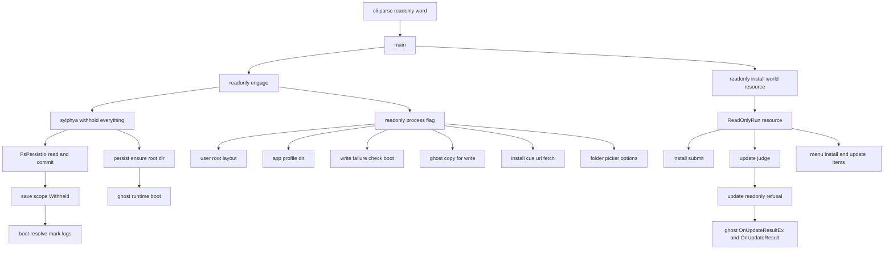
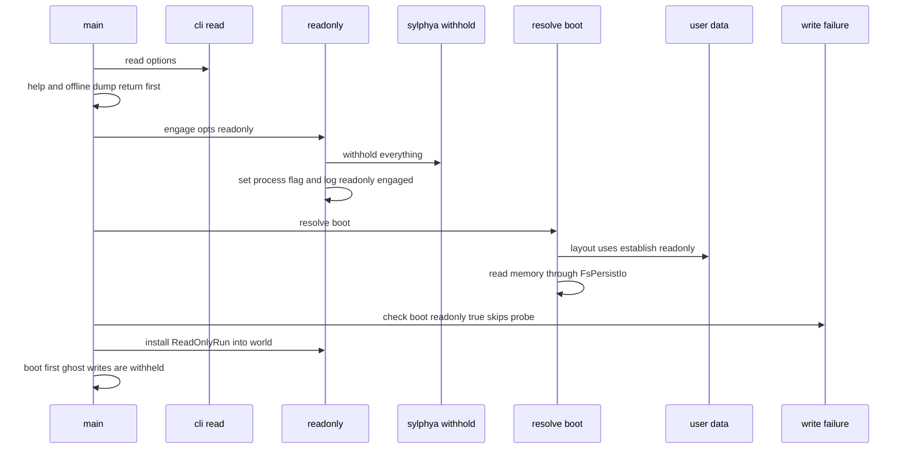
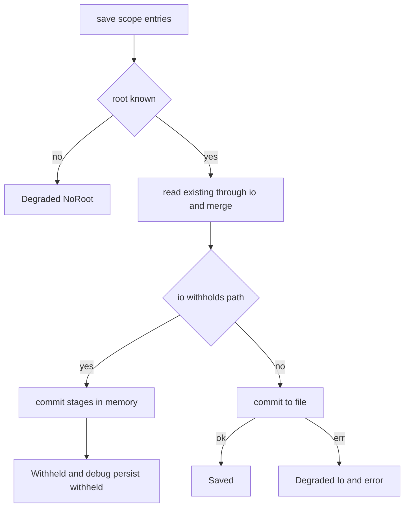
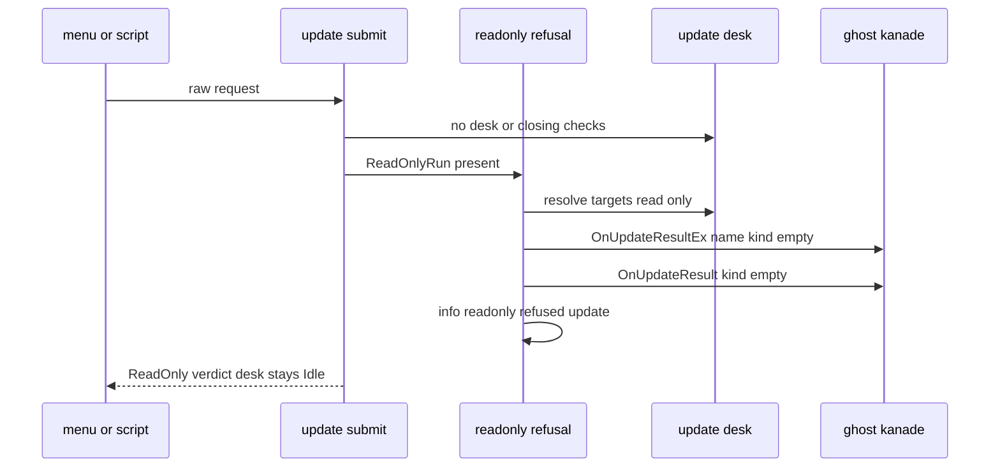

# 設計書: readonly-mode

> 2026-10-23・本ブランチ（main `15d8b0f3` の上・`024600d3`）のコードに対する設計。コードは「何の定義か」（関数名・型名＋ファイルパス）で指す。行番号と行数は今の値。
> ギャップ分析（`research.md` の前半）の §4 の案 A／B／C と §6 の 1〜9 は、この設計で決めた（根拠と比べは `research.md` の「設計の段の調べと決めたこと」）。

## Overview

**Purpose**: `areka.exe --option readonly …` で起こした areka が、1 回の走りのあいだも終わるときも、記憶の置き場・利用者ごとの置き場・ゴースト／シェル／バルーンのフォルダに何も作らず、変えず、消さないようにする。自動の試験で areka を立てる開発者と AI のエージェント、借りた PC や試しの起動で動かしたい利用者が、逃がす環境変数を並べずに「何も残らない起動」を得る。

**Users**: 開発者・AI のエージェントは `--option readonly --sstp-listen …` で、ほかの起動と干渉しない試験用の areka を立てる。利用者は読み取り専用の媒体や借りた PC から試しに動かす。

**Impact**: 今は「受けて、まだ扱わないと記録して無視する」だけの語 `readonly` を扱う語にする。書き込みの道は 1 つも消さず、「書くか控えるか」の分かれ目を保存の口（sylphya の `FsPersistIo`）と、入口（インストール・更新・URL の取り込み・利用者ごとの置き場・ゴーストの写し・書けるかの確かめ）に置く。時刻の扱い・並行の作り・ゴーストへ送るイベントの順は変えない。

### Goals
- 記憶の 13 種（完了 `write-failure-notice` の表）が、作り手に触らずに保存の口 1 か所で控えられ、走るあいだは書けたときと同じに読み返せる。
- 起動中の印・利用者ごとの置き場・ゴーストの記憶のフォルダ・ゴーストの写しを作らず、書けない媒体からでも起動できる。
- インストール・ネットワーク更新・URL からの取り込みを、readonly の SSP で測った知らせ方で断り、窓口を「忙しい」に残さない。
- 「書かない」を決定論のテストで固め、後から足した書き込みが黙って readonly を破らない。

### Non-Goals
- SHIORI（pasta.dll など）が自分で書く保存・一時フォルダ・`areka-mcp-bridge.exe` の手がかりのファイル・`--offline-dump` の書き出し。
- `--option kiosk`（readonly と一緒でも今までどおり「まだ扱わない」）。
- `initial_install.nar` と `--install` の受け取り（`startup-install-option`）。この spec はその入口が通る断りの口を用意するだけ。
- OS や開いたアプリが自分で覚える物（ファイルを選ぶ画面の最後のフォルダ・説明書を開いたアプリの「最近使った」）。止められない物として説明書に書く。

## Boundary Commitments

### This Spec Owns
- 起動オプションの語 `readonly` の読み方（`StartupOptions.readonly`）と、1 回の走りに 1 度だけ決まる「読み取りだけ」の状態（`crates/areka/src/readonly.rs`）。
- 保存の口の「控える範囲」と「重ね書きの控え」（`crates/areka-sylphya/src/persist/withhold.rs`）、`FsPersistIo` がそれを見ること、`PersistOutcome::Withheld` の意味。
- 起動の段で書く物の控え: 起動中の印の 3 つの書き手の記録の文・ゴーストの記憶のフォルダを先に作る段・書けるかの確かめを通す道・利用者ごとの置き場を作らない／写さない形・ゴーストの写しを控える道。
- インストール・更新・URL の取り込みの「読み取りだけ」の断り（判定の値・記録・ゴーストへの知らせ）と、メニューの 2 項目の灰色。
- 読み取りだけのときのフォルダ選びの指定（`FOS_DONTADDTORECENT`）。
- 説明書 `dist/README.txt` の「■ 起動オプション」の readonly の文と、`doc/COMPAT_ARCHITECTURE.md` §8 の 1 行。

### Out of Boundary
- 記憶の形（`FormatDoc`・`PersistKey`）と置き場の決め方そのもの（完了 `user-data-root`・`baseware-root-list`）。`persist/format.rs` には触らない。
- 記憶を書けないときの告知と終わり方（完了 `write-failure-notice`）。ふつうの起動の道は 1 つも変えない。
- インストールと更新の手続き・窓口の段の移し（`install/desk.rs`・`update/desk.rs` の中身）。断りは窓口へ入る前に終わる。
- `argv_session`（argv で始まった走りは印に触れない）の扱い。
- 送らない 7 語の檻（完了 `areka-P0-network-update` の `UNSENT_WORDS`）の中身。この spec は 7 語を変えず、新しい送り物も檻に入れる。

### Allowed Dependencies
- `crates/areka` → `areka-sylphya`（`persist::withhold`・`PersistOutcome`）・`areka-user-data`（`establish_readonly`・`readonly_app_profile_dir`）・`areka-ghost`・`areka-kanade`（送出端）。
- `crates/areka-ghost` → `areka-sylphya`（`persist::FsPersistIo::ensure_root_dir`）。
- `areka-sylphya`・`areka-user-data` は上の層を知らない（読み取りだけの状態を「控える範囲」「関数の選び分け」の形で受け取るだけ）。
- 新しい外部の依存は足さない（std の `OnceLock`・`Mutex`・`BTreeMap`、既存の `windows` の `FOS_DONTADDTORECENT`）。

### Revalidation Triggers
- `PersistIo` に関数が増えた（既定の実装つき）・`PersistOutcome` に値が増えた: `PersistOutcome` を網羅で読む所（今は `boot_resolve.rs` の 3 か所だけ）を足す spec は `Withheld` の腕を持つ。
- `install::SubmitVerdict::ReadOnly`・`update::SubmitVerdict::ReadOnly` が増えた: インストールの入口を足す spec（`startup-install-option`）は `install::submit` を通す。通さない入口は readonly を破る。
- `FsPersistIo` を通らずに `profile\areka` へ書く道を足す spec は、`persist::withholds` を見るか、保存の口を通す。
- 起動の前の順（`readonly::engage` が `resolve_boot`＝`layout()` の最初の呼び出しより前）を動かす変更。
- `copy_for_write` を直に呼ぶ所を足す spec は、readonly を見る（`copy_unless_readonly` を通すか、`switch_copy::start` のように `readonly` を受け取って先に断る）。今の直の呼び手は `copy_unless_readonly`・`switch_copy::start` の背景のスレッド・入口の断りの後ろに在る `install/destination.rs` と `update/worker.rs`。
- `dev-folder-alias` が「別名のフォルダへ書かない守り」を作るときは、`readonly::is_on`／`readonly::of`／`persist::withholds` のどれかから作る（新しい旗を作らない）。

## Architecture

### Existing Architecture Analysis
- 記憶の 13 種はどれも `save_scope`（`persist/mod.rs`）→ `PersistIo::commit` を通る。本番の `PersistIo` は単位の構造体 `FsPersistIo` で、作り手は本番に 7 か所・5 ファイル（`boot_resolve.rs`・`roots/{mod,edit}.rs`・`placement/persist.rs`・`shiori_host.rs`・`areka-ghost/src/sylphya_wiring.rs`）。保存は「読んで重ねて書く」で、書き手をまたいだ読み返し（切替で起こし直した書き手の `build_initial_image`・`boot_resolve` の直読み・窓の位置の読み口）は毎回ファイルを読む。
- 起動の前（World が無い時点）に決まる物: 利用者ごとの置き場の形 `roots::user_root::layout()`（`OnceLock`・最初の呼び出しは `resolve_boot` の中）・書けるかの確かめ `check_boot_dirs`・ゴーストの写し `writable_ghost`。
- 入口: インストールはどれも `install::submit`（積む前に判定）、更新はどれも `update::submit` → `judge`（段を移す前に判定）、URL の取り込みは `InstallCueSink`（`emo2_boot/install_cue.rs`）が `fetch_url::spawn_download` を起こしてから要求を送る。
- 先例: `ModulePolicy`（起動の値を起動の文脈へ渡す）・`RootMark::Temporary`（「書かない」の守りを入口に置く）・`FakePersistIo`（メモリの中の置き場）。

### Architecture Pattern & Boundary Map

選んだ形は案 C（記憶は保存の口の中・World の中の守りは World の資源・起動の前の守りはプロセスの値を引数で受ける純粋な関数）。



**Architecture Integration**:
- Selected pattern: 「1 度だけ決まる走りの状態」＋「継ぎ目ごとの控え」。状態を立てる口は `readonly.rs` の 1 つ、控えの判定の持ち主は継ぎ目ごとに 1 つ（記憶＝`persist::withholds`・World の中の入口＝`ReadOnlyRun`・起動の前の入口＝引数の `readonly: bool`）。
- Domain/feature boundaries: sylphya は「この道は控えるか」だけを知り、readonly の語を知らない。`areka-user-data` は「書かずに形を決める関数」と「写す元を返す関数」を持つだけ。断りの記録とゴーストへの知らせは areka の入口が持つ。
- Existing patterns preserved: `ModulePolicy` の渡し方（`StartupOptions` の欄 → `main`）・`OnceLock` の先例（`exe_location`・`layout`）・`#[path = "*_tests.rs"]` の兄弟の試験・`temp_path_kit::TempPath` の根・`log-capture-kit` の捕捉。
- New components rationale: `persist/withhold.rs`（控えの範囲と控えを 1 か所に閉じる）・`readonly.rs`（走りの状態を立てる唯一の口）・`update/readonly_refusal.rs`（断りの知らせを `update/desk.rs` の外に置く）。
- Steering compliance: 失敗の道はどれも `error!`＋`Err`（今の道をそのまま残す）・断りは info・メッセージボックスなし・テストは兄弟のファイル・試験の根は `target\` の下だけ・`main.rs` は 5 行前後の足しで 1,000 行の内。

**Dependency direction**（左は右を知らない）: `areka-sylphya`（`persist::withhold`）／`areka-user-data` → `areka-ghost` → `crates/areka` の `readonly` → `crates/areka` の入口（`install`・`update`・`menu`・`roots`・`boot_resolve`・`write_failure`・`boot_config`・`emo2_boot`）→ `main`。`readonly.rs` は入口のモジュールを `use` しない（入口が `readonly` を見る）。

### Technology Stack

| Layer | Choice / Version | Role in Feature | Notes |
|-------|------------------|-----------------|-------|
| CLI | 既存 `crates/areka/src/cli/` | 語 `readonly` を効く語にする | 新しい依存なし |
| Data / Storage | 既存 `areka-sylphya` の `persist`（TOML・`FsPersistIo`） | 控えの範囲と重ね書きの控え | std `OnceLock`・`Mutex`・`BTreeMap` |
| Runtime | 既存 `bevy_ecs` の `Resource` | World の中の読み取りだけの印 `ReadOnlyRun` | — |
| OS | 既存 `windows` クレートの `IFileOpenDialog` | `FOS_DONTADDTORECENT`（0x2000000） | Microsoft Learn「_FILEOPENDIALOGOPTIONS」 |

## File Structure Plan

### Directory Structure
```
crates/areka/src/
├── readonly.rs                     # 新: 走りの状態を立てる唯一の口（engage・is_on・install・of・ReadOnlyRun）。下の 3 つの試験を #[path] で宣言する
├── readonly_tests.rs               # 新: 状態の口・構造の試験（engage の呼び手）・起動の前の守りの単体
├── readonly_sites_tests.rs         # 新: 13 種の表を読み取りだけで踏む行列（要件 10.1）
├── readonly_run_tests.rs           # 新: 起動から終わりまでの前後比べ（要件 10.2）
├── boot_resolve_readonly_tests.rs  # 新: 印の 3 つの書き手と予告の記録（Withheld の腕）
├── cli/parse_readonly_tests.rs     # 新: 語の読み手（要件 10.3）
├── install/submit_readonly_tests.rs# 新: インストールの断り・窓口が忙しくない（要件 10.4 の片方）
├── update/readonly_refusal.rs      # 新: 更新の断りの知らせ（Ex と Result）と記録（兄弟の試験を宣言する）
├── update/readonly_refusal_tests.rs# 新: 送る物の字・順・窓口が忙しくない（要件 10.4 の片方）
└── roots/pick_tests.rs             # 新: フォルダ選びの指定の選び分け
crates/areka-sylphya/src/persist/
├── withhold.rs                     # 新: 控える範囲（全部／根の下）・重ね書きの控え（兄弟の試験を宣言する）
└── withhold_tests.rs               # 新: 範囲・控え・取っ手の後始末・鍵の綴り・並んだ試験への漏れなし
crates/areka-user-data/src/
└── establish_readonly_tests.rs     # 新: 作らない・写さない・写す元を読む
```

### Modified Files
- `crates/areka/src/main.rs`（978 行）— `mod readonly;`、`--offline-dump` の戻りの後で `readonly::engage(opts.readonly)`、`roots::install` の次で `readonly::install(…)`、書けるかの確かめの 1 行を `write_failure::check_boot(readonly::is_on(), …)` に替える（足しは 5 行前後）。
- `crates/areka/src/cli/mod.rs` — `StartupOptions` に `pub readonly: bool`。
- `crates/areka/src/cli/parse.rs`（641 行）— `Kind::Option` の腕で `readonly` を効く語へ移す（`effective` に載せ、`WordPending` を出さない）。兄弟の試験の宣言を 1 つ足す。
- `crates/areka/src/cli/parse_tests.rs`（674 行）— `readonly` を「まだ扱わない語」の例にしている 3 か所（418・527・610 行目のあたり）を `kiosk` に替え、`readonly` を効く語の側へ移す。
- `crates/areka/src/boot_resolve.rs`（714 行）— `write_session_mark`・`write_switch_drop`・`clear_session_mark` の網羅の `match` に `Withheld` の腕、`keep_session_mark` に読み取りだけの文。兄弟の試験の宣言。
- `crates/areka/src/boot_config.rs`（622 行）— `default_app_profile_dir` が `readonly::is_on()` で `areka_user_data::readonly_app_profile_dir` を選ぶ。
- `crates/areka/src/roots/user_root.rs`（171 行）— `layout()` が `readonly::is_on()` で `establish_readonly` を選ぶ。`copy_unless_readonly` を足し、`writable_copy` がそれを呼ぶ。
- `crates/areka/src/roots/pick.rs`（75 行）— `dialog_options(base, readonly)` を足し、`show_dialog` が `readonly::is_on()` を渡す。兄弟の試験の宣言。
- `crates/areka/src/write_failure.rs`（230 行）— `check_boot(readonly, cfg, app_profile_dir)` を足す（`check_boot_dirs` は変えない）。
- `crates/areka/src/write_failure_sites_tests.rs`（401 行）— `KINDS` を `pub(crate)` にする（読み取りだけの行列が同じ表を読む）。あわせて `write_failure.rs` の試験の宣言 `mod sites_tests;` を `pub(crate) mod sites_tests;` にする（`#[cfg(test)]` のまま）。
- `crates/areka/src/install/mod.rs`（117 行）— `SubmitVerdict::ReadOnly` と、`submit` の頭の判定・記録。兄弟の試験の宣言。
- `crates/areka/src/emo2_boot/install_cue.rs`（158 行）— `new` の中で取得の口を `fetch_for(readonly::is_on())` から選ぶ（`new` の引数は変えない＝`zorder_wiring_tests.rs` の字の檻に触らない）。
- `crates/areka/src/emo2_boot/install_cue_tests.rs` — 読み取りだけの `url` の腕の試験。
- `crates/areka/src/update/mod.rs`（229 行）— `SubmitVerdict::ReadOnly`、`judge` の `Closing` の後の判定、`submit` の記録の腕、`mod readonly_refusal;`。
- `crates/areka/src/update/refs.rs` — `readonly_summary_refs`。
- `crates/areka/src/update/refs_tests.rs` — 送らない 7 語の檻に `readonly_summary_refs` の出力を足す・字の試験。
- `crates/areka/src/menu/install_frame.rs`・`menu/update_frame.rs` — `enabled` に `!readonly::of(world)`。
- `crates/areka/src/menu/install_frame_tests.rs`・`menu/update_frame_tests.rs` — 読み取りだけで灰色の試験。
- `crates/areka-sylphya/src/persist/io.rs`（301 行）— `PersistIo::withholds`（既定 `false`）、`FsPersistIo` の `read`（控えを先に見る）・`commit`（控える範囲なら控えへ）・`withholds`。
- `crates/areka-sylphya/src/persist/mod.rs`（451 行）— `pub mod withhold;`・`PersistOutcome::Withheld`・`save_scope` の確定の前の分かれ目。 `persist/io.rs` に `FsPersistIo::ensure_root_dir`（関連関数）。
- `crates/areka-ghost/src/runtime.rs`（815 行）— `boot_with_origin` の 629 行目の `std::fs::create_dir_all(ghost_root)` を `areka_sylphya::persist::FsPersistIo::ensure_root_dir(ghost_root)` に替える（1 行）。
- `crates/areka-user-data/src/establish.rs`（240 行）— `establish_readonly`・`establish_readonly_from`、`migrate` と分け合う `migrate_source`。兄弟の試験の宣言。
- `crates/areka-user-data/src/lib.rs` — `readonly_app_profile_dir`・公開の行。
- `dist/README.txt` — 「■ 起動オプション」の 61 行目の文から `readonly` を外し、readonly の段落を足す。
- `doc/COMPAT_ARCHITECTURE.md` — §8（沈黙ルール対応表）に 1 行。

### ウェーブ C11 との重なり（実装の前に各セッションと先に話す）

| ファイル | この spec の差分 | 重なる相手 | 重なりの中身 |
|---|---|---|---|
| `crates/areka-ghost/src/runtime.rs` | 629 行目の 1 行（`boot_with_origin` の中） | ④ `mcp-scope-rect-property`（280 行目・662 行目の `publish_ghost_statics` のあたり） | 文字だけ・別の場所。④ のセッションへ「629 行目の 1 行だけを替える」と先に伝える |
| `crates/areka-sylphya/src/persist/mod.rs` | `PersistOutcome` の値・`save_scope` の確定の前・`mod`／`use` の行 | ⑥ `dpi-realign-remembered-chain`（`PersistKey` の値と TOML への写し） | 文字だけ・意味は当たらない（⑥ の項目も同じ保存の口を通り、控えに覆われる）。後に着地する側が取り込む |
| `crates/areka-sylphya/src/persist/format.rs` | 触らない | ⑥ | 重なり 0 |
| `crates/areka/src/placement/persist.rs` | 触らない（`FsPersistIo` の中で控える） | ⑥ | 重なり 0 |
| `crates/areka-ghost/src/sylphya_wiring.rs` | 触らない | ④ | 重なり 0 |

ほかの持ち物（① の `placement/{config,measure}.rs`・`emo2_boot/{assets,switch_assets}.rs`、② の `input_events/`・`menu/trigger.rs`、⑦ の `mcp/`、⑧ の `shiori-host32-host`）には触らない。`install/desk.rs`・`update/desk.rs`・`fetch_url.rs`・`emo2_boot/runtime_boot.rs` にも触らない。

## System Flows

### 起動の前の順



- `engage` は `--help`・`--offline-dump` の戻りの後（要件 1.5＝`--offline-dump` と一緒の `--option` は効かない）、`resolve_boot` の前（`layout()` が固まる前・要件 4）に 1 度だけ。
- 起動の前の読み（最後に使ったゴースト・シェル・バルーン・印・置き場の並び）は控えがまだ空なのでファイルをそのまま読む（要件 2.2・3.2）。

### 保存の口の分かれ目



- 控えた道は「書けたか」の判定に入らない（要件 6.1・6.2・11.4）。`Withheld` は致命の机へ何も送らない（`actor.rs`・`roots/edit.rs` は `Degraded` だけを見る）。
- `read` は控えを先に見る＝同じ走りの中のどの書き手・読み手も、書けたときと同じ値を読む（要件 2.3）。

### 断った更新の知らせ



- 段（`Stage`）・預かり（`held`）・背景のスレッドには触れない＝`update::desk::is_busy` は偽のまま（要件 7.6・7.7）。

## Requirements Traceability

| Requirement | Summary | Components | Interfaces | Flows |
|-------------|---------|------------|------------|-------|
| 1.1 | 語を受け 1 回の走り全体を読み取りだけに | CliReadonlyWord・ReadonlyState | `StartupOptions.readonly`・`readonly::engage` | 起動の前の順 |
| 1.2 | 起動のはじめの info 1 件・まだ扱わない記録を出さない | CliReadonlyWord・ReadonlyState | `readonly_engaged`・`effective` | 起動の前の順 |
| 1.3 | bootunlock・standalone と同じく自分で起動 | ReadonlyState・Readme | 任せ先の道が無い（足す物なし） | — |
| 1.4 | ほかの語は今どおり・kiosk はまだ扱わない | CliReadonlyWord | `parse` の腕 | — |
| 1.5 | `--offline-dump` と一緒は今の決まり | CliReadonlyWord・ReadonlyState | `OfflineIgnored`・`engage` の位置 | 起動の前の順 |
| 1.6 | 途中で入れ外ししない | ReadonlyState | `OnceLock`・資源は足すだけ | — |
| 2.1 | 13 種を作らず変えず消さない（一時ファイルも） | PersistWithhold | `FsPersistIo::commit`・`withholds` | 保存の口の分かれ目 |
| 2.2 | 今ある記憶をふだんどおり読む | PersistWithhold | `FsPersistIo::read`（控えが無ければファイル） | 起動の前の順 |
| 2.3 | 変わった値を走る間は読み返せる | PersistWithhold | 重ね書きの控え | 保存の口の分かれ目 |
| 2.4 | 終わるときに捨て、記憶は起動の前のまま | PersistWithhold | 控えはメモリの中だけ | — |
| 2.5 | ゴーストの記憶のフォルダを作らない | PersistWithhold・GhostRuntimeDirHook | `FsPersistIo::ensure_root_dir` | 起動の前の順 |
| 2.6 | 書かなかった保存を見分けられる記録 | PersistWithhold・BootMarkLogs | `persist_withheld`（debug）・`*_withheld`（info） | 保存の口の分かれ目 |
| 3.1 | 印を書かず書き換えず消さない | PersistWithhold・BootMarkLogs | 印の 3 関数の `Withheld` の腕 | 保存の口の分かれ目 |
| 3.2 | 前の印を読みふつうと同じ起こし方・印は残す | BootMarkLogs | `read_session_mark`（ファイル） | 起動の前の順 |
| 3.3 | 落ちても次の起動は気付かない・説明書に書く | Readme | 説明書の文 | — |
| 4.1 | 利用者ごとの置き場を作らず写さない | UserRootReadonly | `establish_readonly` | 起動の前の順 |
| 4.2 | 在ればそこを読む | UserRootReadonly | `establish_readonly`（在る根は `Some`） | — |
| 4.3 | 写す元をそのまま読む | UserRootReadonly | `readonly_app_profile_dir`・`migrate_source` | — |
| 4.4 | 書けない所のゴーストを写さずに起こす | GhostCopyReadonly | `copy_unless_readonly` | — |
| 4.5 | 作らなかった・写さなかったを info | UserRootReadonly・GhostCopyReadonly | `user_root_withheld`・`app_memory_read_beside`・`user_data_copy_withheld` | — |
| 5.1 | 書けるかの確かめで何も作らない | BootCheckReadonly | `check_boot`（確かめを飛ばす・今も作る物 0） | 起動の前の順 |
| 5.2 | 書けなくても止めず告知せず起こす | BootCheckReadonly・PersistWithhold | `check_boot`・`Withheld` | 起動の前の順 |
| 5.3 | 読めなければ記憶なしで起こす | PersistWithhold | `load_scope` の寛容な読み（変えない） | — |
| 6.1 | 告知を出さず終了コード 1 にしない | PersistWithhold・BootMarkLogs | `Withheld` は `Err` にならない | 保存の口の分かれ目 |
| 6.2 | `memory_write_failed` を残さない | PersistWithhold | `Withheld` は致命の机へ送らない | 保存の口の分かれ目 |
| 6.3 | 記録の文を起きたことと合わせる | BootMarkLogs | 3 つの `Withheld` の腕・`keep_session_mark` の文 | — |
| 6.4 | ふつうの起動の告知を変えない | PersistWithhold・BootCheckReadonly | 控える範囲の外は今の道のまま | — |
| 7.1 | どの入口のインストールも断る | InstallRefusal・InstallCueReadonly | `install::submit` → `ReadOnly` | — |
| 7.2 | URL を落とし始めない | InstallCueReadonly | `fetch_for(true)` | — |
| 7.3 | 更新を断る | UpdateRefusal | `update::judge` → `ReadOnly` | 断った更新の知らせ |
| 7.4 | 断りを info に 1 件・メッセージボックスなし | InstallRefusal・InstallCueReadonly・UpdateRefusal | `readonly_refused` | 断った更新の知らせ |
| 7.5 | ゴーストへの知らせは SSP の測りどおり | InstallRefusal・UpdateRefusal | 何も送らない／Ex と Result（成否の欄が空） | 断った更新の知らせ |
| 7.6 | 窓口を忙しいに残さない | InstallRefusal・UpdateRefusal | 積む前・段を移す前に断る | 断った更新の知らせ |
| 7.7 | 1 回ごとに断り溜めない | InstallRefusal・UpdateRefusal | 毎回の判定 | — |
| 8.1 | 表示・対話・切替・MCP はふだんどおり | ReadonlyState | 書くか控えるかの外を触らない | — |
| 8.2 | イベントの順・時刻・待ち時間を変えない | PersistWithhold | 控えは確定の位置だけを替える | — |
| 8.3 | SHIORI を今までどおり読む | ReadonlyState | `ModulePolicy` は変えない | — |
| 8.4 | 一時フォルダは作ってよい | — | 触らない | — |
| 8.5 | 置き場の並びの編集はメニューと目録へ映し記憶へは書かない | PersistWithhold | `roots/edit.rs` は変えない（`Withheld` で通る） | 保存の口の分かれ目 |
| 8.6 | OS に「最近使った」を残させない呼び方 | FolderPickerReadonly・Readme | `dialog_options(_, true)`・説明書 | — |
| 8.7 | メニューの 2 項目を灰色・書庫選びを開かない | MenuReadonly | `enabled` の条件 | — |
| 9.1 | まだ扱わない語の文から外す | Readme | `dist/README.txt` 61 行目 | — |
| 9.2 | 書かない物・断る物・書いてしまう物・落ちたとき | Readme | 説明書の段落 | — |
| 9.3 | `--sstp-listen` と組む例 | Readme | 説明書の例 | — |
| 10.1 | 13 種の表から書かないことを判定 | ReadonlyTests | `readonly_sites_tests.rs` | — |
| 10.2 | 起動から終わりまでの前後比べ | ReadonlyTests | `readonly_run_tests.rs` | 起動の前の順 |
| 10.3 | 語の読み手の試験 | ReadonlyTests | `parse_readonly_tests.rs` | — |
| 10.4 | 断りの後に窓口が忙しくない | ReadonlyTests | `submit_readonly_tests.rs`・`readonly_refusal_tests.rs` | — |
| 10.5 | 本物の `%LOCALAPPDATA%\areka` と exe の隣を読み書きしない | ReadonlyTests | `TempPath`・`Signals` の注入・構造の試験 | — |
| 11.1 | 議題 1: 印を書かず消さず・前の印は読んで halt | BootMarkLogs・PersistWithhold | 印の 3 関数・`read_session_mark` | 起動の前の順 |
| 11.2 | 議題 2: 写す元をそのまま読む | UserRootReadonly | `readonly_app_profile_dir` | — |
| 11.3 | 議題 3: インストールは送らず更新は Ex と Result だけ | InstallRefusal・UpdateRefusal | `readonly_summary_refs` | 断った更新の知らせ |
| 11.4 | 議題 4: 判定の手前で道を分け info 以下の記録 | PersistWithhold・BootMarkLogs | `PersistOutcome::Withheld` | 保存の口の分かれ目 |
| 11.5 | 議題 5: ゴーストの記憶のフォルダの段を守りに入れる | GhostRuntimeDirHook | `ensure_root_dir`（`runtime.rs` は 1 行） | 起動の前の順 |
| 11.6 | 議題 6: フォルダ選びの指定・メニューの灰色・説明書 | FolderPickerReadonly・MenuReadonly・Readme | `FOS_DONTADDTORECENT`・`enabled` | — |

## Components and Interfaces

| Component | Domain/Layer | Intent | Req Coverage | Key Dependencies (P0/P1) | Contracts |
|-----------|--------------|--------|--------------|--------------------------|-----------|
| CliReadonlyWord | areka `cli` | 語 `readonly` を効く語にする | 1.1, 1.2, 1.4, 1.5 | parse（P0） | State |
| ReadonlyState | areka `readonly` | 走りの状態を 1 度だけ立て、配る | 1.1, 1.2, 1.3, 1.5, 1.6, 8.1, 8.3 | sylphya withhold（P0） | Service, State |
| PersistWithhold | sylphya `persist` | 控える範囲と重ね書きの控え・`Withheld` | 2.1〜2.6, 3.1, 5.2, 5.3, 6.1, 6.2, 6.4, 8.2, 8.5, 11.4 | FsPersistIo（P0） | Service, State |
| GhostRuntimeDirHook | areka-ghost `runtime` | ゴーストの記憶のフォルダを作る段を保存の口へ寄せる | 2.5, 11.5 | PersistWithhold（P0） | Service |
| BootMarkLogs | areka `boot_resolve` | 印の書き手の記録の文を合わせる | 2.6, 3.1, 3.2, 6.1, 6.3, 11.1, 11.4 | PersistWithhold（P0） | Service |
| BootCheckReadonly | areka `write_failure` | 書けるかの確かめを読み取りだけで通す | 5.1, 5.2, 6.4 | ReadonlyState（P0） | Service |
| UserRootReadonly | areka-user-data＋areka `roots`・`boot_config` | 置き場を作らず写さず写す元を読む | 4.1, 4.2, 4.3, 4.5, 11.2 | ReadonlyState（P0） | Service |
| GhostCopyReadonly | areka `roots::user_root` | ゴーストを写さずに元を返す | 4.4, 4.5 | ReadonlyState（P0） | Service |
| InstallRefusal | areka `install` | どの入口のインストールも積む前に断る | 7.1, 7.4, 7.5, 7.6, 7.7, 11.3 | ReadOnlyRun（P0） | Service |
| InstallCueReadonly | areka `emo2_boot::install_cue` | URL を落とし始める前に断る | 7.1, 7.2, 7.4 | ReadonlyState（P0） | Service |
| UpdateRefusal | areka `update` | 段を移す前に断り Ex と Result を送る | 7.3〜7.7, 11.3 | ReadOnlyRun（P0）・kanade（P1） | Service, Event |
| MenuReadonly | areka `menu` | 2 項目を灰色にする | 8.7, 11.6 | ReadOnlyRun（P0） | State |
| FolderPickerReadonly | areka `roots::pick` | 最近使った所に足さない | 8.6, 11.6 | ReadonlyState（P1） | Service |
| Readme | `dist/README.txt`・`doc/COMPAT_ARCHITECTURE.md` | 意味と限りを書く | 1.3, 3.3, 8.6, 9.1, 9.2, 9.3, 11.6 | — | — |
| ReadonlyTests | 兄弟の `*_tests.rs` | 決定論の檻 | 10.1〜10.5 | TempPath・log-capture-kit（P0） | — |

### 状態の層

#### ReadonlyState（`crates/areka/src/readonly.rs`）

| Field | Detail |
|-------|--------|
| Intent | 1 回の走りが読み取りだけかを 1 度だけ決め、プロセスの値・World の資源・保存の口の範囲を同じ値から立てる唯一の口 |
| Requirements | 1.1, 1.2, 1.3, 1.5, 1.6, 8.1, 8.3 |

**Responsibilities & Constraints**
- `engage(true)` はプロセスの旗を立て、`areka_sylphya::persist::withhold::withhold_everything()` を呼び、`info!(event = "readonly_engaged", "[readonly] --option readonly により、読み取りだけで起動する（記憶・利用者ごとの置き場・ゴーストのフォルダへ書かない）")` を 1 件残す。`engage(false)` は何もしない。
- 旗を下ろす口・資源を外す口は作らない（要件 1.6）。台本・メニュー・MCP から届く道は無い。
- 入口のモジュールを `use` しない（入口がこのモジュールを見る）。
- 二重起動の任せ先は areka に無い（`bootunlock`・`standalone` は今も効き目の無い語）＝要件 1.3 は足す物なし。`readonly` は `bootunlock` の扱い（起動の求めの値を変えない）と同じであることを語の読み手の試験で固め、説明書に書く。

**Dependencies**
- Inbound: `main`（`engage`・`install`）— 起動の前の 1 度（P0）
- Outbound: `areka_sylphya::persist::withhold`（P0）
- Inbound（読む側）: `roots::user_root`・`boot_config`・`write_failure`（`main` 経由）・`emo2_boot::install_cue`・`roots::pick`（`is_on`）、`install`・`update`・`menu`（`of`）

**Contracts**: Service [x] / State [x]

##### Service Interface
```rust
/// World の中の読み取りだけの印（在れば読み取りだけ）。本番は `install` だけが足し、外さない。
#[derive(bevy_ecs::prelude::Resource, Clone, Copy, Debug, Default, PartialEq, Eq)]
pub(crate) struct ReadOnlyRun;

/// 起動の前に 1 度だけ呼ぶ（呼び手は `main` だけ）。`on` が真なら旗・保存の口の範囲・記録を立てる。
pub(crate) fn engage(on: bool);
/// プロセスの旗（起動の前に決まる守りが引数として読む）。
pub(crate) fn is_on() -> bool;
/// 旗が立っていれば World に `ReadOnlyRun` を足す（呼び手は `main` だけ）。
pub(crate) fn install(world: &mut World);
/// World の中の守りが読む（試験は自分の World に `ReadOnlyRun` を足す）。
pub(crate) fn of(world: &World) -> bool;
```
- Preconditions: `engage` は `resolve_boot`（＝`layout()` の最初の呼び出し）より前、`--help`／`--offline-dump` の戻りより後。
- Postconditions: `engage(true)` の後、`is_on()` は真、`persist::withhold::withholds(任意のパス)` は真。
- Invariants: 試験のプロセスでは `engage` が呼ばれない（構造の試験が `crates/areka/src` の中の `readonly::engage(` の呼び手を `main.rs` だけと判定し、`withhold_everything(` の呼び手を `readonly.rs` だけと判定する）。

**Implementation Notes**
- Integration: `main.rs` の足しは `mod readonly;`（説明 1 行）・`readonly::engage(opts.readonly);`（説明 1 行）・`readonly::install(app.world().borrow_mut().world_mut());` の 5 行前後。
- Validation: `readonly_tests.rs`（`install`／`of`、構造の試験、試験のプロセスで `is_on()` が偽）。
- Risks: 旗はプロセスに 1 つ。試験の漏れは「試験は `engage` を呼ばない」の構造の試験で塞ぐ。

#### CliReadonlyWord（`crates/areka/src/cli/{mod,parse}.rs`）

| Field | Detail |
|-------|--------|
| Intent | `--option` の語 `readonly` を効く語にする |
| Requirements | 1.1, 1.2, 1.4, 1.5 |

- `StartupOptions` に `pub readonly: bool`（既定 `false`）。
- `parse` の `Kind::Option` の腕で `"nobootcheck" | "dontloadmodule" | "readonly"` を効く語の腕にまとめ、`readonly` で `options.readonly = true`、`effective` に `readonly` を 1 度だけ載せる。`WordPending` は `kiosk`・`callghost`・`deletesource` だけに残る（要件 1.2・1.4）。大小・カンマの並び・`--option` の重ねは今の読み方のまま（要件 1.1）。
- `--offline-dump` と一緒なら、今の読み方どおり `OfflineIgnored { name: "option" }` が出て `readonly` はまとめの無視の側へ移る。`main` は `engage` より前に書き出しで戻る（要件 1.5）。

**Contracts**: State [x]

### 保存の層

#### PersistWithhold（`crates/areka-sylphya/src/persist/{withhold,io,mod}.rs`）

| Field | Detail |
|-------|--------|
| Intent | 「この道は書かずに控えるか」の唯一の判定と、走る間だけの重ね書きの控え |
| Requirements | 2.1, 2.2, 2.3, 2.4, 2.5, 2.6, 3.1, 5.2, 5.3, 6.1, 6.2, 6.4, 8.2, 8.5, 11.4 |

**Responsibilities & Constraints**
- プロセスに 1 つの `Mutex` の中に、範囲（`Everything` か、登録された根の列）と控え（鍵→中身の `BTreeMap`）を持つ。
- 鍵は「小文字にし、区切りを `\` にそろえた」パスの文字列。範囲の判定（根の下か）は**パスの部品の単位**で行う（根の鍵の末尾に `\` を足してから頭の一致を見る＝根そのものか、根の鍵＋`\` で始まるか）。文字の頭の一致だけでは `TempPath` の `areka-{label}-{pid}-1` が `…-10`〜`…-19` を含んでしまい、並んで走る別の試験の書き込みを黙って控える（設計の検証の指摘 1）。
- `FsPersistIo::commit(path, content)`: 範囲の中なら控えへ入れて `Ok(())`（親のフォルダ・一時ファイル・改名のどれもしない＝要件 2.1）。範囲の外は今の道のまま。
- `FsPersistIo::read(path)`: 控えに在ればその中身、無ければ今の道（ファイル）。控えが空の起動の前は今と同じ値を読む（要件 2.2）。
- `save_scope`: 重ねた中身を作った後、`io.withholds(&path)` が真なら `io.commit` で控えへ入れ、`debug!(target: LOG_TARGET, event = "persist_withheld", ?scope, keys = ?key_names, "persist withheld (read-only run); nothing written")` を残して `PersistOutcome::Withheld` を返す。「書けたか」の判定（`Saved`／`Degraded`）には入らない（要件 6.1・6.2・11.4）。控えへの入れは失敗しない（メモリの中）。
- `FsPersistIo::ensure_root_dir(dir)`（関連関数）: 範囲の中なら `debug!(event = "persist_root_dir_withheld")` を残して `Ok(())`、外なら `std::fs::create_dir_all(dir)`。FS に触れるのは今どおり `FsPersistIo` だけ（`persist/io.rs` の説明「`FsPersistIo` が areka-sylphya で FS に触れる唯一の型（R8.3）」を守る＝設計の検証の指摘 3）。`withhold.rs` は FS に触れない。
- 範囲の外の振る舞い・記録は 1 つも変えない（要件 6.4）。控えはメモリの中だけ＝プロセスが終われば消える（要件 2.4）。

**Dependencies**
- Inbound: `save_scope`・`load_scope`（P0）・`areka_ghost::runtime`（`ensure_root_dir`・P0）・`areka::readonly`（`withhold_everything`・P0）・areka の試験（`WithholdGuard`・P0）・`boot_resolve`（`withholds`・P1）
- External: std のみ

**Contracts**: Service [x] / State [x]

##### Service Interface
```rust
// persist/io.rs
pub trait PersistIo: Send {
    fn read(&self, path: &Path) -> std::io::Result<Option<String>>;
    fn commit(&self, path: &Path, content: &str) -> std::io::Result<()>;
    /// 書かずに控える道か（既定は控えない＝試験の中の偽の IO はそのまま）。
    fn withholds(&self, _path: &Path) -> bool { false }
}
// FsPersistIo は withholds を withhold::withholds へ、read／commit を控えへつなぐ。

// persist/mod.rs
pub enum PersistOutcome {
    Saved,
    Degraded(PersistFailure),
    /// 読み取りだけの走りで書かずに控えた（中身は走る間だけ読み返せる）。
    Withheld,
}
// persist/io.rs（FS に触れる唯一の型の関連関数）
impl FsPersistIo {
    /// 範囲の中ならフォルダを作らずに Ok、外なら create_dir_all。
    pub fn ensure_root_dir(dir: &Path) -> std::io::Result<()>;
}

// persist/withhold.rs（FS に触れない）
/// 本番の読み取りだけの走り: 以後すべてのパスを控える（戻す口は無い・呼び手は areka の readonly::engage だけ）。
pub fn withhold_everything();
/// このパスを書かずに控えるか。
pub fn withholds(path: &Path) -> bool;
/// 試験の根だけを控える取っ手（落とすと登録と、その根の下の控えを消す）。
#[must_use]
pub struct WithholdGuard { /* 登録の番号 */ }
impl WithholdGuard { pub fn under(root: &Path) -> Self; }
impl Drop for WithholdGuard { fn drop(&mut self); }
pub(crate) fn staged(path: &Path) -> Option<String>;
pub(crate) fn stage(path: &Path, content: &str);
```
- Preconditions: なし（`withhold_everything` 前は登録された根だけが範囲）。
- Postconditions: 範囲の中のパスについて、`commit` の後もファイルの木は変わらず、`read` は最後に控えた中身を返す。
- Invariants: `Everything` は一度立つと下りない。`WithholdGuard` の根は呼び出しごとに別（`TempPath`）で、範囲の判定は部品の単位なので、並んで走る別の試験のパス（名前の頭が同じ根を含む）は範囲に入らない。

##### State Management
- State model: `struct Withhold { everything: bool, roots: Vec<(u64, String)>, staged: BTreeMap<String, String> }` を `static` の `Mutex` で 1 つ。
- Persistence & consistency: 控えはメモリの中だけ。「読んで重ねて書く」は今のまま（`read_existing` が控えを読む）＝書き手をまたいでも 1 つの中身にまとまる。
- Concurrency strategy: 書き手（ゴーストごとのアクターのスレッド）と UI スレッドが同じ `Mutex` を短く取る。今の「同じファイルを同時に書かない」決まり（`boot_resolve.rs` の印の節）はそのまま守られる。待ち時間の論理は変わらない（要件 8.2）。

**Implementation Notes**
- Integration: `FsPersistIo` の作り手 7 か所には触らない。`#[derive(Clone, Copy, Debug, Default)]` の単位の構造体のまま。
- Validation: `withhold_tests.rs`（範囲の中の `commit` で親のフォルダも `*.tmp` も作られない・`read` が控えを返す・`save_scope` が `Withheld` と `persist_withheld` を返し `Saved`／`Degraded` の記録を出さない・取っ手を落とすと控えが消える・別の根は書く・`…-1` を登録しても `…-10` の根は書く（部品の単位の判定）・鍵の大小を問わない・`ensure_root_dir` の 2 つの道）。`io.rs` の中の今の試験は変えない。
- Risks: 範囲を登録し忘れた試験は今までどおり本物の根（`TempPath`）へ書く（今と同じ）。

#### GhostRuntimeDirHook（`crates/areka-ghost/src/runtime.rs`）

| Field | Detail |
|-------|--------|
| Intent | 起動のたびにゴーストの記憶のフォルダを作る段を、保存の口の `ensure_root_dir` へ寄せる |
| Requirements | 2.5, 11.5 |

- `boot_with_origin` の中の `std::fs::create_dir_all(ghost_root)` を `areka_sylphya::persist::FsPersistIo::ensure_root_dir(ghost_root)` に替える。`if let Err(err) = …` の `warn!` と続ける振る舞いはそのまま。
- ふつうの起動の振る舞いは変わらない（範囲の外は今どおり作る）。読み取りだけでは作らない（空のフォルダも残らない）。
- ④ `mcp-scope-rect-property` と同じファイル（④ は `publish_ghost_statics` のあたり）。差分はこの 1 行だけで、実装の前に ④ のセッションへ伝える。

### 起動の段

#### BootMarkLogs（`crates/areka/src/boot_resolve.rs`）

| Field | Detail |
|-------|--------|
| Intent | 起動中の印の書き手の記録の文を、控えたときに事実と合わせる |
| Requirements | 2.6, 3.1, 3.2, 6.1, 6.3, 11.1, 11.4 |

**Responsibilities & Constraints**
- `write_session_mark`: `Withheld` の腕で `info!(event = "session_mark_withheld", ghost, "[boot_resolve] 読み取りだけなので、起動中の印を書きませんでした")` を残して `Ok(())`。
- `write_switch_drop`: `Withheld` の腕で `info!(event = "switch_drop_withheld", …, "[boot_resolve] 読み取りだけなので、降ろした直後の記憶を書きませんでした")`・`Ok(())`。
- `clear_session_mark`: `Withheld` の腕で `info!(event = "session_mark_clear_withheld", "[boot_resolve] 読み取りだけなので、起動中の印に触れていません")`・`Ok(())`。
- `keep_session_mark`: `areka_sylphya::persist::withhold::withholds(app_profile_dir)` が真なら、印を読み直さずに `info!(event = "session_mark_kept", readonly = true, "[boot_resolve] 読み取りだけなので起動中の印に触れていません（次の起動は、この走りの前の記憶のとおりに起きます）")` だけを残す（控えの印で次の起動を予告しない＝要件 6.3）。
- 印を読む `read_session_mark` は今のまま（起動の前は控えが空＝前のふつうの走りの印を読み、ふつうと同じく既定のゴーストへ `halt` を伝える。要件 3.2・11.1）。印の 3 関数を呼ぶ側（`main`・`ghost_switch`・`session_end`）と `argv_session` には触らない。
- 読み取りだけの走りが落ちても、印を書いていないので次の起動は気付かない（要件 3.3）＝コードは足さず、説明書に書く。

**Contracts**: Service [x]

#### BootCheckReadonly（`crates/areka/src/write_failure.rs`）

| Field | Detail |
|-------|--------|
| Intent | 書けるかの確かめを読み取りだけで通す |
| Requirements | 5.1, 5.2, 6.4 |

```rust
/// 起動の前の確かめの入口。`readonly` なら確かめずに通す（info 1 件）。そうでなければ今の `check_boot_dirs`。
pub(crate) fn check_boot(
    readonly: bool,
    cfg: &ConfigInputs,
    app_profile_dir: &Path,
) -> Result<(), PersistFailure>;
```
- `readonly` のとき `info!(event = "readonly_boot_check_skipped", "[write_failure] 読み取りだけなので、記憶の置き場が書けるかを確かめません")` を残して `Ok(())`。何も開かず何も作らない（要件 5.1）。書けない置き場・書けない exe のフォルダでも起動を止めず、告知を出さない（要件 5.2）。
- `check_boot_dirs` と `stop_boot` は変えない（要件 6.4）。

#### UserRootReadonly（`crates/areka-user-data/src/{establish,lib}.rs`・`crates/areka/src/roots/user_root.rs`・`crates/areka/src/boot_config.rs`）

| Field | Detail |
|-------|--------|
| Intent | 利用者ごとの置き場を作らず写さず、写す元をそのまま読む |
| Requirements | 4.1, 4.2, 4.3, 4.5, 11.2 |

**Responsibilities & Constraints**
- `establish_readonly_from(signals, exe_dir, profile_env)`: 判断（`decide`）と、隣に居る・決められないときの記録は `establish_from` と同じ道を分け合う。`Decision::UserRoot { root }` のとき、`root.dir` がフォルダなら `Some(root)`（要件 4.2）、無ければ作らずに `None`（隣の形）にして `info!(event = "user_root_withheld", dir, "read-only run: the user root is not created; staying beside the exe")`（要件 4.1・4.5）。`migrate` は呼ばない。
- `migrate_source(root, exe_dir) -> Option<(from, to)>`: 「`root\profile\areka` が無く、`exe_dir\profile\areka` がフォルダ」のときだけ `Some`。`migrate` と `readonly_app_profile_dir` が分け合う（写しの条件の持ち主は 1 つ）。
- `readonly_app_profile_dir(profile_env, layout, exe_dir)`: `AREKA_PROFILE_DIR` が在ればそれ。書ける根が在り `migrate_source` が `Some` なら写す元（`exe_dir\profile\areka`）を返し `info!(event = "app_memory_read_beside", from, to, "read-only run: reading the bundled app memory without copying it")`。ほかは `app_profile_dir` と同じ値（要件 4.3・11.2）。
- areka の側: `layout()` は `readonly::is_on()` で `establish_readonly` と `establish` を選ぶ。`default_app_profile_dir()` は同じく `readonly_app_profile_dir` と `app_profile_dir` を選ぶ。
- 読み取りだけの記憶の置き場は、`layout()`・`exe_location()` と同じく**1 回の走りに 1 度だけ決めて覚える**（`boot_config.rs` の `OnceLock`）。`default_app_profile_dir()` は 1 回の走りで少なくとも 3 回呼ばれる（`boot_config.rs` の起動の値・`main.rs` の 2 か所）ので、呼ぶたびに FS を見て決め直すと、別の areka が同時にふつうに起きて写しを終えた場面（今のコードの `CopyDone::Raced`）で走りの途中に置き場が変わりうる。`app_memory_read_beside` の info も、決めたときの 1 件だけにする（設計の検証の指摘 2・要件 1.6・4.3・4.5）。判断（`migrate_source` の結果から置き場を選ぶ）は純粋な関数に分け、FS を見る所（フォルダが在るか）と覚える所を外に置く。

```rust
// areka-user-data
pub fn establish_readonly(exe_dir: Option<&Path>, profile_env: Option<&OsStr>) -> Layout;
pub fn establish_readonly_from(signals: &Signals, exe_dir: Option<&Path>, profile_env: Option<&OsStr>) -> Layout;
pub fn readonly_app_profile_dir(profile_env: Option<&OsStr>, layout: &Layout, exe_dir: Option<&Path>) -> Option<PathBuf>;
```
- Postconditions: どの腕でもフォルダもファイルも作らない（`probe` の `open_dir_for_add` は今も作る物 0）。
- Notes: `Layout` の形は変えない（字で組む 7 か所を直さない）。書ける根が無い初めての起動では、置き場の並びに書ける根の行が出ない（ふつうは空の根を作って並べる）。起こすゴーストと記憶の値は同じ＝説明書に書く。

#### GhostCopyReadonly（`crates/areka/src/roots/user_root.rs`）

| Field | Detail |
|-------|--------|
| Intent | 書けない所のゴースト・バルーンを写さずに元を返す |
| Requirements | 4.4, 4.5 |

```rust
/// `readonly` なら写さず `dir` を返す（写すはずだったときだけ info 1 件）。そうでなければ `copy_for_write`。
pub(crate) fn copy_unless_readonly(
    readonly: bool,
    roots: &BasewareRoots,
    exe_dir: Option<&Path>,
    kind: StoreKind,
    dir: &Path,
) -> PathBuf;
```
- 写すはずだったか（`plan_copy` が `Copy`）を見て、そのときだけ `info!(event = "user_data_copy_withheld", kind, from, to, "read-only run: not copying into the user root; using the original folder")`。
- `writable_copy` がこれを `readonly::is_on()` で呼ぶ＝起動（`writable_ghost`）・既定へ戻す切替（`switch_to_default`）に効く。インストールの宛先（`install/destination.rs`）と更新（`update/worker.rs`）は `copy_for_write` を直に呼ぶが、どちらも入口の断り（`install::submit`・`update::submit`）より先へ進まないので届かない。
- ふつうの切替は `writable_copy` を通らず、受理（`ghost_switch.rs` の `accept_switch`）が `switch_copy::start(readonly::of(world), …)` を呼ぶ。`start` は `readonly` なら背景のスレッドを起こさず `SwitchCopy::Done(copy_unless_readonly(true, …))`（元のフォルダ・写すはずだったときだけ `user_data_copy_withheld`）を返し、切替はそのフォルダから起こす。`plan_copy`・`copy_for_write` は変えない。

### 入口の層

#### InstallRefusal（`crates/areka/src/install/mod.rs`）

| Field | Detail |
|-------|--------|
| Intent | どの入口のインストールも、窓口に積む前に断る |
| Requirements | 7.1, 7.4, 7.5, 7.6, 7.7, 11.3 |

```rust
pub(crate) enum SubmitVerdict {
    Queued,
    Empty,
    NoDesk,
    Closing,
    /// 読み取りだけの走り（積まない・ゴーストへ何も送らない）。
    ReadOnly,
}
```
- `submit` の頭で `readonly::of(world)` を見て、真なら `info!(event = "readonly_refused", what = "install", origin = ?origin, count, "[install] 読み取りだけなので、インストールの依頼を断ります")` を 1 件残して `ReadOnly` を返す。`install_order_refused` の warn は出さない（記録は 1 件）。
- 窓への投げ込み（`file_drop.rs`）・台本の `path`（窓口の取り出し → `submit`）・後から足される起動のときの入口（`startup-install-option`）は、どれも `submit` を通るので同じ断りを受ける（要件 7.1）。メニューの「インストール…」は灰色（MenuReadonly）。
- ゴーストへは何も送らない（`OnInstallBegin`・`OnInstallFailure` とも 0・要件 7.5・11.3）。待ち行列に積まない＝`install::desk::is_busy` は偽のまま（要件 7.6）。頼まれるたびに同じ判定（要件 7.7）。

#### InstallCueReadonly（`crates/areka/src/emo2_boot/install_cue.rs`）

| Field | Detail |
|-------|--------|
| Intent | `\![execute,install,url,…]` を、落とし始める前に断る |
| Requirements | 7.1, 7.2, 7.4 |

```rust
/// 読み取りだけなら断りの記録だけを残す口、そうでなければ本物の取得（`fetch_url::spawn_download`）。
fn fetch_for(readonly: bool) -> StartFetch;
impl InstallCueSink {
    pub(crate) fn new(tx: Sender<RawInstallRequest>) -> Self; // = with_fetch(tx, fetch_for(readonly::is_on()))
}
```
- 断りの口は `info!(event = "readonly_refused", what = "install_url", url, "[InstallCueSink] 読み取りだけなので、書庫を取りに行きません")` を残し、要求を送らない（スレッドも起こさない・ネットワークへ行かない＝要件 7.2）。
- `new` の引数は変えない（`emo2_boot/zorder_wiring_tests.rs` が `runtime_boot.rs` の受け口の並びを字で固めている）。

#### UpdateRefusal（`crates/areka/src/update/{mod,readonly_refusal,refs}.rs`）

| Field | Detail |
|-------|--------|
| Intent | どの入口の更新も、段を移す前に断り、SSP で測った総括だけを送る |
| Requirements | 7.3, 7.4, 7.5, 7.6, 7.7, 11.3 |

**Responsibilities & Constraints**
- `judge` は窓口が無い（`NoDesk`）・終了が始まった（`Closing`）の判定の次に `readonly::of(world)` を見て、真なら `readonly_refusal::refuse(world, &raw, reason)` を呼んで `SubmitVerdict::ReadOnly` を返す。段（`Stage`）・預かり（`held`）・背景のスレッドに触れない（要件 7.6）。`submit` の記録の腕は `ReadOnly` を「判定した場所が残す」側に入れる（`update_refused` の warn を出さない）。
- `refuse`: `desk::resolve_targets(world, raw)` で対象を解き、`refs::readonly_summary_refs(SummaryKind::ResultEx, &targets)` を `OnUpdateResultEx`、続けて `readonly_summary_refs(SummaryKind::Result, &targets)` を `OnUpdateResult` として、置き場のゴーストの kanade へ返事なし（`reply: None`・`ShioriMethod::Get`）で 1 件ずつ送る。対象が 0 なら送らない。`info!(event = "readonly_refused", what = "update", reason, targets, notified, "[update] 読み取りだけなので、ネットワーク更新を断ります（notified＝総括を送れたか）")` を 1 件残す。
- `OnUpdateBegin`・`OnUpdateReady`・`OnUpdateFailure`・`OnUpdateProcessExec` は送らない。ネットワークへ行かない（要件 7.3・7.5）。
- homeurl の有無で対象を外さない（readonly の SSP は取りに行く前に断る）。

**Contracts**: Service [x] / Event [x]

##### Service Interface
```rust
// update/refs.rs
/// 読み取りだけの断りの総括: 対象ごとに `[名前（ResultEx のときだけ）, 種別, ""]` を `\u{1}` でつなぐ。
pub(crate) fn readonly_summary_refs(kind: SummaryKind, targets: &[TargetSpec]) -> Vec<String>;

// update/readonly_refusal.rs
pub(super) fn refuse(world: &World, raw: &RawUpdateRequest, reason: UpdateReason);
```

##### Event Contract
- Published events: `OnUpdateResultEx`（Reference*n* ＝ `名前\u{1}種別\u{1}`）→ `OnUpdateResult`（Reference*n* ＝ `種別\u{1}`）。例: バルーン「にゃんばるーん」なら `にゃんばるーん\u{1}balloon\u{1}` と `balloon\u{1}`（2026-10-23 の readonly の SSP の測りと字まで同じ）。自分のゴーストの更新（`\![updatebymyself]`＝`Current`）でも、同じ測りで SSP は `窓際のぱすたさんDRESSTEST\u{1}ghost\u{1}` と `ghost\u{1}` の 2 件を送った（homeurl の無いゴーストで測った）＝`Current` でも Ex と Result の 2 件を送る。ふつうの areka が `Current` で `OnUpdateResult` だけを送るのとは違うが、読み取りだけの断りは SSP の測りに合わせる（要件 7.5）。
- Ordering / delivery guarantees: 同じ送出端に Ex → Result の順で積む（kanade の受け口は届いた順に送る）。送れなければ `notified = false` の記録だけ（台本は殺さない）。
- `readonly` の語は Reference に現れない（`update/refs_tests.rs` の送らない 7 語の檻に `readonly_summary_refs` の出力を足して固める）。

#### MenuReadonly（`crates/areka/src/menu/{install_frame,update_frame}.rs`）

| Field | Detail |
|-------|--------|
| Intent | 「インストール…」「ネットワーク更新」を灰色にする |
| Requirements | 8.7, 11.6 |

- `install_item` の `enabled` を `!readonly::of(world) && desk::can_pick(world)`、`update_item` の `enabled` を `!readonly::of(world) && desk::can_update(world)` にする。灰色の項目は Win32 のメニューが選ばせない＝書庫選びの画面（`install/pick.rs`）は開かない。

#### FolderPickerReadonly（`crates/areka/src/roots/pick.rs`）

| Field | Detail |
|-------|--------|
| Intent | 読み取りだけのとき、選んだフォルダを「最近使った」へ足させない |
| Requirements | 8.6, 11.6 |

```rust
/// 今の指定に、読み取りだけなら `FOS_DONTADDTORECENT` を足す。
fn dialog_options(base: FILEOPENDIALOGOPTIONS, readonly: bool) -> FILEOPENDIALOGOPTIONS;
```
- `show_dialog` が `dialog_options(options, crate::readonly::is_on())` を `SetOptions` へ渡す。ふつうの起動の指定は変えない。
- 画面が自分で覚える最後のフォルダ（OS が exe の名前ごとに覚える）は止める指定が無い。説明書を開く道（`readme/os_port.rs`）は `SEE_MASK_FLAG_LOG_USAGE` を渡しておらず areka からは足していない＝変えない。開いたアプリが残す物とあわせて説明書に書く。

#### Readme（`dist/README.txt`・`doc/COMPAT_ARCHITECTURE.md`）

- 61 行目の「まだ扱わない語」の文から `readonly` を外す（要件 9.1）。
- 「■ 起動オプション」に readonly の段落を足す: 書かない物（記憶・起動中の印・利用者ごとの置き場・ゴースト／シェル／バルーンのフォルダ）・断る物（インストール・ネットワーク更新・URL からの取り込み・メニューの 2 項目は灰色）・書いてしまう物（SHIORI が自分で書く保存・一時フォルダ）・OS やアプリが自分で覚える物（フォルダを選ぶ画面の最後のフォルダ・説明書を開いたアプリの「最近使った」）・読み取りだけの走りが落ちても次の起動は気付かないこと・書ける根が無いときは作らず置き場の並びにも出ないこと・`bootunlock`／`standalone` と同じく自分で起動すること（要件 1.3・3.3・9.2）。
- 例: `areka.exe --option readonly --sstp-listen 9831 --ghost emo2`（要件 9.3）。
- `doc/COMPAT_ARCHITECTURE.md` §8 に 1 行: 正典は readonly の断りでゴーストへ何を送るかを書いていない → readonly の SSP の測り（2026-10-23）に合わせ、インストールは何も送らず、更新は成否の欄が空の `OnUpdateResultEx`／`OnUpdateResult` だけ、`readonly` の語は送らない。

## Data Models

### Domain Model
- **走りの状態**: 「ふつう」か「読み取りだけ」。起動の前に 1 度だけ決まり、走りの終わりまで変わらない。持ち方はプロセスの旗・World の資源 `ReadOnlyRun`・保存の口の範囲 `Everything` の 3 つで、どれも `readonly::engage` が同じ値から立てる。
- **控え**: 保存の口が書くはずだった 1 ファイルの全文（`sylphya.toml` の中身）。鍵はファイルのパス。走る間の読み返しの正本。

### Logical Data Model
- `Withhold { everything: bool, roots: Vec<(u64, String)>, staged: BTreeMap<String, String> }`（鍵は小文字・区切り `\` の文字列）。
- 記憶のファイルの形（`FormatDoc`・`format-version`）は変えない。

## Error Handling

### Error Strategy
- 控えはメモリの中で失敗しない。範囲の外の失敗の道（`commit` の `error!`＋`Degraded`・`check_boot_dirs` の `stop_boot`・`establish` の `error!`）は 1 つも変えない。
- 断り（インストール・URL・更新）は失敗ではない＝`info!(event = "readonly_refused")` を 1 件。メッセージボックスも告知も出さない（要件 7.4）。
- 断りの知らせを送れなかった（kanade が居ない・閉じた）は `notified = false` を同じ記録に添える（黙って落とさない）。
- `ensure_root_dir` の範囲の外の失敗は今どおり `warn!` で続ける（`runtime.rs` の今の扱い）。

### Monitoring

| event | level | どこ | いつ |
|---|---|---|---|
| `readonly_engaged` | info | `readonly.rs` | 起動のはじめに 1 件 |
| `persist_withheld` | debug | `persist/mod.rs` | 保存を控えるたび |
| `persist_root_dir_withheld` | debug | `persist/io.rs`（`ensure_root_dir`） | ゴーストの記憶のフォルダを作らなかった |
| `session_mark_withheld`・`switch_drop_withheld`・`session_mark_clear_withheld` | info | `boot_resolve.rs` | 印の 3 つの書き手 |
| `session_mark_kept`（`readonly = true`） | info | `boot_resolve.rs` | きれいに終わらなかった後始末 |
| `readonly_boot_check_skipped` | info | `write_failure.rs` | 起動の前の確かめ |
| `user_root_withheld`・`app_memory_read_beside` | info | `areka-user-data` | 置き場の形を決めたとき |
| `user_data_copy_withheld` | info | `roots/user_root.rs` | 写すはずだったとき |
| `readonly_refused`（`what` ＝ `install`・`install_url`・`update`） | info | 入口の 3 か所 | 断るたびに 1 件 |

## Testing Strategy

どれも決定論。試験の根は `temp_path_kit::TempPath`（`target\` の下）だけ。本物の `%LOCALAPPDATA%\areka` と exe の隣は読みも書きもしない（`areka-user-data` は `Signals` を注入し、areka の側は `TempPath` の根と `SwitchRig` の検体だけ・要件 10.5）。プロセスに 1 つの状態は、試験では `engage`／`withhold_everything` を呼ばず、`WithholdGuard::under(自分の根)` と自分の World の `ReadOnlyRun` だけで立てる。ログの「出ていない」の主張は `log-capture-kit` の捕捉窓（対照のイベントつき）で判定する。

### Unit Tests
1. `persist/withhold_tests.rs`: 範囲の中の `commit` で親のフォルダも `sylphya.toml.tmp` も宛先も作られない・`read` が控えを返す・`save_scope` が `Withheld` を返し `persist_withheld` を出し `persist commit failed` を出さない・取っ手を落とすと控えが消えてファイルを読む・登録していない隣の根は書く・`…-1` を登録しても `…-10` の根は書く・鍵の大小を問わない・`ensure_root_dir` は範囲の中で作らず外で作る（2.1・2.3・2.5・2.6）。
2. `cli/parse_readonly_tests.rs`: `readonly`・`READONLY`・`nobootcheck,readonly`・`--option` 2 回で `readonly = true` と `effective` に 1 つ・`WordPending` が `readonly` に出ない・`kiosk,readonly` で `kiosk` だけがまだ扱わない・`--offline-dump` と一緒で `OfflineIgnored{option}` と無視の側の `readonly`・`readonly` と `bootunlock` のどちらでも `BootRequest` が同じ（1.1〜1.5・10.3）。`cli/parse_tests.rs` の 3 か所は `kiosk` へ替える。
3. `areka-user-data/src/establish_readonly_tests.rs`: 根が無い → 作らず `None`・`user_root_withheld`／根が在る → `Some`・作る物 0／根は在るが記憶が無く隣に記憶 → `readonly_app_profile_dir` が隣を返し `app_memory_read_beside`・写さない／両方無い → ふつうと同じ値／`AREKA_PROFILE_DIR` が勝つ／どの腕も木の前後が同じ（4.1〜4.3・4.5・11.2）。
4. `readonly_tests.rs`: `install` は旗が立たない試験のプロセスで何も足さない・`of` は資源で真偽・構造の試験（`readonly::engage(` の呼び手は `main.rs` だけ・`withhold_everything(` の呼び手は `readonly.rs` だけ）・`check_boot(true, 書けない置き場)` が `Ok` と `readonly_boot_check_skipped`・`check_boot(false, …)` は `check_boot_dirs` と同じ `Err`・`copy_unless_readonly(true, 写す並び)` が元を返し `user_data_copy_withheld`・写し先が作られない（1.6・4.4・5.1・5.2・6.4）。
5. `update/refs_tests.rs`・`roots/pick_tests.rs`: `readonly_summary_refs` の字（`にゃんばるーん\u{1}balloon\u{1}`・`balloon\u{1}`・3 対象の並び）と送らない 7 語の檻・`dialog_options(base, true)` が `FOS_DONTADDTORECENT` を含み `false` は `base` のまま（7.5・8.6・11.3）。

### Integration Tests
1. `readonly_sites_tests.rs`（要件 10.1）: `write_failure_sites_tests.rs` の `KINDS`（13 種）を読み、`SwitchRig` の根に `WithholdGuard` を立てて 13 種の書き込みの場所を 1 つずつ呼ぶ。どの種類も、記憶のファイルの中身と置き場の木が呼ぶ前と同じ・`load_scope`（`FsPersistIo`）で期待の key が読み返せる・最初の出所が無い（致命の机に届かない）ことを判定し、判定した種類の集まりが `KINDS` と等しいことを判定する（1 種でも抜けたら赤）。ふつうの起動で書くことは、同じ表を使う `every_write_kind_reaches_the_desk` が判定する。
2. `readonly_run_tests.rs`（要件 10.2）: 1 つの `TempPath` の下に exe の隣の形（`SwitchRig` の根）と、まだ無い利用者ごとの置き場の場所を置き、前の木（ファイルとフォルダの一覧と中身）を取る。`establish_readonly_from`（利用者ごとの置き場の場所を `Signals` で注入）→ `readonly_app_profile_dir` → `check_boot(true, …)` → `copy_unless_readonly(true, …)` → 根の `WithholdGuard` と `ReadOnlyRun` の下で A を起こす → B へ切り替える → 窓の位置を覚えさせる → プロパティを変える → 置き場の並びに足す → インストールを頼む（`install::submit`）→ 更新を頼む（`update::submit`）→ 降ろして後始末（`settle_session_mark`）。後の木が前の木と同じであることを判定する。あわせて、A／B の SHIORI が受けた要求に `OnInstall*` が 0 件、`OnUpdateResultEx`→`OnUpdateResult` 以外の `OnUpdate*` が 0 件であることを判定する。
3. `boot_resolve_readonly_tests.rs`: 根の `WithholdGuard` の下で印の 3 関数が `Ok` を返し、`session_mark_written`・`session_mark_cleared`・`switch_drop_recorded` を出さず `*_withheld` を出す・前のふつうの走りの印を植えて `read_session_mark` がその印を読み、後始末の後もファイルの印が同じ・`keep_session_mark` が `readonly = true` の文を出す（3.1・3.2・6.3・11.1）。
4. `install/submit_readonly_tests.rs`: `ReadOnlyRun` の World で窓への投げ込み・台本の `path`・メニューの出どころの依頼が `ReadOnly`・待ち行列が空・`install::desk::is_busy` が偽・`readonly_refused` が依頼ごとに 1 件（3 回頼めば 3 件）・`install_order_refused` が出ない・ゴーストへの送り物 0（7.1・7.4〜7.7・10.4）。`emo2_boot/install_cue_tests.rs`: `with_fetch(tx, fetch_for(true))` で `url` の腕が要求を送らず `readonly_refused{install_url}` を出す（7.2）。
5. `update/readonly_refusal_tests.rs`: `ReadOnlyRun` の World で `RawUpdateRequest::Other([(Balloon, "にゃんばるーん")])` と `Current([Ghost])` を頼み、`SubmitVerdict::ReadOnly`・段が `Idle`・預かりが空・`update::desk::is_busy` が偽・ゴーストの送出端に Ex → Result の 2 件だけ（字は上の Event Contract のとおり）・`readonly_refused{update}` が 1 件・続けてもう 1 回頼んでも同じ（7.3〜7.7・10.4・11.3）。`menu/install_frame_tests.rs`・`menu/update_frame_tests.rs`: `ReadOnlyRun` で `enabled == false`、無ければ今どおり（8.7）。

### 実機の確かめ（決定論の試験の外・タスクの最後に 1 回）
- `target\` の下の根で `areka.exe --option readonly --sstp-listen <空きの番号> --ghost <検体>` を有界の自動終了で起こし、記録の `readonly_engaged`・`readonly_refused` を grep し、根の木の前後を比べる（記憶の「実機サインオフは有界 auto-exit＋ログ grep」）。開発者の本物の `%LOCALAPPDATA%\areka` は使わない（`AREKA_USER_ROOT` を `target\` の下へ向けて、読み取りだけでそこが作られないことを見る）。

## Security Considerations
- 読み取りだけの走りは、利用者の環境（記憶・置き場・ゴーストのフォルダ）を変えない約束を持つ。約束を破る道を後から足させないため、「保存の口を通らない書き込み」と「`install::submit` を通らないインストールの入口」を Revalidation Triggers に挙げ、構造の試験で状態の立て方を固める。
- 断りの記録に載せる URL・パスは、今のインストールと更新の記録と同じ範囲（新しく外へ出す値は無い）。
