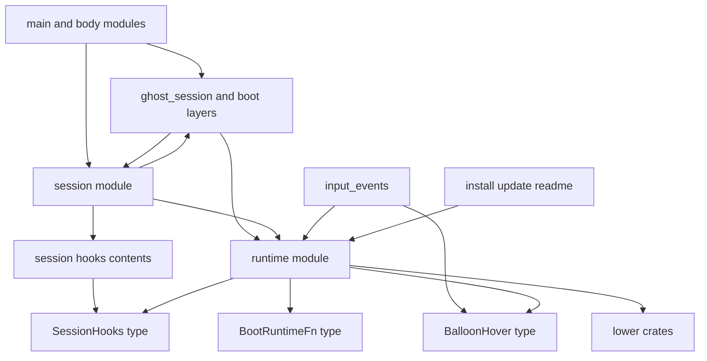
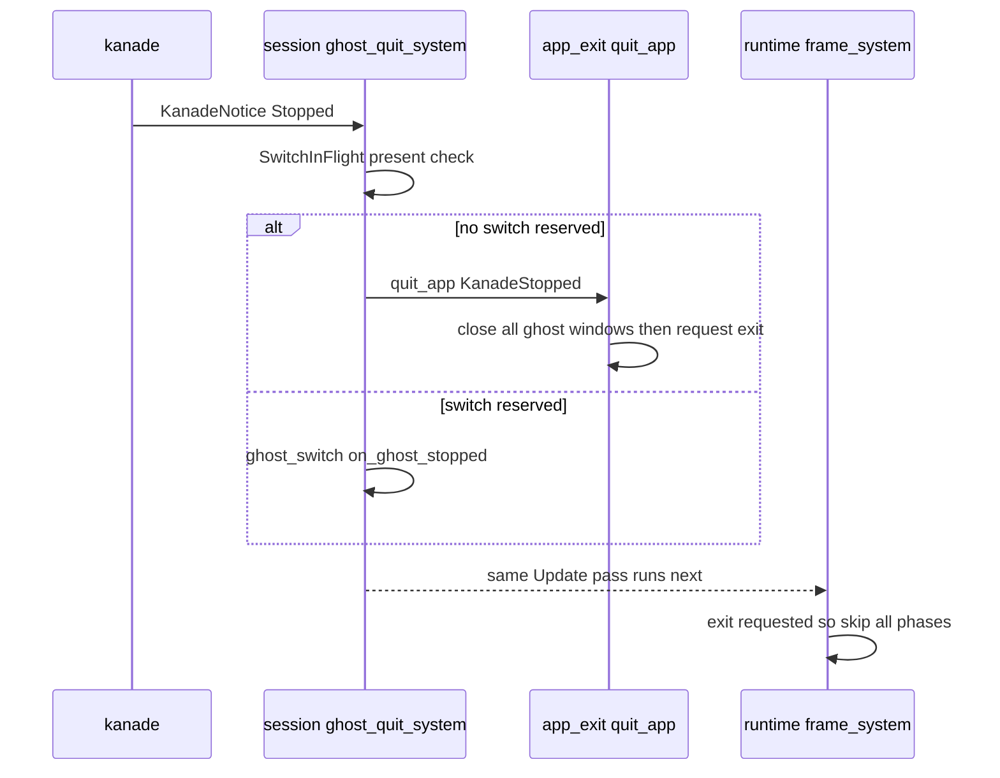
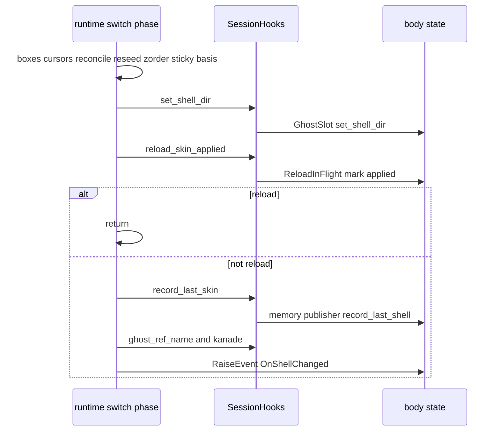
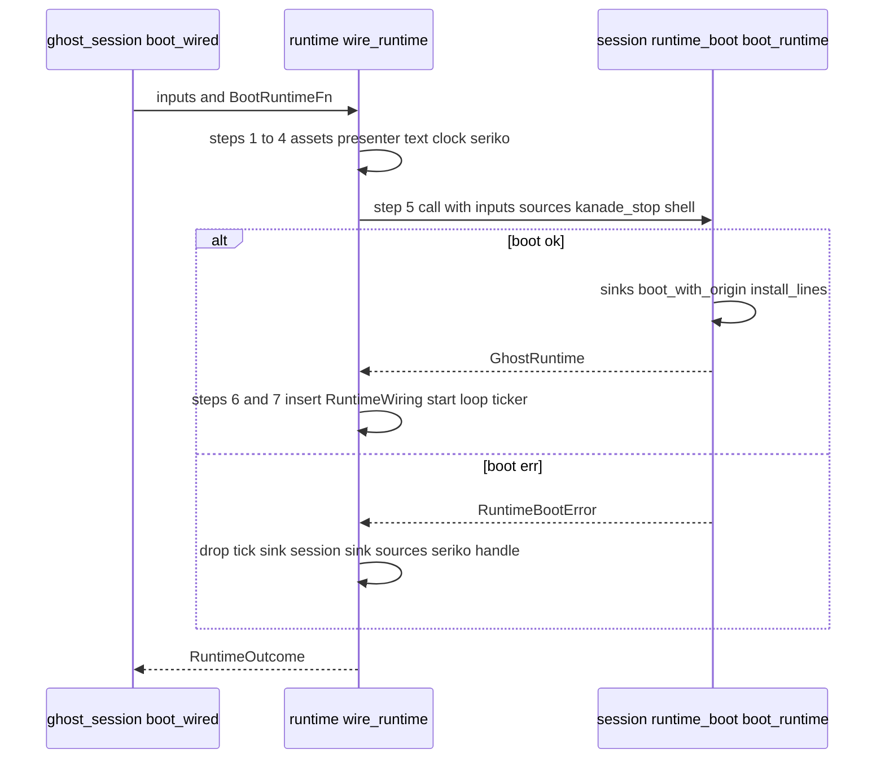
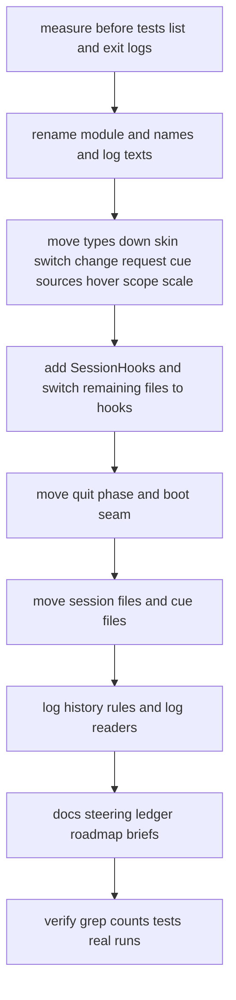

# 設計: runtime-module-untangle

## Overview

本設計は、areka 本体の中のモジュール `crates/areka/src/emo2_boot/` を `crates/areka/src/runtime/` へ改名し、本体に頼る部分を本体の新しいモジュール `crates/areka/src/session/` と install・update・readme のそれぞれのモジュールへ移し、`runtime` に残る本番のコードが本体のほかの部分を 1 か所も参照しない形にする。crate は作らない。

**Purpose**: 次の `runtime-crate-split` が `src/runtime/` を crate `areka-runtime` へ「移すだけ」で済む形を、振る舞いを変えずに作る。
**Users**: areka の開発者（本体を直し、crate に分け、見直しを受け持ちごとに回す人）。
**Impact**: 名前が特定のゴーストを指して読める問題（`emo2_boot`・`Emo2Wiring` ほか）と、`emo2_boot` が本体の起動と切替の層と参照し合う問題を解く。動くデスクトップマスコットとしての振る舞い（起動・切替・読み直し・終わり方・終わる段取りの順・フレームの中の順）は変えない。変わるのはログの文言と出所の名前、イベントの値の名前だけである。

### Goals

- `runtime` の本番のコードが本体の `runtime` の外を参照する所を 0 件にし、その数え方を grep の式で固定する（3.1〜3.3）。
- 名前から `emo2` の語を外し、残るのが既定のゴースト名とその使い手・実在のゴースト emo2 を指す検体・範囲外の所だけであることを一覧で示す（1・6）。
- 終了・切替・読み直し・差し込みを 1 フレームも遅らせず、終わる段取りの順と毎フレームの中の順を構造の上で今と同じに保つ（3.6〜3.8）。
- テストの名前の多重集合・警告 0 件・全体テスト・実機テスト 2 つ・終わる道の記録の順が、前と同じ合否を示す（8）。

### Non-Goals

- crate の新設（`runtime-crate-split`）。input と session の crate 化と session の集め直し（`input-crate-split`・`session-module-gather`・`session-crate-split`）。
- 振る舞いの変更・不具合の直し（範囲を受け持つ audit へ申し送る）。
- `GhostSlot` と止まる流れを複数のゴースト向けに作り直すこと（`multi-ghost-runtime`）。
- `runtime` のテストのコードが本体の外を参照する所を 0 にすること（数えるだけ）。
- 本体の外の crate の説明の文とテストの名前の中の `emo2_boot` の書き換え（パスがもう一度変わる `runtime-crate-split` で直す）。

## Boundary Commitments

### This Spec Owns

- モジュール `runtime`（旧 `emo2_boot`）の名前と、要件 1.1 の表の型・関数・ログの文言・イベントの値・テストの結線の名前。
- 本体の新しいモジュール `session`（この spec が作る最初の形: 切替・読み直し・実行系の起動・終わる相・本体の口の中身）。
- `runtime` と本体のあいだの継ぎ目の形: 本体の口の束 `SessionHooks`（`runtime` が型を持ち、`session` が中身を据える）・起動の関数の型 `BootRuntimeFn`（`wire_runtime` の引数）・ホバーの集合 `BalloonHover`（`runtime` が型を持ち、`input_events` が書く）。
- `runtime` に下ろす型の置き場（`runtime/skin_switch.rs`・`runtime/change_cue.rs` の `ChangeRequestRaw`・`runtime/mod.rs` の `CueSinkSources`／`RuntimeBootError`・`runtime/shell_box_hover.rs`・`runtime/balloon_hover.rs`・`runtime/scope_scale.rs`）。
- `log_history` の決まりのうち、移した出所の名前を読む行（`areka::session::ghost_switch`）と「残さない出所」の表（`areka::install::install_cue`）。
- 古い名前とパスの書き換え（要件 5 の列挙）・`roadmap.md` の新旧のパスの対応表・`audit-emo2-boot-*` 3 本の brief の「受け持つファイル」・`runtime-crate-split` の brief への申し送り。
- 検証の記録（テストの名前の比べ・grep の結果・emo2 の残りの一覧・テストの支えの一覧・終わる道の記録の順の比べ）を `research.md` に置くこと。

### Out of Boundary

- crate の新設と `Cargo.toml`・`Cargo.lock` の依存の変更（コメントの書き換えは依存に触れないので可・8.7）。
- `GhostSlot`・`GhostSession`・`BootContext`・`boot_resolve`・`app_exit`・`ghost_session*` の中身の作り直し（読み口を口の中身から呼ぶだけ）。
- 終わる段取り・切替の段取り・フレームの中の相の順の変更。新しい順の保証は作らない。
- `runtime` のテストが本体を引く所の切り離し（数えて `runtime-crate-split` へ渡す）。
- 本体の外の crate（`areka-placement`・`areka-emo-text`・`wintf` ほか）の説明の文とテストの名前。ただし要件 5.3 の 4 か所は直す。
- 既定のゴースト名 `DEFAULT_GHOST_FOLDER = "emo2"` と実在のゴースト emo2 を指す名前。
- `emo2_boot` に触ると書いているほかの約 70 本の brief（`roadmap.md` の対応表で読み替える）と歴史の文書。

### Allowed Dependencies

- **`runtime` の本番のコード** → ワークスペースの下の crate（`areka-placement`・`wintf`・`areka-kanade`・`areka-ghost`・`areka-seriko`・`areka-emo-*`・`areka-sakura`・`areka-sylphya`・`areka-parsers`・`areka-actor`・`dola` ほか、本体の `areka` に依存しない crate）と外の crate（`bevy_ecs`・`tracing`・`windows`・`thiserror` ほか）だけ。`crate::runtime::` の外の `crate::` パスと、`runtime` の外へ抜ける `super::` は 0 件。
- **`runtime` の `#[cfg(test)]` のコード** → 本体のどこでも引いてよい（要件 3.5 の数に入れる）。
- **`session`** → `runtime` と本体のどこでも引いてよい。
- **本体のほかの部分**（`ghost_session*`・`main.rs`・`mcp/`・`menu/`・`input_events/`・`install/`・`update/`・`readme`・`offline_dump/` ほか） → `runtime`・`session` を引いてよい。`offline_dump/` は `runtime::shell_balloon_resolve` だけを引き、`session` を引かない（steering `structure.md` の決まり）。
- 依存の向きは `main.rs`・本体のほかの部分 → `session` → `runtime` → 下の crate。`runtime` から上へ向く参照は、`SessionHooks` と `BootRuntimeFn` の関数のポインタ（上の層が据える・渡す）だけで表す。

### Revalidation Triggers

- `SessionHooks` の欄（口の本数・型）が変わったとき: `runtime-crate-split`（crate の公開の形）と、口の中身を持つ `session/hooks.rs` を確かめ直す。
- `wire_runtime` の引数・`BootRuntimeFn`・`RuntimeInputs`・`RuntimeOutcome`・`CueSinkSources` の形が変わったとき: `ghost_session.rs`（呼び手）・`ghost_session_runtime.rs`（組み直し）・`runtime-crate-split`。
- `session` の中のモジュールの置き場が変わったとき: `log_history` の決まり（`areka::session::ghost_switch`）・`doc/ssp-mcp/log-convention.md`・`roadmap.md` の対応表・`session-module-gather`。
- 終わる相の登録（`ghost_quit_system.before(frame_system)`）の所が変わったとき: `frame_schedule_tests` の字面の照合と終わる道の記録の順。
- `BalloonHover` の置き場（`wire_balloon_choice`）が変わったとき: `balloon_visibility_phase` の観測の縮退の記録（`observe_hover_wiring`）・`input-crate-split`。

## Architecture

### Existing Architecture Analysis

- `emo2_boot` は本番 61 ファイル・テスト 175 ファイル。本番 18 ファイルが本体の外を 97 回引く（`research.md` 2.1 節）。移す 12 ファイルの分が 76 回、残る 8 ファイルの分が 21 回。移した後に残るファイルが移したファイルを引く所が 8 ファイル 20 回（同 2.3 節）。
- 毎フレームの相は `emo2_frame_system`（`Update`・`update_typewriters` の後）で、終わる相 `ghost_quit_system` はその前に登録される（`wire_kanade_stop`）。登録は `ghost_session::register_systems` がプロセスに 1 度行う（`main.rs` 257 行目）。
- 本体の状態を `runtime` が読む所は 7 ファイル（`research.md` 9.1 節）で、どれも World から同期で借りて読み書きするだけである。
- 上の層が据える関数のポインタの前例は `wintf::ecs::cursor::CursorQuery`（`Resource`）と `exit_wait.rs` の `on_close: fn(&mut World)` である。
- 守る型: cue の受け口の同型の形（`*_cue.rs`）・`consumer_ledger.rs` の表の行・プロセスで共有する状態 3 つ（`balloon_visibility_wait.rs` と `hover_inject.rs` の `OnceLock`・`frame/switch.rs` の `NEXT_EPOCH`）・seriko の送り手の持ち主は `GhostSession` だけ（areka-P0-shell-balloon-switch 要件 8.5）。

### Architecture Pattern & Boundary Map



**Architecture Integration**:
- **選んだ形**: 下の層が型を持ち、上の層が中身を据える「関数の口」（`CursorQuery` の形）。終わる相だけは、相ごと上の層へ移して登録の順をそのまま保つ。
- **受け持ちの分け**: `runtime` は窓と文字と表示の層の毎フレームの仕事（相の中身・後始末の段の並び・記録の文）を持つ。`session` は本体の状態（`GhostSlot`・`BootContext`・`SwitchInFlight`・`ReloadInFlight`・記憶の書き手）への読み書きと、切替・読み直し・起動・終わる相を持つ。
- **残す前例**: donor の形（`remove_non_send` → 各相 → `insert_non_send`）・相の順・`*_cue.rs` の同型・`consumer_ledger.rs`・`Emo2BootOutcome` の後始末の順（失敗のとき seriko の送り手を落とす）。
- **新しいものの理由**: `SessionHooks`（`runtime` が本体の状態を名指さずに同じ答えを得る唯一の同期の形）・`BootRuntimeFn`（起動を引数で受け、手順と後始末の順を残す）・`BalloonHover`（`BalloonWiring` ごと下ろすと `Sender<ChoiceSelection>` まで連れて行くため集合だけを分ける）。
- **steering との整合**: 依存は一方向（`structure.md`・`roadmap.md`「本体の crate 分け」）・1 フレーム遅らせる解は取らない（状態の持ち方で同じフレームに収める）・ログ無し失敗経路を作らない。

**依存の向きの決まり**（実装と見直しはこれに反するものを誤りとして扱う）:
`下の crate` ← `runtime`（本番）← `session`・`input_events`・`install`／`update`／`readme`・`ghost_session*`・`mcp`・`menu`・`offline_dump` ← `main.rs`。`runtime` の本番から右へ向く `use`・パスは 0 件。

### Technology Stack

| Layer | Choice / Version | Role in Feature | Notes |
|-------|------------------|-----------------|-------|
| Backend / Services | Rust（ワークスペースの今の版）・`bevy_ecs`（ワークスペースのピン） | `Resource`（`SessionHooks`）・`NonSend`（`BalloonHover`）・`Schedules` の登録 | 新しい依存なし |
| Messaging / Events | `std::sync::mpsc`・`areka-kanade` の `KanadeMsg`／`KanadeNotice` | 口が返す送り手・終わる相が読む通知 | 形は変えない |
| Infrastructure / Runtime | `tracing`（出所＝モジュールのパス） | 記録の出所が `areka::runtime::…`・`areka::session::…` に変わる | `log_history` の決まりを追従させる |
| 検証の道具 | `rg`（PCRE2）・`cargo test -- --list`・`tools/test-all.ps1` | 0 件の grep・テストの名前の比べ・全体テスト | 新しい道具は作らない |

## File Structure Plan

### Directory Structure

```
crates/areka/src/
├── runtime/                        # 旧 emo2_boot/（git mv）。本体に頼らない実行基盤
│   ├── mod.rs                      # wire_runtime・RuntimeInputs・RuntimeOutcome・CueSinkSources・RuntimeBootError・BootRuntimeFn・register_frame_system
│   ├── session_hooks.rs            # 新: SessionHooks（本体の口の束の型）と口の無い World の答え
│   ├── skin_switch.rs              # 新: shell_balloon_switch.rs から下ろした型（SkinKind ほか）と skin_ref_name・skin_ref_path
│   ├── balloon_hover.rs            # 新: BalloonHover（バルーンの上の滞在の集合・input_events/balloon.rs から）
│   ├── shell_box_hover.rs          # 新: ShellBoxHover・settle_box_hover（input_events/shell_box.rs から）
│   ├── scope_scale.rs              # 新: ScopeScaleTable・SharedScopeScaleTable・ScopeScales・percent_text・scaling_text（ghost_session_scope_scale.rs から）
│   ├── change_cue.rs               # ChangeRequestRaw を受け入れる（ghost_switch.rs から）
│   ├── frame.rs                    # 終わる相を外へ出す。emo2_frame_system → frame_system
│   ├── frame/switch.rs             # 本体の読み書きを SessionHooks で引く
│   ├── frame/{attach,status_report,scale_notice,window_state,wiring}.rs  # GhostSlot・BootContext・倍率の表の参照を口と runtime の型へ
│   ├── balloon_visibility_phase.rs # BalloonWiring → BalloonHover・ShellBoxHover の置き場
│   ├── shell_carry.rs              # capture_for_reload が門の答えを引数で受ける・replay は口で seriko を引く
│   └── （ほかの本番 43 ファイルとテスト。中身は名前とパスの書き換えだけ）
├── session/                        # 新: 本体に頼る切替・読み直し・起動・終わる相
│   ├── mod.rs                      # 新: モジュールの宣言だけ
│   ├── hooks.rs                    # 新: SessionHooks の中身（HOOKS）と install
│   ├── ghost_quit.rs               # 新: KanadeNoticeRx・run_ghost_quit_phase・ghost_quit_system・wire_kanade_stop（frame.rs・mod.rs から）
│   ├── ghost_quit_tests.rs ほか 2  # frame_ghost_quit{,_logsink,_switch}_tests.rs の移動（名前から frame_ を外す）
│   ├── ghost_switch.rs             # git mv（ChangeRequestRaw を出し、門を 1 行足す）
│   ├── ghost_switch_*_tests.rs 8・ghost_switch_test_support.rs  # git mv
│   ├── reload.rs・reload_tests.rs・reload_skin_tests.rs        # git mv
│   ├── runtime_boot.rs・runtime_boot_tests.rs                  # git mv（CueSinkSources・RuntimeBootError を出す）
│   ├── shell_balloon_switch.rs・shell_balloon_switch_tests.rs  # git mv（型を出し、要求の入口だけ残す）
│   ├── switch_copy.rs・switch_copy_tests.rs                    # git mv
│   └── same_folder_pin.rs・same_folder_pin_tests.rs            # git mv
├── install/install_cue.rs・install_cue_tests.rs   # git mv（emo2_boot/ から）
├── update/update_cue.rs・update_cue_tests.rs      # git mv
└── readme/readme_cue.rs・readme_cue_tests.rs      # git mv
```

- 移すファイルの中の `#[path = "…"]` は同じフォルダの中の名前なので、フォルダごと動かせば書き換えは要らない（終わる相の試験 3 本だけは名前を改めて `session/ghost_quit.rs` から宣言する）。
- 1 つのファイルを分けるとき（要件 2.3）は、行の多い側を元のファイルの移動（`git mv`）とし、少ない側を新しいファイルにする: `shell_balloon_switch.rs`（入口約 285 行 → `session/` へ移動・型約 130 行 → `runtime/skin_switch.rs` を新設）・`runtime_boot.rs`（起動約 190 行 → `session/` へ移動・型約 30 行 → `runtime/mod.rs`）・`frame.rs`（相約 580 行 → `runtime/` に残す・終わる相約 90 行 → `session/ghost_quit.rs` を新設）。分けた先は `roadmap.md` の対応表に並べる。

### Modified Files

本体（`crates/areka/src/`）:
- `main.rs` — `mod emo2_boot;` → `mod runtime;`・`mod session;` を足す・説明の文の名前（991 行以下に収める）。
- `ghost_session.rs` — `register_systems` の先頭で `session::hooks::install` を呼ぶ・`register_frame_system`・`session::ghost_quit::wire_kanade_stop`・`session::{ghost_switch, shell_balloon_switch, reload}` の登録・`wire_runtime(…, session::runtime_boot::boot_runtime)` の呼び出し・ログの文言 2 行（`emo2-boot wire` → `runtime wire`）・パス（947 行以下）。
- `ghost_session_runtime.rs` — `session::runtime_boot::boot_runtime` へのパス。
- `ghost_session_scope_scale.rs` — 表と文字の関数を `runtime::scope_scale` から `pub(crate) use` で出し直し、`wire`・`ScopeScaleSource`・`ScaleQuantity` だけを持つ。
- `input_events/balloon.rs` — `BalloonWiring` から `balloon_hover` と 3 つのメソッドを外し、`wire_balloon_choice` で `BalloonHover::default()` を `BalloonWiring` と並べて据える。
- `input_events/balloon_moved.rs`・`balloon_exit.rs` — `BalloonHover` へ書く。
- `input_events/shell_box.rs` — `ShellBoxHover`・`settle_box_hover` を外し、`runtime::shell_box_hover` から `pub(crate) use` で出し直す。
- `install/mod.rs`・`update/mod.rs`・`readme.rs` — `mod install_cue;`・`mod update_cue;`・`mod readme_cue;` の宣言。
- `log_history.rs` — 決まり `areka::session::ghost_switch`・「残さない出所」の表 `UNKEPT_TARGETS`（`areka::install::install_cue`）。
- `session_end.rs`・`app_exit.rs`・`boot_config.rs`・`mcp/`・`menu/`・`offline_dump/`・`input_events/`・`install/`・`update/`・`readme/`・`placement_tests/` の 9 ファイル・`tick_gate_config_producers_tests.rs`・`crate_source_test_support.rs` を通るテスト — パスと名前の書き換え（要件 5.1・5.2）。
- テスト: `log_history_tests.rs`（決まりの名前と assert）・`ghost_session_restart_tests.rs`（`SessionHooks` の据え付けの assert）・`BalloonWiring` を置く 13 ファイル（`BalloonHover` を並べて置く・`input_events/balloon_hover_flag_tests.rs` ほか）・`runtime/frame_schedule_tests.rs`・`runtime/zorder_wiring_tests.rs`（読むファイルのパスと字面）。

本体の外（要件 5 に挙げた所だけ）:
- `crates/areka/tests/smoke_boot_loop_exit.rs`・`tests/emo2_real_run/common.rs`・`tests/emo2_real_run/common_tests.rs`・`tests/emo2_real_run.rs`（説明）・`tests/stay_on_top_real_run.rs`（`RUST_LOG` 6 つ）・`examples/collision-probe.rs`（`#[path]` 2 つ）・`examples/emo-present.rs`・`examples/emo-present/reconcile.rs`（説明）・`crates/areka/Cargo.toml`（コメント 2 行だけ）。
- `crates/log-capture-kit/tests/file_length_guard_test.rs`（63・89 行目）・`crates/log-capture-kit/tests/workspace_scan_test.rs`（320 行目）・`crates/wintf/src/test_crash_report.rs`（1 行目）・`tools/load-flake.ps1`（47 行目）。
- `doc/COMPAT_ARCHITECTURE.md`・`doc/emo2-conformance-scope.md`・`doc/ssp-mcp/`（`log-convention.md` 55・134 行目ほか）・`doc/ukadoc-coverage/` の `briefing-*.md` と `ledger/*.toml`（台帳から作る生成物は作り直す）・`doc/ideas/`。
- `.kiro/steering/structure.md`・`.kiro/steering/tech.md`・`.kiro/steering/roadmap.md`（新旧のパスの対応表）。
- `.kiro/specs/audit-emo2-boot-frame/brief.md`・`audit-emo2-boot-spine/brief.md`・`audit-emo2-boot-switch/brief.md`（受け持つファイル）・`.kiro/specs/runtime-crate-split/brief.md`（申し送り）。
- `.kiro/specs/runtime-module-untangle/research.md` — 検証の記録（テストの名前の対応表・式 1〜3 の結果・説明の文の一覧・テストの参照の数・emo2 の残りの一覧・テストの支えの一覧・広げた見える範囲・終わる道の記録の順の比べ・申し送り）。

## System Flows

### 終わる相（メニューの終了・窓を閉じる・煙の自動終了で kanade が止まったとき）



- 登録は `session::ghost_quit::wire_kanade_stop` が `add_systems(Update, ghost_quit_system.before(frame_system))` で行い、呼ぶ所（`register_systems` の `register_frame_system` の直後）も今と同じ。終了の指示と、同じ巡で毎フレームの相が読み飛ばす判定は今と同じ巡の中で起きる（3.6・3.8）。

### 差し替えの相の後始末（シェル）



- 段の並び（配置の値 → 重なりの基底 → 窓の組 → 標準の位置の材料 → 今のシェル → 読み直しなら戻る → `LastShell` → `OnShellChanged`）は今の `finish_shell` の中の並びのまま。口はどれも同じ関数の中で同期で呼ぶ（3.7・3.8）。バルーンの後始末（`finish_balloon`）も同じ形で、今のバルーンの書き換えが `set_current_balloon`、記憶が `record_last_skin`（`LastBalloon`）になる。
- 記録の文（`skin_shell_dir_not_set`・`skin_memory_not_recorded`・`skin_current_balloon_not_set`・`skin_switch_event_not_sent`・`skin_switch_send_failed`）は `runtime/frame/switch.rs` に残り、口の答え（偽・`None`）で今と同じ枝へ進む。

### 起動の結線（`wire_runtime`）



- 手順 5 の呼ぶ場所・渡す値・失敗のときに落とす順は今の `wire_emo2_boot` と同じ。起動はフレームの外の結線の中で同期で呼ぶ（3.8）。

## Requirements Traceability

| Requirement | Summary | Components | Interfaces | Flows |
|-------------|---------|------------|------------|-------|
| 1.1 | 名前の表どおり改める | RenameSweep | `RuntimeWiring`・`RuntimeInputs`・`RuntimeOutcome`・`wire_runtime`・`register_frame_system`・`frame_system` | — |
| 1.2 | 既定のゴースト名と実在の emo2 と emo2 を含まない名前を変えない | RenameSweep | `DEFAULT_GHOST_FOLDER`・`BootWiringError` | — |
| 1.3 | 名前だけで決まらないものは使われ方で判定し記録 | RenameSweep | `research.md` 13 節の表 | — |
| 1.4 | 名前を改めたテストの対応表 | VerificationRecord | テストの名前の対応表 | — |
| 1.5 | 文言と値を照合する所を一緒に直す | RenameSweep | 照合の所の一覧（要件 1.5 の列挙と `stay_on_top_real_run.rs` ほか） | — |
| 1.6 | 改める語のほかを変えない | RenameSweep | 置き換えは `emo2` の語だけ | — |
| 2.1 | 本体に頼る部分だけを session へ | SessionModule・SkinSwitchTypes・RuntimeBootSeam・ShellCarryGate | File Structure Plan | — |
| 2.2 | install・update・readme の cue を持ち主へ | CueOwnerMove | `install/install_cue.rs` ほか | — |
| 2.3 | 履歴を残す移動・行の多い側を元のファイルに | SessionModule・SkinSwitchTypes | `git mv`・対応表 | — |
| 2.4 | 受け口の型と台帳の行を変えず、リンクだけ直す | CueOwnerMove | `consumer_ledger.rs` の説明のリンク 6 か所 | — |
| 2.5 | 残るファイルが引く型は runtime に置くか向きを逆に | SkinSwitchTypes・RuntimeBootSeam・SessionHooks・GhostQuitPhase | `SessionHooks`・`BootRuntimeFn`・`ChangeRequestRaw` | 全 3 つ |
| 2.6 | 落ちの報告を一緒に移すだけ | RenameSweep | `runtime/crash_report_test_support.rs` | — |
| 3.1 | 本番の外の参照 0 件 | SessionHooks・GhostQuitPhase・RuntimeBootSeam・HoverSplit・ScopeScaleMove・BoundaryCount | 式 1〜3 | — |
| 3.2 | 参照してよい相手は下の crate と外の crate | BoundaryCount | Allowed Dependencies | — |
| 3.3 | grep の結果と数え方の記録 | BoundaryCount | 式 1〜3・本番のファイルの集合 | — |
| 3.4 | 説明の文の名指しを分けて数える | BoundaryCount | 式 1〜3 の説明の文の版 | — |
| 3.5 | テストの参照をファイルごとに数える | BoundaryCount | `rg -c` | — |
| 3.6 | 終わる段取りの順が前と同じ | GhostQuitPhase | `wire_kanade_stop` | 終わる相 |
| 3.7 | 切替と読み直しの段取りとフレームの中の順が前と同じ | SessionHooks・SwitchPhaseHooks | `SessionHooks` | 差し替えの相の後始末 |
| 3.8 | 口で 1 フレームも遅らせない | SessionHooks・GhostQuitPhase・RuntimeBootSeam | 同期の関数のポインタ | 全 3 つ |
| 3.9 | プロセスで共有する状態の数と働きを変えない | SwitchPhaseHooks | `NEXT_EPOCH`・2 つの `OnceLock` の置き場 | — |
| 4.1 | 出所は移した先のモジュールのパス | LogTargetFollow | 出所の対応表 | — |
| 4.2 | 出所を名前で読む決まりとテストと文書を直す | LogTargetFollow | `log_history::RULES`・`UNKEPT_TARGETS` | — |
| 4.3 | 前と同じ行を前と同じ分け方で書く | LogTargetFollow・GhostQuitPhase | `UNKEPT_TARGETS`・`session::ghost_quit` の置き場 | — |
| 4.4 | `RUST_LOG`・フィルタ・手順書を直す | LogTargetFollow | `stay_on_top_real_run.rs`・`tools/load-flake.ps1` | — |
| 4.5 | 語彙の直書きの出所を変えない | LogTargetFollow | `areka::persist::*` ほか | — |
| 4.6 | 古い出所の名前の grep | VerificationRecord | 掃き出しの式 | — |
| 5.1 | 本体の中の名前とパスを書き換える | RenameSweep | — | — |
| 5.2 | ソースを文字列で読むテストと `#[path]` の例 | RenameSweep | `include_str!` の相手・`collision-probe.rs` | — |
| 5.3 | 本体の外でパスが切れると働きが変わる所 | RenameSweep | 番人の表 3 か所・`test_crash_report.rs`・`load-flake.ps1` | — |
| 5.4 | 見つけられなければ赤 | RenameSweep | 既存の番人の挙動（変えない） | — |
| 5.5 | 文書と steering の書き換え | DocSweep | — | — |
| 5.6 | 台帳の根拠の場所と生成物 | DocSweep | 台帳の作り直し | — |
| 5.7 | roadmap の新旧のパスの対応表 | DocSweep | Supporting References の表 | — |
| 5.8 | audit 3 本の brief の受け持つファイル | DocSweep | — | — |
| 5.9 | 古いパスと名前の grep | VerificationRecord | 掃き出しの式 | — |
| 6.1 | emo2 の残りの一覧 | VerificationRecord | `rg -n -i emo2` | — |
| 6.2 | 4 つに分ける | VerificationRecord | 分け方の決め | — |
| 6.3 | どれにも当たらない行は改める | RenameSweep | 要件 1 の規則 | — |
| 6.4 | emo2 だけに向けた動きは既定のゴーストの判定だけ | SessionModule | `ghost_switch.rs` の `DEFAULT_GHOST_FOLDER` の使い手 | — |
| 7.1 | 外のテストが使う支えの一覧 | Handover | `research.md` の表 | — |
| 7.2 | テストが本体の外を引く所の記録 | Handover・BoundaryCount | 要件 3.5 の数・`SessionHooks` の `#[cfg(test)]` の倒れ先 | — |
| 7.3 | 落ちの報告を `runtime-crate-split` へ申し送る | Handover | brief の追記 | — |
| 7.4 | 直したくなったものは audit へ | Handover | 申し送りの記録 | — |
| 8.1 | テストの名前の多重集合が一致 | VerificationRecord | `cargo test --workspace --no-fail-fast -- --list` | — |
| 8.2 | 警告 0 件 | VerificationRecord | `cargo check --workspace --all-targets` | — |
| 8.3 | 全体テストが緑 | VerificationRecord | `tools/test-all.ps1` | — |
| 8.4 | 実機テスト 2 つ | VerificationRecord | `smoke_boot_loop_exit`・`emo2_real_run` | — |
| 8.5 | 終わる道ごとの記録の順の比べ | VerificationRecord・GhostQuitPhase | 実機のログ | 終わる相 |
| 8.6 | 1,000 行の上限と例外表 | VerificationRecord | 番人 `file_length_guard_test` | — |
| 8.7 | crate を作らず依存を変えない | Boundary Commitments・RenameSweep | `Cargo.toml` はコメントだけ | — |
| 8.8 | 実機の走行は 8.4・8.5 だけ | VerificationRecord | — | — |

## Components and Interfaces

| Component | Domain/Layer | Intent | Req Coverage | Key Dependencies (P0/P1) | Contracts |
|-----------|--------------|--------|--------------|--------------------------|-----------|
| SessionHooks | runtime | 本体の状態の同期の読み書きの口の束（型と口の無い World の答え） | 2.5, 3.1, 3.7, 3.8, 7.2 | `bevy_ecs::Resource`（P0） | Service, State |
| SessionHooksImpl | session | 口の中身と据え付け | 3.1, 3.7, 3.8 | `GhostSlot`・`BootContext`・`SwitchInFlight`・`ReloadInFlight`（P0） | Service |
| SwitchPhaseHooks | runtime | 差し替えの相が本体を口で引く | 3.1, 3.7, 3.8, 3.9 | SessionHooks（P0） | Service |
| GhostQuitPhase | session | 終わる相を相ごと移し、登録の順を保つ | 2.5, 3.1, 3.6, 3.8, 4.3, 8.5 | `app_exit::quit_app`・`ghost_switch`（P0）・`runtime::frame::frame_system`（P0） | Batch |
| RuntimeBootSeam | runtime・session | 起動を引数で受ける | 2.1, 2.5, 3.1, 3.8 | `session::runtime_boot::boot_runtime`（P0） | Service |
| SkinSwitchTypes | runtime | 切替の型を下ろし、入口を session へ | 2.1, 2.3, 2.5 | — | State |
| ShellCarryGate | runtime・session | 読み直しの門を呼び手へ出す | 2.1, 3.1 | `session::reload::carries_shell_state`（P1） | Service |
| HoverSplit | runtime・input_events | ホバーの集合と箱の滞在を下ろす | 3.1 | `wire_balloon_choice`（P0） | State |
| ScopeScaleMove | runtime | 倍率の表と文字の関数を下ろす | 3.1 | `ghost_session_scope_scale::wire`（P1） | State |
| CueOwnerMove | install・update・readme | cue の受け口を持ち主へ | 2.2, 2.4 | `session::runtime_boot::runtime_sinks`（P0） | — |
| LogTargetFollow | 本体・文書 | 出所の名前を読む所の追従 | 4.1〜4.6 | `log_history`（P0） | — |
| RenameSweep | 全体 | 名前とパスの書き換え | 1.1〜1.6, 2.6, 5.1〜5.4, 6.3 | — | — |
| DocSweep | 文書・steering・brief | 文書と台帳と対応表 | 5.5〜5.8 | 台帳の生成器（P1） | — |
| BoundaryCount | 検証 | 外の参照の数え方 | 3.1〜3.5 | `rg`（P0） | — |
| VerificationRecord | 検証 | 振る舞いが変わらないことの証跡 | 1.4, 4.6, 5.9, 6.1, 6.2, 8.1〜8.6, 8.8 | — | — |
| Handover | 記録 | 次の spec と audit への申し送り | 7.1〜7.4 | — | — |

### runtime（下の層の型）

#### SessionHooks

| Field | Detail |
|-------|--------|
| Intent | `runtime` が本体の状態を名指さずに、今と同じ答えを同期で得るための関数のポインタの束 |
| Requirements | 2.5, 3.1, 3.7, 3.8, 7.2 |

**Responsibilities & Constraints**
- 口は 10 本で、どれも今の 1 か所の読み書きと 1 対 1 に当たる（`research.md` 9.1 節の表）。口を足すのは、`runtime` の本番に本体の状態を読む所が新しく要るときだけ。
- 口は値を持たない（毎回 World から借りる）。seriko の送り手の持ち主は `GhostSession` だけのまま。
- 口の無い World の答えは、本体の状態が無いときの今の答えと同じにする。

**Dependencies**
- Inbound: `frame/switch.rs`・`frame/status_report.rs`・`frame/attach.rs`・`frame/scale_notice.rs`・`frame/window_state.rs`・`balloon_visibility_phase.rs`・`shell_carry.rs` — 本体の状態の読み書き（P0）
- Outbound: なし（型だけ）
- External: `bevy_ecs`（`Resource`・P0）・`areka_kanade::KanadeMsg`・`areka_seriko::SerikoSink`（P0）

**Contracts**: Service [x] / State [x]

##### Service Interface

```rust
/// 本体の状態を同期で読み書きする口の束（`session::hooks::install` が据える・前例 `wintf::ecs::cursor::CursorQuery`）。
#[derive(bevy_ecs::prelude::Resource, Clone, Copy)]
pub(crate) struct SessionHooks {
    /// 置き場のゴーストの kanade への送り手（`GhostSession::kanade`）。
    pub kanade: fn(&World) -> Option<&Sender<KanadeMsg>>,
    /// 置き場のゴーストの seriko の送り手（`GhostSession::seriko_sink`）。
    pub seriko_sink: fn(&World) -> Option<&SerikoSink>,
    /// Reference のゴーストの名前（`descript.txt` の `name`、無ければフォルダ名、ゴーストが無ければ空）。
    pub ghost_ref_name: fn(&World) -> String,
    /// 起動の文脈の今のゴーストのフォルダ名（`BootContext.current.ghost.folder`）。
    pub ghost_folder: fn(&World) -> Option<String>,
    /// 実行系の今のシェルを書き換える（`GhostSession::set_shell_dir`・ゴーストが無ければ偽）。
    pub set_shell_dir: fn(&mut World, PathBuf) -> bool,
    /// 起動の文脈の今のバルーンを記憶の決め方で書き換える（文脈が無ければ偽）。
    pub set_current_balloon: fn(&mut World, &SkinCandidate) -> bool,
    /// 記憶の書き手で `LastShell`／`LastBalloon` を書く（書き手が無ければ偽）。
    pub record_last_skin: fn(&World, SkinKind, &str) -> bool,
    /// ゴースト切替の予約（`SwitchInFlight`）が在るか。
    pub ghost_switch_in_flight: fn(&World) -> bool,
    /// 読み直しの差し替えなら済んだ印を付けて真（`reload::skin_is_reload` → `reload::skin_applied`）。
    pub reload_skin_applied: fn(&mut World, SkinKind, &Path) -> bool,
    /// 差し替えの相が終わったことを読み直しの窓口へ告げる（`reload::skin_phase_ended`）。
    pub skin_phase_ended: fn(&mut World, SkinKind, &Path),
}

impl SessionHooks {
    /// 据えられた口。本番で無ければ `error!(session_hooks_missing)` を出して `NO_BODY` を返す。
    pub(crate) fn of(world: &World) -> Self;
}

/// 本体の状態が無いときの答え: `None`・偽・空の文字・何もしない（今の「状態が無い」ときの答えと同じ・cfg を付けない）。
pub(crate) const NO_BODY: SessionHooks;
/// 口の無い World の倒れ先。本番は `NO_BODY`（記録つき）。
#[cfg(not(test))]
const FALLBACK: SessionHooks = NO_BODY;
/// テストの World は本体の口そのもの（今日と同じく本体の状態をそのまま読む・記録は出さない）。
#[cfg(test)]
const FALLBACK: SessionHooks = crate::session::hooks::HOOKS;
```

- Preconditions: 本番では `ghost_session::register_systems` が最初の巡より前に `session::hooks::install` を呼んでいる。
- Postconditions: 各口の答えは、置き換える前のその場所のコードの答えと同じ。
- Invariants: 口は World に値を持ち込まない。`SessionHooks` はプロセスで共有する状態ではない（World の `Resource`）。

**Implementation Notes**
- Integration: 呼ぶ側は相の入口で `let hooks = SessionHooks::of(world);` を 1 度取り、`(hooks.kanade)(world)` の形で呼ぶ。
- Validation: 本番の据え付けは既存の試験 `boots_twice_in_one_process_without_double_registration` に `assert!(world.contains_resource::<SessionHooks>())` を足して固定する（試験の数は変えない）。
- Validation（`NO_BODY`）: `NO_BODY` の 10 本の答え（`None`・偽・空の文字・何もしない）を、既存の `frame/switch_tests.rs` の試験に assert を足して固定する（試験の関数は増やさない）。口の据え忘れは `of()` の `error!` で記録に残り、黙った縮退にならない（ログ無し失敗経路の禁止）。`of()` は `&World` しか持たないので、回数は絞らず呼ぶたびに `error!` を出す（絞るための `OnceLock` はプロセスで共有する状態を増やす＝3.9 に反する）。据え付けは `register_systems` の先頭で最初の巡より前に済むので、本番でこの記録が出るのは据え付けを忘れた結線の誤りのときだけで、その誤りは `boots_twice_in_one_process_without_double_registration` の assert が赤で捕まえる。
- Risks: `#[cfg(test)]` の `FALLBACK` は本体を引く（要件 3.5 の数・`runtime-crate-split` へ申し送り）。

#### SwitchPhaseHooks（`frame/switch.rs` の書き換え）

| Field | Detail |
|-------|--------|
| Intent | 差し替えの相を `runtime` に残したまま、本体の読み書きだけを口に替える |
| Requirements | 3.1, 3.7, 3.8, 3.9 |

**Responsibilities & Constraints**
- 置き換え: `session(world).and_then(GhostSession::kanade)` → `(hooks.kanade)(world)`（`await_gap_again`・`raise_changed`）・`seriko_sink` → `(hooks.seriko_sink)`（`commit`）・`get_non_send::<SwitchInFlight>().is_some()` → `(hooks.ghost_switch_in_flight)`・`GhostSlot` の `set_shell_dir` → `(hooks.set_shell_dir)`・`reload::skin_is_reload` ＋ `reload::skin_applied` → `(hooks.reload_skin_applied)`・`record_memory` の書き手 → `(hooks.record_last_skin)`・`BootContext` の書き換え → `(hooks.set_current_balloon)`・`ghost_ref_name` → `(hooks.ghost_ref_name)`・`reload::skin_phase_ended` → `(hooks.skin_phase_ended)`。
- 記録の文・欄・段・出所（`areka::runtime::frame::switch`）は変えない。偽・`None` の答えは今と同じ `warn!`／`error!` の枝へ進む。
- `NEXT_EPOCH`（`AtomicU64`）はこのファイルに残す（3.9）。

**Contracts**: Service [x]（SessionHooks の呼び手）

**Implementation Notes**
- Integration: `use crate::boot_config`・`crate::boot_resolve`・`crate::ghost_session`・`crate::emo2_boot::{ghost_switch, reload}` の行が消え、`super::super::session_hooks::SessionHooks`（または `crate::runtime::session_hooks::SessionHooks`）と `skin_switch` の型が入る。
- Validation: `frame/switch_tests.rs`・`switch_finish_tests.rs`・`reload_skin_tests.rs`・`shell_balloon_switch_session_*_tests.rs` が今の記録と順のまま緑。
- Risks: なし（口の答えが今の 1 か所の答えと同じ）。

#### SkinSwitchTypes（`runtime/skin_switch.rs`）

| Field | Detail |
|-------|--------|
| Intent | `shell_balloon_switch.rs` のうち本体を引かない型を `runtime` に置く |
| Requirements | 2.1, 2.3, 2.5 |

**Responsibilities & Constraints**
- 置く型: `SkinKind`・`SkinRequestRaw`・`SkinSpec`・`SkinOrigin`・`SkinRequest`・`SkinVerdict`・`SkinSwitchInFlight`・`SkinSwitchStage`・`SwapFinish`・`skin_ref_name`・`skin_ref_path`（中身は変えない）。
- 引く側: `frame/switch.rs`・`switch_cue.rs`・`shell_balloon_resolve.rs`（`runtime`）・`session/shell_balloon_switch.rs`・`session/reload.rs`（本体）。
- `session/shell_balloon_switch.rs` は呼び手（`menu/`・`mcp/`・テスト）のために `pub(crate) use crate::runtime::skin_switch::{SkinKind, SkinOrigin, SkinRequest, SkinSpec, SkinVerdict};` で出し直す。`runtime` の中は `runtime::skin_switch` を直に引く。

**Contracts**: State [x]（`SkinSwitchInFlight` は World の NonSend・置くのは session の入口、消すのは runtime の相と session の `discard_for_exit`＝今と同じ）

#### RuntimeBootSeam（`runtime/mod.rs` と `session/runtime_boot.rs`）

| Field | Detail |
|-------|--------|
| Intent | `wire_runtime` が実行系の起動を引数で受け、手順と後始末の順を残す |
| Requirements | 2.1, 2.5, 3.1, 3.8 |

**Contracts**: Service [x]

##### Service Interface

```rust
// runtime/mod.rs
#[derive(Clone)]
pub(crate) struct CueSinkSources { /* 今の 7 欄のまま */ }

#[derive(Debug, thiserror::Error)]
pub(crate) enum RuntimeBootError {
    #[error("実行系の起動に失敗")]
    Boot(#[source] areka_ghost::GhostBootError),
}

/// 実行系の側の起動（本番は `session::runtime_boot::boot_runtime`）。
pub(crate) type BootRuntimeFn = fn(
    &mut World,
    RuntimeInputs,
    &CueSinkSources,
    Sender<KanadeNotice>,
    Option<&str>,
) -> Result<areka_ghost::GhostRuntime, RuntimeBootError>;

pub struct RuntimeInputs { /* 今の Emo2BootInputs の 6 欄のまま */ }
pub struct RuntimeOutcome { /* 今の Emo2BootOutcome の 6 欄のまま */ }

pub fn wire_runtime(
    world: &mut World,
    inputs: RuntimeInputs,
    author_dpi: AuthorDpi,
    zorder_descript: Option<&str>,
    kanade_stop: Sender<KanadeNotice>,
    shell: Option<&str>,
    default_surfaces: &DefaultSurfaces,
    boot_runtime: BootRuntimeFn,
) -> RuntimeOutcome;

pub fn register_frame_system(world: &mut World);
```

- Preconditions: UI スレッドで、UI 基盤の構築後・`run()` の前（今と同じ）。
- Postconditions: 今の 7 手順と同じ。手順 5 で `boot_runtime(world, inputs, &sources, kanade_stop, shell)` を呼び、`Err` なら `tick_sink`・`session_sink`・`sources`・`seriko_handle` を今の順で落として `wired=false` を返す。
- Invariants: `RuntimeInputs` の 6 欄は値のまま起動の関数へ渡る（`research.md` 9.8 節）。
- `session/runtime_boot.rs` は `runtime_sinks`・`boot_runtime`・`runtime_boot_options`・`install_lines`・`RuntimeLines` を持ち、`boot_runtime` の形は今と同じ（引数の型の名前だけ `RuntimeInputs`・`crate::runtime::CueSinkSources`）。
- 総称（`impl FnOnce`）にしないのは、`frame_schedule_tests`・`zorder_wiring_tests` が字面 `pub fn wire_runtime(` を照合するため。

#### HoverSplit（`runtime/balloon_hover.rs`・`runtime/shell_box_hover.rs`）

| Field | Detail |
|-------|--------|
| Intent | 可視性の相が読むホバーの集合と箱の滞在を `runtime` の型にし、`input_events` が書く向きにする |
| Requirements | 3.1 |

**Contracts**: State [x]

##### State Management

```rust
/// ポインタがバルーン窓の上に居る scope の集合（UI スレッドの NonSend・旧 `BalloonWiring::balloon_hover`）。
#[derive(Debug, Default)]
pub(crate) struct BalloonHover(HashSet<usize>);
impl BalloonHover {
    pub(crate) fn is_balloon_hovered(&self, scope: usize) -> bool;
    pub(crate) fn set_balloon_hover(&mut self, scope: usize);
    pub(crate) fn clear_balloon_hover(&mut self, scope: usize);
}
```

- 置く所: `BalloonWiring` を置く所と同じ所・同じ時（本番は `input_events/balloon.rs` の `wire_balloon_choice`・テストは 13 ファイル 45 か所）。外す所も `BalloonWiring` と同じ（本番で外す所は無い）。
- 読む所: `balloon_visibility_phase.rs` の `observe_hover_wiring`（無ければ今と同じ `error!` を 1 回・文言は変えない）と非表示の遷移の掃除（無ければ何もしない）。書く所: `input_events/balloon_moved.rs`（滞在）・`balloon_exit.rs`（離脱）。
- `ShellBoxHover`・`settle_box_hover` は中身を変えずに `runtime/shell_box_hover.rs` へ移し、`input_events/shell_box.rs` が `pub(crate) use` で出し直す（呼び手とテストの書き換え 0）。
- 同期の読み書きで、`input_events` が書いた値を同じフレームの後の相が読む今の順のまま。

#### ScopeScaleMove（`runtime/scope_scale.rs`）

- 中身を変えずに `ScopeScaleTable`・`SharedScopeScaleTable`・`ScopeScales`・`percent_text`・`scaling_text` を移す。`frame/wiring.rs`・`frame/scale_notice.rs` は `runtime::scope_scale` を引く。`ghost_session_scope_scale.rs` は `wire`・`ScopeScaleSource`・`ScaleQuantity` を持ち、表と関数を `pub(crate) use` で出し直す。移す部分に記録の行は無い（出所の変化 0）。

#### ShellCarryGate（`runtime/shell_carry.rs`）

- `capture_for_reload(world: &World, carries: bool) -> Option<ShellCarry>`: `carries` が偽なら `None`（今の門と同じ）。呼び手 `session/ghost_switch.rs` が `crate::session::reload::carries_shell_state(world)` を渡す。`hand_over` は本体を引かないので `runtime` に残る。`replay` は `(hooks.seriko_sink)(world)` で送り手を引く。記録（`reload_shell_captured`・`reload_shell_carry_unavailable` ほか）の文と出所は変えない。
- 要件の段の列は `capture_for_reload`・`hand_over` を `session` へ移すと書いていたが（設計の討議で要件 2.1 の列をこの形に改めた）、設計の段の測り直しで、本体を引くのは `capture_for_reload` の門の 1 行（`reload::carries_shell_state`）だけで、`hand_over` は `RuntimeWiring` の欄を書くだけと分かった。同じ要件の「測り直しで頼る・頼らないが変わったものは、この原則で振り分ける」に従い、門だけを呼び手へ出し、2 つの関数は `runtime` に残す（記録の出所も変わらない）。

### session（本体の層）

#### SessionHooksImpl（`session/hooks.rs`）

| Field | Detail |
|-------|--------|
| Intent | 口の中身（今の読み書きのコードそのもの）と据え付け |
| Requirements | 3.1, 3.7, 3.8 |

**Contracts**: Service [x]

```rust
/// 口の中身。各関数は置き換える前の `runtime` の 1 か所のコードを移したもの。
pub(crate) const HOOKS: SessionHooks = SessionHooks {
    kanade: kanade_of,               // GhostSlot → GhostSession::kanade
    seriko_sink: seriko_sink_of,     // GhostSlot → GhostSession::seriko_sink
    ghost_ref_name,                  // GhostSession::ghost_name、無ければ ghost_dir のフォルダ名、無ければ空
    ghost_folder,                    // BootContext.current.ghost.folder
    set_shell_dir,                   // GhostSlot → GhostSession::set_shell_dir
    set_current_balloon,             // BootContext.current.balloon = BalloonDecision { route: Memory, .. }
    record_last_skin,                // memory_publisher → record_last_shell / record_last_balloon
    ghost_switch_in_flight,          // get_non_send::<SwitchInFlight>().is_some()
    reload_skin_applied,             // reload::skin_is_reload なら reload::skin_applied して真
    skin_phase_ended: reload::skin_phase_ended,
};

/// 口を World へ据える（`ghost_session::register_systems` の先頭からプロセスに 1 度・何度呼んでも同じ）。
pub(crate) fn install(world: &mut World);
```

- 記録は持たない（記録は `runtime` の呼び手に残る）。

#### GhostQuitPhase（`session/ghost_quit.rs`）

| Field | Detail |
|-------|--------|
| Intent | 終わる相を相ごと本体へ移し、system と登録の順を今のまま保つ |
| Requirements | 2.5, 3.1, 3.6, 3.8, 4.3, 8.5 |

**Contracts**: Batch [x]

##### Batch / Job Contract
- Trigger: `Update` の各巡で `frame_system` より前（`ghost_quit_system.before(crate::runtime::frame::frame_system)`）。
- Input / validation: `KanadeNoticeRx`（World の NonSend）を `try_iter` で全件取り出す（無ければ何もしない）。
- Output / destination: 停止で予約が無ければ `app_exit::quit_app(world, ExitOrigin::KanadeStopped(cause))`・予約が在れば `ghost_switch::on_ghost_stopped`・ほかの通知は `ghost_switch::on_notice`。
- Idempotency & recovery: 2 件目からの停止は `debug!(ghost_quit_extra)` で打ち切る（今と同じ）。
- 移すもの: `KanadeNoticeRx`・`run_ghost_quit_phase`・`quit_as_today`・`ghost_quit_system`（`frame.rs`）・`wire_kanade_stop`（`mod.rs`）。中身と記録の文は変えない。出所は `areka::session::ghost_quit`（`log_history` のどの決まりにも当たらない＝今と同じく残らない）。`session::ghost_switch` の中に置かないのは、決まり `areka::session::ghost_switch`（Status）に当たって分け方が変わるため。
- 呼び手: `ghost_session::register_systems`（`register_frame_system` の直後に `wire_kanade_stop`）・`session_end.rs`（`run_ghost_quit_phase`）・`ghost_switch_test_support.rs`。
- 試験 3 本は `session/ghost_quit_tests.rs`・`ghost_quit_logsink_tests.rs`・`ghost_quit_switch_tests.rs` として `ghost_quit.rs` から宣言し、`use super::*;` が拾っていた名前の `use` を足す（試験の名前は変えない）。

#### SessionModule（`session/` のほかのファイル）

- `ghost_switch.rs`・`reload.rs`・`runtime_boot.rs`・`switch_copy.rs`・`same_folder_pin.rs`・`shell_balloon_switch.rs`（入口）と各テストを `git mv` で移す。中身の書き換えはパス（`super::X` のうち `runtime` に残るものは `crate::runtime::X`）・型の置き場（`ChangeRequestRaw`・skin の型・`CueSinkSources`）・名前の改めだけ。
- `ghost_switch.rs` は `pub(crate) use crate::runtime::change_cue::ChangeRequestRaw;`・`pub(crate) use crate::runtime::special_name::{…};` で出し直す。`DEFAULT_GHOST_FOLDER` の使い手（既定のゴーストの判定 4 か所）はここに在る（6.4）。
- 見える範囲の広げ（`pub(crate)` まで・コンパイルが求めた分だけ）: `runtime` の `mod change_cue`・`reload_cue`・`switch_cue`・`window_state_cue`・`special_name` と、`RuntimeWiring` の欄 `shell_carry`（`ghost_switch_reload_tests.rs` が読む）。ほかに要った分は `research.md` に足す。

### 本体のほか

#### CueOwnerMove

- `install_cue.rs`・`update_cue.rs`・`readme_cue.rs` と各テストを `install/`・`update/`・`readme/` へ `git mv` し、持ち主のモジュールが `pub(crate) mod` で宣言する。受け口の型と `consumer_ledger.rs` の表の行は変えない。`consumer_ledger.rs` の説明の文のリンク 6 か所は `crate::install::install_cue::InstallCueSink` ほかへ書き換える（要件 3.4 の一覧に載せる）。組み立ては `session/runtime_boot.rs` の `runtime_sinks`（並びは変えない）。

#### LogTargetFollow

出所の対応（4.1）:

| 今の出所 | 改めた後 |
|---|---|
| `areka::emo2_boot`・`areka::emo2_boot::<残るモジュール>` | `areka::runtime`・`areka::runtime::<同じ名前>` |
| `areka::emo2_boot::{ghost_switch, reload, runtime_boot, switch_copy, same_folder_pin, shell_balloon_switch}` | `areka::session::<同じ名前>` |
| `areka::emo2_boot::frame`（終わる相の 3 つの記録だけ） | `areka::session::ghost_quit` |
| `areka::emo2_boot::{install_cue, update_cue, readme_cue}` | `areka::install::install_cue`・`areka::update::update_cue`・`areka::readme::readme_cue` |

- `log_history.rs`: `rule("areka::emo2_boot::ghost_switch", …)` → `rule("areka::session::ghost_switch", Kind::Status, false)`。`RULES` を当てる前に引く完全一致の表 `UNKEPT_TARGETS: &[&str] = &["areka::install::install_cue"]` を足す（`install_cue` の `info!(readonly_refused)` が決まり `areka::install`（Update）に当たって新しく残るのを防ぎ、今と同じく残さない・`research.md` 9.4 節）。`warn!` 以上は今と同じく出所によらず誤りの種別。
- `log_history_tests.rs`: 決まりの名前を改め、既存の試験 `unrelated_info_is_not_kept` に `classify(Level::INFO, "areka::install::install_cue") == None` と `classify(Level::WARN, "areka::install::install_cue") == Some(Kind::Error)` の assert を足す（試験の数は変えない）。
- 名前で読む所: `doc/ssp-mcp/log-convention.md`（55・134 行目）・`tests/stay_on_top_real_run.rs` の `RUST_LOG`（6 つとも `runtime` に残るモジュール）・`tools/load-flake.ps1`（`-Filter runtime::frame`）・出所を照合するテスト（`balloon_background_tests`・`assets_tests`・`shell_cursor_assets_tests` → `areka::runtime::…`・`reload_skin_tests`・`reload_tests` → `areka::session::reload`・`tests/emo2_real_run/common_tests.rs` の見本の行 → `areka::runtime`）。
- 語彙の直書き（`areka::persist::*`・`areka::log::*`・`areka::perf`）は変えない（4.5）。
- 帰結として、手順書 `doc/pasta-real-run.md` の `RUST_LOG`（`areka::install=debug`）は `install_cue` の `debug!` も開くようになる。手順書の目的（バルーンの決め方の分岐）には響かないので直さない（出所の名前が変わることそのもの＝4.1）。

#### Handover（申し送り・7.1〜7.4）

- **テストの支えの一覧（7.1）**: 完了のときに、`runtime` の外のファイル（`session/` を含む）で `runtime::(spine|sample_test_support|frame::balloon_runtime_test_support|frame_test_support)` と `runtime::spine::hold_support` を名指す所を `rg -c` で数え、支えごとに使う所と回数の表を `research.md` に置く（設計の段の値は `research.md` 2.7 節。`ghost_switch_test_support` は `session` の側の支えになり、境をまたがない）。
- **テストが本体の外を引く所（7.2）**: 要件 3.5 の数に加えて、次を名指しで申し送る: `runtime/session_hooks.rs` の `#[cfg(test)]` の `FALLBACK`（`session::hooks::HOOKS`）・`frame_schedule_tests.rs` と `zorder_wiring_tests.rs` が `include_str!("../session/…")`・`include_str!("../ghost_session.rs")`・`include_str!("../main.rs")` で読むファイル・`frame_transition_atomicity_tests.rs`／`frame_transition_branch_tests.rs` の `crate::placement_tests::transition_judge`・`spine.rs` の `session::runtime_boot::runtime_boot_options`。
- **落ちの報告（7.3）**: `crash_report_test_support.rs` は `runtime-crate-split` で実行ファイルが分かれると本体と `areka-runtime` の両方に要ることを、`.kiro/specs/runtime-crate-split/brief.md` に書く。
- **audit への申し送り（7.4）**: 作業中に直したくなった不具合と要らない項目は直さず、範囲を受け持つ audit（`audit-emo2-boot-frame`・`audit-emo2-boot-spine`・`audit-emo2-boot-switch` ほか）の brief へ書き、申し送った先と中身を `research.md` に残す。

## Data Models

新しい永続のデータは無い。World に置くものの変化だけを挙げる。

| 置き場 | 種類 | 持ち主（型） | 書く所 | 読む所 |
|---|---|---|---|---|
| `SessionHooks` | `Resource`（新） | `runtime` | `session::hooks::install` | `runtime` の 7 ファイル |
| `BalloonHover` | `NonSend`（新・`BalloonWiring` から分けた） | `runtime` | `input_events`（滞在・離脱）・`runtime`（掃除） | `runtime`（可視性の相） |
| `ShellBoxHover` | `NonSend`（型の置き場だけ変わる） | `runtime` | `input_events`・`runtime` | `runtime` |
| `KanadeNoticeRx` | `NonSend`（型の置き場だけ変わる） | `session` | `session::ghost_quit::wire_kanade_stop` | `session::ghost_quit` |
| `SkinSwitchInFlight` | `NonSend`（型の置き場だけ変わる） | `runtime` | `session::shell_balloon_switch` | `runtime::frame::switch`・`session` |

プロセスで共有する状態（3.9）: `runtime/balloon_visibility_wait.rs` の `OnceLock`・`runtime/hover_inject.rs` の `OnceLock`・`runtime/frame/switch.rs` の `NEXT_EPOCH`（`AtomicU64`）の 3 つ。数も働きも置き場（`runtime` の同じファイル）も変えない。`SessionHooks` は World の `Resource` で、プロセスで共有する状態に数えない。

## Error Handling

### Error Strategy
- 新しい誤りの種類は作らない。`RuntimeBootError` は置き場が変わるだけで、分類と記録（`is_benign_boot_error` で `warn!`／`error!`）は `session/runtime_boot.rs` に残る。
- 口が偽・`None` を返したときは、今の「状態が無い」と同じ枝（`warn!(skin_shell_dir_not_set)` ほか）へ進む。黙って捨てる枝は作らない。
- ホバーの集合が無いときは、今と同じ `error!`（1 回・文言はそのまま）で「抑止なし」として扱う。

### Monitoring
- 記録の文・欄・段は変えない。変わるのは出所の名前（LogTargetFollow の表）と、要件 1.1 の表の文言の `emo2` の語だけ。`log_history` の記録の分け方は、出所の決まりの追従と `UNKEPT_TARGETS` で今と同じに保つ。

## Testing Strategy

新しい試験の関数は足さない（要件 8.1 の多重集合を変えない）。固定は既存の試験の assert で足す。

### Unit Tests
- `log_history_tests::status_rows_and_areka_is_exact_only`・`rules_table_is_the_designed_fourteen_rows_in_order`: 決まり `areka::session::ghost_switch` が Status で、行の数と順が 14 のまま（4.2・4.3）。
- `log_history_tests::unrelated_info_is_not_kept`: `areka::install::install_cue` の info が残らず、warn は誤りになる（4.3）。
- `input_events/balloon_hover_flag_tests.rs`: `BalloonHover` の滞在・離脱・掃除・冪等が今と同じ（3.1・振る舞い不変）。
- `runtime/frame/switch_tests.rs`・`switch_finish_tests.rs`: 後始末の段の順と記録が今と同じ（3.7）。

### Integration Tests
- `runtime/frame_schedule_tests.rs`: 毎フレームの相の登録の字面（`runtime/mod.rs`）と終わる相の登録の字面（`session/ghost_quit.rs` の `add_systems(Update, ghost_quit_system.before(frame_system));`）を読み、素の World で終わる相が 1 件の通知で終わる（3.6）。
- `session/ghost_quit_tests.rs` ほか 2 本: 停止・予約あり・LogSink の起動で、終わる段取りが今と同じ（3.6・8.5 の構造の証跡）。
- `ghost_session_restart_tests::boots_twice_in_one_process_without_double_registration`: `register_systems` が `SessionHooks` を据え、2 度目の起動でも登録が重ならない（3.8 の前提）。
- `runtime/zorder_wiring_tests.rs`: `session/runtime_boot.rs` の sink の並びと `runtime/mod.rs` の束の組み立ての字面（2.4・2.5）。
- `session/ghost_switch_*_tests.rs`・`reload_*_tests.rs`・`shell_balloon_switch_session_*_tests.rs`: 切替と読み直しの段取りが今と同じ（3.7）。

### E2E（実機・8.4・8.5）
- `crates/areka/tests/smoke_boot_loop_exit.rs`: 改めた文言 `runtime: 実 sink 結線が成立しました（wire 成立）` を拾って緑。
- `crates/areka/tests/emo2_real_run`（`AREKA_EMO2_REAL_RUN`）: 改めた `WIRE`・`ATTACH` の文言で緑。
- 終わる道 3 つ（メニューの終了・窓を閉じる・`AREKA_APP_SMOKE_EXIT_MS`）: 着手の前と完了の前に同じ `RUST_LOG` で走らせ、終わる段取りの行の順を比べる。出所と文言は LogTargetFollow の表と要件 1.1 の表で読み替える。

### 構造の証跡（VerificationRecord・8.1〜8.3・8.6・8.8）
- 着手と完了で `cargo test --workspace --no-fail-fast -- --list` を取り、`: test$` の行の名前の末尾の多重集合を比べる。差は名前を改めたテストの対応表（`research.md`）だけで説明する。
- `cargo check --workspace --all-targets` の警告 0 件。`pwsh -NoProfile -File tools/test-all.ps1` が緑。番人 `file_length_guard_test` が緑（例外表は書き換えだけ・項目は増やさない）。
- 掃き出しの grep（4.6・5.9）: `rg -n 'areka::emo2_boot'` と `rg -n 'emo2_boot|Emo2Wiring|Emo2BootInputs|Emo2BootOutcome|wire_emo2_boot|register_emo2_frame_system|emo2_frame_system|emo2-boot|emo2 attach:|emo2 text:|_no_emo2\b|headless_emo2_wiring'` を `crates/`・`tools/`・`doc/`・`.kiro/steering/structure.md`・`.kiro/steering/tech.md` に当て、残りが範囲外の所だけであることを一覧で示す。
- emo2 の残り（6.1・6.2）: `rg -n -i 'emo2' crates tools doc` の行を 4 つに分ける。完了した spec の名前の名指し（`areka-P0-emo2-boot` ほか・`.kiro/specs/completed/` の文書の名前）は「歴史の文書」に入れる。

### 外の参照の数え方（BoundaryCount・3.1〜3.5）
- 本番のファイルの集合: `crates/areka/src/runtime/**/*.rs` から `*_tests.rs`・`*test_support*.rs`・`spine*.rs`・`*_cases.rs` を除いたもの。着手の測りで、親が `#[cfg(test)]` で宣言していないファイルの集合と一致することを 1 度確かめる。
- 式 1: `rg -n --pcre2 <glob> '^(?!\s*//).*\bcrate::(?!runtime\b)' crates/areka/src/runtime`
- 本番のファイルの集合を、宣言の深さ（`runtime` から数えたモジュールの段の数・`#[path]` の分も入れる）で 2 つに分ける。深さ 1 の集合 D1（`mod.rs` が直に宣言するもの）と、深さ 2 の集合 D2（`frame.rs` が宣言する `frame/*.rs`・`balloon_visibility.rs` が `#[path]` で宣言する `balloon_visibility_{phase,decision,wait}.rs`・`move_cue.rs` が `#[path]` で宣言する `move_cue_{args,geometry,place}.rs` ほか）。D2 はファイルの置き場では決まらないので、着手の測り（S0）で `#[path]` の宣言をたどって一覧にし、`research.md` に置く。
- 式 2: `rg -n --pcre2 '^(?!\s*//).*\bsuper::super::' <D1 のファイル>`（深さ 1 から `super::super::` で `runtime` の外へ抜ける）
- 式 3: `rg -n --pcre2 '^(?!\s*//).*\bsuper::super::super::' <D2 のファイル>`（深さ 2 から `super::super::super::` で外へ抜ける。D2 の `super::super::frame` ほかは `runtime` の中を指すので数えない）
- S0 で式 1〜3 を今の木に当て、外への参照だけが出る（`balloon_visibility_phase.rs` の `super::super::frame`・`super::super::target_map` が出ない）ことを確かめる。
- 3 本の出力が 0 行（0 行でなければ、残った行が全部 `#[cfg(test)]` の項目の中にあることを行ごとに示し、3.5 の数へ回す）。`runtime` の本番では `use crate::{…}` の束ねた形を使わない。
- 説明の文（3.4）は先頭の `^(?!\s*//)` を `^\s*//` に替えた 3 本で一覧にする。テスト（3.5）は同じ式をテストのファイルの集合と本番のファイルの中の `#[cfg(test)]` の項目に当て、`rg -c` でファイルごとに数える。
- `super::` の深さはファイルの置き場ではなく宣言の深さで決まる。本番のファイルは上の D1・D2 で分けて式 2・3 を当てる（深さ 3 以上の本番のファイルが S0 の測りで見つかったら、同じ形の式を 1 本足す）。テストのファイルは `#[path]` で深く宣言されるもの（`frame.rs` が宣言する直下の `frame_*_tests.rs` は深さ 3）があるので、式 2 に当たったテストの行は宣言の深さで読み直し、`runtime` の外へ抜けるものだけを 3.5 の数に入れる。

## Migration Strategy

各段で `cargo check --workspace --all-targets` が警告 0 件で通る順に進める（1 つの PR の中のコミットの順）。



- S0 は振る舞いの比べの「前」を取る（コードを触る前）。S1 は機械的な改名で、ほかの段の差分と混ぜない。S5 のあと式 1〜3 が 0 行になる。どの段でも失敗したら、その段の差分だけを戻す。

## Supporting References

### `roadmap.md` に置く新旧のパスの対応表（5.7）

| 古いパス | 移した先 |
|---|---|
| `crates/areka/src/emo2_boot/`（下の行に無いもの全部・テストを含む） | `crates/areka/src/runtime/`（同じ名前） |
| `emo2_boot/ghost_switch.rs`・`ghost_switch_*_tests.rs`・`ghost_switch_test_support.rs` | `session/`（同じ名前）。`ChangeRequestRaw` は `runtime/change_cue.rs` |
| `emo2_boot/reload.rs`・`reload_tests.rs`・`reload_skin_tests.rs` | `session/`（同じ名前） |
| `emo2_boot/runtime_boot.rs`・`runtime_boot_tests.rs` | `session/`（同じ名前）。`CueSinkSources`・`RuntimeBootError` は `runtime/mod.rs` |
| `emo2_boot/switch_copy.rs`・`switch_copy_tests.rs`・`same_folder_pin.rs`・`same_folder_pin_tests.rs` | `session/`（同じ名前） |
| `emo2_boot/shell_balloon_switch.rs`（要求の入口）・`shell_balloon_switch_tests.rs` | `session/`（同じ名前）。型と `skin_ref_*` は `runtime/skin_switch.rs` |
| `emo2_boot/frame.rs` の終わる相（`KanadeNoticeRx`・`run_ghost_quit_phase`・`ghost_quit_system`）と `mod.rs` の `wire_kanade_stop` | `session/ghost_quit.rs` |
| `emo2_boot/frame_ghost_quit_tests.rs`・`frame_ghost_quit_logsink_tests.rs`・`frame_ghost_quit_switch_tests.rs` | `session/ghost_quit_tests.rs`・`ghost_quit_logsink_tests.rs`・`ghost_quit_switch_tests.rs` |
| `emo2_boot/install_cue.rs`・`install_cue_tests.rs` | `install/`（同じ名前） |
| `emo2_boot/update_cue.rs`・`update_cue_tests.rs` | `update/`（同じ名前） |
| `emo2_boot/readme_cue.rs`・`readme_cue_tests.rs` | `readme/`（同じ名前） |
| `input_events/shell_box.rs` の `ShellBoxHover`・`settle_box_hover` | `runtime/shell_box_hover.rs` |
| `input_events/balloon.rs` の `BalloonWiring` のホバーの集合 | `runtime/balloon_hover.rs` の `BalloonHover` |
| `ghost_session_scope_scale.rs` の表と文字の関数 | `runtime/scope_scale.rs` |
| 出所 `areka::emo2_boot::*` | LogTargetFollow の表 |
