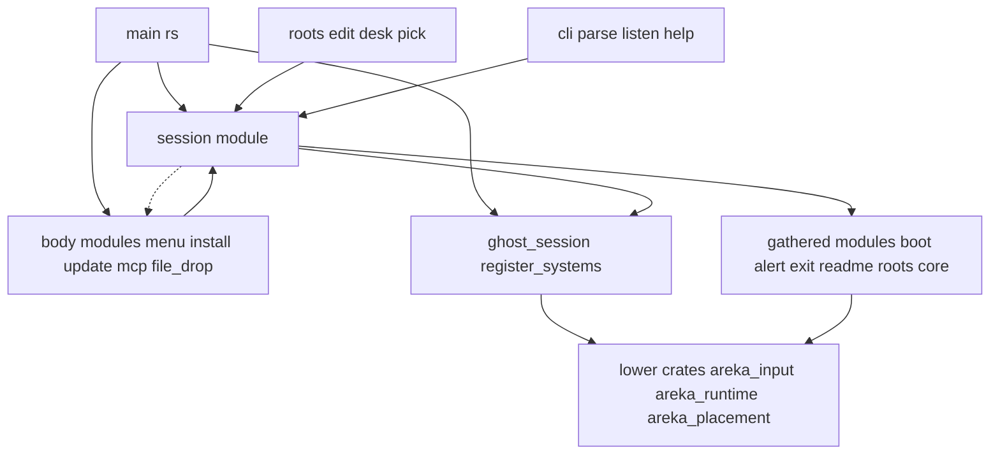
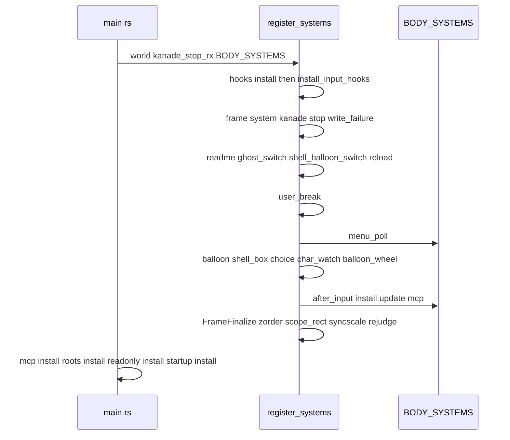
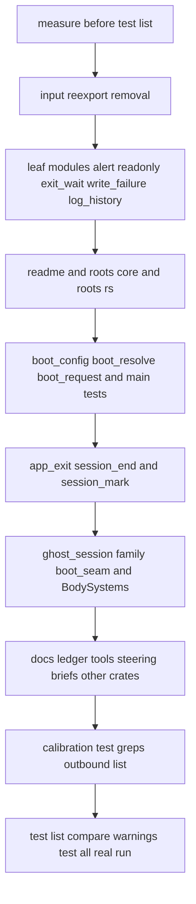

# 設計: session-module-gather

## Overview

本設計は、本体 `crates/areka` の起動・終了・切替の層を、本体の中のモジュール `crates/areka/src/session/` に集める。src 直下の候補 62 ファイル・`main.rs` の項目とそのテスト 6 本・roots の芯・readme・cli の型 2 つを移し、本体だけのモジュールの系の登録を `main.rs` に書き、入力の出し直し `use areka_input as input_events;` と `boot_config` の出し直しを外す。crate は作らず、参照の向きも変えない。

**Purpose**: 次の `session-crate-split` が `src/session/` を crate へ移し、外への参照（本番 28 行）の向きを逆にするだけで済む形を、振る舞いを変えずに作る。
**Users**: areka の開発者（本体を直し、crate に分け、見直しを受け持ちごとに回す人）。
**Impact**: 層の境目がフォルダの境目で見えるようになり、`main.rs` は 947 行から約 650 行になる。変わるのは、モジュールのパスと、パスから付くログの出所の名前（`areka::…` → `areka::session::…`）だけである。起動・切替・読み直し・終了・OS のセッションの終了・告知・起動中の印・記憶の書き込み・ログの本文・`get_log` の分け方は変えない。

### Goals

- 要件の In scope に挙げたファイルと項目が `crates/areka/src/session/` の下にあり、src 直下と `main.rs` に残らない（1・2・3）。
- `session/` の本番のコードが、系の登録のために `menu`・`install`・`update`・`mcp` を名指さない（4）。
- 本体に、実在しないモジュールの名前の出し直し（`input_events`・`crate::ConfigInputs` ほか）が残らない（2.3・5）。
- 古いパスと古い出所の名前が、決めた grep の式で 0 件になる（6.8・7.8）。
- テストの名前の末尾の多重集合（足した較正 1 本を除く）・警告 0 件・全体テスト・実機テスト 2 つが、前と同じ合否を示す（10）。

### Non-Goals

- crate の新設と参照の向きを逆にすること（`session-crate-split`）。
- ゴーストの単位を複数にすること（`multi-ghost-runtime`）。
- デモ 4 本を消すこと（`audit-areka-app`）。
- 不具合と、移動と関係なくもとから古い説明の直し（範囲を受け持つ audit へ申し送る・10.1）。
- 移した項目の中身・登録の順・起動の段取りの順の変更。

## Boundary Commitments

### This Spec Owns

- `crates/areka/src/session/` に足すモジュールの置き場と名前（下の File Structure Plan の表）。
- `main.rs` が持つものの範囲（`fn main`・`finish_after_run`・`after_run`・`AfterRun`・`install_boot_context`・`first_boot_origin`・`boot_first_ghost`・モジュールの宣言・本体だけの系の登録 `BODY_SYSTEMS`）。
- 系の登録の入口 `session::ghost_session::register_systems` の形（本体だけの系を引数 `BodySystems` で受ける）。
- 残る `roots` の宣言のファイル `src/roots.rs` と、cli の型の新しい置き場 `session/boot_request.rs`。
- `log_history` の決まりの表の 4 行（`areka::session::boot_config`・`areka::session::boot_resolve`・`areka::session::ghost_session`・`areka::session::readme`）と、それを名前で読む所の追従。
- 古いパスの書き換え（要件 6 の列挙）・2 つの audit の brief の「受け持つファイル」。
- 検証の記録（テストの名前の比べ・grep の結果・`session/` の外への参照の一覧・除いた所の一覧・申し送り）を `research.md` に置くこと。

### Out of Boundary

- 参照の向きを逆にすること（`session/` の本番が `menu`・`install`・`update`・`mcp`・`file_drop`・`smoke_exit` を引く 28 行はそのまま残す・8.3）。
- 移したファイルの中身（パスと `mod` の宣言のほか）・ログの本文・登録の順・起動の段取りの順。
- `crates/areka-runtime/`（`src/placement_tests/transition_judge_offset_signoff_tests.rs:57` の 1 か所のほか）・`crates/areka-placement/`・`crates/areka-input/`・`crates/log-capture-kit/`・本体の `runtime_tests/mod.rs`・`Cargo.lock`・ルートの `Cargo.toml`・`THIRD-PARTY-NOTICES.md`（9）。
- ディレクトリを付けない素のファイル名とモジュールの名前だけの説明（6.8・6.9）。触れない crate の説明が `ghost_session::register_systems` を名指す 26 か所は、入口の名前を変えないので古くならない。
- ほかの brief（約 70 本）・`roadmap.md`（新旧のパスの対応表を含む）・歴史の文書・日付つきの 1 枚の写し。
- `session-crate-split` の brief の書き換え（要件 8 の一覧は `research.md` に置き、次の spec がそれを読む）。

### Allowed Dependencies

- **`session/` の本番のコード** → `session/` の中（`crate::session::…`）・ワークスペースの下の crate（`areka_input`・`areka_runtime`・`areka_placement`・`areka_ghost`・`areka_kanade` ほか）・外の crate。本体の残る部分（`menu`・`install`・`update`・`mcp`・`file_drop`・`smoke_exit`）を引く所は、今ある 28 行だけで、増やさない（8 の一覧で数える）。
- **`session/` のテストのコード** → 本体のどこでも引いてよい（`crate::BODY_SYSTEMS`・`crate::after_run` ほか・8.2 の別表で数える）。
- **本体の残る部分**（`main.rs`・`cli/`・`roots.rs` と `roots/`・`install/`・`update/`・`menu/`・`mcp/`・`offline_dump/` ほか） → `session/` を引いてよい。
- `main.rs` の最上位に `use session::…`・`use areka_input…` を置かない。最上位の `use` は crate のどこからも `crate::<名>` で引ける出し直しになり、古いパスを黙って通すため。`fn` の中の `use` か、`session::…` の道で書く。
- 依存の向きは `main.rs`・本体の残る部分 → `session` → 下の crate。`session` から本体の残る部分へ向く新しい参照は、`BodySystems` の関数のポインタ（`main.rs` が渡す）だけで表す。

### Revalidation Triggers

- `register_systems` の引数（`BodySystems` の欄）が変わったとき: `main.rs` の `BODY_SYSTEMS`・登録を呼ぶテスト 5 か所・`session-crate-split`（crate の公開の入口）。
- `session/` の下のモジュールの名前か `#[path]` の入れ子が変わったとき: `log_history` の決まりの表・`doc/ssp-mcp/log-convention.md`・較正のテスト・real-run-kit の `RELIED_TARGETS`・実機テストの `RUST_LOG`。
- `session/` の外への参照（本番 28 行）が増減したとき: `research.md` の一覧と `session-crate-split` の見積もり。
- `main.rs` の `fn main` の字面が変わったとき: ソースを読むテスト（`runtime_tests/zorder_wiring_tests.rs`・`readonly_tests.rs`）。

## Architecture

### Existing Architecture Analysis

- 本体は lib を持たない bin で、モジュールは `main.rs` が宣言する。`session/` は前例 `runtime-module-untangle` が作った（今の本番は `ghost_quit`・`ghost_switch`・`hooks`・`reload`・`runtime_boot`・`same_folder_pin`・`shell_balloon_switch`・`switch_copy`）。テストは `#[cfg(test)] #[path = "<stem>_tests.rs"]` の兄弟で置く。
- `#[path]` は、それを書いたファイルのあるフォルダから読む。移すファイルの `#[path]` はどれも同じフォルダの名前で、`../` を使うものは 0 件（2026-11-21 の測り）。フォルダごと移せば `#[path]` の書き換えは要らない。
- `main.rs` の最上位の項目は、私有でも crate のどこからも `crate::<名>` で引ける。今の出し直し 2 つ（`use areka_input as input_events;`・`pub(crate) use boot_config::{…}`）はこの性質で働いている。
- `register_systems`（`ghost_session.rs:43-80`）は 25 の呼び出しを順に並べる。本体だけの 4 本は `menu`（11 番目・入力の登録の間）と `install`・`update`・`mcp`（17〜19 番目）の 2 か所にある。`Input` の段の系は互いの並びの指定を持たないので、登録の順を変えない。
- `get_log` の分け方は出所の名前で決まる（`log_history.rs` の `classify`）。debug と trace は残さず、warn 以上は出所によらず error、info だけが `RULES` で分かれる。

### Architecture Pattern & Boundary Map



- 点線は、残す外への参照（本番 28 行）で、この spec では向きを変えない。
- 系の登録だけは、`main.rs` が本体だけの系を `BodySystems` で渡し、`register_systems` は渡された関数を決まった 2 か所で呼ぶ。`session/` の本番から `menu::register_menu_poll`・`install::register`・`update::register`・`mcp::register` の名指しが消える。

**Architecture Integration**:
- **選んだ形**: ファイルは `git mv` で同じ名前のまま移し、呼び手を `crate::session::<名>::…` へ直に書き換える（研究の案 A）。作業はモジュールの塊ごとに段を切り、各段で `cargo check` を緑に保つ（案 C の順）。
- **受け持ちの分け**: `session/` は起動・終了・切替の層の本番とテスト。`main.rs` は入口と最上位の段取りと、本体だけの系の登録。
- **残す前例**: `#[path]` の兄弟のテスト・`module_path!()` から付く出所・`register_systems` が順に呼ぶだけの形・プロセスに 1 回の登録・`session/` の中は `crate::session::…` で引く書き方。
- **新しいものの理由**: `BodySystems`（`register_systems` の名前と順を変えずに、本体だけの系の名指しを `main.rs` へ出す唯一の形）・`session_mark.rs` と `boot_seam.rs`（`main.rs` の項目の行き先。移すファイルの中身を書き換えないので、既にあるファイルへ足さない）・`boot_request.rs`（cli の型 2 つの行き先）・`roots.rs`（残る `edit`・`desk`・`pick` の宣言。`roots/mod.rs` を移動として追えるようにする）。
- **steering との整合**: 1 ファイル 1,000 行の上限・テストは兄弟・依存は一方向（`structure.md`・`roadmap.md`「本体の crate 分け」の共通の約束）・ログ無し失敗経路を作らない。

**依存の向きの決まり**（実装と見直しはこれに反するものを誤りとして扱う）: 下の crate ← `session`（本番）← 本体の残る部分 ← `main.rs`。`session` の本番から本体の残る部分へ向く参照は、8 の一覧の 28 行と `BodySystems` のほかに足さない。

### Technology Stack

| Layer | Choice / Version | Role in Feature | Notes |
|-------|------------------|-----------------|-------|
| Backend / Services | Rust（edition 2024・rustc 1.100）・`bevy_ecs`（ワークスペースのピン） | `Schedules` への系の登録・`fn(&mut World)` の関数のポインタ | 新しい依存なし |
| Infrastructure / Runtime | `tracing`（出所＝モジュールのパス）・`std::any::type_name_of_val` | 出所が `areka::session::…` に変わる・較正のテストが実のモジュールのパスを引く | `log_history` の決まりを追従させる |
| 検証の道具 | `git mv`・`git grep`・`cargo test -- --list`・`tools/test-all.ps1`・`git diff -M --stat` | 移動・0 件の grep・テストの名前の比べ・全体テスト・移動の検出 | 新しい道具は作らない |

## File Structure Plan

### Directory Structure

```
crates/areka/src/
├── main.rs                          # 残す項目と宣言・BODY_SYSTEMS・register_body_after_input（約 650 行）
├── main_finish_after_run_tests.rs   # 残す
├── main_session_mark_tests.rs       # 残す（子 main_session_mark_fallback_tests.rs も）。移った項目は crate::session::session_mark::… で引く
├── main_session_mark_write_tests.rs # 残す
├── roots.rs                         # 新: mod desk・edit・pick の宣言と pub(crate) use desk::install・pub(crate) use edit::*
├── roots/
│   ├── desk.rs・edit.rs・pick.rs とテスト 5 本   # 残す（edit.rs の super:: を crate::session::roots:: へ）
├── cli/mod.rs                       # BootRequest・ModulePolicy を外し、use crate::session::boot_request::{BootRequest, ModulePolicy}
└── session/
    ├── mod.rs                       # 宣言を足す（main.rs の各 mod の上の説明を移す）
    ├── ghost_session.rs ほか 21 本   # git mv（ghost_session*・shell_balloon_switch_session_*・boot_shell_tests.rs）
    ├── boot_resolve*.rs 6 本・boot_config*.rs 8 本      # git mv
    ├── app_exit*.rs 3 本・session_end*.rs 4 本・exit_wait*.rs 2 本・write_failure*.rs 5 本  # git mv
    ├── alert*.rs 4 本・readonly*.rs 4 本・log_history*.rs 4 本  # git mv
    ├── boot_config_input_tests.rs        # git mv（main_config_input_tests.rs）
    ├── boot_config_ghost_wiring_tests.rs # git mv（main_ghost_wiring_tests.rs）
    ├── boot_config_module_policy_tests.rs # git mv（main_module_policy_tests.rs）
    ├── session_mark.rs              # 新: MarkInputs・Teardown・MarkVerdict・session_mark_verdict・settle_session_mark（main.rs 527〜547・643〜733 行）
    ├── boot_seam.rs                 # 新: restore_merged_placements・insert_persist_wiring・on_boot_ok・record_last_used_at_boot・record_last_used・boot_monitor_snapshot（main.rs 735〜884 行）
    ├── boot_seam_restore_tests.rs         # git mv（main_restore_seam_tests.rs）
    ├── boot_seam_persist_wiring_tests.rs  # git mv（main_persist_wiring_seam_tests.rs）
    ├── boot_seam_monitor_snapshot_tests.rs # git mv（main_monitor_snapshot_seam_tests.rs）
    ├── boot_request.rs              # 新: BootRequest・ModulePolicy（cli/mod.rs 54〜74 行）
    ├── readme.rs・readme_tests.rs・readme/ の 11 本   # git mv
    └── roots/mod.rs・resolve.rs・report.rs・user_root.rs とテスト 3 本  # git mv（mod.rs から edit・desk・pick の宣言と出し直し 2 つを外す）
```

- 移すファイルはどれも 1,000 行より小さい（最大は `shell_balloon_switch_session_lap_tests.rs` 902 行・`main_session_mark_tests.rs` 947 行は残す）。`ghost_session.rs` は 881 行から約 890 行、`boot_config.rs` は 648 行から約 660 行（テストの宣言 3 つ）になる。上限越えの例外表に足す行は無い（1.5）。
- 新しいファイル 4 本（`session_mark.rs`・`boot_seam.rs`・`boot_request.rs`・`roots.rs`）は、項目を元の字面のまま写し、可視性を `pub(crate)` に上げることだけを許す。`main.rs` の `[main]` の前置きのある記録の文もそのまま写す（7.9）。
- `roots/mod.rs` を移動として追えるように、残る `edit`・`desk`・`pick` の宣言は新しい `src/roots/mod.rs` でなく `src/roots.rs`（`readme.rs` ＋ `readme/` と同じ形）に置く。同じパスに新しい `mod.rs` を置くと、squash の後に git が「`roots/mod.rs` の書き換え＋`session/roots/mod.rs` の追加」と見る。
- 移したファイルの中身の書き換えは、パス（`mod` の宣言・`#[path]`・`use`・`crate::…`・説明の中のパス）のほかに次の 4 つだけで、どれも要件が求めるもの: ⑴ `ghost_session.rs` の `register_systems` の引数と 2 か所の呼び出し・`BodySystems`（4.1） ⑵ `session/roots/mod.rs` から残る 3 本の宣言と出し直しを外す（3.1） ⑶ `boot_config.rs` の `//!` の出し直しと檻の名前の説明（2.3・説明を正しく保つ） ⑷ `readonly_tests.rs` の絞り込みの空でないことの `assert!`（6.2）。

### Modified Files

本体（`crates/areka/`）:
- `src/main.rs` — 移す `mod` の宣言 11 本と `boot_config` の出し直しと `use areka_input as input_events;`（とその上の 2 行）を外す。`MarkInputs`〜`boot_monitor_snapshot` とテストの宣言 6 本を外す。`fn main`・`after_run`・`install_boot_context`・`boot_first_ghost` の本文の先頭に `use session::{…};` を置き、本文の字面を変えない（変わるのは `cli::ModulePolicy::Skip` の 1 か所だけ・型が `session::boot_request` へ移るため）。署名と構造体の欄は `session::…` の道で書く。`BODY_SYSTEMS` と `register_body_after_input` を足す。
- `src/session/ghost_session.rs` — `register_systems` に `body: BodySystems` を足し、`menu::register_menu_poll(world)` を `(body.menu_poll)(world)` に、`install`・`update`・`mcp` の 3 行を `(body.after_input)(world)` にする。`BodySystems` を足す。`use crate::input_events;` を外し、`input_events::` を `areka_input::` に、`crate::{ConfigInputs, …}` を `crate::session::boot_config::{…}` にする。説明の中の `input_events`（276 行）を `areka_input` にする。
- `src/session/mod.rs` — 移したモジュールと新しいファイルの `pub(crate) mod` の宣言。
- `src/session/boot_config.rs` — `crate::cli::{BootRequest, ModulePolicy}` を `crate::session::boot_request::…` に。移ってきたテスト 3 本の宣言。`//!` の説明の「`main.rs`（`pub(crate) use` で crate 直下へ再輸出）」と檻の名前を、出し直しの無い形と新しいファイル名へ直す。
- `src/session/roots/mod.rs` — `mod desk;`・`mod edit;`・`mod pick;` と `pub(crate) use desk::install;`・`pub(crate) use edit::*;` を外す（`roots.rs` へ）。
- `src/roots/edit.rs` — `super::report`・`super::{ResolvedRoots, RootStatus, RootsOrigin, encode_memory}`・`super::user_root` を `crate::session::roots::…` へ。`desk.rs` の `super::add_root` は `roots.rs` の `edit::*` を通るのでそのまま。
- `src/cli/mod.rs` — 型 2 つを外し、`use crate::session::boot_request::{BootRequest, ModulePolicy};` で引く（出し直さない）。
- `src/log_history.rs`（→ `session/log_history.rs`）— `RULES` の 4 行の出所。
- `src/log_history_tests.rs`・`src/log_history_convention_tests.rs`（→ `session/`）— 出所の文字列の追従と、較正 1 本（KindCalibration）を `log_history_tests.rs` に足す（約 640 行 → 約 680 行）。
- 集めるモジュールを名指す本体のファイル（2026-11-21 の測りで 186 本）— `crate::<名>` を `crate::session::<名>` へ。`crate::{ConfigInputs, default_app_profile_dir, default_helper_exe_path, ghost_boot_options, is_benign_boot_error}` を `crate::session::boot_config::…` へ。`crate::{MarkInputs, Teardown, …}` を `crate::session::session_mark::…`、`crate::{restore_merged_placements, on_boot_ok, record_last_used, boot_monitor_snapshot}` を `crate::session::boot_seam::…`、`crate::cli::{BootRequest, ModulePolicy}` を `crate::session::boot_request::…`、roots の芯の項目を `crate::session::roots::…` へ。
- `crate::input_events::…` の呼び手 26 ファイル（`runtime_tests/` の 8 本と `menu/` を含む）— `areka_input::…` へ。`menu/mod.rs:182` の説明の `input_events` を `areka_input` へ。
- 系の登録を呼ぶテスト 5 か所（`app_exit_escape_tests.rs:137`・`ghost_session_reload_tests.rs:71`・`:179`・`ghost_session_restart_tests.rs:455`・`session/ghost_switch_test_support.rs:237`）— 引数 `crate::BODY_SYSTEMS` を足す。
- ソースを読むテスト（Components の SourceReadingTests）。
- `Cargo.toml:44` — 説明の「本体は `use areka_input as input_events;` で今の呼び手のパスを通す」を外す（依存の行は変えない）。
- `tests/emo2_mcp_real_run.rs`（出所の名前）・`tests/emo2_real_run.rs:58`（`default_helper_exe_path()` の置き場を `crates/areka/src/session/boot_config.rs` に）。

本体の外:
- `crates/real-run-kit/src/launch.rs:372`・`launch_tests.rs`・`close_tests.rs`・`bin/real-run-fake-areka.rs`（出所の名前）。
- `crates/areka-runtime/src/placement_tests/transition_judge_offset_signoff_tests.rs:57`・`crates/areka-kanade/src/schedule/script_log.rs:16`・`crates/pilot/examples/pilot-windows-rs-next/REWRITE_TABLE.md:66`（説明のパス）。
- `tools/package.ps1:149`・`:153`・`:695`・`tools/perf/judge-perf.py:96`（説明のパスだけ・目印の本文は変えない）。
- `doc/COMPAT_ARCHITECTURE.md`（§8 の既にある行のパス 33 か所と、`main.rs` の名で移す項目を指す `:189`・`:318`・`:319`）・`doc/ukadoc-coverage/ledger/*.toml`（32 行・43 か所）と `report/` の作り直し・`doc/ukadoc-coverage/briefing-assets.md:174`・`:213`・`doc/testing.md:47`・`doc/ssp-mcp/log-convention.md`（`:3`・`:39`・表の 4 行・`:135`）・`doc/pasta-real-run.md:127`・`:141`・`doc/ideas/novel-redesign-2026-11-20/` の 5 ファイル。
- `.kiro/steering/structure.md`（本体の節の `session/`・`roots/`・`cli/`・`readme`・起動と終了の最上位のファイル・`log_history.rs`・`:281` の出し直し・`:319`・`:348`・`:418`・`:419`）・`.kiro/steering/tech.md:171`・`.kiro/steering/logging.md:103`。
- `.kiro/specs/audit-areka-app/brief.md`・`.kiro/specs/audit-areka-install-update/brief.md`（受け持つファイルのパス）。
- `.kiro/specs/completed/session-module-gather/research.md`（検証の記録・外への参照の一覧・除いた所・申し送り）。

## System Flows

### 系の登録の順（前と同じ 25 の呼び出し）



- 呼び出しの順は今の 25 行と 1 対 1 で同じ（4.2）。`hooks::install` → `install_input_hooks` の並びはそのまま（4.3）。
- `register_systems` を呼ぶのは本番では `fn main` の 1 か所（4.4）。LogSink の起動でも同じ系が載り、状態の無い系は今と同じく無操作で戻る（4.5）。

## Requirements Traceability

| Requirement | Summary | Components | Interfaces | Flows |
|-------------|---------|------------|------------|-------|
| 1.1 | src 直下の候補と `boot_shell_tests.rs` を `git mv` | FileMove | — | Migration |
| 1.2 | 中身を変えずパスだけ直す | FileMove・PathRewrite | — | — |
| 1.3 | src 直下に候補が残らない | FileMove・VerificationRecord | grep の式 1 | — |
| 1.4 | 可視性は `pub(crate)` まで | FileMove・MainItemMove | — | — |
| 1.5 | 1,000 行の上限・例外表を増やさない | FileMove・MainItemMove | — | — |
| 1.6 | テストは兄弟・同じ実行ファイル | FileMove・MainItemMove | — | — |
| 2.1 | `main.rs` の項目を `session/` へ | MainItemMove | `session_mark`・`boot_seam` | — |
| 2.2 | `main.rs` に残るもの | MainItemMove | — | — |
| 2.3 | `boot_config` の出し直しを外す | MainItemMove・PathRewrite | — | — |
| 2.4 | `main_*_tests.rs` の仕分けの記録 | MainItemMove | 仕分けの表 | — |
| 2.5 | 起動の段取りの順 | MainItemMove・RegistrationInjection | — | 系の登録の順 |
| 3.1 | roots の芯を移し edit・desk・pick を残す | RootsSplit | `roots.rs` | — |
| 3.2 | readme を移す | FileMove | — | — |
| 3.3 | cli の型 2 つを `session/` へ・cli → session | BootRequestMove | `boot_request` | — |
| 3.4 | 起動オプション・根・説明書の振る舞い | BootRequestMove・RootsSplit・FileMove | — | — |
| 3.5 | 残る roots と芯がテストで合う | RootsSplit・VerificationRecord | — | — |
| 4.1 | 本体だけの 4 本を `main.rs` へ | RegistrationInjection | `BodySystems`・`BODY_SYSTEMS` | 系の登録の順 |
| 4.2 | 登録の順を前と同じに | RegistrationInjection | — | 系の登録の順 |
| 4.3 | 強制退避の口の位置・固定のテスト | RegistrationInjection | — | 系の登録の順 |
| 4.4 | 登録はプロセスに 1 回 | RegistrationInjection | — | 系の登録の順 |
| 4.5 | LogSink の起動でも同じ系 | RegistrationInjection | — | 系の登録の順 |
| 5.1 | 入力の出し直しと説明・`Cargo.toml:44` | InputPathRewrite | — | Migration |
| 5.2 | 26 ファイルを `areka_input::…` へ | InputPathRewrite | — | — |
| 5.3 | `input_events` の道が 0 件 | InputPathRewrite・VerificationRecord | grep の式 2 | — |
| 5.4 | `runtime_tests/mod.rs` を書き換えない | InputPathRewrite | — | — |
| 6.1 | 本体の名指すファイルのパス | PathRewrite | — | — |
| 6.2 | ソースを読むテスト | SourceReadingTests | — | — |
| 6.3 | ほかの crate の説明のパス | DocPathFollow | — | — |
| 6.4 | `tools/` の説明のパス | DocPathFollow | — | — |
| 6.5 | 文書と網羅台帳 | DocPathFollow | — | — |
| 6.6 | steering 3 本 | DocPathFollow | — | — |
| 6.7 | audit 2 本の brief の受け持ち | DocPathFollow | — | — |
| 6.8 | 古いパスが 0 件・除いた所の一覧 | VerificationRecord | grep の式 3 | — |
| 6.9 | モジュールの名前だけの説明は当たりにしない | VerificationRecord | grep の式 3 | — |
| 7.1 | 出所は `areka::session::…`・決まりはモジュールごとに 1 行 | LogTargetFollow | `RULES` | — |
| 7.2 | 直書きの出所の扱いの一覧 | LogTargetFollow | 直書きの表 | — |
| 7.3 | 名前で読む所の書き換え | LogTargetFollow | — | — |
| 7.4 | `get_log` の種別が前と同じ | LogTargetFollow・KindCalibration | — | — |
| 7.5 | 根 `areka` から外れる info の行の手当て | MainItemMove・LogTargetFollow | — | — |
| 7.6 | `RUST_LOG` の新しい名前で同じだけ出る | LogTargetFollow | — | — |
| 7.7 | real-run-kit が足す出所 | LogTargetFollow | `RELIED_TARGETS` | — |
| 7.8 | 古い出所の名前が 0 件 | VerificationRecord | grep の式 4 | — |
| 7.9 | ログの本文を変えない | MainItemMove・LogTargetFollow | — | — |
| 8.1 | `session/` の外への参照の一覧 | OutboundRefRecord | grep の式 5 | — |
| 8.2 | テストだけの参照を分けて載せる | OutboundRefRecord | — | — |
| 8.3 | 向きを逆にしない | OutboundRefRecord | — | — |
| 9.1 | `areka-runtime` は 1 か所だけ | DocPathFollow・VerificationRecord | — | — |
| 9.2 | 触らない crate 3 つ | VerificationRecord | — | — |
| 9.3 | `runtime_tests/mod.rs` | InputPathRewrite・VerificationRecord | — | — |
| 9.4 | §8 は既にある行のパスだけ | DocPathFollow | — | — |
| 9.5 | `Cargo.lock` ほか・新しい依存なし | VerificationRecord | — | — |
| 9.6 | 触らずに済まないとき | VerificationRecord | — | — |
| 9.7 | `user_break.rs:201` の申し送り | VerificationRecord | — | — |
| 10.1 | 振る舞いを変えない・もとから古い説明の申し送り | VerificationRecord | — | — |
| 10.2 | テストの名前の末尾の多重集合 | VerificationRecord | — | Migration |
| 10.3 | 差の対応表 | VerificationRecord・KindCalibration | — | — |
| 10.4 | 警告 0 件 | VerificationRecord | — | Migration |
| 10.5 | 全体テスト | VerificationRecord | — | — |
| 10.6 | 実機テスト 2 つ | VerificationRecord | — | — |
| 10.7 | 実機はその 2 つだけ | VerificationRecord | — | — |
| 10.8 | `get_log` の分け方の証跡と較正 1 本 | KindCalibration | — | — |

## Components and Interfaces

| Component | Domain/Layer | Intent | Req Coverage | Key Dependencies (P0/P1) | Contracts |
|-----------|--------------|--------|--------------|--------------------------|-----------|
| FileMove | session | src 直下の候補・readme・roots の芯を `git mv` | 1, 3.2, 3.4 | `session/mod.rs`（P0） | — |
| MainItemMove | session・main | `main.rs` の項目を新しいファイル 2 本へ・テストの仕分け | 2, 7.5, 7.9 | `session_mark.rs`・`boot_seam.rs`（P0） | Service |
| BootRequestMove | session・cli | cli の型 2 つの置き場 | 3.3, 3.4 | `boot_request.rs`（P0） | State |
| RootsSplit | session・roots | 芯と残る 3 本の分け | 3.1, 3.4, 3.5 | `roots.rs`（P0） | — |
| RegistrationInjection | session・main | 本体だけの系を `main.rs` から渡す | 2.5, 4 | `ghost_session.rs`・`main.rs`（P0） | Service |
| InputPathRewrite | 本体全体 | 入力の出し直しを外す | 5 | 26 ファイル（P1） | — |
| PathRewrite | 本体全体 | `crate::<名>` を `crate::session::<名>` へ | 1.2, 2.3, 6.1 | 186 ファイル（P1） | — |
| SourceReadingTests | 本体のテスト | ソースを読むテストを移した先へ | 6.2 | 下の表（P0） | — |
| LogTargetFollow | ログ | 出所の名前で読む所の追従 | 7 | `log_history.rs`・real-run-kit（P0） | State |
| KindCalibration | ログのテスト | 実のモジュールのパスで種別を引く較正 1 本 | 7.4, 10.3, 10.8 | `log_history_tests.rs`（P1） | — |
| DocPathFollow | 文書・道具・ほかの crate | 説明のパスの書き換え | 6.3〜6.7, 9.1, 9.4 | 文書（P2） | — |
| OutboundRefRecord | 記録 | `session/` の外への参照の一覧 | 8 | `research.md`（P1） | — |
| VerificationRecord | 記録 | grep・テストの名前・警告・全体テスト・実機 | 1.3, 5.3, 6.8, 6.9, 7.8, 9, 10 | `research.md`（P0） | — |

### session（集める層）

#### RegistrationInjection

| Field | Detail |
|-------|--------|
| Intent | `register_systems` の名前と順を保ったまま、本体だけの系の登録を `main.rs` に書く |
| Requirements | 2.5, 4.1, 4.2, 4.3, 4.4, 4.5 |

**Responsibilities & Constraints**
- `session::ghost_session::register_systems` は今の 25 の呼び出しを同じ順で行い、11 番目と 17〜19 番目を引数の関数で呼ぶ。
- `main.rs` は `BODY_SYSTEMS` を持ち、`fn main` の 1 か所で `register_systems` に渡す。
- 触れない crate の説明が名指す `ghost_session::register_systems`（`areka-input` 16・`areka-placement` 8・`areka-runtime` 2）は、名前と中身（入力・配置・フレームの系の登録）が今のままなので古くならない。

**Contracts**: Service [x]

##### Service Interface
```rust
// session/ghost_session.rs
/// 本体だけのモジュールの系の登録（`main.rs` が渡す）。
#[derive(Clone, Copy)]
pub(crate) struct BodySystems {
    /// 入力の取り出しの系の間（`user_break` の後・`balloon` の前）で呼ぶ。
    pub(crate) menu_poll: fn(&mut World),
    /// 入力の系の後・`FrameFinalize` への足し込みの前で呼ぶ。
    pub(crate) after_input: fn(&mut World),
}

pub(crate) fn register_systems(
    world: &mut World,
    kanade_stop_rx: Receiver<KanadeNotice>,
    body: BodySystems,
);

// main.rs
pub(crate) const BODY_SYSTEMS: session::ghost_session::BodySystems =
    session::ghost_session::BodySystems {
        menu_poll: menu::register_menu_poll,
        after_input: register_body_after_input,
    };

/// `install::register` → `update::register` → `mcp::register` の順。
fn register_body_after_input(world: &mut World);
```
- Preconditions: `world` は `WinApp` が作った World（`Schedules` がある）。プロセスに 1 回。
- Postconditions: 登録された系の集合と順が、移す前の `register_systems` と同じ。
- Invariants: `hooks::install` → `install_input_hooks` が最初の 2 つ。`install` の後に `update`（終了の門の登記の順）。

**Implementation Notes**
- Integration: テスト 5 か所は `crate::BODY_SYSTEMS` を渡す（テストから根を引く参照として 8.2 に載せる。`session/ghost_switch_test_support.rs:237` の `SwitchRig::new` を通る 46 ファイルもこの 1 か所に頼る）。`session-crate-split` で `session/` が crate になると、これらのテストは本体の `BODY_SYSTEMS` を引けなくなる＝次の spec のいちばん大きい直しになる見込みとして `research.md` の申し送りに書く。
- Validation: 固定のテスト `register_systems_installs_the_escape_hook`・`ghost_session_restart_tests.rs:455` の口の据え付け・`SwitchRig::new` を使う 46 ファイルが前と同じ合否。
- Risks: 2 つの欄は同じ型 `fn(&mut World)` なので、取り違えてもコンパイルは通り、登録の順だけが変わる。`Input` の段の系は互いの並びの指定を持たないので、赤になるテストがあるとは限らない。欄の名前（`menu_poll`・`after_input`）で呼ぶ位置を固定したうえで、実装の段で一度だけ `BODY_SYSTEMS` の 2 つの欄を入れ替えて回し、赤になるテストを `research.md` に記録する（入れ替えは戻してコミットしない）。0 件なら、取り違えを止める守りは字面の見直しだけであることをこの文と `research.md` に書く。 実験で取り違えを試した結果、bin の単体テストは全部通った（取り違えを止める守りは字面の見直しだけ）。

#### MainItemMove

| Field | Detail |
|-------|--------|
| Intent | `main.rs` の項目を `session/session_mark.rs` と `session/boot_seam.rs` へ移し、テスト 9 本を仕分ける |
| Requirements | 1.4, 1.5, 1.6, 2.1, 2.2, 2.3, 2.4, 2.5, 7.5, 7.9 |

**Responsibilities & Constraints**
- 項目は元の字面のまま写す（doc コメント・`[main]` の前置きのある記録の文を含む）。変えてよいのは可視性（`pub(crate)`・構造体の欄を含む）と、引く道だけ。
- `main.rs` の残す項目は `session::…` で引く。`fn` の本文は先頭の `use session::{…};` で字面を変えない（`zorder_wiring_tests.rs` と `readonly_tests.rs` が `fn main` の字面を読む）。

**Contracts**: Service [x]

##### Service Interface
```rust
// session/session_mark.rs（後始末と OS のセッションの終了が共有する印の判定）
pub(crate) struct MarkInputs { pub(crate) app_profile_dir: PathBuf, pub(crate) argv_session: bool,
    pub(crate) first: Option<ExitOrigin>, pub(crate) logsink_fallback: bool }
pub(crate) struct Teardown { pub(crate) run_ok: bool, pub(crate) down_ok: bool, pub(crate) shiori_cut: bool }
pub(crate) enum MarkVerdict { Clear, Keep(&'static str), Untouched }
pub(crate) fn session_mark_verdict(first: Option<&ExitOrigin>, argv_session: bool,
    logsink_fallback: bool, end: Teardown) -> MarkVerdict;
pub(crate) fn settle_session_mark(mark: &MarkInputs, end: Teardown)
    -> (MarkVerdict, Option<areka_sylphya::PersistFailure>);

// session/boot_seam.rs（起動窓と起動の直後の結線のシーム）
pub(crate) fn restore_merged_placements(ghost_root: &Path, placements: Vec<ScopePlacement>,
    snapshot: &MonitorSnapshot) -> (Vec<ScopePlacement>, BTreeMap<usize, Option<AdjacencyMark>>, bool);
pub(crate) fn insert_persist_wiring(world: &mut World, publisher: SylphyaPublisher);
pub(crate) fn on_boot_ok(world: &mut World, runtime: &GhostRuntime, ghost: &GhostDecision, balloon: &BalloonDecision);
pub(crate) fn record_last_used_at_boot(publisher: &SylphyaPublisher, shell_dir: &Path,
    ghost: &GhostDecision, balloon: &BalloonDecision);
pub(crate) fn record_last_used(publisher: &SylphyaPublisher, shell_dir: &Path,
    ghost: &GhostDecision, balloon: &BalloonDecision);
pub(crate) fn boot_monitor_snapshot(monitors: &[Monitor]) -> MonitorSources;
```
- Invariants: 署名と本文は `main.rs` の今のものと同じ（`derive` を含む）。

**`main_*_tests.rs` の仕分け（2.4）**

| テスト | 確かめる相手 | 行き先 |
|---|---|---|
| `main_config_input_tests.rs` | `ConfigInputs`・`resolve_boot_from`（`boot_config`） | `session/boot_config_input_tests.rs`（`boot_config.rs` が宣言・モジュール名 `config_input_tests`） |
| `main_ghost_wiring_tests.rs` | `default_helper_exe_path`・`ghost_boot_options`・`is_benign_boot_error` | `session/boot_config_ghost_wiring_tests.rs`（`ghost_wiring_tests`） |
| `main_module_policy_tests.rs` | `ghost_boot_options` の SHIORI の読み方の指定 | `session/boot_config_module_policy_tests.rs`（`module_policy_tests`） |
| `main_restore_seam_tests.rs` | `restore_merged_placements` | `session/boot_seam_restore_tests.rs`（`boot_seam.rs` が宣言・`restore_seam_tests`） |
| `main_persist_wiring_seam_tests.rs` | `insert_persist_wiring`・`on_boot_ok` | `session/boot_seam_persist_wiring_tests.rs`（`persist_wiring_seam_tests`） |
| `main_monitor_snapshot_seam_tests.rs` | `boot_monitor_snapshot` | `session/boot_seam_monitor_snapshot_tests.rs`（`monitor_snapshot_seam_tests`） |
| `main_finish_after_run_tests.rs` | `finish_after_run`（残る） | 残す |
| `main_session_mark_tests.rs`（子 `main_session_mark_fallback_tests.rs`） | `after_run`・`boot_first_ghost`・`install_boot_context`・`first_boot_origin`（残る）と `settle_session_mark`・`session_mark_verdict`（移る） | 残す。移った項目は `crate::session::session_mark::…` で引く |
| `main_session_mark_write_tests.rs` | `after_run`・`finish_after_run`・`boot_first_ghost`（残る）と `session_mark_verdict` | 残す。同上 |

- 移すテストのモジュール名（`mod config_input_tests;` ほか）は今のままにする。テストの関数の名前は変わらない（10.2）。
- 移すテストの `use super::*;` は、親が `main.rs` から移った先のモジュールに変わる。足りなくなる名前は `crate::session::…` の道で足す（中身は変えない）。

**Implementation Notes**
- Integration: 本番の呼び手 `ghost_session.rs:204`・`:227`・`:720`・`ghost_session_runtime.rs:55`・`session/ghost_switch.rs:569`・`session_end.rs:22` は、移した後は `session/` の中の参照になる。
- Validation: 移す項目の中の `info!` は 0 件（2026-11-21 の測り・`settle_session_mark`・`record_last_used_at_boot` は debug、`record_last_used` は error）。出所が根 `areka` から `areka::session::session_mark`・`areka::session::boot_seam` に変わっても、debug は残さず error は出所によらず error なので、`get_log` の分け方は変わらない（7.5 は手当て不要）。実装の段の始めに `info!` が 0 件であることを grep で確かめ直す。
- Risks: `after_run` の `session_end_already_handled`（info・出所 `areka`・status）は `main.rs` に残すので当たらない。

#### BootRequestMove

| Field | Detail |
|-------|--------|
| Intent | `BootRequest`・`ModulePolicy` を `session/boot_request.rs` へ移し、cli がそれを引く |
| Requirements | 3.3, 3.4 |

**Contracts**: State [x]

##### State Management
- State model: 型の定義（`derive`・欄・doc）は `cli/mod.rs` 54〜74 行の字面のまま。
- `cli/mod.rs` は私有の `use crate::session::boot_request::{BootRequest, ModulePolicy};` で `StartupOptions` の欄に使う。`pub(crate) use` で出し直さないので、`crate::cli::BootRequest` は通らなくなり、呼び手（13 ファイル・2026-11-21 の測り）は `crate::session::boot_request::…` へ書き換わる（コンパイルが漏れを止める）。

**Implementation Notes**
- Validation: `cli/parse*_tests.rs`・`install/startup_tests.rs` が前と同じ合否（3.4）。

#### RootsSplit

| Field | Detail |
|-------|--------|
| Intent | roots の芯を `session/roots/` へ移し、`edit`・`desk`・`pick` を本体の `roots` に残す |
| Requirements | 3.1, 3.4, 3.5 |

**Responsibilities & Constraints**
- `session/roots/mod.rs`（`git mv`）: `report`・`resolve`・`user_root` の宣言・`pub(crate) use resolve::*;`・`read_memory`・`resolve_roots`・`single_env`。
- `src/roots.rs`（新）: `pub(crate) mod desk;`・`mod edit;`・`pub(crate) mod pick;`・`pub(crate) use desk::install;`・`pub(crate) use edit::*;`（今の `roots/mod.rs` の字面）。
- 呼び手の `crate::roots::<名>` は、名が芯のもの（`ResolvedRoots`・`RootsOrigin`・`RootStatus`・`RootError`・`resolve_roots`・`read_memory`・`single_env`・`report`・`user_root` ほか）なら `crate::session::roots::<名>` へ、残る 3 本のもの（`install`・`add_root` ほか `edit::*`・`pick`・`desk`）ならそのまま。
- ログの出所: 芯は `areka::session::roots::{report,user_root,resolve}`、残る 3 本は `areka::roots::{edit,desk,pick}` のまま。どちらも決まりの表に当たらないので、種別は前と同じ（残さない）。

**Implementation Notes**
- Validation: `roots/edit_tests.rs`・`desk_tests.rs`・`pick_tests.rs` と芯のテスト 3 本が前と同じ合否（3.5）。`edit.rs` が芯の項目を引けないとコンパイルが止まる。
- Risks: `RUST_LOG=areka::roots=debug` は今は芯と残る 3 本の両方を開く。移した後は `areka::session::roots=debug` も要る。この指定は文書にもテストにも無く（測り）、既定の動きに関わらない。`research.md` に記録する。

### 本体全体の書き換え

#### InputPathRewrite

| Field | Detail |
|-------|--------|
| Intent | `use areka_input as input_events;` を外し、呼び手を `areka_input::…` で書く |
| Requirements | 5.1, 5.2, 5.3, 5.4 |

- `main.rs` の 59〜61 行（説明 2 行と出し直し）を外す。`Cargo.toml:44` の説明から出し直しの括弧書きを外す。
- 26 ファイルの `crate::input_events::` を `areka_input::` に、`use crate::input_events;` は外して `input_events::` を `areka_input::` にする。呼ぶ項目は変えない。
- `runtime_tests/mod.rs` は `crate::input_events` を引かない（測り）ので、書き換えずに済む（5.4）。
- `app_exit_tests.rs:182` の `input_events_tests.rs`（もとから実在しない）は直さず、申し送る（5.3）。

#### PathRewrite

| Field | Detail |
|-------|--------|
| Intent | 集めたモジュールの呼び手を `crate::session::<名>::…` へ書き換える |
| Requirements | 1.2, 2.3, 6.1 |

- 書き方は 1 つ: `session/` の外も中も `crate::session::<名>::…`（`session/` の中に既にある書き方）。`use crate::{a, b};` の束は、集めた名前を `crate::session::{…}` の束へ分ける。
- 出し直しは足さない（`boot_config` の出し直しを外した後に、`crate::ConfigInputs` ほかを通す道を残さない）。
- 中身の書き換えは、`mod` の宣言・`#[path]`・`use`・`crate::…` のパス・説明の中のパスだけ（1.2）。

#### SourceReadingTests

| Field | Detail |
|-------|--------|
| Intent | `include_str!` と `CARGO_MANIFEST_DIR` でソースを読むテストを、移した先を読ませ、同じ事実を確かめさせる |
| Requirements | 6.2 |

| テスト | 今 | 直し |
|---|---|---|
| `runtime_tests/zorder_wiring_tests.rs:68` | `include_str!("../ghost_session.rs")` | `include_str!("../session/ghost_session.rs")`。`main.rs` を読む `:71` と字面（`ghost_session::open_ghost_windows(…)`・`.map_err(write_failure::stop_boot)?;`）は、`fn main` の本文が字面を保つのでそのまま |
| `readonly_tests.rs:82` | 較正の針 `mod readonly;`（`main.rs`） | 針を `mod session;` にする（走査が `main.rs` の本文を見ている、という同じ事実） |
| `readonly_tests.rs:92` | `rel == "readonly.rs" \|\| rel.starts_with("readonly_")` | 移した先（`session/readonly.rs`・`session/readonly_`・区切りは `all_sources` の書き方）にし、`bare` が空でないことの `assert!` を足す（黙って空になる形を残さない） |
| `readonly_tests.rs:153` | `rel == "readonly.rs"` | `session/readonly.rs`（較正 `seen_in_readonly` が空振りを赤にする） |
| `session_end_deadline_tests.rs:405`・`:409`・`:413`・`:519`・`:533` | `"areka/ghost_session.rs"`・`"areka/session_end.rs"` | `"areka/session/ghost_session.rs"`・`"areka/session/session_end.rs"` |
| `readme_tests.rs:424` | `"areka/readme/os_port.rs"` | `"areka/session/readme/os_port.rs"` |
| `session_end_sync_send_tests.rs:437`・`:445` | `"crates/areka/src/main.rs"`（較正の写し） | 直さない（`main.rs` は残る） |

- 実装の段の始めに `git grep -n -E 'include_str!|CARGO_MANIFEST_DIR|crate_path\(' -- crates/areka/src` で読む所を数え直し、集めたファイルの名前を字面に持つものを全部この表に足す。

### ログ

#### LogTargetFollow

| Field | Detail |
|-------|--------|
| Intent | 出所の名前を読む所を、移した先のモジュールのパスへそろえる |
| Requirements | 7.1, 7.2, 7.3, 7.4, 7.6, 7.7, 7.9 |

**Contracts**: State [x]

##### State Management
- `RULES`（行の数 14・並びは今のまま）: `areka::boot_config` → `areka::session::boot_config`・`areka::boot_resolve` → `areka::session::boot_resolve`・`areka::ghost_session` → `areka::session::ghost_session`・`areka::readme` → `areka::session::readme`。どれも `exact=false` のまま。`areka::session` を下まで含む 1 行には畳まない（7.1）。`UNKEPT_TARGETS` は変えない。
- モジュールの名前と `#[path]` の入れ子は今のまま。`ghost_session_runtime`・`ghost_session_scope_rect`・`ghost_session_scope_scale` の出所は `areka::session::ghost_session::<名>` で、`areka::session::ghost_session` の行に当たり続ける。
- 同じコミットでそろえる 3 つ: `RULES`・`doc/ssp-mcp/log-convention.md` の表（`log_history_convention_tests.rs` が一致を確かめる）・移したファイルの置き場（`every_rule_target_names_a_module_or_literal_that_exists` が `src/session/<名>.rs` を探す）。

**直書きの出所の扱い（7.2）**

| 直書き | 所 | 扱い |
|---|---|---|
| `"areka::boot_config"`・`"areka::boot_resolve"`・`"areka::ghost_session"`・`"areka::readme"`・`"areka::readme::opener"`・`"areka::alert"`・`"areka::app_exit"` | `log_history.rs:124-131`・`log_history_tests.rs:103-111`・`:125`・`:168-174`・`:197`・`:462`・`log_history_convention_tests.rs:152`・`:156`・`:185`・`:186`・`:191`・`:192` | モジュールのパスを写したもの＝`areka::session::<名>` へ |
| `"areka::app_exit"`・`"areka::boot_config"` | `real-run-kit/src/launch.rs:372`（`RELIED_TARGETS`）・`launch_tests.rs:76`・`:207`・`:211`・`:212`・`:237`・`:238`・`close_tests.rs:8`・`bin/real-run-fake-areka.rs:17`・`:58` | 同上 |
| `areka::boot_config`・`areka::ghost_session` | `tests/emo2_mcp_real_run.rs:18`・`:31`・`:32`（`BOOT_CONFIG_PREFIX`）・`:114`（`rust_log`）・`:254` | 同上 |
| `areka::boot_resolve`・`areka::app_exit`・`areka::roots::user_root` | `doc/pasta-real-run.md:127`・`:141`・`doc/testing.md:47`・`doc/ssp-mcp/log-convention.md:53-55`・`:59`・`:135`・`structure.md:418`・`:419` | 同上（`areka::roots::user_root` はモジュールの道で、芯に入るので `areka::session::roots::user_root`） |
| `"areka::persist::*"`・`"areka::log::*"`・`"areka::perf"` | 本番の `target:` | 語彙＝変えない |
| `"areka::session::ghost_switch"`・`"areka::session::reload"` | `RULES`・テスト | 既に `session/` にある＝変えない |
| `"areka"` | `RULES` の完全一致の行 | 本体の根＝変えない |
| `"areka::menu"`・`"areka::file_drop"`・`"areka::menu::shortcut"`・`"areka::install::install_cue"` | `log_history_tests.rs:126`・`:147`・`:148`・`UNKEPT_TARGETS` | 集めないモジュール＝変えない |

- 本番のコードの `target:` に、集めるモジュールの名前を写した直書きは 0 件（2026-11-21 の測り）。
- `EnvFilter` の名指しは素の前方一致なので、`areka::session::boot_config=debug` は移す前の `areka::boot_config=debug` と同じ範囲を開く（7.6）。real-run-kit は info より絞った段を受けたとき、前と同じく `areka_mcp::server` と `areka::session::app_exit` を info で足す（7.7）。

#### KindCalibration

| Field | Detail |
|-------|--------|
| Intent | 移したモジュールの実のパスで種別を引き、表の文字列とファイルの置き場のずれを赤にする |
| Requirements | 7.4, 10.3, 10.8 |

- `log_history_tests.rs` に 1 本足す（例 `moved_modules_keep_their_kinds_by_real_module_path`）。
- 行ごとに、移したモジュールの本番の項目 1 つ（型か、総称でない関数）の `std::any::type_name`／`std::any::type_name_of_val` を取り、最後の `::<項目名>` を落とした文字列＝その項目を定義したモジュールの `module_path!()` の値で `classify(Level::INFO, …)` を引き、移す前の種別と比べる。
- 種別を引く前に、導いたモジュールのパスが期待の字面（`areka::session::alert` ほか）と等しいことを `assert_eq!` で確かめる（同じ 1 本の中で）。`type_name` の文字列の形は標準ライブラリが約束しておらず、項目を選び違えると、残さない（None）を期待する行がどの決まりにも当たらないまま緑になるため。
- 期待（移す前の種別・7.4）: `boot_config`・`boot_resolve`・`ghost_session`・`ghost_session::ghost_session_runtime`・`readme`・`readme::opener` は status。`alert`・`app_exit`・`session_end`・`exit_wait`・`write_failure`・`readonly`・`roots::report`・`roots::user_root` は残さない（None）。
- ファイルを平らに置き直す・名前を変える・`RULES` の文字列を書き違える、のどれでも赤になる。足した 1 本は 10.3 の対応表で「新しく足したテスト」として説明する。

### 文書・記録

#### DocPathFollow

| Field | Detail |
|-------|--------|
| Intent | 本体の外の説明・道具・文書・steering・brief のパスを移した先へ |
| Requirements | 6.3, 6.4, 6.5, 6.6, 6.7, 9.1, 9.4 |

- 書き換えるのはパスだけ。`tools/package.ps1` の目印の本文（`'本物のゴースト窓を開きました'` ほか）は変えない。
- `doc/COMPAT_ARCHITECTURE.md` §8 は既にある行のパスだけを書き換え、行を足さない・消さない（9.4）。`:189`・`:318`・`:319` は項目の名（`restore_merged_placements`・`session_mark_verdict`）で引いて `session/boot_seam.rs`・`session/session_mark.rs` へ直し、同じ行の `after_run` ほか `main.rs` に残る項目は直さない。
- `doc/ukadoc-coverage/briefing-assets.md:174`・`:213` の `crates/areka/src/main.rs:141` は、記録の水準の既定（`RUST_LOG` が無いときの落ち先＝`log_history.rs` の `init`）を指すので、`crates/areka/src/session/log_history.rs` の `init` へ直す（行番号はもとからずれているので書かず、関数の名で指す）。
- 網羅台帳は別々の行だけを書き換え、`doc/ukadoc-coverage/report/` は作り直す（手で直さない）。
- `doc/README.md:33` の `crates/areka/src/main.rs` は、`main.rs` に残る結線を指すので直さない。`doc/click-through.md:3`・`:136` はもとから古いので直さず申し送る（10.1）。
- audit 2 本の brief は「受け持つファイル」のパスだけを書き換え、持ち主は変えない（roots の芯と readme は `audit-areka-install-update` のまま・6.7）。

#### OutboundRefRecord

| Field | Detail |
|-------|--------|
| Intent | `session/` の本番とテストが本体の外のモジュールを参照する所を一覧で残す |
| Requirements | 8.1, 8.2, 8.3 |

- 集め終えた木で数え直し、`research.md` の新しい節に置く。式（grep の式 5）: `session/` の下の本番のファイル（`*_tests.rs`・`*test_support*.rs` と `#[cfg(test)]` の塊を除く）で `crate::(menu|install|update|mcp|file_drop|smoke_exit|png_image|thread_roles|tick_gate_config|perf_thread_report|offline_dump|shiori_[a-z_]+|reference_brain|cli|roots)\b` と、`use crate::menu` で引いた `menu::` の行。
- 下書き（2026-11-21 の測り・登録を `main.rs` へ出した後の形）: 本番 28 行＝`menu` 12（`ghost_session.rs:21`・`:282`・`ghost_session_runtime.rs:19` と `:35`〜`:50` の 9 行）・`menu::shortcut` 1（`ghost_session.rs:291`）・`install` 6（`ghost_session_runtime.rs:52`・`session/ghost_switch.rs:511`・`:673`・`session/reload.rs:312`・`session/runtime_boot.rs:24`・`:89`）・`update` 7（`session/ghost_switch.rs:502`・`:513`・`:523`・`session/reload.rs:309`・`session/runtime_boot.rs:26`・`:90`・`session/shell_balloon_switch.rs:131`）・`file_drop` 1（`ghost_session.rs:288`）・`smoke_exit` 1（`alert.rs:286`）。登録の 4 行（`ghost_session.rs:57`・`:63`・`:64`・`:65`）は消える（研究の記録の 32 行から 4 行減る）。`cli` は型 2 つが移るので本番は 0（テストの `boot_config.rs:209` の `cli::parse::parse` だけ）。
- テストだけの参照は別の表（`research.md` 9.2 節の下書きに、`crate::BODY_SYSTEMS` を引くテスト 5 か所と、根の `after_run`・`boot_first_ghost` を引くテストを足す）。
- 向きは逆にしない（8.3）。

#### VerificationRecord

| Field | Detail |
|-------|--------|
| Intent | 構造の証跡と実機の 2 つで「移しただけ」を示す |
| Requirements | 1.3, 5.3, 6.8, 6.9, 7.8, 9.1〜9.7, 10.1〜10.7 |

grep の式（どれも `git grep -n -E`・結果と除いた所を `research.md` に残す）:
1. src 直下に候補が無い（1.3）: `git ls-files crates/areka/src` で、src 直下に `ghost_session*`・`boot_resolve*`・`boot_config*`・`app_exit*`・`session_end*`・`exit_wait*`・`write_failure*`・`readonly*`・`alert*`・`log_history*`・`shell_balloon_switch_session_*`・`boot_shell_tests.rs`・`readme.rs`・`main_{config_input,ghost_wiring,module_policy,restore_seam,persist_wiring_seam,monitor_snapshot_seam}_tests.rs` が 0、`roots/` に `resolve*`・`report*`・`user_root*` が 0。
2. 入力の道（5.3）: `'crate::input_events|input_events::'` を `crates/areka` で 0 件。語 `input_events` の当たりは `app_exit_tests.rs:182` の 1 件だけ（申し送り）。
3. 古いパス（6.8）: `'(crates/areka/src/|areka/src/|src/|areka/)(ghost_session|boot_resolve|boot_config|app_exit|session_end|exit_wait|write_failure|readonly|alert|log_history|shell_balloon_switch_session|boot_shell_tests|readme)|src/roots/(resolve|report|user_root)|main_(config_input|ghost_wiring|module_policy|restore_seam|persist_wiring_seam|monitor_snapshot_seam)_tests'` を `crates/`・`tools/`・`doc/`・`.kiro/steering/{structure,tech,logging}.md` で 0 件。除くのは `roadmap-history.md`・`.kiro/specs/completed/`・`roadmap.md`・`doc/roadmap-overview-2026-10-16.html`・`crates/areka-input/src/user_break.rs:201` だけ。素のファイル名（`ghost_session.rs` だけの書き方）とモジュールの名前だけの説明は当たりにしない（6.9）。`roots/mod.rs` を名指す行は、残る `roots.rs` との取り違えが無いかを 1 件ずつ見る。当たりが本体の集めたファイルでない（ほかの crate の同じ名前の）ときは、除いた所の一覧に理由つきで載せる。`cli::(BootRequest|ModulePolicy)` も同じ範囲で 0 件。
4. 古い出所（7.8）: `'areka::(ghost_session|boot_config|boot_resolve|app_exit|alert|readme|session_end|exit_wait|write_failure|readonly|log_history|roots::(resolve|report|user_root))\b|areka::roots\b(?!::(edit|desk|pick))'`（先読みを使うので `git grep -P`、使えなければ `rg -P`）を `crates/`・`tools/`・`doc/`・`.kiro/steering/{structure,tech}.md` で 0 件。
5. 外への参照（8.1）: OutboundRefRecord の式。
6. `main.rs` の最上位の出し直しが無い（2.3・5.3）: `main.rs` の最上位（`fn` の外）の `use` の行が、外の crate（`bevy_ecs`・`windows`・`wintf` ほか、着手のときの行と同じもの）だけで、`use session`・`use crate::`・`use areka_input`・`pub(crate) use` が 0 件。最上位に私有の `use session::…` を 1 行足すだけで、`crate::ConfigInputs` ほかの古い道が黙って通り、コンパイルの守りが効かなくなるため。

- テストの名前（10.2・10.3）: 着手のときと完了のときに `cargo test --workspace --no-fail-fast -- --list` を取り、`: test$` の行の名前の末尾の多重集合を比べる。差は KindCalibration の 1 本だけで、対応表で説明する。
- 警告（10.4）: `cargo check --workspace --all-targets` が 0 件。各段の終わりにも回す。
- 全体テスト（10.5）: `pwsh -NoProfile -File tools/test-all.ps1` が緑。
- 実機（10.6・10.7）: `crates/areka/tests/emo2_mcp_real_run.rs` と `crates/areka/tests/smoke_boot_loop_exit.rs` を新しい出所の名前で 1 回ずつ。ほかは構造の証跡で足りる。
- 移動の検出（1.1）: PR の前に `git diff -M --stat main...HEAD` で、移したファイルが全部 `R`（移動）に見えることを確かめる。`R` にならないものがあれば一覧で残す。
- 触らない所（9）: `git diff --name-only main...HEAD` に `crates/areka-runtime/` は 1 ファイル（`transition_judge_offset_signoff_tests.rs`）だけ、`crates/areka-placement/`・`crates/areka-input/`・`crates/log-capture-kit/`・`crates/areka/src/runtime_tests/mod.rs`・`Cargo.lock`・ルートの `Cargo.toml`・`THIRD-PARTY-NOTICES.md` は 0。
- 申し送り（9.7・10.1）: `crates/areka-input/src/user_break.rs:201`（着地の時点でまだ `crates/areka/src/readme.rs` を名指すなら `audit-areka-input-menu` か後の見直しへ）・`doc/click-through.md:3`・`:136`・`tools/perf/invoke-perf-run.ps1:29`・`app_exit_tests.rs:182` を `audit-areka-app`・`audit-areka-install-update` へ。`research.md` に記録する。

## Data Models

この spec は保存する値の形を変えない。変わるのは型の置き場だけで、欄・`derive`・意味は今のまま。

- `BodySystems`（新・`Copy`）: 関数のポインタ 2 つ。`main.rs` の `BODY_SYSTEMS` だけが値を作る。
- `MarkInputs`・`Teardown`・`MarkVerdict`（`session/session_mark.rs`）・`BootRequest`・`ModulePolicy`（`session/boot_request.rs`）: 欄の可視性を `pub(crate)` に上げることだけを許す。

## Error Handling

### Error Strategy

- 振る舞いは変えないので、新しい失敗の道は作らない。移した項目の `error!`・`warn!` とその種別（error）はそのまま。
- 作業の失敗は全部ビルドかテストで止まる形にする: 古い道はコンパイルで止まる（出し直しを残さない）・ソースを読むテストは移した先を読み、空振りを `assert!` で赤にする・決まりの表とファイルの置き場のずれは表の守りと KindCalibration で赤にする。
- 9.6: 触らない所に触らなければ済まない箇所が見つかったら、そのファイルを変えずに通す形を設計の範囲で選び（例: 説明は直さず申し送る）、無理なら持ち主の spec のセッションに相談してから開発者に報告する。今の測りで該当は 0 件。

### Monitoring

- `get_log` の種別は KindCalibration と既存の表のテストで、`RUST_LOG` の名前は実機テスト 2 つで確かめる。

## Testing Strategy

### Unit Tests

- `log_history_tests.rs` の KindCalibration 1 本: 移したモジュールの実のパスで status と残さないが前と同じ（7.4・10.8）。
- `log_history_tests.rs`・`log_history_convention_tests.rs` の既存の表のテスト: 4 行の新しい出所で、上から当てる順と完全一致の行が前と同じ（7.1）。`every_rule_target_names_a_module_or_literal_that_exists` が `src/session/<名>.rs` を見つける。
- `readonly_tests.rs` の 3 本: 移した先を走査し、絞り込みが空でないこと（6.2）。
- `main_session_mark*_tests.rs`: 印の判定を `crate::session::session_mark` から引いて前と同じ合否（2.4）。

### Integration Tests

- `app_exit_escape_tests.rs` の `register_systems_installs_the_escape_hook`: `BODY_SYSTEMS` を渡した登録で強制退避の口が据わる（4.3）。
- `ghost_session_restart_tests.rs:455`・`ghost_session_reload_tests.rs`・`SwitchRig::new` を使う 46 ファイル: 本体だけの系を含む全部の登録の上で前と同じ合否（4.1・4.2）。
- `runtime_tests/zorder_wiring_tests.rs`: `session/ghost_session.rs` と `main.rs` の字面で、重なりの生の値が結線まで運ばれる（6.2・2.5）。
- `session_end_deadline_tests.rs`・`readme_tests.rs`: 移した先の道で許可の表と綴りの持ち主が合う（6.2）。
- `roots/edit_tests.rs`・`desk_tests.rs`・`cli/parse*_tests.rs`・`install/startup_tests.rs`: 芯と残る 3 本・cli の型の置き場が変わっても前と同じ合否（3.4・3.5）。

### E2E（実機・10.6）

- `crates/areka/tests/emo2_mcp_real_run.rs`: `rust_log("warn,areka::session::boot_config=info,…")` と前置き `areka::session::boot_config: ` で、起動の記録と MCP の窓口が前と同じに拾える（7.3・7.6・7.7）。
- `crates/areka/tests/smoke_boot_loop_exit.rs`: 起動 → 自動の終了 → 終わりの記録が前と同じ（2.5・4.4）。文言で照合するので出所の名前に頼らないが、新しい道の本番を 1 回通す。

### 構造の証跡（10.2〜10.5・1.1・9）

- VerificationRecord の grep の式 1〜5・テストの名前の多重集合・警告 0 件・全体テスト・`git diff -M --stat`・触らない所の `git diff --name-only`。

## Migration Strategy



- 各段は 1 つのモジュールの塊について、`git mv`・`session/mod.rs` の宣言・`main.rs` の宣言の削除・呼び手の書き換え・その塊の出所を名前で読む所（`RULES` の行・`log-convention.md` の行・テストの文字列・real-run-kit）・ソースを読むテストを、まとめて済ませる。段の終わりに `cargo check --workspace --all-targets` を緑にする。塊どうしは `crate::<名>` と `crate::session::<名>` が並んでもコンパイルが通るので、この順で 1 段ずつ進められる。
- 段 1 は移動と関係なく今の場所で済む（入力の道だけ）。
- 段 4 で `boot_config` の出し直しを外す。段 5 は `session_end` が `session_mark` を引くので一緒にする。段 6 は `ghost_session` が `boot_seam` を引き、登録の形が変わるので一緒にする。
- 段 7 の網羅台帳の作り直しと文書は、モジュールが全部移った後にまとめて行う（1 回の作り直しで済む）。
- 戻すきっかけ: 段の終わりにテストの名前の数か合否が変わったら、その段の中で直す（次の段へ持ち越さない）。

## 設計の討議で決めたこと（2026-11-21・全議題を推奨案で一括承認）

1. **本体だけの系の登録の形**（4.1・4.2）: `register_systems` が `BodySystems`（関数のポインタ 2 つ）を受け、`main.rs` の `BODY_SYSTEMS` が `menu::register_menu_poll` と `install`→`update`→`mcp` を渡す。名前 `ghost_session::register_systems` と 25 の呼び出しの順が残り、触れない crate の説明 26 か所が古くならない。次の spec で向きを逆にするときもこの形をそのまま使える。
2. **新しいファイルの名前**（2.1・3.3）: `session/session_mark.rs`・`session/boot_seam.rs`・`session/boot_request.rs`。移すテストは `boot_config_{input,ghost_wiring,module_policy}_tests.rs`・`boot_seam_{restore,persist_wiring,monitor_snapshot}_tests.rs`。
3. **残る roots の宣言の置き場**（3.1・1.1）: `src/roots.rs`。新しい `src/roots/mod.rs` を同じ道に置くと、`roots/mod.rs` が移動として追えなくなる（1.1）。同じ crate の `readme.rs` ＋ `readme/` と同じ形。
4. **`main.rs` の書き方**（2.3・5）: 最上位に `use session::…` を置かず、`fn` の本文の先頭の `use session::{…};` で字面を保つ（grep の式 6 で守る）。
5. **較正のテストの取り方**（10.8）: `std::any::type_name`／`type_name_of_val` から導いたパスを `assert_eq!` で期待の字面と比べてから種別を引く。移したファイルの中身に触れない。

- 設計の生成のときの持ち越し 6（`briefing-assets.md` の `main.rs:141`）と 7（`roadmap.md` の新旧のパスの対応表はこの spec のタスクで触らず、`/kiro-complete` の roadmap の更新で Supporting References の表を写す）は、要件の範囲どおり本文で決めた。

## Supporting References

### 移すファイルの数（2026-11-21・作業の木 `cc912590`・物理行）

| まとまり | 本番 | テスト | 置き場 |
|---|---|---|---|
| `ghost_session*`（`_runtime`・`_scope_rect`・`_scope_scale` を含む）・`shell_balloon_switch_session_*`・`boot_shell_tests.rs` | 4 | 18 | `session/` |
| `boot_resolve*`・`boot_config*` | 2 | 12 | `session/` |
| `app_exit*`・`session_end*`・`exit_wait*`・`write_failure*` | 4 | 10 | `session/` |
| `alert*`・`readonly*`・`log_history*` | 3 | 9 | `session/` |
| src 直下の計 | 13 | 49 | 62 本 |
| `main_*_tests.rs` のうち移す 6 本 | — | 6 | `session/`（名前を改める） |
| `readme.rs`・`readme_tests.rs`・`readme/` | 5 | 8（`opener_test_support.rs` を含む） | `session/` |
| `roots/` の芯 | 4 | 3 | `session/roots/` |
| 新しいファイル | 4（`session_mark.rs`・`boot_seam.rs`・`boot_request.rs`・`roots.rs`） | — | — |

- 研究の記録（2026-11-21 のギャップ分析）の「78 ファイル」は数え方が違う。上の表を設計の数とし、実装の段の始めに `git ls-files` で数え直す。

### 新旧のパスの対応（この spec の分・`roadmap.md` は書き換えない）

| 今 | 着地の後 |
|---|---|
| `crates/areka/src/{ghost_session,boot_resolve,boot_config,app_exit,session_end,exit_wait,write_failure,readonly,alert,log_history}*.rs`・`shell_balloon_switch_session_*`・`boot_shell_tests.rs`・`readme.rs`・`readme/` | `crates/areka/src/session/` の下の同じ名前 |
| `crates/areka/src/roots/{mod,resolve,report,user_root}*.rs` | `crates/areka/src/session/roots/` の下の同じ名前（`edit`・`desk`・`pick` は `crates/areka/src/roots/` に残り、宣言は `crates/areka/src/roots.rs`） |
| `main.rs` の `MarkInputs`・`Teardown`・`MarkVerdict`・`session_mark_verdict`・`settle_session_mark` | `crates/areka/src/session/session_mark.rs` |
| `main.rs` の `restore_merged_placements`・`insert_persist_wiring`・`on_boot_ok`・`record_last_used_at_boot`・`record_last_used`・`boot_monitor_snapshot` | `crates/areka/src/session/boot_seam.rs` |
| `main_{config_input,ghost_wiring,module_policy}_tests.rs` | `session/boot_config_{input,ghost_wiring,module_policy}_tests.rs` |
| `main_{restore_seam,persist_wiring_seam,monitor_snapshot_seam}_tests.rs` | `session/boot_seam_{restore,persist_wiring,monitor_snapshot}_tests.rs` |
| `cli::BootRequest`・`cli::ModulePolicy` | `crates/areka/src/session/boot_request.rs` |
| `ghost_session::register_systems` の `menu`・`install`・`update`・`mcp` の 4 行 | `main.rs` の `BODY_SYSTEMS`・`register_body_after_input` |
| 出所 `areka::{ghost_session,boot_config,boot_resolve,app_exit,alert,readme,…}`・`areka::roots::{resolve,report,user_root}` | `areka::session::{…}`・`areka::session::roots::{…}`（`areka::roots::{edit,desk,pick}` は変わらない） |
