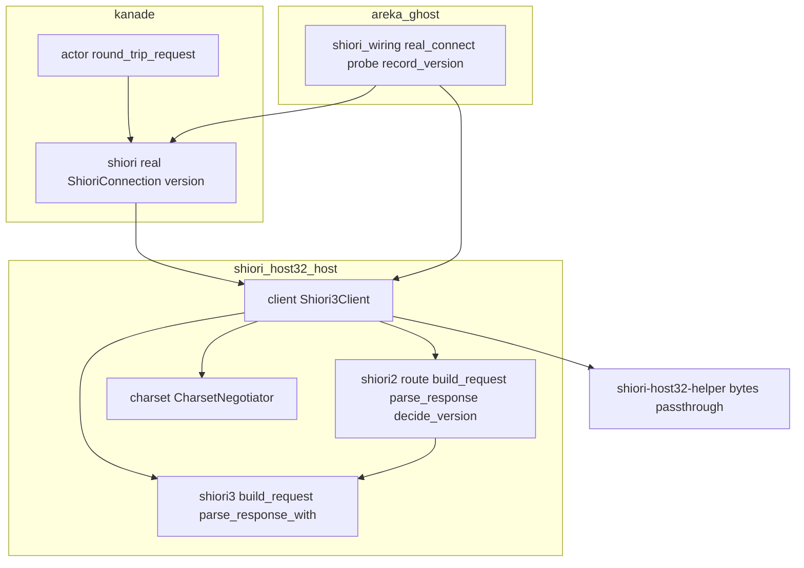
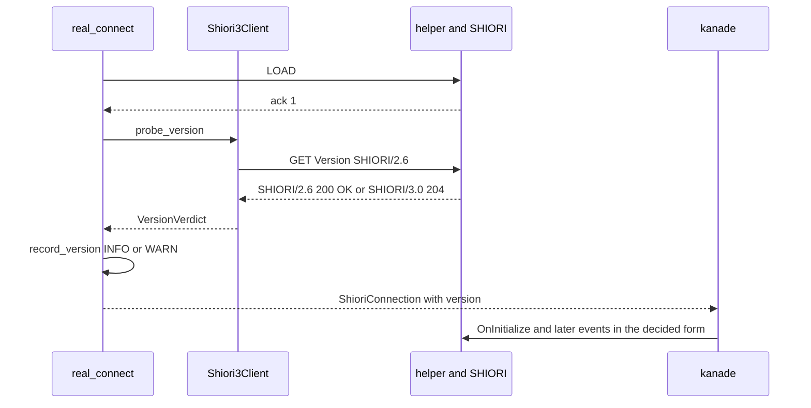
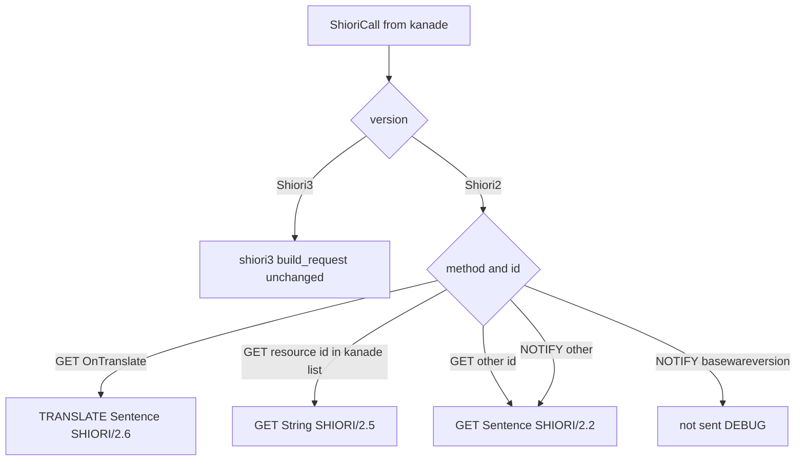

# 設計: shiori2-protocol

## Overview

**目的**: SHIORI/2.x の書き方しか読めないゴースト（検体は「．さくら」・華和梨 7.4）が、areka で SSP と同じように話し、面を出すようにする。areka は SHIORI を読み込んだ直後に SSP と同じ `GET Version SHIORI/2.6` を 1 本送り、答えの先頭の行の版の字で相手の版を決め、2.x の相手には要求を 2.x の書き方に組み替えて送り、`Sentence:`・`String:` の答えを 3.0 の `Value` と同じに扱う。

**使う人**: SHIORI/2.x のゴーストの利用者（起動の挨拶・時間のトーク・終了のトークを聞く）と、検体で確かめる開発者。

**変わること**: 今は誰にでも SHIORI/3.0 で話している。本 spec の後は、別プロセスの道（32 ビットの中継）で読み込むたびに版を確かめる。3.0 のゴーストに対しては、要求のバイトは確かめの 1 本が足されるだけで、ほかは 1 バイトも変わらない。

### Goals
- 読み込みのたびに版を確かめ、その読み込みのあいだ覚える（要件 2）。
- 2.x の相手へ、SSP 2.9.23 で測った形で要求を送り（要件 3）、答えを 3.0 と同じ扱いへ戻す（要件 4）。
- 3.0 のゴーストの要求と応答の読み方を変えない（要件 6）。
- 偽の 2.x の答えで、組み立て・読み・版の確かめを常時のテストに固定する（要件 7）。
- 「．さくら」の実機の 1 回で、話すこと・面が出ることを確かめる（要件 5）。

### Non-Goals
- 同じプロセスの道（`ShioriWiring::InProc`・`crates/areka-ghost/src/shiori_inproc.rs`）。触らない（要件 2.6・`shiori4-api` の決定 3 で消える）。
- areka が今送っていない要求（`NOTIFY OwnerGhostName`・`NOTIFY OtherGhostName`・コミュニケート・TEACH・`BaseEvent` など）を新しく送ること。
- 2.x の細かい版（2.0〜2.6）での書き分け。SSP は相手の細かい版によらず種類ごとに決まった行を送っていた（研究記録 10.2 節）。
- 文字コードの決め方の変更（`areka-P0-charset-canon` の持ち場）。
- 32 ビットの中継 `crates/shiori-host32-helper/` の中身（バイトの素通しのまま）。
- 起動で台本が来ないときに面を出さない決めの変更（件 2 は確かめるだけ）。

## Boundary Commitments

### This Spec Owns
- SHIORI/2.x の要求の組み立てと応答の読み（新しい `crates/shiori-host32-host/src/shiori2.rs`）。
- 版の確かめの要求（`GET Version SHIORI/2.6`）と、答えから版を決める規則。
- 決めた版を「接続（load から unload まで）」の持ち物として覚えること（`ShioriConnection` の欄）。
- 3.0 のイベントから 2.x の要求への組み替えの表（コードの 1 か所と `doc/COMPAT_ARCHITECTURE.md` §8 の記録）。
- 版の決定の INFO・決められないときの WARN・送らなかったイベントの DEBUG の記録。
- 「．さくら」の実機の 1 回と、その記録（`.kiro/specs/completed/shiori2-protocol/verification.md`）。
- 32 ビットの経路で `load` に渡すフォルダのパスの形（要件 6.4・`shiori4-api` の決定 6 の helper の道の前倒し・2026-10-23 開発者承認）。`shiori_wiring.rs` の `real_connect` で helper を起こす前に整える。helper・`shiori_proxy.rs`・`resolve_shell.rs` の `GHOST_MASTER`（ほかの読み手も使う）は変えない。

### Out of Boundary
- 同じプロセスの道（`ShioriWiring::InProc`）と SHIORI4 の口。
- kanade の `msg.rs`・`schedule/`（`ShioriCall` の形・起動の運行・許可の表）。`ShioriCall` の形は変えない。資源の問い合わせかどうかは、kanade の `shiori/real.rs` が `schedule::resources::is_allowed_resource_id`（`actor.rs` の送出の関門と同じ正本の一覧）を読むだけで決める（`schedule/` のファイルは直さない）。
- kanade の `actor.rs`（往復の関門と `shiori_error_response` の WARN）。2.x の 400・500 は今の 3.0 と同じ誤りの値になって、今の関門をそのまま通る。
- `crates/areka-ghost/src/runtime.rs`（結線の種類・`real_connect` の呼び方）。`real_connect` の引数は変えない。
- 文字コードの採用規則（`CharsetNegotiator`）。2.x の要求も今の決め方の文字コードで符号化する。
- 32 ビットの中継・MAKOTO・ゴースト側の辞書の直し。

### Allowed Dependencies
- `shiori2.rs` → `crate::charset`（`Charset`・`CharsetPolicy`）・`crate::shiori3`（`Method`・`ShioriRequest`・`EncodedRequest`・`ParsedResponse`・`ABSENT_REFERENCE`・`parse_response_with`）・`crate::error::ShioriError`。窓・IPC・`windows` に依存しない（純粋・決定的）。
- `client.rs` → `shiori2`（組み立て・読み・確かめの要求と判定）。
- kanade `shiori/real.rs` → `shiori_host32_host::ShioriVersion`（kanade の中で host32 の型を使ってよい唯一の場所という今の決めのまま）・`crate::schedule::resources::is_allowed_resource_id`（読むだけ）。
- `areka-ghost` の `shiori_wiring.rs` → `Shiori3Client::probe_version`・`ShioriVersion`・`VersionVerdict`。
- 依存の向き: `charset` → `shiori3` → `shiori2` → `client` → kanade `shiori/real.rs` → `areka-ghost` `shiori_wiring.rs`。逆向きの import は誤りとする。
- 新しいクレートの依存は足さない。

### Revalidation Triggers
- `ShioriConnection` の欄の増減（kanade の結合テストが構造体の書き下しで組んでいる）。
- `Shiori3Client` の公開の手（`probe_version`・`with_version`）の形の変更。
- `ShioriCall` の形や GET／NOTIFY の選び方が kanade で変わったとき（組み替えの表は「GET／NOTIFY の別＋イベント名」に頼る）。
- kanade の資源の一覧（`ALLOWED_RESOURCE_IDS`）の判定の手 `is_allowed_resource_id` の名前や意味が変わるとき。
- `basewareversion` 以外に、SSP が 2.x の相手へ送らない NOTIFY を areka が足すとき（表の行を足すか確かめる）。
- `shiori4-api` で中継が乗り換わるとき（版の確かめは 64 ビットの側に残る形のまま移す）。
- 文字コードの採用規則を変えるとき（確かめの答えを採用の根拠にしない決めと絡む）。

## Architecture

### Existing Architecture Analysis
- 要求を組むのは `shiori3::build_request` の 1 か所。32 ビットの経路は `Shiori3Client`（`client.rs`）の `get_with_headers`・`notify_with_headers` が `request_of` → `encode_and_note` → `send_request` → `parse_and_note` → `map_get_reply` と結ぶ。
- `Shiori3Client` は 1 往復ごとに作り捨てられ、続く状態（文字コードの交渉）は kanade の `ShioriConnection` が持つ。版も同じ所に置けば、読み直しで新しい接続ができたときに自然にやり直しになる。
- 接続は `areka-ghost` の `real_connect` が、shiori のアクターのスレッドで kanade の最初の要求より前に作る（窓 → 中継の起動 → HELLO → LOAD の ack）。kanade の要求はその間アクターの受け箱で待つ。
- `client.rs` の `the_one_way_event_body_contains_no_adoption_path` は `notify_with_headers` の本文（コメントを含む）に `encode_and_note(` があり、`parse_and_note`・`note_response`・`parse_response` が無いことを数える。`shiori_wiring_charset_tests.rs` の `the_connection_receives_the_already_decided_negotiator` は `shiori_wiring.rs` の中の `CharsetNegotiator::new` の出現が 1 回であることを数える。本 spec の変更はこの 2 つの綴りの条件を守る（コメントにも書かない）。

### Architecture Pattern & Boundary Map



- 採る形: 「接続ごとの状態＋版で選ぶ符号化」。文字コードの交渉と同じ形（接続が持ち、作り捨ての client が借りる）。
- 新しい部品の理由: `shiori2.rs` は 2.x の書き方を 3.0 の部品から切り離して単独で固定するため（`shiori3.rs` 852 行・1 ファイル 1,000 行の目安）。版で選ぶ分岐は `client.rs` の 2 つの手の中だけに置く。
- steering との合致: 失敗の経路はすべて記録を残す（確かめの失敗は WARN・送らないイベントは DEBUG・2.x の 400／500 は今の WARN）。テストは兄弟のファイルに置く。

### Technology Stack

| 層 | 選んだもの | 本機能での役 | 備考 |
|---|---|---|---|
| 通信の層 | Rust・`shiori-host32-host`（既存） | 2.x の組み立てと読み・版の確かめ | 依存の追加なし。符号化は既存の `Charset::encode`（`encoding_rs`） |
| 往復の層 | `areka-kanade` の `shiori/real.rs`（既存） | 版を接続の持ち物として持つ | `ShioriBackend` の口は変えない |
| 結線の層 | `areka-ghost` の `shiori_wiring.rs`（既存） | 読み込みの直後に確かめ、版を記録する | `real_connect` の引数は変えない |
| 記録 | `tracing`（既存） | INFO／WARN／DEBUG の 1 行 | 宛先は既存の `ghost-boot` と新しい `shiori2` |
| テスト | `log-capture-kit`（既存） | 記録の行を数える | 実物の SHIORI・SSP・ネットを要さない |

## File Structure Plan

### Directory Structure
```
crates/shiori-host32-host/src/
├── shiori2.rs                 # 新: 2.x の書き方（版の型・確かめの要求と判定・組み替えの表・組み立て・読み）。純粋
├── shiori2_tests.rs           # 新: shiori2.rs の兄弟のテスト（表の各行の要求のバイト・答えの読み・版の判定）
└── client_shiori2_tests.rs    # 新: client.rs の兄弟のテスト（2.x の前半・後半の結線・送らないイベントの DEBUG）
crates/areka-kanade/src/shiori/
└── real_resource_mark_tests.rs     # 新: real.rs の兄弟のテスト（資源の印が GET の 2 つの手の中・資源の一覧の判定の後ろにだけあることの構造）
crates/areka-ghost/src/
└── shiori_wiring_version_tests.rs  # 新: shiori_wiring.rs の兄弟のテスト（版の記録の INFO/WARN・確かめが接続ごとに 1 回であることの構造）
.kiro/specs/completed/shiori2-protocol/
└── verification.md            # 新: 「．さくら」の実機の 1 回の記録（要件 5.6）
```

### Modified Files
- `crates/shiori-host32-host/src/shiori3.rs` — `parse_response` の本体を `pub(crate) fn parse_response_with(bytes, policy, value_header: &str)` へ移し、`parse_response` は `"Value"` を渡すだけの 1 行にする。3.0 の読み方は 1 文字も変わらない。
- `crates/shiori-host32-host/src/client.rs` — `Shiori3Client` に `version: ShioriVersion` の欄（`new`・`with_sender` は `Shiori3`）、`with_version`・`probe_version` の 2 つの手、`get_with_headers`・`notify_with_headers` の版の分岐、私の手 `encode2_and_note`・`parse2_and_note`、兄弟のテストの `#[path]` の 3 行。
- `crates/shiori-host32-host/src/lib.rs` — `pub mod shiori2;`・`pub use shiori2::{ShioriVersion, VersionVerdict};`・モジュールの説明の 1 行。
- `crates/areka-kanade/src/shiori/real.rs` — `ShioriConnection` に `pub version: ShioriVersion`。4 つの手で `Shiori3Client::new(..).with_version(self.version)` とする。
- `crates/areka-ghost/src/shiori_wiring.rs` — LOAD の ack の後に `probe_version` を 1 回呼び、`record_version` で INFO／WARN を出し、決めた版を `ShioriConnection` へ渡す。ゴーストのフォルダ名を取る小さな手 `ghost_label`。helper へ渡す読み込みのパスを決定 6 の形（絶対パス・`\` の区切り・末尾に `\` が 1 つ）に整える小さな私の手 1 つ（要件 6.4・`ghost_label` は元のパスのまま）。兄弟のテストの `#[path]` の 3 行。
- `crates/areka-kanade/tests/kanade/common/common_window_actor.rs`・`crates/areka-kanade/tests/kanade/idle_pump_test.rs`・`crates/areka-kanade/tests/kanade/real_helper_test.rs` — `ShioriConnection` の書き下しに `version: ShioriVersion::Shiori3` の 1 行を足す（コンパイルのためだけ・確かめを送らないので要求のバイトも数も変わらない・要件 6.3 で名前を挙げる）。
- `doc/COMPAT_ARCHITECTURE.md` §8 — 版の確かめ方と組み替えの表を出どころ付きで足す（要件 3.7・8.1）。
- `doc/ukadoc-coverage/ledger/shiori.toml` — ステータスコードの行（`ukadoc:spec_shiori3:_30b9_30c6_30fc_30bf_30b9_30b3_30fc_30c9:1`）の `owner` を `shiori2-protocol` に、`note` に「2.x の答えも同じ番号の規則で読む・`GET Version` の答えの先頭の行の版の字で版を決める」を足す（`status` は `implemented` のまま・要件 8.2）。`Age` の行（`ukadoc:spec_shiori3:Age_20_5bSSP_62e1_5f35_5d:1`）は本 spec が受け持たない（areka は `Age` を送らず、コミュニケートは範囲の外）ので触らない。ukadoc に項目の無い 2.x の要求の行は台帳に作らない。
- `README.md` — 検体の表の「．さくら」の行（要件 8.3・実機の結果に合わせて）。

触らないファイル（約束の確認）: kanade の `msg.rs`・`schedule/`・`actor.rs`、`crates/shiori-host32-helper/`、`crates/areka-ghost/src/runtime.rs`・`shiori_inproc.rs`、`shiori-host32-host/src/request_headers.rs`（`request_of` はそのまま使う）。

## System Flows

### 読み込みと版の確かめ



- 確かめは接続の手続きの中（kanade の起動の運行より前）で 1 回だけ。kanade が先に出した要求はアクターの受け箱で待つので、`OnInitialize`・`OnBoot` が版の違いで断られることは無い（要件 2.1）。
- 確かめが失敗しても（答えが無い・読めない・中継が応答しない）接続は失敗にしない。WARN を 1 行残して 3.0 で話す（要件 2.5）。中継が死んでいれば、今の死活の見張りが次の要求で拾う。

### 1 本の要求の組み替え



## Requirements Traceability

| 要件 | 要点 | 部品 | 口 | 流れ |
|---|---|---|---|---|
| 1.1 | SSP で測って記録 | 研究記録 10 節（済） | — | — |
| 1.2 | 3.0 を受け付けていたら止まる | 研究記録 10.1 節（測 1＝2.x・枝に入らない） | — | — |
| 1.3 | 操作ごとに許し | 研究記録 10 節冒頭（許された 5 操作の内で測った） | — | — |
| 1.4 | 表の各行に出どころ | 組み替えの表（本書）・§8 | — | — |
| 1.5 | 設計の前に測りを済ませる | 研究記録 10 節（2026-10-23 済） | — | — |
| 2.1 | 読み込みのたびに SSP と同じ確かめ | `real_connect`・`Shiori3Client::probe_version`・`shiori2::decide_version` | `probe_version` | 読み込みと版の確かめ |
| 2.2 | 読み込みのあいだ覚える | `ShioriConnection.version` | `with_version` | — |
| 2.3 | 読み直しでやり直す | `real_connect` の閉包の中の確かめ（接続ごとに新しい値） | — | 読み込みと版の確かめ |
| 2.4 | INFO を 1 行 | `record_version`（`shiori_version_decided`） | — | 同上 |
| 2.5 | 決められなければ 3.0＋WARN | `decide_version` の `Undecided`・`record_version`（`shiori_version_undecided`） | — | 同上 |
| 2.6 | 別プロセスの道だけ | `real_connect`・`ShioriConnection` だけを変える。`shiori_inproc.rs` に触らない | — | — |
| 3.1 | 台本を求めるイベント | `shiori2::build_request` の `GET Sentence` | `build_request` | 組み替え |
| 3.2 | 通知だけのイベント | 同上（NOTIFY も `GET Sentence` で送り、答えは捨てる） | 同上 | 組み替え |
| 3.3 | 資源の問い合わせ | 同上の `GET String` | 同上 | 組み替え |
| 3.4 | 翻訳 | 同上の `TRANSLATE Sentence` | 同上 | 組み替え |
| 3.5 | SSP が送らないイベント | `basewareversion` を送らない・`encode2_and_note` の DEBUG `shiori2_event_not_sent` | 同上（`None`） | 組み替え |
| 3.6 | `Charset`・`Sender`・`SecurityLevel` | 3.0 と同じ値を書く。`SecurityOrigin` は `GET String`・`TRANSLATE` だけ。`SenderType` は書かない | 同上 | — |
| 3.7 | 表を 1 つ持ち §8 に記録 | `shiori2` の `route` の 1 か所・§8 の表。資源かどうかは kanade の正本の一覧で決める | `for_resource` | — |
| 4.1 | 台本を再生 | `shiori2::parse_response`（`Sentence` → `value`）→ 既存の `map_get_reply` | `parse_response` | — |
| 4.2 | 値を使う | 同上（`String` → `value`） | 同上 | — |
| 4.3 | 翻訳の結果 | 同上（`TRANSLATE` の答えの `Sentence` → `value`） | 同上 | — |
| 4.4 | 返す物が無い | 204 と、見出しの無い 200 は既存の `map_get_result` で `None` | — | — |
| 4.5 | 400・500 は WARN で続ける | 既存の `map_get_result` → `RequestError::Shiori` → kanade の今の `shiori_error_response` | — | — |
| 4.6 | 読めない応答 | 既存の `ShioriError::Parse`（`parse_response_with` の状態の行の規則のまま） | — | — |
| 4.7 | 3.0 の見出しの対応 | 見出しの対応表（本書）。2.x に無い見出しは読まない | `parse_response` | — |
| 5.1〜5.4 | 「．さくら」が話し、面が出る | 実機の 1 回の手順（Testing Strategy） | — | — |
| 5.5 | 面が出ないときの扱い | 実機の 1 回で枝に入ったら止めて報告（独断で変えない） | — | — |
| 5.6 | 記録の抜き書き | `verification.md` | — | — |
| 5.7 | 根は `target\` の下・自分のプロセスだけ | 実機の 1 回の手順 | — | — |
| 6.1 | 3.0 の要求のバイトは確かめの 1 本だけが違い | `Shiori3` の枝は今の `encode_and_note` をそのまま通る・違いの表（本書） | — | 組み替え |
| 6.2 | 3.0 の応答の読み方 | `Shiori3` の枝は今の `parse_and_note` をそのまま通る。`parse_response` の働きは不変 | — | — |
| 6.3 | 3.0 のテストは緑のまま | 変えるテストはコンパイルのための 3 ファイルの 1 行だけ（名前を挙げる） | — | — |
| 6.4 | `load` に渡すパスの形 | `real_connect` が helper を起こす前にパスを整える私の手（決定 6 の前倒し） | — | 読み込み |
| 7.1 | 表の各行の要求のバイト | `shiori2_tests.rs` | — | — |
| 7.2 | 答えの種類ごとの扱い | `shiori2_tests.rs`・`client_shiori2_tests.rs` | — | — |
| 7.3 | 版の確かめの 3 通り | `shiori2_tests.rs`（判定）・`shiori_wiring_version_tests.rs`（記録） | — | — |
| 7.4 | 読み直しで確かめ直す | `shiori_wiring_version_tests.rs`（構造の検査＋2 回の記録） | — | — |
| 7.5 | 常時のテスト | 上の 3 ファイルはどれも窓も中継も要さない | — | — |
| 8.1 | §8 に表と確かめ方 | `doc/COMPAT_ARCHITECTURE.md` §8 | — | — |
| 8.2 | 網羅台帳の行 | `shiori.toml` のステータスコードの行 | — | — |
| 8.3 | README の行 | `README.md` | — | — |
| 8.4 | 直さなかった崩れの行き先 | 実機の 1 回の後に持ち主の brief へ追記か `/kiro-discovery` | — | — |

## Components and Interfaces

| 部品 | 層 | 役 | 要件 | 主な依存 | 契約 |
|---|---|---|---|---|---|
| `shiori2`（新） | 通信 | 2.x の書き方の表・組み立て・読み・版の判定 | 2.1, 2.5, 3.1〜3.7, 4.1〜4.3, 4.7, 7.1〜7.3 | `shiori3` (P0)・`charset` (P0) | Service |
| `shiori3::parse_response_with`（改） | 通信 | 値の見出しの名前を受けて読む | 4.1〜4.3, 6.2 | `charset` (P0) | Service |
| `Shiori3Client`（改） | 通信 | 版で符号化と読みを選ぶ・確かめの往復 | 2.1, 2.5, 3.5, 4.4〜4.6, 6.1, 6.2 | `shiori2` (P0)・`ParentMessageWindow` (P0) | Service, State |
| `ShioriConnection`（改） | 往復 | 版を接続の持ち物として持つ | 2.2, 2.3 | `Shiori3Client` (P0) | State |
| `real_connect`・`record_version`（改） | 結線 | 読み込みの直後に確かめ、記録し、版を渡す | 2.1, 2.3〜2.6 | `Shiori3Client` (P0)・`ShioriConnection` (P0) | Service |

### 通信の層

#### shiori2

| Field | Detail |
|---|---|
| Intent | SHIORI/2.x の書き方を、3.0 の部品から切り離した純粋な関数として持つ |
| Requirements | 2.1, 2.5, 3.1〜3.7, 4.1〜4.3, 4.7, 7.1〜7.3 |

**Responsibilities & Constraints**
- 組み替えの表（下の「2.x の要求の形」）をコードの 1 か所（私の手 `route`）だけで持つ。
- `windows`・窓・IPC に依存しない。記録は出さない（記録は呼び手が出す）。
- 文字コードは `ShioriRequest.charset` の 1 本の経路で全文を符号化する（3.0 と同じ・分岐しない）。

**Contracts**: Service [x]

##### Service Interface
```rust
/// 相手の SHIORI の版（接続のあいだ変わらない）。
#[derive(Debug, Clone, Copy, PartialEq, Eq)]
pub enum ShioriVersion {
    /// SHIORI/3.0 の書き方で話す（今と同じ・決められないときもこれ）。
    Shiori3,
    /// SHIORI/2.x の書き方で話す（細かい版は区別しない）。
    Shiori2,
}
impl ShioriVersion {
    /// 記録に書く綴り（"SHIORI/3.0"／"SHIORI/2.x"）。
    pub fn as_str(self) -> &'static str;
}

/// 確かめの結果。
#[derive(Debug, Clone, PartialEq, Eq)]
pub enum VersionVerdict {
    /// 版を決めた。evidence は答えの先頭の行そのまま（例 "SHIORI/2.6 200 OK"）。
    Decided { version: ShioriVersion, evidence: String },
    /// 決められない（答えが空・先頭の行に SHIORI/2. も SHIORI/3. も無い・往復の失敗）。
    Undecided { reason: String },
}

/// 確かめの要求（GET Version SHIORI/2.6 / Charset / Sender / 空行・CRLF）。
pub fn version_probe_request(charset: Charset, sender: &str) -> Vec<u8>;

/// 答えの先頭の行の最初の字句で版を決める（状態の番号は見ない）。
pub fn decide_version(reply: &[u8]) -> VersionVerdict;

/// 3.0 の要求の材料から 2.x の要求を組む。None は「2.x の相手へは送らない」。
/// is_resource は呼び手（kanade の正本の一覧）が決めた「資源の問い合わせか」。
pub fn build_request(req: &ShioriRequest<'_>, is_resource: bool) -> Option<EncodedRequest>;

/// 2.x の答えを読む。要求の種類で値の見出し（Sentence／String）を選び、
/// 2.x に無い見出し（ErrorLevel・ErrorDescription・SecurityLevel）は読まない。
pub fn parse_response(
    bytes: &[u8],
    policy: CharsetPolicy,
    method: Method,
    id: &str,
    is_resource: bool,
) -> Result<ParsedResponse, ShioriError>;
```
- 事前条件: `decide_version` は先頭の行を LF で切り、行末の CR と前後の空白を落として見る。状態の行は ASCII の範囲なので、復号の前のバイトのまま読める（`scan_charset_header` と同じ根拠）。
- 事後条件: `decide_version` は `SHIORI/2.` で始まる字句を `Shiori2`、`SHIORI/3.` で始まる字句を `Shiori3` とし、それ以外は `Undecided`。`SHIORI/3.0 400 Bad Request` も `Shiori3` に決まる（evidence にその行が残る）。
- 不変条件: `build_request` は `None` を `Method::Notify`＋`basewareversion` のときだけ返す。`parse_response` の状態の番号・`Charset` の拾い方・読めない応答の判定は `shiori3::parse_response_with` と同じ。

##### 私の手 `route`（組み替えの表のコードの 1 か所）

| 入力（版＝2.x） | 経路 | 答えの値の見出し |
|---|---|---|
| `Method::Get` かつ `id == "OnTranslate"` | `TRANSLATE Sentence SHIORI/2.6` | `Sentence` |
| `Method::Get` かつ `is_resource`（kanade の資源の一覧に載る名前） | `GET String SHIORI/2.5` | `String` |
| `Method::Get` かつそれ以外（台本を求めるイベント・SSTP や MCP の `raise_event` から頼まれた任意の名前のイベントを含む） | `GET Sentence SHIORI/2.2` | `Sentence` |
| `Method::Notify` かつ `id == "basewareversion"` | 送らない | — |
| `Method::Notify` かつそれ以外 | `GET Sentence SHIORI/2.2`（答えは捨てる） | — |

決めた根拠: SSP は資源の名前（`username`・`version`・`name` など）を `GET String`、それ以外のイベントを `On` で始まらない名前（`installedghostname`・`hwnd`・`rateofusegraph` など）も含めて `GET Sentence` で送っていた（研究記録 10.2 節）。資源かどうかは名前の形でなく一覧で決まる。そこで、kanade が持つ正本の一覧（`ALLOWED_RESOURCE_IDS`・判定の手 `is_allowed_resource_id`＝`actor.rs` の送出の関門と同じ）を kanade の `shiori/real.rs` が引いて `Shiori3Client::for_resource` で渡す。「名前が `On` で始まるか」で分ける案は、SSTP の NOTIFY や MCP の `raise_event` から頼まれた `On` で始まらない名前のイベントを資源の問い合わせとして送ってしまい、資源の一覧も暗黙の規則でもう一度持つことになるので採らない（設計の検証の問題 1）。種類を `ShioriCall` に載せて運ぶ形は kanade の `msg.rs`（ウェーブの約束で触れない）と `ShioriBackend` の口と偽物の全部に波及するので採らない。

#### Shiori3Client（改）

| Field | Detail |
|---|---|
| Intent | 決めた版で符号化と読みを選び、確かめの往復を 1 本だけ行う |
| Requirements | 2.1, 2.5, 3.5, 4.4〜4.6, 6.1, 6.2 |

**Contracts**: Service [x] / State [x]

##### Service Interface
```rust
impl<'a> Shiori3Client<'a> {
    /// 版を指定する（既定は new／with_sender の Shiori3）。
    #[must_use]
    pub fn with_version(self, version: ShioriVersion) -> Self;

    /// この往復が資源の問い合わせであると印を付ける（2.x では GET String で送る）。
    /// 3.0 では何も変えない。既定は印なし。
    #[must_use]
    pub fn for_resource(self) -> Self;

    /// GET Version SHIORI/2.6 を 1 本送り、答えから版を決める。
    /// 符号化は今の文字コード（negotiator.current()）。答えは文字コードの採用の根拠にしない。
    /// 往復の失敗は Undecided（理由は SendError の表示）。panic しない。
    pub fn probe_version(&mut self) -> VersionVerdict;
}
```
- `get_with_headers`: `Shiori3` は今の行をそのまま通す（`encode_and_note` → `send_request` → `parse_and_note` → `map_get_reply`）。`Shiori2` は `encode2_and_note`（`shiori2::build_request`＋`note_request`）→ `send_request` → `parse2_and_note`（`shiori2::parse_response`＋`note_response`）→ 同じ `map_get_reply`。`encode2_and_note` が `None` なら送らず `Ok(None)`（表では GET に `None` は無いが、口は 1 つの形にそろえる）。
- `notify_with_headers`: `Shiori3` は今の `encode_and_note(` をそのまま呼ぶ。`Shiori2` は `encode2_and_note` を呼び、`None` なら送らず `Ok(())`。答えは今と同じく捨てる。本文とコメントに採用の経路の名前を書かない（既存の構造の検査を緑に保つ）。
- `encode2_and_note`・`parse2_and_note` は今の `encode_and_note`・`parse_and_note` と同じく窓を持たない自由な関数（`negotiator`・`req`・`is_resource` を受ける）にし、窓なしで試せるようにする。確かめも「要求を組む半分」と「送受の結果（答えか `SendError`）から `VersionVerdict` を出す半分」の自由な関数に分け、`probe_version` はその間で `send_request` を呼ぶだけにする。
- `encode2_and_note` は `shiori2::build_request(req, is_resource)` を呼ぶ。`None` のとき DEBUG を 1 行出す: `target: "shiori2"`, `event = "shiori2_event_not_sent"`, `id`。
- 状態: `version` は client が持つ写し（`Copy`）。続く状態は接続が持つ（下の `ShioriConnection`）。

**Implementation Notes**
- 確かめの答えを `note_response` へ回さない理由: 回すと、宣言の無い UTF-8 の 3.0 ゴースト（emo2 の pasta）で、今は `Shift_JIS` で出ている `OnInitialize` と `username` の要求の `Charset` の値が `UTF-8` に変わり、要件 6.1（3.0 の要求のバイトを今と同じに）に反する。採用は今どおり最初の GET の答えから起きる。
- 確かめの要求は ASCII だけなので、置換の記録（`note_request`）は要らない。
- 待ちの上限は今の要求と同じ（`effective_timeout`＝既定 60 秒・`AREKA_SHIORI_REQUEST_TIMEOUT_MS`）。確かめに答えない SHIORI は上限まで待って `Undecided` になる（LOAD の待ちと同じ種類の危うさで、新しい待ちの仕組みは足さない）。SHIORI が止まっていれば次の要求も上限まで待つので、起動の失敗に気づくまでが今より最大で上限 1 回分（既定 60 秒）延びる。
- `client.rs` は今 858 行で、足すのは 50 行ほど（約 910 行・1,000 行の目安の内）。テストは兄弟の `client_shiori2_tests.rs` へ置き、`client.rs` の中のテストは増やさない。

#### shiori3::parse_response_with（改）
- `pub(crate) fn parse_response_with(bytes: &[u8], policy: CharsetPolicy, value_header: &str) -> Result<ParsedResponse, ShioriError>`。今の `parse_response` の本体を移し、`"Value"` との比べを `value_header` との比べに替えるだけ。
- `pub fn parse_response(bytes, policy)` は `parse_response_with(bytes, policy, "Value")` を返す 1 行になる。呼び手（`client.rs`・`shiori_inproc.rs`）は変わらない。

### 往復の層

#### ShioriConnection（kanade `shiori/real.rs`・改）

**Contracts**: State [x]
- 欄 `pub version: ShioriVersion` を足す。値は `real_connect` が確かめで決めたもの。接続（load から unload まで）のあいだ変わらず、要求のたびに確かめ直さない（要件 2.2）。
- 4 つの手（`get`・`notify`・`get_with_headers`・`notify_with_headers`）で `Shiori3Client::new(&self.window, &mut self.negotiator).with_version(self.version)` とする。`get`・`get_with_headers` は、`crate::schedule::resources::is_allowed_resource_id(id)` が真なら `.for_resource()` を足す（NOTIFY には足さない）。
- 読み直しは新しい接続（新しい `real_connect` の閉包）を作るので、前の版は残らない（要件 2.3）。

### 結線の層

#### real_connect・record_version（areka-ghost `shiori_wiring.rs`・改）

**Contracts**: Service [x]
- LOAD の ack `[1]` を確かめた直後、`ShioriConnection` を組む前に、`Shiori3Client::new(&window, &mut negotiator).probe_version()` を 1 回だけ呼ぶ。
- `fn record_version(ghost: &str, verdict: VersionVerdict) -> ShioriVersion`（記録して版を返す）:
  - `Decided` → `info!(target: "ghost-boot", event = "shiori_version_decided", ghost, version = version.as_str(), evidence, ..)` を 1 行（要件 2.4）。
  - `Undecided` → `warn!(target: "ghost-boot", event = "shiori_version_undecided", ghost, reason, assumed = "SHIORI/3.0", ..)` を 1 行し、`Shiori3` を返す（要件 2.5）。
- `fn ghost_label(master_dir: &Path) -> String`: `ghost\master` の 2 つ上のフォルダ名（例 `dot_sakura`）。取れなければ `master_dir` の表示。記録の `ghost` はこのフォルダ名とする（areka はゴーストをフォルダ名で見分ける＝`catalog` の `ghost_dir(folder)`。`real_connect` は descript の `name` を受け取らず、受け取らせるには `runtime.rs` の呼び方を変える要があるため）。
- 確かめの失敗で接続を失敗にしない（`Err` を返さない）。

## Data Models

### 2.x の要求の形（組み替えの表・出どころは研究記録 10.2 節＝SSP 2.9.23 が「．さくら」へ送った記録・ukadoc に無い）

行の区切りは CRLF・最後に空行。`[ ]` は値があるときだけ出す行。Reference の欠番の印（`ABSENT_REFERENCE`）の位置は行を出さず番号だけ進める（3.0 と同じ）。

| 3.0 での種類 | 2.x の要求の行 | 見出し（この並び） | SSP との違い |
|---|---|---|---|
| 版の確かめ（areka が足す） | `GET Version SHIORI/2.6` | `Charset`・`Sender` | `Charset` は今の文字コード（SSP は `UTF-8` 固定）・`Sender: areka`（SSP を名乗らない今の決め） |
| 台本を求めるイベント（GET・資源の一覧に無い名前） | `GET Sentence SHIORI/2.2` | `Charset`・`SecurityLevel`・`Sender`・`Event`・`[Status]`・`Reference0…` | `BaseEvent` は書かない（areka は 3.0 でも `BaseID` を送っていない） |
| 通知だけのイベント（NOTIFY） | `GET Sentence SHIORI/2.2` | 上と同じ | 答えは今の NOTIFY と同じく捨てる |
| `basewareversion`（NOTIFY） | 送らない（DEBUG） | — | SSP も 2.x の相手へ送らなかった（測 5） |
| 資源の問い合わせ（GET・kanade の資源の一覧に載る名前） | `GET String SHIORI/2.5` | `Charset`・`SecurityLevel`・`SecurityOrigin`・`Sender`・`ID`・`[Status]` | 今の areka は資源の問い合わせに References を付けない（14 名とも）。付く資源ができたら、3.0 と同じ値を同じ番号で `Status` の後に書く（SSP では測っていない） |
| 台本の翻訳（GET・`OnTranslate`） | `TRANSLATE Sentence SHIORI/2.6` | `Charset`・`SecurityLevel`・`SecurityOrigin`・`Sender`・`[Status]`・`Sentence` | `Sentence` の値は 3.0 の `Reference0`。References は書かない（SSP も書かない） |

areka が今送っていないので組まない行（表には「送らない」と記録する）: `NOTIFY OwnerGhostName SHIORI/2.3`（`Ghost` 見出し）・`NOTIFY OtherGhostName SHIORI/2.3`・`capability`。

値: `Charset` は `ShioriRequest.charset` の正規名、`SecurityLevel`・`SecurityOrigin`・`Sender` は `RequestHeaders` の値をそのまま（3.0 と同じ値・要件 3.6）。`SenderType` は 2.x のどの要求にも書かない（SSP も書かない・測 6）。

### 見出しの対応（要件 4.7・出どころは研究記録 10.3 節）

| 3.0 で areka が読む見出し | 2.x の見出し | 扱い |
|---|---|---|
| `Value`（台本） | `Sentence` | 同じに扱う |
| `Value`（資源の値） | `String` | 同じに扱う |
| `Value`（翻訳の結果） | `Sentence` | 同じに扱う |
| `ErrorLevel`・`ErrorDescription` | 2.x に無い | 読まない（`None`） |
| `SecurityLevel` | 2.x に無い | 読まない（`None`・3.0 で見出しの無い答えと同じ扱い） |
| `Charset` | `Charset` | 今の採用の規則のまま（GET の答えだけ） |
| 状態の行の番号 | 同じ（`200`・`204`・`400` など） | 今の `map_get_result` のまま |

### 3.0 のゴーストへの違い（要件 6.1）

| 場面 | 今 | 本 spec の後 |
|---|---|---|
| 読み込みの直後 | 何も送らない | `GET Version SHIORI/2.6`（`Charset: <今の文字コード>`・`Sender: areka`）を 1 本 |
| それ以外の要求のバイト | — | 変わらない（`Shiori3` の枝は今の `encode_and_note` をそのまま通る・確かめの答えは文字コードの採用に使わない） |
| 応答の読み方 | — | 変わらない |
| `load` に渡すパス | `…\ghost/master`（区切りの混在・末尾の区切りなし。華和梨はこれにファイル名をそのままつなげて辞書を開くので読めなかった＝5.1 の 1 回目） | 絶対パス・`\` の区切り・末尾に `\`（要件 6.4・全部のゴースト） |

## Error Handling

### Error Strategy
- 確かめの往復の失敗・読めない答え → `Undecided` → WARN `shiori_version_undecided` を 1 行・3.0 で話す（要件 2.5）。接続は続ける。
- 3.0 のゴーストが確かめに 400 などで答える → 先頭の行が `SHIORI/3.x` なら `Shiori3` に決まり、INFO の `evidence` に状態の行が残る。**`shiori_error_response` の WARN には数えない**（確かめは kanade の往復の関門を通らない）。理由: SSP は 3.0 のゴーストの 204 にも同じく 3.0 で続けており状態の番号で振る舞いを変えない（研究記録 4.1・10.1 節）。数えると、`Version` の受け口を持たない 3.0 のゴーストで起動のたびに WARN が 1 行増え、要件 5.6 の内訳を濁す。根拠は INFO に残るので記録の無い道にはならない。
- 2.x の 400・500 → 今の `map_get_result` が `RequestError::Shiori` にし、kanade の `round_trip_request` が今の `shiori_error_response` の WARN を出して続ける（要件 4.5・`actor.rs` は変えない）。
- 2.x の読めない応答 → `ShioriError::Parse`（今の扱い・要件 4.6）。
- 送らないイベント → DEBUG `shiori2_event_not_sent`（要件 3.5）。NOTIFY は `Ok(())` で返し、起動の運行は今どおり進む。
- panic しない・`unwrap` しない（今の通信の層の決めのまま）。

### Monitoring
- 実機の確かめは `shiori_version_decided`（INFO）の行と、`shiori_error_response` の行の内訳で見る。

## Testing Strategy

### 単体（`shiori2_tests.rs`・常時）
- 表の各行の要求の全文のバイト: `GET Sentence`（`OnFirstBoot`・References と欠番あり／`Status` あり・なし／`On` で始まらない外からのイベント名でも `is_resource` が偽なら `GET Sentence`）、通知の `OnInitialize`（NOTIFY → `GET Sentence`）、`GET String`（`username`・`is_resource` が真）、`TRANSLATE Sentence`（`Status: talking`・`Sentence` は Reference0・References を書かない）、`basewareversion` は `None`、確かめの要求（要件 7.1・3.1〜3.6）。期待値は研究記録 10.2 節の抜き書きを手で写した定数（符号化器から導かない）。
- Shift_JIS の値（2 バイト文字の `Sentence`）が全文 1 本の経路で符号化されること（要件 3.6）。
- 答えの読み: `Sentence` 付き 200・`String` 付き 200・204・見出しの無い 200・400・500・状態の行の無い答え。`Value` だけの 2.x の答えは値なし、`ErrorLevel`・`SecurityLevel` を付けた 2.x の答えでもそれらは `None`（要件 7.2・4.1〜4.7）。
- 版の判定の 3 通り: `SHIORI/3.0 204 No Content`・`SHIORI/3.0 400 Bad Request` → `Shiori3`、研究記録 10.1 節の華和梨の答え → `Shiori2`、空・`garbage`・`SHIORI/1.1 200 OK` → `Undecided`（要件 7.3）。

### 結線（`client_shiori2_tests.rs`・常時）
- `encode2_and_note`／`parse2_and_note` → `map_get_reply` の結び: 2.x の `Sentence` 付き 200 が 3.0 の `Value` 付き 200 と同じ `ValueReply` になる。2.x の 400 が 3.0 の 400 と同じ `RequestError::Shiori(Status{400})` になる（＝kanade の今の WARN の道へ乗る・要件 4.5・7.2）。
- 送らないイベントで DEBUG `shiori2_event_not_sent` が 1 行（`log-capture-kit`・要件 3.5）。
- 2.x の GET の答えの `Charset` が今の規則で採用されること（要件 3.6）。

### 結線（`shiori_wiring_version_tests.rs`・常時）
- `record_version`: `Decided` で INFO 1 行（`ghost`・`version`・`evidence`）、`Undecided` で WARN 1 行（`assumed = "SHIORI/3.0"`）と `Shiori3` の戻り（要件 2.4・2.5・7.3）。
- 構造の検査（先例 `the_connection_receives_the_already_decided_negotiator` と同じ理由＝接続の値は中継が無いと組めない）: `shiori_wiring.rs` の中で `probe_version(` は 1 回だけ、`real_connect` の閉包の中の `MsgTag::Load` の後かつ `ShioriConnection {` の前にあり、版を閉包の外に置かない（閉包が接続ごとに 1 回走る＝読み直しで確かめ直す・要件 2.3・7.4）。
- `ghost_label` が `…\dot_sakura\ghost\master` から `dot_sakura` を返す。
- 読み込みのパスを整える私の手: `C:\x\ghost/master` が `C:\x\ghost\master\` になり、末尾に区切りが既にあっても区切りは 1 つのまま（要件 6.4）。
- 要件 2.4 の「ゴーストの名前」はフォルダ名で残す（`verification.md` にもそう書く）。

### 3.0 のテスト（要件 6.3）
- 今の決定論のテストはそのまま緑。変えるのは `ShioriConnection` の書き下しに欄を 1 行足す 3 ファイル（`crates/areka-kanade/tests/kanade/common/common_window_actor.rs`・`idle_pump_test.rs`・`real_helper_test.rs`）だけ。どれも確かめを送らず、要求のバイトも数も変わらない。名前を `verification.md` に挙げる。
- 実物の pasta と中継で回る条件つきのテスト（`crates/areka-ghost/tests/real_pasta_online.rs`・`crates/areka-ghost/tests/ghost/snapshot_capture_test.rs`）は `real_connect` を通るので、pasta へ確かめの 1 本が先に届く。どちらも要求を kanade の口（`ShioriBackend`）の側で記録し、確かめはその外（接続の中）で送られるので、記録する並びは変わらない見込み。実装のタスクで 1 回回して確かめる。

### 実機の 1 回（要件 5・人の机の待ちなし）
1. `tools/sync-i686-helper.ps1` で 32 ビットの補助プログラムを揃え、`dot_sakura.nar` をこのワークツリーの `target\` の下の根に置く（要件 5.7）。
2. `RUST_LOG` を `ghost-boot=info,shiori2=debug` を含む形で開け、areka で「．さくら」を起動。版の INFO の行が `SHIORI/2.x`（evidence `SHIORI/2.6 200 OK`）であることを見る。
3. 起動の挨拶の再生（5.1）・MCP の `get_status`・`dump_surface` を 1 人目・2 人目で（5.4）。
4. 1〜2 分待って時間のトークの有無と待った時間（5.2）。
5. `raise_event OnClose` を送り、終了のトークの再生と終了（5.3）。areka が送った `GET Sentence`＋`Event: OnClose` の形と答えを記録する（研究記録 10.5 節の測れなかった点の確かめ）。
6. `shiori_error_response` の行を数え、受け口の無いイベント（`OnTranslate` など）の 400 を別に数える（5.6）。
7. 3.0 の検体（emo2・里々・YAYA）を 1 回ずつ起動し、版の INFO の行が `SHIORI/3.0` であることを見る（要件 6.1 の確かめ・研究記録 10.6 節の未測定の分）。2.x に決まる 3.0 の検体があれば止めて報告する。
8. 面が出なければ要件 5.5 のとおり止めて報告する。直さなかった崩れ（`updatebuttoncaption` など）は要件 8.4 のとおり持ち主の brief へ追記するか `/kiro-discovery` で起票する。
9. 自分が起こした areka のプロセスだけを扱う（5.7）。

## Supporting References
- 測った要求と応答のバイト: `research.md` 10 節（SSP 2.9.23・2026-10-23）。
- 決めの経緯と、選ばなかった案: `research.md` 11 節。
