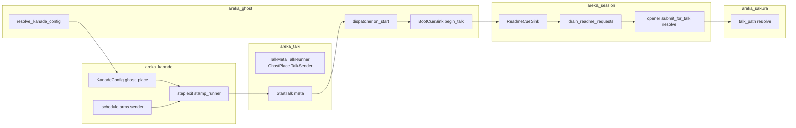
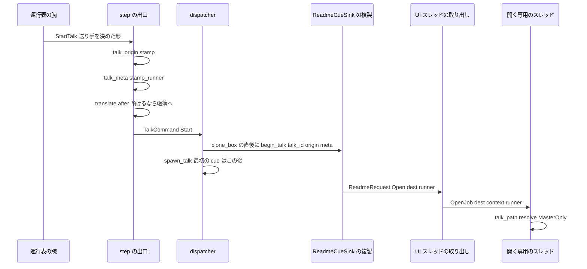
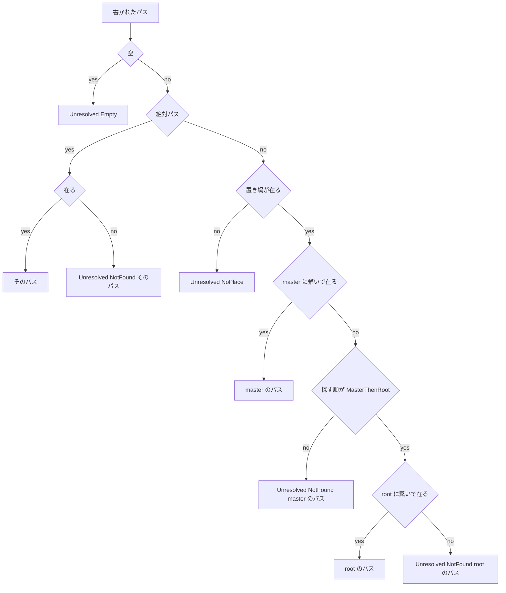
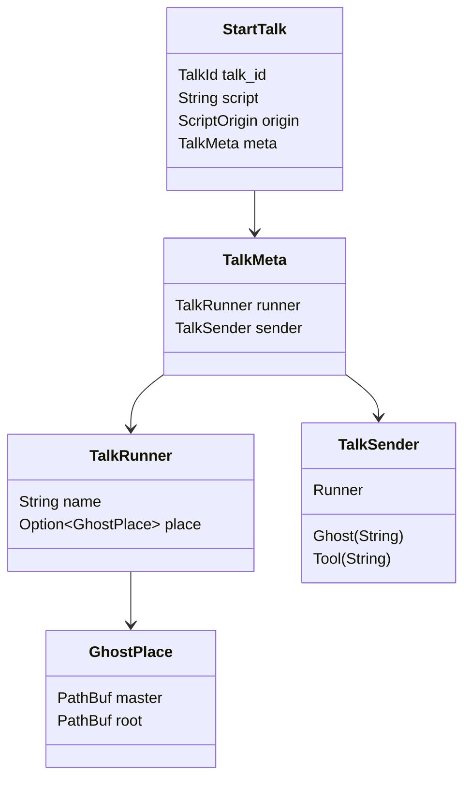

# 設計書: talk-script-metadata

## Overview

**Purpose**: トーク 1 つごとに「どのゴーストが実行し、そのゴーストがどこに置かれ、誰が送ったか」を表す**台本の付帯情報**を付け、トークの始まりに全部の受け手へ届け、ファイルを指すタグの相対パスをその付帯情報から 1 つの決まりで解く。最初の使い手は開く系のタグの受け口（`\![open,file|explorer|editor,…]`・`\j[file:…]`）である。

**Users**: ゴーストの作者（トークの途中でゴーストを切り替えても、喋っているゴーストのファイルが開く）と、ファイルを指すタグや複数のゴーストを扱う後の spec の開発者（受け手が自分で「今居るゴースト」を引かずに済む）。

**Impact**: `StartTalk` に付帯情報の欄 `meta` が増え、kanade の運行表は `step` の出口で実行するゴーストを押す。`BootCueSink::begin_talk` は付帯情報も受け取る。開く系の受け口は付帯情報を要求に載せて UI へ運び、opener は台本の要求で `GhostSlot` を引かなくなる。`ScriptOrigin` の形と値は変えない。

### Goals

- 台本を作る所すべてで、付帯情報（実行するゴーストの名・ghost/master と最上位の絶対パス・送り手）がトークの始まりに決まり、トークの終わりまで変わらない。
- 付帯情報が、そのトークの最初の cue より前に、そのトークの全部の受け手へ届く（前のトークの付帯情報を持ち越さない）。
- 相対パスを解く決まりが 1 つ（`areka_sakura::talk_path::resolve`）で、探す順 2 通り・絶対パス・`..`・空・置き場が無い・どこにも無いを決定論のテストで固定する。
- 開く系のタグが付帯情報で解き、ゴーストが 1 体でトークの途中に切り替わらないあいだは前と同じパスを開く（空に展開された `\![open,file]` だけを断る）。

### Non-Goals

- ファイルを指すほかのタグ（`\_b`・`\_v`・`\_V`・`\![sound]`・`\![set,tasktrayicon]`・`\![set,wallpaper]`・`\f` のフォントファイル）の実装と、読んだ後の処理。
- 複数のゴーストを同時に動かすこと（`multi-ghost-runtime`）・ネットワークの SSTP の受け口（`sstp-receive`）・他のゴーストから来た台本を作る所。
- 送り手で台本を断る・制限する決まり、`check_script` のファイルの在る無しの診断、本体のフォルダを探す順に入れること、プロセスのカレントディレクトリを替えること。
- dola の `CueSheet` に付帯情報を持たせること（要件 4.4）。

## Boundary Commitments

### This Spec Owns

- 付帯情報の型 `TalkMeta`・`TalkRunner`・`GhostPlace`・`TalkSender`（`areka-talk`）と `StartTalk.meta` の欄。
- kanade の運行表で付帯情報を埋める規則: 実行するゴーストは `step` の出口で `KanadeConfig` から押す。送り手は台本を作る腕が決める（既定は実行するゴースト自身・MCP の 2 つの入口は道具・選択肢の `script:` は元のトークから写す）。
- 実行するゴーストの置き場を kanade へ運ぶこと（`KanadeConfig.ghost_place`・`areka-ghost` の `resolve_kanade_config` で埋める）。
- 受け手へ届ける口 `BootCueSink::begin_talk(talk_id, origin, meta)` と、dispatcher がトークごとに複製へ渡すこと。
- 相対パスを解く共通の決まり `areka_sakura::talk_path`（`resolve`・`resolve_in`・`SearchOrder`・`Unresolved`）。記録は持たない（結果だけを返す）。
- 開く系のタグの受け口と opener の乗り換え（`ReadmeCueSink` が付帯情報を受けて要求に載せる・opener が付帯情報の実行するゴーストから文脈を組む）。

### Out of Boundary

- `ScriptOrigin` の語の組・Owned・実効のレベルの値と、それを決める規則（`talk_origin::stamp`・`translate::on_done` の下げ・`of_shown` の写し）。値は前と同じ。
- dola（`crates/dola`）と `CueSheet`。
- `crates/areka-ghost/src/runtime.rs`・`runtime_tests.rs`（同じウェーブの約束）。`Cargo.toml`・`Cargo.lock`（依存を足さない）。
- MCP の宛先の決め方（`crates/areka/src/mcp/resolve.rs` の `GhostSlot`）と `KanadeMsg::SstpSend`／`SstpNotify` の欄（道具の名は kanade の中で決める）。
- メニューの「説明書」と引数なしの `\![open,readme]` の道（表示中のゴーストの文脈のまま・要件 6.6）。
- `\![open,browser|mailer]`・`\j[http(s):…|mailto:…]` の扱い（書かれた綴りのまま OS へ）。
- 環境変数の展開（opener に残す）・フォントの探し場所（`shell_box_assets.rs`・読むだけ）。

### Allowed Dependencies

- 依存の向きは今のまま: `areka-talk`（std＋dola の時刻）→ `areka-sakura`（contract で再輸出）と `areka-kanade`（それぞれ直に依存し、`areka-kanade` は `areka-sakura` に依存しない）→ `areka-ghost`（両方に依存）→ `areka-runtime`／`areka-session`。
- `areka-talk` は std だけで付帯情報の型を持つ（`PathBuf` は std）。fs を読まない。
- `areka-sakura` の `talk_path` は std だけを使う（在る無しは引数の述語で受け、`resolve` は `Path::exists` を渡す）。`areka-sakura` は文字の層（`areka-emo-text`）を含む受け手のどれからも届く。
- `areka-session` は付帯情報の型と `talk_path` を `areka-ghost` 経由で使う（`areka-session` の本番の依存に `areka-talk`・`areka-sakura` は無いので、`areka_ghost::sink` が型と `talk_path` を再輸出する）。
- 新しいクレート・外の依存・機能の追加は 0。

### Revalidation Triggers

- `TalkMeta`／`TalkRunner`／`GhostPlace`／`TalkSender` の形を変える（下流の受け手すべて）。
- `BootCueSink::begin_talk` の引数を変える（`BalloonLifecycleSink`・`NoUserBreakCueSink`・`ReadmeCueSink` と下流の受け手）。
- `talk_path::resolve` の探す順・空・置き場が無いときの答え・`Unresolved` の語を変える（`balloon-inline-image`・`balloon-font-file`・`tasktray-ghost-icon`・`sound-canon-tags`）。
- kanade の外で `StartTalk` を作る本番の道ができる（出口で押す規則を通らない）。`multi-ghost-runtime`・`sstp-receive`・`ghost-call` が他のゴーストや SSTP の台本を足すときは、送り手 `TalkSender::Ghost`／`Tool` を作る所を足す。
- `KanadeConfig` を `resolve_kanade_config` 以外で本番に組む道ができる（置き場が無いまま起きる）。

## Architecture

### Existing Architecture Analysis

- kanade の運行表は純粋な状態機械で、台本を作る所は全部 `schedule/` の中にある（`start_talk` の呼び手 7 か所と、直に組む `boot.rs` 2・`change.rs` 2・`close.rs` 1）。どれも `step` の出口を通り、出口には既に「腕は決めず、ここで一括に付ける」規則が並ぶ（`talk_origin::stamp`・`translate::after`・`balloon_events::settle`・`script_log::record`）。
- kanade はゴースト 1 体に 1 つで、`KanadeConfig` はそのゴーストの定数（`ghost_name` ほか）を持つ。本番の `KanadeConfig` は `resolve_kanade_config` 1 か所で組まれ、`runtime.rs` は他の欄だけを書き換える。
- 受け手への道 `begin_talk(talk_id, origin)` は既にあり、dispatcher がトークごとに複製の直後に 1 回呼ぶ（複製＝トークの境界）。既定は何もしない。
- 開く系の受け口 `ReadmeCueSink` は `Clone` で一括の実装に乗り、要求 `ReadmeRequest::Open(dest)` を UI スレッドへ送る。UI スレッドの `opener::submit` が `GhostSlot` を引いて文脈を組み、開く専用のスレッドで `existing()`（絶対はそのまま・相対は ghost/master に繋いで `exists()`）が解く。

### Architecture Pattern & Boundary Map



**Architecture Integration**:
- Selected pattern: 既存の「出どころの通り道」に欄を 1 つ足す。実行するゴーストは kanade の定数なので、出口の一括の規則（`talk_origin::stamp` と同じ形）で押す。送り手はトークごとの決めなので、台本を作る腕が決める（`mark_strict` と同じ形）。
- Domain boundaries: 型は契約の層（`areka-talk`）、埋めるのは運行表（`areka-kanade`）、置き場を作るのはゴーストの置き場を知る結線の層（`areka-ghost`）、解き方はタグを知る再生の層（`areka-sakura`・純粋な関数）、使うのは受け口（`areka-session`）。
- Existing patterns preserved: 出口の一括の規則・腕の既定値・`begin_talk` の複製の直後の 1 回・受け口の自己選別と送り出し・UI スレッドの外で fs を読む opener。
- New components rationale: `talk_meta`（出口の規則 1 つ）と `talk_path`（共通の決まり 1 つ）だけ。
- Steering compliance: `areka-talk` は std だけ・エンジン知識（探す順）を持たない／記録は呼び手が 1 行（`logging.md`）／決定論のテスト・一時フォルダは `target\` の下。

**依存の向き（違反はレビューで誤りとして扱う）**: `areka-talk` → `areka-sakura`（`contract`・`talk_path.rs`）・`areka-kanade`（並び・互いに依存しない）→ `areka-ghost`（`config.rs`・`sink.rs`・`dispatcher.rs`）→ `areka-runtime`／`areka-session`。下の層は上の層を引かない。

### Technology Stack

| Layer | Choice / Version | Role in Feature | Notes |
|-------|------------------|-----------------|-------|
| 契約の型 | Rust std（`std::path::PathBuf`） | 付帯情報の型 | `areka-talk` は std＋dola の時刻のまま |
| 運行表 | 既存の `areka-kanade` | 出口で実行するゴーストを押す・腕が送り手を決める | 新しい依存なし |
| 解き方 | std `Path::is_absolute`・`Path::join`・`Path::exists`・`std::path::absolute` | 共通の決まり・置き場の絶対化 | fs の読みは UI スレッドの外だけ |
| 記録 | `tracing`（既存） | opener の `error!`（`open_external_failed`）1 行・置き場を絶対にできないときの `warn!` | `log-capture-kit` で数える |
| テスト | `temp-path-kit`・`log-capture-kit`（既存の dev 依存） | fs の候補を `target\` の下に作る・記録を数える | 追加なし |

## File Structure Plan

### Directory Structure

```
crates/
├── areka-talk/src/
│   ├── meta.rs                 # 新: TalkMeta・TalkRunner・GhostPlace・TalkSender（std のみ・fs を読まない）
│   └── meta_tests.rs           # 新: 既定値（置き場が無い・送り手は実行するゴースト自身）と sender_name
├── areka-kanade/src/schedule/
│   ├── talk_meta.rs            # 新: step の出口で実行するゴーストを押す規則 stamp_runner
│   └── talk_meta_tests.rs      # 新: 台本を作る所ごとの付帯情報（実行するゴースト・送り手・翻訳の後も保つ）
├── areka-sakura/src/
│   ├── talk_path.rs            # 新: 相対パスを解く共通の決まり（resolve・resolve_in・SearchOrder・Unresolved）
│   └── talk_path_tests.rs      # 新: 在る無しの述語で探す順 2 通り・絶対・..・空・置き場が無い・どこにも無い・記録 0 件（fs を読まない）
```

### Modified Files

- `crates/areka-talk/src/lib.rs` — `mod meta;` と再輸出。`StartTalk` に `pub meta: TalkMeta`、`StartTalk::new` は `TalkMeta::default()`。
- `crates/areka-sakura/src/contract.rs` — `TalkMeta`・`TalkRunner`・`GhostPlace`・`TalkSender` を再輸出。
- `crates/areka-sakura/src/drive.rs` — `StartTalk` の網羅の分解に `meta: _`（再生の層は運ぶだけ・`CueSheet` に持たせない）。
- `crates/areka-kanade/src/msg.rs` — `KanadeConfig` に `pub ghost_place: Option<GhostPlace>`（`KanadeConfig::new` は `None`）。
- `crates/areka-kanade/src/schedule/mod.rs` — `mod talk_meta;`、`step` の出口で `talk_meta::stamp_runner(config, &mut actions)` を `talk_origin::stamp` の直後・`translate::after` の前に 1 回呼ぶ。
- `crates/areka-kanade/src/schedule/sstp.rs` — 道具の名の定数 `SAKURASCRIPT_TOOL`（`"sakurascript"`）・`RAISE_EVENT_TOOL`（`"raise_event"`）。`on_send` と `on_notify_reply` が作る `StartTalk` の `meta.sender` を `TalkSender::Tool(…)` にする。
- `crates/areka-kanade/src/schedule/balloon_events.rs` — `ShownTalk` に `sender: TalkSender`（`settle` が最後の `StartTalk` から控える）。
- `crates/areka-kanade/src/schedule/talk_origin.rs` — `of_shown` が出どころと送り手の組を返す（控えが無いときの送り手は `TalkSender::Runner`）。
- `crates/areka-kanade/src/schedule/steady_choice_script.rs` — 写した送り手を `meta.sender` に入れる。
- `crates/areka-kanade/src/schedule/boot.rs` — 直に組む 2 か所の `StartTalk` に `meta: TalkMeta::default()`（実行するゴーストは出口で押す）。
- `crates/areka-ghost/src/config.rs` — `resolve_kanade_config` が `ghost_place` を埋める（ghost/master と最上位を `std::path::absolute`・失敗は `warn!` の上で `None`）。名の作りと最上位の取り方は `listed_ghost_name` と同じ 1 つの手。
- `crates/areka-ghost/src/sink.rs` — `begin_talk(&mut self, talk_id, origin, meta: &TalkMeta)`。付帯情報の型と `talk_path` を再輸出（`areka-session` などの受け手が使う口）。
- `crates/areka-ghost/src/dispatcher.rs` — `on_start` が複製ごとに `begin_talk(talk_id, origin, &start.meta)`。
- `crates/areka-sakura/src/lib.rs` — `pub mod talk_path;`。
- `crates/areka-runtime/src/talk_lifecycle.rs`・`crates/areka-runtime/src/user_break_cue.rs` — `begin_talk` の引数に `_meta` を足すだけ（振る舞いは変えない）。
- `crates/areka-session/src/readme.rs` — `ReadmeRequest::Open { dest, runner: TalkRunner }`。`drain_readme_requests` は台本の要求を `opener::submit_for_talk` へ、説明書の要求は今のまま `open_from_world` へ。
- `crates/areka-session/src/readme/readme_cue.rs` — `#[derive(Clone)]` を外し `BootCueSink` を自分で実装（`clone_box` は送信端だけを写し付帯情報を既定へ戻す・`begin_talk` で実行するゴーストを控える）。開く系の要求に控えた実行するゴーストを載せる。
- `crates/areka-session/src/readme/opener.rs` — `OpenContext` を `{ runner: TalkRunner, baseware }` に替える。`submit_for_talk(world, dest, runner)` を足し、`submit`（説明書の道）は `GhostSlot` から `TalkRunner` を組む。`existing()` を `talk_path::resolve(…, SearchOrder::MasterOnly)` に置き換え、`OpenFailure` に `EmptyPath`・`NoPlace` を足す。`\![open,explorer,shell|balloon,名前]` の「今のゴーストの中」は `runner.place.root`。
- テストの支えと、`StartTalk { … }` を直に組むテスト（`areka-kanade` の `schedule/` 8 ファイルと `tests/kanade/common/common_smoke.rs`・`areka-ghost` の `dispatcher_begin_talk_tests.rs`・`dispatcher_strict_tests.rs`・`prop_sink.rs` のテスト・`areka-sakura` の `drive_choice_tests.rs`・`drive_strict_tests.rs`・`areka-runtime/src/strict_judges_tests.rs`・`areka/src/runtime_tests/strict_judges_tests.rs`・`areka-seriko/tests/common/mod.rs`）— `meta: TalkMeta::default()` を足す。`opener_test_support.rs` の `open_context` は `TalkRunner` で組み、`ReadmeRequest::Open`・`OpenContext` を名指す `readme_tests.rs`・`readme_cue_tests.rs`・`opener_tests.rs`・`opener_submit_tests.rs`・`opener_execute_tests.rs` は新しい形に合わせる。`begin_talk` を呼ぶ・実装するテスト（`areka-ghost` の `dispatcher_begin_talk_tests.rs`・`areka-runtime/src/` の `balloon_visibility_choice_wait_tests.rs`・`script_restriction_tests.rs`・`talk_lifecycle_signals_tests.rs`・`user_break_cue_origin_tests.rs`・`crates/areka/src/runtime_tests/frame_balloon_timeout_notice_e2e_tests.rs`）は引数を足す。`ShownTalk { … }` を直に組むテスト（`areka-kanade/src/schedule/` の `balloon_events_done_tests.rs`・`balloon_events_tests.rs`・`steady_choice_script_tests.rs`）は `sender` を足す。

## System Flows

### 付帯情報が決まり、受け手へ届くまで



- 出口は `step` を出る全部の `StartTalk` に実行するゴーストを押す。翻訳に預けた一括（`sstp::on_send` が腕の中で預けるもの・`translate::after` が出口で預けるもの）は、翻訳の結果の入力の `step` で `StartTalk` として出るときに押される。腕が決めた送り手は預けた一括の中に残り、`translate::on_done` は台本と出どころだけを替えるので、翻訳の後も保たれる（要件 2.4）。押す値はゴースト 1 体に kanade 1 つの定数なので、どの `step` で押しても同じ。
- dispatcher は古いトークの複製を合流してから新しいトークの複製を作り、複製ごとに `begin_talk` を呼んでから `spawn_talk` する。受け手は複製の中に付帯情報を値で持つので、次のトークへ持ち越さない（要件 4.1・4.2）。
- トークの途中で表示中のゴーストが切り替わっても、要求は付帯情報の実行するゴーストを運ぶので、opener は `GhostSlot` を引かない（要件 3.4・6.2）。

### 相対パスの解き方



- `..` は断らずにそのまま繋ぐ（`Path::join` のまま・正規化しない）。在る無しは `Path::exists`（ファイルもフォルダも）。
- Windows の `\foo`（ドライブの無い根からのパス）は絶対ではないので繋ぐ。`Path::join` は置き場のドライブの根からのパスになる（今の `existing()` と同じ）。

## Requirements Traceability

| Requirement | Summary | Components | Interfaces | Flows |
|-------------|---------|------------|------------|-------|
| 1.1 | トークごとに名・2 つのフォルダ・送り手 | TalkMeta, TalkMetaStamp | `StartTalk.meta` | 付帯情報が決まるまで |
| 1.2 | 実行するゴーストを送り手と別の欄 | TalkMeta | `TalkMeta.runner`／`TalkMeta.sender` | ― |
| 1.3 | フォルダは絶対パス | KanadeConfigPlace | `resolve_kanade_config`（`std::path::absolute`） | ― |
| 1.4 | 名の決め方は一覧と同じ | KanadeConfigPlace, TalkMetaStamp | `KanadeConfig.ghost_name` → `TalkRunner.name` | ― |
| 1.5 | 出どころの意味と値を変えない | TalkMeta（`ScriptOrigin` は別の欄のまま） | `StartTalk.origin`・`begin_talk` の `origin` | ― |
| 1.6 | 置き場が無いことを表す | TalkMeta, KanadeConfigPlace | `TalkRunner.place: Option<GhostPlace>` | ― |
| 2.1 | 送り手の名を別の欄に | TalkMeta | `TalkSender`・`TalkMeta::sender_name` | ― |
| 2.2 | ゴーストのトークは送り手＝自身 | TalkMeta, TalkMetaStamp | `TalkSender::Runner`（既定） | ― |
| 2.3 | MCP は送り手＝道具・実行＝送り先 | SstpSender | `SAKURASCRIPT_TOOL`・`RAISE_EVENT_TOOL` | ― |
| 2.4 | 翻訳の後も送り手を保つ | TalkMetaStamp | `translate::on_done` は `meta` に触れない | 付帯情報が決まるまで |
| 2.5 | 選択肢の `script:` は元から写す | ChoiceScriptSender | `ShownTalk.sender`・`of_shown` | ― |
| 2.6 | 別のゴーストを表せる | TalkMeta | `TalkSender::Ghost(String)` | ― |
| 3.1 | 始まりの時点で決める | TalkMetaStamp | `step` の出口 | 付帯情報が決まるまで |
| 3.2 | 作る所すべてで埋める | TalkMetaStamp | `StartTalk.meta`（欄は必須）・出口で全部の `StartTalk` | ― |
| 3.3 | 再生中に書き換えない | BootCueSinkMeta, ReadmeCueMeta | 複製が値で持つ | ― |
| 3.4 | 途中の切り替えで基準が変わらない | ReadmeCueMeta, OpenerForTalk | `ReadmeRequest::Open { runner }` | 付帯情報が決まるまで |
| 4.1 | 最初の cue より前に全員へ | BootCueSinkMeta | `begin_talk(talk_id, origin, &meta)` | 付帯情報が決まるまで |
| 4.2 | 持ち越さない | BootCueSinkMeta, ReadmeCueMeta | 複製＝トークの境界・`clone_box` で既定へ戻す | ― |
| 4.3 | 使わない受け手を変えない | BootCueSinkMeta | 既定の実装は何もしない | ― |
| 4.4 | `CueSheet` に持たせない | DriveMetaPassThrough | `drive.rs` の `meta: _` | ― |
| 5.1 | 解き方は 1 つ | TalkPath | `talk_path::resolve` | 相対パスの解き方 |
| 5.2 | 絶対パスはそのまま | TalkPath | `resolve` | 相対パスの解き方 |
| 5.3 | ghost/master だけ | TalkPath | `SearchOrder::MasterOnly` | 相対パスの解き方 |
| 5.4 | ghost/master → 最上位 | TalkPath | `SearchOrder::MasterThenRoot` | 相対パスの解き方 |
| 5.5 | `..` を断らない | TalkPath | `Path::join` のまま | 相対パスの解き方 |
| 5.6 | どこにも無いと最後の候補 | TalkPath | `Unresolved::NotFound { last_tried }` | 相対パスの解き方 |
| 5.7 | 置き場が無い | TalkPath | `Unresolved::NoPlace` | 相対パスの解き方 |
| 5.8 | 空のパス | TalkPath | `Unresolved::Empty` | 相対パスの解き方 |
| 5.9 | 決まりは結果だけ・受け手が 1 行 | TalkPath, OpenerForTalk | `Unresolved::reason`・opener の `open_external_failed` | ― |
| 5.10 | 環境変数の展開を入れない | OpenerForTalk | `expand_env` は opener に残す | ― |
| 5.11 | 本体のフォルダを入れない | TalkPath | `SearchOrder` は 2 値だけ | ― |
| 6.1 | 開く系は MasterOnly で解く・browser/mailer はそのまま | OpenerForTalk | `resolve` の `Path`・`Program`・`Folder`・`Edit` の腕 | ― |
| 6.2 | 台本の要求で `GhostSlot` を引かない | OpenerForTalk | `submit_for_talk` | ― |
| 6.3 | 名前で引くフォルダは実行するゴーストの中 | OpenerForTalk | `named_folder` が `runner.place.root` | ― |
| 6.4 | 記録の名は実行するゴースト | OpenerForTalk | `OpenContext.runner.name` | ― |
| 6.5 | 1 体のとき前と同じ（空の展開だけ断る） | OpenerForTalk | `OpenFailure::EmptyPath` | ― |
| 6.6 | 説明書の道は今のまま | OpenerForTalk | `submit`（`GhostSlot` から `TalkRunner`） | ― |
| 7.1 | 決定論のテスト | 全部 | Testing Strategy | ― |
| 7.2 | テストのフォルダは `target\` の下 | TalkPath のテスト・opener のテスト | `temp-path-kit` | ― |
| 7.3 | 解けないときの記録が 1 行 | OpenerForTalk のテスト | `log-capture-kit` | ― |

## Components and Interfaces

| Component | Domain/Layer | Intent | Req Coverage | Key Dependencies (P0/P1) | Contracts |
|-----------|--------------|--------|--------------|--------------------------|-----------|
| TalkMeta | 契約（`areka-talk`） | 付帯情報の型 | 1.1, 1.2, 1.5, 1.6, 2.1, 2.2, 2.6 | std (P0) | State |
| TalkMetaStamp | 運行表（`areka-kanade`） | 出口で実行するゴーストを押す | 1.1, 1.4, 2.2, 2.4, 3.1, 3.2 | KanadeConfig (P0) | Service |
| SstpSender | 運行表 | MCP の 2 つの入口の送り手 | 2.3 | `sstp.rs` (P0) | Service |
| ChoiceScriptSender | 運行表 | 選択肢の `script:` が元の送り手を写す | 2.5 | `ShownTalk` (P0) | State |
| KanadeConfigPlace | 結線（`areka-ghost`） | 置き場を絶対パスで kanade へ運ぶ | 1.3, 1.4, 1.6 | MountModel (P0) | Service |
| BootCueSinkMeta | 結線 | トークごとに受け手へ渡す口 | 3.3, 4.1, 4.2, 4.3 | dispatcher (P0) | Service |
| DriveMetaPassThrough | 再生（`areka-sakura`） | 付帯情報を `CueSheet` に入れない | 4.4 | ― | ― |
| TalkPath | 再生（`areka-sakura`） | 相対パスを解く共通の決まり | 5.1〜5.11 | std fs (P0) | Service |
| ReadmeCueMeta | 受け口（`areka-session`） | 実行するゴーストを要求に載せる | 3.3, 3.4, 4.2 | BootCueSink (P0) | Service |
| OpenerForTalk | 受け口 | 付帯情報で文脈を組み共通の決まりで解く | 3.4, 5.9, 5.10, 6.1〜6.6, 7.3 | TalkPath (P0), BootContext (P1) | Service |

### 契約の層（areka-talk）

#### TalkMeta

| Field | Detail |
|-------|--------|
| Intent | トーク 1 つの付帯情報（実行するゴーストと置き場・送り手）を値で持つ |
| Requirements | 1.1, 1.2, 1.5, 1.6, 2.1, 2.2, 2.6 |

**Responsibilities & Constraints**
- 実行するゴースト（`runner`）と送り手（`sender`）を別の欄に持つ。`ScriptOrigin` は `StartTalk.origin` のまま別に持ち、型も値も変えない（`Copy` のまま）。受け手には `begin_talk` で `origin` と `meta` の両方が届き、両方で要件の「付帯情報」になる。
- `GhostPlace` の 2 つのパスは絶対パスを入れる（作るのは本番では `resolve_kanade_config` だけ）。
- fs を読まない。探す順の知識を持たない（`talk_path` の仕事）。

**Contracts**: State [x]

##### State Management

```rust
/// 台本の付帯情報（トークの始まりに決まり、終わりまで変わらない）。
#[derive(Debug, Clone, PartialEq, Eq, Default)]
pub struct TalkMeta {
    pub runner: TalkRunner,
    pub sender: TalkSender,
}

/// 台本を実行する（喋る）ゴースト。
#[derive(Debug, Clone, PartialEq, Eq, Default)]
pub struct TalkRunner {
    /// 一覧と script の記録が使う名（descript の name、無い・空なら最上位の絶対パス）。
    pub name: String,
    /// 置き場。`None` は置き場を渡さずに組んだ kanade（試験の支え）。
    pub place: Option<GhostPlace>,
}

/// 実行するゴーストの置き場（どちらも絶対パス）。
#[derive(Debug, Clone, PartialEq, Eq)]
pub struct GhostPlace {
    /// ghost/master（SHIORI の DLL がある所）。
    pub master: PathBuf,
    /// ゴーストの最上位（ghost/master の 2 つ上）。
    pub root: PathBuf,
}

/// 台本の送り手（今の出どころの種類と信用度は `ScriptOrigin` のまま別に持つ）。
#[derive(Debug, Clone, PartialEq, Eq, Default)]
pub enum TalkSender {
    /// 実行するゴースト自身（名は `TalkRunner::name`）。
    #[default]
    Runner,
    /// 実行するゴーストと別のゴースト（この spec の中では作る所が無い）。
    Ghost(String),
    /// 道具（MCP の `sakurascript`・`raise_event`）。
    Tool(String),
}

impl TalkMeta {
    /// 送り手の名（実行するゴースト自身なら実行するゴーストの名）。
    pub fn sender_name(&self) -> &str;
}

pub struct StartTalk {
    pub talk_id: TalkId,
    pub script: String,
    pub epilogue: Vec<EpilogueCommand>,
    pub origin: ScriptOrigin,
    pub strict: bool,
    pub meta: TalkMeta,
}
```

- Invariants: `TalkMeta::default()` は「置き場が無い・名は空・送り手は実行するゴースト自身」＝`KanadeConfig::new` で組んだ kanade が押す値と同じ（試験の支え・要件 1.6）。
- 送り手が実行するゴースト自身のときは名を 2 か所に書かない（`Runner`）。同じ名のゴーストが 2 体居ても「自身か」を名で比べずに判る。名は `sender_name` で引ける（要件 2.1）。

**Implementation Notes**
- Integration: `areka-sakura::contract` と `areka_ghost::sink` が再輸出する。`StartTalk { … }` を直に組むテストは `meta: TalkMeta::default()` を足す。
- Validation: `meta_tests.rs` が既定値と `sender_name` の 3 通りを確かめる。
- Risks: `StartTalk` の公開の欄が増えるので、直に組む所はコンパイルで全部見つかる（見落としは起きない）。

### 運行表（areka-kanade）

#### TalkMetaStamp

| Field | Detail |
|-------|--------|
| Intent | `step` の出口で、返す一括の全部の `StartTalk` に実行するゴーストを押す |
| Requirements | 1.1, 1.4, 2.2, 2.4, 3.1, 3.2 |

**Responsibilities & Constraints**
- 実行するゴーストは kanade の定数（`KanadeConfig.ghost_name`・`KanadeConfig.ghost_place`）なので、腕は決めず出口で一括に押す（`talk_origin::stamp` と同じ規律）。台本を作る所が増えても漏れない。
- 送り手には触れない（腕が決める）。
- `talk_origin::stamp` の直後に呼ぶ。対象は「その `step` を出る `StartTalk`」で、翻訳に預けた一括は翻訳の結果の `step` で出るときに押される（`sstp::on_send` は腕の中で預けるので、預けた時点ではまだ押されていない。預けた一括が `step` の外へ出る道は翻訳の結果の `step` だけ）。
- 記録は出さない（毎秒の `step` で何もしない一括が大半・押すのは失敗ではない）。

**Contracts**: Service [x]

##### Service Interface

```rust
/// 返す一括の全部の再生の開始に、この kanade の実行するゴーストを押す。
pub(super) fn stamp_runner(config: &KanadeConfig, actions: &mut [Action]);
```
- Preconditions: なし（`StartTalk` の無い一括は何もしない）。
- Postconditions: 一括の全部の `Action::StartTalk(start)` で `start.meta.runner == TalkRunner { name: config.ghost_name, place: config.ghost_place }`。`start.meta.sender`・`origin`・`script`・`epilogue`・`strict` は変わらない。
- Invariants: kanade が `TalkCommand::Start` で送る `StartTalk` は、どれもちょうどこの規則を通った後のもの（`actor.rs` の `execute_batch` は `step` の返す一括を写すだけ）。同じ値を 2 回押しても変わらない。

`step` の出口の並び（変更後）:

```rust
let (mut state, mut actions) = route(state, input, config);
let mut actions = talk_origin::stamp(reply_origin, actions);
talk_meta::stamp_runner(config, &mut actions);
let actions = translate::after(&mut state, replied, actions);
// 以降は今のまま（talk_gap::observe・balloon_events::settle・script_log::record）
```

#### SstpSender

| Field | Detail |
|-------|--------|
| Intent | MCP の 2 つの入口が作るトークの送り手を道具にする |
| Requirements | 2.3 |

**Contracts**: Service [x]

- `on_send`（`KanadeMsg::SstpSend`）が `start_talk` で作った再生の開始に `meta.sender = TalkSender::Tool(SAKURASCRIPT_TOOL.into())`、`on_notify_reply`（`KanadeMsg::SstpNotify` の応答）が `TalkSender::Tool(RAISE_EVENT_TOOL.into())` を入れる（`mark_strict` と同じ所・同じ形の小さな手）。
- 道具の名は kanade が受けた知らせの種類から kanade の中で決め、`msg.rs` の `SstpSend`／`SstpNotify` の欄は変えない。今は MCP がこの 2 つの知らせを作る唯一の送り手。
- 実行するゴーストは受けた kanade のゴースト（出口で押す）＝送り先のゴースト。

```rust
/// MCP の `sakurascript` が送る台本の送り手の名。
pub(crate) const SAKURASCRIPT_TOOL: &str = "sakurascript";
/// MCP の `raise_event` が頼むイベントの応答の送り手の名。
pub(crate) const RAISE_EVENT_TOOL: &str = "raise_event";
```

#### ChoiceScriptSender

| Field | Detail |
|-------|--------|
| Intent | 選択肢の `script:` の台本が、その選択肢を出したトークの送り手を写す |
| Requirements | 2.5 |

**Contracts**: State [x]

- `ShownTalk` に `sender: TalkSender` を足し、`balloon_events::settle` が最後の `StartTalk` の `meta.sender` を控える（出どころの控えと同じ所・翻訳の後の最終の値）。
- `talk_origin::of_shown(state, prev_talk_id) -> (ScriptOrigin, TalkSender)`。控えが元のトークでない（構造上は起きない）ときは今の `choice_script_origin_missing` の `error!` 1 行のまま、出どころは外部扱い・送り手は `TalkSender::Runner`。
- `steady_choice_script::begin` が写した送り手を `meta.sender` に入れる。

#### 台本を作る所と送り手（全部）

| 作る所 | トーク | 送り手 | 実行するゴースト |
|---|---|---|---|
| `steady.rs` の定常の応答（置き換えを含む）・選択肢の段の応答・`OnChoiceTimeout` の応答 | SHIORI の応答・バルーンのイベント・`\![get,property]` の返しのイベント・中断 | `Runner`（既定） | 出口で押す |
| `boot.rs` の挨拶・後書きだけのトーク | 起動・初回起動・切替の後・読み直し | `Runner`（既定） | 出口で押す |
| `change.rs` の `OnGhostChanging`／切替の `OnClose`・取りやめた切替 | 切替 | `Runner`（既定） | 出口で押す |
| `close.rs` の `OnClose` | 終了 | `Runner`（既定） | 出口で押す |
| `sstp.rs` の `on_send` | MCP `sakurascript`（翻訳の後も保つ） | `Tool("sakurascript")` | 出口で押す |
| `sstp.rs` の `on_notify_reply` | MCP `raise_event` の応答（翻訳の後も保つ） | `Tool("raise_event")` | 出口で押す |
| `steady_choice_script.rs` の `begin` | 選択肢の `script:` | 元のトークの送り手を写す | 出口で押す |

### 結線の層（areka-ghost）

#### KanadeConfigPlace

| Field | Detail |
|-------|--------|
| Intent | `resolve_kanade_config` が実行するゴーストの置き場を絶対パスで `KanadeConfig` に入れる |
| Requirements | 1.3, 1.4, 1.6 |

**Contracts**: Service [x]

```rust
// crates/areka-kanade/src/msg.rs
pub struct KanadeConfig {
    // 既存の欄は変えない
    /// 実行するゴーストの置き場（既定 `None`。結線は `areka-ghost` の `resolve_kanade_config` が入れる）。
    pub ghost_place: Option<GhostPlace>,
}
```

- `resolve_kanade_config(mount, default_encoding)` は `ghost_name` と同じく `mount.shiori.dir`（ghost/master）とその 2 つ上（最上位・`listed_ghost_name` と同じ取り方）から `GhostPlace` を作り、両方に `std::path::absolute` を当てる。どちらかが絶対にできなければ `warn!`（`event = "ghost_place_unresolved"`・パスと理由）を 1 行残して `None`（起動は止めない。相対パスのタグはその後 `NoPlace` で解けず、受け手が記録する）。
- `runtime.rs` は `resolve_kanade_config` の結果の他の欄だけを書き換えるので触らない（同じウェーブの約束）。
- `KanadeConfig::new` は置き場を知らないので `None`（試験の支え・要件 1.6）。

#### BootCueSinkMeta

| Field | Detail |
|-------|--------|
| Intent | トークの始まりに、そのトークの複製ごとに付帯情報を渡す口 |
| Requirements | 3.3, 4.1, 4.2, 4.3 |

**Contracts**: Service [x]

```rust
pub trait BootCueSink: CueSink + Send {
    fn clone_box(&self) -> Box<dyn BootCueSink>;
    /// この複製が受け持つトークの番号・出どころ・付帯情報。dispatcher がトークの起動ごとに、
    /// 複製の直後・最初の cue より前に 1 回だけ呼ぶ。既定は何もしない。
    fn begin_talk(&mut self, _talk_id: TalkId, _origin: ScriptOrigin, _meta: &TalkMeta) {}
}
```

- dispatcher の `on_start` は `sink.begin_talk(talk_id, origin, &start.meta)` を複製ごとに呼んでから `spawn_talk(start, …)` する。
- 一括の実装に乗る受け口（seriko・文字・移動ほか）は既定のまま何もしない（要件 4.3）。`BalloonLifecycleSink`・`NoUserBreakCueSink` は引数を受けるだけで使わない。
- 受け手は付帯情報が要るとき複製の中に写して持つ（参照を持ち越さない）。

#### DriveMetaPassThrough

- `drive.rs` の `on_start` の網羅の分解に `meta: _` を足す（再生の層は運ぶだけで解釈しない）。`CueSheet` と dola は変えない（要件 4.4）。

### 再生の層（areka-sakura）

#### TalkPath

| Field | Detail |
|-------|--------|
| Intent | 置き場・書かれたパス・探す順だけで読むファイルを決める共通の決まり |
| Requirements | 5.1, 5.2, 5.3, 5.4, 5.5, 5.6, 5.7, 5.8, 5.9, 5.10, 5.11 |

**Responsibilities & Constraints**
- 置き場（`Option<&GhostPlace>`）・書かれたパス・探す順の 3 つだけで決まる。今居るゴーストも World も引かない。
- 記録を出さない（結果だけを返す）。記録は呼んだ受け手が 1 行だけ残す（同じ失敗を 2 行に重ねない）。新しい受け手は `warn!` で、そのタグ・書かれたパス・`Unresolved::reason`・最後に試した候補・`TalkRunner::name` を 1 行に載せる（この spec では開く系の受け口だけが使い、今の `error!` のまま）。
- 環境変数を展開しない。本体のフォルダを探さない（`SearchOrder` は 2 値）。
- `resolve` は fs を読むので UI スレッドで呼ばない（開く専用のスレッドなど）。在る無しの判定は `resolve_in` の述語に分け、決まりそのものは fs を読まずに確かめる（`areka-sakura` には一時フォルダの道具 `temp-path-kit` が無く、依存は足さない）。

**Contracts**: Service [x]

##### Service Interface

```rust
/// 相対パスを探す順（どのタグがどちらを使うかは、そのタグの ukadoc の項目に従う）。
#[derive(Debug, Clone, Copy, PartialEq, Eq)]
pub enum SearchOrder {
    /// ghost/master だけ。
    MasterOnly,
    /// ghost/master → ゴーストの最上位。
    MasterThenRoot,
}

/// 解けなかった理由。
#[derive(Debug, Clone, PartialEq, Eq)]
pub enum Unresolved {
    /// 書かれたパスが空。
    Empty,
    /// 相対パスなのに付帯情報に置き場が無い。
    NoPlace,
    /// どの候補にも無い（最後に試した候補）。
    NotFound { last_tried: PathBuf },
}

impl Unresolved {
    /// 記録の欄 `reason` の値（`"empty_path"`／`"no_place"`／`"not_found"`）。
    pub fn reason(&self) -> &'static str;
}

/// 書かれたパスを付帯情報の置き場と探す順で解く（在る無しは `Path::exists`）。
pub fn resolve(
    place: Option<&GhostPlace>,
    written: &str,
    order: SearchOrder,
) -> Result<PathBuf, Unresolved>;

/// `resolve` の決まりそのもの（在る無しを `exists` で判定する）。
pub fn resolve_in(
    place: Option<&GhostPlace>,
    written: &str,
    order: SearchOrder,
    exists: impl Fn(&Path) -> bool,
) -> Result<PathBuf, Unresolved>;
```
- Preconditions: なし。
- Postconditions: `Ok(p)` なら `exists(p)` が真だった（`resolve` では `p.exists()`）。絶対パスの `Ok` は書かれたパスそのもの。相対パスの `Ok` は `place.master.join(written)` か（`MasterThenRoot` のときだけ）`place.root.join(written)`。`Err(NotFound)` の `last_tried` は最後に `exists` を試したパス。
- Invariants: 空は置き場の有無・絶対かどうかより先に `Empty`（ghost/master のフォルダそのものを解いたパスにしない）。

### 受け口（areka-session）

#### ReadmeCueMeta

| Field | Detail |
|-------|--------|
| Intent | 開く系のタグの受け口が、そのトークの実行するゴーストを開く要求に載せる |
| Requirements | 3.3, 3.4, 4.2 |

**Contracts**: Service [x]

```rust
pub struct ReadmeCueSink {
    tx: Sender<ReadmeRequest>,
    /// このトークの実行するゴースト（begin_talk で控える・既定は置き場が無い）。
    runner: TalkRunner,
}

impl BootCueSink for ReadmeCueSink {
    fn clone_box(&self) -> Box<dyn BootCueSink>; // 送信端だけを写し、runner は既定へ戻す
    fn begin_talk(&mut self, _talk_id: TalkId, _origin: ScriptOrigin, meta: &TalkMeta); // runner を控える
}

pub enum ReadmeRequest {
    /// 引数なしの `\![open,readme]`（表示中のゴーストの文脈・今のまま）。
    Readme,
    /// 開く系の行き先と、そのトークの実行するゴースト。
    Open { dest: Destination, runner: TalkRunner },
}
```

- `#[derive(Clone)]` を外して `BootCueSink` を自分で実装する（`NoUserBreakCueSink` と同じ形）。`clone_box` で控えを既定へ戻すので、前のトークの実行するゴーストを持ち越さない（要件 4.2）。
- 自己選別・断り・送出の失敗の記録は今のまま。`runtime_boot.rs` の並びと作り方（`ReadmeCueSink::new(tx)`）は変えない。

#### OpenerForTalk

| Field | Detail |
|-------|--------|
| Intent | 台本の開く要求を、付帯情報の実行するゴーストと共通の決まりで解く |
| Requirements | 3.4, 5.9, 5.10, 6.1, 6.2, 6.3, 6.4, 6.5, 6.6, 7.3 |

**Responsibilities & Constraints**
- 台本の要求（`ReadmeRequest::Open`）は `submit_for_talk` で、`GhostSlot` を引かずに要求の `TalkRunner` から文脈を組む。ゴーストが居なくても捨てない（`no_ghost` の道は台本の要求には無い）。根の並びは今のまま `BootContext` から。
- 説明書（メニューと引数なしの `\![open,readme]`）は今の `submit` のまま `GhostSlot` から文脈を組む（`TalkRunner { name: listed_name(…), place: Some(GhostPlace { master: ghost_dir/ghost/master, root: ghost_dir }) }`）。説明書のパスは絶対パスなので解き方は前と同じ。
- `resolve` の `Path`（`\j[file:…]`）・`Program`（`\![open,file]`）・`Folder`（`\![open,explorer]`）・`Edit`（`\![open,editor]`）の腕は `existing()` の代わりに `talk_path::resolve(ctx.runner.place.as_ref(), written, SearchOrder::MasterOnly)`。`Url`・`Mail` は今のまま綴りを OS へ。
- `Program` は今のまま `%名前%` を展開してから解く。解けず、展開後が**空でなく**区切り（`\`・`/`・`:`）を含まない名前だけなら OS の探索に任せる。展開後が空なら `EmptyPath` で断る（前は ghost/master のフォルダを開いた・要件 6.5 の唯一の違い）。
- `NamedFolder` の shell・balloon の「今のゴーストの中」は `ctx.runner.place.root`。置き場が無ければ `NoPlace`。ghost は今のまま根の並びの目録。
- 記録は今の 1 行のまま: 解けない・OS が断ったら `error!`（`target: TARGET_ERROR`・`event = "open_external_failed"`・`reason`）、開けたら `info!`（`open_external`）、入口で捨てたら `error!`（`open_external_dropped`）。どれも `ghost` の欄は `ctx.runner.name`（要件 6.4）。`talk_path` は記録しないので失敗は 1 行（要件 5.9・7.3）。

**Contracts**: Service [x]

```rust
pub(crate) struct OpenContext {
    /// 実行するゴースト（記録の `ghost` は `runner.name`）。
    pub runner: TalkRunner,
    pub baseware: Option<areka_ghost::BasewareRoots>,
}

pub(crate) enum OpenFailure {
    NotFound(PathBuf),
    NoMatch { store: Store, name: String },
    NoBasewareRoot,
    /// 書かれたパス（展開の後）が空（`reason = "empty_path"`）。
    EmptyPath,
    /// 相対パスなのに置き場が無い（`reason = "no_place"`）。
    NoPlace,
}

/// 台本の開く要求の入口（UI スレッド）。`GhostSlot` を引かない。
pub(crate) fn submit_for_talk(world: &World, destination: Destination, runner: TalkRunner);
/// 説明書の入口（UI スレッド・表示中のゴーストの文脈）。今のまま。
pub(crate) fn submit(world: &World, destination: Destination);
```

- `Unresolved` から `OpenFailure` への写し: `Empty` → `EmptyPath`、`NoPlace` → `NoPlace`、`NotFound { last_tried }` → `NotFound(last_tried)`（`reason = "not_found"` は前と同じ字面）。

**Implementation Notes**
- Integration: `drain_readme_requests` が `ReadmeRequest::Open { dest, runner }` を `submit_for_talk` へ渡す。`open_from_world` は変えない。
- Validation: `opener_tests.rs` の今の解き方のテストは文脈を `TalkRunner` で組み直すだけで同じパスを確かめ続ける（要件 6.5）。
- Risks: 開く専用のスレッドへ送った後に表示中のゴーストが変わっても、文脈は要求の実行するゴーストなので変わらない（今は `submit` の時点の `GhostSlot` を写していた）。

## Data Models

### Domain Model

- 付帯情報（`TalkMeta`）はトーク（`TalkId`）1 つに 1 つ。kanade の出口で決まり、dispatcher がトークの複製へ値で配り、受け口が要求に写す。書き換えるのは kanade の `step` の中だけ（出口で押す・翻訳は触れない）。
- 実行するゴースト（`TalkRunner`）は kanade 1 つ＝ゴースト 1 体の定数。送り手（`TalkSender`）はトークごと。
- 出どころ（`ScriptOrigin`）は付帯情報と並ぶ別の欄で、今の規則（出口の `stamp`・翻訳の下げ・選択肢の写し）がそのまま決める。



## Error Handling

### Error Strategy

- 失敗は記録してトークの再生を続ける。共通の決まりは記録せず理由と最後の候補を返し、呼んだ受け手が 1 行だけ残す。
- 置き場を絶対パスにできない（`std::path::absolute` の失敗）: `resolve_kanade_config` が `warn!`（`ghost_place_unresolved`）を 1 行残し、置き場は `None`。起動は続ける。
- 開く系の要求が解けない（空・置き場が無い・どこにも無い・名前に当たらない・根が無い）: opener の `error!`（`open_external_failed`・`reason` は `empty_path`／`no_place`／`not_found`／`no_match`／`no_baseware_root`）を 1 行。OS が断る: 同じ `error!`（`reason = "os"`）。
- 入口で捨てる（`Opener` が無い・開く専用のスレッドが落ちた）: `error!`（`open_external_dropped`）を 1 行。台本の要求の入口に `no_ghost` は無い。
- 選択肢の `script:` で元のトークの控えが無い（構造上は起きない）: 今の `error!`（`choice_script_origin_missing`）1 行のまま。送り手は実行するゴースト自身に倒す。

### Monitoring

- `get_log` の error 種別に載る `open_external_failed`／`open_external_dropped` の `ghost` の欄は実行するゴーストの名になる（`get_log` の `ghost_name` の絞り込みが、そのトークのゴーストで当たる）。

## Testing Strategy

すべて実機・実 GPU・時刻の待ちに依らない決定論のテスト。fs の候補は `temp-path-kit` で `target\` の下にだけ作る（要件 7.2）。

### Unit Tests

- `areka-talk/src/meta_tests.rs`: `TalkMeta::default()` が置き場なし・名は空・送り手 `Runner`。`StartTalk::new` の `meta` が既定値。`sender_name` が `Runner`→実行するゴーストの名・`Ghost(n)`→`n`・`Tool(n)`→`n`（要件 1.6・2.1・2.6）。
- `areka-sakura/src/talk_path_tests.rs`（要件 5.1〜5.8・5.11・`resolve_in` に在るパスの集合を述語として渡し、fs を読まない）: 絶対パスが在る→そのまま・無い→`NotFound` の候補はそのパス／`MasterOnly` で master に在る→master のパス・無い→`NotFound` の候補は master のパス（最上位に在っても見ない）／`MasterThenRoot` で master に在る→master・master に無く最上位に在る→最上位・どちらにも無い→`NotFound` の候補は最上位のパス／`..\..\shell\master\surface0.png` が繋いだままのパス（正規化しない）で在る判定に当たる／置き場なしの相対→`NoPlace`・置き場なしの絶対→解ける／空→置き場の有無に依らず `Empty`／`resolve` が記録を 1 件も出さない（`log-capture-kit`・要件 5.9）。
- `areka-ghost/src/config.rs` のテスト: 相対の根で組んだ `MountModel` から `resolve_kanade_config` が絶対の `ghost_place`（master と最上位）を返し、`ghost_name` は前と同じ（要件 1.3・1.4）。

### Integration Tests

- `areka-kanade/src/schedule/talk_meta_tests.rs`（置き場つきの `KanadeConfig` で `step` を駆動）: 台本を作る所ごとに `meta.runner` が config の名と置き場・`meta.sender` が上の表のとおり——定常の応答・置き換え・選択肢の段の応答・`OnChoiceTimeout`・バルーンのイベントの応答・`\![get,property]` の返しのイベント（`origin` が `PROPERTY` のまま・送り手 `Runner`）・起動の挨拶・後書きだけのトーク・`OnGhostChanging`・切替の `OnClose`・取りやめた切替・終了の `OnClose`・MCP `sakurascript`（翻訳に預けて `TranslateDone` で返った後も `Tool("sakurascript")`）・MCP `raise_event` の応答（翻訳の後も `Tool("raise_event")`）・選択肢の `script:`（元が MCP なら `Tool`・元がゴーストなら `Runner`）。あわせて `origin` が乗り換えの前と同じ値（要件 1.5・2.2〜2.5・3.1・3.2）。`KanadeConfig::new` の kanade では `place` が `None` でトークは始まる（要件 1.6）。
- `areka-ghost/src/dispatcher_begin_talk_tests.rs`: 付帯情報を記録する受け口で、`begin_talk` がそのトークの最初の cue より前に 1 回届く・付帯情報の違う 2 つのトークを続けて始めるとそれぞれの複製がそれぞれの付帯情報を受ける（要件 4.1・4.2）。既定の受け口が何も変わらない（要件 4.3）。
- `areka-session/src/readme/readme_cue_tests.rs`: `clone_box`＋`begin_talk(A)` の複製が `\![open,file,x]` で `ReadmeRequest::Open { runner: A }` を送る・同じ元から `begin_talk(B)` した複製は B を送る（取り違えない）・`clone_box` した直後は既定（前のトークを持ち越さない）（要件 3.3・4.2）。
- `areka-session/src/readme/opener_submit_tests.rs`: World の `GhostSlot` がゴースト B を指しているとき、ゴースト A の `TalkRunner` を載せた要求の `OpenJob` の文脈が A（途中の切り替えで基準が変わらない・`GhostSlot` を引かない）・`GhostSlot` が空でも台本の要求は捨てない・説明書の要求は今のまま表示中のゴースト（要件 3.4・6.2・6.6）。
- `areka-session/src/readme/opener_tests.rs`: 今の解き方のテスト（相対の `\![open,file]`・`\j[file:…]`・`\![open,explorer]` のファイル選択・`\![open,editor]`・環境変数の展開・名前だけのプログラムの OS 探索・行き先が無いときの断り）を `TalkRunner` の文脈で同じパスのまま通す（要件 6.5）／`%EMPTY%` が空に展開された `\![open,file]` は `EmptyPath`（要件 5.8・6.5）／置き場なしの相対は `NoPlace`・絶対は開く（要件 5.7）／`\![open,explorer,shell,名前]` が `runner.place.root` の中を引く（要件 6.3）／`\![open,browser]`・`\![open,mailer]` は綴りのまま（要件 6.1）。
- `areka-session/src/readme/opener_execute_tests.rs`: 解けない要求 1 件で `open_external_failed` がちょうど 1 行・`ghost` の欄は実行するゴーストの名・`reason` が理由の語（要件 5.9・6.4・7.3）。

### 既存のテストの扱い

- `StartTalk { … }` を直に組むテストは `meta: TalkMeta::default()` を足すだけで、確かめる中身は変えない。`begin_talk` を実装するテストの受け口は引数を足す。

## 設計の議論で決めたこと

1. **送り手は 3 つの値**（`TalkSender::{Runner, Ghost(String), Tool(String)}`）: 「実行するゴースト自身」を `Runner` として持ち（名は `TalkRunner::name`・`sender_name()` で引く）、`Ghost(名)` は実行するゴーストと別のゴーストだけに使う。腕が名を知らずに既定値を置ける（`ScriptOrigin::GHOST` の既定と同じ規律）・同じ名のゴーストが 2 体居ても名の比べで「自身か」を誤らない。要件の議論の「ゴーストなら名・道具なら名」は `sender_name()` で満たす。
2. **出どころ（`ScriptOrigin`）を `TalkMeta` に入れない**: 要件の「付帯情報」は `StartTalk.origin`（今のまま）と `StartTalk.meta` の組で表し、`begin_talk(talk_id, origin, &meta)` で両方を届ける。
3. **共通の決まりは `areka-sakura`（`talk_path.rs`）**: 文字の層（`areka-emo-text`）を含む受け手のどれからも届く層で、タグの決まりを知る純粋な関数の置き場。`areka-ghost` は kanade・sylphya・SHIORI の結線を持つので、下流の文字の層に依存を足させない。`areka-session` へは `areka_ghost::sink` の再輸出で届ける（`Cargo.toml` は直さない）。在る無しは `resolve_in` の述語に分け、`areka-sakura` のテストは fs を読まずに決まりを確かめる（実の fs での解き方は `areka-session` の opener のテストが `temp-path-kit` で確かめる）。下流の受け手が `begin_talk` をどの crate で受けるかは、その spec が決める。
4. **置き場を絶対パスにできないとき**: `warn!`（`ghost_place_unresolved`）を 1 行残して置き場を `None` にし、起動は続ける（在ることを確かめ済みの ghost/master で失敗は実際には起きない・元のパスへ戻すと置き場が相対になりうる）。
