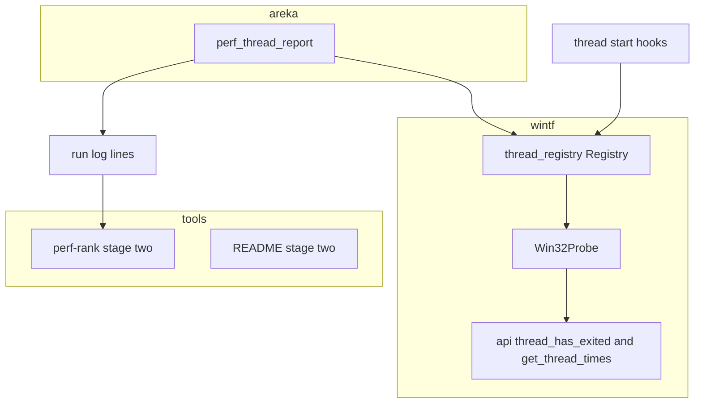
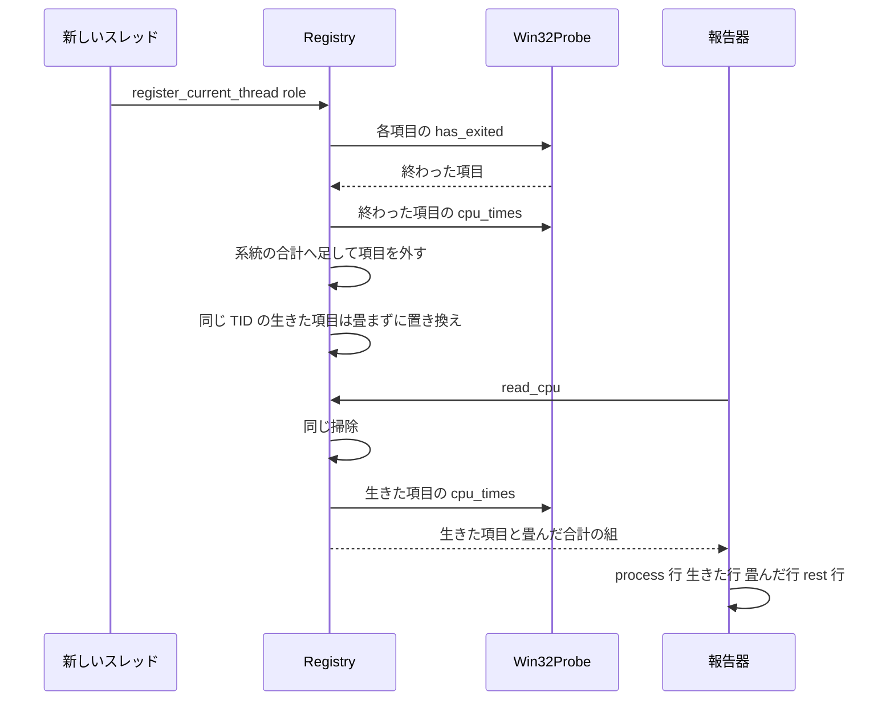
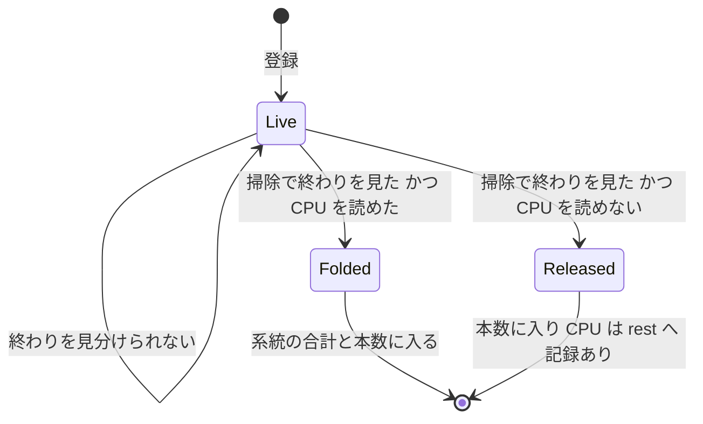

# 設計: talk-thread-count-growth

## Overview

**Purpose**: スレッド名簿が終わったスレッドの項目と預かったハンドルを手放し、その最後の CPU 時間を役割の系統ごとの合計へ畳んで報告に残す。これで、何日起動していてもトークの数に比例して名簿の項目と OS のハンドルが増えず、報告の `threads=` が実際に生きているスレッドと食い違わず、終わったスレッドの CPU 時間も報告から黙って消えない。

**Users**: マスコットを起動したまま喋らせる利用者（資源が積み上がらない）と、`perf(thread)`／`perf(process)` の行と順位表の段②で重さを調べる開発者（数と役割別の CPU が正しい）。

**Impact**: 今の名簿は、同じスレッド番号が登録し直したときにしか項目を外さない。これを「登録と読み出しのたびに、終わったスレッドを畳んで外す」形に変える。報告器は、生きたスレッドの行の後ろに系統ごとの畳んだ合計の行を足し、`threads=` を生きているスレッドの数にする。順位表の道具は、区間の差を系統ごとの合計の差で取る。最初に実機で、増えているのが名簿の項目だけか、生きたスレッドもかを切り分ける。

### Goals

- 名簿の項目の数を「生きている登録済みスレッドの数＋系統の数」で頭打ちにする（報告器が消えていても）。
- 終わったスレッドの最後の CPU 時間を系統ごとの累積へ足し、二重にも数えず、黙っても捨てない。
- `threads=` の意味・畳んだ合計の行・`unregistered_rest` の算出を直した後の振る舞いに合わせ、順位表の段②の区間の差を正しく保つ。
- 直した形を決定論テストで固定し、実機で切り分けと数え直しを 1 回ずつ記録する。

### Non-Goals

- 名簿の作りの置き換え（OS からスレッドを列挙する形）と、`Cargo.toml` の機能・依存の追加。
- トークの再生の振る舞い（台本・刻み・中断の意味）と、トーク以外のアクターの起こし方・終わり方。
- `areka-actor` の `spawn_actor`・`run_inbox` の約束と、走り始めのフックの型（`ThreadStartHook`）。
- 報告器の時計の置き換え（`instant-to-interrupt-ticks` が扱う）。
- 判定の道具 `judge-perf.py`・性能改善ループの比べと台帳の道具の変更（変えた後の行を読んで止まらないことだけを確かめる）。

## Boundary Commitments

### This Spec Owns

- スレッド名簿の状態（生きた項目の並びと、系統ごとの畳んだ合計）と、その出し入れの規則（掃除・畳み・置き換え）。
- 系統の名の規則（役割名の末尾の `-<数字>` を `-*` に畳む）。名簿（Rust）と順位表の道具（Python）が同じ規則を持つ。
- スレッドの終わりを Win32 で見分ける口（`crates/wintf/src/api.rs` の 1 関数）と、名簿が預かるハンドルの権限。
- 報告器の行の意味: `perf(process)` の `threads=`、畳んだ合計の `perf(thread)` 行の形、`unregistered_rest` の算出、1 枚の中の行の順。
- 順位表の道具の段②の区間の差の規則と、その自己テストの検体。
- 説明の追随（名簿と報告器のモジュールの説明、`tools/perf/README.md` の段②）。
- 実機の切り分けと数え直しの記録（spec の `verification/` の下）。

### Out of Boundary

- トークの側のファイル（`crates/areka-sakura/src/drive.rs`・`crates/areka-ghost/src/dispatcher.rs`）。切り分けで生きたスレッドも残ると分かったときでも、本 spec のこの段では触らない（要件 6 の扱いは「System Flows」の最後の節）。
- 走り始めのフック `crates/areka/src/thread_roles.rs`（読むだけ）と、名簿へ登録する他の呼び手（`runtime/mod.rs`・`tick_bridge.rs`・`clickthrough/monitor.rs`）。
- `tools/perf/judge-perf.py`・`perf-compare.py`・`perf-ledger.py`・`perf_lines.py`・`tools/perf/fixtures/generate.py`・`*.ps1`。
- 報告器の時計（`Instant`）と周期の決め方。

### Allowed Dependencies

- `windows` 0.62.2 の今の機能 `Win32_System_Threading`／`Win32_Foundation` の中の `WaitForSingleObject`・`THREAD_SYNCHRONIZE`・`WAIT_OBJECT_0`・`WAIT_TIMEOUT`・`WAIT_FAILED`（新しい機能も依存も足さない）。
- `tracing`（記録）、`std`（`Mutex`・`BTreeMap`・`Arc`・`OwnedHandle`）。
- テストは今の dev 依存だけ（wintf の `log-capture-kit`）。
- 依存の向き: `wintf::api` → `wintf::ecs::world::thread_registry` → `areka::perf_thread_report` → （ログの字面）→ `tools/perf/perf-rank.py`。逆向きの参照は作らない。

### Revalidation Triggers

- `perf(thread)` 行の欄の集合（`exited=` の追加）・`perf(process)` の `threads=` の意味が変わる → `perf(process)`／`perf(thread)` を読む道具（`judge-perf.py`・性能改善ループの比べと台帳）を持つ spec は読み直す。
- 名簿の公開の口（`snapshot`・`read_cpu`・`ThreadEntry`・`RegistryReading`）の形が変わる → 名簿を読むテスト（`monitor.rs`・`tick_bridge.rs`・`runtime/mod.rs`・`thread_roles_tests.rs`）と `instant-to-interrupt-ticks`（報告器の時計を替える）。
- 預かるハンドルの権限が変わる → v0.2.0 の windows-rs の移行（束縛へ移るときに `WaitForSingleObject` と権限の定数を載せる）。
- 切り分けで生きたスレッドも残ると分かった → `talk-script-metadata` の着地の後にトークの側の設計を追補する（本 spec の改訂）。

## Architecture

### Existing Architecture Analysis

- 名簿は `static REGISTRY: Mutex<Vec<ThreadEntry>>`。スレッド自身が走り始めに `register_current_thread(role)` を呼び、自分の擬似ハンドルを `DuplicateHandle`（権限 `THREAD_QUERY_LIMITED_INFORMATION`）で複製して預ける。外すのは同じスレッド番号の項目だけ（`retain(|e| e.tid != tid)`）。
- `snapshot()` は錠の中で全項目を複写して返し、報告器が錠の外で 1 本ずつ `GetThreadTimes` を呼ぶ。
- 報告器 `take_and_emit` の 1 枚は「`perf(process)` 1 行 → 名簿のスレッド（TID 昇順）→ `unregistered_rest` 1 行」。`threads=` は CPU を読めた項目の数。
- 順位表の道具の段②は、最後のスナップショットと 60 秒前（無ければ最初）の差を TID で照らして取り（`thread_delta`）、差の基準では名簿外の残りを `max(プロセスの差 − 名簿の差の合計, 0)` で置き換え（D7）、役割別の表だけ `actor:…-<数字>` を `-*` に畳む（D8）。
- 報告器の `delta` は本番から呼ばれない「規則の権威」だが、D7・D8 は Python 側にしか無く、すでに権威ではない。

### Architecture Pattern & Boundary Map



**Architecture Integration**:
- Selected pattern: 既存の「登録による名簿」をそのまま拡張する。掃除は登録と読み出しの 2 つの時点（ギャップ分析の A1）で、錠の中で行う。
- 終わりの見分け: `WaitForSingleObject(h, 0) == WAIT_OBJECT_0`（スレッドのオブジェクトは終わると signaled になる＝文書に書かれた方法・L1）。
- 1 枚の一貫性: 生きた項目の CPU の読みも錠の中で掃除と同じ時点に行い、生きた項目と畳んだ合計を 1 つの組として返す（C1）。同じスレッドが 1 枚の中で生きた行と畳んだ合計の両方に入ることは無い。
- 生死と CPU の読みを `ThreadProbe` で差し替えられる芯（`Registry`）を置く。本番は `Win32Probe` だけ、テストは偽物で、本物のスレッドでは起こせない場面（TID の使い回し・最後の CPU を読めない）を固定する。
- Steering compliance: 依存も機能も足さない・ログの無い失敗の道を作らない（読めない・見分けられないは `warn!` と記録）・描画の刻みの経路に入れない・イベント→台本→再生の流れに触らない。

### Technology Stack

| Layer | Choice / Version | Role in Feature | Notes |
|-------|------------------|-----------------|-------|
| Runtime（Rust） | `windows` 0.62.2（workspace の今の機能） | `WaitForSingleObject`・`THREAD_SYNCHRONIZE`・`GetThreadTimes`・`DuplicateHandle` | 機能・依存の追加なし（`Win32_System_Threading` の中で確かめた） |
| Observability | `tracing`（workspace） | 畳めなかったスレッド・見分けられなかったスレッドの `warn!`・行の `debug!` | target は今と同じ（`wintf::thread_registry`・`areka::perf`） |
| Tooling | Python（`tools/perf` の今の版） | 段②の区間の差 | 自己テストは `fixtures-loop/rank/` の逐語の検体 |
| Test | `log-capture-kit`（wintf の dev 依存） | 記録の捕捉 | 新しい dev 依存なし |

## File Structure Plan

### Directory Structure

```
crates/wintf/src/
├── api.rs                                  # 変更: 終わりの見分けの口・複製の権限
└── ecs/world/
    ├── thread_registry.rs                  # 変更: Registry・ThreadProbe・系統の名・掃除と畳み・read_cpu
    └── thread_registry_tests.rs            # 変更: 本物のスレッドのテストと偽の芯のテスト
crates/areka/src/
├── perf_thread_report.rs                   # 変更: 畳んだ合計の行・threads= の意味・名簿外の残り・delta の削除
└── perf_thread_report_tests.rs             # 変更: 行の固定・delta のテストの削除
tools/perf/
├── perf-rank.py                            # 変更: exited= の読み・系統の合計の差・系統の名の規則
├── README.md                               # 変更: 段②の説明
└── fixtures-loop/rank/
    ├── tid_reused/case.txt                 # 変更: note の文だけ（Rust の delta への言及）
    └── thread_exited_in_window/            # 新規: 区間の途中で畳まれたスレッドの検体
        ├── case.txt
        ├── run.log
        └── expected_rank.txt
.kiro/specs/talk-thread-count-growth/verification/
├── isolation.md                            # 新規: 要件 1 の切り分けの記録
└── signoff.md                              # 新規: 要件 7.8 の数え直しの記録
```

### Modified Files

- `crates/wintf/src/api.rs` — `duplicate_current_thread_handle` の権限に `THREAD_SYNCHRONIZE` を足す。`thread_has_exited(&OwnedHandle) -> Result<bool>` を足す。`get_thread_times` の説明の「ハンドルが開いている限り」はそのまま。
- `crates/wintf/src/ecs/world/thread_registry.rs` — 名簿を `Registry { live, folded }` に替え、掃除・畳み・置き換えを芯に集める。公開の `snapshot()` は掃除の後の生きた項目だけを返す。報告器向けの `read_cpu()` を足す。モジュールの説明（「終了した後も CPU 時間を読み出せる」「登録は複製 1 回と push 1 回」）と `ALL_ROLES` の説明（報告行に出る役割名）を直す。
- `crates/wintf/src/ecs/world/thread_registry_tests.rs` — `registration_from_another_thread_is_visible_from_this_thread`（join の後も項目が残る前提）を「join の後は畳まれて系統の合計に入る」へ書き直す。要件 7.1〜7.3・7.6・7.7 のテストを足す。
- `crates/areka/src/perf_thread_report.rs` — `take_and_emit` を `read_cpu()` に替え、畳んだ合計の行を足す。`ProcessSample::threads` の意味・`compute_unregistered_rest` の引く側・モジュールの説明「行は累積値である」を直す。本番から呼ばれない `delta` を消す（下の決め D6）。
- `crates/areka/src/perf_thread_report_tests.rs` — 畳んだ行の語彙・綴りと並び・名簿外の残り・`threads=` の固定を足す。`delta` の 3 本を消す。
- `tools/perf/perf-rank.py` — `ThreadRow` に `exited` を足し、段②の区間の差を系統の合計の差で取る。`thread_delta` は生きた行のスレッド別の表にだけ使う。D8 の規則を全部の役割へ広げる。
- `tools/perf/README.md` — 段②の箇条（名簿が手放すこと・畳んだ行・`threads=`・差の取り方）を書き直す。
- `tools/perf/fixtures-loop/rank/tid_reused/case.txt` — note の「Rust の delta と同じ」を系統の合計の差の規則の言葉に直す（期待の出力は変わらない＝設計の検証で、今の 4 つの検体の役割別の値が系統の規則でも同じになることを確かめた）。

## System Flows

### 登録と読み出し（名簿の掃除）



- 掃除は錠の中で、登録と読み出しの両方で必ず走る（報告器が消えていても登録の時点で畳まれる＝2.2）。
- 掃除の後に同じ TID の項目が残っていれば、それは生きている同じスレッドの登録し直しなので、合計へ足さずに置き換える（3.5）。終わったスレッドの TID の使い回しは、掃除が先に畳んでいるので置き換えの前に合計へ入る（3.4）。
- 名簿がハンドルを持つ間は OS がその TID を使い回さない（research.md R1）。本物のスレッドで 3.4 は起こらず、偽の芯で固定する。

### 項目の状態



### 実機の切り分けと数え直し（要件 1・7.8）

- 道具: debug ビルドの `areka.exe` を emo2 で、実機の根と一時フォルダをワークツリーの `target\` の下の短い絶対パスに置いて起こす。`RUST_LOG` に `areka::perf=debug`、`AREKA_PERF_THREAD_REPORT_SEC=10`。
- 対の取り方: 起動直後の報告 1 枚の後に 1 対。以後、areka の MCP（`sakurascript`）でトークを 1 つ流し、`get_status` でトークの終わりを見てから、次の報告の 1 枚が出る（ログの `snap=` が 1 つ進む）のを待って、その `threads=` と PowerShell の `(Get-Process -Id <pid>).Threads.Count` を 1 対として記録する。これを 5 回以上。
- 判定: 名簿の数だけが増え OS の数が増えない →「名簿の項目だけが増える」。OS の数もトークの数だけ増える →「生きたスレッドも増える」。どちらかを数の表とともに `verification/isolation.md` に書く（1.3）。トーク以外で同じ形の増え方を見たら、その起こし方と増え方を同じ記録に書く（1.4）。
- 数え直し（7.8）: 直した後のビルドで同じ手順にゴーストの切り替えを 1 回足し、`threads=` と OS の数のどちらも回数に比例して増えないこと、`role=actor:sakura-talk-*` の畳んだ行が出てその `exited=` が終わったトークの数と合うことを `verification/signoff.md` に書く。
- 終わったトークの数の出どころ: `exited=` は MCP で流したトークのほかに、起動の挨拶・切り替えのトーク・時刻やランダムのトークも数えるので、MCP で流した回数とは合わない。名簿の登録の `debug!`（target `wintf::thread_registry`・`role`・`tid`。下の Registry に足す）のうち系統が `actor:sakura-talk-*` の行を走行のログから数え、最後の 1 枚の時点で生きている `sakura-talk-<番号>` の行（`get_status` で喋っている最中なら 1 本）を引いた数を「終わったトークの数」とする。記録には MCP で流した回数と、ログから数えた数の両方を書く（`RUST_LOG` に `wintf::thread_registry=debug` を足す）。
- 決まり（1.5）: 実機の根・検体・一時フォルダは `target\` の下だけ。排他テストの机と画面の操作はそのタスクの区切りの中だけで持つ。止めるのは自分が起こしたと pid で確かめた `areka.exe` だけ。SSP などが `127.0.0.1:9276` を握っていないかを先に見る。

### 要件 6 の扱い（生きたスレッドが残っていた場合）

- 切り分けが「名簿の項目だけが増える」なら、トークの後始末は行わず、トークの側のファイルに触らない（6.4）。読む限りはこちらの見込み（research.md 6.3）。
- 「生きたスレッドも増える」なら、名簿・報告器・順位表の直しはそれだけで正しいので予定どおり進める。トークの側は、原因を `kiro-debug` の手順で突き止めて `verification/isolation.md` に記録し、本 spec の中に残したまま、`talk-script-metadata` の着地の後に本設計を追補して直す（6.1〜6.3）。追補の制約は 6.2（台本・刻み・中断の意味を変えない）。それまでトークの側のファイルには触らない。

## Requirements Traceability

| Requirement | Summary | Components | Interfaces | Flows |
|-------------|---------|------------|------------|-------|
| 1.1 | 報告と OS の数を対で記録 | 実機の確かめ | MCP `sakurascript`・`get_status` | 実機の切り分け |
| 1.2 | OS の数はプロセスの外から | 実機の確かめ | `Get-Process` | 実機の切り分け |
| 1.3 | 判定と数の表を記録 | 実機の確かめ | `verification/isolation.md` | 実機の切り分け |
| 1.4 | トーク以外の増え方は記録だけ | 実機の確かめ | `verification/isolation.md` | 実機の切り分け |
| 1.5 | 置き場・机・止めるプロセス | 実機の確かめ | — | 実機の切り分け |
| 2.1 | 登録・読み出しで終わった項目を残さない | Registry | `register_current_thread`・`snapshot`・`read_cpu` | 名簿の掃除 |
| 2.2 | 消灯でも増えない | Registry | `register_current_thread` | 名簿の掃除 |
| 2.3 | 生きた項目は今の形 | Registry | `ThreadEntry` | — |
| 2.4 | 項目の数の頭打ち | Registry | `Registry::live`・`folded` | 項目の状態 |
| 2.5 | 刻みの経路に入れない | Registry | 呼び手は起動と報告の周期だけ | — |
| 3.1 | 手放す前に最後の CPU を足す | Registry・Win32Probe | `ThreadProbe::cpu_times` | 名簿の掃除 |
| 3.2 | 系統の名の規則 | Registry・perf-rank | `role_family`・`family()` | — |
| 3.3 | 読めなかったら記録 | Registry | `warn!`（tid・role・family） | 項目の状態 |
| 3.4 | TID の使い回しでも足してから置き換え | Registry | 掃除の後に置き換え | 名簿の掃除 |
| 3.5 | 生きた同じスレッドは足さずに置き換え | Registry | 掃除の後に置き換え | 名簿の掃除 |
| 3.6 | 合計は減らない | Registry | `FoldedTotal` は足すだけ | — |
| 4.1 | `threads=` は生きた数 | 報告器 | `ProcessSample::threads` | 読み出し |
| 4.2 | 系統ごとの畳んだ行と本数 | 報告器 | `format_folded_line`（`exited=`） | 読み出し |
| 4.3 | 名簿外の残りは両方を引く | 報告器 | `compute_unregistered_rest` | — |
| 4.4 | OS の数との差を広げない | Registry・報告器・実機の確かめ | `threads=` | 数え直し |
| 4.5 | 行の語彙の約束 | 報告器 | `format_folded_line`・`sanitize` | — |
| 4.6 | 今の文言・並び・行の順を保つ | 報告器 | `take_and_emit` の順 | 読み出し |
| 4.7 | 消灯で報告スレッドを起こさない | 報告器 | `start` の前置ガード（変えない） | — |
| 5.1 | 区間の中の分だけを数える | perf-rank | 系統の合計の差 | — |
| 5.2 | 名簿外の残り＝プロセスの差 − 名簿の差 | perf-rank | D7（系統の差の合計を引く） | — |
| 5.3 | 古いログも止まらず正しく | perf-rank | `exited` は任意の欄 | — |
| 5.4 | 判定・比べ・台帳が止まらない | perf-rank（読み手の確かめ） | 行の欄の追加だけ | — |
| 5.5 | 説明の追随 | 報告器・Registry・README | モジュールの説明・段② | — |
| 6.1 | 残っていたらトークの後始末 | 要件 6 の扱い | — | 要件 6 の扱い |
| 6.2 | 再生の振る舞いを変えない | 要件 6 の扱い | — | 要件 6 の扱い |
| 6.3 | 着地までトークの側に触らない | 要件 6 の扱い | — | 要件 6 の扱い |
| 6.4 | 残らないなら行わない | 要件 6 の扱い | — | 要件 6 の扱い |
| 7.1 | 100 本以上で頭打ち | 名簿のテスト | `read_cpu` | — |
| 7.2 | 畳んだ合計＝最後の CPU の和・減らない | 名簿のテスト | `read_cpu` | — |
| 7.3 | 使い回しと登録し直し | 名簿のテスト（偽の芯） | `Registry::insert` | — |
| 7.4 | 報告の行 | 報告器のテスト | 純関数 | — |
| 7.5 | 区間の差と古いログ | perf-rank の自己テスト | `fixtures-loop/rank/` | — |
| 7.6 | 消灯でも積み上がらない | 名簿のテスト（局所の `Registry`＋`Win32Probe`） | `Registry::insert` だけ | — |
| 7.7 | 読めない失敗の記録 | 名簿のテスト（偽の芯） | `log-capture-kit` | — |
| 7.8 | 直した後の実機の数え直し | 実機の確かめ | `verification/signoff.md` | 数え直し |

## Components and Interfaces

| Component | Domain/Layer | Intent | Req Coverage | Key Dependencies | Contracts |
|-----------|--------------|--------|--------------|------------------|-----------|
| api（終わりの見分け） | wintf の Win32 の口 | スレッドが終わったかと CPU 時間を読む | 2.1, 3.1 | `windows` 0.62.2（P0） | Service |
| Registry | wintf の名簿 | 生きた項目と系統の合計を持ち、掃除・畳み・置き換えを行う | 2.1–2.5, 3.1–3.6 | api（P0） | Service, State |
| 報告器 | areka | 1 枚の行を組んで出す | 4.1–4.7, 5.5 | Registry（P0） | Service |
| perf-rank 段② | tools/perf | 区間の役割別・スレッド別の CPU | 5.1–5.4, 7.5 | run.log の行（P0） | Batch |
| 実機の確かめ | 手順と記録 | 切り分けと数え直し | 1.1–1.5, 4.4, 6.1–6.4, 7.8 | areka の MCP（P1） | — |

### wintf の Win32 の口

#### api（終わりの見分け）

| Field | Detail |
|-------|--------|
| Intent | 名簿の預かるハンドルで、スレッドが終わったかを待たずに見分ける |
| Requirements | 2.1, 3.1 |

**Responsibilities & Constraints**
- `duplicate_current_thread_handle` は権限を `THREAD_QUERY_LIMITED_INFORMATION | THREAD_SYNCHRONIZE` にする（`WaitForSingleObject` は `SYNCHRONIZE` を要る・`GetThreadTimes` は今のまま `QUERY_LIMITED` で足りる）。自プロセスの自スレッドのハンドルで、同期待ちの権限を足すだけ。
- `thread_has_exited` は待たない（`dwMilliseconds = 0`）。

**Contracts**: Service [x]

##### Service Interface
```rust
/// スレッドが終わったか（待たない・`WaitForSingleObject(h, 0)`）。
pub fn thread_has_exited(thread: &OwnedHandle) -> windows::core::Result<bool>;
// WAIT_OBJECT_0 → Ok(true) / WAIT_TIMEOUT → Ok(false)
// WAIT_FAILED → Err(Error::from_thread()) / それ以外の戻り → Err（E_UNEXPECTED 相当）
```
- Preconditions: `thread` は `duplicate_current_thread_handle` が返したもの（`SYNCHRONIZE` つき）。
- Postconditions: `Ok(true)` は「スレッドのオブジェクトが signaled＝終わった」。以後 `get_thread_times` は最後の値を返す。
- Invariants: スレッドの状態を変えない。`unsafe` には `// SAFETY:` を付ける。

### wintf の名簿

#### Registry（`thread_registry.rs`）

| Field | Detail |
|-------|--------|
| Intent | 生きた項目と系統ごとの畳んだ合計を 1 つの錠で持ち、登録と読み出しのたびに終わったスレッドを畳んで外す |
| Requirements | 2.1, 2.2, 2.3, 2.4, 2.5, 3.1, 3.2, 3.3, 3.4, 3.5, 3.6 |

**Responsibilities & Constraints**
- 状態は `static REGISTRY: Mutex<Registry>`。錠の毒化は今と同じく中身を受け取って続ける。
- 掃除（`sweep`）: 生きた項目ごとに `probe.has_exited` を見る。
  - `Ok(true)`: `probe.cpu_times` を読み、読めたら系統の合計（カーネル・ユーザー 100ns）へ足す。読めなければ `warn!`（`tid`・`role`・`family`・`error`・「その分は unregistered_rest へ回る」）。どちらでも系統の `exited` を 1 足し、項目（とハンドル）を外す。
  - `Ok(false)`: 残す。
  - `Err`: 残す（外すと CPU を黙って落とすので）。`warn!`（`tid`・`role`・`error`）。
- 登録（`insert`）: 掃除 → 同じ TID の項目があれば畳まずに外す（掃除の後に残っているのは生きている同じスレッドだけ）→ 末尾へ足す。
- 読み出し（`read`）: 掃除 → 生きた項目ごとに `probe.cpu_times` を錠の中で読み、生きた項目と畳んだ合計（系統名の昇順）を 1 つの組として返す。
- 系統の名（`role_family`）: 役割名が `^(.+)-[0-9]+$` に合えば `\1-*`、合わなければそのまま（ASCII の数字だけ）。例 `actor:sakura-talk-17` → `actor:sakura-talk-*`、`actor:kanade` → `actor:kanade`。系統の名は登録の口を通らないので語彙の検査（`is_known_role`）には掛けない。
- 呼び手は走り始めの登録と報告器の周期だけで、描画の刻みの経路には入らない（2.5）。錠の中の Win32 の呼び出しは項目の数（今は 20 前後）× 2 回程度。
- 記録は錠の外で出す: 掃除は `warn!` に出す中身（tid・role・family・error）を錠の中で集めるだけにし、錠を放してから出す（錠の時間を縮め、名簿の錠と記録の購読者の錠の順の取り合いを作らない）。記録は登録したスレッド（または報告器）の span の中に出るので、対象のスレッドは欄の `tid`・`role` で指す。
- 登録の `debug!`: 登録が済んだら `debug!`（target `wintf::thread_registry`・`role`・`tid`）を 1 行出す（実機の数え直しで、起きたスレッドの本数をログから数えるため）。

**Dependencies**
- Inbound: 走り始めの登録の呼び手 5 か所（P0）・報告器（P0）・名簿を読むテスト（P2）
- Outbound: api の `thread_has_exited`・`get_thread_times`（P0）

**Contracts**: Service [x] / State [x]

##### Service Interface
```rust
// 公開（今の口の形を保つ）
pub fn register_current_thread(role: impl Into<String>) -> windows::core::Result<()>;
/// 掃除の後の生きた項目の複写（今の呼び手 8 か所はこのまま）。
pub fn snapshot() -> Vec<ThreadEntry>;
/// 掃除の後の生きた項目の CPU と畳んだ合計を、錠の中の 1 つの時点の組で返す（報告器向け）。
pub fn read_cpu() -> RegistryReading;

pub struct RegistryReading {
    pub live: Vec<LiveReading>,      // 登録順（並べ替えは報告器）
    pub folded: Vec<FoldedReading>,  // 系統名の昇順
}
pub struct LiveReading {
    pub role: String,
    pub name: Option<String>,
    pub tid: u32,
    pub cpu: windows::core::Result<CpuTimes>,
}
pub struct FoldedReading {
    pub family: String,
    pub cpu: CpuTimes,   // 畳んだスレッドの最後の CPU の和（100ns・累積）
    pub exited: u64,     // 畳んだスレッドの本数（累積・読めなかった分も入る）
}

// 非公開（芯）
struct Registry { live: Vec<ThreadEntry>, folded: BTreeMap<String, FoldedTotal> }
struct FoldedTotal { kernel_100ns: u64, user_100ns: u64, exited: u64 }
trait ThreadProbe {
    fn has_exited(&self, entry: &ThreadEntry) -> windows::core::Result<bool>;
    fn cpu_times(&self, entry: &ThreadEntry) -> windows::core::Result<CpuTimes>;
}
struct Win32Probe; // api::thread_has_exited と ThreadEntry::cpu_times を呼ぶだけ
impl Registry {
    fn sweep(&mut self, probe: &impl ThreadProbe);
    fn insert(&mut self, entry: ThreadEntry, probe: &impl ThreadProbe);
    fn read(&mut self, probe: &impl ThreadProbe) -> RegistryReading;
}
fn role_family(role: &str) -> String;
```
- Preconditions: `register_current_thread` は登録される当のスレッドが呼ぶ（今と同じ）。
- Postconditions: `register_current_thread`・`snapshot`・`read_cpu` が返った時点で、その時点より前に終わりを見分けられたスレッドの項目は残っていない（2.1）。項目の数 ≦ 生きている登録済みスレッドの数＋系統の数（2.4）。
- Invariants: 系統の合計と本数は足すだけで減らない（3.6）。1 本のスレッドの CPU は、1 つの読み出しの組の中で生きた項目か畳んだ合計のどちらか一方にだけ入る。`ThreadEntry` の欄（役割名・OS 名・TID・ハンドル）と `cpu_times()` は今のまま（2.3）。

##### State Management
- State model: 生きた項目（`Vec<ThreadEntry>`）＋系統の合計（`BTreeMap<String, FoldedTotal>`）。
- Persistence & consistency: プロセスの中だけ（保存しない）。掃除・置き換え・読み出しは全部 1 つの錠の中。
- Concurrency strategy: 錠 1 本。報告器の読み出しの錠の時間は項目の数 ×（`WaitForSingleObject`＋`GetThreadTimes`）で、新しいスレッドの登録はその間だけ待つ。

**Implementation Notes**
- Integration: `ThreadEntry::handle` の説明「スレッド終了後も CPU 時間を読める」は「名簿が手放すまで」に直す。`ALL_ROLES` の説明は「報告行の役割名は語彙のもの（アクターは `actor:<name>`）と、その系統の名（末尾の番号を `-*` に畳んだもの）」へ直す。
- Validation: 本物のスレッドのテストは「そのテストだけの系統」で数え、名簿全体の数を当てにしない（並列のテストの掃除は自分の系統を減らす向きにしか働かない）。
- Risks: 見分けの失敗が続く場合は掃除のたびに `warn!` が出る（権限を足し忘れたなどの作りの誤りでしか起きない＝見える方を取る）。

### areka

#### 報告器（`perf_thread_report.rs`）

| Field | Detail |
|-------|--------|
| Intent | 名簿の読み出しの組から 1 枚の行を組んで出す |
| Requirements | 4.1, 4.2, 4.3, 4.5, 4.6, 4.7, 5.5 |

**Responsibilities & Constraints**
- 1 枚の行の順: `perf(process)` 1 行 → 生きた行（TID 昇順・CPU を読めた項目だけ）→ 畳んだ行（系統名の昇順）→ `unregistered_rest` 1 行。
- `threads=` は `reading.live.len()`（CPU を読めなかった生きた項目も数える・畳んだ行と残りの行は数えない）。読めなかった生きた項目の扱い（行を出さず、1 枚に 1 度の `warn!` に TID を並べる）は今のまま。
- 畳んだ行は今の `perf(thread)` の欄のまま `tid=0 name=-` とし、末尾に `exited=<本数>` を 1 つ足す。行の形（`exited=` の有無）で生きた行・残りの行と見分ける（番号の無い系統では役割名が生きた行と同じになるため）。
- `unregistered_rest` ＝ max(プロセス − 生きた行の合計 − 畳んだ合計, 0)（カーネル・ユーザーそれぞれ）。
- 本番から呼ばれない `delta` と `#[allow(dead_code)]` を消し、モジュールの説明の「差の取り方は `delta` が権威」を「区間の差は読み手（`perf-rank.py` の段②・自己テストが規則を固定する）が、最後のスナップショットと 60 秒前のものを比べて取る。名簿外の残りはプロセスの差から出す」へ直す（決め D6・決め 1）。
- 点灯の判定と `start` の前置ガードは変えない（4.7）。
- 読む順: `read_cpu()` を先に読み、プロセス CPU をその後に読む（プロセスの値が名簿の値より後になるので、名簿外の残りが 0 で止まる向きの食い違いを作らない）。

**Contracts**: Service [x]

##### Service Interface
```rust
pub struct FoldedSample { pub family: String, pub kernel_us: u64, pub user_us: u64, pub exited: u64 }
impl FoldedSample { pub const fn cpu_us(&self) -> u64; }

/// "perf(thread): スレッド別 CPU snap={} t_s={} tid=0 name=- role={family} cpu_us={} kernel_us={} user_us={} exited={}"
pub fn format_folded_line(snap: u32, t_s: u64, s: &FoldedSample) -> String;

pub fn compute_unregistered_rest(
    process: &ProcessSample, threads: &[ThreadSample], folded: &[FoldedSample],
) -> ThreadSample;

/// 1 枚の行を組む純関数（Win32 を呼ばない）。`take_and_emit` はプロセス CPU と
/// `read_cpu()` を読んでこれに渡し、返った行を順に出し、読めなかった TID を `warn!` に並べる。
pub(crate) struct ComposedSnapshot { pub lines: Vec<String>, pub unreadable_tids: Vec<u32> }
pub(crate) fn compose_snapshot(
    snap: u32, elapsed: Duration, process: CpuTimes, reading: RegistryReading,
) -> ComposedSnapshot;
```
- Preconditions: `family` は名簿の系統名（`sanitize` を通す＝空白を `_`・空なら `-`）。
- Postconditions: 畳んだ行の欄名は 9 つで重複しない。`format_thread_line`・`format_process_line` の文言・欄の綴りと並びは今のまま（4.6）。
- Invariants: `ProcessSample::threads` の説明は「そのスナップショットの時点で生きている名簿のスレッドの本数（CPU を読めなかったものも数える）」。

### tools/perf

#### perf-rank 段②（`perf-rank.py`）

| Field | Detail |
|-------|--------|
| Intent | 区間の中で使った CPU を、系統ごとの合計の差で役割別に出す |
| Requirements | 5.1, 5.2, 5.3, 5.4, 7.5 |

**Contracts**: Batch [x]

##### Batch / Job Contract
- Trigger: `perf-rank.py rank`（段②）と自己テスト。
- Input / validation: `perf(thread)` 行の `exited=` は任意の欄。在れば整数でなければ他の欄と同じく exit 4（部分の集計を出さない）。`ThreadRow` に `exited: int | None = None` を足す（既定は `None`＝古い行と今の呼び手のまま）。
- 行の分類: `role == unregistered_rest` → 残りの行。`exited is not None` → 畳んだ行。それ以外 → 生きた行。
- 系統: `family(role) = re.sub(r"^(.+)-[0-9]+$", r"\1-*", role)`（Rust の `role_family` と同じ規則・全部の役割へ広げる）。畳んだ行の役割名はすでに系統名。
- 差の基準（`delta`）:
  - 系統の合計 F(s) ＝ その系統の生きた行の `cpu_us` の和 ＋ 畳んだ行の `cpu_us`。系統の区間の CPU ＝ max(F(後) − F(前), 0)。前に無い系統は 0 から。
  - `registry_cpu_s` ＝ 系統の区間の CPU の和。`unregistered_rest_cpu_s` ＝ max(プロセスの差 − 名簿の差, 0)（D7 のまま）。プロセスの差が取れないときは残りの行の TID の差（今のまま）。
  - 役割別の表 ＝ 系統ごとの区間の CPU ＋ 残りの 1 行。
  - スレッド別の表 ＝ 生きた行と残りの行に今の `thread_delta`（TID で照らす）をかけたもの。畳んだ行はスレッドではないので載せない（決め 5）。畳んだ行は残りの行と同じ `tid=0` を持つので、`thread_delta` に渡す前に前後の両方から畳んだ行を除く（除かないと前の辞書の鍵 0 が重なって残りの行の差が化ける）。
- 累積の基準（1 枚だけ）: 系統の合計 F(最後) と残りの行の値をそのまま使う。
- 正しさ: 1 本のスレッドはどのスナップショットでも生きた行か畳んだ行のどちらか一方にだけ入り、累積は減らない。よって F(後) − F(前) は、その系統の各スレッドの「後の値 − 前の値（前に無ければ 0・前より先に終わっていれば 0）」の和に等しく、区間より前の分を足さず、区間の中の分を落とさない（5.1・5.2）。名簿が手放した後の TID の使い回しにも左右されない。
- 古いログ（畳んだ行が無い・終わったスレッドが最後の値で残り続ける）: 名簿がハンドルを持ち続けたので TID は使い回されておらず、F の差は TID ごとの差の和と同じ値になる（5.3）。今の検体 `full_ok`・`tid_reused`・`talk_threads_folded` の期待の出力は変わらない見込み（変わったら自己テストの差で見て、理由を検体の note に書く）。
- Output / destination: 段②の表の形・見出し・欄は今のまま。
- Idempotency & recovery: 純粋な読み取り。

**Implementation Notes**
- Integration: `thread_delta` の説明の「Rust の `delta` と同じ意味論の写し」を消し、「スレッド別の表の照らし方」とする。D8 の説明を「系統の規則（名簿の `role_family` と同じ）」へ。
- Validation: 新しい検体 `thread_exited_in_window` に、⑴ 区間の前から生きていて区間の中で終わったスレッド ⑵ 区間の中で生まれて終わったスレッド ⑶ 区間の前に終わって前後とも畳んだ行に入っているスレッド ⑷ 番号の無い系統（`actor:kanade`）で生きた行と畳んだ行が同じ役割名で並ぶ場面、を入れ、役割別の表・`registry_cpu_s`・`unregistered_rest_cpu_s` を逐語で固定する。古い形のログは今の 3 つの検体が受け持つ（7.5）。
- Risks: 生きている同じスレッドが区間の中で別の系統へ登録し直すと、その前の分が新しい系統へ移り、古い系統は 0 で止まる（名簿の合計は保たれる）。本番の呼び手で登録し直すものは無い（決め 6）。
- Risks: 最後の CPU を読めずに手放したスレッドは系統の合計から消えるので、その区間の系統の差が 0 で止まり、同じ系統の他のスレッドの区間の分を呑むことがある。稀で `warn!` に残るので、既知の限りとして README の段②に書く（決め 6 と並べる）。

#### 説明（`tools/perf/README.md` の段②）

- 書き直す箇条: ⑴ 名簿は終わったスレッドを登録と読み出しのたびに手放し、その最後の CPU を系統（末尾の番号を `-*` に畳んだ役割名）ごとの合計へ畳む ⑵ 畳んだ合計は系統ごとに 1 行の `perf(thread)` 行で毎回出て、`tid=0 name=-` と末尾の `exited=`（畳んだ本数・累積）で見分ける ⑶ `perf(process)` の `threads=` は生きている名簿のスレッドの数 ⑷ 区間の差は最後のスナップショットと 60 秒前のものを比べ、役割別は系統の合計の差、名簿外の残りはプロセスの差から出す ⑸ 名簿がハンドルを持つ間は TID が使い回されず、手放した後の使い回しは系統の差では区間の CPU を崩さない（スレッド別の表は TID で照らすので、使い回した新しいスレッドが小さく出ることがある）。
- 「名簿は終了したスレッドの登録を消しません」「値は累積です。読み手が 2 つのスナップショットの差を取ります」の文を消す。`check_tree(readme_examples=True)` が README の例を見張るので、例の字面を変えたら自己テストで確かめる。

## Data Models

### Domain Model

- 生きた項目 `ThreadEntry`（今のまま）: 役割名・OS 名・TID・預かったハンドル。不変条件: 1 つの TID に生きた項目は高々 1 つ。
- 系統の合計 `FoldedTotal`: 系統名をキーに、カーネル・ユーザーの累積（100ns）と畳んだ本数。不変条件: 減らない。読めなかった畳みは本数にだけ入る。
- 読み出しの組 `RegistryReading`: 錠の中の 1 つの時点の生きた項目の CPU と系統の合計の写し。

### Data Contracts & Integration

`perf(thread)` 行（畳んだ合計・新しい形）:

| 欄 | 値 | 備考 |
|----|----|------|
| `snap`・`t_s` | 生きた行と同じ | |
| `tid` | `0` | 実在のスレッドを指さない印（残りの行と同じ） |
| `name` | `-` | |
| `role` | 系統名（例 `actor:sakura-talk-*`・`actor:kanade`） | |
| `cpu_us`・`kernel_us`・`user_us` | 畳んだスレッドの最後の CPU の和（µs・累積） | 100ns の和を最後に 1 度だけ µs へ切り捨てる |
| `exited` | 畳んだ本数（累積） | この欄があることが畳んだ行の印 |

- 例: `perf(thread): スレッド別 CPU snap=12 t_s=120 tid=0 name=- role=actor:sakura-talk-* cpu_us=84000 kernel_us=31000 user_us=53000 exited=7`
- 前方互換: 欄を 1 つ足すだけ。`judge-perf.py` は `perf(thread)` 行を数えるだけで、欄の語彙の見本は今の行のまま（変えない）。性能改善ループの比べと台帳は `perf(thread)` と `threads=` を読まない（research.md 2.6 で確かめた）。

## Error Handling

### Error Strategy

| 失敗 | どこで | 扱い | 記録 |
|------|--------|------|------|
| 終わりを見分けられない（`WAIT_FAILED`） | 掃除 | 項目を残す（CPU を黙って落とさない） | `warn!` target `wintf::thread_registry`（tid・role・error） |
| 終わったスレッドの最後の CPU を読めない | 掃除 | 項目を外し、本数にだけ入れる（その CPU は名簿外の残りへ回る） | `warn!`（tid・role・family・error・「unregistered_rest へ回る」）＝3.3 |
| 生きた項目の CPU を読めない | 読み出し | 行を出さず `threads=` には数える | 報告器の今の `warn!`（1 枚に 1 度・tid の並び） |
| ハンドルの複製に失敗 | 登録 | 今のまま `error!`＋`Err`（名簿に載らない） | 今のまま |
| プロセス CPU を読めない | 報告器 | 今のまま 1 枚を諦める | 今のまま `error!` |

### Monitoring

- 畳んだ行の `exited=` で、終わったスレッドの本数を系統ごとに追える。`threads=` と OS の数の差が広がらないことは実機の記録（7.8）で見る。

## Testing Strategy

### Unit Tests（名簿 `thread_registry_tests.rs`）

- 本物のスレッドを 128 本、そのテストだけの系統 `actor:test-<tid>-many-<i>` で順に起こして登録させ、join する。全部の後に `read_cpu()` で、その系統の生きた項目が 0・畳んだ行が 1 つ・`exited` が 128 であること（7.1・2.4）。
- 同じテストで、各スレッドが自分のハンドルを `duplicate_current_thread_handle` で別に複製して返し、join の後にテストがそれで読んだ最後の CPU の和が、その系統の畳んだ合計に一致すること。16 本ごとに読んだ合計が減らないこと（7.2・3.1・3.6）。
- 局所の `Registry` と本物の `Win32Probe` で、本物のスレッドを順に起こし、各スレッドが `duplicate_current_thread_handle` で自分の `ThreadEntry` を作ってテストへ返し、テストが `insert` だけを呼ぶ（`read` は 1 度も呼ばない）。各 `insert` の直後に、局所の名簿の項目が「生きた 1 本＋合計 1 つ」を超えないこと（7.6・2.2）。プロセス共有の名簿は、同じテストの二進の他のテスト（`tick_bridge`・`monitor`・`runtime`）が `snapshot()` を 5 ms ごとに読んで掃除を起こすので、登録の時の掃除が無い作りでも通ってしまう＝共有の名簿では固定しない。
- 偽の `ThreadProbe` と局所の `Registry` で: ⑴ 終わったと告げた TID 7 の項目へ別の系統の TID 7 を登録すると、前の CPU が前の系統へ 1 度だけ入り、生きた項目は新しい方だけ ⑵ 生きていると告げた TID 8 の登録し直しでは合計が動かず、生きた項目は 1 つ（7.3・3.4・3.5）。
- 偽の芯で、終わったが CPU を読めない項目を掃除すると、`log-capture-kit` で tid と役割名つきの `warn!` が捕まり（対照の事象つき）、本数は 1 増え CPU は増えないこと（7.7・3.3）。
- `role_family` の表: `actor:sakura-talk-17`→`actor:sakura-talk-*`・`actor:kanade`→そのまま・`vblank`→そのまま・`-5`→そのまま・`actor:x-1a`→そのまま（3.2）。
- `registration_from_another_thread_is_visible_from_this_thread` を「join の後は生きた項目に無く、その系統の畳んだ合計に入る」へ書き直す。`api::thread_has_exited` は、生きている自スレッドで `false`、join したスレッドの複製で `true`。

### Unit Tests（報告器 `perf_thread_report_tests.rs`）

- 畳んだ行の欄名が重複しない・綴りと並びが固定（`snap t_s tid name role cpu_us kernel_us user_us exited`）・`tid=0`・`name=-`・系統名の空白が `_` になる（7.4・4.2・4.5）。
- `compute_unregistered_rest` がプロセスから生きた行と畳んだ合計の両方を引き、0 で止まる（4.3）。
- `compose_snapshot` に手で組んだ `RegistryReading`（読めない生きた項目 1 つ・番号の無い系統の畳んだ合計を含む）を渡し、`threads=` が生きた項目の数（読めないものを含む）であること、行の順（process が先頭・生きた行は TID 昇順・畳んだ行は系統名の昇順でその後・残りが末尾）、読めない TID が `unreadable_tids` に出ることを固定する（4.1・4.6）。
- 既存の `format_thread_line`／`format_process_line` の綴りと並びのテストはそのまま緑（4.6）。消灯時に何も起こさないテストもそのまま（4.7）。

### Integration Tests（perf-rank の自己テスト）

- 新しい検体 `thread_exited_in_window`（Batch の Validation の 4 つの場面）で、役割別の表・`registry_cpu_s`・`unregistered_rest_cpu_s` が逐語で一致（7.5・5.1・5.2）。
- 今の検体（`full_ok`・`tid_reused`・`talk_threads_folded`・`thread_missing_cpu_us` ほか）が変わらず通る＝古い形のログを止まらずに正しく読む（7.5・5.3）。
- `judge-perf.py` の自己テストと性能改善ループの道具の自己テストが、手を入れずに緑のまま（5.4）。

### E2E（実機）

- 切り分け（要件 1）と数え直し（7.8）を「System Flows」の手順で 1 回ずつ。結果は `verification/` の 2 つの記録。

## Performance & Scalability

- 登録 1 回の費用: 項目の数 × `WaitForSingleObject(h, 0)`（待たない）＋終わった項目ごとの `GetThreadTimes`。今の規模（20 前後）で数十 µs の見込み。トークの始まりのスレッドの頭で走り、刻みの経路には入らない（2.5）。
- 報告器の 1 枚: 錠の中で項目の数 × 2 回の Win32 の呼び出し。周期は既定 60 秒。
- 消灯時の費用: 増えるのは登録のたびの掃除だけ。報告スレッドは起こさない（4.7）。

## 設計の決め（research.md の「設計の決め」に根拠）

- **D1 掃除の時点**: 登録と読み出しの両方（A1）。読み出しだけでは消灯時に満たせない（2.2）。スレッドの終わりのフック（A3）は、本体のスレッドで後始末が走らないことがあり、最後の CPU より少し前の値しか読めないので採らない。
- **D2 終わりの見分け**: `WaitForSingleObject(h, 0)`（L1）。複製の権限に `THREAD_SYNCHRONIZE` を足す。終了時刻（L2）は生きたスレッドで中身が未定義と文書にある。終了コード（L3）は 259 で終わるスレッドを生きていると誤る。
- **D3 1 枚の一貫性**: 生きた項目の CPU も錠の中で掃除と同じ時点に読む（C1）。世代の番号（C2）や 1 度だけ渡す行（C3）は状態を増やすだけで、錠の中の費用は数十 µs。
- **D4 畳んだ行の形**: `perf(thread)` の今の欄に `exited=` を 1 つ足す（R2）。要件 4.2 が `perf(thread)` 行と行の形での見分けを求めるので、別の行の種類（R3）と値だけの印（R1）は採らない。
- **D5 区間の差**: 系統の合計の差（P1）。名簿の合計の中でスレッドは生きた行か畳んだ行の一方にだけ入るので、手放した後の TID の使い回しにも区間の境の終わりにも正しい。消えた TID の差し引き（P2）は使い回しで誤り、最後の行を 1 度出す（P3）は報告器に状態が要る。
- **D6 Rust の `delta` を消す**: 本番から呼ばれず、D7・D8 を持たないのですでに規則の権威ではない。規則の正本を perf-rank の自己テストの検体 1 か所にする（Rust と Python に同じ規則を 2 つ持って食い違う道を断つ）。系統の名の規則だけは名簿が畳むのに要るので、Rust（`role_family`）と Python（`family`）の両方に置き、どちらもテストで同じ例を固定する。

## 設計の議論で決めたこと / Risks

- **決め 1（D6）**: Rust の `delta` は消す。区間の差の規則の正本は perf-rank の自己テストの検体 1 か所。
- **決め 2（D4）**: 本数の欄の名は `exited`。畳んだ行の `tid=0`・`name=-` は残りの行と同じにし、`exited=` の有無で見分ける。
- **決め 3（D2）**: 終わりの見分けは `WaitForSingleObject(h, 0)`。複製の権限に `THREAD_SYNCHRONIZE` を足す。
- **決め 4**: 見分けに失敗した項目は残し、掃除のたびに `warn!` を出す（1 度だけ記録する状態は持たない）。
- **決め 5**: 順位表のスレッド別の表に畳んだ行を載せない（役割別の表と `registry_cpu_s` には入る）。
- **決め 6**: 生きている同じスレッドが区間の中で別の系統へ登録し直したときの区間の割り振り（前の分が新しい系統へ移る）は、既知の限りとして README の段②に書くだけにする（本番の呼び手で登録し直すものは無い）。
- **決め 7**: 最後の CPU を読めずに手放したスレッドも `exited=` の本数に数え、`warn!` を残す。
- **決め 8（実機の手順）**: トークの終わりは MCP の `get_status`（`talking` の有無）で見る。見えなければ、ログの報告の 1 枚を 2 つ待つ形に倒す。
- **危うさ**: 実機で生きたスレッドも増えると分かったときは、トークの側の直しが `talk-script-metadata` の着地を待つので、本 spec の完了がそれだけ遅れる。
