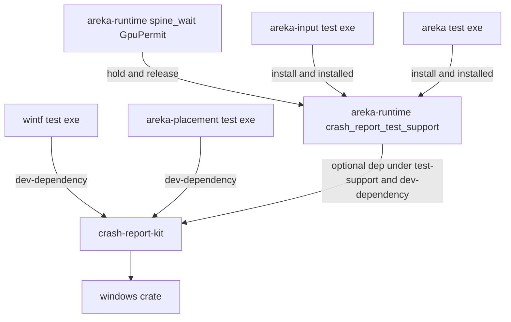
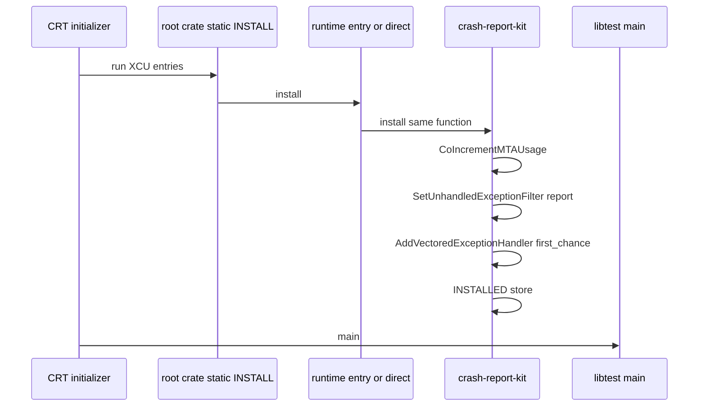

# 設計書: test-crash-report-merge

## Overview

**Purpose**: テストのプロセスの落ちの報告（例外の受け手・プロセスの寿命の MTA・報告の行）の 3 本の写しを、テスト専用の新しい leaf の crate `crash-report-kit` の 1 本にまとめる。直す所を 1 か所にし、写しの直し忘れと windows-rs の移行での 3 回の書き換えを無くす。

**Users**: areka の開発者（テストの揺れを `tools/load-flake.ps1` で調べる人・windows-rs の移行をする人）。

**Impact**: 本文は `areka-runtime` の写し（3 本の上位集合）をそのまま新しい crate へ移す。wintf と areka-placement の写しは、`areka-input` が既に取っている「根の crate に据え付けの静的変数 1 つ＋確かめ 1 本」の小さなファイルに替わる。`areka-runtime` の `crash_report_test_support` は同じ名を `pub use` で開く薄い入口になり、`areka-input`・本体・`spine_wait.rs` は差分 0 のまま新しい本体を使う。areka の本番の振る舞いは変わらない。あわせて `audit-emo2-boot-frame` から預かった `areka-placement` の古い注と写しを直す。

### Goals

- 落ちの報告の本体の定義がワークスペースに 1 つだけ（`crates/crash-report-kit/src/lib.rs`）。
- 報告の行・書く先・据わる時点・緑の走行で何も書かないことが今と同じ。
- 許可の持ち手の表を使うのは `areka-runtime` の `GpuPermit` だけ・ほかの実行ファイルの報告には `AREKA-CRASH-HOLDER` の行が出ない。
- C24 の並走の約束のファイルに差分 0・`Cargo.lock` の差分は決めた分だけ。
- 預かった `areka-placement` の件（申し送りウ・エ・オ・カ・移したテストの置き場・武装の説明）が片づく。

### Non-Goals

- 報告の中身・書く先を変えること（`write_thread_name` の `LocalFree` の先送りもそのまま）。
- windows-rs の移行そのもの。
- `carrier_cue` の残りの写し・申し送りに名指されていない `code_only` の写し・`areka-runtime` の `INVARIANT_WARNING` の手写し・`frame_test_support.rs` の `window_move_lines` の写しの付け替え（決定 4〜6）。
- 写しが戻ること、`crash-report-kit` が本番の依存に現れることを見張る常設の見張り（決定 7）。

## Boundary Commitments

### This Spec Owns

- 新しい crate `crates/crash-report-kit/`（本文・自分のテスト・`Cargo.toml`）と、その公開の入口 `install`・`installed`・`hold`・`release`・`crash_on_an_unnamed_thread`。
- `areka-runtime` の入口 `crash_report_test_support`（同じ名の再公開・据え付け・据え付けの確かめ・装置ありの較正）。
- wintf と areka-placement の据え付けのファイル（`test_crash_report.rs` の中身の差し替え）。
- 使い手 3 crate の `Cargo.toml` の依存の行・`Cargo.lock`・`THIRD-PARTY-NOTICES.md` の該当の行。
- steering の `structure.md` の新しい節と runtime の節の依存の 1 句。
- `areka-placement` の預かりの件: `follow_window_move_hold_watch_tests.rs` の鳴る側の 1 本・古い道 44 行の説明・`code_only` の定義の 1 本化・`window_move_lines` の移し・`chain_rule_tests.rs` 5 行・`chain_realign.rs` 167〜169 行。

### Out of Boundary

- `crates/areka-runtime/src/frame_test_support.rs`（`window-resetwindowpos-hold` の持ち場・中の `window_move_lines` の写しも付け替えない）。
- `crates/areka-input/` の全部と本体の `crates/areka/src/runtime_tests/mod.rs`（`audit-areka-input-menu` の持ち場・入口の名を保つので触る理由も無い）。
- `crates/areka-placement/src/spawn.rs` の 350 行の外（末尾は `audit-areka-input-menu` が足す）。
- `crates/log-capture-kit/` の全部（見張り・1,000 行の番人の例外表を含む）。
- `tools/load-flake.ps1`（報告の行の語を変えないので触らない）。
- `crates/pilot/examples/pilot-windows-rs-next/q9-api-count/`（判定の例の文字列 `crates/wintf/src/test_crash_report.rs` はファイルの名を保つので今のまま正しい）。
- ワークスペースの根の `Cargo.toml`（members は `"crates/*"` なので新しい crate は置くだけで入る）。

### Allowed Dependencies

- `crash-report-kit` の `[dependencies]` は `windows = { workspace = true }` だけ。`[dev-dependencies]` は持たない。ワークスペースの中の crate へは依存しない（leaf）。
- `crash-report-kit` を引いてよいのは次の 3 か所だけ:
  - wintf・areka-placement の `[dev-dependencies]`。
  - `areka-runtime` の `[dependencies]` の任意の依存（`test-support` の機能のときだけ付く・前例 `shiori-host32-host`）と `[dev-dependencies]`（自分のテスト）。
- `areka-input` と本体は `crash-report-kit` を直に引かず、`areka_runtime::crash_report_test_support` を通る。
- `areka-placement` の `test_support` は `log-capture-kit` を引かない（`test_support.rs` の頭の説明の規律のまま）。

### Revalidation Triggers

- 報告の行の語・形を変える → `tools/load-flake.ps1`（`AREKA-CRASH` の字面の拾い）を確かめ直す。
- 入口 `areka_runtime::crash_report_test_support::{install, installed, hold, release}` の名を変える → `areka-input`・本体の `runtime_tests/mod.rs`・`spine_wait.rs` を確かめ直す。
- `crash-report-kit` にワークスペースの crate への依存を足す → wintf が上位の crate に依存しない向きを確かめ直す。
- `areka-runtime` の `test-support` の機能の組み立てを変える → `areka-input` と本体のテストの据え付けを確かめ直す。
- `areka_placement::test_support::code_only` の置き場・署名を変える → `areka-runtime` の `source_text_test_support::code_only` の呼び手（runtime・本体・`audit-areka-app` の寄せ先）を確かめ直す。

## Architecture

### Existing Architecture Analysis

- 本文の 3 本はコメントを除くと、runtime の写しが wintf・placement の写しの上位集合である（足すのは持ち手の表・`pub`・`installed`・`#[cfg(test)]` の 2 か所）。runtime の写しを元にすれば、3 本の働きを 1 本で持てる。
- 据え付けは `.CRT$XCU` の `#[used]` の静的変数で行う。上流の rlib に置いた静的変数は参照されないとリンクに入らないので、**静的変数は各テストの実行ファイルの根の crate に 1 つずつ要る**。`areka-input` と本体は既にこの形（静的変数の中身が `areka_runtime::crash_report_test_support::install` を指す）を取っている。
- `areka-input` と本体は `areka-runtime` を `test-support` つきで引き、入口へ届く。入口の後ろの本文は `areka-runtime` の `[dependencies]` から届かなければならない（dev-dependency は依存先として組まれるときは見えない）。

### Architecture Pattern & Boundary Map



**Architecture Integration**:
- Selected pattern: 「本体 1 つ＋各テストの実行ファイルの根に据え付け 3 行」。既に `areka-input` と本体が取っている形を wintf・placement・本体の crate 自身にも当てる。
- 依存の向き: `windows` ← `crash-report-kit` ← {wintf（dev）・areka-placement（dev）・areka-runtime（任意／dev）} ← {areka-input・areka}（runtime の入口を通す）。逆向き（kit から上位）は禁止。
- Existing patterns preserved: `-kit` の名・`publish = false # テストだけが使う道具`（数えの道具の判定）・`test-support` の任意の依存（`shiori-host32-host` の前例）・テストは隣の `*_tests.rs`。
- New components rationale: `crash-report-kit` は決定 1 のとおり（`log-capture-kit` に入れると、runtime の `[dependencies]` に置く形になり見張り `with_default_guard_test.rs:433` が赤になる）。
- Steering compliance: wintf は上位の crate に依存しない・新しい外の crate 0・1 ファイル 1,000 行の目安。

### Technology Stack

| Layer | Choice / Version | Role in Feature | Notes |
|-------|------------------|-----------------|-------|
| Language | Rust edition 2024（ワークスペースの設定） | 本文・据え付け | `#[unsafe(link_section = ".CRT$XCU")]` の今の書き方のまま |
| Win32 | `windows` 0.62.2（ワークスペースの表・`workspace = true`） | `CoIncrementMTAUsage`・`GetModuleHandleExW`・`GetThreadDescription` ほか | `Cargo.lock` の `windows` は 1 版のまま。kernel32 の手で宣言する 6 つ＋`RaiseException` は今の本文のまま |
| License | `cargo about`（`tools/test-all.ps1 -License`） | `THIRD-PARTY-NOTICES.md` を作り直す | ワークスペースの member として `crash-report-kit 0.1.0` の 1 行が増える |

## File Structure Plan

### Directory Structure

```
crates/crash-report-kit/
├── Cargo.toml        # publish = false・[dependencies] は windows だけ
└── src/
    ├── lib.rs        # 落ちの報告の唯一の本体（受け手・MTA・持ち手の表・報告の行・1 行の溜め・較正の口）
    └── lib_tests.rs  # この crate のテストの実行ファイルの据え付けの静的変数と、本体の檻・装置なしの較正
```

- `lib.rs` は `crates/areka-runtime/src/crash_report_test_support.rs` の 1〜509 行をそのまま移す。変えるのは次だけ:
  - 頭の `//!` を 1 本の説明に書き直す（「写しの相手」の行と 14 行の切れ端を入れない・1 行目は日本語 1 行の要約）。
  - `#[cfg(test)]` の静的変数（127〜130 行）は `lib_tests.rs` へ移す。`RaiseException` の宣言の `#[cfg(test)]`（110 行）を外す（較正の口が使う）。
  - 較正の口 `crash_on_an_unnamed_thread` を足す（runtime の 580〜586 行と wintf の 478〜485 行の本文をそのまま関数にしたもの）。
  - `#[cfg(test)] mod lib_tests;` を足す。
  - 見込みの大きさは 520 行前後（1,000 行の目安に収まる・番人の例外表に載らない）。
- `lib_tests.rs` は runtime の 515〜570 行の檻 4 本と、wintf の 475〜486 行の装置なしの較正 1 本を移す（`super::` で私有の項目を読む）。見込みは 90 行前後。

### Modified Files

- `crates/wintf/src/test_crash_report.rs` — 中身を据え付けの小さなファイルに替える（`crates/areka-input/src/crash_report_tests.rs` と同じ形・静的変数は `crash_report_kit::install` を指す・確かめ 1 本）。名は保つ＝`lib.rs` は差分 0。
- `crates/areka-placement/src/test_crash_report.rs` — wintf と同じ。
- `crates/areka-runtime/src/crash_report_test_support.rs` — `pub use crash_report_kit::{hold, install, installed, release};`・`#[cfg(test)]` の据え付けの静的変数・据え付けの確かめ 1 本・装置ありの較正 1 本だけの薄い入口に替える（見込み 35 行前後）。
- `crates/wintf/Cargo.toml` — `[dev-dependencies]` に `crash-report-kit = { path = "../crash-report-kit" }` を 1 行（説明の注つき）。
- `crates/areka-placement/Cargo.toml` — 同じ 1 行。
- `crates/areka-runtime/Cargo.toml` — `test-support` の機能に `"dep:crash-report-kit"` を足し、`[dependencies]` に `crash-report-kit = { path = "../crash-report-kit", optional = true }`、`[dev-dependencies]` に `crash-report-kit = { path = "../crash-report-kit" }`。
- `Cargo.lock` — 新しい `[[package]] name = "crash-report-kit"`（`dependencies = ["windows"]`）の塊と、wintf・areka-placement・areka-runtime の項の `dependencies` に `"crash-report-kit",` を 1 行ずつ（cargo が書く）。
- `THIRD-PARTY-NOTICES.md` — `pwsh -NoProfile -File tools/test-all.ps1 -License` の 1 回で作り直す（MIT の対象 crate の並びに `crash-report-kit 0.1.0` が 1 行）。
- `.kiro/steering/structure.md` — 「Temp Path Kit Crate」の節の後に「Crash Report Kit Crate（crash-report-kit）」の節を足す。runtime の節の Dependencies の「`shiori-host32-host` は `test-support` のときだけ付く optional の依存」に `crash-report-kit` を並べる。
- `crates/areka-runtime/src/source_text_test_support.rs` — `code_only` の定義（3〜10 行）を `pub use areka_placement::test_support::code_only;` に替える。
- `crates/areka-placement/src/test_support.rs` — `window_move_lines` を `pub fn` で足す（`&str` の並びを受ける）。`code_only` の定義を `zorder_pair_deferred` から `test_support` の直下へ上げ、`zorder_pair_deferred` には `pub use super::code_only;` を残す（placement の呼び手は差分 0）。
- `crates/areka-placement/src/follow_window_move_diag_tests.rs` — 私有の `window_move_lines`（169〜176 行）を消し、`crate::test_support::window_move_lines` を使う（`follow::test_support` と取り違えない）。呼び手 7 か所は `events.iter().map(CapturedEvent::message)` を渡す。
- `crates/areka-placement/src/follow_window_move_hold_watch_tests.rs` — 鳴る側の 1 本 `a_system_write_that_bypasses_its_deferral_still_trips_the_watch` を、`capture` の中で `catch_unwind` し警告の文を数えてから `resume_unwind` する形（前例 `crates/areka-runtime/src/frame_work_area_resnap_hold_tests.rs` の `the_invariant_watch_still_fires_for_a_write_that_bypasses_the_sites`）に替える。
- 古い道の説明 21 ファイル 44 行（`examples/window-placement.rs`・`balloon_offset_persist_roundtrip_tests.rs`・`chain_finalize.rs`・`chain_realign.rs`・`config.rs`・`diag.rs`・`follow.rs`・`follow/move_shift.rs`・`follow/offset_space.rs`・`follow/window_move.rs`・`follow/work_area.rs`・`follow/work_area_clamp.rs`・`follow_balloon_limit_tests.rs`・`follow_transition_diag_tests.rs`・`follow_visibility_balloon_wiring_tests.rs`・`lib.rs`・`measure.rs`・`measure_template_tests.rs`・`spawn.rs`（350 行だけ）・`transition_diag.rs`・`zorder_chain_compose.rs`。どれも `crates/areka-placement/` の下）— コメントの道だけを直す（「古い道の書き換えの決まり」）。
- `crates/areka-placement/src/chain_rule_tests.rs` — 5 行目の置き場を `crates/areka-runtime/src/frame_chain_rule_tests.rs` と書く。
- `crates/areka-placement/src/chain_realign.rs` — 167〜169 行の `arm_chain_realign` の説明を今の呼び手の形に合わせる（160 行の古い道も同じ段落で直す）。

### 差分を作らないファイル（確かめの的）

| ファイル | 理由 |
|---|---|
| `crates/areka-runtime/src/frame_test_support.rs` | 要件 7.1 |
| `crates/areka-input/` の全部 | 要件 7.2・入口の名を保つ |
| `crates/areka/src/runtime_tests/mod.rs` | 要件 7.2・入口の名を保つ |
| `crates/log-capture-kit/tests/file_length_guard_test.rs` | 要件 7.4 |
| `crates/wintf/src/lib.rs`・`crates/areka-runtime/src/lib.rs` | ファイルの名と `mod` の印を保つ |
| `crates/areka-placement/src/lib.rs` の `mod test_crash_report;` の行とその説明（85〜86 行） | ファイルの名と `mod` の印を保つ。同じファイルの古い道のコメント 4 行（114・138・181・187 行）だけは PlacementCommentFixes で直す |
| `crates/areka-runtime/src/spine_wait.rs`・`wire_tests.rs`・`assets_tests.rs`・`assets_shell_tests.rs`・`assets_markers_tests.rs` | 入口の名を保つので、コードも説明の名（`crash_report_test_support`）も今のまま正しい |
| ワークスペースの根の `Cargo.toml` | members は `"crates/*"` |

## System Flows

### 据え付け（テストの実行ファイルの読み込み）



- `Entry` は `pub use` の再公開なので、静的変数が指すのは `crash-report-kit` の同じ関数そのもの（呼び出しが 1 段増えるわけではない）。wintf・placement・本体の crate 自身は `crash_report_kit::install` を直に指す。
- 落ちたときの流れ（最初の受け手が AV だけを 1 度書いて次へ回す・最後の受け手が AV でない例外を書いて前の受け手へ回す・持ち手の表は `try_lock` で読み取れなければ `busy`）は今の本文のまま変えない。

## Requirements Traceability

| Requirement | Summary | Components | Interfaces | Flows |
|-------------|---------|------------|------------|-------|
| 1.1 | 本体を 1 か所に | CrashReportKit・CrateInstaller・RuntimeEntry | `install`・`installed`・`hold`・`release` | 据え付け |
| 1.2 | 本番の依存にワークスペースの crate を持たない | KitManifest | `[dependencies]` は `windows` だけ | — |
| 1.3 | 新しい leaf `crash-report-kit`・`log-capture-kit` に入れない | KitManifest・CrashReportKit | — | — |
| 1.4 | 外の crate を増やさない・NOTICES は 1 行 | KitManifest・ConsumerManifests | `tools/test-all.ps1 -License` | — |
| 1.5 | `-kit` の名・数えのテストの道具 | KitManifest | crate の名 | — |
| 1.6 | 1,000 行の目安 | CrashReportKit・KitSelfTests | — | — |
| 1.7 | テストだけが使う | ConsumerManifests | dev-dependency・`test-support` の任意の依存 | — |
| 2.1 | libtest の main より前に受け手と MTA | CrashReportKit・CrateInstaller・RuntimeEntry | `install` | 据え付け |
| 2.2 | MTA が立たないときの 1 行 | CrashReportKit | `install` | 据え付け |
| 2.3 | AV は最初の受け手で 1 度 | CrashReportKit | 私有 `first_chance` | 落ちたとき |
| 2.4 | AV でない例外は最後の受け手で書いて前へ回す | CrashReportKit | 私有 `report` | 落ちたとき |
| 2.5 | 行の語・並び・形・切り | CrashReportKit | 私有 `write_report`・`Line` | 落ちたとき |
| 2.6 | OS のハンドルへ 1 行 1 度・割り当て無しの行が先 | CrashReportKit | 私有 `raw_stderr`・`Line::emit` | 落ちたとき |
| 2.7 | 緑の走行で何も書かない | CrashReportKit | — | — |
| 3.1 | runtime 系の実行ファイルで持ち手の行 | CrashReportKit・RuntimeEntry | `hold`・`release` | 落ちたとき |
| 3.2 | wintf・placement で持ち手の行を書かない | CrashReportKit・CrateInstaller | 表は空のまま | 落ちたとき |
| 3.3 | 表と入口は本体・runtime は同じ名で開く・載せるのは `GpuPermit` だけ | CrashReportKit・RuntimeEntry | `pub use` | — |
| 3.4 | `hold`・`release` の働きと表の大きさ | CrashReportKit | `hold() -> usize`・`release(usize)`・16 行・160 バイト | — |
| 4.1 | wintf・placement・runtime が本体で据える | CrateInstaller・RuntimeEntry | `crash_report_kit::install` | 据え付け |
| 4.2 | areka-input・本体は今の入口で | RuntimeEntry | `areka_runtime::crash_report_test_support::{install, installed}` | 据え付け |
| 4.3 | `GpuPermit` の載せ降ろし | RuntimeEntry | `hold`・`release`（`spine_wait.rs` は差分 0） | — |
| 4.4 | 使い手の説明が正しく指す | RuntimeEntry | 入口の名を保つ＝説明 5 か所は差分 0 | — |
| 4.5 | 「写しの相手」を残さない | CrashReportKit・CrateInstaller・RuntimeEntry | 頭の `//!` | — |
| 4.6 | `structure.md` の節 | SteeringDoc | — | — |
| 5.1 | 各実行ファイルに据え付けの確かめ 1 本 | KitSelfTests・CrateInstaller・RuntimeEntry | `crash_filter_is_installed_before_the_tests_start` | 据え付け |
| 5.2 | MTA の檻 | KitSelfTests | `initializer_keeps_a_process_lifetime_mta` | — |
| 5.3 | 最初の受け手は AV だけ | KitSelfTests | `first_chance_writes_only_access_violations` | — |
| 5.4 | 1 行の溜めの檻 | KitSelfTests | `line_cuts_an_overlong_line_at_a_char_boundary_with_a_mark` | — |
| 5.5 | 較正 2 形 | KitSelfTests・RuntimeEntry | `crash_on_an_unnamed_thread`・`crash_report_names_the_running_test` ×2 | 落ちたとき |
| 5.6 | 定義が 1 つを grep で記録 | CompletionRecord | `git grep` | — |
| 6.1 | 警告の文が変わったら赤 | HoldWatchCage | `capture`＋`catch_unwind` で数える | — |
| 6.2 | 古い道 44 行 | PlacementCommentFixes | 書き換えの決まり | — |
| 6.3 | `code_only` の定義を 1 つ | PlacementSupportMerge | `pub use` | — |
| 6.4 | `window_move_lines` を `&str` の並びで `test_support` へ | PlacementSupportMerge | `window_move_lines` | — |
| 6.5 | `chain_rule_tests.rs` 5 行 | PlacementCommentFixes | — | — |
| 6.6 | `arm_chain_realign` の説明 | PlacementCommentFixes | — | — |
| 6.7 | 説明だけを直す | PlacementCommentFixes・CompletionRecord | コメント行だけの差分 | — |
| 6.8 | runtime の写しの申し送り | CompletionRecord | tasks.md の記録 | — |
| 7.1 | `frame_test_support.rs` 差分 0 | CompletionRecord | `git diff` | — |
| 7.2 | `areka-input`・`runtime_tests/mod.rs` 差分 0 | RuntimeEntry・CompletionRecord | 入口の名を保つ | — |
| 7.3 | `Cargo.lock` の差分の形 | ConsumerManifests・CompletionRecord | — | — |
| 7.4 | 番人のファイル差分 0 | CompletionRecord | `git diff` | — |
| 7.5 | 約束のファイルに及ぶなら止まる | CompletionRecord | 止まりの手順 | — |
| 8.1 | 全体テスト緑 | CompletionRecord | `tools/test-all.ps1` | — |
| 8.2 | 約束のファイルと `Cargo.lock` の差分の記録 | CompletionRecord | `git diff` | — |
| 8.3 | 較正 2 形の記録 | CompletionRecord・KitSelfTests・RuntimeEntry | 較正の走らせ方 | 落ちたとき |

## Components and Interfaces

| Component | Domain/Layer | Intent | Req Coverage | Key Dependencies (P0/P1) | Contracts |
|-----------|--------------|--------|--------------|--------------------------|-----------|
| CrashReportKit | テストの道具（leaf） | 落ちの報告の唯一の本体 | 1.1, 1.2, 1.3, 1.6, 2.1〜2.7, 3.1〜3.4, 4.5, 5.5 | `windows`（P0） | Service, State |
| KitSelfTests | テストの道具（leaf） | 本体の檻・装置なしの較正・自分の据え付け | 1.6, 5.1〜5.5, 8.3 | CrashReportKit（P0） | — |
| KitManifest | ビルドの設定 | 新しい crate の `Cargo.toml` | 1.2〜1.5 | `windows`（P0） | — |
| RuntimeEntry | areka-runtime のテストの支え | 同じ名の再公開・runtime の据え付け・装置ありの較正 | 3.1, 3.3, 4.1〜4.5, 5.1, 5.5, 7.2 | CrashReportKit（P0）・`GpuPermit`（P1）・`wintf::ecs::GraphicsCore`（P1） | Service |
| CrateInstaller | wintf・placement のテスト | 根の crate の据え付けと確かめ | 2.1, 3.2, 4.1, 4.5, 5.1 | CrashReportKit（P0） | — |
| ConsumerManifests | ビルドの設定 | 使い手 3 crate の依存の行・`Cargo.lock`・NOTICES | 1.4, 1.7, 7.3 | KitManifest（P0） | — |
| SteeringDoc | 文書 | `structure.md` の節 | 4.6 | — | — |
| PlacementSupportMerge | areka-placement のテストの支え | `code_only` の 1 本化・`window_move_lines` の移し | 6.3, 6.4 | `areka-placement` の `test_support`（P0） | Service |
| HoldWatchCage | areka-placement のテスト | 警告の文が在ることを数える | 6.1 | `log_capture_kit::capture`（P0） | — |
| PlacementCommentFixes | areka-placement の説明 | 古い道・置き場・武装の説明を直す | 6.2, 6.5, 6.6, 6.7 | — | — |
| CompletionRecord | 確かめの記録 | grep・差分・較正・全体テストの記録と申し送り | 5.6, 6.7, 6.8, 7.1〜7.5, 8.1〜8.3 | — | — |

### テストの道具（crash-report-kit）

#### CrashReportKit

| Field | Detail |
|-------|--------|
| Intent | テストのプロセスの落ちの報告の唯一の本体 |
| Requirements | 1.1, 1.2, 1.3, 1.6, 2.1, 2.2, 2.3, 2.4, 2.5, 2.6, 2.7, 3.1, 3.2, 3.3, 3.4, 4.5, 5.5 |

**Responsibilities & Constraints**
- 受け手 2 つ（最初の受け手 `first_chance`・最後の受け手 `report`）・プロセスの寿命の MTA・報告の行の組み立てと書き出し・1 行の溜め `Line`・許可の持ち手の表をここだけが持つ。
- 本文は `crates/areka-runtime/src/crash_report_test_support.rs` の今の本文を移すだけで、行の語・並び・書く先・`LINE_BYTES`（1024）・`CUT_MARK`（` <cut>`）・`HOLDER_ROWS`（16）・`NAME_BYTES`（160）を変えない。
- 据え付けの静的変数は持たない（使い手の根の crate が持つ）。この crate の中で静的変数を持つのは `#[cfg(test)]` の `lib_tests.rs` だけ。
- 持ち手の表は使い手が `hold` を呼んだときだけ埋まる。呼ばない実行ファイル（wintf・placement・本体の crate 自身）では表が空で、`MISSED` は 0＝`AREKA-CRASH-HOLDER` の行は出ない。

**Dependencies**
- Inbound: CrateInstaller・RuntimeEntry・KitSelfTests — 据え付けと載せ降ろし（P0）
- External: `windows` 0.62.2（`Win32_Foundation`・`Win32_System_Com`・`Win32_System_LibraryLoader`・`Win32_System_Threading`）と kernel32 の手で宣言する関数（`SetUnhandledExceptionFilter`・`AddVectoredExceptionHandler`・`RaiseException`・`CreateToolhelp32Snapshot`・`Thread32First`・`Thread32Next`・`VirtualQuery`）（P0）

**Contracts**: Service [x] / State [x]

##### Service Interface

```rust
/// プロセスの読み込みの初め（libtest の main より前）に 1 度だけ走る。
pub extern "C" fn install();

/// 据え付けが最初の受け手まで据わったか。
pub fn installed() -> bool;

/// 今のスレッドを許可の持ち手として載せ、行の番号を返す（入りきらなければ `usize::MAX`）。
pub fn hold() -> usize;

/// 許可を返す所: 表から降ろす（範囲の外の番号は何もしない）。
pub fn release(row: usize);

/// 較正: 名前の無いスレッドで捕まえられない AV を起こし、プロセスを落とす。
pub fn crash_on_an_unnamed_thread() -> !;
```

- Preconditions: `install` は使い手の根の crate の `.CRT$XCU` の静的変数からだけ呼ばれる（1 つの実行ファイルに 1 つ）。`crash_on_an_unnamed_thread` は `#[ignore]` の較正からだけ呼ぶ。
- Postconditions: `install` の後、`installed()` は AV の受け手が据わったときに `true`。MTA が立たなければ `AREKA-MTA-KEEPER failed hr=…` の 1 行を標準エラーの OS のハンドルへ書き、据え付けは続ける。`crash_on_an_unnamed_thread` は戻らない（戻ったら `unreachable!`）。
- Invariants: 受け手はプロセスの寿命のあいだ外さない。報告は割り当ての無い行から先に書く。最初の受け手は `WRITING` で書き直しを防ぐ。

##### State Management

- State model: `PREVIOUS`（`OnceLock`）・`INSTALLED`・`WRITING`（`AtomicBool`）・`HOLDERS`（`Mutex<[Holder; 16]>`）・`MISSED`（`AtomicUsize`）。どれも実行ファイルごとの静的変数（rlib の静的変数は実行ファイルごとに 1 つ）。
- Concurrency strategy: 受け手の中では `HOLDERS` を `try_lock` で読み、取れなければ `busy` の 1 行（今のまま）。

**Implementation Notes**
- Integration: 頭の `//!` は 1 行目を日本語 1 行の要約にし、続けて今の説明（据わる時点・2 つの受け手・書く中身と書く先・MTA・書く順）を 1 本にまとめる。持ち手の表の節の説明は「`GpuPermit` の取る・返す所から」を「使い手が許可を取る・返す所から」に言い換える（kit は `GpuPermit` を知らない）。「写しの相手」と runtime の 14 行の切れ端は入れない。spec や要件の番号を書かない。
- Validation: KitSelfTests の 4 本と較正。`git grep -n "fn SetUnhandledExceptionFilter" -- crates` が 1 件。
- Risks: `RaiseException` を `#[cfg(test)]` から出すので、公開の口から落とせるようになる。テスト専用の crate の中の口で、較正の印（`#[ignore]`）の下からだけ呼ぶ。

#### KitSelfTests

- `crates/crash-report-kit/src/lib_tests.rs`（`lib.rs` の `#[cfg(test)] mod lib_tests;`）。
- 中身: `#[used] #[unsafe(link_section = ".CRT$XCU")] static INSTALL: extern "C" fn() = super::install;`・`crash_filter_is_installed_before_the_tests_start`・`initializer_keeps_a_process_lifetime_mta`・`first_chance_writes_only_access_violations`・`line_cuts_an_overlong_line_at_a_char_boundary_with_a_mark`（runtime の 515〜570 行の本文のまま）・装置なしの較正 `crash_report_names_the_running_test`（`#[ignore = "較正: わざとプロセスを落とす"]`・本文は `super::crash_on_an_unnamed_thread()` だけ）。
- この実行ファイルにはほかのテストが無いので、MTA の檻がほかのテストへ影響することも、ほかのテストが MTA に影響することも無い（research 8.3 の R3）。

#### KitManifest

- `crates/crash-report-kit/Cargo.toml`: `name = "crash-report-kit"`・`workspace = "../.."`・`version`／`edition`／`authors`／`license`／`repository` は `.workspace = true`・`publish = false # テストだけが使う道具`・`description` は日本語 1 文（spec の名を書かない）・`[dependencies] windows = { workspace = true }`。`[features]`・`[dev-dependencies]` は持たない。

### areka-runtime のテストの支え

#### RuntimeEntry

| Field | Detail |
|-------|--------|
| Intent | 今の入口の名を保ったまま、本体を `crash-report-kit` へ向ける |
| Requirements | 3.1, 3.3, 4.1, 4.2, 4.3, 4.4, 4.5, 5.1, 5.5, 7.2 |

**Responsibilities & Constraints**
- `crates/areka-runtime/src/crash_report_test_support.rs`（宣言は `lib.rs:69-70` の `#[cfg(any(test, feature = "test-support"))] pub mod` のまま）。
- 持つのは: 再公開 1 行・`#[cfg(test)]` の据え付けの静的変数・据え付けの確かめ 1 本・装置ありの較正 1 本。頭の `//!` は日本語 1 行（例「テストのプロセスの落ちの報告の入口（本体は `crash-report-kit`）。」）。

**Contracts**: Service [x]

##### Service Interface

```rust
pub use crash_report_kit::{hold, install, installed, release};

#[cfg(test)]
#[used]
#[unsafe(link_section = ".CRT$XCU")]
static INSTALL: extern "C" fn() = install;
```

- 装置ありの較正 `crash_report_names_the_running_test`（`#[ignore = "較正: わざとプロセスを落とす"]`）: `crate::spine::GpuPermit::take()` → `wintf::ecs::GraphicsCore::new()` → `crash_report_kit::crash_on_an_unnamed_thread()`。報告に `AREKA-CRASH-HOLDER tid=… name="<このテストの名前>"` が出る。
- Postconditions: `areka_runtime::crash_report_test_support::{install, installed}`（`areka-input`・本体）と `crate::crash_report_test_support::{hold, release}`（`spine_wait.rs`）は今と同じ名で引ける。

**Implementation Notes**
- Integration: `Cargo.toml` の `test-support` に `"dep:crash-report-kit"`。自分のテストは dev-dependency の同じ crate で組む（`shiori-host32-host` と同じ並べ方）。
- Validation: runtime の据え付けの確かめ・`areka-input` と本体の据え付けの確かめ（差分 0 のまま緑）・装置ありの較正。
- Risks: 入口の名を変えると `areka-input` と本体の静的変数が組めなくなる（再検証の引き金）。

### wintf・areka-placement のテスト

#### CrateInstaller

- `crates/wintf/src/test_crash_report.rs` と `crates/areka-placement/src/test_crash_report.rs` の中身を、次の形の 11 行前後に替える（`crates/areka-input/src/crash_report_tests.rs` と同じ形）:
  - `//!` 1 行「落ちの報告をこのクレートのテストの実行ファイルに据える。中身は `crash-report-kit` の 1 つだけを指す。」
  - `#[used] #[unsafe(link_section = ".CRT$XCU")] static INSTALL: extern "C" fn() = crash_report_kit::install;`
  - `#[test] fn crash_filter_is_installed_before_the_tests_start() { assert!(crash_report_kit::installed()); }`
- `lib.rs` の `#[cfg(test)] mod test_crash_report;` と placement の説明（`lib.rs:85`）は今のまま。装置なしの較正はこの 2 ファイルから消え、KitSelfTests の 1 本になる。

#### ConsumerManifests

- wintf・areka-placement の `[dev-dependencies]` に `crash-report-kit = { path = "../crash-report-kit" }`。注は「テストの実行ファイルの落ちの報告の本体。テスト専用の leaf で、`[dependencies]` へは置かない。」の趣旨で 1〜2 行（spec の名を書かない）。
- areka-runtime は「Modified Files」の 3 か所。`[dependencies]` の注は「本体と areka-input のテストが入口を引くため、`test-support` のときだけ付く（本番のビルドには付かない）。」の趣旨。
- `Cargo.lock` は `cargo` に書かせ、手で直さない。期待する差分は新しい塊 1 つと 3 行。
- `THIRD-PARTY-NOTICES.md` は `pwsh -NoProfile -File tools/test-all.ps1 -License` の 1 回で作り直し、出た差分（`crash-report-kit 0.1.0` の 1 行）をコミットに含める。

### 文書

#### SteeringDoc

- `.kiro/steering/structure.md` に足す節（「Temp Path Kit Crate」の節の後）:
  - **Location**: `/crates/crash-report-kit/`
  - **Purpose**: テストの実行ファイルが落ちたときの報告（受け手・プロセスの寿命の MTA・報告の行・許可の持ち手の表）を**ワークスペースで唯一定義する**テスト専用 leaf。据え付けの `.CRT$XCU` の静的変数は上流の rlib に置くとリンクに入らないので、使い手の各テストの実行ファイルの根の crate に 1 つずつ置く。
  - **Modules**: `lib.rs`（本体と公開の入口 `install`・`installed`・`hold`・`release`・較正の口 `crash_on_an_unnamed_thread`）＋`lib_tests.rs`（自分の据え付けと檻・装置なしの較正）
  - **Dependencies**: `windows` だけ（ワークスペースの表）・ワークスペース内 crate への依存は 0・`publish = false`
  - **Consumers**: `[dev-dependencies]` で wintf・areka-placement、`areka-runtime` は `test-support` の任意の依存と `[dev-dependencies]`。`areka-input` と本体は `areka_runtime::crash_report_test_support` を通る。報告の行（`AREKA-CRASH`）は `tools/load-flake.ps1` が字面で拾う。
- runtime の節の **Dependencies** の「`shiori-host32-host` は `test-support` のときだけ付く optional の依存」を「`shiori-host32-host`・`crash-report-kit` は…」にする。

### areka-placement の預かりの件

#### PlacementSupportMerge

**Contracts**: Service [x]

```rust
// crates/areka-placement/src/test_support.rs（`#[cfg(any(test, feature = "test-support"))] pub mod test_support` の中）
/// 記録の文の並びから窓移動レコードの行だけを抜く（ほかの debug の記録は無視）。
pub fn window_move_lines<'a>(messages: impl IntoIterator<Item = &'a str>) -> Vec<String>;

/// 行コメント（`//` で始まる行）を落としたソースの本文。
pub fn code_only(src: &str) -> String;   // 定義は test_support の直下の 1 つだけ

pub mod zorder_pair_deferred {
    pub use super::code_only;            // 今の呼び手の道を保つ
}

// crates/areka-runtime/src/source_text_test_support.rs
pub use areka_placement::test_support::code_only;
```

- `window_move_lines` は `crate::diag::WINDOW_MOVE_RECORD_TAG` で始まる文だけを `String` にして並びの順に返す（今の本文のまま）。`log-capture-kit` を引かないので、`test-support` の機能だけで組んだ placement でも組める。
- 呼び手（`follow_window_move_diag_tests.rs` の 7 か所・`only_window_move_line` を含む）は `window_move_lines(events.iter().map(CapturedEvent::message))` の形で渡す。
- `code_only` の定義は placement の `test_support::code_only` の 1 つになる（汎用の道具を Z 順専用のモジュールに預けない）。placement の呼び手は `zorder_pair_deferred::code_only` の道のまま使える。runtime の呼び手 6 ファイルと本体のテストは `areka_runtime::source_text_test_support::code_only` の道のまま使える（`audit-areka-app` の寄せ先もこの道）。runtime は `test-support` でも自分のテストでも placement の `test-support` を付けているので届く。

#### HoldWatchCage

- `a_system_write_that_bypasses_its_deferral_still_trips_the_watch` の本文を、`let (written, events) = capture(|| std::panic::catch_unwind(AssertUnwindSafe(|| move_window_with_route(…))));` → `assert_eq!(warnings_containing(&events, INVARIANT_WARNING), 1, …)` → `if let Err(panic) = written { std::panic::resume_unwind(panic) }` の形にする。`#[should_panic(expected = "DpiSyncHold")]` と `#[cfg_attr(not(debug_assertions), ignore = …)]` は残す。
- これで本番の警告の文（`follow/window_move.rs` の `warn!`）が変われば、この 1 本が赤になる。同じ定数を「0 件」で使う 3 本（135・212・241 行）は空虚でなくなる（同じ土台 `held_world` で鳴る側が 1 件を数えるため）。

#### PlacementCommentFixes

古い道の書き換えの決まり（コメントだけ・コードは変えない）:

| 今の書き方 | 書き換え後 |
|---|---|
| `runtime::frame::<名>`（`<名>` が今その道に在る） | `areka_runtime::frame::<名>` |
| `runtime::frame::<名>`（今は下のモジュールに在る。例 `runtime::frame::run_dpi_phase`） | 今の定義の在る道（例 `areka_runtime::frame::dpi::run_dpi_phase`） |
| `runtime::frame::wiring::seed_zorder_descript_base` | `areka_runtime::frame::wiring` の `RuntimeWiring::seed_zorder_descript_base` |
| `runtime::wire_runtime` | `areka_runtime::wire_runtime` |
| `runtime::assets…`・`runtime::balloon_visibility` | `areka_runtime::assets…`・`areka_runtime::balloon_visibility` |
| `runtime::move_cue_place` | `areka_runtime::move_cue::place`（`crates/areka-runtime/src/move_cue_place.rs`） |
| `runtime::…`（省略の形） | `areka_runtime::…` |
| 古い道と並ぶ「本体の」（`diag.rs:186・187`・`follow_transition_diag_tests.rs:13`・`follow/window_move.rs:33`・`zorder_chain_compose.rs:193`・`follow_visibility_balloon_wiring_tests.rs:812・816`） | 「本体の」を消す（`areka-runtime` は本体ではない） |
| `config.rs:106` の `ghost_session.rs` | `crates/areka/src/ghost_session.rs`（本当に本体） |

- 行ごとに、書き換え後の道の最後の項目が今その置き場に定義されていることを grep で確かめる（`fn`・`mod`・`struct`・`#[path]`）。`collect_chain_states` のような私有の関数も、置き場の道で書く。
- 本当に `crates/areka/` を指す「本体の」は残す。
- `spawn.rs` は 350 行だけを直す（末尾は `audit-areka-input-menu` が足す）。
- `chain_rule_tests.rs` 5 行目: 「World の要る行（起動の確定・詰め直し・保存の実際の窓）は `crates/areka-runtime/src/frame_chain_rule_tests.rs` ほか。」
- `chain_realign.rs` 167〜169 行: 「呼び手は拡大率の相（`areka_runtime::frame::dpi`）だけで、キャラ窓の窓寸が再射影の前後で変わったときに呼ぶ（窓の種類と窓寸の前後比べは呼び手が見る）——本関数は「武装してよい状態か」だけを見る。」の趣旨。「書込を起こしたときに呼ぶ」「書込が起きたかの判断は呼び手が持つ」は残さない。

### 確かめの記録

#### CompletionRecord

- 記録の置き場は `.kiro/specs/test-crash-report-merge/tasks.md` の Implementation Notes（タスク生成の後）。
- 記録する事:
  - 5.6: `git grep -n "fn SetUnhandledExceptionFilter" -- crates` が `crates/crash-report-kit/src/lib.rs` の 1 件だけ。参考に `git grep -n 'link_section = ".CRT$XCU"' -- crates` が 6 件（kit・wintf・placement・runtime・areka-input・本体）。
  - 6.7: 6.2・6.5・6.6 の差分がコメント行だけであること（`git diff` の `+`／`-` の行が `//` で始まる）。
  - 6.8: `crates/areka-runtime/src/frame_test_support.rs:886` の `window_move_lines` の写しは C24 の約束で付け替えていない、と記録し、完了の未解決の棚卸（`/kiro-complete`）の件として残す（寄せ先は placement の `test_support::window_move_lines`）。
  - 7.1・7.2・7.4・8.2: `git diff --stat origin/main...HEAD -- crates/areka-runtime/src/frame_test_support.rs crates/areka-input crates/areka/src/runtime_tests/mod.rs crates/log-capture-kit/tests/file_length_guard_test.rs` が空。`git diff origin/main...HEAD -- Cargo.lock` が新しい塊 1 つと 3 行。
  - 7.5: 直しが約束のファイルに及ぶとわかったら、そのファイルに触らずに止まり、相手のセッションと開発者へ案を出す（記録にもその旨を残す）。
  - 8.1: `pwsh -NoProfile -File tools/test-all.ps1 -License` が緑（NOTICES の差分は `crash-report-kit 0.1.0` の 1 行）。
  - 8.3: 較正 2 形をそれぞれ 1 度走らせ、報告の行を写す。装置なし＝`cargo test -p crash-report-kit --lib -- --ignored --exact lib_tests::crash_report_names_the_running_test`（`AREKA-CRASH code=0xC0000005`・`AREKA-CRASH module=… thread=""`・`AREKA-CRASH-THREAD`・`AREKA-CRASH-STACK` が出て `AREKA-CRASH-HOLDER` が出ない）。装置あり＝`cargo test -p areka-runtime --lib -- --ignored --exact crash_report_test_support::crash_report_names_the_running_test`（加えて `AREKA-CRASH-HOLDER tid=… name="…crash_report_names_the_running_test"` が出る）。どちらもプロセスが落ちるのが正しい結果。

## Error Handling

### Error Strategy

- 本文の失敗の扱いは今のまま変えない: MTA が立たなければ 1 行書いて据え付けを続ける・書き込みの失敗は捨てる（落ちていくプロセスで次の段へ進むため）・持ち手の表の錠が取れなければ `busy`・錠の毒は中身を読む・モジュールに当たらない番地は領域の行・スレッドの写しが取れなければ `snapshot-failed`。
- 据え付けが据わらない失敗は、各実行ファイルの据え付けの確かめが赤で知らせる（静的変数の置き場の誤りを黙らせない）。

### Monitoring

- 報告の行は `tools/load-flake.ps1` が `AREKA-CRASH` の字面で拾う（今のまま）。

## Testing Strategy

### 本体の檻（`crates/crash-report-kit/src/lib_tests.rs`）

1. `crash_filter_is_installed_before_the_tests_start` — 本体の crate のテストの実行ファイルでも受け手が libtest の main より前に据わる（5.1・2.1）。
2. `initializer_keeps_a_process_lifetime_mta` — COM を初期化していない新しいスレッドが暗黙の MTA に居る（5.2）。
3. `first_chance_writes_only_access_violations` — `0xC0000005` だけ書き、`0x40010006`・`0xE06D7363` は書かない（5.3・2.3）。
4. `line_cuts_an_overlong_line_at_a_char_boundary_with_a_mark` — 短い行は改行つき・長い行は字の境目で切って ` <cut>`・切った後の書き足しを捨てる（5.4・2.5）。

### 各テストの実行ファイルの据え付けの確かめ（5.1・4.1・4.2）

- wintf・areka-placement（`test_crash_report.rs`）・areka-runtime（`crash_report_test_support.rs`）・areka-input・本体（どちらも差分 0）の `crash_filter_is_installed_before_the_tests_start`。

### 較正（`#[ignore]`・5.5・8.3・3.1・3.2）

- 装置なし（kit）: 名前の無いスレッドで落ち、持ち手の行が出ない。
- 装置あり（runtime）: 許可と `GraphicsCore` の後に落ち、持ち手の行にそのテストの名前が出る。

### areka-placement の預かりの件

- `a_system_write_that_bypasses_its_deferral_still_trips_the_watch` — 鳴る側で警告の文がちょうど 1 件（6.1）。debug でだけ走る（今のまま）。
- `follow_window_move_diag_tests.rs` の既存のテスト — 移した `window_move_lines` で今と同じに緑（6.4）。
- `code_only` の呼び手（placement 6 ファイル・runtime 6 ファイル・本体のテスト） — 今と同じに組めて緑（6.3）。

### 全体

- `pwsh -NoProfile -File tools/test-all.ps1 -License` が緑（8.1・1.4）。

## 設計の討議で決めたこと（2026-11-21・開発者「推奨どおり承認」）

1. **`code_only` の置き場**: 定義を `areka_placement::test_support::code_only` に上げ、`zorder_pair_deferred` には `pub use super::code_only;` を残す。runtime は `pub use areka_placement::test_support::code_only;`（設計の検証の指摘）。
2. **較正と `RaiseException`**: 装置なしの較正は kit の 1 本だけ（wintf・placement の 2 本は消す）。`RaiseException` の宣言は kit の 1 つだけで、較正の口 `crash_on_an_unnamed_thread` を kit と runtime の較正が共に使う。
3. **wintf・placement の小さなファイル**: 名 `test_crash_report.rs` を保つ（`lib.rs` の `mod` の行は差分 0）。中身は `areka-input` の `crash_report_tests.rs` と同じ形。
4. **kit の檻**: 隣の `lib_tests.rs` に、kit 自身の据え付けの静的変数・檻 4 本・装置なしの較正を置く。
5. **申し送りウ**: 新しいテストは足さず、鳴る側の既存の 1 本を「数えてから panic を戻す」形に替える。
6. **申し送りカの runtime の写し**: 完了の未解決の棚卸の件として tasks.md に残し、持ち主は `/kiro-complete` の棚卸で決める。
7. **kit の `windows`**: `windows = { workspace = true }`。
