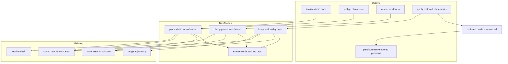
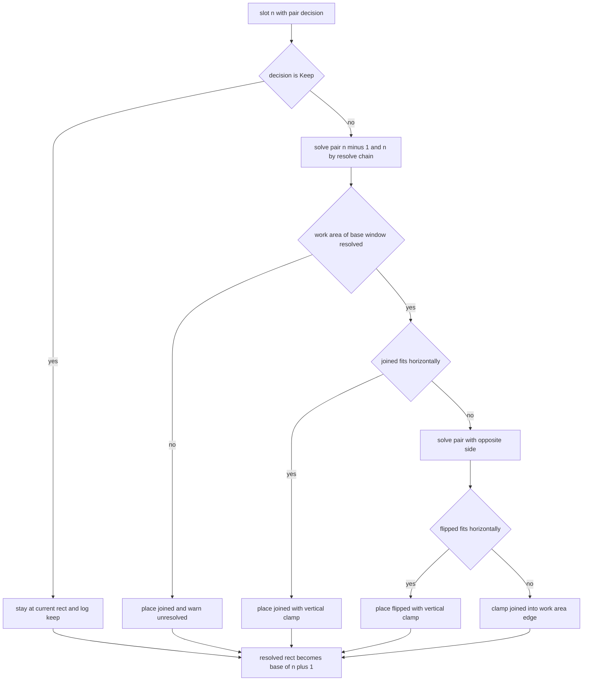
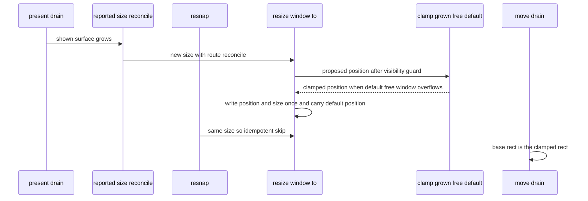
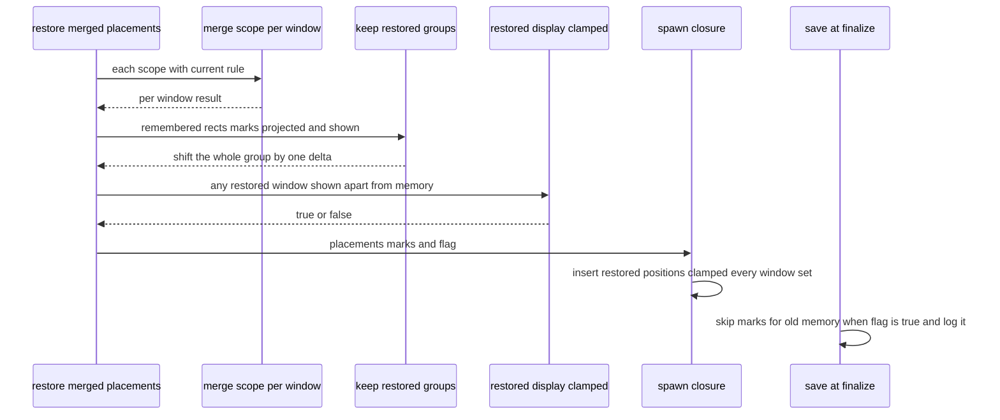
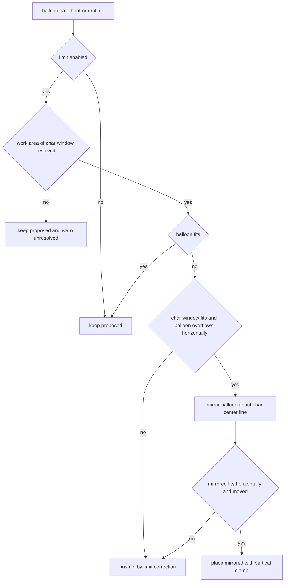

# 設計: window-work-area-clamp

## Overview

**目的**: 起動の直後やその後に、キャラクターの窓が作業領域（モニタのうちタスクバーなどを除いた矩形）からはみ出したり、隣のモニタへ渡ったりしないようにする。窓を作業領域へ寄せる働きを 1 つの新しいファイルにまとめ、起動の並べ直し・拡大率の後の詰め直し・記憶からの隣り合わせ・面の切り替え・記憶からの組の戻しの 5 つの場面から同じ決まりで呼ぶ。起動のトークの位置の指令（`\![move]` など）がトークの最中に正しく当たらない崩れ（件 5）は、測ってから原因を決め、測りの道具と、見込みごとの直し方をここで決めておく。

**使う人**: areka の利用者（窓を探して手で戻さずに済む）と開発者（寄せたか・寄せなかったかとその理由をログで見分けられる）。

**変わること**: 今は「起動の初期配置」「記憶からの戻し（窓ごと）」「バルーン」だけが作業領域を見ている。この spec の後は、起動の並べ直しと詰め直しが置いた窓・既定の位置で大きくなった `free` の窓・記憶から戻した組も作業領域の中に置かれる。寄せの式は今ある `balloon_limit::clamp_rect_to_work_area`（左辺・上辺を優先する式）だけを使い、新しい式は書かない。どの決まりも特定のゴーストを名指ししない（要件 7.8）。

**実装の後の改め（2026-10-30・要件 5.3〜5.8）**: キャラ窓は収まっているのにバルーンだけが横にはみ出すときは、バルーンを押し込まずにキャラ窓の反対の側へ並べ替える（SSP 2.9.26 と同じ・`research.md` 13 節）。並べ替えは今のバルーンの関門（`placement/balloon_limit.rs`）の中に置き、反対の側にも入らなければ今の押し込みに倒す。完了 spec `areka-P0-windowposition-limit` の押し込みの決まりをこの spec が改める。

### Goals

- 件 1〜3 の場面で、キャラクター窓を置くその時点で作業領域の中に解く（1 フレーム遅らせない・要件 7.3）。
- 寄せの判断（寄せた・寄せなかった・作業領域が取れない）を 1 語で grep できる記録に残す（要件 9）。
- 件 5 の原因を測る道具を入れ、測りの結果に応じた一般の直し方を決めておく（要件 6）。
- 決定論のテストで 10.1 の ⑴〜⑽ を固定し、今ある檻を保つ（要件 10.1・10.2）。

### Non-Goals

- 特定のゴースト（ぱすたを含む）を名指しした扱い・初回起動だけの扱い。
- 利用者がドラッグで作業領域の外へ置いた窓を戻すこと（要件 7.6）・台本が置いた窓を寄せること（要件 1.4）。
- `top`／`left`／`right` に吸着する窓の起動の位置と、作業領域が変わったときの沿わせ直し（`window-snap`）。
- 記憶の書式を変えること（要件 4.2）。
- 3 体目以降の窓を出すこと（`extra-character-windows`）。ただし決まりは 2 体に決め打ちしない。

## Boundary Commitments

### This Spec Owns

- **キャラクター窓を作業領域へ寄せる判定と記録**（新しいファイル `placement/follow/work_area_clamp.rs`）。場面の語・記録の接頭辞 `[work-area-clamp] `・3 つの入口（鎖の寄せ・面の拡大の寄せ・記憶の組の寄せ）。
- 起動の並べ直し（`finalize_chain_once_with`）と拡大率の後の詰め直し（`realign_chain_once_with`）が、解いた位置を書く前に寄せを通すこと。並べ終えた時点の既定の位置へ、寄せた後の位置を運ぶこと（要件 7.5）。
- `resize_window_to` の中で、既定の位置にいる `free` の窓が大きくなってはみ出したときに収めること（呼ぶ 1 文だけを `window_move.rs` に置き、本体は兄弟の新しいファイル）。
- 記憶から戻した組を同じ量だけ動かすこと（`persist::apply_restored_placements` の中）と、「この起動で記憶の位置を寄せて表示した」を並べ終えた時点の保存まで運ぶ値（資源 `RestoredPositionsClamped`）。
- 件 5 の測りの道具（`\![move]` の記録に拡大率と窓の大きさを足す・拡大率が決まる前に当てたことの記録）と、測りの結果に応じた直し（見込み H1 の形はここで決める）。
- `doc/COMPAT_ARCHITECTURE.md` §8 の行（件 1〜5）。
- バルーンの関門（起動の関門 `apply_balloon_limit`・書き込みの関門 `apply_balloon_limit_gate`）で、キャラ窓が収まっていてバルーンだけが横にはみ出すときの反対の側への並べ替え（BalloonFlip・要件 5.3〜5.8）。完了 spec `areka-P0-windowposition-limit` の押し込みの決まりを、この spec が倒し先へ改める（改めた事実は §8 の件 4 の行・要件 8.4）。

### Out of Boundary

- 寄せの式そのもの（`balloon_limit::clamp_rect_to_work_area`・`limit_correction`）。呼ぶだけで変えない。
- 窓の属するモニタの決め方（`follow::work_area_for_window`）。呼ぶだけで変えない（要件 7.1）。
- 隣り合いの解き（`chain_finalize::resolve_chain`）と組ごとの決め（`boot_pair_decision`・`judge_adjacency`）。呼ぶだけで変えない。
- 記憶から戻した窓ごとの今の判定（`persist::project_restore`＝作業領域とまったく交わらない窓だけを寄せる）。保つ（要件 4.3・4.5）。
- バルーンの押し込みの式（`limit_correction`）・解放の補正（`on_balloon_drag_end` の `apply_release_limit_correction`）・`windowposition.limit` の有効の判定（`BalloonLimit`）。変えない（要件 5.5・5.6）。並べ替えはその手前の 1 段として足すだけ。
- 起動の初期配置（`resolver.rs` の P4＝窓ごとの寄せ）と、作業領域の変化での沿わせ直し（`work_area_sync`）。
- kanade の起動のイベントの順。見込み H3 は H1 の直しで areka の側だけで消える形を取り、kanade には触らない。
- `placement/mod.rs`・`placement/spawn.rs`・`emo2_boot/consumer_ledger.rs`（C12 の約束。触らない）。

### Allowed Dependencies

- 新しいファイルが使ってよいもの: `placement::balloon_limit::{clamp_rect_to_work_area, limit_correction}`・`placement::chain_finalize::{resolve_chain, ChainSlot, ChainRect, PairDecision, KeepReason, judge_adjacency, Adjacency, AdjacencyMark, ScriptPlaced}`・`follow::{MonitorSnapshot, work_area_for_window}`（ファサード経由）・`placement::spawn::{GhostWindows, CharWindowMarker}`（ファサードの再束縛経由）・`placement::diag::PlacementRoute`・`placement::resolver::{Anchor, PointPx, SizePx, RectPx}`・wintf の `WindowPos`・`DraggingState`・`bevy_ecs`・`tracing`。
- 新しい crate の依存は足さない。`clamp_axis` の写しを新しく作らない（式は `clamp_rect_to_work_area` だけ）。
- 依存の向き: `work_area_clamp` は上の部品を読むだけで、呼び手（`drain_resnap`・`chain_realign`・`window_move`・`persist`）を知らない。呼び手 → `work_area_clamp` → 式と判定の部品、の一方向。

### Revalidation Triggers

- `resolve_chain` の式や `ChainSlot`・`PairDecision` の形が変わる（鎖の寄せが 2 窓の解きに使っている）。
- `clamp_rect_to_work_area` の意味（左辺・上辺の優先）が変わる。
- `restore_merged_placements` の戻り値の形（この spec で 3 つ組にする）が変わる・`GhostWindows` に記憶の寄せの印を持たせる形へ移す。
- 位置の指令の線（`PositionCue`）の取り出しの門（見込み H1 の直しで、対象の窓と基準の窓の最初の面の表示を待つ形にする）が変わる。
- `extra-character-windows` が 3 体目以降を出したとき（鎖の寄せの「反対の側」が別の窓と重なりうる・Risks）。
- バルーンの左右のずらしの符号（右に出すときの `balloon.offsetx` の向き）を正典へ合わせる spec や、`offsetxl`／`offsetxr` などの向きごとのずらしを読む spec が入ったとき（並べ替えの「映した位置」の式と食い違いうる・Risks）。
- バルーンの関門の形（`apply_balloon_limit_one`・`apply_balloon_limit_gate` の判定の順）が変わる。

## Architecture

### Existing Architecture Analysis

- 位置の書き込みは単一の窓書込口 `enqueue_window_set_pos` を通る。システム由来の経路（`Resnap`・`ReportedSizeReconcile`・`ChainRealign` ほか）だけが既定の位置を書き込み先へ運ぶ（`track_default_char_pos`）。起動の並べ直しの書き込み（`move_window_to`＝`MoveCue`）は運ばないので、並べ直しは自分で既定の位置を直す。
- 1 フレームの相の順（`emo2_boot/frame.rs`）: 表示の指令の取り出し → 窓寸の照合（`ReportedSizeReconcile`）→ 面の大きさの再スナップ（`Resnap`）→ 位置の指令の取り出し（`run_move_drain_phase`）→ 起動の並べ直し → 拡大率の後の詰め直し。寄せをそれぞれの書き込みの中で済ませれば、同じフレームの後ろの相は寄せた後の矩形を読む（要件 3.3）。
- 記憶からの戻しは窓を作る前の純関数（`apply_restored_placements`）で、書き込みの口を持たない（記憶へ書き戻さない構造・要件 4.5）。
- 1 ファイル 1,000 行の番人は `window_move.rs`（1,221 行）を例外表に載せており、行数そのものは見ない（例外表の理由欄に行数を書かない決まり）。`main.rs` は 981 行。

### Architecture Pattern & Boundary Map



- **選んだ形**: 「新しい部品を 1 つ立て、4 か所は呼ぶだけ」（research の案 C＝B を骨にした混ぜ）。鎖は 2 窓ずつ `resolve_chain` で解き直して寄せる（案 1-C の一般形）。件 2 は `resize_window_to` に呼ぶ 1 文（案 2-a）。件 3 は記憶の位置から組を推す（案 3-A）。
- **分け方**: 判定と記録は `work_area_clamp.rs` が 1 つで持つ。呼び手は「いつ・どの窓に」だけを持つ。式と帰属は既存の部品が持つ。
- **保つ形**: 単一の窓書込口・システム由来の経路の既定の位置の追随・相の順・記憶の純関数・並べ直しは一度きり。
- **steering**: 兄弟のテストファイル＋`#[path]`・1,000 行・ログの水準（寄せた＝`info!`・作業領域が取れない＝`warn!`・寄せなかった理由＝`debug!`）・パニックしない（飽和演算・`Option` で縮退）。

### Technology Stack

| 層 | 選び | この spec での役 | 注 |
|---|---|---|---|
| 配置の層 | Rust（areka crate の `placement`） | 寄せの判定・記録・記憶の組の寄せ | 新しい依存なし |
| ECS | `bevy_ecs`（ワークスペースの版） | `World` から窓・既定の位置・資源を読む。資源 `RestoredPositionsClamped` を 1 つ足す | 今の版のまま |
| 窓の層 | wintf の `WindowPos`・`DraggingState` | 窓の今の位置と大きさ・ドラッグの最中の印を読む | 読むだけ |
| 記録 | `tracing` | `[work-area-clamp] ` の 3 語 | `logging.md` の水準 |

## File Structure Plan

### Directory Structure

```
crates/areka/src/placement/
├── follow/
│   └── work_area_clamp.rs                      # 新規: キャラ窓を作業領域へ寄せる判定と記録（3 つの入口・場面の語・記録の語）
├── follow_work_area_clamp_chain_tests.rs       # 新規: 鎖の寄せの檻（10.1 ⑴⑵⑸⑹⑺）
├── follow_work_area_clamp_grow_tests.rs        # 新規: 面の拡大の寄せの檻（10.1 ⑶⑹）
├── follow_work_area_clamp_restore_tests.rs     # 新規: 記憶の組の寄せの檻（10.1 ⑷）
├── persist_restore_group_tests.rs              # 新規: apply_restored_placements の組の結線と寄せた起動の印（10.1 ⑷⑻）
└── balloon_limit_flip_tests.rs                 # 新規（2026-10-30 の改め）: バルーンの反対の側への並べ替えの檻（10.1 ⑾）
crates/areka/src/emo2_boot/
├── frame_chain_finalize_clamp_tests.rs         # 新規: 並べ直しの寄せのフレームの檻（10.1 ⑴⑻⑼）
└── frame_move_hold_tests.rs                    # 新規（H1 と決まったとき）: 位置の指令が対象・基準の窓の最初の面の表示まで待つ檻（10.1 ⑽）
```

テストの接続宣言の置き場: `follow_work_area_clamp_*_tests.rs` は `placement/follow.rs` の末尾（今の `follow_*_tests.rs` と同じ並び）、`persist_restore_group_tests.rs` は `placement/persist.rs` の末尾、`frame_chain_finalize_clamp_tests.rs`・`frame_move_hold_tests.rs` は今の `frame_chain_finalize_tests.rs`・`frame_move_order_tests.rs` と同じく `emo2_boot/frame.rs`（615 行）の末尾。

### Modified Files

- `crates/areka/src/placement/follow.rs`（238 行）— `mod work_area_clamp;`・crate 内の再束縛（`place_chain_in_work_area`・`keep_restored_groups` ほか）・`window_move` が `super::` で辿る私有の再束縛 `clamp_grown_free_default`・テストの接続宣言 3 つ。`placement/mod.rs` には触らない。
- `crates/areka/src/emo2_boot/frame/drain_resnap.rs`（685 行）— `finalize_chain_once_with` が `resolve_chain` の代わりに `place_chain_in_work_area` を呼び、x と y を書き、既定の位置へ寄せた後の位置を運ぶ。`run_move_drain_phase` に拡大率が決まる前に当てたことの記録を足す（測りの道具）。H1 と決まったときだけ、同じ関数に窓ごとの表示の待ちを足す（判定は兄弟の新しいファイル）。
- `crates/areka/src/placement/chain_realign.rs`（423 行）— `realign_chain_once_with` が `place_chain_in_work_area` を呼び、x と y を書く。
- `crates/areka/src/placement/follow/window_move.rs`（1,221 行）— `resize_window_to` の手順 3c（可視性の関門）の直後に `clamp_grown_free_default` を呼ぶ 1 文と注記 1 行だけ。本体は兄弟の新しいファイル。
- `crates/areka/src/placement/persist.rs`（815 行）— `apply_restored_placements` の後段に組の寄せを足す・`restore_and_judge` と資源 `RestoredPositionsClamped` を足す・`persist_unremembered_char_positions` が資源を読み、寄せた起動では古い記憶へ印を書き足さず記録する。
- `crates/areka/src/main.rs`（981 行）— `restore_merged_placements` の戻り値に「記憶の位置を寄せて表示したか」の真偽を足す（3 つ組・約 3 行増え 1,000 行を超えない）。
- `crates/areka/src/ghost_session.rs`（935 行）— 3 つ組を受け、窓を作る閉包で `RestoredPositionsClamped` を毎回据える（約 3 行）。
- `crates/areka/src/emo2_boot/move_cue_place.rs`（222 行）— `move_applied` の記録に拡大率 `k` と動かす窓の大きさを足す（測りの道具）。
- `crates/areka/src/emo2_boot/frame.rs`（615 行）— 新しい兄弟の檻 2 つの接続宣言だけ（相の順は変えない）。
- `restore_merged_placements` を呼ぶテスト 4 ファイル（`emo2_boot/frame_chain_finalize_persist_tests.rs`・`_persist_nowrite_tests.rs`・`_persist_restart_tests.rs`・`main_restore_seam_tests.rs`〔呼び出し 5 か所〕）— 3 つ組の受け方に合わせる。
- `doc/COMPAT_ARCHITECTURE.md` — §8 の末尾へ件 1〜件 5 の行を足す（要件 8.3・8.4）。2026-10-30 の改めで、件 4 の行に完了 spec の決まりを改めた事実と理由を足す。
- `crates/areka/src/placement/balloon_limit.rs`（231 行）— 2026-10-30 の改め: 並べ替えの純関数 `place_balloon_in_work_area` と結果の型を足し、`apply_balloon_limit_one` の `limit_correction` の呼び出しをそれに替え、記録に `how` を足す。テストの接続宣言 1 つ（`balloon_limit_flip_tests.rs`）。
- `crates/areka/src/placement/follow/window_move.rs` — 2026-10-30 の改め: `apply_balloon_limit_gate` の末尾の `limit_correction(proposed, target_size, area)` の呼び出しを、キャラ窓の矩形（関門が既に組んだ `char_rect`）を渡す `place_balloon_in_work_area` に替え、記録に `how` を足すだけ（数行の置き換え・判定の本体は `balloon_limit.rs`）。

## System Flows

### 起動の並べ直しと詰め直しの寄せ（件 1・要件 1・2）



- 基準は前の窓（n−1）の**寄せた後**の矩形で、そのモニタの作業領域で判定する。要件 1.1 の「基準の窓」と要件 2.1・2.2 の「組の動かさない側の窓」はどちらも n−1 で、同じものになる。
- 「横に入るか」は `clamp_rect_to_work_area` を当てて x が変わらないかで決める（式は 1 本）。入るなら y だけを同じ式で収める。どちらの側にも入らなければ、並べた位置に同じ式を当てて作業領域の端へ寄せる（基準の窓と重なってよい・要件 1.2）。窓が作業領域より大きければ、同じ式が左辺・上辺を優先する（要件 7.2）。
- 先頭（本体）と `Keep` の窓は動かさない（要件 1.3・1.4・2.3）。寄せた窓の先の窓は、寄せた後の矩形を基準に解く（3 体以上でも鎖が割れない）。

### 面の拡大の寄せ（件 2・要件 3）と同じフレームの位置の指令



- 寄せは `resize_window_to` の書き込みの前に決まるので、位置と大きさは 1 回で書かれる（要件 7.3）。経路がシステム由来なので、既定の位置は単一の窓書込口が寄せた先へ運ぶ（要件 7.5）。
- 同じフレームの `\![move,--base=0,…]` は後の相で寄せた後の矩形を基準に読む（要件 3.3）。並べ直しはやり直さない（要件 3.4）。

### 記憶から戻した組の寄せと、寄せた起動の印（件 3・要件 4）



### バルーンだけが横にはみ出すときの並べ替え（件 4・要件 5.3〜5.8・2026-10-30 の改め）



- 並べ替えは関門の中の 1 段で、関門の前提（`limit` の有効・作業領域はキャラ窓のモニタ・縮退は `Unresolved`）はそのまま。解放の補正（利用者がバルーンを離したとき）は通らない（要件 5.6）。
- 書き込みの関門は、キャラ窓が動いて付いて動くバルーンの書き込み（`BalloonFollow`）にも、起動の後のどの書き込みにも同じに当たる。だから窓が作業領域の端へ寄れば並べ替わり、余裕のある所へ戻れば相対の位置のとおりの側へ戻る（焼き付けない・要件 5.7）。

## Requirements Traceability

| 要件 | 要約 | 部品 | 口 | 流れ |
|---|---|---|---|---|
| 1.1 | 並べ直した位置がはみ出すなら基準の窓のモニタの作業領域へ収める | ChainClamp・Finalize | `place_chain_in_work_area` | 並べ直しの寄せ |
| 1.2 | 反対の側へ並べ替え・入らなければ端へ | ChainClamp | `resolve_chain_in_work_area` | 同上 |
| 1.3 | 基準の窓を動かさない | ChainClamp | 先頭と `Keep` は `from == to` | 同上 |
| 1.4 | 台本で置いた窓は動かさない | ChainClamp | `Keep(ExplicitlyPlaced)` を `Kept` で素通し | 同上 |
| 1.5 | 収まっていれば変えない | ChainClamp | `Fits` は並べた位置のまま | 同上 |
| 2.1 | 詰め直しにも同じ規則 | ChainClamp・Realign | 場面 `DpiRealign` | 同上 |
| 2.2 | 記憶からの隣り合わせにも同じ規則 | ChainClamp・Finalize | 場面 `RememberedJoin` | 同上 |
| 2.3 | 動かさなかった窓は動かさない | ChainClamp | `Kept` | 同上 |
| 2.4 | 寄せた位置を記憶に書かない | Finalize・Realign | 既定の位置の無い窓は運ばない・詰め直しは保存を呼ばない | — |
| 3.1 | 既定の位置の `free` の窓が大きくなってはみ出したら収める | GrowClamp・Resize | `clamp_grown_free_default` | 面の拡大の寄せ |
| 3.2 | はみ出した向きにだけ動かす | GrowClamp | `limit_correction` | 同上 |
| 3.3 | 台本は収めた後の位置を基準に | Resize・相の順 | 書き込みの前に寄せる | 同上 |
| 3.4 | 並べ直しをやり直さない | GrowClamp | 鎖に触らない | 同上 |
| 3.5 | ドラッグ・台本で置いた窓は寄せない | GrowClamp | 既定の位置との一致・`ScriptPlaced`・`DraggingState` | 同上 |
| 4.1 | 組の窓を同じ量だけ動かす | GroupClamp・Restore | `keep_restored_groups` | 組の寄せ |
| 4.2 | 記憶の位置・印・今の大きさだけで組を決める | GroupClamp | `RestoredWindow` | 同上 |
| 4.3 | どれも見えていれば寄せない | GroupClamp | 寄せた窓の無い組は動かさない | 同上 |
| 4.4 | 離れていた組は窓ごと | GroupClamp | 1 窓の組は今の結果のまま | 同上 |
| 4.5 | 寄せた位置を記憶に書き戻さない | Restore | 純関数のまま | — |
| 4.6 | 寄せた起動では古い記憶へ印を書き足さず記録 | ClampedFlag・SaveAtFinalize | `RestoredPositionsClamped` | 同上 |
| 5.1 | 窓もバルーンも収まるならバルーンを寄せない | 既存 `balloon_limit` | `limit_correction` が `None` | — |
| 5.2 | シェルを収めてバルーンだけの寄せを起こさない | ChainClamp・GrowClamp・GroupClamp | キャラ窓を先に収める | 全部 |
| 5.3 | 窓が収まりバルーンだけ横にはみ出すなら反対の側へ並べ替える（どのスコープも） | BalloonFlip・起動の関門・書き込みの関門 | `place_balloon_in_work_area` | 並べ替え |
| 5.4 | 反対の側＝キャラ窓の縦の中心線で映した位置・縦は変えない（縦だけはみ出せば縦だけ収める） | BalloonFlip | `place_balloon_in_work_area` の映しの 1 行と `clamp_rect_to_work_area` | 同上 |
| 5.5 | 反対の側も入らない・映しても動かない・縦だけはみ出す → 今の押し込み | BalloonFlip | `limit_correction`（今の式） | 同上 |
| 5.6 | 窓がはみ出している・`limit=0`・解放の補正は並べ替えない | 関門の前提・解放の補正 | `BalloonLimit`・`apply_release_limit_correction` は変えない | 同上 |
| 5.7 | 表示の位置だけ・相対の位置に焼き付けない・`dontmove` は止めない | 起動の関門・書き込みの関門 | `balloon_pos`／書き込みの位置だけ（DD6 のまま） | 同上 |
| 5.8 | `[balloon-limit] Clamp` に `how`（`flipped`／`pushed`） | 起動の関門・書き込みの関門 | 記録の欄 | — |
| 6.1 | 件 5 の原因を測って残す | MoveMeasure | `move_applied` の欄・`move_ratio_unset` | 件 5 |
| 6.2 | 起動のトークの指令を正しい拡大率と大きさで当てる | MoveHold（H1） | 対象・基準の窓の表示の待ち | 件 5 |
| 6.3 | トークの後にずらさない | MoveHold（H1） | 最初の当てが正しい | 件 5 |
| 6.4 | 一般の道の直し | MoveHold | ゴースト・初回を見ない門 | 件 5 |
| 7.1 | モニタの決め方は今のまま | 全入口 | `work_area_for_window` | — |
| 7.2 | 大きい窓は左辺・上辺を優先 | 全入口 | `clamp_rect_to_work_area` | — |
| 7.3 | 置く時点で決める | 全入口 | 書き込みの前に寄せる | — |
| 7.4 | 作業領域が取れなければ寄せずに記録 | 全入口 | `[work-area-clamp] Unresolved` | — |
| 7.5 | 並べ終えた時点の保存は寄せた後の位置 | Finalize・Resize | 既定の位置へ x・y を運ぶ | — |
| 7.6 | ドラッグの窓は動かさない（記憶の今の判定・2.2・要件 4 を除く） | ChainClamp・GrowClamp | `Keep(Dragging)`・既定の位置との食い違い・`DraggingState` | — |
| 7.7 | バルーンは付いて動く | 書き込みの口 | `move_window_to`・`move_window_with_route`・`resize_window_to` の随伴・組の寄せは `balloon_pos` も同じ量 | — |
| 7.8 | ゴーストを名指ししない | 全入口 | 判定の入力は窓の幾何と印だけ | — |
| 8.1 | SSP の測り ⑸ 必須・⑷ 条件つき・⑴⑵⑶ 任意 | 実機の測り（タスク） | — | — |
| 8.2 | SSP と食い違っても決めた規則を保ち記録 | §8 の行 | — | — |
| 8.3 | 件 1〜5 を §8 に残す | §8 の行 | — | — |
| 8.4 | 完了 spec の要件を改めたら §8 に残す | §8 の行 | — | — |
| 9.1 | 動かした記録 | Vocab | `[work-area-clamp] Clamp`（`info!`） | — |
| 9.2 | 動かさなかった理由 | Vocab | `[work-area-clamp] Keep`（`debug!`） | — |
| 10.1 | 決定論のテスト ⑴〜⑾ | 各テストファイル | — | — |
| 10.2 | 今ある檻を保つ | 檻の一覧 | — | — |
| 10.3 | 実機の必達 ⑴〜⑷ | 実機の確かめ（タスク） | — | — |
| 10.4 | ぱすたの初回起動の通し | 実機の確かめ（タスク） | — | — |

## Components and Interfaces

| 部品 | 層 | 役 | 要件 | 主な依存 | 契約 |
|---|---|---|---|---|---|
| Vocab（場面の語と記録の語） | 配置 | 3 入口が共有する語彙 | 9.1・9.2・7.4 | tracing | State |
| ChainClamp | 配置 | 解いた鎖を作業領域の中に置く | 1・2・7 | resolve_chain（P0）・clamp_rect_to_work_area（P0）・work_area_for_window（P0） | Service |
| GrowClamp | 配置 | 既定の位置の `free` の窓の拡大を収める | 3・7 | GhostWindows（P0）・limit_correction（P0） | Service |
| GroupClamp | 配置 | 記憶の組を同じ量だけ動かす | 4・7 | judge_adjacency（P0）・clamp_rect_to_work_area（P0） | Service |
| ClampedFlag | 記憶 | 寄せた起動の印を保存まで運ぶ | 4.6 | bevy Resource（P0） | State |
| 呼び手の結線（Finalize・Realign・Resize・Restore・SaveAtFinalize） | フレーム・配置・記憶 | いつ・どの窓に当てるか | 1〜4・7.5 | 上の部品（P0） | — |
| MoveMeasure・MoveHold | フレーム | 件 5 の測りと直し | 6 | Emo2Wiring（P0） | — |
| BalloonFlip（2026-10-30 の改め） | 配置 | バルーンだけが横にはみ出すとき反対の側へ並べ替える | 5.3〜5.8 | clamp_rect_to_work_area（P0）・limit_correction（P0） | Service |

### 配置の層: `placement/follow/work_area_clamp.rs`

#### Vocab

| 欄 | 中身 |
|---|---|
| Intent | 寄せの場面の語と記録の語を 1 か所で持つ |
| Requirements | 7.4・9.1・9.2 |

```rust
/// 寄せて動かした（info!）。
pub(crate) const WORK_AREA_CLAMP_TAG: &str = "[work-area-clamp] Clamp";
/// 判定したが動かさなかった（debug!）。
pub(crate) const WORK_AREA_KEEP_TAG: &str = "[work-area-clamp] Keep";
/// 作業領域が取れず寄せなかった（warn!）。
pub(crate) const WORK_AREA_UNRESOLVED_TAG: &str = "[work-area-clamp] Unresolved";

#[derive(Debug, Clone, Copy, PartialEq, Eq)]
pub(crate) enum ClampScene {
    BootRepack,     // "boot-repack"  起動の並べ直し（記憶に位置の無い窓）
    RememberedJoin, // "remembered-join" 記憶からの隣り合わせ
    DpiRealign,     // "dpi-realign"  拡大率の後の詰め直し
    SurfaceGrow,    // "surface-grow" 面の切り替え
    RestoreGroup,   // "restore-group" 記憶からの組の戻し
}
impl ClampScene { pub(crate) fn as_str(self) -> &'static str; }
```

- 記録の欄は 3 入口で揃える: `scene`・`scope`・`how`（`flipped`／`edge`／`fits`／`shifted`／`grown`）・`from`・`to`・`work_area`。動かさなかった行は `reason`（`fits`・`explicitly-placed` などの今の `KeepReason` の語・`script-placed`・`dragging`・`not-default-pos`・`remembered-visible`）。
- `[work-area-clamp] ` の 1 語で全部を grep でき、2 語目で動かした・動かさなかった・取れなかったを分けられる（`[balloon-limit] ` の先例と同じ形）。

#### ChainClamp

| 欄 | 中身 |
|---|---|
| Intent | 組ごとの決めで解いた鎖を、前の窓のモニタの作業領域の中に置く |
| Requirements | 1.1〜1.5・2.1〜2.3・7.1〜7.4・7.6・9.1・9.2 |

**責務と縛り**
- 先頭のスロットは動かさず、2 番目から昇順に 1 つずつ置く。基準は前のスロットの**置いた後**の矩形。
- 隣の位置は `resolve_chain` に 2 スロット（前の窓を置いた後の x と幅で `Keep`・今のスロット）を渡して得る。反対の側は決めを `JoinLeft`⇔`JoinRight` に替えて同じく得る。隣の式を新しく書かない。
- 寄せの式は `clamp_rect_to_work_area` だけ。「横に入るか」は式を当てて x が変わらないかで決める。
- y も同じ式で収める（要件 7.2 は両軸）。ふだんの並べ直しでは y は初期配置で収まっているので動かない。

**依存**
- Inbound: `finalize_chain_once_with`・`realign_chain_once_with` — 解いた位置を書く前に通す（P0）
- Outbound: `resolve_chain`（P0）・`clamp_rect_to_work_area`（P0）・`work_area_for_window`（P0）

**Contracts**: Service [x]

```rust
#[derive(Debug, Clone, Copy, PartialEq, Eq)]
pub(crate) enum ChainClampOutcome {
    Fits,             // 並べた位置のまま（y だけ収めた場合を含む）
    Flipped,          // 反対の側へ並べ替えた
    Edge,             // どちらの側にも入らず端へ寄せた（重なってよい）
    Kept(KeepReason), // 組の決めが Keep＝寄せの対象外
    Unresolved,       // 作業領域が取れず、並べた位置のまま
}

#[derive(Debug, Clone, Copy, PartialEq, Eq)]
pub(crate) struct ChainPlacement {
    pub scope: usize,
    pub from: PointPx,   // 今の左上
    pub joined: PointPx, // 並べた位置（寄せる前）
    pub to: PointPx,     // 置く左上
    pub outcome: ChainClampOutcome,
}

/// 純関数の核。`slots` と `rects` は同じ長さ・同じ順（スコープ昇順）で、
/// `rects[i]` は `slots[i]` の今の矩形（x == current_x・w == width）。
/// 先頭を除く各スロットの ChainPlacement を返す。
pub(crate) fn resolve_chain_in_work_area(
    slots: &[ChainSlot],
    rects: &[ChainRect],
    snapshot: &MonitorSnapshot,
) -> Vec<ChainPlacement>;

/// World の口。`targets` は走査（collect_chain_states）の `(scope, char 窓, 今の位置)`。
/// 窓の高さを WindowPos から、作業領域を MonitorSnapshot 資源から読み、核を呼び、記録を出す。
/// MonitorSnapshot が無いときは Join のスロットを Unresolved として warn! を 1 行出す。
pub(crate) fn place_chain_in_work_area(
    world: &World,
    slots: &[ChainSlot],
    targets: &[(usize, Entity, PointPx)],
    scene_of: impl Fn(usize) -> ClampScene,
) -> Vec<ChainPlacement>;
```

- 事前条件: `mark_non_positive_widths` を通した後の `slots`（幅が非正の組は `Keep`）。
- 事後条件: `Kept` の `to == from`。`Fits`・`Flipped`・`Edge` の `to` の矩形は、作業領域より大きい軸を除き、基準の窓の作業領域に 4 辺とも入る。空の入力・1 スロットは空列。パニックしない（式も帰属も飽和演算）。
- 呼び手が書くのは `to != from` のものだけ。

**実装の注**
- 結線: 確定の場面は `default_x` が有れば `BootRepack`、無ければ `RememberedJoin`。詰め直しは全部 `DpiRealign`。
- 記録: `to != joined` のとき `Clamp`（`info!`）。`Fits` で動かさなかった・`Kept` は `Keep`（`debug!`）。今の組の行（`chain_finalize:`・`chain_realign:`）は残し、`to_x` を置く左上から取る。
- 危うさ: 3 体以上で反対の側が別の窓と重なりうる（Risks）。

#### GrowClamp

| 欄 | 中身 |
|---|---|
| Intent | 既定の位置にいる `free` のキャラ窓が大きくなってはみ出したら、はみ出した向きにだけ収める |
| Requirements | 3.1〜3.5・7.1〜7.4・7.6・9.1・9.2 |

**責務と縛り**
- 当てる条件（全部満たすとき）: 吸着が `Free`・経路が `Resnap` か `ReportedSizeReconcile`（面の表示の大きさが変わった書き込み）・キャラ窓（`CharWindowMarker`）・既定の位置が有り、今の位置と同じ・`ScriptPlaced` が無い・`DraggingState` が無い。
- 収め方: `limit_correction(提案の位置, 新しい大きさ, 作業領域)`。`None` なら提案の位置のまま。
- 作業領域は**提案の位置に置いた窓**のモニタ（要件 7.1）。
- 期間は限らない（要件の話し合い 3＝既定の位置にいる間はいつでも）。`DpiReproject`（拡大率の変化）と `AnchorChange`（吸着の変化）と `WorkAreaResnap`（作業領域の変化）は当てない（それぞれ `dpi-realign-remembered-chain`・吸着の当て直し・`window-snap` の持ち物）。

**依存**
- Inbound: `resize_window_to`（`window_move.rs` の 1 文・P0）
- Outbound: `GhostWindows::default_char_pos`（P0）・`limit_correction`（P0）・`work_area_for_window`（P0）

**Contracts**: Service [x]

```rust
/// 手順 3c（可視性の関門）の後の提案の位置を受け、収めた位置か提案のままを返す。World は読むだけ。
pub(crate) fn clamp_grown_free_default(
    world: &World,
    char_window: Entity,
    anchor: Anchor,
    route: PlacementRoute,
    proposed: PointPx,
    new_size: SizePx,
) -> PointPx;
```

- 事後条件: 条件を満たさない窓には提案の位置をそのまま返す。満たした窓の戻りは作業領域に 4 辺とも入る（大きい軸は左辺・上辺）。はみ出していない向きの座標は変えない（要件 3.2）。
- 記録: 吸着が `Free` でない・経路が違う・キャラ窓でない窓は記録しない（この spec の対象外）。`Free` のキャラ窓で既定の位置と違う・台本の印・ドラッグ・収まっていた、は `Keep`（`debug!`）。作業領域が取れない（`MonitorSnapshot` が無い・空）は `Unresolved`（`warn!`）。収めたら `Clamp`（`info!`・`how=grown`）。

**実装の注**
- 結線: `window_move.rs` の `resize_window_to` の手順 3c の直後に `let new_pos = super::clamp_grown_free_default(world, char_window, anchor, route, new_pos, new_size);` の 1 文（rustfmt で折れても 1 つの呼び出し）と注記 1 行。べき等の判定・書き込み・既定の位置の追随・バルーンの随伴は、今のまま寄せた後の位置で走る。
- 開発者の承認（設計の話し合い 3・2026-10-29）: この 1 文を `window_move.rs` へ足すことを認めた。ロードマップの C12 の約束「`window_move.rs` に足さない」の書き換えは `/kiro-complete` のときに行う。
- 行数の番人: `window_move.rs` は番人の例外表に載り、番人は行数を見ない（理由欄に行数を書かない決まり）。足すのは呼ぶ文だけで、判定・記録の本体は兄弟の新しいファイルにある。C12 の約束「足す分は兄弟のファイルへ」の本旨（本体を伸ばさない）を保つ形で、別の書き込みを足す形（同じフレームに 2 回書く）や経路の語を足す形（結局 `window_move.rs` の網羅の `match` に触る）より本質に近い（research 案 2-a・開発者の 10-29 の指示）。
- 危うさ: 起動の確定の前に寄せると、確定は寄せた後の本体の x を基準に相方を付ける。これはやり直しではなく一度きりの確定の入力が変わるだけ（要件 3.4 を保つ）。

#### GroupClamp

| 欄 | 中身 |
|---|---|
| Intent | 記憶から戻した組のどれかが今の判定で寄せられたら、組の全員を同じ量だけ動かして組の互いの位置を保つ |
| Requirements | 4.1〜4.4・7.1・7.2・7.4・7.7・9.1・9.2 |

**責務と縛り**
- 入力は記憶から位置を戻したスコープだけ（スコープ昇順）。
- 組の決め: 隣り合う番号の組 (n−1, n) が、覚えた印が `left`／`right` か、記憶の矩形どうしの `judge_adjacency` が `Left`／`Right`／`Overlapped` のとき繋がる。繋がった並びが 1 つの組。印が `none` でも記憶の矩形が重なっていれば組（重なっていた組・要件 4.1）。離れていれば組にしない（要件 4.4）。
- 寄せの決め（設計の話し合い 1・2026-10-29）: **組の全員が今の判定で寄せられている（どの窓も作業領域と交わらない）**とき、組の**吸着の当て直しだけをした矩形**（`projected`）の和の矩形を `clamp_rect_to_work_area` で和の矩形のモニタの作業領域へ収め、その差を全員の `projected` に足す。全員が同じ量だけ動くので互いの位置が保たれる（要件 4.1）。
- **見えている窓は動かさない**（要件 4.1 の改め）: 見えている窓と寄せられた窓が混ざる組では、見えている窓は記憶の位置のまま。隣り合っていた組（印 `left`／`right`）の寄せられた窓は、起動の並べ直しが見えている窓の隣へ付け直し、ChainClamp の決まり（反対の側・端）で作業領域へ置く（要件 2.2）。重なっていた組の寄せられた窓は、今の窓ごとの結果のまま（`Keep`・`reason=partner-visible`）。
- 寄せた窓の無い組は動かさない（要件 4.3）。1 窓の組は今の窓ごとの結果のまま（要件 4.4）。

**依存**
- Inbound: `persist::apply_restored_placements`（P0）
- Outbound: `judge_adjacency`（P0）・`clamp_rect_to_work_area`（P0）・`work_area_for_window`（P0）

**Contracts**: Service [x]

```rust
#[derive(Debug, Clone, Copy, PartialEq, Eq)]
pub(crate) struct RestoredWindow {
    pub scope: usize,
    pub remembered: ChainRect,      // 記憶の位置を今の大きさで置いた矩形（吸着の当て直しの前）
    pub projected: PointPx,         // 吸着の当て直しだけをした左上（窓ごとの寄せの前）
    pub shown: PointPx,             // 今の窓ごとの判定の結果（merge の char_pos）
    pub mark: Option<AdjacencyMark>, // 組 (scope−1, scope) の覚えた印
}

#[derive(Debug, Clone, Copy, PartialEq, Eq)]
pub(crate) struct GroupShift {
    pub scope: usize,
    pub to: PointPx, // 置く左上（shown と違うものだけ返す）
}

pub(crate) fn keep_restored_groups(
    windows: &[RestoredWindow],
    snapshot: &MonitorSnapshot,
) -> Vec<GroupShift>;
```

- 事後条件: 返した組の全員で `to − projected` が同じ。組の和の矩形は作業領域に入る（大きい軸は左辺・上辺）。作業領域が取れない組は返さず `Unresolved`（`warn!`）を残す（窓ごとの結果のまま）。
- 記録: 動かした窓ごとに `Clamp`（`scene=restore-group`・`how=shifted`）。寄せた窓の無い組は `Keep`（`reason=remembered-visible`）。

**実装の注**
- 和の矩形の作業領域: 寄せられた窓はどのモニタとも交わらないので、和の矩形が入る作業領域があれば寄せられた窓も入る。差が 0 になる組は「どれも見えていた」組と同じになる。
- 吸着: 下端に吸着した組では、和の矩形の下端は当て直しで作業領域の下端にあるので縦の差はふつう 0。縦にも入らない組だけ縦の差が出る（左辺・上辺の優先）。
- 限界: 一緒に動く組（`\![set,sticky-window,…]`）でも、離れて置かれていたものは拾えない（要件の話し合い 4）。組は隣り合う番号の対だけで決める（覚えた印と同じ単位）。

### 配置の層: `placement/balloon_limit.rs` の足し（2026-10-30 の改め）

#### BalloonFlip

| 欄 | 中身 |
|---|---|
| Intent | キャラ窓が作業領域に収まっているのにバルーンだけが横にはみ出すとき、バルーンをキャラ窓の反対の側へ並べ替え、入らなければ今の押し込みに倒す |
| Requirements | 5.3〜5.8・7.2・7.8 |

**責務と縛り**
- 置き場は今のバルーンの関門の式のファイル（`balloon_limit.rs`）。2 つの関門（起動の関門 `apply_balloon_limit_one`・書き込みの関門 `apply_balloon_limit_gate`）が、今 `limit_correction` を呼んでいる 1 か所をこの関数に替える。解放の補正は替えない（要件 5.6）。
- 「収まるか」「横にはみ出すか」は `clamp_rect_to_work_area` を当てて位置が変わるか・x が変わるかで決める（式は 1 本・ChainClamp と同じ手口）。押し込みは `limit_correction` をそのまま使う。新しく足す式は映しの 1 行（`x' = char.left + char.right − (pos.x + size.w)`）だけ。
- 左右の側を表す値は持たない: 映しの式は側によらず 1 本で、左隣のバルーンは右隣へ、右隣のバルーンは左隣へ移る。真上・真下で中央に揃ったバルーンは映しても x が（ほぼ）変わらないので、横に入らず押し込みに倒れる（要件 5.5）。`placement/spawn.rs`（C12 の約束）に側の印を足す形は取らない。
- 縦は映さない（要件 5.4）。映した位置が縦にだけはみ出すときは同じ式で縦だけ収める（x は変わらないことを確かめてから使う）。
- 表示の位置だけを返す。`balloon_offset`・`BalloonFollow` の追従のずらし・記憶には触らない（今の DD6 のまま・要件 5.7）。`balloon.dontmove`・`\![lock,balloonmove]` の帳簿（`BalloonLockLedger`）は読まない（利用者のドラッグの止めであって置き方ではない・要件 5.7）。

**依存**
- Inbound: `apply_balloon_limit_one`（起動の関門）・`apply_balloon_limit_gate`（書き込みの関門・`window_move.rs`）
- Outbound: `clamp_rect_to_work_area`（P0）・`limit_correction`（P0）

**Contracts**: Service [x]

```rust
#[derive(Debug, Clone, Copy, PartialEq, Eq)]
pub(crate) enum BalloonPlace {
    Fits,             // 動かさない（今の None と同じ・記録もしない）
    Flipped(PointPx), // 反対の側へ並べ替えた（縦だけ収めた場合を含む）
    Pushed(PointPx),  // 今の押し込み
}
impl BalloonPlace { pub(crate) fn how(self) -> &'static str; } // "flipped" / "pushed"

/// 純関数。`char_rect` はキャラ窓の今の矩形、`area` はキャラ窓のモニタの作業領域。
pub(crate) fn place_balloon_in_work_area(
    pos: PointPx,
    size: SizePx,
    char_rect: RectPx,
    area: RectPx,
) -> BalloonPlace;
```

- 事前条件: `size` は正（関門が寸の未確定を先に落としている）。`area` は関門がキャラ窓の矩形から決めたもの。
- 事後条件: `Fits` は `limit_correction` が `None` のときだけ。`Flipped` の矩形は作業領域に横は入り、x は映した値。`Pushed` は今の `limit_correction` の戻りと同じ（今の檻の押し込みの主張はそのまま成り立つ）。パニックしない（飽和演算）。
- 記録: 関門が今の `[balloon-limit] Clamp` の行に `how = place.how()` を足して出す（`context` の語は今のまま）。新しい記録の語は作らない。

**実装の注**
- キャラ窓が「収まっている」は `clamp_rect_to_work_area(char の左上, char の寸, area) == char の左上`。作業領域より大きいキャラ窓が左上に揃っている形も「収まっている」に入るが、そのときは映した位置が横に入らないので押し込みに倒れる。
- 起動の関門は `ScopePlacement` の `char_pos`・`char_size` から矩形を組む（今の関門がすでに組んでいる `char_rect` をそのまま渡す）。書き込みの関門も `window_rect_of` で組んだ `char_rect` を渡す。
- 檻: 兄弟の新しいテスト `balloon_limit_flip_tests.rs`（純関数と、起動の関門・書き込みの関門の 2 つを通す形）。

### 記憶の層: `placement/persist.rs` の足し

#### Restore の組の結線

- `apply_restored_placements` は今の窓ごとの写像（`merge_scope`）の後に、記憶から位置を戻したスコープの `RestoredWindow` を組み、`keep_restored_groups` の戻りを当てる。当てるときは `char_pos` と `balloon_pos` を同じ量だけ動かし、`balloon_offset` は変えない（要件 7.7）。純関数のまま（要件 4.5）。
- `RestoredWindow` を組む私有の関数 1 つ（`restored_windows`）を、組の寄せと下の判定で共有する。`remembered` と `projected` は**新しく計算し直さず**、`project_restore`（`merge_scope` 経由）が窓ごとの判定のために計算した値を一緒に返させて使う（記憶の位置の計算を 1 か所に保つ。2 か所で計算すると、ずれたときに見えていた組を動かしたり、`RestoredPositionsClamped` を誤って真にしたりする）。印は警告を出さない読み（`entry_value`＋`AdjacencyMark::parse`）。知らない語の警告は今の `restored_scope_marks` の 1 回に任せる。
- 注記「本関数自身はクランプしない」は「窓ごとの寄せは `project_restore`、組の寄せは `keep_restored_groups`」へ直す。

#### ClampedFlag

| 欄 | 中身 |
|---|---|
| Intent | 「この起動で記憶の位置を寄せて表示した」を並べ終えた時点の保存まで運ぶ |
| Requirements | 4.6 |

**Contracts**: State [x]

```rust
/// 窓の一式ごとに据える。true は、記憶から戻したスコープのどれかを記憶の位置
/// （吸着の当て直しだけをした位置）と違う位置に表示したこと。
#[derive(Resource, Debug, Clone, Copy, PartialEq, Eq, Default)]
pub struct RestoredPositionsClamped(pub bool);

/// 記憶から戻した配置（窓ごとの寄せ＋組の寄せ）と、その後の配置で記憶から戻したスコープの
/// どれかが projected と違う位置かを、窓ごとの計算の結果を使い回して一緒に返す
/// （merged から判定し直すと remembered／projected の計算と記録が 2 回になるため・2.5 で確定）。
/// `apply_restored_placements` は `restore_and_judge(..).0`。
pub fn restore_and_judge(
    placements: Vec<ScopePlacement>,
    entries: &[(PersistKey, String)],
    snapshot: &MonitorSnapshot,
) -> (Vec<ScopePlacement>, bool);
```

- 状態の持ち方: `main.rs` の `restore_merged_placements` が `(placements, restored, clamped)` の 3 つ組を返し、`ghost_session.rs` の窓を作る閉包が `spawn_ghost_windows` の直後に `RestoredPositionsClamped(clamped)` を**毎回**据える（窓の一式ごとに上書き＝読み直し・切り替えで古い値が残らない）。`placement/spawn.rs` の `GhostWindows` には持たせない（C12 の約束）。
- 読む所: `persist_unremembered_char_positions` は、印の無い古い記憶のスコープ（今の `unmarked`）が有り、資源が `true` なら `push_adjacency_marks` を呼ばず、`info!(target: "areka::persist::save", scopes = ?unmarked, …)` で「記憶の位置を寄せて表示した起動なので、古い記憶へ隣り合いの印を書き足さない」を残す。資源が無い・`false` なら今のまま書き足す（印は寄せずに起動した回に書く）。
- 行数: `main.rs` は 981 行から約 3 行（戻り値の型・判定の 1 行・返す組）、`ghost_session.rs` は約 3 行。どちらも 1,000 行を超えない。同じウェーブの ⑤ `startup-install-option` も `main.rs` を約 2 行増やす（2026-10-29 に向こうのセッションへ確かめた・`restore_merged_placements` には触らない）＝両方の着地後で約 986 行。合計が 1,000 行を超える見込みに変わったら、`restore_merged_placements` を `persist.rs` へ移す（設計の話し合い 5）。`ghost_session.rs` は ⑤ が触らない約束。

### フレームの層: 呼び手の結線

#### Finalize（`emo2_boot/frame/drain_resnap.rs` の `finalize_chain_once_with`）

- `mark_non_positive_widths` の後の `resolve_chain(&slots)` を `place_chain_in_work_area(world, &slots, &targets, |scope| …)` に替える（場面は上記）。
- 書き込みは `to != from` の窓を `move_window_to(world, entity, to.x, to.y)` で書く（今は y を据え置いていた）。
- 既定の位置: 既定の位置の有る窓は `x = to.x`、`y` は寄せで y が変わったときだけ `to.y`、変わらなければ元の既定の y（台本の縦の移動を既定へ入れない今の決まり `char-position-save-on-exit` 1.7 を保つ）。これで並べ終えた時点の保存は寄せた後の位置を書く（要件 7.5）。既定の位置の無い窓（記憶から隣り合わせた窓）は今どおり運ばない＝記憶に書かない（要件 2.4）。
- 組の行・確定の行・保存の呼び出しの位置は変えない。

#### Realign（`placement/chain_realign.rs` の `realign_chain_once_with`）

- `resolve_chain(&slots)` を `place_chain_in_work_area(world, &slots, &targets, |_| ClampScene::DpiRealign)` に替え、`to != from` の窓を `move_window_with_route(world, entity, to.x, to.y, PlacementRoute::ChainRealign)` で書く。経路はシステム由来のままなので既定の位置は書込口が運ぶ。詰め直しは保存を呼ばない（要件 2.4）。

#### MoveMeasure（件 5 の測りの道具・必ず入れる）

- `emo2_boot/move_cue_place.rs` の `move_applied` の記録に `k = ?k`・`target_w`・`target_h`（動かす窓の今の大きさ）を足す。今の記録は拡大率も動かす窓の大きさも出していない（research R4 の確かめの答え）。
- `run_move_drain_phase` で対象か基準の窓の `applied_ratio(..)` が `None` のとき、指令を預けた巡に 1 度だけ `info!(event = "move_ratio_unset", scope, waiting, …)` で「表示の前なので預かる」を残す（MoveHold の H1）。
- 測りの手順（要件 6.1・8.1 ⑸）: areka は `RUST_LOG` に `info` と `areka::placement::diag=debug`（窓の書き込みの記録）を開け、`kanade` の `boot_*` の行・GPU の装着の行・`move_ratio_unset`・`move_applied`・`Resnap`／`ReportedSizeReconcile` の書き込みの並びを読む。SSP は `ghost\master\ssp_shiori_log.txt` の起動の前のバイト位置を控えて差分を読み、`OnFirstBoot` など起動のイベントの並びと時機を比べる。SSP の初回起動を作る手順と reload は毎回開発者の許しを取り、ウェーブの兄弟に知らせる。検体・記録の置き場はワークツリーの `target\` の下だけ。

#### MoveHold（件 5 の直し・測りで決まった見込みごとの形）

| 見込み | 測りで見えるもの | 直しの形 | 触る所 |
|---|---|---|---|
| H1 表示の前に位置の指令が当たる | `move_ratio_unset` が起動のトークで出る・`move_applied` の `k` が 1・対象の窓の最初の面の表示より前 | **指令ごとに、対象の窓と基準の窓（`--base`）が最初の面を表示する（`applied_ratio` が取れる）まで待たせる**（設計の話し合い 2・2026-10-29）。GPU の装着だけを待つ形では、最初の `\s` の前の窓（相方など）に装着の後でも拡大率 1 で当たる穴が残るため取らない。待っている指令に関わる窓へ後から来る指令は、待っている指令を追い越さない（同じ窓への順を保つ）。関わりの無い窓の指令は先に当てる（表示されない窓が 1 つあっても列全体は詰まらない）。待つ間は指令を順のまま預かり、取りこぼさない。`run_move_drain_phase` の「装着を待たない」理由の注記を書き換え、§8 の件 5 の行に残す | `drain_resnap.rs`（待ちの判定は兄弟の新しいファイル）・兄弟の檻 |
| H2 面の指令と位置の指令が別の巡に割れる | 表示の後でも、同じ窓の `move_applied` が対の面の大きさの書き込みより前に出る | **位置の指令を、同じ台本でそれより前に流れた面の指令が表示に当たるまで待たせる順の柵**。柵の材料（表示の線の進み）を取る場所が seriko の `actor.rs`・emo-present の `presenter/show.rs`（C12 の ① `mcp-strict-errors` の持ち物）に及ぶなら、切り出す前に ① のセッションと相談する（設計の話し合い 4）。① が先に着地するならそれを取り込んでからこの spec で直し、着地が間に合わないときだけ別の spec へ切り出して `brief.md` と `roadmap.md` に残す。`emo2_boot/consumer_ledger.rs` に行が要る形は切り出す（要件の話し合い 7） | 測りの後に決める |
| H3 起動のイベントの時機の差（kanade） | SSP は表示の後に `OnFirstBoot`、areka は表示の前 | kanade には触らない。areka の側の H1 の直しで、トークがいつ始まっても位置の指令は表示の後に当たる | H1 と同じ |
| どれでもない | 上のどれとも合わない | 直しを決めずに止め、測りの結果を記録して開発者へ報告する | — |

- どの形もゴースト・初回起動・特定のイベントを見ない（要件 6.4・7.8）。2 回目以降のトークは窓が表示された後なので、H1 の待ちは何も変えない。
- 関わる窓（H1）: 移動は対象・基準・連れ動く組の相手、組の作成は名指しの窓、台本の組を解く指令は台本の組の窓、吸着の向き・バルーンの lock は実行者の窓、並べ直しは全部の窓、バルーン位置初期化は預かった吸着の向き・バルーンの lock の窓だけ（窓ごとに自分のキャラ窓の今の位置から置き直し、後の移動がバルーンを連れ動かすので、移動とは入れ替えても同じ）。並べ直しは、それより前に預かった移動を当てずに捨てて `info!(event = "move_hold_superseded")` を残す（並べ直しが全部の窓を既定の位置へ置くので、順のまま当てたのと結果が同じ。捨てないと最初の面を表示しない窓が 1 つで後の全部の指令が預かられ続ける）。
- H1 の待ちは 1 フレーム遅らせる形ではない: 指令は入力（表示の大きさと拡大率）がそろった巡の、その相で当たる（要件 7.3）。

## Data Models

### Domain Model

- **寄せの場面**（`ClampScene`）: 5 語。記録の語彙であり、判断を変えない。
- **鎖の置き場**（`ChainPlacement`）: 1 スロットの `from`・`joined`・`to`・`outcome`。呼び手が書く値と記録の値を 1 つにまとめる。
- **記憶の窓**（`RestoredWindow`）と **組の寄せ**（`GroupShift`）: 記憶の読み取りから組み立てる値。保存の書式は変えない。
- **寄せた起動の印**（`RestoredPositionsClamped`）: 窓の一式ごとに 1 つの真偽。保存はしない。

### 変えない不変条件

- 既定の位置（`GhostWindows::default_char_pos`）の意味: 「最後にシステムが置いた位置」。寄せた位置もシステムが置いた位置として運ぶ。
- `balloon_offset` は寄せで変えない（バルーンの寄せを相対位置へ焼き付けない今の決まり）。
- 記憶の鍵と語（`WindowPos`・`BalloonOffset`・`WindowAdjacent` の `left`／`right`／`none`）は変えない（要件 4.2）。

## Error Handling

### Error Strategy

- **作業領域が取れない**（`MonitorSnapshot` が無い・空）: 寄せずに今の位置・並べた位置・窓ごとの結果のまま置き、`[work-area-clamp] Unresolved` を `warn!` で残す（場面・スコープ・理由つき・要件 7.4）。ありもしない作業領域を作らない。
- **窓の高さが読めない**（鎖の走査の後に `WindowPos.size` が無い・本来起きない）: そのスロットを `Unresolved` として並べた位置で置き、`warn!` を残す。ほかのスロットは続ける。
- **パニックしない**: 座標の足し引きは飽和演算・`Option` の欠けは素通しへ縮退。

### Monitoring

- 実機の確かめは `[work-area-clamp] ` で grep し、2 語目で `Clamp`／`Keep`／`Unresolved` を分ける。`Keep` は `debug!` なので、実機の確かめでは `RUST_LOG` に `areka::placement=debug` を開ける（判定の分岐の水準まで開ける決まり）。
- 件 5 は `move_ratio_unset`・`move_applied`（`k`・`target_w`・`target_h`）・`kanade` の `boot_*` の行で並びを読む。

## Testing Strategy

### 決定論のテスト（要件 10.1）

| 形 | 置き場 | 何を確かめるか |
|---|---|---|
| ⑴ 本体が主のモニタの左端・相方を左へ並べると左隣の 150% のモニタへ渡る（x=−1108 の形） | `follow_work_area_clamp_chain_tests.rs`・`frame_chain_finalize_clamp_tests.rs` | 相方が本体の右の隣へ並べ替えられる（`Flipped`）。右にも入らない並び（作業領域が本体＋相方より狭い）では作業領域の端へ寄せられる（`Edge`・本体と重なる）。どちらも本体の位置は変わらない。フレームの檻では `ChainFinalized` の巡で書かれた位置と記録の行を見る |
| ⑵ 詰め直しと記憶からの隣り合わせで外へ出る | `follow_work_area_clamp_chain_tests.rs`（純関数）・今の `frame_chain_realign_*`／`frame_chain_finalize_remembered_tests.rs` の並びに 1 つずつ足す | 場面 `DpiRealign`・`RememberedJoin` でも ⑴ と同じ置き方になる。3 体の鎖で 2 番目を並べ替えたとき 3 番目は並べ替えた後の 2 番目を基準に付く |
| ⑶ 200% で既定の位置の `free` の窓が y=864 に 640×840・1108×1368 へ（作業領域の下端 1704） | `follow_work_area_clamp_grow_tests.rs` | 下端が 1704 以下・x は変わらない。既定の位置と違う窓（ドラッグの後）・`ScriptPlaced` の窓・`DraggingState` の窓・既定の位置の無い窓（記憶から戻した窓）は動かない。経路が `DpiReproject` のときは動かない。`resize_window_to` を通したとき書き込みは 1 回で、既定の位置が寄せた先へ運ばれる |
| ⑷ 記憶の位置がどのモニタとも交わらない組 | `follow_work_area_clamp_restore_tests.rs`（純関数）・`persist_restore_group_tests.rs`（結線） | 全員が外の、隣り合っていた組・重なっていた組（印 `none`）は寄せた後も互いの差が同じ。見えている窓と外の窓が混ざる組では見えている窓が動かない（隣り合っていた組は並べ直しの檻で付け直しを見る）。離れていた組は窓ごとに寄せられる。どれも見えている組は動かない。`balloon_pos` が同じ量だけ動き `balloon_offset` は変わらない。`restore_and_judge` の判定が真になる |
| ⑸ 窓が作業領域より大きい | 3 つの純関数の檻 | 左辺・上辺が作業領域の左辺・上辺に合う |
| ⑹ 作業領域を取り出せない | 3 つの純関数の檻 | 空の `MonitorSnapshot` で動かない（`Unresolved`）。`warn!` の行が出る（`log-capture-kit` の捕捉窓で、対照のイベントつき） |
| ⑺ 収まっている並び | 3 つの純関数の檻 | どの窓も `to == from`（鎖は `Fits` で並べた位置のまま） |
| ⑻ 並べ終えた時点の保存 | `frame_chain_finalize_clamp_tests.rs`・`persist_restore_group_tests.rs` | 寄せた相方の記憶に書かれる位置が寄せた後の位置（下端中央の x に直した値）。記憶から戻して寄せた窓・詰め直した窓の位置は書かれない。`RestoredPositionsClamped(true)` のとき古い記憶へ印が書き足されず、その行が出る。`false` なら今どおり書き足される |
| ⑼ キャラ窓が収まりバルーンもずらしどおりで収まる | `frame_chain_finalize_clamp_tests.rs` | ⑴ の並べ替えの後、相方のバルーンが `char + offset` に立ち、`[balloon-limit] Clamp` が出ない（要件 5.1・5.2） |
| ⑽ 起動のトークの位置の指令が表示の前に届く | `frame_move_hold_tests.rs`（H1 と決まったとき） | 装着の前に送った `\![move]` は窓を動かさず預かられる。**装着の後でも最初の面をまだ表示していない窓**（対象・基準のどちらでも）への指令も預かられる。その窓が表示した巡で、同じ巡の表示の指令・再スナップの後に当たる（相の順は今の `frame_move_order_tests.rs` が固定）。同じ窓へ後から来た指令は追い越さず、関わりの無い窓への指令は先に当たる。H2 と決まったときは柵の檻に替える |
| ⑾ キャラ窓が収まりバルーンだけ横にはみ出す（2026-10-30 の改め） | `balloon_limit_flip_tests.rs` | 左端の窓（0〜1108）の左隣のバルーン（x=−872・幅 872）が右隣（x=1108）へ、右端の窓の右隣のバルーンが左隣へ映され、y は変わらない。映した位置が縦にだけはみ出すと縦だけ収まる。両方の側に入らない・縦だけはみ出す・中央揃え・キャラ窓がはみ出している → 今の押し込みと同じ位置。`limit=0` と解放の補正は並べ替えない。`BalloonLockLedger` に descript の止めがあっても並べ替える。起動の関門で `balloon_offset` が変わらない・書き込みの関門でキャラ窓が戻ると元の側へ戻る。記録の行に `how="flipped"`／`how="pushed"` が載る（ログ捕捉・対照のイベントつき） |

### 今ある檻（要件 10.2）

- 2026-10-30 の改めで見直す（期待が変わりうる）: キャラ窓が作業領域に収まっていて、バルーンだけを横に外へ出し、押し込みを期待している檻。grep で当たった候補は `placement/balloon_limit_gate_tests.rs`（`boot_gate_clamps_display_position_and_keeps_offset_raw`・`boot_gate_never_touches_balloon_offset_on_any_edge`・`boot_gate_limit_arms_cover_every_edge_at_every_dpi_level` ほか）・`placement/follow_balloon_limit_tests.rs`（`enqueue_clamps_the_write_when_the_target_carries_balloon_limit_true`・`move_window_to_clamps_the_trailing_balloon_but_never_the_char_window`・`follow_balloon_clamps_for_every_trigger`・`visibility_guard_runs_first_and_the_limit_correction_has_the_last_word` ほか）・`placement/placement_windowposition_tests.rs`・`placement/follow_visibility_balloon_wiring_tests.rs`・`placement/follow_visibility_guard_tests.rs`・`placement/follow_drag_tests.rs`・`placement/spawn_assembly_tests.rs`・`input_events/balloon_wiring_tests.rs`・`ghost_session_scope_rect_tests.rs`・`mcp/get_property_tests.rs`。当たるのは「キャラ窓が収まり・横にはみ出し・映した位置が入る」形だけで、押し込みを主張する檻は前提（キャラ窓を作業領域の外へ出す・作業領域を狭めて両方の側に入らなくする・縦だけはみ出させる）を合わせて押し込みの主張を保つ。`balloon_limit_tests.rs`（式そのもの）と `follow_drag_end_limit_tests.rs`（解放の補正）は変わらない。
- 保つ: 表情の差し替えで横へ動かない（`placement/follow_resize_tests.rs` の下端中央の檻・`emo2_boot/frame_chain_finalize_tests.rs` の一度きりの檻）・記憶の寄せと書き戻さない（`placement/persist_restore_tests.rs`）・バルーンを作業領域へ収める（`placement/balloon_limit_tests.rs`・`balloon_limit_gate_tests.rs`・`follow_balloon_limit_tests.rs`・`placement_windowposition_tests.rs`）。`resize_window_to_free_keeps_position_and_updates_size_only` は `CharWindowMarker`・`GhostWindows` を持たない窓なので寄せの対象外のまま緑。
- 見直す（期待が変わりうる）: `MonitorSnapshot` を入れて、解いた x が作業領域の外へ出る並びを期待している鎖の檻（`emo2_boot/frame_chain_finalize_*_tests.rs`・`frame_chain_realign_*_tests.rs`・`placement/chain_realign_script_moved_tests.rs`）・既定の位置にいる `Free` の窓を作業領域の外へ育てる檻（`follow_*`・`emo2_boot/frame_resnap_tests.rs`・`frame_balloon_offset_follow_tests.rs`）・`restore_merged_placements` の 2 つ組を受けるテスト 3 ファイル。H1 と決まったときは、未装着の配線で位置の指令が当たることを前提にしている檻（`frame_move_order_tests.rs`・`frame_window_link_drain_tests.rs`・`frame_transition_branch_tests.rs`・`frame_drain_text_tests.rs` のうち該当するもの・`spine_move_cue_tests.rs`・`spine_conformance_lap_tests.rs`）が装着を立ててから流す形へ変わる。どれも本質（並べ方・相の順・指令の中身）は変えず、前提の状態だけを合わせる。

### 実機（要件 10.3・10.4）

- 排他テストの机を持ち、開発者の机（主の画面 2880×1800・200%、左の画面 150%）で、emo2 を写した検体（根・記憶・記録はワークツリーの `target\` の下）で回す。⑴ 記憶に本体だけを主の画面の左端で書いた検体 → 相方が右の隣に並ぶ ⑵ 起動の台本で既定の面より大きい面へ替える `free` の検体 → 作業領域の中 ⑶ 記憶の位置がどのモニタとも交わらない隣り合った組の検体 → 組のまま作業領域の中、`[work-area-clamp] Clamp scene=restore-group` が出る ⑷ 起動のトークで `\![move]` を流す検体 → トークの最中から結果の並び、トークの後にずれない。
- 同じ机でぱすたを記憶の空から初回起動し、トークの間も後も窓が作業領域の中・並びがずれない・縦書きのバルーンの 1 列目に × と横線がかからないことを 1 回確かめる（要件 10.4）。このとき相方の側のバルーンの `[balloon-limit] Clamp` の行も読む。2026-10-30 の 1 回目でキャラ窓が収まっているのにバルーンだけはみ出す場面が見つかり（`research.md` 13 節）、裁定で BalloonFlip を足したので、BalloonFlip の後にもう 1 回通し、相方のバルーンが窓の右隣に `how="flipped"` で立ち窓に重ならないことを確かめる。
- 終わったら机と画面の操作をすぐ返す。

## SSP との違いと記録（要件 8）

`doc/COMPAT_ARCHITECTURE.md` §8 の末尾へ、件ごとに 1 行足す（列は今の表のとおり「項目・裁量・根拠・出典 spec」）。

| 件 | 裁量に書くこと |
|---|---|
| 件 1 | 起動の並べ直し・拡大率の後の詰め直し・記憶からの隣り合わせで、並べた窓が基準の窓のモニタの作業領域からはみ出すなら反対の側へ並べ替え、入らなければ端へ寄せる（重なってよい）。基準の窓と台本が置いた窓は動かさない |
| 件 2 | 既定の位置にいる `free` の窓が大きい面ではみ出したら、はみ出した向きにだけ収める。**SSP には無い安全網**（SSP は何もしない見込み・測り ⑵ は任意） |
| 件 3 | 記憶の位置と今の大きさから隣り合い・重なりを推し、組を同じ量だけ寄せる。離れて置かれた一緒に動く組は拾えない。寄せた起動では古い記憶へ印を書き足さない |
| 件 4 | キャラ窓を収めることでバルーンだけの寄せを起こさない。それでもキャラ窓が収まっていてバルーンだけが横にはみ出すときは、キャラ窓の縦の中心線で映した反対の側へ並べ替え、入らなければ押し込む。**完了 spec `areka-P0-windowposition-limit` の押し込みの決まりを改めた**事実と理由（4.4 の通しで相方のバルーンが押し込まれて窓に重なった・SSP 2.9.26 は反対の側へ並べ替えていた・2026-10-30 の裁定）を同じ行に残す（要件 8.4）。根拠は `research.md` 13 節 |
| 件 5 | 測り ⑸ の結果と、決まった直し（H1 なら位置の指令は対象・基準の窓の最初の面の表示を待つ） |

SSP を測った ⑴〜⑷ があれば、その版・手順・結果を `research.md` に残し、§8 の根拠の欄から指す（測っていないものは書かない）。

## Risks

- **3 体以上の鎖**: 反対の側へ並べ替えた窓が、さらに前の窓と重なりうる（例: 本体の左に 1、その左の 2 が外へ出て 1 の右＝本体の上へ）。要件 1.2 の字面どおりで、3 体目は今は出ない（`extra-character-windows`）。そちらの spec で見直す（Revalidation Triggers）。
- **件 5 が H2 だった場合**: 直しが C12 の ① のファイルに及ぶと、この wave では直せない。MoveHold の表の扱い（切り出して報告）に従う。
- **見直す檻が多い**: 鎖・面の拡大・H1 の待ちは、どれも前提の状態を合わせるだけの書き換えになる見込み。本質の主張を外す書き換えはしない。
- **バルーンの横のずらしの符号（2026-10-30 の改め）**: 並べ替えはキャラ窓の縦の中心線で映すので、シェルからの横の間合いが左右で同じになる（ukadoc の「横の＋はどちらの側でもシェルに近づく向き」に沿う）。一方、今の初期配置（`resolver.rs` P5）は右に出すときも `balloon.offsetx` を画面の右向きに足しており、作者が `balloon.alignment,right` と横のずらしを書いたバルーンでは、初めから右に出たバルーンと、左から並べ替えて右に来たバルーンの位置が食い違う。SSP で横のずらしのあるバルーンの並べ替えは測っていない（測ったぱすたの相方のずらしは 0）。初期配置の符号はこの spec の外（Revalidation Triggers）。
- **書き込みの関門のファイル**: 並べ替えは `window_move.rs` の `apply_balloon_limit_gate` の呼び出し 1 か所の置き換えで、判定の本体は `balloon_limit.rs` に置く。C12 の約束「`window_move.rs` に足さない」は 10-29 の承認（1 文）の外になるので、置き換えの前に開発者の承認を取る（書き換えは `/kiro-complete` で一緒に）。
- **重なっていた組の片方だけが外にある場合**: 見えている窓を動かさない決め（設計の話し合い 1）のため、外の窓は窓ごとに寄せられ、重なりの互いの位置は保たれない。見えている窓が一部でも作業領域にかかり、それと重なる窓が作業領域とまったく交わらない形に限られる（まれ）。記録 `Keep reason=partner-visible` で見分けられる。
