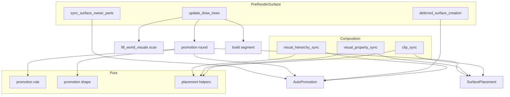
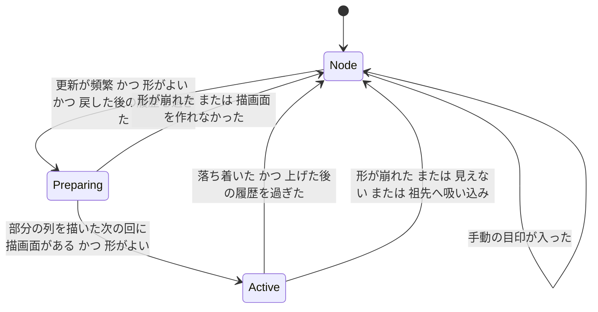
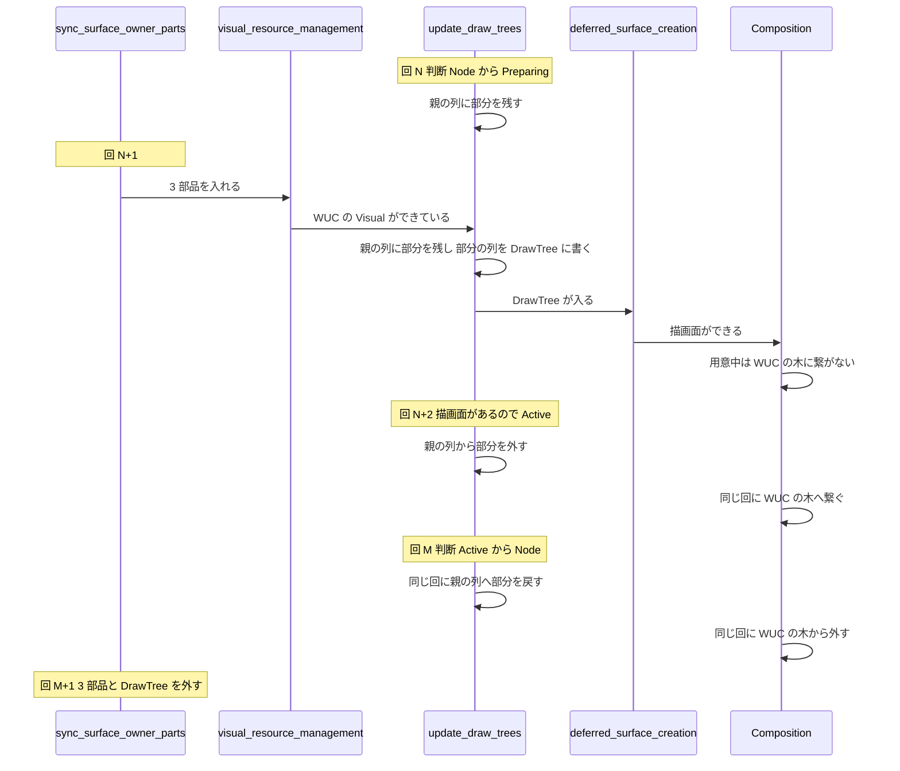

# 技術設計: wintf-surface-auto-promotion

## Overview

**Purpose**: wintf の描画の木で、更新が頻繁な節を wintf が自動で描画面の持ち主へ上げ、落ち着いたら節へ戻す。あわせて、節の下に描画面の持ち主を置けるようにし（WUC の木のつながりと位置が節をまたぐ）、描画面の持ち主の `VisualTransform` を画面の見た目に効かせる。上げ下げで画面の画素の答えは変えない。

**Users**: wintf を使う描き手（新しい描き方の部品 `VisualDrawContent`・`VisualTransform` で木を組む人）と wintf の保守者。今の areka の描き手（`GraphicsCommandList` で描く emo のシェル・wintf のウィジェット）の見た目は変わらない（`crates/areka*` に `VisualDrawContent`／`VisualTransform`／`OwnSurface` の使い手は 0 件）。

**Impact**: (1) 規則 `wants_own_surface` に 4 つ目の入力（自動で上げた持ち主か）が足される。(2) 描画面の持ち主の木を埋める係 `fill_world_visuals` が、節の下の持ち主を切らずに「置き場」を記し、自動で上げた持ち主の部分木を通り抜けて 1 本の前順の列（走査の列）を作る。(3) WUC の木の同期が、いちばん近い祖先の持ち主を親とし、節を通り抜けた前順で子を並べる。(4) 持ち主の `VisualTransform` が WUC の `TransformMatrix` に写る（`warn!` をやめる）。係の登録（`ecs/world/mod.rs`）は変えない。

### Goals
- 頻繁に変わる節を、時刻で数えた純粋な規則（履歴つき）で自動で上げ下げする（要件 1）。
- 上げ下げの前後とその瞬間の画面の画素を、全部を節にした形と一致させる（境界から離れた画素で 1 チャネルあたり ±1・要件 2・3）。
- 節の下の持ち主（手動・自動）を画面に出し、祖先の節の位置・可視・不透明度の積・矩形の切り抜きを効かせる（要件 4）。
- 持ち主の `VisualTransform` を効かせる（要件 5）。
- 判断と見分けを GPU を使わない純粋なテストで、画素の一致を WARP で、WUC への写しを実 GPU で固める（要件 8）。

### Non-Goals
- 差分の描き直しの作り（`wintf-visual-damage-redraw`）・合成の規則（`wintf-d2d-composite-rules`）の変更。
- 今の描き方の Visual と何も持たない Visual の既定の変更（道筋を `draw/README.md` に書くだけ・要件 6）。
- 当たり判定の答えの変更。回転・拡大を含む `VisualTransform` を持つ持ち主の見た目と当たりのずれは文書に書くだけ（要件 9.1）。
- 自動の昇格を止める口・閾値の設定の口・持ち主の数と大きさの上限（討議の確定 7）。
- 表示した窓の画面の画素を読むこと（討議の確定 6）。

## Boundary Commitments

### This Spec Owns
- 自動の上げ下げの純粋な規則（定数・履歴・相の移り）と、その状態の部品 `AutoPromotion`（wintf の内部の部品・全部の節が `WorldVisual` に連れられて持つ）。
- 自動で上げてよい形の純粋な見分け（要件 2.3 の各場合）と、自分の描画面の中の位置の決め（端数の扱い・要件 2.7）。
- 走査の列（`TreeScan`）: 描画面の持ち主（手動）ごとの前順の列で、節・自動で上げた持ち主・節の下の手動の持ち主を 1 本に並べ、祖先の性質の積み重ねと「この回の更新」を記す。
- 1 回の判断（帰属・祖先を優先・相の移り・記録・置き場の書き込み・描く列の分け方）。
- 置き場の部品 `SurfacePlacement`（節の下の持ち主と自動で上げた持ち主の、WUC の親からの位置・不透明度・可視・切り抜き）と、それを WUC へ写す純粋な補助（変形・切り抜きの合わせ・子の並び・親の決め）。
- 描画の木の組み立て `build` の「部分の列」の形（根の中身を出さず、原点をずらして描く）。
- WUC の木の同期・性質の同期・切り抜きの同期のうち、節をまたぐ部分と持ち主の `VisualTransform`。
- 自動で上げた持ち主の描画面の矩形の決め（部分木の描く範囲から・はみ出したら作り直す）。
- 上げ下げ・見送りの `debug!` と、節の下の手動の持ち主の効かせられない形の `warn!`。
- `draw/README.md` と steering（`structure.md`・`tech.md`）の描画の道の記述。

### Out of Boundary
- 差分の描き直し（項・比べ・計画・写し・記録の行 `[render_surface] damage`）。`render.rs`・`damage.rs`・`diff.rs`・`composite.rs` は触らない。ただし `render.rs` の根の変換の選び 1 か所だけは例外（3.4 の実装で確定）: 部分の列は自分の描画面の物理ピクセルで出すので、`DrawTree::device_px`（`draw_tree.rs` に足す欄・部分の列の木だけ真）が立つ木は恒等の根の変換で描き直す（`replay_transform`）。`composite.rs` は同じ行列から拡大を取るので、`diff::entries` の拡大も (1,1) になり、触らない。でないと DPI の拡大が二重にかかる。
- 係の登録と順（`ecs/world/mod.rs`）・WUC の Visual を作る係（`visual_manager.rs`）・部品の定義（`components.rs` の `VisualGraphics`。`ClipKey` は欄と、その欄の型の別名 `PlacedClip` を足すだけ受け持つ）・配置の伝播（`layout/`）。
- 当たり判定（`hit_test`）・描画面 1 枚ごとの読み戻し（`readback.rs`）の答えの形。
- 層・不透明度・重ね方・ブレンドの規則。
- areka の側の使い方（`crates/areka*`・`crates/pilot`・`tools/`）。

### Allowed Dependencies
- wintf の中: `Visual`・`VisualDrawContent`・`VisualTransform`・`WorldVisual`・`VisualVersion`・`OwnSurface`・`GraphicsCommandList`・`DrawTree`・`VisualGraphics`・`SurfaceGraphics`・`Arrangement`・`GlobalArrangement`・`FrameTime`・`GraphicsCore`・`WucGraphicsResource`・`ReportedIssues`・`format_entity_name`・`MAX_ANCESTOR_DEPTH`。
- 外: `bevy_ecs` 0.19・`windows` 0.62（今の機能 `UI_Composition` の中の `Visual.TransformMatrix`・`CompositionGeometricClip`・`CompositionClip.TransformMatrix`）・`windows-numerics`・`tracing`。依存は足さない（`Cargo.toml` に触らない）。
- 向き: 純粋な規則（`promotion.rs`・`promotion_shape.rs`・`placement.rs` の補助）は ECS の係に依らない。係（`systems.rs`・`systems/*.rs`）が純粋な規則を呼ぶ。逆向きは禁止。

### Revalidation Triggers
- `wants_own_surface` の引数（4 つ目の入力を足す）・`WorldVisual` が `AutoPromotion` を連れてくること。
- WUC の子の並びの作り方（節を通り抜けた前順）・親の決め方（いちばん近い祖先の持ち主）。
- 持ち主の `VisualTransform` が効くようになること（今まで無視していた値が画面に出る）。
- 自動で上げた部分木が親の描画面の読み戻し（`SurfaceReadback`）に載らなくなること。
- 新しい記録の行（`[surface_promotion]`）。既存の行の文言と欄は変えない。
- 判断の定数の値。

## Architecture

### Existing Architecture Analysis
- 係の順（変えない）: `PreRenderSurface` は `sync_surface_owner_parts` → `visual_resource_management_system`（WUC の Visual を作る）→ `update_draw_trees`（埋める・組む）→ `deferred_surface_creation_system`（描画面を作る）→ `mark_dirty_surfaces` → …。`RenderSurface` は `render_surface`。`Composition` は `visual_hierarchy_sync_system` → `visual_property_sync_system` → `clip_sync_system`。命令（`Commands`）は前後のある係の間で反映される（今も `sync_surface_owner_parts` が入れた部品が同じ回に作られる）。
- 13 本の予定は 1 回の tick の中で UI スレッドの上で続けて回り、WUC の暗黙の確定はその後にまとめて出る（研究 R-c）。描画面の描き込みと Visual の木の付け外しが同じ回なら同じ画面の更新に出る。
- WUC の兄弟の並び: `Children` の順に `InsertAtBottom` するので、**最初の子が最上・最後の子が最下**（`visual_sync.rs` の注記・`tests/visual/common/mod.rs`）。節の描く列は画家の順（最初の子が最下）。本設計はどちらの約束も変えない（下の「重なりの順」）。
- 節の下の持ち主は今 2 重に切られている（`fill_world_visuals` が `error!` で切り、`visual_hierarchy_sync_system` は直の親が `VisualGraphics` を持たないので「根」とみなしてどこにも繋がない）。

### Architecture Pattern & Boundary Map



**Architecture Integration**:
- 選んだ形: ギャップ分析の案 C（純粋な規則と見分けは新しいファイル・置き場は埋める係が記す・WUC は祖先の持ち主に直に繋ぐ B-1・用意してから切り替える 2 段）。新しい係は足さず、今の係の中で呼ぶ（係の登録を変えない）。
- 責務の分け: 判断の状態は `AutoPromotion` だけが持ち、書くのは「1 回の判断」（`update_draw_trees` の中）と、手動の目印が入ったときの初期化（`sync_surface_owner_parts`）だけ。置き場 `SurfacePlacement` は「1 回の判断」だけが書き、Composition の 3 係が読む。描画面の部品（3 部品・`DrawTree`）の出し入れは今どおり `sync_surface_owner_parts`（3 部品）と `update_draw_trees`（`DrawTree`）。
- 保つ形: 規則 `wants_own_surface` の 1 か所・`ReportedIssues` の「続く間 1 度」・値が変わったときだけ書く・変形では版を上げない（`version.rs`）・`Children` の順に `InsertAtBottom` する並べ方。
- steering: Visual が最小の描画単位・log-first（失敗は `error!`）・兄弟ファイルのテスト・1 ファイル 1,000 行以内・`Cargo.toml` に触らない。

### Key Decisions

| 番号 | 決め | 要点（詳しくは research.md の設計の段） |
|---|---|---|
| D1 | 用意してから切り替える 2 段 | 判断の回に相を「用意中」にし、次の回に部品と WUC の Visual と自分の描画面を作って描く（親の描く列には残し、WUC の木には繋がない）。描画面ができた次の回に「上げた」へ進め、親の描く列から外すことと WUC の木へ繋ぐことを同じ回に行う。戻しは判断した回に効く。どの回の画面も、部分木が欠けず 2 度描かれない。係の順の組み替え（`ecs/world/mod.rs`）は要らない。要件 3.1 の「判断した」は「切り替える答え（Activate／Demote）を出した」と読む（要件を書き直した・設計の討議の確定 2）。用意中の回（1 回）は部分木を親の描画面と自分の描画面の 2 か所で描く費用が掛かる（画面に出るのは親の 1 か所） |
| D2 | 状態は `AutoPromotion`（`WorldVisual` が連れてくる内部の部品）・相は規則の 4 つ目の入力 | 全部の節が生まれたときから持つので、命令で部品を足す揺れが無い。履歴の書き込みは変化の印を立てず、相が変わったときだけ印を立てる（`sync_surface_owner_parts` が拾う） |
| D8 | 静かな間の戻しは心拍で拾う | 静かな間は tick が回らないので、戻しは心拍（30 回の画面更新ごと）で判断する。遅れは画素に出ない（GPU のメモリを返すのが遅れるだけ）。`tick_wake::arm_deadline` は使わない |
| B-1 | 節の下の持ち主は、いちばん近い祖先の持ち主の WUC の Visual に直に繋ぐ | WUC の Visual を増やさない。祖先の節の位置は行列に、不透明度は積に、可視は不透明度 0 に、矩形の切り抜きは 1 つの切り抜きへ合わせて写す。1 つの切り抜きに合わせられない形は `warn!` を 1 度残す |
| 部分の列 | 自動で上げた持ち主の描画面は、親の走査の列の中の連続した部分をそのまま描く | 自動で上げた持ち主は自分の埋める係を回さず、親の走査の列の部分（前順で連続）を、原点（整数の物理ピクセル）を物理ピクセルのまま引いて描く。持ち主自身の切り抜き・不透明度の層・`VisualTransform` も節のときと同じ D2D の命令で描くので、WUC には位置（整数）だけを写す |
| 描画面の矩形 | 部分木の描く範囲から決める | 用意中の回に、部分木の描く範囲（物理ピクセルへ外向きに丸め・にじみの余白込み・親の描画面と祖先の矩形の切り抜きで切ったもの）を自分の描画面の矩形とし、原点をその左上に置く。上げた後に範囲が矩形からはみ出したら描画面を作り直す（自分の描画面だけ全部描き直し・親には触らない）。縮むほうは追わない（設計の討議の確定 1・検証の重大な問題 1） |
| 重なりの順 | 自動で上げた持ち主は親の持ち主の WUC の子の一番下（自動の持ち主どうしは画家の順） | 全部を節にした形では候補は親の描画面の中＝全部の WUC の子より下に在る。一番下に並べれば手動の持ち主との順は同じになり、手動の持ち主・ほかの自動の持ち主との重なりの条件が要らない（設計の討議の確定 3・要件 2.3・4.6 を書き直した） |
| 端数 | 案 b（端数を自分の描画面の中でずらす）を取る | 原点の物理ピクセルを範囲の左上の整数に置き、端数は描画面の中に残す。原点は物理ピクセルの整数のまま世界の行列と外接矩形から引く（DIP の `px / scale` で引くと f32 で割り切れず画素がずれる。研究 R-e）。D2D のラスタは画素の格子に対する端数にしか依らないので、整数だけずらした描き方は親の描画面の中で描いた画素を整数だけずらしたものになる（研究 R-e）。WARP のテストで、位置 (10.3, 7.6) DIP の端数のある子を含む矩形・にじみのある楕円・線形のビットマップ・縮小の HIGH_QUALITY_CUBIC のビットマップが、拡大 1.0・1.25・1.5 で全画素 ±1 に揃うことを確かめた（案 b を維持・落としは使わない・`INTEGER_POSITION_ONLY = false`） |
| 変形の写し | 平行移動だけなら `Offset`、それ以外は `TransformMatrix` に全部（`Offset` は 0） | WUC の `TransformMatrix` と `Offset` を掛ける順は文書に無い（研究）。片方だけを使えば順に依らない。`VisualTransform` を持たない持ち主の写し方は今のまま（`Offset` だけ） |

### Technology Stack

| Layer | Choice / Version | Role in Feature | Notes |
|-------|------------------|-----------------|-------|
| ECS | bevy_ecs 0.19 | 部品・係・変化の印 | 新しい係は足さない |
| 合成 | Windows.UI.Composition（windows 0.62 の `UI_Composition`） | 節の下の持ち主の親・位置・変形・不透明度・切り抜き | `Visual.TransformMatrix`・`CompositionGeometricClip`・`CompositionClip.TransformMatrix` は今の機能の中 |
| 描画 | Direct2D（D3D11・テストは WARP） | 部分の列の描画・画素の一致のテスト | WARP の足場 `draw/emit_test_support.rs` を広げる |
| 時刻 | `FrameTime`（f64 秒・QPC） | 判断の時刻 | テストは資源を差し替えて注入する |

## File Structure Plan

### Directory Structure
```
crates/wintf/src/ecs/graphics/visual/
├── promotion.rs                 # 新規: 判断の定数・相・AutoPromotion・純粋な規則 step
├── promotion_tests.rs           # 新規: 規則の真理値表と時系列（要件 8.1）
├── promotion_shape.rs           # 新規: 自動で上げてよい形の純粋な見分けと原点の決め（要件 2.3・2.7）
├── promotion_shape_tests.rs     # 新規: 見分けの各場合（要件 8.2）
├── promotion_round.rs           # 新規: 1 回の判断（帰属・祖先の優先・相の移り・記録・置き場・描く列の分け方）
├── promotion_round_tests.rs     # 新規: GPU を使わない ECS のテスト（帰属・吸い込み・記録の 1 度・置き場）
├── promotion_round_log_tests.rs # 新規（実装で足した兄弟）: 記録の行の捕まえ（要件 1.8・4.9・7.x）
├── placement.rs                 # 新規: SurfacePlacement と WUC へ写す純粋な補助（変形・切り抜き・子の並び・親）
├── placement_tests.rs           # 新規: 補助の純粋なテスト（要件 8.4 の並びと親の決め）
├── mod.rs                       # 変更: 規則の 4 つ目の入力・新しいモジュールの宣言と公開・文書
├── world_visual.rs              # 変更: 走査の列 TreeScan・節の下の持ち主を切らない・自動の持ち主を通り抜ける
├── world_visual_tests.rs        # 変更: 切って error! を確かめる 2 本を、置き場を記す形へ
├── world_visual_scan_tests.rs   # 新規（実装で足した兄弟）: 走査の列の材料と更新の印
├── systems.rs                   # 変更: 3 部品の係の規則の入力・update_draw_trees の配線
├── systems_tests.rs             # 変更: 持ち主の VisualTransform の warn! の 1 本を、warn! が出ない形へ・自動の部品の出し入れ
├── systems_promotion_tests.rs   # 新規（実装で足した兄弟）: 時刻を注入した上げ下げの通しと描画面の大きさ
├── draw_tree.rs                 # 変更（境界の例外）: DrawTree::device_px の欄
└── draw/
    ├── builder.rs               # 変更: 部分の列の形（根の中身を出さない・原点をずらす）
    ├── builder_segment_tests.rs # 新規: 部分の列の組み立て
    ├── mod.rs                   # 変更: テストの接続宣言だけ（emit.rs は触らない）
    ├── emit_promotion_tests.rs  # 新規: WARP の画素の一致（要件 8.3・研究 R-e）
    ├── emit_placement_tests.rs  # 新規（実装で足した兄弟）: 節の下の持ち主と持ち主の変形の WARP の一致
    ├── emit_test_support.rs     # 変更: WUC の重ねを写す口（描画面ごとの絵を整数の位置と不透明度で重ねる）
    └── README.md                # 変更: 自動の上げ下げ・節の下の持ち主・持ち主の VisualTransform・既定の寄せ方
crates/wintf/src/ecs/graphics/
└── components.rs                # 変更: ClipKey に当てた置き場の切り抜き（型の別名 PlacedClip）と自動の持ち主かの欄を足すだけ
crates/wintf/src/ecs/graphics/systems/
├── visual_sync.rs               # 変更: 親の決め・節を通り抜けた並び・並びだけの変化・変形と置き場の写し
├── visual_sync_tests.rs         # 変更: 写しの値の純粋な部分
├── clip_sync.rs                 # 変更: 置き場の切り抜きとの合わせ・自動で上げた持ち主は切り抜きなし
├── clip_sync_tests.rs           # 変更: 合わせの鍵
├── render.rs                    # 変更（境界の例外）: replay_transform（device_px の木は恒等）
├── render_tests.rs              # 変更: replay_transform の選び
├── window_pos_tests.rs          # 変更: DrawTree の欄が増えたための 1 行
└── surface.rs                   # 変更: 自動で上げた持ち主の描画面の矩形を部分木の描く範囲から決める・はみ出したら作り直す
crates/wintf/tests/
├── graphics.rs                  # 変更: 新しいテストの接続宣言 1 行だけ
└── graphics/
    ├── surface_embedding_test.rs # 新規: 実 GPU の WUC の性質の読み戻しと描画面ごとの画素（要件 8.5）
    └── draw_tree_systems_test.rs # 見直しのみ: 昇格まわりの期待は走査の列の形でも変わらず、差分なし
.kiro/steering/
├── structure.md                 # 変更: graphics/visual の描画の道の記述
└── tech.md                      # 変更: テストの記述（画素の一致の WARP の場合に自動の上げ下げを足す）
```

### Modified Files（要点）
- `visual/mod.rs` — `wants_own_surface(has_command_list, has_own_surface, is_node, auto_owner)` に変える（`has_command_list || has_own_surface || !is_node || auto_owner`）。`on_visual_add` は `auto_owner = false` を渡す。`Visual`・`OwnSurface` の文書を今の作りに合わせる。
- `visual/world_visual.rs` — `WorldVisual` に `#[require(AutoPromotion)]`。`fill_world_visuals` が `TreeScan` を埋める（下の Components）。`TreeIssue::OwnerUnderNode` と、その `error!` をなくす。
- `visual/systems.rs` — `sync_surface_owner_parts` が `Changed<AutoPromotion>` を見る・手動の目印か命令の列が入った節の状態を初期化する。`update_draw_trees` の根の回し方・1 回の判断の呼び出し・部分の列の組み立て・持ち主の `VisualTransform` の `warn!` の削除。
- `visual/draw/builder.rs` — `build` に「部分の列」の口を足す（今の呼び出しの答えは変えない）。
- `systems/visual_sync.rs`・`systems/clip_sync.rs`・`systems/surface.rs` — 下の Components のとおり。
- `tests/graphics.rs`・`visual/draw/mod.rs` — 兄弟のテストの接続宣言だけ（本体は書かない）。

> 触らないファイル（ウェーブの約束）: `Cargo.toml`・`ecs/world/**`・`ecs/graphics/{visual_manager,composite,damage,readback}.rs`（`components.rs` は `ClipKey` の欄だけ。同じウェーブでほかに wintf を触る spec は無い）・`ecs/graphics/systems/{render,init,brushes,window_pos}.rs`・`visual/draw/{diff,emit(本体),command,clip_geometry}.rs`・`ecs/layout/**`・`crates/areka*`・`crates/pilot`・`tools/`。

## System Flows

### 相の移り（AutoPromotion）



- 手動の目印（`OwnSurface`）か命令の列が入った節は、相を Node に初期化し（履歴も消す）、以後は手動の持ち主として扱う（要件 2.2）。外れた後は規則 `wants_own_surface` の答えに戻り、節なら判断の対象になる。
- 「形が崩れた」「見えない」「描画面を作れなかった」「祖先へ吸い込み」での戻しは履歴を待たない（要件 2.4・2.5・1.10）。戻した後は上げる側の履歴を掛ける（要件 1.3・討議の確定 4）。

### 上げ下げのフレーム（係の中の順）



- どの回の画面も、部分木は親の描画面か自分の描画面のどちらか 1 か所にだけ出る（要件 3.1）。判断から画面の切り替えまでの回の遅れは画素に出ない。
- 用意中の回は部分木を 2 か所（親の描画面・WUC の木に繋がない自分の描画面）で描く。費用は上げる 1 度ごとに部分木 1 回ぶんの描画と描画面の作成（設計の討議の確定 2）。
- 親の描く列から部分が外れる・戻る変化は、そのまま差分の描き直しの「消えた・足された項」になる（要件 3.3・既存の作りのまま）。

## Requirements Traceability

| Requirement | Summary | Components | Interfaces | Flows |
|---|---|---|---|---|
| 1.1 | 決まった時間に決まった回数で上げる | PromotionRule | `RuleState::step` | 相の移り |
| 1.2 | 決まった時間更新が無ければ戻す | PromotionRule・PromotionRound | `step`（Active の落ち着き） | 相の移り |
| 1.3 | 上げを厳しく・逆向きの履歴・即時の戻しの後も上げの履歴 | PromotionRule | 定数・`since` | 相の移り |
| 1.4 | 材料は版・局所の変形と配置・FrameTime だけ | TreeScan・PromotionRound | `ScanEntry::updated` | — |
| 1.5 | 経過した実時間・丸めない・同じ回は 1 回 | PromotionRule・PromotionRound | `step` の重複の除き・帰属ごとに 1 回 | — |
| 1.6 | 時刻が戻ったら経過 0 | PromotionRule | `last_now` の単調化 | — |
| 1.7 | 1 か所の純粋な規則 | PromotionRule | `step` | — |
| 1.8 | ログの水準で答えを変えない | PromotionRound | 水準を読まない | — |
| 1.9 | 全部の節を毎回判断しない | PromotionRound | 判断は更新のあった帰属先と自動の持ち主だけ | — |
| 1.10 | 祖先と子孫が同じ回なら祖先だけ | PromotionRound | 祖先の優先・吸い込み | 相の移り |
| 1.11 | 自動の持ち主の部分木の更新はその持ち主へ数える | PromotionRound | 帰属 | — |
| 2.1 | 対象は窓の下の節だけ | 規則 `wants_own_surface`・PromotionRound | 節の種類（`WorldVisual` かつ命令の列と目印なし） | — |
| 2.2 | 手動の目印の優先と外した後 | SurfaceOwnerParts | 初期化・規則の答え | 相の移り |
| 2.3 | 画素が変わる形は上げない | PromotionShape | `check_shape` | — |
| 2.4 | 形が崩れたらその回に戻す | PromotionRule・PromotionRound | `step`（Shape） | 上げ下げのフレーム |
| 2.5 | 描画面を作れなければ節のまま・記録 | PromotionRound・PromotionRule | `SurfaceReadiness::Failed` | 相の移り |
| 2.6 | 使い手の部品を足し外ししない | PromotionRound・SurfaceOwnerParts | 出し入れは wintf の部品だけ | — |
| 2.7 | 端数は自分の描画面の中でずらす | PromotionShape・SegmentBuild・PlacementMath | `Origin`・`build` の原点 | — |
| 3.1 | そのフレームのうちに切り替え・欠けない・2 度描かない | PromotionRound・HierarchySync | 2 段の切り替え | 上げ下げのフレーム |
| 3.2 | 画素の一致 | SegmentBuild・PromotionShape | 部分の列 | — |
| 3.3 | 差分の描き直しとして扱う | 既存の差分の描き直し | — | — |
| 4.1 | 節の下の持ち主を切らない・error! を残さない | TreeScan・HierarchySync | 置き場・親の決め | — |
| 4.2 | 子孫の節はその持ち主の描画面へ | TreeScan（手動の持ち主は自分で埋める） | 走査は持ち主で止まる | — |
| 4.3 | いちばん近い祖先の持ち主の上に重ねる | HierarchySync・PlacementMath | `wuc_host_of` | — |
| 4.4 | 位置は祖先の節の変形と配置と DPI | TreeScan・PropertySync・PlacementMath | `parent_world`・`wuc_transform` | — |
| 4.5 | 祖先の変化を同じ回に合わせ直す | PromotionRound・PropertySync・HierarchySync | 置き場の変化の印 | — |
| 4.6 | 重なりの順は前順・自動の持ち主も前順 | HierarchySync・PlacementMath・PromotionShape | `wuc_children_order`・重なりの見分け | — |
| 4.7 | 祖先の節が見えなければ出さない | TreeScan・PropertySync | `visible` | — |
| 4.8 | 祖先の不透明度の積と矩形の切り抜き | TreeScan・PropertySync・ClipSync | `opacity`・`PlacementClip` | — |
| 4.9 | 効かせられない形は warn! を 1 度 | PromotionRound | `ReportedIssues` の種類 | — |
| 4.10 | 外れた・消えた・戻った持ち主を古い親から外す | HierarchySync | 期待する親の変化・既存のフック | — |
| 4.11 | 並びだけの変化を同じ回に合わせ直す | HierarchySync | `Changed<Children>` | — |
| 5.1 | 持ち主の VisualTransform を効かせる・warn! をやめる | PropertySync・PlacementMath | `wuc_transform` | — |
| 5.2 | 変わった回に反映 | PropertySync | `Changed<VisualTransform>` | — |
| 5.3 | 版を上げない | 既存の `version.rs` の約束 | — | — |
| 5.4 | 回転・拡大は位置・向き・大きさを合わせ再標本化の違いは許す | PropertySync・テスト | `TransformMatrix` の読み戻し | — |
| 6.1 | 今の描き方と何も持たない Visual の既定を変えない | 規則 `wants_own_surface` | — | — |
| 6.2 | 新しい描き方の既定（節）を保つ | 規則 `wants_own_surface` | — | — |
| 6.3 | 道筋を README に書く | Docs | — | — |
| 7.1 | 上げた・戻したを debug! に 1 行 | PromotionRound | `[surface_promotion]` | — |
| 7.2 | 見送りを debug! に・続く間は 1 度 | PromotionRound | `skip_memo` | — |
| 7.3 | 毎フレーム繰り返さない | PromotionRound | 移りのときだけ・見送りは 1 度 | — |
| 7.4 | 既存の行を変えない | 境界 | — | — |
| 8.1 | 規則の真理値表と時系列 | promotion_tests | — | — |
| 8.2 | 形の見分けの純粋なテスト | promotion_shape_tests | — | — |
| 8.3 | WARP の画素の一致 | emit_promotion_tests・emit_test_support | WUC の重ねの口 | — |
| 8.4 | WUC の木のつながりと位置・並び | placement_tests・surface_embedding_test | — | — |
| 8.5 | 実 GPU の確かめ | surface_embedding_test | 性質の読み戻し・`CopySurface`（WUC の描画面そのもの） | — |
| 8.6 | 既存のテストの更新 | world_visual_tests・systems_tests・draw_tree_systems_test | — | — |
| 8.7 | 兄弟ファイル | File Structure Plan | — | — |
| 9.1 | README の記述 | Docs | — | — |
| 9.2 | steering の記述 | Docs | — | — |
| 9.3 | areka に依存しない | 境界 | — | — |
| 9.4 | 依存を足さない | 境界 | — | — |
| 9.5 | 1,000 行以内 | File Structure Plan | — | — |

## Components and Interfaces

| Component | Domain/Layer | Intent | Req Coverage | Key Dependencies | Contracts |
|---|---|---|---|---|---|
| PromotionRule（`promotion.rs`） | 純粋 | 定数・相・履歴・`step` | 1.1〜1.3, 1.5〜1.7, 2.4, 2.5 | なし | Service, State |
| PromotionShape（`promotion_shape.rs`） | 純粋 | 上げてよい形と原点 | 2.3, 2.7, 4.6 | TreeScan (P0) | Service |
| TreeScan（`world_visual.rs`） | 埋める係 | 前順の走査の列 | 1.4, 1.9, 4.1, 4.2, 4.4, 4.7, 4.8 | `Visual` ほか (P0) | State |
| PromotionRound（`promotion_round.rs`） | 係の中の処理 | 1 回の判断と書き込み | 1.8〜1.11, 2.1, 2.5, 2.6, 3.1, 4.5, 4.9, 7 | PromotionRule・PromotionShape (P0) | Service |
| SegmentBuild（`draw/builder.rs`） | 組み立て | 部分の列 | 2.7, 3.2 | `NodeData` (P0) | Service |
| PlacementMath（`placement.rs`） | 純粋 | 置き場の部品と WUC へ写す補助 | 4.3, 4.4, 4.6, 4.8, 5.1 | なし | Service, State |
| SurfaceOwnerParts（`systems.rs`） | 係 | 3 部品の出し入れ | 2.1, 2.2, 6.1, 6.2 | 規則 (P0) | Batch |
| UpdateDrawTrees（`systems.rs`） | 係 | 配線 | 3.1, 5.1 | TreeScan・PromotionRound・SegmentBuild (P0) | Batch |
| HierarchySync（`systems/visual_sync.rs`） | 係 | WUC の親と並び | 3.1, 4.3, 4.6, 4.10, 4.11 | PlacementMath (P0) | Batch |
| PropertySync（`systems/visual_sync.rs`） | 係 | 位置・変形・不透明度 | 4.4, 4.5, 4.7, 4.8, 5.1, 5.2, 5.4 | PlacementMath (P0) | Batch |
| ClipSync（`systems/clip_sync.rs`） | 係 | 切り抜きの合わせ | 4.8 | PlacementMath (P0) | Batch |
| AutoSurfacePad（`systems/surface.rs`） | 係 | 描画面の矩形を部分木の描く範囲から | 2.7 | `AutoPromotion` (P1) | Batch |
| WarpStack（`draw/emit_test_support.rs`） | テストの足場 | WUC の重ねの写し | 8.3 | WARP (P0) | — |
| Docs（`draw/README.md`・steering） | 文書 | 記述 | 6.3, 9.1, 9.2 | — | — |

### 純粋な規則

#### PromotionRule

| Field | Detail |
|---|---|
| Intent | 上げ下げの判断の定数・履歴・相の移りを 1 か所に置く純粋な規則 |
| Requirements | 1.1, 1.2, 1.3, 1.5, 1.6, 1.7, 2.4, 2.5 |

**Responsibilities & Constraints**
- 定数（1 か所・wintf の中・設定の口は出さない）:

| 名 | 値 | 意味 |
|---|---|---|
| `PROMOTE_COUNT` | 8 | 上げるのに要る更新の回数 |
| `PROMOTE_WINDOW_SECS` | 1.0 | その回数を数える直近の実時間 |
| `DEMOTE_QUIET_SECS` | 3.0 | 戻すのに要る更新の無い実時間 |
| `HOLD_AFTER_PROMOTE_SECS` | 3.0 | 上げた後、落ち着きで戻さない実時間 |
| `HOLD_AFTER_DEMOTE_SECS` | 3.0 | 戻した後（即時の戻しも）、上げない実時間 |

  上げる条件（1 秒に 8 回＝おおむね 8 Hz 以上が続く）は戻す条件（3 秒間 0 回）より厳しく、その間の頻度では今の相を保つ（要件 1.3）。
- 時刻は f64 秒のまま比べ、丸めない（要件 1.5）。`now` が前の回より小さければ前の回の値として扱う（経過 0・要件 1.6）。
- 同じ時刻の更新は 1 回にする（同じフレームの複数の更新・要件 1.5）。

**Contracts**: Service [x] / State [x]

##### Service Interface
```rust
#[derive(Clone, Copy, PartialEq, Eq, Debug, Default)]
pub(crate) enum Phase { #[default] Node, Preparing, Active }

/// 用意中の描画面の様子（1 回の判断が部品の様子から決める）。
#[derive(Clone, Copy, PartialEq, Eq, Debug)]
pub(crate) enum SurfaceReadiness { Pending, Ready, Failed }

#[derive(Clone, Copy, PartialEq, Eq, Debug)]
pub(crate) enum DemoteReason { Quiet, Shape(Ineligible), SurfaceFailed, Absorbed }

#[derive(Clone, Copy, PartialEq, Eq, Debug)]
pub(crate) enum Verdict { Stay, Prepare, Activate, Demote(DemoteReason), Skip(Ineligible) }

/// 1 つの節の判断の状態（純粋・ECS に依らない）。
#[derive(Clone, Debug, PartialEq)]
pub(crate) struct RuleState { /* phase, since, last_now, 直近 PROMOTE_COUNT 回の更新の時刻の輪 */ }

impl RuleState {
    pub(crate) fn phase(&self) -> Phase;
    /// 1 回ぶん進める。`shape` は上げる・保つ判断に要るときだけ呼ぶ（純粋な関数を渡す）。
    pub(crate) fn step(
        &mut self,
        now: f64,
        updated: bool,
        shape: impl FnOnce() -> Result<(), Ineligible>,
        surface: SurfaceReadiness,
    ) -> Verdict;
    /// 祖先が上がった回の吸い込み（即時の戻し・上げの履歴を掛ける）。
    pub(crate) fn absorb(&mut self, now: f64) -> Verdict;
    /// 手動の目印が入った回の初期化（履歴を消し、上げの履歴を掛けない）。
    pub(crate) fn reset(&mut self);
}
```
- `step` の答え（`t` は単調にした今の時刻）:
  - Node: 直近の更新が `PROMOTE_COUNT` 回そろい、最も古いものから `t` までが `PROMOTE_WINDOW_SECS` 以内で、`t − since ≥ HOLD_AFTER_DEMOTE_SECS` なら、`shape()` が `Ok` で `Prepare`（相を Preparing・`since = t`）、`Err(e)` で `Skip(e)`。ほかは `Stay`。
  - Preparing: `shape()` が `Err(e)` なら `Demote(Shape(e))`。`surface` が `Ready` なら `Activate`、`Failed` なら `Demote(SurfaceFailed)`、`Pending` なら `Stay`。
  - Active: `shape()` が `Err(e)` なら `Demote(Shape(e))`。最後の更新から `DEMOTE_QUIET_SECS` 以上たち、`t − since ≥ HOLD_AFTER_PROMOTE_SECS` なら `Demote(Quiet)`。ほかは `Stay`。
  - Demote の後は相を Node・`since = t`。
- Invariants: 同じ入力の並びから同じ答え（要件 1.7）。ログの水準を読まない（要件 1.8）。

##### State Management
- 状態の部品（`WorldVisual` が `#[require]` で連れてくる・全部の節が持つ）:
```rust
#[derive(Component, Debug, Default, Clone)]
pub struct AutoPromotion {
    pub(crate) rule: RuleState,
    /// 最後に記録した見送りの理由（続く間は記録しない・要件 7.2）。
    pub(crate) skip_memo: Option<Ineligible>,
    /// 用意中に部分の列を描いた回が在るか（次の回に描画面の有無で Ready／Failed を決める）。
    pub(crate) built: bool,
}
```
- 履歴だけの書き込みは `bypass_change_detection` で行い、相が変わった回だけ変化の印を立てる（`sync_surface_owner_parts` と WUC の同期が拾う）。
- 公開の型だが欄は crate の外から触れない（`ReportedIssues` と同じ形）。

#### PromotionShape

| Field | Detail |
|---|---|
| Intent | 上げても画面の画素が全部を節にした形と同じになるかの純粋な見分けと、自分の描画面の原点の決め |
| Requirements | 2.3, 2.7, 4.6 |

**Responsibilities & Constraints**
- 入力は走査の列と候補の添字と大きさだけ。ECS に触らない。
- 重なりと収まりの判定は、物理ピクセルの整数へ外向きに丸めた外接矩形に、にじみの余白を足して行う。余白は差分の描き直しと同じ規則（`diff.rs`: 最近傍の補間なら 0、ほかは `ceil(2 × 拡大)`）。討議の確定 2 の「にじみの余白を足すか」は「足す」と決める（D2D の縁のにじみは外接矩形の外へ出るため）。
- 自分の描画面の矩形はこの範囲から決める（下の `Origin`）ので、収まりは親の描画面と祖先の矩形の切り抜きに対してだけ見る（設計の討議の確定 1）。
- 手動の持ち主・ほかの自動の持ち主との重なりは見ない。自動で上げた持ち主は親の持ち主の WUC の子の一番下に並ぶので、全部を節にした形と順が同じ（設計の討議の確定 3）。
- 持ち主から見た変形が回転・拡大を含むこと、自分の切り抜きが角丸・図形・端数の矩形であることは見ない。部分の列は持ち主自身の変形と切り抜きも節のときと同じ D2D の命令で描き、WUC には整数の位置だけを写すので画素は変わらない（設計の討議の確定 4・要件 2.3 を書き直した）。

**Contracts**: Service [x]

##### Service Interface
```rust
#[derive(Clone, Copy, PartialEq, Eq, Debug, Hash)]
pub(crate) enum Ineligible {
    LaterContentOverlap,   // 同じ描画面の中で後に描く中身と重なる
    ContainsOwner,         // 部分木の中に手動の持ち主が在る
    AncestorLayer,         // 祖先の節の不透明度の層（1 未満）か図形の切り抜き（角丸・任意の図形）の中
    NonSourceOver,         // 部分木に SOURCE_OVER でない混ぜ方の件が在る
    OutOfBounds,           // 描く範囲が親の描画面・祖先の矩形の切り抜きに収まらない
    FractionalOrigin,      // 研究 R-e が揃わなかったときだけ使う落とし（原点の端数が 0 でない）
    Hidden,                // 見えない（自動の持ち主の即時の戻しに使う）
    NoDevice,              // 装置か WUC の資源が無い
}
impl Ineligible { pub(crate) fn as_str(self) -> &'static str; }

pub(crate) struct ShapeInput<'a> {
    pub scan: &'a TreeScan,
    pub idx: usize,              // 候補（節）の添字
    pub scale: f32,              // 親の持ち主の拡大（GlobalArrangement）
    pub host_px: (u32, u32),     // 親の描画面の物理の大きさ
}

/// 自分の描画面の矩形（部分木の描く範囲を物理ピクセルへ外向きに丸め・にじみの余白込み・
/// 親の描画面と祖先の矩形の切り抜きで切ったもの）。原点はその左上。
#[derive(Clone, Copy, PartialEq, Debug)]
pub(crate) struct Origin { pub px: (i32, i32), pub dip: (f32, f32), /* 部分の列の組み立てでは使わない */ pub size_px: (u32, u32) }

pub(crate) fn check_shape(input: &ShapeInput) -> Result<Origin, Ineligible>;
```
- 見分けの中身（要件 2.3 の列＋統べる文「画素が変わる形」の適用）:
  1. 後に描く中身: 候補の部分（前順の `[idx, end)`）より後ろの、見える節の中身の外接矩形と、候補の部分木の外接矩形が重なる。ほかの自動の持ち主（Preparing・Active）の部分の中は数えない（別の描画面）。
  2. 部分木の中の手動の持ち主。
  3. 祖先の節（親の持ち主と候補の間）の不透明度 1 未満か、角丸か任意の図形の切り抜き。
  4. 部分木の中の件の混ぜ方が `MixMode::Composite(SOURCE_OVER)` でない。
  5. 親の持ち主の DIP の上の部分木の描く範囲（余白込み）が、親の描画面 `[0, host_px)` と祖先の節の矩形の切り抜きの交わりに収まらない（交わりの外へ出る分は、節のときは切られ、上げると見えてしまうため）。
- 原点と大きさ: 部分木の描く範囲を物理ピクセルへ外向きに丸めて余白を足し、親の描画面と祖先の矩形の切り抜きで切った矩形を `[px, px + size_px)` とし、`dip = px / scale`（部分の列の組み立ては `px` だけを使い `dip` は使わない）。世界の位置の端数は自分の描画面の中に残る（要件 2.7）。整数の位置だけを上げる形へ落とす場合（研究 R-e が揃わなかったとき）は、候補の世界の位置の端数が 0 でない候補を `FractionalOrigin` にする 1 か所の条件で落とす。
- 上げた後（Active）の回は、部分木の描く範囲が `Origin` の矩形からはみ出したら、新しい範囲で `Origin` を決め直し、描画面を作り直させる（`SurfaceGraphicsDirty`・自分の描画面だけ全部描き直す）。縮むほうは追わない。

### 埋める係

#### TreeScan（`fill_world_visuals` の広げ方）

| Field | Detail |
|---|---|
| Intent | 手動の持ち主ごとの前順の走査の列を作り、節の世界の行列と判断の材料と置き場の材料を 1 度の歩きで記す |
| Requirements | 1.4, 1.9, 4.1, 4.2, 4.4, 4.7, 4.8 |

**Responsibilities & Constraints**
- 歩く根は手動の持ち主（`VisualGraphics` を持ち、節の種類でないもの）だけ。節の種類＝`WorldVisual` を持ち、`GraphicsCommandList` と `OwnSurface` を持たない（自動で上げた持ち主も節の種類）。自動で上げた持ち主は根として歩かず、親の持ち主の歩きが通り抜ける（世界の行列は親の持ち主からの DIP のまま 1 つに保つ）。
- 子が手動の持ち主なら、その子の部分木は歩かず、走査の列に持ち主の項（置き場の材料）を 1 つ入れて止まる（`error!` を残さない・要件 4.1）。子孫の節はその持ち主自身の歩きが受け持つ（要件 4.2）。
- 見えない部分木は今どおり版だけを追い、項には `visible = false` を記す（節の下の持ち主の可視・要件 4.7）。
- 「この回の更新」は、見える節の版が上がったか、その節自身の `VisualTransform` か `Arrangement` が変わったか（祖先の動きで世界の行列だけが変わった回は数えない・討議の確定 1）。
- 値が変わったときだけ部品を書く・戻り値「変化あり」の意味・深さの上限と NaN の記録は今のまま。

**Contracts**: State [x]

##### State Management
```rust
/// 手動の持ち主 1 つの走査の列（係の Local に置き使い回す）。
pub(crate) struct TreeScan { pub entries: Vec<ScanEntry> }

pub(crate) struct ScanEntry {
    pub entity: Entity,
    pub depth: usize,            // 根の子が 1
    pub parent: Option<usize>,   // 親の節の添字（根の直下は None）
    pub end: usize,              // 部分木の終わり（前順で連続・排他）
    pub kind: ScanKind,
    pub visible: bool,           // 自分と祖先の節が見える
    pub world: WorldVisual,      // 節は埋めた値。手動の持ち主は置き場の行列と自分の矩形から作る
    pub updated: bool,           // この回の更新（節だけ）
    pub own_clip: ClipClass,     // 自分の切り抜きの種類
    pub source_over: bool,       // 自分の件の混ぜ方が SOURCE_OVER か（中身が無ければ真）
    pub ancestors: AncestorAcc,  // 親の持ち主から自分の親までの節の積み重ね
}

pub(crate) enum ScanKind {
    Node { phase: Phase },
    /// 節の下か根の直下の手動の持ち主。`parent_world` は親の節の世界の行列（根の直下は恒等）。
    Owner { parent_world: Matrix3x2 },
}

pub(crate) enum ClipClass { None, Rect, Rounded, Geometry }

#[derive(Clone, Copy)]
pub(crate) struct AncestorAcc {
    pub opacity: f32,             // 祖先の節の clamped_opacity の積
    pub layer: bool,              // 祖先に不透明度 1 未満か角丸・任意の図形の切り抜きが在る
    pub rect_clip: Option<Aabb>,  // 祖先の矩形の切り抜きの交わり（親の持ち主の DIP・軸に沿うものだけ）
    pub rect_clip_rotated: bool,  // 軸に沿わない矩形の切り抜きの祖先が在る
    pub blend: bool,              // 祖先に SOURCE_OVER でない混ぜ方の中身が在る
}
```
- `fill_world_visuals` の引数の `visited: &mut Vec<(Entity, usize)>` を `scan: &mut TreeScan` に替える。描く列の組み立ては、走査の列から「見える節」の `(実体, 深さ)` の列を作って今の `build` に渡す（下の UpdateDrawTrees）。
- `FillData` に `Has<GraphicsCommandList>`・`Has<OwnSurface>`・`Option<&AutoPromotion>`・`VisualTransform` の `Ref` を足す（節の種類と相と「この回の更新」を見るため）。

### 1 回の判断

#### PromotionRound

| Field | Detail |
|---|---|
| Intent | 1 つの手動の持ち主の走査の列から、相を進め、記録を残し、置き場を書き、描く列の分け方を返す |
| Requirements | 1.8, 1.9, 1.10, 1.11, 2.1, 2.5, 2.6, 3.1, 4.5, 4.9, 7.1, 7.2, 7.3 |

**Responsibilities & Constraints**
- 帰属（要件 1.11）: 更新のあった見える節ごとに、自分か祖先のうちいちばん近い自動の持ち主（Preparing・Active）を帰属先とし、無ければ自分を候補とする。帰属先ごとにこの回 1 回の更新とする（要件 1.5）。
- 判断の対象（要件 1.9）: この回に更新のあった帰属先と、この走査の列に居る自動の持ち主だけ。ほかの節の `step` は呼ばない。
- 祖先の優先（要件 1.10）: 同じ回に上げると答えた候補のうち、祖先も上げると答えた候補は上げない（状態は Node のまま・記録しない）。上がった候補の部分木の中の自動の持ち主は `absorb` で同じ回に戻す（記録の理由は `absorbed`）。
- 描画面の様子（要件 2.5）: Preparing の持ち主が 3 部品を持たないか、まだ部分の列を描いていなければ `Pending`。描いた次の回に `SurfaceGraphics` が有効なら `Ready`、無効なら `Failed`。装置か WUC の資源が無い回の上げは `NoDevice` で見送る。
- 見えない自動の持ち主と、どの走査の列にも現れなかった自動の持ち主（窓の外へ移った・持ち主の下から外れた）は `Hidden` で即時に戻す（`update_draw_trees` が全部の根を回した後に、係の `Local` に控えた自動の持ち主の集まりだけを照らし合わせる。全部の節を問い合わせで歩かない＝要件 1.9）。
- 置き場: 走査の列の手動の持ち主の項と、Active・Preparing の自動の持ち主に `SurfacePlacement` を書く（値が変わったときだけ）。この回に書かなかった実体の `SurfacePlacement` は外す（命令）。
- 効かせられない形の `warn!`（要件 4.9）: 節の下の手動の持ち主について、祖先の図形の切り抜き（角丸・任意の図形）か軸に沿わない矩形の切り抜き・祖先の `SOURCE_OVER` でない混ぜ方・後に描く中身との重なり・自分の切り抜きと祖先の矩形の切り抜きを 1 つに合わせられない形を、実体名つきで `ReportedIssues` の新しい種類で続く間 1 度残す。
- 記録（要件 7）: 相の移りの回だけ `debug!` を 1 行（`[surface_promotion] promoted`／`activated`／`demoted`）。見送りは理由が前の見送りと違うときだけ `debug!`（`skip_memo`）。描画面を作れなかった回は、作成の係の既存の `error!` に加えて見送りの `debug!` を 1 度。理由の語は `frequent`・`quiet`・`shape`（`Ineligible::as_str` を添える）・`surface_failed`・`absorbed`。
- 使い手の部品（`OwnSurface`・`GraphicsCommandList`・`VisualDrawContent`・`VisualTransform`）には触らない（要件 2.6）。

**Contracts**: Service [x]

##### Service Interface
```rust
/// 描く列の分け方（1 つの手動の持ち主の回ぶん）。
pub(crate) struct RoundPlan {
    /// 親の描く列に入れる見える節（前順・深さつき）。Active の自動の持ち主の部分を除いたもの。
    pub host_visited: Vec<(Entity, usize)>,
    /// 部分の列を描く自動の持ち主（Preparing の 3 部品つき・Active）。範囲は host の見える節の前順の添字。
    pub segments: Vec<Segment>,
}
pub(crate) struct Segment { pub owner: Entity, pub visited: Vec<(Entity, usize)>, pub origin: Origin }

pub(crate) struct RoundContext<'a> {
    pub host: Entity,
    pub now: Option<f64>,            // FrameTime が無ければ判断しない（相を進めない）
    pub device_ready: bool,
    pub scale: f32,
    pub host_px: (u32, u32),
}

pub(crate) fn run_round(
    ctx: &RoundContext,
    scan: &TreeScan,
    states: &mut Query<PromotionData>,     // AutoPromotion・3 部品の有無・SurfaceGraphics・GlobalArrangement・Visual・Name
    placements: &mut PlacementWrites,      // 書いた実体の控えと命令
    reported: &mut ReportedIssues,
) -> RoundPlan;
```
- Preconditions: `scan` は同じ回に `fill_world_visuals` が埋めたもの。
- Postconditions: Active の自動の持ち主の部分は `host_visited` に無く、`segments` に在る。Preparing の部分は両方に在る（WUC の木には繋がないので画面には親の描画面の 1 か所だけ）。Node へ戻った持ち主の部分は `host_visited` に在り、`segments` に無い。

### 組み立て

#### SegmentBuild（`build` の部分の列の形）

| Field | Detail |
|---|---|
| Intent | 自動で上げた持ち主の描画面に、親の走査の列の部分を、原点を引いて節のときと同じ命令で描く |
| Requirements | 2.7, 3.2 |

**Contracts**: Service [x]

##### Service Interface
```rust
/// 組む木の枠。今の呼び出しは `Root`。
pub(crate) enum TreeFrame<'a> {
    /// 描画面の持ち主の木（根の自分の中身を先頭の 1 件にする・今のまま）。
    Root { root: Entity, root_name: Option<&'a Name> },
    /// 自動で上げた持ち主の部分の列。根の中身は出さず、全部の世界の行列と外接矩形から物理ピクセルの原点 `origin_px` を引く（各行列を `scale(s,s) * translation(-px)` で写すので、部分の列は持ち主の描画面の物理ピクセルの空間になる）。
    Segment { owner: Entity, owner_name: Option<&'a Name>, origin_px: (i32, i32), scale: f32 },
}

pub(crate) fn build(
    out: &mut Vec<DrawCommand>,
    factory: &ID2D1Factory,
    unit_rect: &ID2D1Geometry,
    viewport: Aabb,
    nodes: &Query<NodeData>,
    frame: &TreeFrame,
    visited: &[(Entity, usize)],
);
```
- 部分の列の先頭は自動の持ち主自身（深さ `d0`）で、節と同じく不透明度の層・切り抜き・中身を出す。深さは相対の比べにしか使わないので付け直さない。
- `viewport` は自分の描画面の矩形を、原点から物理ピクセルで測ったもの。切り抜き・不透明度の層の範囲・`hash_draw` の鍵もこの空間で決め、部分の列は恒等の根の変換で描き直す（`diff::entries` の拡大は (1,1)。DPI の拡大を二重にかけない）。
- 原点を引いた行列で件の同一性の鍵（`hash_draw`）が決まるので、整数だけ動いた回は（拡大 1 では常に・それ以外の拡大では fl(位置×拡大)−原点 の端数が変わらない間は）鍵が同じで自分の描画面の計画は `skip`、端数が変わった回は自分の描画面だけを描き直す（要件 2.7・親の描く列には部分が無い）。

### 置き場と WUC への写し

#### PlacementMath（`placement.rs`）

| Field | Detail |
|---|---|
| Intent | 節の下の持ち主と自動で上げた持ち主の置き場の部品と、WUC へ写す値を出す純粋な補助 |
| Requirements | 4.3, 4.4, 4.6, 4.8, 5.1 |

**Contracts**: Service [x] / State [x]

##### State Management
```rust
/// 節の下の持ち主・自動で上げた持ち主の置き場（1 回の判断だけが書く・Composition の係が読む）。
/// 無い持ち主は、直の親の持ち主の直下（今の写し方＋自分の VisualTransform）。
#[derive(Component, Clone, Debug, PartialEq)]
pub struct SurfacePlacement(pub(crate) PlacementKind);

pub(crate) enum PlacementKind {
    /// 手動の持ち主。行列は親の節の世界の行列（親の持ち主の DIP）。不透明度は祖先の節の積。
    Embedded { parent_world: Matrix3x2, opacity: f32, visible: bool, clip: PlacementClip },
    /// 自動で上げた持ち主。原点は親の持ち主の WUC の Visual からの整数の物理ピクセル、大きさは描画面の物理の大きさ。
    Auto { origin_px: (i32, i32), size_px: (u32, u32) },
}

pub(crate) enum PlacementClip { None, Rect(Aabb), Unsupported }
```

##### Service Interface
```rust
/// 持ち主の WUC の親からの変形（DIP の行列と拡大から）。平行移動だけなら Offset、ほかは行列（Offset 0）。
pub(crate) enum WucTransform { Offset(Vector3), Matrix(Matrix4x4) }
pub(crate) fn wuc_transform(to_parent_dip: Matrix3x2, scale: f32) -> WucTransform;

/// 自分の切り抜き（局所）と置き場の切り抜き（親の持ち主の DIP）を 1 つの WUC の切り抜きへ合わせる。
pub(crate) enum ClipPlan {
    Own,                                      // 今の写し方（置き場の切り抜きが無い）
    Rect { local: Aabb },                     // 1 つの軸に沿う矩形（局所）
    Transformed { host_rect: Aabb, inverse: Matrix3x2 }, // 親の DIP の矩形を逆行列で局所へ
    Unsupported,                              // 合わせられない（自分の切り抜きだけを写し warn! は 1 回の判断が残す）
}
pub(crate) fn merged_clip(own: Option<&ClipShape>, placement: &PlacementClip,
                          to_host_dip: Matrix3x2, size: (f32, f32)) -> ClipPlan;

/// 子の WUC の親になる持ち主（節を通り抜けて祖先をたどる）。
pub(crate) enum HostAnswer { Host(Entity), Detached }
pub(crate) fn wuc_host_of(e: Entity, parent_of: impl Fn(Entity) -> Option<Entity>,
                          class_of: impl Fn(Entity) -> ChildClass) -> HostAnswer;

/// 親の持ち主の WUC の子の並び。この順に InsertAtBottom する（最初が最上）。
/// 手動の持ち主を節を通り抜けた前順で先に、続けて自動で上げた持ち主を前順の逆で並べる
/// （自動の持ち主は手動の持ち主すべての下・自動どうしは画家の順＝前順で後が上）。
pub(crate) fn wuc_children_order(host: Entity, children_of: impl Fn(Entity) -> Vec<Entity>,
                                 class_of: impl Fn(Entity) -> ChildClass) -> Vec<Entity>;

#[derive(Clone, Copy, PartialEq, Eq, Debug)]
pub(crate) enum ChildClass { Owner, AttachedAuto, DetachedAuto, Node, Other }
```
- `ChildClass`: `Owner`＝手動の持ち主（`VisualGraphics` を持ち節の種類でない）。`AttachedAuto`＝相 Active で `VisualGraphics` を持つ節。`DetachedAuto`＝それ以外の `VisualGraphics` を持つ節（Preparing・戻した直後）。`Node`＝`VisualGraphics` を持たない節。`Other`＝`Visual` を持たないか窓の外。
- `wuc_host_of`: 親をたどり、`Node`・`DetachedAuto` は通り抜け、`Owner` に着けばその実体、`Other` に着けば `Detached`（今の「根の印」）。`AttachedAuto` を通り抜ける場合は無い（自動の持ち主の部分木に手動の持ち主は居ない・見分けの 2）。自分が `DetachedAuto` なら `Detached`。深さの上限で止める。
- `wuc_children_order`: 親の持ち主の `Children` を前順で歩き、`Owner` と `AttachedAuto` を拾って止まり、`Node` と `DetachedAuto` は通り抜けて子へ降りる。拾った `Owner` を前順のまま先に、`AttachedAuto` を前順の逆で後に並べる。
- 重なりの順: 手動の持ち主は今の約束（`Children` の順に `InsertAtBottom`＝前順で最初が最上）を、節を通り抜けた前順へそのまま広げる（要件 4.6）。自動で上げた持ち主は全部の手動の持ち主の下に、自動どうしは画家の順（前順で後が上）に並ぶ。全部を節にした形では候補は親の描画面の中＝全部の WUC の子より下に在り、親の描画面の中では画家の順なので、どちらの順も全部を節にした形と同じ（設計の討議の確定 3）。自動の持ち主と、その間に描く親の描画面の中身との順は見分けの 1（後に描く中身と重ならない）で保たれる。

#### HierarchySync（`visual_hierarchy_sync_system`）

- 居るべき親を `wuc_host_of` で決める（直の親の `VisualGraphics` ではなく）。`Detached` は今の「根の印」（自分の Visual を控えに置く）と同じに扱い、古い親から外す（要件 4.10・自動の持ち主の用意中と戻し）。
- 親の持ち主の子を並べ直すのは、(a) 居るべき親と控えが違う子が出た、(b) 親の持ち主自身か、その下で通り抜ける節の `Children` が変わった（`Changed<Children>`・要件 4.11）、(c) その下の節の `AutoPromotion` の相が変わった、のどれか。並べ直しは今どおり `RemoveAll` の後に `wuc_children_order` の順で `InsertAtBottom`。
- 期待する親の計算は毎回全部の持ち主で行う（今と同じ・持ち主ごとに祖先を上限つきでたどる）。

#### PropertySync（`visual_property_sync_system`）

- 置き場が無い持ち主: 局所の行列 `VisualTransform × 平行移動(Arrangement.offset)`（無ければ平行移動だけ）を `wuc_transform` で写す。平行移動だけなら今と同じ `SetOffset`（`TransformMatrix` は恒等に戻す）。窓の実体は今どおり位置を写さない。
- `Embedded`: 行列 `局所 × parent_world` を写す。不透明度は `自分の clamped_opacity × 積`、`visible` が偽か自分が見えなければ 0。
- `Auto`: `SetOffset(origin_px)`・`SetSize(size_px)`・`TransformMatrix` は恒等・不透明度は 1（自分の不透明度と切り抜きと変形は部分の列が D2D で描く）。
- 見る変化に `Changed<VisualTransform>`・`Changed<SurfacePlacement>`・`Changed<AutoPromotion>` と、`SurfacePlacement` の外れを足す（要件 4.5・5.2）。
- 持ち主の `VisualTransform` の変化では版を上げない（`version.rs` の約束・要件 5.3）。

#### ClipSync（`clip_sync_system`）

- `merged_clip` の答えで切り抜きを作る。`Own` は今のまま。`Rect` は矩形（角丸 0）の図形の切り抜き。`Transformed` は親の DIP の矩形の図形の切り抜きに `CompositionClip.TransformMatrix` へ逆行列（物理）を入れる。`Auto` の持ち主は切り抜きを外す（`SetClip(None)`）。
- 切り抜きの鍵（`components.rs` の `ClipKey`・`pub(crate)`）に、当てた置き場の切り抜き（`PlacedClip`＝`Rect` なら局所の矩形、`Transformed` なら親の DIP の矩形と DIP の逆行列、無ければ無し）と「自動で上げた持ち主か」を足す。局所の切り抜きは持ち主の局所の行列で変わるので、親の矩形だけを鍵にすると持ち主が動いたり回ったりした回を見逃す（4.3 の実装で確定）。鍵は今どおり「同じなら当て直さない」の約束を保ち、置き場の切り抜き・自動の相・持ち主の局所の行列（`VisualTransform`・配置）が変わった回だけ当て直す（設計の検証の重大な問題 3・回避の形を取らない）。
- 見る変化に `Changed<SurfacePlacement>`・`Changed<AutoPromotion>`・`Changed<VisualTransform>` と、`SurfacePlacement`・`VisualTransform` の外れを足す。

#### AutoSurfacePad（`deferred_surface_creation_system`）

- 相が Preparing か Active の節の描画面は、`GlobalArrangement.bounds` でなく `SurfacePlacement::Auto` の `size_px`（部分木の描く範囲から決めた矩形・PromotionShape の `Origin`）の大きさで作る。大きさが変わった回（範囲のはみ出し）は今の作り直しの道（大きさの違いで作り直す）に乗る。ほかの持ち主の大きさは今のまま（設計の討議の確定 1）。

### 係の配線

#### SurfaceOwnerParts（`sync_surface_owner_parts`）
- 規則に `auto_owner = (相 != Node)` を渡す。見る変化に `Changed<AutoPromotion>` を足す（相が変わった回だけ印が立つ）。
- `Added<OwnSurface>`・`Added<GraphicsCommandList>` の節は `AutoPromotion::rule.reset()` で相を Node に初期化し、用意中か上げた形で持っていた `DrawTree` を外す（根として組み直させる・要件 2.2）。
- 規則が持ち主でないと答えた節から 3 部品と `DrawTree` を外すのは今のまま（戻した次の回）。

#### UpdateDrawTrees（`update_draw_trees`）
- 根として回すのは手動の持ち主だけ（節の種類の実体は、`VisualGraphics` を持っていても飛ばす）。直下に節が無い判定も節の種類で見る。
- 根ごとに: `fill_world_visuals` で走査の列を埋める → `run_round` → `host_visited` で根の木を組む（今の `needs_rebuild` の判定）→ `segments` ごとに `TreeFrame::Segment` で組む。`TreeFrame::Segment` には `origin_px` と拡大を渡し、自動の持ち主の描画面の描き直しは恒等の根の変換と `diff::entries` の拡大 (1,1) で行う（でないと DPI の拡大が二重にかかる）。部分を組むのは、根の木を組み直す回と、その自動の持ち主がまだ `DrawTree` を持たない回。組んだ部分の列は全部の根を回した後にまとめて自動の持ち主の `DrawTree` へ書く・入れる（根の問い合わせを回している間は別の実体を可変で借りられないため）。用意中の部分を書いた回に `AutoPromotion::built` を立てる。
- 全部の根を回した後、`Local` に控えた自動の持ち主（相が Node でない実体）のうちこの回どの走査の列にも現れなかった実体を `Hidden` で戻し、書かなかった `SurfacePlacement` を外す。
- 持ち主の `VisualTransform` の `warn!` を消す（要件 5.1）。`FrameTime` を `Option<Res<FrameTime>>` で読む。

**Implementation Notes**
- Integration: 新しい係を足さない。`Commands` の反映は今の前後の関係に乗る（`sync_surface_owner_parts` の命令は WUC の Visual の作成より前、`update_draw_trees` の命令は描画面の作成より前に反映される）。
- Validation: 各係の兄弟のテスト（下の Testing Strategy）。
- Risks: `systems.rs` の `update_draw_trees` が長くなる。1 回の判断を `promotion_round.rs` に出し、係は配線だけにする。

## Data Models

### Domain Model
- 節（`WorldVisual` を持つ `Visual`）は必ず `AutoPromotion` を持つ。相が Node でない節は「自動で上げた持ち主」で、規則 `wants_own_surface` の答えが真になり 3 部品を持つ。
- `SurfacePlacement` は節の下の手動の持ち主と自動で上げた持ち主にだけ在る。書くのは 1 回の判断だけ。
- 不変条件:
  - 自動で上げた持ち主の部分木に、手動の持ち主も、ほかの自動の持ち主も居ない（見分けの 2・吸い込み）。
  - どの回の終わりにも、部分木の画素は親の描画面か自分の描画面のどちらか 1 か所だけに在る（Preparing は親の描画面・Active は自分の描画面）。
  - 世界の行列（`WorldVisual.world_mat`）はいつも手動の持ち主からの DIP。

## Error Handling

### Error Strategy
- 判断と見分けは失敗しない純粋な関数。`FrameTime` が無い回は判断しない（相を進めない）。
- 描画面を作れない（装置が無い・作成に失敗・大きさが 0）: 作成の係の既存の `error!`／`trace!` はそのまま。1 回の判断は次の回に `Failed` を見て節へ戻し、見送りの `debug!` を 1 度残す（要件 2.5）。戻した後は上げる側の履歴で、すぐには作り直さない。
- 部分の列の組み立ての失敗（単位矩形の図形を作れない・切り抜きの図形を作れない）: 今の `build` と同じく `error!` を残してその部分木を飛ばす。
- WUC の呼び出しの失敗（`SetOffset`・`put_TransformMatrix`・`SetClip`・子の付け外し）: 今の係と同じく `error!`（外す失敗は `debug!`）を残して続ける。
- 節の下の手動の持ち主の効かせられない形: `warn!` を 1 度（要件 4.9）。

### Monitoring
- 新しい記録の行（`debug!`）: `[surface_promotion] promoted`（実体名・理由 `frequent`）・`activated`・`demoted`（理由 `quiet`／`shape`＋見分けの語／`surface_failed`／`absorbed`）・`skipped`（見分けの語）。
- 新しい `warn!`: `[surface_promotion] 節の下の持ち主に効かせられない形`（実体名・種類 `geometry_clip`／`rotated_clip`／`blend`／`later_overlap`／`clip_combo`）。
- 既存の行（`[render_surface] damage`・`[tick]` ほか）の文言と欄は変えない。

## Testing Strategy

### 純粋なテスト（GPU なし）
- `promotion_tests.rs`（要件 8.1）: 真理値表＝Node→Prepare・Node の Skip・Preparing の Pending／Ready→Activate／Failed→Demote・Active の Quiet と履歴の内の据え置き・Shape の即時の戻し・即時の戻しの後の上げの履歴・`absorb`・`reset`。時系列＝一定の間隔（8 Hz で 1 秒ちょうど・ちょうど前後）・途切れる更新・時刻が進まない回・戻る回・同じ時刻の複数の更新。
- `promotion_shape_tests.rs`（要件 8.2）: 見分けの 1〜5 の各場合の真偽と `FractionalOrigin` の落とし、余白のちょうど前後、描画面の矩形と原点の決め（負の座標・親の描画面と祖先の切り抜きで切る回を含む）、上げた後に範囲がはみ出した回の決め直し。
- `placement_tests.rs`（要件 8.4）: `wuc_host_of`（直下・節の下・深い節の下・用意中の自動の持ち主・窓の外）と `wuc_children_order`（節の通り抜け・自動の持ち主の位置・`Children` の並べ替え）、`wuc_transform`（平行移動・回転・拡大と DPI）、`merged_clip` の各場合。
- `builder_segment_tests.rs`: 部分の列が根の中身を出さず、物理ピクセルの原点を引いた行列と外接矩形を出し、整数だけ動いた原点で件の鍵が変わらないこと。

### ECS のテスト（GPU なし）
- `world_visual_tests.rs`（要件 8.6 を含む）: 節の下の持ち主を切らず `error!` を残さないこと（既存 2 本を書き換え）、走査の列の置き場の材料（親の世界の行列・可視・不透明度の積・矩形の切り抜きの交わり）、自動の持ち主の通り抜け、`updated` が祖先の動きでは立たないこと。
- `promotion_round_tests.rs`: 帰属（自動の持ち主の部分木の更新）・祖先の優先・吸い込み・見えない自動の持ち主の戻し・置き場の書き込みと外し・記録が移りの回だけ 1 行で見送りが続く間 1 度（`log_capture_kit`）・ログの水準で答えが変わらないこと（要件 1.8）。
- `systems_tests.rs`（要件 8.6 を含む）: 持ち主の `VisualTransform` で `warn!` が出ないこと（既存 1 本を書き換え）、相の変化で 3 部品が出入りすること、手動の目印で初期化されること。

### WARP の画素の一致（要件 8.3・研究 R-e）
- `emit_promotion_tests.rs`（`emit_test_support.rs` の WUC の重ねの口を使う。重ねは描画面ごとの絵を、整数の物理ピクセルの位置と不透明度で `SOURCE_OVER` で親の絵へ重ねる D2D の写し）:
  1. 最初に R-e: 拡大 1.0・1.25・1.5 で、小数の位置（例 10.3 DIP）の節の部分木（矩形・にじみのある楕円・ビットマップの補間）を、親の描画面の中で描いた絵と、部分の列で原点を引いて描き整数の位置へ重ねた絵が ±1 に揃う。結果: 原点を DIP で引く形ではにじみのある楕円が拡大 1.25 で最大 16 ずれた（10.3 − 7.2f が 3.1000004 になる等、f32 が `px / scale` を持てない）。物理ピクセルの整数で引く形に直すと、位置 (10.3, 7.6) DIP の端数のある子を含む矩形・にじみのある楕円・線形のビットマップ・縮小の HIGH_QUALITY_CUBIC のビットマップが、拡大 1.0・1.25・1.5 の全画素で ±1 に揃った。落とし（`FractionalOrigin`）は使わない。
  2. 全部を節にした形・自動で上げた形・戻した形・上げ下げのフレーム（Preparing の回と Active へ切り替えた回）の画面の画素の一致。
  3. 節の下の手動の持ち主（祖先の節の不透明度の積と矩形の切り抜き）・`VisualTransform` を持つ持ち主（平行移動・回転）の絵が、WUC の写しの値（置き場から出した行列・不透明度・切り抜き）で重ねた写しと揃う。

### 実 GPU（要件 8.5・討議の確定 6）
- `tests/graphics/surface_embedding_test.rs`（HWND の無い窓・画面の操作なし）: 節の下の持ち主の WUC の `Parent`・`Offset`・`TransformMatrix`・`Opacity`・`Children` の並び（DPI の拡大を含む）を読み戻す。付け替え・外し・祖先の節が見えない回・`Children` の並びだけを変えた回（要件 8.4）。`VisualTransform` を持つ持ち主の `TransformMatrix`。`FrameTime` を注入して自動で上げ、Active の回の自動の持ち主の描画面の画素を `CopySurface` で読み、親の描画面からその部分木が消えていること。
- `draw_tree_systems_test.rs`: 昇格まわりの既存の期待を、走査の列の形で見直す（答えは変わらない見込み）。

### 性能
- 判断の手間は「この回に更新のあった帰属先＋自動の持ち主」の数に比例する（要件 1.9）。埋める係の歩きは今と同じ 1 度。上げ下げの回は今どおり全部の根を組み直す（研究 R5・描き直しは差分で済む）。

## 設計の討議の確定（2026-11-16・開発者が全議題を推奨案で承認）

設計の検証の重大な問題 1〜3 と、下書きの前提 A〜H を 6 つの議題にまとめた（問題 3 の `ClipKey` と、見えない自動の持ち主の照らし合わせは自明な直しとして先に直した）。本文の「設計の討議の確定 n」はこの番号を指す。

1. **自動で上げた持ち主の描画面の矩形**（検証の問題 1）: 用意中の回に、部分木の描く範囲（物理ピクセルへ外向きに丸め・にじみの余白込み・親の描画面と祖先の矩形の切り抜きで切ったもの）から決め、原点をその左上の整数の物理ピクセルに置く。上げた後に範囲がはみ出したら描画面を作り直す（自分の描画面だけ全部描き直し・親には触らない）。縮むほうは追わない。収まりは親の描画面と祖先の矩形の切り抜きに対してだけ見る。
2. **2 段の切り替え**（検証の問題 2・前提 A）: 2 段のまま。要件 3.1 を「切り替える答え（上げた・戻す）を出したフレームのうちに」と書き直した。用意中の 1 回は部分木を 2 か所で描く費用が掛かることを本文（System Flows）に書いた。画素を遅らせる解ではなく、用意中の状態を足して画面の切り替えを 0 フレームにする形。
3. **自動で上げた持ち主の重なりの順**（前提 B・要件の討議の確定 2 の D4 の決め直し）: 親の持ち主の WUC の子の一番下（全部の手動の持ち主の下）に並べ、自動どうしは画家の順（前順で後が上）。全部を節にした形と順が同じになるので、手動の持ち主・ほかの自動の持ち主との重なりの条件を外した。要件 2.3（「前順で前に在る手動の持ち主と重なる」を外す）と 4.6 を書き直した。要件の段の決めは「WUC の最初の子が最下」の誤った前提の上で決まっていた。
4. **平行移動だけ・整数の矩形の切り抜きの条件を外す**（前提 D）: 部分の列は持ち主自身の変形と切り抜きも節のときと同じ D2D の命令で描き、WUC には整数の位置だけを写すので画素は変わらない。回転・拡大を含む節と角丸・図形の切り抜きを持つ節も上げる。要件 2.3 と要件の討議の確定 2 の「回転・拡大を含む節は自動では上げない」を書き直した。
5. **判断の定数**（前提 E）: 1 秒に 8 回で上げ、3 秒更新が無ければ戻し、上げた後・戻した後とも 3 秒の履歴。数コマで止まるまばたきは上げず、口の動きや動き続ける部品を上げる（描画面を作る手間は描き直し数回ぶんより重い）。上げた数は記録の行で追える。
6. **小さな前提**（下書きどおり）:
   - WUC の写しは B-1（祖先の持ち主に直に繋ぐ・前提 C）。手動の持ち主で 1 つの切り抜きに合わせられない形（自分の角丸か図形の切り抜き＋祖先の矩形の切り抜き・祖先の角丸・軸に沿わない祖先の矩形の切り抜き（1 つでも・走査の列はその形を持たず印だけを立てるため。実装で確定））は `warn!` を 1 度残して自分の切り抜きだけを写す（種類 `rotated_clip`・`clip_combo` を足し、祖先の角丸は図形と同じに扱う）。
   - 静かな間の戻しは心拍で拾う（D8・前提 F・遅れは最大約 0.5 秒で画素に出ない）。
   - 端数は案 b。最初の WARP のテスト（研究 R-e）で確かめ、原点を物理ピクセルの整数のまま引く形で拡大 1.0・1.25・1.5 の全画素が ±1 に揃った（DIP で引く形は 1.25 で最大 16 ずれ、これが揃う条件）。落とし（前提 G の `FractionalOrigin`）は使わない。
   - 記録の理由の語に `absorbed`・`surface_failed`・`hidden` を足し、要件 7.1 を書き直した（前提 H）。

## Supporting References
- 判断の定数・見分けの各場合・WUC の写しの根拠と調べた結果は `research.md` の「設計の段」に置く。
