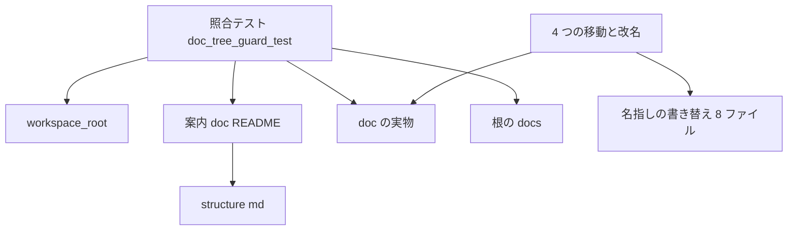
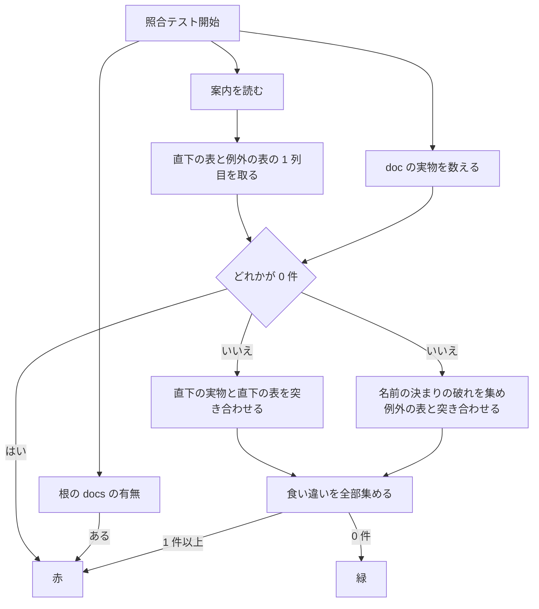

# 設計: doc-tree-tidy

## Overview

**目的**: 文書の置き場を `doc/` の 1 つにまとめ、名前の書き方の決まりを案内 `doc/README.md` に書いて名前をそろえ、案内の表と実物の食い違いを決定論の試験 1 本（照合テスト）で見つける。後から文書を足すセッションが、どこにどの名前で置き、置いた後に何をするかで迷わないようにする。

**使う人**: 開発者と、後から `doc/` に文書を足すセッション（`/kiro-next` の俯瞰の頁・リリースの手順・`/kiro-discovery` の `doc/ideas/`・網羅台帳の道具）。

**変わること**: ファイルを 4 つ動かし（うち 1 つは `docs/` から `doc/` へ）、`docs/` を無くす。案内に置き方の決まり・名前の決まり・例外の表・動かした名前の対応の表・表の書き方を足す。照合テストを `crates/log-capture-kit/tests/` に 1 ファイル足す。動かした 4 つを名指す 8 ファイルの行を新しいパスへ直す。文書の中身は書き直さない。

### Goals

- `docs/` が無くなり、文書は `doc/` の下だけにある（1.1）。
- `doc/` の下（`doc/archive/` の下を除く）の名前が決まりに合うか、例外の表に理由と行方つきで載る（2.1〜2.7）。
- 案内の直下の表が実物と 1 対 1 に合い、食い違うといつもの全体テストが赤になる（3.3・4.1〜4.11）。
- 動かした 4 つの古いパスを名指す所が、歴史の場所と本 spec の仕事を述べる所の外に 0 件（5.1〜5.4）。

### Non-Goals

- 文書の中身の書き直し（移動と改名で食い違うパスの書き方だけを直す）。
- `doc/COMPAT_ARCHITECTURE.md` の改名と、`doc/ssp-mcp/` の下の名前と置き場の変更（6.1）。
- `doc/shiori/fragments/` の下の名前の変更（2.6）。
- `doc/` の直下のファイルをフォルダへまとめ直すこと（3.5）。
- フォルダの中のファイルを 1 つずつ直下の表に載せること。
- 古いパスと古いファイル名が戻らないかを毎回の試験で見張ること（完了のときの 1 回の検索だけ・5.4）。
- 表の「役目」「今か歴史か」「理由」「行方」の列の中身を試験で確かめること（書くのは案内の仕事）。

## Boundary Commitments

### This Spec Owns

- `doc/` の置き方と名前の決まり、その正本としての案内 `doc/README.md` の「決まり」の節と 3 つの表（直下の表・名前の決まりの例外の表・動かした名前の対応の表）と、表の書き方の決まり。
- 4 つの移動と改名: `docs/click_through.md` → `doc/click-through.md`、`doc/CONSTITUTION.md` → `doc/constitution.md`、`doc/PASTA_PROFILE.md` → `doc/pasta-profile.md`、`doc/shiori/equivalence_evidence.toml` → `doc/shiori/equivalence-evidence.toml`。
- 照合テスト `crates/log-capture-kit/tests/doc_tree_guard_test.rs`（新しいファイル 1 つ）。案内の表の読み方と名前の決まりの判定は、このファイルだけが持つ。
- 4 つの古いパスを名指す行のうち、歴史の場所と本 spec の仕事を述べる所の外にあるものの書き替え。
- `.kiro/steering/structure.md` の最上位の並びの `docs/` の項の削除と、正本 `doc/README.md` の名指し。
- 完了のときの最後の検索・後続の spec の起票・「ぱすた開発」のセッションへの知らせ。

### Out of Boundary

- `doc/COMPAT_ARCHITECTURE.md` の名前（例外の表の行だけを持つ。改名は後続の spec・6.5）。
- `doc/ssp-mcp/` の下の名前と置き場（6.1）。直下の表の `ssp-mcp/` の行の役目の文だけは直す（3.5）。
- `doc/shiori/fragments/` の下の名前と、目録 `_manifest.toml` の中身。
- 歴史の場所（`.kiro/specs/completed/` の下・`doc/archive/` の下・`.kiro/steering/roadmap-history.md`）の中身。
- `.kiro/steering/roadmap.md` で本 spec の仕事を述べる行（`doc-tree-tidy` を含む行）の中の古いパス。
- 同じウェーブの見直し 7 本が受け持つファイル（`crates/areka-parsers/`・`crates/areka-sakura/`・`crates/areka-emo-present/`・`crates/wintf/`・`crates/areka-ghost/`・`crates/areka-nar/`・`crates/areka-user-data/`・`crates/areka-emo-compose/`・`crates/areka-seriko/`）。
- `crates/log-capture-kit/tests/` の既存のファイル（`workspace_scan/mod.rs` を含む）。照合テストは `workspace_root()` を呼ぶだけで、道具箱を直さない。
- 外のリポジトリの文書（知らせるだけ）。

### Allowed Dependencies

- Rust の標準ライブラリ（`std::fs::read_dir`・`std::fs::read_to_string`・`BTreeSet`）。正規表現などのクレートは足さない。
- 既存の `crates/log-capture-kit/tests/workspace_scan/mod.rs` の `workspace_root()`（`mod workspace_scan;` で取り込む。既存の見張り 4 本と同じ使い方）。
- 依存の向き: 照合テスト → `workspace_scan::workspace_root` → `std`。逆向きは無い。
- 守ること: `Cargo.toml`・`Cargo.lock` を変えない。新しいクレートを足さない（`members = ["crates/*"]` で `Cargo.lock` が変わる）。`crates/areka-emo-text/` にファイルを足さない（6.3）。

### Revalidation Triggers

- 案内 `doc/README.md` の 3 つの表の見出しの文字・1 列目の書き方・置き字 `{YYYY-MM-DD}` を変えるとき（照合テストの読み方が変わる）。
- 名前の決まりの字の種類を変えるとき（照合テストの判定と、後から文書を足す道具の名前の付け方が変わる）。
- `doc/` の直下にファイルやフォルダを足す・動かす・消す spec と道具（直下の表の行を同じ変更で直す。直さないとその枝で赤になる）。
- `doc/` の下（`doc/archive/` の外）へ書く道具が名前の付け方を変えるとき（`roadmap-overview.ps1` の日付の名前・`doc/release-notes/` の版の名前・`doc/ideas/` の名前・`doc/ukadoc-coverage/` の生成物）。
- `doc/COMPAT_ARCHITECTURE.md` を改名する後続の spec（例外の表の行を消し、対応の表に 1 行足す）。

## Architecture

### Existing Architecture Analysis

- `crates/log-capture-kit/tests/` は、ワークスペース全体を走査する見張りの置き場（`temp_path_guard_test.rs` の頭の注記「設計 C6」）。`file_length_guard_test.rs` が「例外は `const`・各項目に理由・もう事情の無い項目は赤・0 件で緑にならない較正・既知の 1 件を外すと赤の自己検査」の型を持つ。照合テストはこの型に沿う。違いは、例外の表を `const` でなく案内 `doc/README.md` の中に持つこと（要件 2.5 が例外の表を案内に置くと決めている）。
- `tools/test-all.ps1` の段「x64 workspace tests」が `cargo test --workspace` を回すので、`tests/` に足したファイルは自動で全体テストに入る（4.11）。`log-capture-kit` の `Cargo.toml` は試験の自動発見を止めていない。
- 全体テストの中で `doc/` に書くものは無い（`ukadoc-survey` の試験は書き手を差し替えて書かない・`roadmap-overview.ps1` の既定の書き先は直下の表の置き字の行に当たる）。照合テストは読むだけなので、ほかの試験と並んで走っても結果は変わらない。
- 動かす 4 つを開く・取り込むコードは 0（`include_str!`・`build.rs`・`Cargo.toml` の `readme`/`include` を含む）。文書を開くコード（`doc/ukadoc-coverage/`・`doc/ssp-mcp/`・`doc/release-notes/`）は動かさない所を読む（5.5）。

### Architecture Pattern & Boundary Map



- 照合テストは読むだけの 1 ファイルで、案内と実物を突き合わせる。直す側（移動・案内・名指し）は文書の編集で、照合テストを通すために同じ枝で揃える。
- 新しい部品は照合テストの 1 つだけ。案内の表の読み方・名前の決まりの判定・日付の型の照合は、ほかで使う当ても無いので、照合テストの中の私有の関数に置く（道具箱 `workspace_scan` へは出さない）。

### Technology Stack

| 層 | 選んだもの | 役目 | 注記 |
|---|---|---|---|
| 試験 | Rust（edition 2024）・`cargo test` の統合試験 | 照合テスト | 標準ライブラリだけ。依存は足さない |
| 文書 | Markdown（GitHub の表の書き方） | 案内の 3 つの表 | 見出しの文字で表を見分ける |
| 版の管理 | Git for Windows 2.55（`core.ignorecase=true`） | 移動と改名（`git mv`） | 大文字と小文字だけの改名も `git mv` 1 回で足りる（下の Migration Strategy） |

## File Structure Plan

### Directory Structure

```
crates/log-capture-kit/tests/
└── doc_tree_guard_test.rs   # 新しい: 照合テスト（案内の表と doc/ の実物と名前の決まりの突き合わせ・自己検査）

doc/
├── README.md                # 直す: 決まりの節・直下の表・名前の決まりの例外の表・動かした名前の対応の表・表の書き方
├── click-through.md         # 移す: docs/click_through.md から（中身は変えない）
├── constitution.md          # 改名: CONSTITUTION.md から（中身は変えない・見出しの語 CONSTITUTION も残す）
├── pasta-profile.md         # 改名: PASTA_PROFILE.md から（中身は変えない）
└── shiori/
    ├── equivalence-evidence.toml  # 改名: equivalence_evidence.toml から（1 行目の自分の名前だけ直す）
    └── README.md            # 直す: equivalence_evidence.toml の名指し 2 行

docs/                        # 消す（中の 1 ファイルを移すと空になり、Git から消える）
```

### Modified Files

- `doc/README.md` — 案内の書き直し（C2）。
- `doc/shiori/README.md` — 53 行目・84 行目の `equivalence_evidence.toml` を `equivalence-evidence.toml` へ。
- `doc/shiori/equivalence-evidence.toml` — 1 行目の注記の自分の名前を新しい名前へ（2.4）。
- `doc/ideas/novel-platform.md` — 48 行目・54 行目の `doc/PASTA_PROFILE.md` を `doc/pasta-profile.md` へ。
- `README.md`（根） — 22 行目の `doc/PASTA_PROFILE.md` のリンク、126 行目の `doc/CONSTITUTION.md` のリンク（表示の文字とリンク先の両方）。
- `.kiro/steering/product.md` — 84 行目の `doc/PASTA_PROFILE.md`。
- `.kiro/steering/roadmap.md` — 「利用統計とノベルゲーム基盤」の節の 2 行（今の 1721 行目・1734 行目）の `doc/PASTA_PROFILE.md`。`doc-tree-tidy` を含む行（版の段・ウェーブ C17・台帳・棚卸㉞・チェックの行）は触らない（5.3）。
- `.kiro/steering/structure.md` — 18 行目の「その他の最上位」から `docs/`＝単発の技術メモ の項を消し、Workspace Root の項に `doc/` の置き場と名前の決まりの正本が `doc/README.md` であることを書く（3.6）。

行番号は 2026-11-05 の実測。実装のときは語で探して直す。

### 完了のときに触るもの（C6）

- `doc/README.md` — 例外の表の `doc/COMPAT_ARCHITECTURE.md` の行の行方に、起票した後続の spec の名前を書く（6.5）。
- 後続の spec の `.kiro/specs/<後続の spec 名>/brief.md` と `.kiro/steering/roadmap.md` の台帳の行 — `/kiro-discovery` が作る（本 spec の手では書かない）。
- `.kiro/specs/doc-tree-tidy/` のタスクの記録 — 最後の検索の語ごとの件数（5.4）。

### 並べて作れる所

- C4（`crates/log-capture-kit/tests/doc_tree_guard_test.rs`）と、C1・C2・C3・C5（文書の編集）は触るファイルが重ならないので、並べて作れる。ただし照合テストは C1 と C2 が入るまで赤になる（今の `doc/README.md` には例外の表が無く、`EmptyReading` と `BadName` が出る）。
- C1 と C5 と C2 の直下の表の直しは、照合テストが途中で赤にならないよう同じコミットに入れる。
- C6 は全部の後（全体テストが緑になってから）。

## System Flows

照合テストの判定の流れ:



- 食い違いは最初の 1 件で止めず全部集め、並べて出す（直す人が 1 回で全部見られる）。
- 並びは名前の昇順に固定する（4.10）。

## Requirements Traceability

| 要件 | まとめ | 部品 | 契約・決め | 流れ |
|---|---|---|---|---|
| 1.1 | `docs/click_through.md` を `doc/click-through.md` へ・`docs/` を無くす | C1 | `git mv` | Migration |
| 1.2 | 移すときに中身を変えない | C1 | 中にパスの食い違いは無い（実測） | — |
| 1.3 | wintf のクレートへは移さない | C1 | 置き先は `doc/` の直下 | — |
| 2.1 | 名前の決まりを 1 つ書く | C2・C4 | 案内の「決まり」の節・`is_conforming` | — |
| 2.2 | `doc/archive/` の下を除く全部に効く | C2・C4 | `walk_doc` が `doc/archive/` に降りない | 照合 |
| 2.3 | 3 つの名前を変える | C1 | `git mv` | Migration |
| 2.4 | 改名で中身を変えない | C1 | 直すのは `equivalence-evidence.toml` の 1 行目だけ | — |
| 2.5 | 例外の表に理由と行方 | C2 | 表の列 `名前`・`理由`・`行方` | — |
| 2.6 | 例外の表の最初の 2 行 | C2 | `doc/COMPAT_ARCHITECTURE.md`・`doc/shiori/fragments/` | — |
| 2.7 | フォルダの行は読む側が名前を決めるフォルダだけ | C2・C4 | 末尾 `/` の行＝下の全部を覆う | 照合 |
| 3.1 | 置き方の決まりを書く | C2 | 「決まり」の節 | — |
| 3.2 | 「機械の検査は無い」を書き替える | C2 | 照合テストの名前と回し方 | — |
| 3.3 | 直下の 1 つずつに 1 行・日付の型の行 | C2・C4 | 直下の表 | 照合 |
| 3.4 | 動かした 4 つの対応の表 | C2 | 「動かした名前の対応」の表 | — |
| 3.5 | 棚卸と役目の書き方の直し | C2 | `ssp-mcp/` の行・`pasta-real-run.md` の行 | — |
| 3.6 | `structure.md` の直し | C3 | `docs/` の項を消す・正本を名指す | — |
| 4.1 | 直下の実物と直下の表を突き合わせる | C4 | `check_direct` | 照合 |
| 4.2 | 表に無い直下の実物で赤 | C4 | `Finding::Unlisted` | 照合 |
| 4.3 | 表の行が名指すものが無いと赤 | C4 | `Finding::MissingRow` | 照合 |
| 4.4 | `{YYYY-MM-DD}` の型の行 | C4 | `row_matches`・当たり 0 でも赤にしない | 照合 |
| 4.5 | 根に `docs/` があると赤 | C4 | `Finding::DocsDirExists` | 照合 |
| 4.6 | 決まりに合わず例外にも無い名前で赤 | C4 | `check_names`・`Finding::BadName` | 照合 |
| 4.7 | 要らなくなった例外の行で赤 | C4 | `Finding::StaleException` | 照合 |
| 4.8 | どの読み取りも 0 件なら赤 | C4 | `Finding::EmptyReading` | 照合 |
| 4.9 | 自己検査 2 つ | C4 | 実データの基準との差が 1 件 | 照合 |
| 4.10 | リポジトリの中だけを読み、何度回しても同じ | C4 | ディスクを読む・git もネットも時刻も使わない・昇順 | 照合 |
| 4.11 | 全体テストで走る | C4 | `cargo test --workspace` の中 | — |
| 5.1 | 4 つの古いパスと名前をリポジトリ全域で探す | C5・C6 | 検索の語と道具（下の C6） | 完了 |
| 5.2 | 歴史の外の名指しを全部直す | C5 | Modified Files の 8 ファイル | — |
| 5.3 | 歴史の場所と本 spec の仕事を述べる所は残す | C5・C6 | 除く場所の一覧 | 完了 |
| 5.4 | 完了のときに 0 件と空振りしないことを確かめる | C6 | 先に歴史の場所で当たりを確かめる | 完了 |
| 5.5 | 文書を開くコードの振る舞いを変えない・全体テストが緑 | C5 | 開くコードの読む所は動かさない | — |
| 5.6 | 「ぱすた開発」のセッションへ知らせる | C6 | 知らせの文 | 完了 |
| 6.1 | `COMPAT_ARCHITECTURE.md` と `ssp-mcp/` の名前と置き場を変えない | C1・C2 | 例外の表に載せる | — |
| 6.2 | 見直し 7 本の受け持つファイルを変えない | 全部 | 直すファイルの一覧に入らない（実測で名指し 0） | — |
| 6.3 | 依存を足さない・`areka-emo-text` にファイルを足さない | C4 | 標準ライブラリだけ | — |
| 6.4 | 照合テストを見直しの受け持つクレートの外に置く | C4 | `crates/log-capture-kit/tests/` | — |
| 6.5 | 後続の spec を起票し、例外の行の行方に名前を書く | C6 | `/kiro-discovery`・例外の表の書き替え | 完了 |

## Components and Interfaces

| 部品 | 層 | 役目 | 要件 | 主な依存 | 契約 |
|---|---|---|---|---|---|
| C1 移動と改名 | 文書 | 4 つを `git mv` で動かす | 1.1〜1.3・2.3・2.4・6.1 | Git（P0） | 手順 |
| C2 案内 | 文書 | 置き方と名前の決まり・3 つの表・表の書き方 | 2.1・2.2・2.5〜2.7・3.1〜3.5・6.1 | C4 が読む（P0） | 表の書式 |
| C3 構成の steering | 文書 | `docs/` の項を消し正本を名指す | 3.6 | — | — |
| C4 照合テスト | 試験 | 案内と実物と名前の決まりの突き合わせ | 2.1・2.2・2.7・3.3・4.1〜4.11・6.3・6.4 | `workspace_root`（P0）・C2（P0） | Service |
| C5 名指しの直し | 文書 | 歴史の外の古いパスを新しいパスへ | 5.1〜5.3・5.5・6.2 | C1（P0） | — |
| C6 完了の手当て | 手順 | 最後の検索・後続の起票・知らせ | 5.1・5.3・5.4・5.6・6.5 | C1・C5（P0） | 手順 |

### 文書

#### C2 案内 `doc/README.md`

| 項目 | 内容 |
|---|---|
| 役目 | `doc/` の置き方と名前の決まりの正本。照合テストが読む表を持つ |
| 要件 | 2.1・2.2・2.5〜2.7・3.1〜3.5・6.1 |

**節の並び**（上から）:

1. 冒頭の 1 文（今のまま）。
2. `## 決まり` — 次を書く。
   - 文書は `doc/` の下に置き、`docs/` などほかの置き場を作らない（3.1）。
   - 歴史は `doc/archive/` の下だけ（今のまま）。日付つきの俯瞰の例外（今のまま）。
   - 名前の決まり: 名前は小文字の英字・数字・ハイフン・点だけで書き、語はハイフンでつなぐ。拡張子・版の番号・日付・並びの番号の点とハイフンは含めてよい。各フォルダの案内の `README.md` だけは決まりの外。`doc/archive/` の下は歴史として名前も残し、決まりの外（2.1・2.2）。
   - 決まりに合わない名前を残すときは、下の「名前の決まりの例外」の表に理由と行方（後で改名する／改名しない）つきで 1 行足す。フォルダ単位の行（末尾 `/`・下の全部を覆う）は、中の名前を読む側のデータや道具が決めるフォルダにだけ使い、ほかはファイル 1 つずつの行で載せる。例外は今そこにある事情だけを表し、事情が無くなったら行を消す（2.5・2.7・4.7）。
   - `doc/` の直下にファイルやフォルダを足す・動かす・消すときは、同じ変更で直下の表の行を足す・直す・消す。動かしたら「動かした名前の対応」の表にも 1 行足す（3.1・3.4）。
   - 確かめ: 照合テスト `crates/log-capture-kit/tests/doc_tree_guard_test.rs` が、直下の表と実物・名前の決まり・例外の表・根の `docs/` の有無を確かめる。いつもの全体テスト（`tools/test-all.ps1`）で回り、単独では次で回す（3.2）。

     ```powershell
     cargo test --manifest-path C:\home\maz\git\areka\Cargo.toml -p log-capture-kit --test doc_tree_guard_test
     ```

     ほかの写しで回すときは、`C:\home\maz\git\areka` をその写しの場所に替える（俯瞰の HTML の節と同じ書き方）。
   - 表の書き方（照合テストが読むので崩さない）: 照合テストは見出しの文字で表を見分ける。下の 2 つの見出し「直下のファイルとフォルダ」「名前の決まりの例外」の文字を変えない。表の 1 列目はバッククォートで囲んだ名前 1 つだけにする。フォルダは名前の末尾に `/` を付ける。置き字は `{YYYY-MM-DD}`（4 桁・2 桁・2 桁の数字をハイフンでつないだ日付）だけを使う。
3. `## 直下のファイルとフォルダ` — 今の 3 列の表（`名前`・`役目`・`今か歴史か`）。1 列目は `doc/` の直下の名前（`doc/` を付けない）。直すのは次の行。
   - `CONSTITUTION.md` → `constitution.md`、`PASTA_PROFILE.md` → `pasta-profile.md`（名前だけ）。
   - 新しい行 `click-through.md`（役目＝wintf のクリック透過の仕組みの説明。`crates/areka/src/main.rs` の結線も述べる開発者向けの説明・今も効く）。
   - `ssp-mcp/` の行の役目に、試験が読むファイルとして `areka-tools.md` を足す（3.5・名前と置き場は変えない）。
   - `pasta-real-run.md` の行の「v0.1.0 の版の門の最後の確かめで回す」を、v0.1.0 が出た今の書き方（回した・今も何度でも回せる）へ直す（3.5）。
4. `## 名前の決まりの例外` — 3 列の表（`名前`・`理由`・`行方`）。1 列目はリポジトリの根からのパス（`doc/` から書く）。初めの 2 行（2.6）:

   | 名前 | 理由 | 行方 |
   |---|---|---|
   | `doc/COMPAT_ARCHITECTURE.md` | 同じウェーブ（C17）で並んで走る見直しとの約束で、`doc-tree-tidy` では名前を変えない | 後で改名する（後続の spec は `doc-tree-tidy` の完了のときに起票し、ここにその名前を書く） |
   | `doc/shiori/fragments/` | 名前と結合の順を目録 `_manifest.toml` が決める、道具が読むデータの目録であるため | 改名しない |

5. `## 動かした名前の対応` — 2 列の表（`古いパス`・`新しいパス`）。1 列目と 2 列目はリポジトリの根からのパス。4 行（3.4）。照合テストはこの表を読まない（歴史の記録に残る古いパスから今のファイルを辿るための表・5.3 で古いパスを残す所）。
6. `## 俯瞰の HTML`（今のまま）。

**決め**: 直下の表の 1 列目は今の書き方（`doc/` からの名前）のまま。例外の表と対応の表はリポジトリの根からのパス（対応の表には `doc/` の外の `docs/click_through.md` が載るため、根から書くのが要る。例外の表もそれにそろえる）。

#### C1 移動と改名・C3 構成の steering・C5 名指しの直し

- C1: `git mv` を 4 回（Migration Strategy）。`doc/click-through.md`・`doc/constitution.md`・`doc/pasta-profile.md` は中身を 1 字も変えない（`doc/constitution.md` の見出しの語 `CONSTITUTION` も残す・2.4）。`doc/shiori/equivalence-evidence.toml` は 1 行目の自分の名前だけを直す。
- C3: `.kiro/steering/structure.md` の 18 行目の「その他の最上位」から `` `docs/`＝単発の技術メモ `` の項を消す。Workspace Root の項（`doc/` を挙げる所）に「文書の置き場は `doc/` だけで、置き場と名前の決まりの正本は `doc/README.md`」を足す（3.6）。
- C5: File Structure Plan の Modified Files の行を直す。根の `README.md` のリンクは表示の文字とリンク先の両方を直す。`.kiro/steering/roadmap.md` は `doc-tree-tidy` を含む行に触らない（5.3）。

### 試験

#### C4 照合テスト `crates/log-capture-kit/tests/doc_tree_guard_test.rs`

| 項目 | 内容 |
|---|---|
| 役目 | 案内 `doc/README.md` の表と `doc/` の実物と名前の決まりの食い違いを全部集め、1 件でもあれば赤にする |
| 要件 | 2.1・2.2・2.7・3.3・4.1〜4.11・6.3・6.4 |

**責務と制約**

- 読むのは `workspace_root()` の下の `doc/README.md`・`doc/` の下のディスクの実物・根の `docs` の有無だけ。git もネットも時刻も使わない（4.10）。
- 実物はディスクで数える（`std::fs::read_dir`）。git の索引で数えない。追跡していないファイルを置いただけでも手元で赤になるのは意図どおり（表に行を足し忘れた置き方を、置いた人の手元で見つける）。
- 判定は純粋な関数（名前の集まりと案内の文字列を受けて食い違いの一覧を返す）にし、ファイルシステムに触る関数（`walk_doc`・`read_guide`・`docs_dir_exists`）と分ける。自己検査と較正は純粋な側に実データや見本を通して行う。
- 出力の並びは名前の昇順（`BTreeSet`）。食い違いは全部集めてから出す。
- 新しいファイルは 1,000 行以下（`file_length_guard_test.rs` の番人の対象）。

**依存**

- Outbound: `workspace_scan::workspace_root`（`mod workspace_scan;` で取り込む）— 根の場所（P0）。
- Inbound: `cargo test --workspace`（`tools/test-all.ps1` の段「x64 workspace tests」）（P0）。
- External: 無し（標準ライブラリだけ）。

**契約**: Service [x]

##### Service Interface

```rust
// すべてこのファイルの私有の項目。パスの区切りは `/`、フォルダは末尾に `/` を付ける。

const GUIDE: &str = "doc/README.md";
const DIRECT_HEADING: &str = "## 直下のファイルとフォルダ";
const EXCEPTION_HEADING: &str = "## 名前の決まりの例外";
const DATE_PLACEHOLDER: &str = "{YYYY-MM-DD}";

/// doc/ の実物（ディスクの実際の字のまま）。
struct DocTree {
    /// doc/ の直下の名前（`doc/` を付けない。フォルダは `name/`）。
    direct: BTreeSet<String>,
    /// doc/ の下の全部（`doc/archive/` の下を除く）。根からのパス（`doc/...`）。
    all: BTreeSet<String>,
}

/// 食い違い 1 件。Display は日本語で、名前と直し方を出す。
#[derive(Debug, Clone, PartialEq, Eq, PartialOrd, Ord)]
enum Finding {
    /// 直下の実物が表のどの行にも当たらない（4.2）。「表に行を足すか、置き場を直す」
    Unlisted(String),
    /// 表の行（置き字の無い行）が名指すものが無い（4.3）。「行を消すか直す」
    MissingRow(String),
    /// 根に docs/ がある（4.5）。「doc/ へまとめる」
    DocsDirExists,
    /// 名前の決まりに合わず、例外の表にも無い（4.6）。「名前を直すか、例外の表に理由と行方つきで足す」
    BadName(String),
    /// 例外の行が覆う破れが 1 つも無い（4.7）。「行を消す」
    StaleException(String),
    /// 表の行の 1 列目がバッククォートの名前 1 つの形でない。「表の書き方に合わせる」
    MalformedRow { heading: &'static str, line: usize },
    /// 読み取りが 1 件も拾わない（4.8）。「見出しの文字が変わったか、読み方が壊れた」
    EmptyReading(&'static str),
}

// ファイルシステムに触る側
fn walk_doc(root: &Path) -> DocTree;          // 読めないときは panic（原因のパスを出す）
fn read_guide(root: &Path) -> String;         // 読めないときは panic
fn docs_dir_exists(root: &Path) -> bool;      // root.join("docs").is_dir()

// 純粋な側
fn table_first_cells(guide: &str, heading: &'static str) -> (Vec<String>, Vec<Finding>);
fn row_matches(row: &str, name: &str) -> bool;
fn is_conforming(name: &str) -> bool;
fn check_direct(direct: &BTreeSet<String>, rows: &[String]) -> Vec<Finding>;
fn check_names(all: &BTreeSet<String>, exceptions: &[String]) -> Vec<Finding>;
fn check_all(tree: &DocTree, guide: &str, docs_exists: bool) -> BTreeSet<Finding>;
```

- `table_first_cells`: 行を前後の空白を落として `heading` と完全に一致する行を探し、その後で最初に始まる `|` の行の塊を表とする。塊が切れるか次の見出し（`#` で始まる行）が来たら終わる。1 行目（列の名前）と 2 行目（`-` と `:` だけの区切り）を飛ばし、残りの各行の 1 列目を取る。1 列目が「バッククォート 1 組で囲んだ空でない名前 1 つ」でない行は `MalformedRow` にする（行番号は案内の 1 始まり）。見出しが無いときは空の一覧を返す（`check_all` が `EmptyReading` にする）。
- `row_matches`: `row` に `DATE_PLACEHOLDER` が無ければ `row == name`。あれば置き字の前と後ろが `name` の頭と尻に一致し、間がちょうど `DDDD-DD-DD`（`D` は ASCII の数字）であること。フォルダの行（末尾 `/`）はフォルダにだけ、ファイルの行はファイルにだけ当たる（`direct` のフォルダは末尾 `/` を持つので文字の比較で分かれる）。
- `is_conforming`: 名前（パスの最後の 1 区切り。フォルダは末尾の `/` を除く）が空でなく、字が `a-z`・`0-9`・`-`・`.` だけ。名前が `README.md` ちょうどなら合う（決まりの外）。字の種類だけを見て、ハイフンや点の続き方は見ない。
- `check_direct`: `direct` の各名前について当たる行が無ければ `Unlisted`。置き字の無い各行について当たる名前が無ければ `MissingRow`。置き字の行は当たりが 0 でも何も出さない（4.4）。
- `check_names`: `all` の中で `is_conforming` が偽のものを「破れ」とする。例外の行 `r` は、破れ `v` が `v == r` か、`r` が `/` で終わり `v` が `r` で始まるとき `v` を覆う。どの行にも覆われない破れは `BadName`。破れを 1 つも覆わない行は `StaleException`（名指すものが無い・もう決まりに合っている・フォルダの下に破れが無くなった、のどれもここに入る）。
- `check_all`: `tree.direct`・直下の表の行・例外の表の行のどれかが 0 件なら `EmptyReading`（どれが 0 件かを名指す）。`docs_exists` が真なら `DocsDirExists`。ほかに `check_direct`・`check_names`・`MalformedRow` を合わせて返す。
- `walk_doc`: `doc/` を下へ辿り、ファイルとフォルダを全部集める。`doc/archive/` は直下の名前 `archive/` として `direct` に入れるが、その下へは降りない。ほかのフォルダは名前を `all` に入れて下へ降りる。名前は `to_string_lossy` で取り、ディスクの実際の字のまま持つ（大文字と小文字を区別しない Windows でも、取り込み損ねた古い字は `BadName` で見える）。

- 前提: `workspace_root()` がワークスペースの根を返す。
- 事後: 返す集まりは名前の昇順。同じ入力からは同じ集まりを返す。
- 不変: 純粋な側はファイルシステムに触らない。

**試験の関数**（同じファイルの `#[test]`）

| 試験 | 確かめること | 要件 |
|---|---|---|
| `doc_tree_matches_the_guide` | 実データで `check_all` が空。空でなければ全件を 1 件 1 行で出して赤 | 4.1〜4.7・4.10 |
| `every_reading_finds_something` | 直下の実物・直下の表・例外の表が 0 件でない | 4.8 |
| `dropping_a_known_row_turns_the_guard_red` | 実データの直下の表から `README.md` の行を外すと、基準との差がちょうど `Unlisted("README.md")` の 1 件 | 4.9 |
| `adding_a_bad_name_turns_the_guard_red` | 実データの `all` に `doc/Bad_Name.md` を足すと、基準との差がちょうど `BadName("doc/Bad_Name.md")` の 1 件 | 4.9 |
| `date_placeholder_reads_only_the_date_shape` | 見本で、`roadmap-overview-2026-10-16.html` に当たり、`roadmap-overview-2026-1-16.html`・`roadmap-overview-latest.html` に当たらず、当たりが 0 でも赤にしない | 4.4 |
| `tables_are_told_apart_by_heading` | 見本の案内で、対応の表の 1 列目が直下の表の行に混ざらない・見出しが無いと 0 件 | 4.1・4.8 |
| `an_exception_row_with_nothing_to_cover_turns_red` | 見本で、ファイルの行の名指すものが無い・フォルダの行の下に破れが無い・行が覆う破れがある、の 3 通り | 4.7 |
| `a_docs_dir_turns_the_guard_red` | `check_all` に `docs_exists = true` を渡すと `DocsDirExists` が出る | 4.5 |

自己検査（4.9）は「実データの基準の集まり」と「1 か所だけ変えた集まり」の差で比べる。実データが別の理由で赤のときも、自己検査は自分の 1 件だけを確かめられる。

**Implementation Notes**

- 取り込み: 先頭に `mod workspace_scan;`。道具箱の `#![allow(dead_code)]` があるので、使わない関数で警告は出ない。
- 確かめ: 単独で `cargo test -p log-capture-kit --test doc_tree_guard_test`。全体では `tools/test-all.ps1`。
- 危うさ: 案内を書き直す人が見出しの文字を変えると `EmptyReading` で赤になる（意図どおり。案内の「表の書き方」に書く）。

### 手順

#### C6 完了の手当て

| 項目 | 内容 |
|---|---|
| 役目 | 完了のときに 1 回だけ行う、古いパスの最後の検索・後続の spec の起票・外のセッションへの知らせ |
| 要件 | 5.1・5.3・5.4・5.6・6.5 |

**最後の検索**（tasks の最後のタスクの手順として書く。試験には入れない）

- 道具は `git grep`（追跡しているファイルだけ・既定で大文字と小文字を区別する）。リポジトリの根で打つ。
- 検索の語（どれも大文字と小文字を区別）:

  | 語 | 書き方 | 拾うもの |
  |---|---|---|
  | `click_through.md` | `-F` | `docs/click_through.md` と、パスを付けない名前 |
  | `docs/` | `-P '(?<![\w./:-])docs/'` | `docs/` のフォルダの名指し（`https://.../docs/` のような URL を除く） |
  | `CONSTITUTION.md` | `-F` | `doc/CONSTITUTION.md` と相対のリンクとパスを付けない名前（見出しの語 `CONSTITUTION` には当たらない） |
  | `PASTA_PROFILE` | `-F` | `doc/PASTA_PROFILE.md` と波括弧の書き方 `doc/{...,PASTA_PROFILE}.md` |
  | `equivalence_evidence` | `-F` | `doc/shiori/equivalence_evidence.toml` とパスを付けない名前 |

  `click_through` だけで探さない（Rust の識別子 `register_ghost_windows_click_through` などに当たる）。大文字と小文字を区別しない検索をしない（新しい名前 `constitution.md` に当たる）。

- 手順:
  1. 空振りしていないことを先に示す: 5 つの語のそれぞれを、歴史の場所（`.kiro/specs/completed/`・`doc/archive/`・`.kiro/steering/roadmap-history.md`）だけに絞って探し、どの語も 1 件以上当たることを確かめる（2026-11-05 の実測: `click_through.md` は completed 13 ファイル、`CONSTITUTION.md` は completed 15 ファイル・`doc/archive/` 1・roadmap-history 3 行、`PASTA_PROFILE` は completed 13 ファイル・roadmap-history 1 行、`equivalence_evidence` は completed 3 ファイル）。
  2. 同じ語を、除く場所 `:(exclude).kiro/specs/completed/`・`:(exclude)doc/archive/`・`:(exclude).kiro/steering/roadmap-history.md`・`:(exclude).kiro/specs/doc-tree-tidy/` を付けて全域で探す。
  3. 残ってよいのは、`.kiro/steering/roadmap.md` の `doc-tree-tidy` を含む行と、`doc/README.md` の「動かした名前の対応」の表の行だけ（5.3）。それ以外が 1 件でもあれば直してから 2 へ戻る。0 件を確かめた結果（語ごとの件数）をタスクの記録に残す。

**後続の起票と行方の書き替え**（6.5）

- `/kiro-discovery` で `doc/COMPAT_ARCHITECTURE.md` の改名を受け持つ spec を起票する。brief に、`doc/COMPAT_ARCHITECTURE.md` を名指すファイルを受け持つ見直しの spec と本体のクレート分けの spec とは同じウェーブに置かないことを書く。
- 起票した spec の名前を、例外の表の `doc/COMPAT_ARCHITECTURE.md` の行の行方に書く（「後で改名する（`<spec 名>`）」）。

**知らせ**（5.6）

- 進行役（本 spec を回すメインのセッション）が、完了のときに「ぱすた開発」のセッションへ伝言を送る。中身: `doc/PASTA_PROFILE.md` は `doc/pasta-profile.md` に名前を変えた・古いパスと新しいパスの対応は `doc/README.md` の「動かした名前の対応」の表にある・外のリポジトリの名指しの直しはそちらの仕事。
- 伝言を送れない場合（セッションが見つからない等）は、完了の報告にその旨と伝える文を載せ、開発者に渡す。

## Data Models

### 案内の表（照合テストが読む書式）

| 表 | 見出し（完全一致） | 1 列目 | 照合テストが読むか |
|---|---|---|---|
| 直下の表 | `## 直下のファイルとフォルダ` | `doc/` の直下の名前（`doc/` を付けない）・フォルダは末尾 `/`・置き字 `{YYYY-MM-DD}` 可 | 読む |
| 例外の表 | `## 名前の決まりの例外` | 根からのパス（`doc/...`）・フォルダの行は末尾 `/` | 読む |
| 対応の表 | `## 動かした名前の対応` | 根からの古いパス（2 列目は根からの新しいパス） | 読まない |

- どの表も 1 列目はバッククォート 1 組で囲んだ名前 1 つ。表の 1 行目は列の名前、2 行目は区切り。
- 名前の決まり（`is_conforming`）: 字は `a-z`・`0-9`・`-`・`.` だけ。`README.md` は決まりの外。`doc/archive/` の下は見ない。

## Error Handling

- 食い違いは試験の失敗として出す。失敗の文は日本語で、1 件 1 行に名前と直し方を書き、件数を頭に出す（`file_length_guard_test.rs` と同じ形）。
- `doc/` や `doc/README.md` が読めないときは、原因のパスとエラーを添えて panic する（試験の外の壊れ。黙って 0 件にしない）。
- 読み取りが 0 件のときは `EmptyReading` で赤（4.8）。見出しの文字が変わったときもここに入る。

## Testing Strategy

- **照合テストそのもの**: 上の試験の表の 8 本。実データの 4 本（主検査・0 件でない・自己検査 2 つ）と、見本の 4 本（日付の型・見出しで表を見分ける・例外の行の要らなくなり方・根の `docs/`）。
- **移動と名指しの直し**: 照合テストが緑になること（直下の表と実物・名前の決まり・`docs/` が無いこと）と、C6 の最後の検索が 0 件であること。
- **振る舞いを変えないこと**（5.5）: `tools/test-all.ps1` の全体テストが緑（`doc/ukadoc-coverage/`・`doc/ssp-mcp/`・`doc/release-notes/` を読む試験と道具の `-SelfTest` を含む）。
- **依存を足さないこと・触らない所に触らないこと**（6.1〜6.3）: 実装の後で、枝の分かれ目からの差分 `git diff --name-only main...HEAD` に、`Cargo.lock`・`Cargo.toml`・`crates/*/Cargo.toml`・`crates/areka-emo-text/`・見直し 7 本の受け持つクレート・`doc/COMPAT_ARCHITECTURE.md`・`doc/ssp-mcp/` が 1 つも無い。

## Migration Strategy

- 4 つの移動は `git mv` 1 回ずつ（同じコミットで名指しの直しと案内の直しも入れ、照合テストが途中の状態で赤にならないようにする）。
  - `git mv docs/click_through.md doc/click-through.md`（`docs/` は空になり、Git から消える。ディスクに空のフォルダが残っていたら消す。照合テストはディスクで `docs/` を見るので、残ると赤になる）。
  - `git mv doc/CONSTITUTION.md doc/constitution.md`（大文字と小文字だけの改名）。
  - `git mv doc/PASTA_PROFILE.md doc/pasta-profile.md`。
  - `git mv doc/shiori/equivalence_evidence.toml doc/shiori/equivalence-evidence.toml`。
- 大文字と小文字だけの改名（`core.ignorecase=true`）: 2026-11-05 に `target/doc-tree-tidy-case-test/` の使い捨てのリポジトリで Git for Windows 2.55 を試し、`git mv` 1 回で索引もディスクも新しい字になること、別の写しの `git pull`・別の作業場の `git merge`・中身を直した枝の `git merge`（名前の変更として追われ、中身の直しも入る）・`git rebase` のどれでも、ディスクの字が新しい字になることを確かめた（`research.md` 9.1）。間に別の名前を挟む 2 段の手順は要らない。
- Windows ではファイルの名前の大文字と小文字を区別しないので、古い字のリンク（`doc/CONSTITUTION.md`）は手元では開けてしまい、切れていても気づかない。だから最後の検索は大文字と小文字を区別して行う（C6）。
- 戻し方: 本 spec の枝を捨てるだけ（コードの振る舞いは変わらない）。
