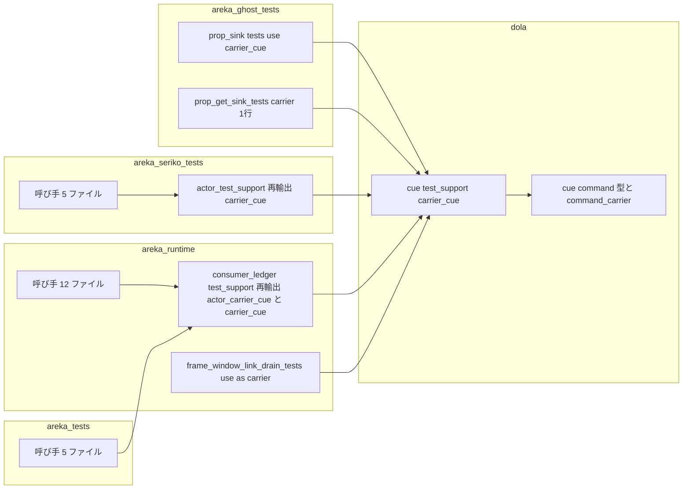
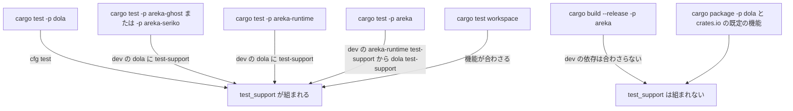

# 設計書: dola-cue-test-builder

## Overview

**目的**: 正準のキャリアの合図（`\![name,tokens...]`＝`CueCommand::command_carrier` を載せた `TalkCue`・発火時刻 0・長さ 0）を組むテスト用の本文を、ワークスペースに 1 つだけ置く。今は同じ働きの写しが 3 つの crate（areka-ghost・areka-seriko・areka-runtime）に 5 つある。

**使い手**: areka-ghost・areka-seriko・areka-runtime と本体 `areka` のテストを書く開発者。正準形（発火時刻・長さ・演者の受け取り）を変えるときに直す所が `dola` の 1 関数になる。

**変わること**: `dola` に `test-support` 機能と、その下だけで開く `dola::cue::test_support::carrier_cue` を足す。5 つの写しは本文を持たなくなり、`dola` の関数を `use` で受けるか、`"0"` を渡すだけの 1 行になる。呼び手の 22 ファイルと本番の振る舞い・合図の型は変わらない。

### Goals

- 正準のキャリアの合図を組む本文が `dola` の 1 関数だけになる（要件 1）。
- `test-support` 機能が無効（既定）のとき、`dola` の公開の面と docs.rs の文書が今と同じ（要件 2）。
- 5 つの写しの本文が消え、呼び手の名と引数の形が残る（要件 3）。
- 付け替えの前と後でテストの集合と結果が同じ（要件 4）。
- 差分がウェーブ C25 の約束のファイルの中に留まる（要件 5）。

### Non-Goals

- `TalkCue`・`CueCommand` の型、`command_carrier`・`as_command_carrier` の意味の変更。
- 正準でない合図（seriko の `noncanonical_custom_cue`・runtime の `broken_custom_cue`）や、時刻の違う合図の組み立ての整理（ghost `sink.rs` の `sample_cue`・runtime `shell_carry.rs` の `cue` ほか）。
- 本体の session のテスト 3 本の `prop_set_cue`（【決め 3】・`audit-areka-app` へ申し送る）。
- `TalkCue { at: 0.0, … }` を直に書くテスト（【決め 4】）。
- 呼び手 22 ファイルの付け替え。
- 新しい crate・ワークスペースの外の依存・`Cargo.lock` の変更。

## Boundary Commitments

### This Spec Owns

- `dola::cue::test_support` モジュールと、その中の関数 `carrier_cue(actor, name, tokens) -> TalkCue`（正準のキャリアの合図の唯一の組み立て）と、その檻。
- `dola` の `test-support` 機能の行と、その説明（`crates/dola/Cargo.toml` の 1 行のコメントと `crates/dola/README.md` の段落）。
- 5 つの写しの本文の撤去と、名の取り次ぎの形（再輸出か 1 行の関数か）。
- 使い手 3 crate の `Cargo.toml` の `dola` の行（dev の依存の機能）と、runtime の `test-support` 機能の行（`"dola/test-support"` の前送り）。

### Out of Boundary

- 合図の型と正準形の判定（`crates/dola/src/cue/command.rs` は触らない）。
- 呼び手の 22 ファイル（本体 5・runtime 12・seriko 5）。
- 本体 `crates/areka/` の全部（`Cargo.toml` を含む）・根の `Cargo.toml`・`Cargo.lock`。
- `crates/dola/src/lib.rs`・`crates/dola/src/cue/mod.rs` の型の表（`//!` の「提供する型」）。
- `prop_set_cue`（本体の session の 3 本）は完了の棚卸で `audit-areka-app` の brief へ申し送るだけで、コードは触らない（要件 5.4）。
- steering（`structure.md` の dola の節）への記載は、完了の段（`/kiro-complete`）の文書の更新が受け持つ（議題 8）。

### Allowed Dependencies

- `dola::cue::test_support` は同じ `cue` モジュールの `ActorKey`・`CueCommand`・`TalkCue`（`super` の再輸出）だけに依存する。`dola` の外の crate を新しく引かない。
- 使い手 3 crate は `dola::cue::test_support` をテストのビルド（`#[cfg(test)]` の中）か、runtime の `test-support` 機能の中（`consumer_ledger::test_support`）からだけ引く。本番のコードから引かない。
- 依存の向きは `dola` ← areka-ghost（dev）／areka-seriko／areka-runtime ← 本体（dev の `areka-runtime/test-support` 経由）のまま。新しい向きは足さない。

### Revalidation Triggers

- `TalkCue` のフィールドや `CueCommand::command_carrier` の署名が変わる（C27 の `dola-interrupt-ticks` が `crates/dola/` の全体に触る）＝直すのは `dola::cue::test_support::carrier_cue` の本文 1 か所。
- `carrier_cue` の署名を変える＝写しの取り次ぎ 5 か所（再輸出 2・`use` 2・1 行の関数 1）が組めなくなる。呼び手 22 ファイルへは波及しない（名の層が吸う）。
- `test-support` 機能の名や開き方を変える＝使い手 3 crate の `Cargo.toml` と runtime の機能の行。
- runtime の `consumer_ledger::test_support` の開き方（`cfg(any(test, feature = "test-support"))`）が変わる＝runtime の dev の行と機能の前送りの両方が要るかを見直す。

## Architecture

### Existing Architecture Analysis

- ワークスペースの `test-support` 機能の前例（`areka-placement`・`areka-input`・`areka-runtime`）は「`[features] test-support = [...]`＋`#[cfg(any(test, feature = "test-support"))] pub mod test_support;`＋使い手の `[dev-dependencies]` に同じ依存を `features = ["test-support"]` で書く」形。runtime は `areka-placement/test-support` を自分の `test-support` へ前送りしている（他 crate の機能を連ねる前例）。この spec は同じ形を `dola` に足す。
- `dola` は crates.io へ出す crate。`cargo package` は `Cargo.toml` を正規化して包むのでコメントは利用者に届かず、公開の説明は README が担う。
- 本番の配布物は `cargo build --locked --release -p areka -p areka-mcp-bridge` で組む。dev の依存の機能は本番の組み立てに合わさらない（`resolver = "2"`）。

### Architecture Pattern & Boundary Map



- **選んだ形**: 機能の裏のテストの支えのモジュール（ワークスペースの前例と同じ）。本文は `dola` に 1 つ、写しの位置には名だけが残る。
- **持ち場の分け方**: 正準形の中身（`Custom` の String 配列）は今までどおり `CueCommand::command_carrier` が持ち、`carrier_cue` は `TalkCue` の残り 3 つのフィールド（発火時刻 0・長さ 0・演者）だけを決める。演者の既定（`"0"`）は呼び手の名の側（runtime の `carrier_cue`・ghost の `carrier`）が持つ（【決め 2】）。
- **保つ前例**: `test_support` の名のモジュール・`cfg(any(test, feature = "test-support"))`・兄弟の `_tests.rs`・dev の依存に機能を足すだけの書き方。
- **依存の向き**: `cue::test_support` → `cue`（型）だけ。使い手 → `dola::cue::test_support`。`dola` は使い手を知らない。

### Technology Stack

| 層 | 選択 | この spec での役目 | 備考 |
|---|---|---|---|
| ライブラリ | `dola`（ワークスペースの版・`publish = true`） | 組み立てと `test-support` 機能を持つ | 外の依存は足さない |
| ビルド | Cargo の機能（`resolver = "2"`） | dev の依存とテストのビルドだけで機能を開く | `Cargo.lock` に機能は載らない |
| 確かめの道具 | `tools/crates-io.ps1`・`tools/test-all.ps1` | 公開前の包みと全体テスト | 足す段は無い |

## File Structure Plan

### Directory Structure

```
crates/dola/
├── Cargo.toml                         # [features] に test-support = [] を足す（1 行のコメント付き）
├── README.md                          # About の後に test-support の段落を足す
└── src/cue/
    ├── mod.rs                         # cfg 付きの `pub mod test_support;` の宣言を足す
    ├── test_support.rs                # 新規: carrier_cue（正準のキャリアの合図の唯一の組み立て）
    └── test_support_tests.rs          # 新規: carrier_cue の檻（要件 1.5）
```

### Modified Files

- `crates/dola/Cargo.toml` — `[features]` に `test-support = []`。行の上のコメントは「テストだけが使う合図の組み立てを開ける・使い手は `[dev-dependencies]` でだけ付ける」の 1 行（spec 名・要件番号は書かない）。`[package.metadata.docs.rs] features = ["toml"]` は変えない（議題 4）。
- `crates/dola/README.md` — About の段落の直後に、`test-support` 機能の短い段落（英語）を 1 つ。下書きは「Components and Interfaces」の README の項。
- `crates/dola/src/cue/mod.rs` — `pub mod sheet;` の並びに `#[cfg(any(test, feature = "test-support"))] pub mod test_support;` を足す（モジュールの doc は `test_support.rs` の `//!` が持つ）。`//!` の型の表は変えない。
- `crates/areka-ghost/Cargo.toml` — `[dev-dependencies]` の `dola = { path = "../dola" }` を `dola = { path = "../dola", features = ["test-support"] }` にする。上のコメント（「…組み立てるためだけの…」）を、キャリアの合図の組み立ても引くことが読める文に直す（本番のコードは `dola` を直に引かない、の趣旨は残す）。
- `crates/areka-ghost/src/prop_sink.rs` — `#[cfg(test)] mod tests` の中の `fn carrier_cue`（doc コメントごと）を消し、`use dola::cue::test_support::carrier_cue;` を足す。同じモジュールの呼び手 5 か所は変えない。取り込みの `ActorKey`・`CueCommand` は他のテストが使うので残る。
- `crates/areka-ghost/src/prop_get_sink_tests.rs` — `carrier(name, tokens)` の本文を `dola::cue::test_support::carrier_cue("0", name, tokens)` の 1 行にする（名と引数は残す・議題 6）。取り込みは `CueCommand::Text` の合図が使うので残る。
- `crates/areka-seriko/Cargo.toml` — `[dev-dependencies]` に `dola = { path = "../dola", features = ["test-support"] }` を足す（本番の表の同じ依存に機能を足すだけ、の 1 行のコメント）。
- `crates/areka-seriko/src/actor_test_support.rs` — `pub(super) fn carrier_cue` を消し、`pub(super) use dola::cue::test_support::carrier_cue;` を置く（同じ位置・doc コメントは消す）。呼び手 5 ファイルは `use super::test_support::*;` のグロブで同じ名を引く。`cue`・`CueCommand` は他の組み立てが使うので残る。
- `crates/areka-runtime/Cargo.toml` — `[features] test-support` の並びに `"dola/test-support"` を足す。`[dev-dependencies]` に `dola = { path = "../dola", features = ["test-support"] }` を足す（`areka-placement` の dev の行と同じ書き方・コメント 1 行）。
- `crates/areka-runtime/src/consumer_ledger_test_support.rs` — `pub fn actor_carrier_cue` を消し、`pub use dola::cue::test_support::carrier_cue as actor_carrier_cue;` を置く。`pub fn carrier_cue(name, args)` の本文 `actor_carrier_cue("0", name, args)` は変えない。取り込みの `ActorKey`・`CueCommand` は `broken_custom_cue` が使うので残る。
- `crates/areka-runtime/src/frame_window_link_drain_tests.rs` — `fn carrier`（doc コメントごと）を消し、`use dola::cue::test_support::carrier_cue as carrier;` を足す。使われなくなる `ActorKey`・`CueCommand` を `use dola::cue::{…}` から外す（`CueSink`・`TalkCue` は残る）。

> 上の 13 ファイルの外に差分は無い（要件 5.1・5.2）。

## System Flows

機能が開く経路（どのビルドで `carrier_cue` が組まれるか）だけを示す。



- runtime は 2 つの開き方の両方が要る: 自分のテスト（`cfg(test)`・自分の機能は無効）は dev の行で、本体のテスト（runtime を非テストの lib として `test-support` 付きで組む）は機能の前送りで開く。

## Requirements Traceability

| 要件 | 要旨 | 受け持つ所 | 確かめ |
|---|---|---|---|
| 1.1 | 組み立てを 1 つだけ持つ | `dola::cue::test_support::carrier_cue` | 檻 T1・写しの撤去（3.1） |
| 1.2 | トークンの順・空・`--key=value` をそのまま | `carrier_cue` が `command_carrier` に無変形で渡す | 檻 T2 |
| 1.3 | `as_command_carrier` で往復 | 同上 | 檻 T2 |
| 1.4 | 演者を必ず受け取り既定を持たない | `carrier_cue` の署名（`actor: &str` が第 1 引数・既定の関数を置かない） | 署名・檻 T1 |
| 1.5 | 1〜3 を `dola` のテストで固定 | `crates/dola/src/cue/test_support_tests.rs` | `cargo test -p dola` |
| 2.1 | 機能を有効にすると使い手から呼べる | `cue/mod.rs` の `cfg(any(test, feature = "test-support"))`・`Cargo.toml` の機能 | 使い手 3 crate の単独のテスト |
| 2.2 | 既定では公開の面に出さない | 同上の `cfg`・docs.rs の表を変えない | `cargo package`／既定の機能の組み立て |
| 2.3 | 使い手はテストのビルドでだけ有効・本番に入れない | 使い手 3 crate の dev の行・runtime の機能の前送り | `cargo tree -p areka -e normal,features -i dola` |
| 2.4 | `tools/crates-io.ps1` が通る | 空の機能 `test-support = []` | `pwsh -NoProfile -File tools/crates-io.ps1` |
| 2.5 | README に機能の働きを書く | `crates/dola/README.md` の段落・`Cargo.toml` の 1 行のコメント | 目視 |
| 2.6 | 外の crate を足さない・`Cargo.lock` 不変 | 機能の行と既在の依存への dev の行だけ | `git diff --exit-code Cargo.lock` |
| 3.1 | 写しの 5 ファイルが自分の本文で組まない | 再輸出 2・`use` 2・1 行の関数 1 | 差分の目視・grep（`at: 0.0` と `command_carrier` の対が写しの 5 ファイルから消える） |
| 3.2 | runtime・seriko の名と引数の形を残し 1 行に | `pub use … as actor_carrier_cue;`・`pub(super) use …;`・`carrier_cue` の既存の 1 行 | 呼び手 22 ファイルが無変更で組める |
| 3.3 | runtime の `carrier_cue` は演者 `"0"` | 既存の本文 `actor_carrier_cue("0", …)` を残す | runtime・本体の既存のテスト |
| 3.4 | ghost の `carrier` は演者 `"0"` | `carrier_cue("0", name, tokens)` の 1 行 | ghost の既存のテスト |
| 3.5 | 呼び手 22 ファイルは差分に入らない | 名の層が残る | `git diff --name-only` |
| 3.6 | 同じファイルだけの写しの形を設計で決める | ghost `prop_sink.rs`＝`use`・runtime `frame_window_link_drain_tests.rs`＝`use … as carrier`・ghost `prop_get_sink_tests.rs`＝1 行の関数 | 議題 6 |
| 4.1 | 合図の型と判定を変えない | `command.rs` に触らない | `git diff --name-only` |
| 4.2 | 前と同じテストが全部緑・消えた／無視されたテストが無い | テストの関数に触らない | 各 crate の `cargo test -- --list` の数の比較と単独のテスト |
| 4.3 | 正準でない組み立てを変えない | `noncanonical_custom_cue`・`broken_custom_cue` に触らない | 差分の目視 |
| 5.1 | 差分が約束のファイルに留まる | File Structure Plan の 13 ファイル | `git diff --name-only main...HEAD` |
| 5.2 | 本体・根の `Cargo.toml`・`Cargo.lock` に入らない | 本体は runtime の機能の前送りで足りる | 同上 |
| 5.3 | 新しい crate を足さない | `dola` の中のモジュール | 同上 |
| 5.4 | `prop_set_cue` を寄せず完了の棚卸で申し送る | 完了の段の作業（コードの差分は無い） | `/kiro-complete` の棚卸で `audit-areka-app` の brief に書く |
| 5.5 | `TalkCue { at: 0.0, … }` の直書きを付け替えない | 範囲の外に置く | 差分の目視 |
| 5.6 | コメントに spec・要件・タスクを名指さない | 足すコメント（`Cargo.toml` 3 か所・`//!`・`///`）の書き方 | `git diff` の grep（`spec`・`要件`・`タスク`・`Req`） |

## Components and Interfaces

| 部品 | 層 | 役目 | 要件 | 依存 |
|---|---|---|---|---|
| `dola::cue::test_support::carrier_cue` | `dola`（機能の裏） | 正準のキャリアの合図の唯一の組み立て | 1.1〜1.4・2.1・2.2 | `CueCommand::command_carrier`・`ActorKey`・`TalkCue`（P0） |
| `test_support_tests` | `dola` のテスト | 組み立ての働きを固定 | 1.5 | `carrier_cue`・`as_command_carrier` |
| `test-support` 機能と README | `dola` の manifest と文書 | 機能を開く・利用者へ説明 | 2.1〜2.6 | 無い |
| 写しの取り次ぎ 5 つ | 使い手 3 crate のテストの支え | 名と引数の形を残して `carrier_cue` へ委ねる | 3.1〜3.6・4.1〜4.3 | `carrier_cue`（P0） |
| 使い手の manifest の行 | 使い手 3 crate の `Cargo.toml` | テストのビルドでだけ機能を開く | 2.3・2.6・5.2 | 無い |

### dola: `cue::test_support`

| 項目 | 内容 |
|---|---|
| Intent | 正準のキャリアの合図を組むテスト用の唯一の口 |
| Requirements | 1.1, 1.2, 1.3, 1.4, 2.1, 2.2 |

**責務と制約**
- 発火時刻 0・長さ 0・演者は引数のまま・コマンドは `CueCommand::command_carrier(name, tokens)` で組んだ `TalkCue` を返す。
- トークンは並びの順のまま `String` にして渡すだけで、空のトークンや `--key=value` を解釈しない（正準形の保証は `command_carrier` が持つ）。
- 演者の既定を持たない。演者を省く 2 つめの関数も置かない。
- モジュールは `cfg(any(test, feature = "test-support"))` の下にだけ在る。

**Contracts**: Service [x] / API [ ] / Event [ ] / Batch [ ] / State [ ]

##### Service Interface

```rust
//! テストだけが使う合図の組み立て（`test-support` 機能の下だけで開く）。

use super::{ActorKey, CueCommand, TalkCue};

/// 正準のキャリアの合図 `\![name,tokens...]` を発火時刻 0・長さ 0 で組む。
pub fn carrier_cue(actor: &str, name: &str, tokens: &[&str]) -> TalkCue;

#[cfg(test)]
#[path = "test_support_tests.rs"]
mod tests;
```

- 事前条件: 無い（どの文字列も受ける）。
- 事後条件: 戻り値 `c` は `c.at == 0.0`・`c.duration == 0.0`・`c.actor == ActorKey::from(actor)`・`c.command == CueCommand::command_carrier(name, tokens を String にした並び)`。`c.command.as_command_carrier() == Some((name, tokens))`。
- 不変条件: `TalkCue` のフィールドを増減させない。正準形の判定は `command.rs` のまま。

**Implementation Notes**
- 本文は今の写しと同じ 1 式（`TalkCue { at: 0.0, actor: ActorKey::from(actor), command: CueCommand::command_carrier(name, tokens.iter().map(|t| t.to_string()).collect()), duration: 0.0 }`）。
- `//!` と `///` の 1 行目は日本語（`CLAUDE.md` の `## Comments`）。spec 名・要件番号は書かない。
- `///` に doc テストの例を付けない（rustdoc の doc テストは `test-support` 機能無しで組むので、例は組まれないか赤になる。働きは檻が固定する）。

### dola: 檻 `test_support_tests.rs`

| 項目 | 内容 |
|---|---|
| Intent | `carrier_cue` の正準形を `dola` 自身のテストで固定する |
| Requirements | 1.5（1.1〜1.4 の働きを固定） |

- **T1 形**: `carrier_cue("1", "move", &["-353", "40"])` の `at`・`duration` が 0.0、`actor` が `ActorKey::from("1")`、`command` が `CueCommand::command_carrier("move", vec!["-353".into(), "40".into()])` と等しい。
- **T2 往復とトークンの保持**: `carrier_cue("0", "set", &["", "--key=value", "b", ""])` を `as_command_carrier` で開くと `Some(("set", vec!["", "--key=value", "b", ""]))`（先頭・末尾の空のトークン・順・`--key=value` がそのまま）。
- 檻は既存の `command_tests.rs`（`command_carrier` 自体の檻）と重ねず、組み立てが埋める 3 つのフィールドと往復だけを見る。

### dola: `test-support` 機能と README

| 項目 | 内容 |
|---|---|
| Intent | 機能の口を足し、crates.io の利用者へ働きを伝える |
| Requirements | 2.1, 2.2, 2.4, 2.5, 2.6 |

- `Cargo.toml`: `test-support = []`（依存を持たない空の機能）。docs.rs の表は `["toml"]` のまま。
- README の段落の下書き（About の段落の直後・英語・議題 5）:

  > The optional `test-support` feature exposes `dola::cue::test_support`, a helper that builds a canonical command-carrier `TalkCue` for tests. Enable it only from `[dev-dependencies]`; it is not part of the stable API and is not meant for production builds.

### 使い手: 写しの取り次ぎ 5 つ

| 写し | 撤去の後の形 | 呼び手 |
|---|---|---|
| ghost `prop_sink.rs` の `carrier_cue(actor, name, tokens)`（`mod tests` の私有） | `use dola::cue::test_support::carrier_cue;` | 同じモジュール 5 か所（無変更） |
| ghost `prop_get_sink_tests.rs` の `carrier(name, tokens)` | `fn carrier(name: &str, tokens: &[&str]) -> TalkCue { dola::cue::test_support::carrier_cue("0", name, tokens) }` | 同じファイル（無変更） |
| seriko `actor_test_support.rs` の `pub(super) fn carrier_cue(scope, name, tokens)` | `pub(super) use dola::cue::test_support::carrier_cue;` | 5 ファイル（`use super::test_support::*;`・無変更） |
| runtime `consumer_ledger_test_support.rs` の `pub fn actor_carrier_cue(actor, name, args)` | `pub use dola::cue::test_support::carrier_cue as actor_carrier_cue;` | runtime 12・本体 5（名で引く・無変更） |
| runtime `consumer_ledger_test_support.rs` の `pub fn carrier_cue(name, args)` | 変えない（本文は今も `actor_carrier_cue("0", name, args)` の 1 行） | 同上 |
| runtime `frame_window_link_drain_tests.rs` の `carrier(actor, name, tokens)` | `use dola::cue::test_support::carrier_cue as carrier;` | 同じファイル（無変更） |

- 再輸出と `use` は本文を持たない 1 行で、名と引数の形が今のまま残る（要件 3.2）。関数で包む形は同じ署名を 2 か所に書くので取らない（議題 1）。
- seriko のグロブ（`use super::test_support::*;`）と `use super::*;` の両方から同じ名が来ないこと（E0659）は、`actor.rs` に `carrier_cue` が無いので起きない。
- runtime の `consumer_ledger_test_support.rs` の `//!`（「cue の作り手…もここに置く。受け口ごとに写しを持たない」）は、名がここに残るので正しいまま。

### 使い手: manifest の行

| crate | 足す・直す行 | 開くビルド |
|---|---|---|
| areka-ghost | `[dev-dependencies]` の `dola` に `features = ["test-support"]` | `cargo test -p areka-ghost` |
| areka-seriko | `[dev-dependencies]` に `dola = { path = "../dola", features = ["test-support"] }` | `cargo test -p areka-seriko` |
| areka-runtime | `[dev-dependencies]` に同上・`[features] test-support` に `"dola/test-support"` | 自分のテスト／本体のテスト |

- どれも既に `dola` に依存している（ghost は dev、seriko・runtime は本番）ので、`Cargo.lock` の依存の並びは変わらない。

## Error Handling

- 組み立ては失敗しない（`Result` を返さない・panic しない）。正準でない入力は在りえない（どの文字列も正準形の String 配列になる）。
- 失敗はビルドの段で出る: 機能の開き忘れは「`test_support` が見つからない」の組み立ての誤り、取り込みの消し忘れは警告。確かめは「Testing Strategy」の単独のテストで拾う。
- 記録（ログ）は要らない（テストの支えで、本番の経路に乗らない）。

## Testing Strategy

### 単体（`dola`）

- T1・T2（上の檻）を `cargo test -p dola` と `cargo test -p dola --features toml`（全体テストの既存の段）で回す。

### 付け替えの確かめ（各 crate の単独）

- `cargo test -p areka-ghost`・`cargo test -p areka-seriko`・`cargo test -p areka-runtime`・`cargo test -p areka` を 1 回ずつ単独で回す。`--workspace` だと機能が合わさって dev の行や前送りの書き忘れが隠れるため、単独で回すことが確かめの本体（要件 2.1・2.3・3.2〜3.4・4.2）。
- 付け替えの前と後で、上の 4 crate と `dola` の `cargo test -p <crate> -- --list` のテストの数を比べ、`dola` が檻のぶん（2 本）増えるほかは同じであること（要件 4.2）。無視されたテストが増えていないことは `--list` の出力と `cargo test` の要約の `ignored` の数で見る。
- `cargo check -p dola`（機能なし）と `cargo check -p dola --features test-support` の両方が警告 0 で通る（要件 2.1・2.2）。

### 本番と公開の確かめ

- `cargo tree -p areka -e normal,features -i dola` の出力に `test-support` が出ない（要件 2.3）。
- `pwsh -NoProfile -File tools/crates-io.ps1` が通る（要件 2.4）。
- `git diff --exit-code Cargo.lock` が 0（要件 2.6・5.2）。
- `git diff --name-only main...HEAD` が File Structure Plan の 13 ファイルと spec の文書だけ（要件 3.5・4.1・5.1〜5.3）。

### 全体

- 完了の段（`/kiro-complete`）の全体テスト 1 回（`tools/test-all.ps1`）で、`x64 workspace tests`・`dola toml feature tests`・`crates.io pre-publish check (package only)` を含む全段が緑。高負荷のテストを繰り返さない（単独のテストは各 1 回）。

## 前提と議題（設計の討議で確かめる）

設計の段は開発者に問わずに書いた。次の 8 件は推奨の形で下書きし、設計の討議で確かめる。

1. **取り次ぎの形**: 引数の形が `dola` と同じ名（seriko の `carrier_cue`・runtime の `actor_carrier_cue`）は、関数で包まず再輸出 1 行（`pub(super) use …;`・`pub use … as actor_carrier_cue;`）にする、と置いた。要件 3.2 の「`dola` の組み立てを呼ぶだけの 1 行」を、再輸出も満たすと読んだ。
2. **置き場と名**: 案 A＝`dola::cue::test_support` モジュールの自由関数 `carrier_cue`、と置いた（案 C の `cfg` 付き `impl TalkCue` は取らない）。
3. **引数の形**: `(actor: &str, name: &str, tokens: &[&str])` に固定し、`impl Into<ActorKey>` などへ広げない、と置いた（5 つの写しが全部この形）。
4. **docs.rs の表**: `[package.metadata.docs.rs] features` に `test-support` を足さない、と置いた（docs.rs の文書の面を今と同じに保つ）。
5. **README の言い方**: About の段落の直後に英語の段落を 1 つ（下書きは上の README の項）、と置いた。Key features の箇条には足さない。
6. **同じファイルの中だけの写し（要件 3.6）**: ghost `prop_sink.rs` の `carrier_cue` と runtime `frame_window_link_drain_tests.rs` の `carrier` は関数を消して `use`（後者は `as carrier`）で名を受け、ghost `prop_get_sink_tests.rs` の `carrier(name, tokens)` は `"0"` を渡す 1 行の関数で残す、と置いた（呼び手の行を変えない）。
7. **檻の置き場**: 新しい兄弟 `crates/dola/src/cue/test_support_tests.rs` に 2 本、と置いた（`command_tests.rs` へは足さない）。
8. **steering への記載**: `structure.md` の dola の節に `test-support` 機能のことを書くのは、この spec のコードの差分でなく完了の段（`/kiro-complete`）の文書の更新が受け持つ、と置いた。
