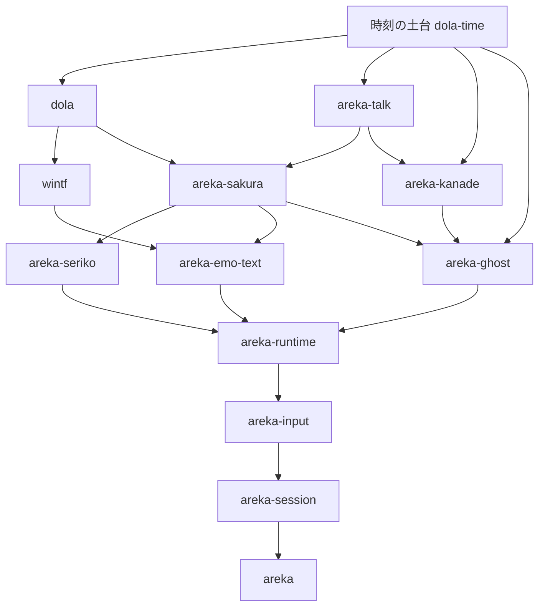
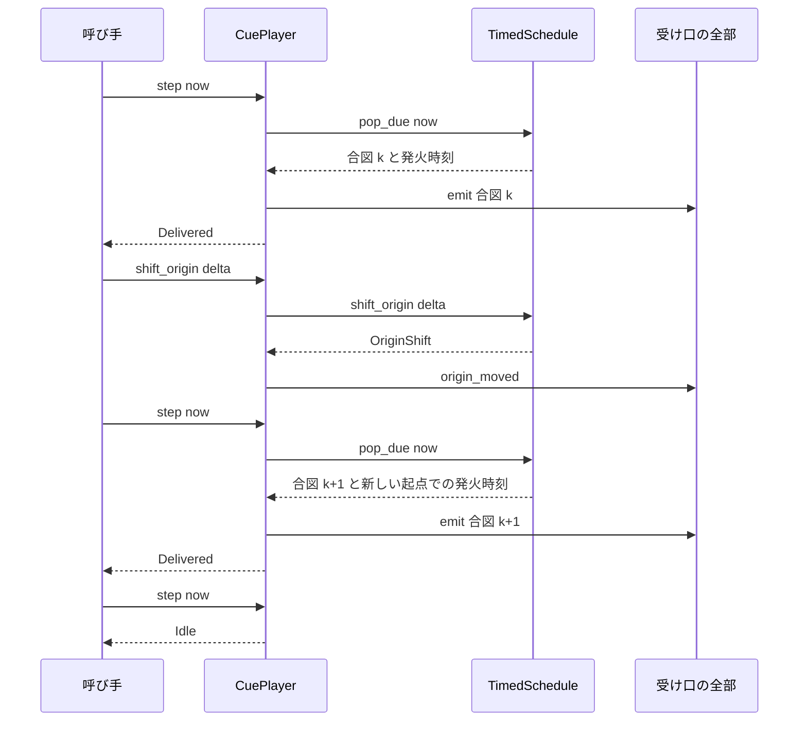
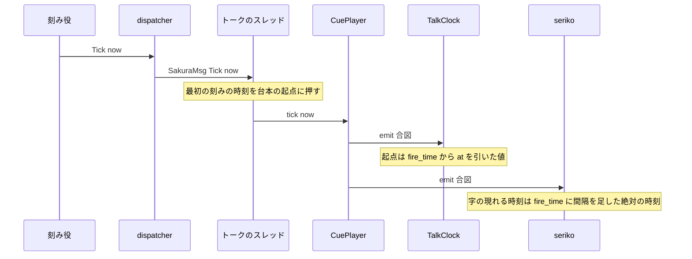
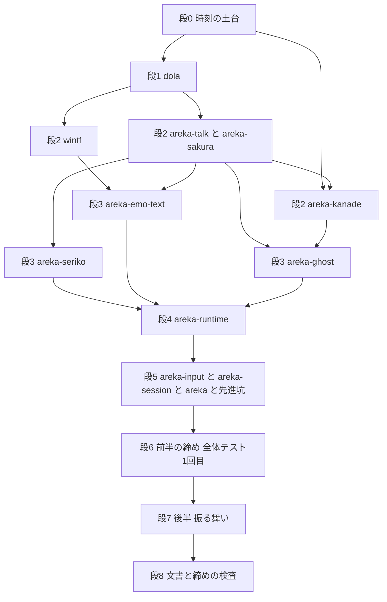

# Design Document: dola-interrupt-ticks

## Overview

**Purpose**: dola の時刻の土台を作り直す。時刻・長さ・符号つきの差を 100ns の整数の型にし、「今」を読む時計を `QueryUnbiasedInterruptTimePrecise` の 1 本にし、台本（`CueSheet`）と storyboard の層と使い手の全部を同じ物差しへ移す。そのうえで、起点の置き直し・置き直しの知らせ・合図の絶対の発火時刻・絶対の時刻の刻みを入れる。

**Users**: dola の使い手（areka の各エンジンと wintf）と、この土台の上に高速再生基盤・並走・値を時間で変える口を建てる開発者。

**Impact**: dola の公開の口から `f64` の秒が消える。本番の時計は 1 本になり、`GetTickCount64` と QPC の秒は読まれなくなる。受け手（文字の層・seriko・バルーンの寿命の時計）は起点を見積もらず、再生機が押した値を読む。

大前提（要件 18）: 同じ起点を持つ台本は、どの受け手でも同じタイミングで再生される。dola は「受け取った現在の時刻」から再生の位置を求めるだけで、その時刻がどう刻まれたかを問わない。刻みが運ぶ時刻は、刻み役が起きた時に読んだ時計の値のままである（格子の値へ寄せない・先読みして配らない）。

設計の案は、設計として必然かどうかで選ぶ。この文書に出るタスクの数は、段取りを組むための見込みであって、案を選ぶ根拠ではない。

### Goals

- 時間の次元を持つ値を、絶対も相対も、cue の層・storyboard の層・storyboard の文書の定義の型の全部で、100ns の整数の型で持つ。
- 本番の「今」を 1 本の時計から読む。
- 倍率が 1 でない時の出来事の判定と、逆向きに求めた時刻が食い違わない事と、どの出来事も本当の時刻より前に「届いた」と判定しない事を、構造で保証する。
- 起点の置き直し（前へも後ろへも）・知らせ・絶対の発火時刻の口を、後で作り直さずに済む形で入れる。
- 遅れて届いた合図の追い付き方を、受け手ごとに決める。
- 並行のサブエージェントで進められる段取りを、設計が持つ。

### Non-Goals

- `std::time::Instant` で測る締め切りと入力の時刻、別の時計を止める番人（`instant-to-interrupt-ticks`）。
- 高速再生基盤そのもの・`\x` の待ち・並走の流れ・値を時間で変える口。本番で起点を置き直す使い手は、この spec には居ない。
- 表示の周期と刻みの周期（50・1000・16 ms）。区切りの種類を増やす事。
- 付け替えの前の形を読む互換の口・移行の案内・版の行の変更。

## Boundary Commitments

### This Spec Owns

- 時刻の型 `TimePoint`・長さの型 `TimeSpan`・符号つきの差 `TimeDelta`・倍率 `TimeScale`・「今」を読む関数・作者が書く単位からの変え方と丸めの決まり。
- dola の公開の口の全部（cue の層・storyboard の層・文書の定義の型）の時刻と長さ、直列化の形。
- 時刻の表の起点の置き直し・受け口への知らせ（`CueSink::origin_moved`）・合図の絶対の発火時刻（`TalkCue::fire_time`）。
- 使い手の追従: `wintf`・`areka-talk`・`areka-sakura`・`areka-kanade`・`areka-seriko`・`areka-emo-text`・`areka-ghost`・`areka-runtime`・`areka-input`・`areka-session`・本体 `areka`・先進坑。
- 時計の結線: ghost の刻み役・seriko の時計・`FrameTime`・`TalkClock`。
- 1 字ごとの間隔の式（文字の層と seriko が呼ぶ 1 本の関数）。
- 受け手ごとの追い付き方の決まり（文字の層・seriko・バルーンの寿命の時計・姿を変える指令の受け口・storyboard の層の値と引き金）。
- storyboard の層の、止めた再生を戻すときの時間の数え方。
- 全体テストの、Windows でない target の検査の段。dola の README・`tech.md`・`structure.md`・替えた所のコードの説明。
- 時刻の土台の crate を、crates.io へ出す crate の一覧と順に足す事（未決 1 の前提の時だけ）。

### Out of Boundary

- `Instant` の締め切り（`tick_wake`・SHIORI の応答の予算ほか）と、入力の時刻。
- 暦の時刻（`GetLocalTime`・ログの日時）。
- 速さの切り替え・待ちの飛ばし・クリック待ちの通り方・並走の流れの進め方・値を時間で変える口の中身。
- kanade の時間切れの権限の持ち主と、指令の読み分け（無い・0 と負・正）。
- seriko の、姿を変える指令（`\s`・着せ替え）が始めるアニメの起点（届いた時の時計の読みのまま）。
- roadmap とほかの spec の brief の書き直し（棚卸の持ち物）。

### Allowed Dependencies

- 時刻の土台の crate は、std と、Windows の時だけ `windows`（機能 `Win32_System_WindowsProgramming`）に依存する。ワークスペースのほかの crate に依存しない。
- 依存の向きは「時刻の土台 → dola → wintf」「時刻の土台 → `areka-talk` → `areka-sakura`・`areka-kanade` → …」。上の crate が下を引く。逆は作らない。
- `areka-kanade`・`areka-talk`・`areka-ghost` の本番は、時刻の土台だけを引く（dola を引かない）。
- 外の crate は足さない。`windows` の機能を 1 つ足すだけ。
- 再生と評価の口は、時刻を外から受ける。dola の中から「今」を読まない。

### Revalidation Triggers

- `TimePoint`・`TimeSpan`・`TimeDelta` の表せる範囲・丸めの決まり・範囲の端の扱いを変える時。
- `TalkCue` の欄・`CueSink` の口・`OriginShift` の中身を変える時。
- `CueSheet` の直列化の形を変える時。
- 時刻の表の「取り出す時に発火時刻を決める」「知らせと合図を起きた順に配る」の決まりを変える時。
- 1 字ごとの間隔の式（`areka_sakura::reveal`）を変える時（文字の層と seriko の両方が確かめ直す）。
- 時刻の土台の置き場（crate の名前・dola の再公開の道）を変える時。

## Architecture

### Existing Architecture Analysis

- dola は時刻を外から受ける受け身の作りで、自分の中から「今」を読まない。この作りは保つ。
- cue の層と storyboard の層は、コードで互いを参照しない。共通の物は時刻の型だけになる。
- 時刻の表（`TimedSchedule`）は「進め終えてから配る」2 段の口（`tick`＋`ready`）で、取り出しごとに何かを挟む場所が無い。起点は作る時に 1 回入るだけ。
- 受け口（`CueSink`）は起点を受け取らない。だから文字の層の時計（`TalkClock`）と seriko（`TalkEpoch`）は「今 − 合図の時刻」の最大で起点を見積もる。届く時刻の揺れが台本の時刻に出て、起点は前へ動かせない。
- 本番の起点はいつも 0。dispatcher が台詞の最初の刻みからの相対の秒を送るからである。
- 時計が 3 つある（QPC の秒・`GetTickCount64` のミリ秒・`Instant`）。前の 2 つをこの spec で 1 本にする。
- `areka-sakura` の `contract.rs` が dola の cue の型を再公開している。`areka-sakura` より上は、`areka-sakura` が替わる時に一緒に替わる。
- `instant-to-interrupt-ticks` は、`shiori-host32-host`・`areka-nar`・`areka-emo-present`・`areka-actor` など、dola を引かない crate でも「今」を読む。時刻の型と時計が dola の中に在ると、それらの crate が、時計を読むためだけにアニメの宣言のライブラリを引く事になる。

### Architecture Pattern & Boundary Map



**Architecture Integration**:

- 選んだ形: 時刻の土台を一番下の小さい crate に置き、dola が `dola::time` として再公開する。cue の層と storyboard の層は、その場で型を替える。起点の置き直しと知らせは、時刻の表と再生機の口として足す。
- 責任の分け方: 丸めと範囲の決まりは時刻の土台の 1 か所。直列化の形は dola。作者が書く単位を読む縁は、それぞれの使い手（`areka-sakura` の `duration.rs`・seriko の表を組む所・`areka-runtime` のバルーンの待ち）。
- 保つ作り: 時刻を外から受ける受け身の再生機・全部の受け口へ選ばずに配る形・テストが時刻を外から渡す決定論。
- steering: 時刻は正確に扱う（待ちを丸めない・遅れたら過ぎた分だけ進める）・1 フレーム遅らせない・ベースウェアに判断やモードを足さない・外の crate を足さない・ログ無しの失敗の道を作らない。

### Technology Stack

| Layer | Choice / Version | Role in Feature | Notes |
|-------|------------------|-----------------|-------|
| 時計 | `windows` 0.62・機能 `Win32_System_WindowsProgramming` | `QueryUnbiasedInterruptTimePrecise() -> u64` を呼ぶ | 時刻の土台の crate の `cfg(windows)` の依存。dola は `windows` の依存を外す |
| 直列化 | `serde` 1（dola の今の依存） | cue は 100ns の整数・storyboard の文書は秒 | 時刻の土台の crate は serde を引かない。アダプタは dola が持つ |
| 検査 | `rustup` の target `x86_64-unknown-linux-gnu` | Windows でない target の `cargo check -p dola` | 全体テストの 1 段。外の crate は足さない |

### 設計の決め

| # | 決め | 中身 | 根拠 |
|---|---|---|---|
| D1 | 置き場 | 時刻の型・丸め・時計を、dola の下の小さい crate（仮の名 `dola-time`）に置く。dola は `dola::time` として同じ物を再公開する。「今」を読む関数の定義は 1 つ | `areka-kanade`・`areka-talk`・`areka-ghost` の本番と、`instant-to-interrupt-ticks` が触る `shiori-host32-host`・`areka-nar` などは、アニメの宣言を使わない。時計を読むためだけに dola を引く向きは、依存として誤り。crates.io へ出す物が 1 つ増えるので、開発者に確かめる（未決 1） |
| D2 | 型の中身 | `TimePoint`・`TimeDelta` は `i64`、`TimeSpan` は 0 以上の `i64`。どれも 100ns が 1 | 起点は、台本の再生が始まった時刻より前へ動く（要件 11 の 3）。0 から数える時計では、起点が 0 より前になる。受け手も起点を持つので、「0 より前の時刻」を表せない型では、起点を持つ所の全部に別の型が要る。時計の値は 2^63 に届かない（約 2 万 9 千年）。TOML の整数（符号つき 64 ビット）にも全部の値が書ける（未決 2） |
| D3 | 範囲の端 | 足し引きの演算子は、端で張り付く（回り込まない）。端を越えたかを知りたい所は `checked_*` で `None` を受ける | 作者の値は端まで来る（選択待ちの時間切れは `i64` の端へ張り付く＝要件 3 の 8）。パニックは致命に限る |
| D4 | 「終わりが無い」 | `Option<TimePoint>` の `None`。周回の後の待ちで最後の値を保つ間は、中の列挙で表す | 型の普通の値（`TimePoint::MAX`）と取り違えない（要件 1 の 7） |
| D5 | 丸め | 最も近い 100ns。ちょうど中間は 0 から遠い側。作者が書く単位からの変え方（`std::time::Duration` からを含む）・`mul_div`・`mul_unit` に使う。倍率の写し（D6）には使わない | 長さを作る計算は、元の値に最も近い長さを作る。0 を挟んで対称になる（負の台本の時刻でも同じ決まり） |
| D6 | 倍率 | `TimeScale`（有限で正の実数）が、前向きの写し F と、その最小の逆 G を持つ。F は切り捨て（負の無限大の側）で求める。出来事の判定も予定の時刻も、この 2 つだけで作る | 写しの意味は「台本の時刻に届いたか」である。切り捨てなら、掛け算の結果が届く前に「届いた」にならない。G を「F が届く最初の値」と定義すると、判定と予定は定義から食い違わない（「倍率の写し」の節） |
| D7 | 直列化 | `CueSheet` は 100ns の整数。storyboard の文書は秒の実数のまま読み書きし、読む縁で 1 回だけ型へ変える | 台本は機械が渡す物・文書は作者が書く物 |
| D8 | 台本の起点 | `CueSheet` の起点は `Option<TimePoint>`。押されていない台本から再生機は作れない（`Err`） | 0 は普通の時刻である。押し忘れた台本が「起点 0＝全部が過ぎた」として一度に配られる道を、型で閉じる |
| D9 | 合図の形 | `TalkCue` に `fire_time: TimePoint` を足す。`at` は `TimeSpan`（台本の時刻）。先渡しの合図の `fire_time` は、その時の起点での予定の値。時刻の表の中では、発火時刻を持たない型（`PendingCue`）で持ち、`TalkCue` は出口（取り出しと先渡し）でだけ組む | 文字の層の空回しは、先渡しの合図を配られる合図と同じ道で当てる。受け口へ渡す型を分けると、同じ道を通せない。表の中の項目は、発火時刻がまだ決まっていないので、その欄を持たない型にして、古い値を持つ合図を作れなくする |
| D10 | 時刻の表 | 取り出し口は `pop_due`（1 件ずつ）だけ。`tick`＋`ready` は無くす。起点は中で 128 ビットで持つ | 取り出しごとに起点を置き直せる（要件 11 の 6）。溜めが無いので、同じ時刻の刻み直しは、守り無しで「何も届かない」「置き直した分だけ届く」になる（要件 11 の 9・10）。トークのスレッドの同じ時刻の守りも要らなくなり、取り除く。型の下の端でも比べが変わらない（要件 11 の 12） |
| D11 | 置き直しの口 | `reanchor(at, script_time)`（時刻 `at` が台本の時刻 `script_time` である）と `shift_origin(delta)`（負は前へ）。どちらも `OriginShift` を返す | ノベルの作り直しの使い方は、この 2 つの言い方で全部書ける（「使い手の居ない口の確かめ」の節） |
| D12 | 再生機 | `step`（1 件）と `tick`（届く分の全部）。置き直しのたびに、全部の受け口へ `origin_moved` を登録順に配る | 合図 → 知らせ → 合図の順が、呼んだ順のまま受け口に着く（要件 12 の 2） |
| D13 | 受け手の起点 | 文字の層の時計は「最後に受けた合図の `fire_time − at`」と「最後に受けた知らせの起点」のうち、後に着いた方を起点にする。seriko は起点を持たず、字の現れる時刻を絶対の時刻で持つ | どちらも再生機が押した値で、届いた時刻から導かない（要件 12 の 9・18 の 2） |
| D14 | 口パク | 1 回の刻みで越えた区切りを、古い順に全部、それぞれの字が現れた時刻で判定する | 結果が、刻みの細かさと届く遅れに依らない（要件 18 の 1）。今の「いちばん新しい 1 つだけ」は、刻みの取り方で口の動きが変わる（未決 3） |
| D15 | 時計の結線 | 刻み役・seriko・`FrameTime`・`TalkClock` の既定の時計は、同じ 1 つの関数。kanade は時計を持たず、刻みが運ぶ値で動く | 要件 17 |
| D16 | 段取り | 継ぎを置かない。前半は型の付け替え（合図と刻みの形は最後の形）、後半は振る舞い | 要件 9 の 1（付け替えで変わらない）と 9 の 6（変えた所）を、別々の確かめで示す（「Migration Strategy」） |

## File Structure Plan

### Directory Structure

```
crates/dola-time/                    # 時刻の土台（新しい crate・名前は仮）
├── Cargo.toml                       # windows は cfg(windows) だけ・機能 test-support・docs.rs の target は Windows
├── README.md
└── src/
    ├── lib.rs                       # 再公開
    ├── point.rs                     # TimePoint
    ├── span.rs                      # TimeSpan
    ├── delta.rs                     # TimeDelta
    ├── convert.rs                   # 作者が書く単位からの変え方・丸めの決まり・TimeRangeError
    ├── scale.rs                     # TimeScale（F と G）・比の掛け算・進み具合
    ├── text.rs                      # Display と FromStr（値を落とさない秒の小数）
    ├── clock.rs                     # now()（cfg(windows)）
    ├── testing.rs                   # at_ms・ms・delta_ms（機能 test-support）
    └── *_tests.rs                   # 上のファイルごとの隣のテスト

crates/dola/src/
├── time/
│   ├── mod.rs                       # dola_time の再公開
│   ├── serde_ticks.rs               # 100ns の整数のアダプタ（cue の層）
│   └── serde_secs.rs                # 秒のアダプタ（storyboard の文書）・秒への変え方・文書の値の上限の確かめ
├── cue/
│   ├── command.rs                   # Cue・TalkCue・PendingCue・BarrierKind の時刻の欄
│   ├── schedule.rs                  # TimedSchedule・Due・OriginShift
│   ├── schedule_reanchor_tests.rs   # 置き直しの単体テスト（新しいファイル）
│   ├── sheet.rs                     # CueSheet の起点・占有の終わり
│   ├── runtime.rs                   # CuePlayer・CueError
│   ├── sink.rs                      # CueSink::origin_moved
│   └── test_support.rs              # carrier_cue
├── storyboard.rs / transition.rs    # 文書の定義の型
├── builder.rs / validate/
├── error.rs                         # DolaError（消す variant と足す variant の全部を、家族を並べる前に 1 度で替える）
├── compile/{types.rs, mod.rs, resolve.rs}
│                                    # types.rs に、1 周の長さを求める 1 本の関数を置く
└── runtime/{facade.rs, types.rs, instance_state.rs, instance_manager/, loop_controller/, timeline_manager/, conflict_resolver.rs}
                                     # clock.rs は消す

crates/dola/tests/cue/
├── runtime_test_reanchor_tests.rs       # 新: 要件 11
├── runtime_test_fire_time_tests.rs      # 新: 要件 13
├── runtime_test_origin_notice_tests.rs  # 新: 要件 12 の 1〜3
└── runtime_test_late_delivery_tests.rs  # 新: 要件 18 の 3・4

crates/areka-sakura/src/reveal.rs        # 新: 1 字ごとの間隔の式（文字の層と seriko が呼ぶ）
.kiro/specs/dola-interrupt-ticks/migration-ledger.md   # 新: 記録（外したテスト・取り除いた分かれ道・変える前後の期待・締めの検索）
```

### Modified Files

並行の作業者が同じファイルに触らないための家族の分け方。家族の中は 1 人が持つ。「先」と書いた物は、同じ crate のほかの家族より先に替える。

**dola**

| 家族 | ファイル |
|---|---|
| 土台（先） | `crates/dola/Cargo.toml`・`src/lib.rs`・`src/time/*`・`src/error.rs`・`src/compile/types.rs`・`src/runtime/mod.rs`（`clock` を外す）・`src/runtime/clock.rs`（消す） |
| cue の本体（先） | `src/cue/{command.rs, schedule.rs, sheet.rs, runtime.rs, sink.rs, mod.rs, test_support.rs, test_support_tests.rs}`・`tests/cue/test_support.rs` |
| cue の単体テスト | `src/cue/command_tests.rs`／`src/cue/schedule/tests.rs`（2 人に割れる） |
| cue の結合テスト | `tests/cue/sheet_test.rs`／`tests/cue/{sheet_sort_test.rs, schedule_test.rs}`／`tests/cue/{runtime_test_*_tests.rs, sink_test.rs}`（3 人に割れる） |
| 文書の型と検査 | `src/{storyboard.rs, transition.rs, builder.rs, document.rs}`・`src/validate/**`・`tests/validation/**`・`tests/general/**`・`tests/trigger/{serde_test.rs, validation_test.rs}`・`tests/runtime/loop_offset_test/loop_offset_serde.rs` |
| コンパイル | `src/compile/{mod.rs, resolve.rs}`・`tests/compile/**`・`tests/trigger/compile_test.rs` |
| runtime の芯 | `src/runtime/{facade.rs, facade_tests.rs, types.rs, instance_state.rs, conflict_resolver.rs}`・`src/runtime/{instance_manager, loop_controller, timeline_manager}/*`・`src/runtime/interpolator/tests.rs`（置物の時刻だけ）・`tests/runtime/**`（上の 1 本を除く）・`tests/trigger/{runtime_test.rs, event_order_test.rs}` |
| 文書 | `crates/dola/README.md` |

2 つ以上の家族が要るファイルは、土台の家族が持つ。

- `src/error.rs`: 「文書の型と検査」（消える variant・`LoopOffsetRangeInverted` の型・文書の値の上限の variant）と「コンパイル」（`LoopDurationOutOfRange`）の両方が要る。variant の足し引きの全部を、土台の家族が 1 度で替える。後の家族は、このファイルを編集しない。`src/error.rs` の中のテスト（表示の字面）も、土台の家族が直す。
- `src/compile/types.rs`: コンパイルの結果の型と、1 周の長さを求める 1 本の関数（`CompiledStoryboard::lap_length`）を置く。「コンパイル」と「runtime の芯」の両方が呼ぶので、土台の家族が先に置く。

触らない: `src/easing.rs`・`src/runtime/interpolator/mod.rs`・`src/runtime/subscription_manager/*`・`src/value.rs`・`src/variable.rs`。

**使い手**

| crate | 家族 | ファイル |
|---|---|---|
| `wintf` | 時計と世界（先） | `Cargo.toml`（変えない）・`src/ecs/graphics/core.rs`（`FrameTime`）・`src/ecs/world/mod.rs`・`src/ecs/dola/mod.rs`・`tests/ecs/dola_animator_test.rs`・`FrameTime(` を書くテスト（`world_tick_gate_tests.rs`・`tests/graphics/surface_embedding_test.rs`・`systems_tests.rs`） |
| | タイプライター | `src/ecs/widget/text/typewriter/{mod.rs, tests.rs}`・`typewriter_ir.rs`・`typewriter_layout.rs`・`typewriter_draw.rs`・`examples/typewriter_demo.rs` |
| | 自動の上げ下げ | `src/ecs/graphics/visual/{promotion.rs, systems.rs, promotion_tests.rs, promotion_round_log_tests.rs, systems_promotion_tests.rs}` |
| `areka-talk` | 全部（先） | `Cargo.toml`・`src/lib.rs`（`ChoiceWaiting`） |
| `areka-sakura` | 本体（先） | `src/{contract.rs, duration.rs, reveal.rs, compile.rs, drive.rs, strict_tap.rs, lib.rs}`・`src/drive_test_support.rs` |
| | コンパイルのテスト | `src/compile_*_tests.rs` |
| | 再生のテスト | `src/drive_*_tests.rs` |
| `areka-kanade` | 本体と組み立て（先） | `Cargo.toml`・`src/{msg.rs, lib.rs, actor.rs}`・`src/schedule/{types.rs, choice.rs, close.rs, change.rs, events.rs, steady.rs, mod.rs}`・`tests/kanade/*_test_support.rs` |
| | `src` のテスト | `src/**/*_tests.rs` |
| | 結合テスト | `tests/kanade/**` |
| `areka-seriko` | 時計と表の縁（先） | `src/{actor.rs, actor_bind.rs, table.rs, table_calls.rs, settle.rs}`・`src/{lib_test_support.rs, actor_test_support.rs}`・`tests/common/mod.rs` |
| | ループと部品の芯 | `src/{looper.rs, looper_trigger.rs, looper_calls.rs, looper_refresh.rs, parts.rs, parts_trigger.rs, parts_calls.rs, parts_refresh.rs, timeline.rs, trigger.rs, calls.rs, talk.rs}` |
| | テスト（2 人に割れる） | `src/looper*_tests.rs`・`src/talk_tests.rs`・`src/trigger_tests.rs`／`src/parts*_tests.rs`・`src/actor*_tests.rs`・`tests/**` |
| `areka-emo-text` | 本体と組み立て（先） | `src/{state.rs, actor.rs, actor_present.rs, actor_box.rs, sink.rs}`・`src/{actor_test_support.rs, state_test_support.rs, viewbox_draw_test_support.rs}`・`tests/support/{mod.rs, fixture.rs}` |
| | `src` のテスト（2 人に割れる） | `src/state_*_tests.rs`・`src/lookahead_tests.rs`・`src/choice_anchor_tests.rs`／`src/actor_*_tests.rs`・`src/viewbox_*_tests.rs` |
| | 結合テストと例 | `tests/*.rs`・`tests/decoration_readback/`・`examples/**` |
| `areka-ghost` | 刻み役と時計（先） | `Cargo.toml`・`src/{ticker.rs, ticker_tests.rs, runtime.rs, config.rs, runtime_choice_wake_tests.rs}` |
| | dispatcher | `src/{dispatcher.rs, dispatcher_*_tests.rs}` |
| | 受け口と結合テスト | `src/{sink.rs, prop_sink.rs, prop_get_sink.rs, test_support.rs, translate_wiring_e2e_tests.rs}`・`tests/**` |
| `areka-runtime` | 土台と結線（先） | `src/{lib.rs, talk_clock.rs, talk_lifecycle.rs, shell_carry.rs, balloon_visibility_wait.rs, hover_inject.rs}`・`src/{frame_test_support.rs, consumer_ledger_test_support.rs, balloon_visibility_test_support.rs, balloon_visibility_phase_test_support.rs, frame_balloon_runtime_test_support.rs}`・`src/{talk_lifecycle_tests.rs, talk_lifecycle_signals_tests.rs, seriko_clock_tests.rs}` |
| | バルーンの判断 | `src/{balloon_visibility.rs, balloon_visibility_decision.rs, balloon_visibility_tests.rs, balloon_visibility_box_tests.rs, balloon_visibility_timeout_*}` |
| | バルーンの相 | `src/balloon_visibility_phase*`（組み立てを除く） |
| | バルーンの通し | `src/{balloon_visibility_choice_wait_tests.rs, balloon_visibility_lifecycle_e2e_tests.rs, balloon_visibility_talk_end*}` |
| | 変更の受け口 | `src/{change_cue*, move_cue*, reload_cue*, switch_cue*, zorder_cue*, zorder_wiring*, window_state_cue*, user_break_cue*}`・`src/frame/window_state_tests.rs` |
| | フレーム | `src/frame/scale_text.rs`・`src/frame_*_tests.rs`・`src/{strict_judges_tests.rs, film_playback_e2e_tests.rs}` |
| `areka-input` | 全部 | `src/balloon_test_support.rs`・`TalkCue {` と `present_frame(` を書くテスト |
| `areka-session` | 全部 | `src/{runtime_boot.rs, runtime_boot_tests.rs, boot_config.rs, ghost_switch_test_support.rs, shell_balloon_switch_session_lap_test_support.rs}`・時計を差し込むテスト |
| 本体 `areka` | 5 つに割れる | `src/runtime_tests/**`／`src/session_tests/**`／`src/mcp/**`／`src/{install, update}/*_cue*`・`src/thread_roles_tests.rs`／`examples/emo-present/**` |
| 先進坑 | 1 か所 | `crates/pilot/examples/pilot-windows-rs-next/q7-vertical/src/old_side.rs` |

**テストの組み立てを使う crate の `Cargo.toml`**: テストで `at_ms`・`ms`・`delta_ms` を使う crate は、`[dev-dependencies]` に時刻の土台の crate を機能 `test-support` 付きで足す。`Cargo.toml` は、その crate の「先」の家族が持つ。

**道具と文書**

- `Cargo.toml`（根）: `[workspace.dependencies]` に時刻の土台の crate の行を足す。版の行（`version`）は動かさない。
- `tools/test-all.ps1`: 段 `dola non-windows check` を足す（段 `dola toml feature tests` の直後。中身は `rustup target add x86_64-unknown-linux-gnu` と `cargo check -p dola --features toml --target x86_64-unknown-linux-gnu -j 4`）。
- `tools/crates-io.ps1`・`doc/crates-io-publish.md`: 出す crate の一覧と順に、時刻の土台の crate を足す（未決 1 が「dola の中に置く」に決まれば、触らない）。
- `.kiro/steering/tech.md`（dola の依存の行・時刻の土台の行・全体テストの段・出す crate の一覧）・`.kiro/steering/structure.md`（cue の層の説明・crate の一覧）。
- `crates/dola/README.md` と、時刻の土台の crate の `README.md`: 時刻の型と長さの型と符号つきの差・「今」を読む関数・作者が書く単位からの変え方と丸めの決まり・眠りの間を数えない決まりを、今の姿だけで書く。付け替えの前の形の説明と、書き換え方の案内は書かない。
- コードの説明: `crates/wintf/src/ecs/graphics/core.rs`（`FrameTime`）・`crates/areka-runtime/src/{talk_clock.rs, lib.rs}`・`crates/areka-sakura/src/{contract.rs, duration.rs}`・`crates/areka-kanade/src/msg.rs`・`crates/areka-ghost/src/ticker.rs`・`crates/areka-seriko/src/{actor.rs, talk.rs}`・dola の `cue/*`・`runtime/facade.rs`。

## System Flows

### 1 回の刻みの中の、取り出し・置き直し・知らせの順



- 合図 k の発火時刻は、取り出した時の起点で決まり、後の置き直しで変わらない。合図 k+1 は、置き直した後の起点で決まる。
- `tick(now)` は、`step(now)` を `Delivered` が返る間くり返すだけである。置き直しを挟まない呼び手は `tick` を呼ぶ。
- 区切りで止まっている間・最初の刻みの前でも、`reanchor`／`shift_origin` は受け付ける。完了の後は何もしない（`None` を返す）。

### 起点が受け手へ届く道（後半の後）



- 刻みが運ぶ値は、刻み役が起きた時に読んだ時計の値のままで、dispatcher も トークのスレッドも変えない。
- 受け手は、届いた時刻を起点の計算に使わない。

## Requirements Traceability

| Requirement | Summary | Components | Interfaces | Flows |
|-------------|---------|------------|------------|-------|
| 1.1, 1.2, 1.3, 1.4 | 型と整数の足し引き | 時刻の土台 | `TimePoint`・`TimeSpan`・`TimeDelta` と演算子 | — |
| 1.5, 1.9 | 負の差を区別して運ぶ | 時刻の土台 | `TimePoint - TimePoint -> TimeDelta`・`span_since -> Option<TimeSpan>` | — |
| 1.6 | 回り込ませない | 時刻の土台 | 張り付く演算子と `checked_*` | — |
| 1.7 | 「終わりが無い」 | 時刻の土台・`DolaRuntime` | `Option<TimePoint>`・`ValueTime` | — |
| 1.8, 2.7, 15.8 | Windows でない所でのコンパイル | 時刻の土台・全体テストの段 | `cfg(windows)` は `clock.rs` だけ・段 `dola non-windows check` | — |
| 2.1, 2.2, 2.3, 2.4, 2.5 | 時計 | 時刻の土台 | `now() -> TimePoint` | — |
| 2.6, 8.4 | 古い時計を無くす | dola・使い手 | `runtime/clock.rs` を消す | 前半 |
| 2.8 | 時刻を外から受ける | cue の層・storyboard の層 | `tick(now)`・`start(name, start_time)` | — |
| 3.1, 3.2, 3.3, 3.4, 3.7, 3.8 | 作者が書く単位からの変え方 | 時刻の土台・使い手の縁 | `convert.rs` の口・`TimeRangeError` | — |
| 3.5, 3.6 | 実数の掛け算の 1 か所（倍率の写しは切り捨て・ほかは最も近い 100ns） | 時刻の土台 | `TimeScale`・`mul_div`・`mul_unit` | — |
| 4.1, 4.2, 4.3, 4.4, 4.5 | cue の層の口 | cue の型・`CueSheet`・`TimedSchedule`・`CuePlayer` | 「dola の cue の層」の節 | — |
| 4.6 | 時間切れの指令 | cue の型・`areka-talk`・`areka-kanade` | `BarrierKind::WaitForChoice { timeout: Option<TimeDelta> }` | — |
| 5.1, 5.2, 5.3, 5.4, 5.10 | storyboard の層の口 | 文書の型・コンパイル・`DolaRuntime` | 「dola の storyboard の層」の節 | — |
| 5.5, 5.6, 5.8 | 終わらないループ | `DolaRuntime`・コンパイルの結果 | `StartResult.end_time: Option<TimePoint>`・`CompiledStoryboard::lap_length`・`MIN_LOOP_DURATION`・`checked_add` | — |
| 5.7, 5.11 | 進み具合と倍率の写し | 時刻の土台・`DolaRuntime` | `TimeScale::forward`・`first_reaching`・`ratio_of` | — |
| 5.9 | 文書の定義の型 | 文書の型 | `TransitionDef`・`LoopOffset`・`KeyframeRef`・`StoryboardEntry` | — |
| 6.1, 6.2, 6.3, 6.4, 6.5, 6.9 | `CueSheet` の直列化 | `dola::time` のアダプタ・`CueSheet` | `serde_ticks` | — |
| 6.6, 6.7 | 文書の秒の読み書き | `dola::time` のアダプタ・文書の型・検査 | `serde_secs`（読む・書く・検査の 3 か所で、文書の値の上限を確かめる） | — |
| 6.8 | 書式ごとの往復のテスト | dola のテスト | JSON と TOML | — |
| 7.1, 7.2, 7.3, 7.5 | 使い手の追従 | 使い手の全部 | 「使い手」の節 | 前半 |
| 7.4 | 作者のミリ秒を縁で 1 回 | `areka-sakura`・`areka-seriko`・`areka-runtime` | `duration.rs`・`table.rs`・`balloon_visibility_wait.rs` | — |
| 7.6 | 正準のキャリアの合図 | cue の層 | `carrier_cue` | — |
| 7.7 | 決定論のテスト | 使い手の全部 | 偽の時計・`dola_time::testing` | — |
| 7.8 | ログ | 時刻の土台・使い手 | `Display`・「ログの形」の節 | — |
| 7.9 | 起きなくなった分かれ道 | 使い手・記録 | `migration-ledger.md` | — |
| 7.10, 9.8 | 1 字ごとの間隔 | `areka-sakura` | `reveal::chunk_reveal_offsets` | — |
| 7.11 | 先進坑 | 先進坑 | `old_side.rs` | 前半 |
| 7.12 | wintf のタイプライターと自動の上げ下げ | wintf | 「wintf」の節 | — |
| 8.1, 8.2, 8.3, 8.5 | 「今」を読む本番の所 | wintf・`areka-runtime` | `FrameTime(TimePoint)`・`TalkClock` の既定の時計 | — |
| 9.1, 9.2, 9.3 | 付け替えで変わらない事 | テスト・全体テストの 1 回目 | 「Testing Strategy」「Migration Strategy」 | 前半の締め |
| 9.4, 9.5, 9.7 | 外す・置き換えるテスト | 記録 | `migration-ledger.md` | — |
| 9.6 | 変える前後の期待 | 記録 | `migration-ledger.md` | 後半 |
| 10.1, 10.2, 10.3, 10.4, 10.5 | 止めて戻す | `DolaRuntime` | `InstanceState::Paused { since }`・`pause`・`resume`（終わりの期限は 10.2 が除く） | — |
| 11.1, 11.2, 11.3, 11.4, 11.5 | 起点の置き直し | `TimedSchedule`・`CuePlayer` | `reanchor`・`shift_origin` | 刻みの中の順 |
| 11.6, 11.7, 11.8 | 取り出しごと・区切りの間・後ろの起点 | `TimedSchedule`・`CuePlayer` | `pop_due`・`step` | 刻みの中の順 |
| 11.9, 11.10, 11.11 | 同じ時刻の刻み直し・置き直さない時 | `TimedSchedule`・`areka-sakura` | 溜めを持たない取り出し・`drive.rs` は同じ時刻の刻みを読み飛ばさない | — |
| 11.12 | 型の下の端（届き方が変わらない） | `TimedSchedule` | 中の 128 ビットの起点 | — |
| 12.1, 12.2, 12.3 | 知らせ | `CuePlayer`・`CueSink` | `origin_moved(OriginShift)` | 刻みの中の順 |
| 12.4, 12.5, 12.8, 12.9, 12.10 | 文字の層の時計とバルーンの寿命 | `TalkClock`・`areka-emo-text` | `talk_time -> Option<TimeDelta>` | 起点が届く道 |
| 12.6, 12.7 | seriko | `areka-seriko` | `TalkFeed`（絶対の時刻）・口パクの決まり | 起点が届く道 |
| 13.1, 13.2, 13.3, 13.4, 13.5, 13.6, 13.7 | 絶対の発火時刻 | `TimedSchedule`・`CuePlayer`・`TalkCue`・`PendingCue` | `Due::Payload { fire_time, at, .. }`・`PendingCue::fire`・`TalkCue::fire_time` | 刻みの中の順 |
| 14.1, 14.2, 14.4, 14.5 | 絶対の刻み | `areka-ghost`・`areka-sakura` | `SakuraMsg::Tick(TimePoint)` | 起点が届く道 |
| 14.3, 17.8 | 最初の刻みを起点に押す | `areka-sakura` | `drive.rs` の最初の刻み | 起点が届く道 |
| 14.6 | 表示の終わりを換算せずに渡す | `areka-talk`・`areka-ghost`・`areka-kanade` | `ChoiceWaiting { display_end: TimePoint, .. }` | — |
| 14.7, 17.1, 17.2, 17.4 | 時計の統一 | `areka-ghost`・`areka-seriko`・`areka-runtime` | 刻み役と seriko の時計 | — |
| 15.1, 15.2, 15.3, 15.5 | 1 本で終える | 段取り | 「Migration Strategy」 | 全体 |
| 15.4 | 公開の口に `f64` の秒が無い | 締めの検査 | 「締めの検査」の節 | 締め |
| 15.6 | 外の crate を足さない | 時刻の土台 | `windows` の機能 1 つ | — |
| 15.7 | 1,000 行 | 段取り | 「1,000 行に近いファイル」の節 | — |
| 16.1, 16.2, 16.3, 16.4 | 文書 | 文書 | README・`tech.md`・`structure.md`・コードの説明 | 締め |
| 17.3, 17.5, 17.7 | kanade の型・締め切り・`OnSecondChange` | `areka-kanade` | 「areka-kanade」の節 | — |
| 17.6, 17.10 | 眠り | 時刻の土台・テスト | 時計の説明・偽の時計を止めるテスト | — |
| 17.9 | 台本の道とフレームの時刻が同じ物差し | 全部 | `TimePoint` | — |
| 18.1, 18.2 | 再生の位置は台本と起点と今だけで決まる | `CuePlayer`・受け手 | D13・D14 | — |
| 18.3, 18.4 | 過ぎた起点・まだ来ていない起点 | `CuePlayer`・`TalkClock` | `pop_due`・`talk_time` | — |
| 18.5, 18.6, 18.7 | 追い付き方 | 受け手の全部 | 「受け手ごとの追い付き方」の節 | — |

## Components and Interfaces

| Component | Domain/Layer | Intent | Req Coverage | Key Dependencies | Contracts |
|-----------|--------------|--------|--------------|------------------|-----------|
| 時刻の土台 | 最下層 | 型・丸め・倍率・時計 | 1, 2, 3, 5.7, 5.11 | `windows`（P0・Windows だけ） | Service |
| `dola::time` | dola | 再公開と直列化のアダプタ | 6 | 時刻の土台（P0）・serde（P0） | Service |
| cue の型・`CueSheet` | dola cue | 台本と合図の時刻の欄 | 4, 6, 13 | `dola::time`（P0） | State |
| `TimedSchedule` | dola cue | 取り出し・起点・占有の終わり | 4, 11, 13 | cue の型（P0） | Service, State |
| `CuePlayer`・`CueSink` | dola cue | 配る・知らせる・区切り | 11, 12, 13, 18 | `TimedSchedule`（P0） | Service, Event |
| 文書の型・コンパイル | dola storyboard | 定義の型とコンパイルの結果 | 5, 6 | `dola::time`（P0） | State |
| `DolaRuntime` | dola storyboard | 開始・刻み・止める・戻す | 5, 10 | コンパイル（P0）・`TimeScale`（P0） | Service, State |
| wintf | 使い手 | `FrameTime`・タイプライター・自動の上げ下げ | 7.12, 8 | dola（P0） | State |
| `areka-talk` | 使い手 | `ChoiceWaiting` | 4.6, 14.6 | 時刻の土台（P0） | Event |
| `areka-sakura` | 使い手 | 作者の単位の縁・刻み・1 字ごとの間隔 | 7, 14 | dola（P0） | Service, Event |
| `areka-kanade` | 使い手 | 締め切り・`OnSecondChange` | 17 | 時刻の土台（P0） | State |
| `areka-ghost` | 使い手 | 刻み役・dispatcher | 14, 17 | 時刻の土台（P0） | Event |
| `areka-seriko` | 使い手 | 時計・表の縁・口パク | 12, 17, 18 | dola（P0）・`areka-sakura`（P0） | State |
| `areka-emo-text` | 使い手 | 字の現れる時刻 | 7, 12, 18 | `areka-sakura`（P0） | State |
| `areka-runtime` | 使い手 | `TalkClock`・バルーンの寿命・結線 | 8, 12, 17, 18 | 上の全部（P0） | State |

### 時刻の土台

#### 型（`point.rs`・`span.rs`・`delta.rs`）

| Field | Detail |
|-------|--------|
| Intent | 時刻・長さ・符号つきの差を、100ns の整数の別々の型で表す |
| Requirements | 1.1, 1.2, 1.3, 1.4, 1.5, 1.6, 1.7, 1.8, 1.9 |

**Contracts**: Service [x]

```rust
/// 時刻（ある瞬間）。1 は 100ns。QueryUnbiasedInterruptTimePrecise の値と同じ物差し。
#[derive(Clone, Copy, PartialEq, Eq, PartialOrd, Ord, Hash, Default, Debug)]
pub struct TimePoint(i64);

/// 長さ（0 以上）。
#[derive(Clone, Copy, PartialEq, Eq, PartialOrd, Ord, Hash, Default, Debug)]
pub struct TimeSpan(i64);

/// 符号つきの差。負は「前」。
#[derive(Clone, Copy, PartialEq, Eq, PartialOrd, Ord, Hash, Default, Debug)]
pub struct TimeDelta(i64);

impl TimePoint {
    pub const ZERO: Self; pub const MIN: Self; pub const MAX: Self;
    pub const fn from_ticks(ticks: i64) -> Self;
    pub const fn as_ticks(self) -> i64;
    pub fn checked_add(self, span: TimeSpan) -> Option<Self>;
    pub fn checked_add_delta(self, delta: TimeDelta) -> Option<Self>;
    /// self が earlier 以後なら、その長さ。前なら None。
    pub fn span_since(self, earlier: TimePoint) -> Option<TimeSpan>;
}
impl TimeSpan {
    pub const ZERO: Self; pub const MAX: Self;
    pub const fn as_ticks(self) -> i64;
    pub fn checked_add(self, other: TimeSpan) -> Option<Self>;
    pub fn checked_sub(self, other: TimeSpan) -> Option<Self>;
    pub fn to_std(self) -> std::time::Duration; // ちょうどの値
}
impl TimeDelta {
    pub const ZERO: Self; pub const MIN: Self; pub const MAX: Self;
    pub const fn from_ticks(ticks: i64) -> Self;
    pub const fn as_ticks(self) -> i64;
    pub fn is_negative(self) -> bool;
    /// 0 以上なら長さ。負なら None。
    pub fn to_span(self) -> Option<TimeSpan>;
    pub fn checked_add(self, other: TimeDelta) -> Option<Self>;
}
impl From<TimeSpan> for TimeDelta { /* 値は変わらない */ }
```

演算子（どれも整数のまま・端で張り付く）:

| 式 | 結果 |
|---|---|
| `TimePoint ± TimeSpan`・`TimePoint ± TimeDelta` | `TimePoint` |
| `TimePoint - TimePoint` | `TimeDelta` |
| `TimeSpan + TimeSpan` | `TimeSpan` |
| `TimeSpan - TimeSpan` | `TimeDelta` |
| `TimeDelta ± TimeDelta`・`-TimeDelta` | `TimeDelta` |

- `TimePoint + TimePoint`・`TimeSpan` と `TimeDelta` の取り違えは、演算子が無いのでコンパイルで止まる。
- 負になりうる引き算は `TimeDelta` を返す。0 へ張り付ける引き算は置かない（負を黙って 0 にしない）。
- 張り付いた値は、型の普通の端の値である。「終わりが無い」は `Option` で表し、端の値と取り違えない。
- `Default` は 0（`FrameTime` の `Default` と、直列化の既定の長さ 0 に使う）。

#### 作者が書く単位からの変え方（`convert.rs`）

| Field | Detail |
|-------|--------|
| Intent | ミリ秒・秒・`std::time::Duration` から長さと符号つきの差を作る口と、丸めの決まりを 1 か所に置く |
| Requirements | 3.1, 3.2, 3.3, 3.4, 3.7, 3.8 |

```rust
#[derive(Clone, Copy, Debug, PartialEq, Eq)]
pub enum TimeRangeError { NotFinite, Negative, OutOfRange }

impl TimeSpan {
    /// 1 ミリ秒＝10,000。u32 の全部の値がちょうど収まる。
    pub const fn from_millis(ms: u32) -> TimeSpan;
    pub fn try_from_millis(ms: u64) -> Result<TimeSpan, TimeRangeError>;
    /// 最も近い 100ns。ちょうど中間は 0 から遠い側。
    pub fn try_from_secs_f64(secs: f64) -> Result<TimeSpan, TimeRangeError>;
}
/// 100ns より細かい端数は、最も近い 100ns へ丸める。失敗は、範囲の外だけ。
impl TryFrom<std::time::Duration> for TimeSpan { type Error = TimeRangeError; }
impl TimeDelta {
    /// 端を越える値は、端へ張り付ける。
    pub const fn from_millis_saturating(ms: i64) -> TimeDelta;
    pub fn try_from_secs_f64(secs: f64) -> Result<TimeDelta, TimeRangeError>;
}
```

- 丸めの決まりは、このファイルの先頭の説明に 1 度だけ書く: 「最も近い 100ns・ちょうど中間は 0 から遠い側・有限でない値と表せない値は `Err`」。
- `TryFrom<std::time::Duration>`: `Duration` は 1ns まで持つ。100ns より細かい端数は、作者が書く単位からの変え方の全部と同じ決まり（最も近い 100ns・ちょうど中間は 0 から遠い側）で丸める。端数が在る事は失敗にしない。失敗になるのは、丸めた値が型の範囲を越える時だけ（`TimeRangeError::OutOfRange`）。100ns の倍数の `Duration`（ミリ秒から作った物を含む）は、ちょうどの値になる。
- 秒の実数を返す口は、`TimeSpan` にも `TimeDelta` にも置かない。この crate の公開の口に出る秒の実数は、作る口の引数（`try_from_secs_f64` の `secs`）だけである。storyboard の文書へ秒で書く計算は、dola のアダプタ（`serde_secs`）が `as_ticks()` の整数から自分の中で行う。進み具合は `ratio_of` で求める。ログは `Display` で出す。
- 使い手は、読み込む縁で 1 回だけこの口を呼び、後は型のまま運ぶ。

#### 倍率の写し（`scale.rs`）

| Field | Detail |
|-------|--------|
| Intent | 実数を時間に掛けて整数へ戻す計算を 1 か所に置き、前向きの写しとその逆が食い違わない事を保証する |
| Requirements | 3.5, 3.6, 5.7, 5.11 |

```rust
/// 再生の速さの倍率（有限で正）。
#[derive(Clone, Copy, Debug, PartialEq)]
pub struct TimeScale(f64);

impl TimeScale {
    pub const ONE: Self;
    /// 有限で正でなければ None。
    pub fn new(value: f64) -> Option<Self>;
    pub fn get(self) -> f64;
    /// F: 経った長さ → 台本の時刻。まだ届いていない側（負の無限大の側）へ切り捨てる。
    pub fn forward(self, elapsed: TimeDelta) -> TimeDelta;
    /// G: 台本の時刻 script に届く、最初の経った長さ。どの長さでも届かなければ None。
    /// script が 0 以上なら、返る値も 0 以上。
    pub fn first_reaching(self, script: TimeDelta) -> Option<TimeDelta>;
}
impl TimeSpan {
    /// self × num ÷ den（最も近い 100ns）。途中は 128 ビットで、端数を積もらせない。den は 0 でない。
    pub fn mul_div(self, num: u64, den: u64) -> TimeSpan;
    /// self × ratio（ratio は 0 以上 1 以下へ収めて掛ける）。
    pub fn mul_unit(self, ratio: f64) -> TimeSpan;
}
impl TimeDelta {
    /// self ÷ whole を実数の比で返す（進み具合）。whole が 0 なら None。
    pub fn ratio_of(self, whole: TimeDelta) -> Option<f64>;
}
```

**丸めの向きは 2 つ在り、意味で分ける**:

- 長さを作る計算（`mul_div`・`mul_unit`）は、D5 の決まり（最も近い 100ns）で丸める。作る値が、元の値に最も近い長さだからである。
- 倍率の写し F は、切り捨て（負の無限大の側）で求める。F の意味は「台本の時刻が、どこまで届いたか」である。最も近い値へ丸めると、掛け算の結果が `s − 0.5` を越えた所で「s に届いた」になり、届く前に出来事が起きる。切り捨てなら、届く前に「届いた」にならない。

**F の定義**: 倍率を k とする。k が 1 なら `F(e) = e`（恒等・どの値でもちょうど）。k が 1 でないなら `F(e) = 張り付け(切り捨て((e を f64 にした値) × k))`。切り捨ては、負の無限大の側の整数へ（負の値でも 0 の側へ寄せない）。張り付けは、型の範囲の端へ。

**届く前に「届いた」にならない**: 整数 s について、`F(e) ≥ s` は「`(e を f64 にした値) × k` の掛け算の結果が s 以上である」事と同じである（切り捨てた整数が s 以上である事と、切り捨てる前の値が s 以上である事は、s が整数なら同じ）。

**F は減らない**: `e1 ≤ e2` なら、整数から f64 への変換は順を保ち、正の k を掛ける IEEE の掛け算は順を保ち、切り捨ては順を保ち、端への張り付けも順を保つ。だから `F(e1) ≤ F(e2)`。

**G の定義**: `G(s) = F(e) ≥ s となる最小の e`。`F(TimeDelta::MAX) < s` なら `None`。求め方は、`s ÷ k` の見積もりから両側へ挟み、F だけを使って二分する（F の呼び出しは多くて 64 回ほど）。

**食い違わない理由**: F が減らず、G が「F が届く最小の値」なので、どの e についても「`e ≥ G(s)`」と「`F(e) ≥ s`」は同じ事である（左から右は F が減らない事から、右から左は G が最小である事から）。出来事の判定（経った長さ e で、台本の時刻が s に届いたか＝`F(e) ≥ s`）と、予定の時刻（起点＋`G(s)` に今が届いたか＝`e ≥ G(s)`）は、どの e でも同じ答えを出す。この理由は、F が減らない事だけに依る。

**そこから出る事**:

- `G(0) = 0`（どの倍率でも）。`F(0) = 0` で、e が負なら `e × k` は負なので、切り捨てた値は −1 以下になる。開始より前の刻み（経った長さが負）で、台本の時刻 0 に届いた事にならない。
- G も減らない（`s1 ≤ s2` なら `G(s1) ≤ G(s2)`）。だから `s ≥ 0` なら `G(s) ≥ G(0) = 0` で、`s > 0` なら `G(s) ≥ 1` である（`F(0) = 0 < s`）。1 周の長さ `L = G(全体の長さ)` は、全体の長さが `TimeSpan`（0 以上）なので負にならず、`TimeSpan` に収まる。
- 周回の中の引き金（発火の台本の時刻 ≤ 全体の長さ）の予定の時刻は、周回の終わりの時刻を越えない。今の「周回の終わりの時刻で抑える」継ぎは要らなくなる。
- 割り切れる時は、ちょうどの値になる。`s ÷ k` が整数で、その掛け算が f64 でちょうど表せる時（倍率 0.5・0.25・2 など）、`G(s) = s ÷ k`。倍率 0.5 で全体の長さ 500,000（0.05 秒）の 1 周は 1,000,000（0.1 秒ちょうど）、倍率 2 で全体の長さ 1,000,000 の 1 周は 500,000 である。周回ごとに端数が削れる事は無い。
- 割り切れない時は、届く最初の刻みになる。倍率 3 で `s = 1,000,000` なら `G(s) = 333,334`（333,333 では 999,999 までしか届かない）。
- 10 進の小数の倍率（0.1・0.3 など）は、f64 がその値をちょうどは持たない。写しは、f64 の倍率と IEEE の掛け算の結果で決まる（例: 倍率 0.1 で `G(1,000,000) = 10,000,000`、倍率 0.3 で `G(300,000) = 1,000,000`・`G(1,000,000) = 3,333,334`）。f64 の掛け算の最後の 1 ビットの丸めは、写しの決まりではなく、実数の倍率が持つ精度である。
- 範囲: `e × k` が型の範囲を越えたら端へ張り付く（F は減らないまま）。G が `None` の storyboard は、1 周の長さが表せないので、コンパイルで拒む。
- 精度: 2^53（約 28 年）を越える経った長さでは f64 が整数をちょうど表せないが、F は減らないままなので、判定と予定は食い違わない。

使う所は 6 つで、全部がこのファイルの口を呼ぶ: 実効の台本の時刻（`forward`・切り捨て）・引き金の予定の時刻（`first_reaching`）・1 周の長さ（`first_reaching`。runtime とコンパイルが同じ 1 本の関数 `CompiledStoryboard::lap_length` を呼ぶ）・進み具合（`ratio_of`）・周回の間の待ち（`mul_unit`・D5 の丸め）・1 字ごとの間隔（`mul_div`・D5 の丸め）。

#### 時計（`clock.rs`）

| Field | Detail |
|-------|--------|
| Intent | 「今」を返す、ただ 1 つの関数 |
| Requirements | 2.1, 2.2, 2.3, 2.4, 2.5, 2.6, 2.7, 17.6 |

```rust
/// 今の時刻。眠り（スリープ・休止）の間は進まない。プロセスごとの起点も倍率も持たない。
#[cfg(windows)]
pub fn now() -> TimePoint;
```

- 中身は `QueryUnbiasedInterruptTimePrecise()` の値をそのまま `TimePoint` にするだけ（割り算も掛け算も無い）。`u64` の値が `i64` に収まらない時（約 2 万 9 千年）だけ、端へ張り付ける。
- `unsafe` のブロックに `// SAFETY:` を書く（引数もポインタも渡さない読み取りで、前提が無い）。
- 失敗の道は無い（OS の関数が失敗を返さない）。
- `cfg(windows)` はこのモジュールだけ。ほかの全部は、どの target でもコンパイルできる。
- dola は `pub use dola_time::now;` を `cfg(windows)` で再公開する。`dola::runtime::clock` は消す。

#### 文字の形（`text.rs`）と、テストの組み立て（`testing.rs`）

- `Display`: 秒の小数で、小数点の下をいつも 7 桁出す（例 `12.3456789`・`-0.0500000`）。値を落とさない。`FromStr` はその逆で、実数を介さずに整数で読む。
- `testing`（機能 `test-support`）: `at_ms(i64) -> TimePoint`・`ms(u32) -> TimeSpan`・`delta_ms(i64) -> TimeDelta`。テストは、決まった時刻と長さを、作者が書く単位（ミリ秒）の値で書く。その値から型を作る 1 語の口である。本番の口ではないので、機能 `test-support` の下に置き、使う crate は `[dev-dependencies]` からだけ機能を付ける（本番のコードは、ミリ秒の値から時刻を作らない。時刻は時計か刻みから来る）。

### dola の cue の層

#### cue の型と `CueSheet`

| Field | Detail |
|-------|--------|
| Intent | 台本と合図の時刻の欄を型で持ち、絶対の時刻を「起点＋相対」の整数の足し算で作る |
| Requirements | 4.1, 4.2, 4.3, 4.5, 4.6, 6.1, 6.2, 6.3, 6.4, 6.5, 6.9, 13.2, 13.7 |

```rust
pub enum BarrierKind {
    WaitForInput,
    /// 上の層へ運ぶ指令。0 と負も、そのまま運ぶ。
    WaitForChoice { timeout: Option<TimeDelta> },
}
pub struct Cue {
    pub actor: ActorKey,
    pub start_time: TimeSpan,   // 起点からの隔たり
    pub payload: CuePayload,
    pub duration: TimeSpan,     // 直列化の既定は 0
}
pub struct TalkCue {
    /// 絶対の発火時刻。取り出した時の起点＋at。
    pub fire_time: TimePoint,
    /// 起点からの隔たり（台本の時刻）。
    pub at: TimeSpan,
    pub actor: ActorKey,
    pub command: CueCommand,
    pub duration: TimeSpan,
}
impl TalkCue {
    /// 起点 origin の台本の、台本の時刻 at の合図（fire_time は origin + at）。
    pub fn scheduled(origin: TimePoint, at: TimeSpan, actor: ActorKey, command: CueCommand, duration: TimeSpan) -> Self;
}
/// 時刻の表の中の、まだ取り出していない合図の中身。発火時刻の欄を持たない。
/// 台本の時刻（at）は、時刻の表の項目の相対の時刻が持つ。
pub struct PendingCue {
    pub actor: ActorKey,
    pub command: CueCommand,
    pub duration: TimeSpan,
}
impl PendingCue {
    /// 発火時刻と台本の時刻を付けて、受け口へ渡す合図にする。
    pub fn fire(self, fire_time: TimePoint, at: TimeSpan) -> TalkCue;
}
impl CueSheet {
    pub fn new(cues: Vec<Cue>) -> Self;                         // 起点は押されていない
    pub fn with_absolute_start_time(self, origin: TimePoint) -> Self;
    pub fn absolute_start_time(&self) -> Option<TimePoint>;
    pub fn absolute_fire_time(&self, cue: &Cue) -> Option<TimePoint>;
    pub fn absolute_end_time(&self) -> Option<TimePoint>;
    /// 占有の終わりの、起点からの隔たり（全部の合図の「開始＋長さ」の最大）。
    pub fn relative_end(&self) -> TimeSpan;
}
```

- `sum_on_ms_grid` は消す。絶対の時刻は整数の足し算で、ちょうどの刻みで届く（要件 4 の 4）。
- 長さの clamp（有限でない・負を 0 にする）と、0 以上の `debug_assert` は消える（型が保証する）。並べ替えは `start_time` の安定な並べ替え。
- 本番で合図を手で組む 2 か所（`areka-runtime` の `shell_carry.rs`・`areka-seriko` の `settle.rs`）は、`TalkCue::scheduled` で組む。テストの手組みも同じ関数を通す（`fire_time` が「起点＋`at`」である事が、組み立てで保たれる）。
- 時刻の表が持つ項目は `PendingCue` で、`TalkCue` ではない。発火時刻は取り出す時の起点で決まるので、表の中に居る間は、その値がまだ無い。欄を持たない型にする事で、「表の中の合図が、置き直しの前の起点の発火時刻を持っている」状態を作れなくする。`PendingCue` から `TalkCue` を組むのは `fire` の 1 本で、再生機がそれを呼ぶ所は、取り出しと先渡しの 2 つだけである（「`CuePlayer` と `CueSink`」の節）。
- `carrier_cue`（機能 `test-support`）は、呼び方を変えずに新しい型で組む（起点 0・`at` 0・長さ 0）。

**直列化の形**（JSON の例。TOML も同じ欄の名前と整数）:

```json
{"absolute_start_time": 420000000, "cues": [
  {"actor": "sakura", "start_time": 0, "payload": {"Command": {"Text": "hi"}}, "duration": 5000000},
  {"actor": "sakura", "start_time": 5000000, "payload": {"Barrier": {"WaitForChoice": {"timeout": -10000}}}, "duration": 0}
]}
```

- 値は 100ns の整数。`absolute_start_time` と `timeout` は、無い時は欄ごと書かない（読む時は、欄が無い・`null` のどちらも「無い」）。
- 読み込みは、整数でない値・範囲の外の値・負の `start_time`／`duration` を失敗にする。`timeout` は負も 0 も読む。
- 付け替えの前の形（実数の秒）を読む口は無い。

#### `TimedSchedule`

| Field | Detail |
|-------|--------|
| Intent | 起点と相対の時刻から、届いた項目を 1 件ずつ取り出す。起点を置き直す |
| Requirements | 4.1, 4.4, 11.1, 11.2, 11.3, 11.4, 11.5, 11.6, 11.7, 11.8, 11.9, 11.10, 11.11, 11.12, 13.1, 13.3, 13.4, 13.5, 13.6 |

**Contracts**: Service [x] / State [x]

```rust
pub enum Entry<T> { Payload(TimeSpan, T), Barrier(TimeSpan, BarrierKind) }

/// 取り出した 1 件。
pub enum Due<T> {
    /// 中身と、取り出した時の起点で決めた絶対の発火時刻と、項目の相対の時刻（台本の時刻）。
    Payload { fire_time: TimePoint, at: TimeSpan, payload: T },
    /// 区切りに着いた（時刻の表は、外から解かれるまで止まる）。
    Barrier(BarrierKind),
}

/// 起点の置き直しの結果。
#[derive(Clone, Copy, Debug, PartialEq, Eq)]
pub struct OriginShift {
    /// 置き直した後の起点。
    pub origin: TimePoint,
    /// 新しい起点 − 前の起点。負は前へ（台本の時刻は進む）。
    pub delta: TimeDelta,
}

impl<T> TimedSchedule<T> {
    pub fn with_horizon(origin: TimePoint, horizon: TimeSpan) -> Self;
    pub fn insert_each(&mut self, entries: impl IntoIterator<Item = Entry<T>>);
    /// now までに届いた次の 1 件。届いた物が無い・区切りで止まっている時は None。
    pub fn pop_due(&mut self, now: TimePoint) -> Option<Due<T>>;
    /// 「時刻 at が、台本の時刻 script_time である」ように起点を置く。
    pub fn reanchor(&mut self, at: TimePoint, script_time: TimeSpan) -> OriginShift;
    /// 起点を delta だけ動かす。
    pub fn shift_origin(&mut self, delta: TimeDelta) -> OriginShift;
    pub fn origin(&self) -> TimePoint;
    pub fn current_barrier(&self) -> Option<&BarrierKind>;
    pub fn notify_barrier_resolved(&mut self);
    pub fn remaining(&self) -> usize;
    /// 全部を取り出し、区切りが無く、now が占有の終わりに届いている。
    pub fn is_completed_at(&self, now: TimePoint) -> bool;
    /// 起点＋占有の終わり。起点を置き直すと動く。
    pub fn occupancy_horizon(&self) -> TimePoint;
}
```

- **届いたかの判定**: 「起点＋相対 ≤ now」。引き算で相対へ戻さない。起点は中で 128 ビットの整数で持ち、比べも 128 ビットで行う。だから、起点が `TimePoint` の下の端より前になっても、比べの結果は端が無い時と同じである。
- **型の下の端（要件 11 の 12）**: 要件 11 の 12 は、届き方（どの項目が・どの順で・どの刻みで届くか）について満たす。`origin()` と `fire_time` は `TimePoint` で返すので、値が `i64` の範囲の外に在る時だけ、端へ張り付く。その時は `fire_time − at` が中の起点と合わない。張り付くのは、起点か発火時刻が `i64` の端（時計の 0 から約 2 万 9 千年）を越えた時だけで、時計の値（0 以上で、2^63 に届かない）と、そこからの台本の長さの範囲の置き直しでは起きない。
- **発火時刻**: `pop_due` が、取り出した時の起点＋相対で決める。刻みの時刻ではない。決めた値は、後の置き直しで変わらない（取り出した物は、もう表の中に無い）。
- **溜めを持たない**: 取り出した物は返して終わり。同じ時刻でもう一度呼ぶと、新しく届いた物だけが返る（置き直しが無ければ `None`、起点が前へ動いていれば、新しく届いた項目）。同じ時刻の刻み直しの守りと、区切りを解く時に溜めを空にする処理は、消える。
- **置き直し**: まだ取り出していない項目は、次の `pop_due` から新しい起点で判定される。項目は動かさないので、落ちない・2 度届かない・順は変わらない。区切りで止まっている間も、起点は動く。
- **完了**: 状態として持たず、`is_completed_at(now)` が、その時の起点で答える。
- **起点より前の今**: 最初の項目の「起点＋相対」に今が届くまで、何も返らない。0 に寄せない。
- **まだ取り出していない項目の照会**: crate の中の口が、配る順に「その時の起点での予定の発火時刻・相対の時刻・中身」を返す（先渡しが使う）。
- **台本からの変換**: `to_talk_schedule(&CueSheet) -> Result<TimedSchedule<PendingCue>, CueError>`。項目の相対の時刻が台本の時刻（`at`）で、中身は発火時刻を持たない `PendingCue` である。起点の押されていない台本は `Err`。
- **前半と後半**: 前半は、今の `tick`＋`ready` の口のまま型だけを替える（表の項目は `TalkCue` で、`fire_time` は台本の起点＋`at`。前半には起点を動かす口が無いので、この値は古くならない）。この節の口（`pop_due`・`reanchor`・`shift_origin`・`is_completed_at`）へ替えるのと、表の項目を `PendingCue` へ替えるのは、後半の同じ時である（起点を動かす口と、発火時刻を持たない項目の型は、一緒に入る）。

#### `CuePlayer` と `CueSink`

| Field | Detail |
|-------|--------|
| Intent | 取り出した合図に発火時刻を付けて全部の受け口へ配り、置き直しを知らせる |
| Requirements | 2.8, 11.1, 11.6, 11.7, 12.1, 12.2, 12.3, 13.2, 13.3, 13.7, 18.1, 18.3, 18.4 |

**Contracts**: Service [x] / Event [x]

```rust
#[derive(Clone, Debug, PartialEq, Eq, thiserror::Error)]
pub enum CueError {
    /// 台本の起点が押されていない。
    #[error("cue sheet has no absolute start time")]
    OriginNotStamped,
}

/// step の結果。
#[derive(Clone, Copy, Debug, PartialEq, Eq)]
pub enum StepOutcome { Delivered, Barrier, Idle, Completed }

impl CuePlayer {
    pub fn from_sheet(sheet: &CueSheet) -> Result<Self, CueError>;
    pub fn register_sink(&mut self, sink: Box<dyn CueSink>);
    /// 届いた項目を 1 件だけ進める。
    pub fn step(&mut self, now: TimePoint) -> StepOutcome;
    /// 届いた項目を全部進める（step を Delivered の間くり返す）。
    pub fn tick(&mut self, now: TimePoint);
    /// 起点を置き直し、全部の受け口へ知らせる。完了の後は何もせず None。
    pub fn reanchor(&mut self, at: TimePoint, script_time: TimeSpan) -> Option<OriginShift>;
    pub fn shift_origin(&mut self, delta: TimeDelta) -> Option<OriginShift>;
    pub fn origin(&self) -> TimePoint;
    pub fn occupancy_horizon(&self) -> TimePoint;
    // resolve_click・resolve_choice・announce_choice_wait・state・is_completed・pending_choices・current_barrier は今のまま
}

pub trait CueSink {
    fn emit(&mut self, cue: TalkCue);
    fn emit_with(&mut self, cue: TalkCue, probe: &CueProbe) { self.emit(cue) }
    fn preview(&mut self, upcoming: &[TalkCue]) {}
    fn choice_wait_began(&mut self) {}
    /// 起点が置き直された。既定は何もしない。
    fn origin_moved(&mut self, shift: OriginShift) {}
}
```

- **`step`**: 待ちの状態と完了の後は進まない。`pop_due` が中身（`PendingCue`）と発火時刻と相対の時刻を返したら、`PendingCue::fire` で `TalkCue` を組み、選択肢なら `pending_choices` へ積み、全部の受け口へ登録順に `emit` して `Delivered`。区切りなら待ちの状態へ移って `Barrier`。何も届いていなければ、完了を確かめて `Completed` か `Idle`。
- **順**: `emit` と `origin_moved` は、呼ばれたその場で、登録順に全部の受け口へ配る。溜めない。だから「置き直しの前に取り出した合図 → 知らせ → 置き直しの後に取り出した合図」の順が、受け口に着く順になる。
- **`TalkCue` を組む所**: 時刻の表の中の項目は `PendingCue` で、発火時刻を持たない。再生機が `TalkCue` を組むのは、取り出し（`step`）と先渡し（`register_sink`）の 2 つの出口だけで、どちらも `PendingCue::fire` に、その時の起点＋相対の時刻を渡す。表の中に「発火時刻の古い合図」は在りえない。
- **先渡し**: `register_sink` は、まだ取り出していない合図を、その時の起点での予定の `fire_time` を付けて渡す。決まった値は `emit` で届く。起点が置き直されなければ、2 つは等しい。先渡しの後に起点が置き直されると、同じ合図が `emit` で届く時の `fire_time` は、先渡しで見せた値と違う。先渡しの値は、後の置き直しで改まりうる予定の値であり、決まった値は `emit` の値だけである。受け口は、先渡しの `fire_time` を時刻の計算に使わない（文字の層の空回しは、時刻を使わない）。この事を確かめるテストを置く（先渡し → 置き直し → 取り出しで、`emit` の `fire_time` が新しい起点＋`at` であり、先渡しの値と置き直しの分だけ違う事）。
- **包む受け口**: ほかの受け口を包む受け口（`areka-sakura` の `StrictTap`・`areka-runtime` の `ClockedTextSink`）は、`origin_moved` を中へ通す。通さないと、既定の「何もしない」に落ちて、中の受け口へ知らせが着かない。包む受け口ごとに、通る事のテストを置く。
- **完了の後の置き直し**: 何もしない。全部の合図を配り、占有の終わりも過ぎた台本に、動かす物は無い。
- **台本の起点が押されていない**: `from_sheet` は `Err(CueError::OriginNotStamped)`。本番の呼び手（`drive.rs`）は、直前に起点を押すので起きない。起きたら `error!` を出して、その台詞を中断として終える。

### dola の storyboard の層

#### 文書の定義の型と直列化

| Field | Detail |
|-------|--------|
| Intent | 作者が秒で書く値を、読む縁で 1 回だけ型へ変えて持つ |
| Requirements | 5.3, 5.9, 5.10, 6.6, 6.7, 6.8 |

| 欄 | 型 | 文書の字面 |
|---|---|---|
| `TransitionDef.delay` | `TimeSpan` | 秒（既定 0） |
| `TransitionDef.duration` | `Option<TimeSpan>` | 秒 |
| `LoopOffset::Scalar` | `TimeSpan` | 秒 |
| `LoopOffsetRange.min`・`max` | `TimeSpan` | 秒 |
| `KeyframeRef::WithOffset.offset` | `TimeDelta` | 秒（負も書ける） |
| `StoryboardEntry.trigger_start_offset` | `Option<TimeDelta>` | 秒（負も書ける） |
| `Storyboard.time_scale` | `f64` | 実数のまま（次元が無い） |

- 読み書きは `dola::time` の `serde_secs` のアダプタを欄に付ける。読む時は `try_from_secs_f64`。書く時は、アダプタが `as_ticks()` の整数を 10,000,000 で割って秒の実数にする（アダプタの中だけの計算で、公開の口にしない。時刻の土台の型は、秒の実数を返す口を持たない）。
- 秒で読み、書き出し、もう一度読むと、1 度目と 2 度目で同じ値になる。100ns の整数を秒の実数で書いた値は、最も近い 100ns へ丸めると元の整数に戻る。これは絶対値が 2^51（100ns の数。約 7 年）より小さい値でいつも成り立つ。だから、storyboard の文書の時間の値は、この範囲の中だけとする（文書の値の上限）。
- **文書の値の上限は、文書の作り方に依らずに守る**。上限を確かめる関数は `serde_secs` の 1 本で、次の 3 か所が呼ぶ。
  - 読む時: 越える値は、読み込みの失敗。
  - 検査（`validate`）: 文書の定義の型の時間の欄の全部を見て、越える値を `DolaError::TimeOutOfDocumentRange { location, field }` で拒む。`DolaDocumentBuilder::build` と `compile_storyboard` は検査を通すので、`StoryboardBuilder` で型から作った文書も、書き出す前・コンパイルの前に拒まれる。
  - 書く時: 越える値は、書き出しの失敗（`serde` の誤り）。欄を直に組んで検査を通さずに書く道でも、読み戻せない文書は出来ない。
- 往復のテストで、上限の端（2^51 − 1 は往復する・2^51 とその先は、読む・検査・書くの 3 つとも失敗。符号つきの欄は、負の側も同じ）を確かめる。
- 有限でない値・負の長さ・範囲の外は、読み込みの失敗になる。検査の決まり（`validate/rules.rs`）のうち「長さが有限で 0 以上」は、型が保証するので消える。`DolaError::LoopOffsetNegativeMin`／`Max` も消える。`LoopOffsetRangeInverted { min, max }` は `TimeSpan` で残る。消した決まりと、それを確かめていたテストの行き先（読み込みの失敗のテストへ）は、記録に書く。
- `StoryboardBuilder` と文書を字面で組むテストは、型で書く。

#### コンパイルの結果

| Field | Detail |
|-------|--------|
| Intent | 区間と引き金の時刻を、台本の軸の符号つきの差で持つ |
| Requirements | 5.2, 5.3, 5.10 |

| 欄 | 型 |
|---|---|
| `CompiledStoryboard.start_time` | `TimeDelta`（コンパイルの起点。runtime は 0 で呼ぶ） |
| `CompiledStoryboard.time_scale` | `TimeScale` |
| `CompiledStoryboard.total_base_duration` | `TimeSpan` |
| `CompiledVariableTimeline.base_duration` | `TimeDelta` |
| `CompiledSegment.start_time`・`end_time` | `TimeDelta`（負のオフセットで、起点より前に置ける） |
| `CompiledTrigger.fire_time` | `TimeDelta` |
| `CompiledTrigger.start_offset` | `Option<TimeDelta>` |
| `compile_storyboard(doc, name, start_time)` | `start_time: TimeDelta` |

- 足し算は `checked_add` で、越えたら `DolaError`（今の「和が無限大になったら拒む」と同じ所）。
- 1 周の長さが表せない（`first_reaching` が `None`）storyboard は、`DolaError::LoopDurationOutOfRange { location }` で拒む。1 周の長さを求める関数は 1 本（`CompiledStoryboard::lap_length(&self) -> Option<TimeSpan>`＝`time_scale.first_reaching(total_base_duration)`。`src/compile/types.rs` に置く）で、コンパイル（表せるかの確かめ）と runtime（開始の時の 1 周の長さ）の両方が呼ぶ。全体の長さが 0 以上なので、返る値は 0 以上である（「倍率の写し」の節）。
- 並べ替えは整数の比べ。

#### `DolaRuntime`

| Field | Detail |
|-------|--------|
| Intent | 開始・刻み・止める・戻す・終わりの期限を、時刻の型で受け、倍率の写しを通して判定する |
| Requirements | 2.8, 5.2, 5.4, 5.5, 5.6, 5.7, 5.8, 5.11, 10.1, 10.2, 10.3, 10.4, 10.5 |

**Contracts**: Service [x] / State [x]

```rust
impl DolaRuntime {
    pub fn start(&mut self, name: &str, start_time: TimePoint) -> Result<StartResult, RuntimeError>;
    pub fn pause(&mut self, group_id: u64, now: TimePoint) -> Result<(), RuntimeError>;
    /// 戻した後の終わりの予定の時刻。終わらないループは None。
    pub fn resume(&mut self, group_id: u64, now: TimePoint) -> Result<Option<TimePoint>, RuntimeError>;
    pub fn finish(&mut self, group_id: u64, deadline: TimePoint) -> Result<(), RuntimeError>;
    pub fn tick(&mut self, now: TimePoint);
}
pub struct StartResult {
    pub group_id: u64,
    /// 終わりの予定の時刻。終わらないループは None（終わりが無い）。
    pub end_time: Option<TimePoint>,
    pub affected_group_ids: Vec<u64>,
}
// RuntimeError::TooShortDurationWithInfiniteLoop { storyboard: String, duration: TimeSpan }
// MIN_LOOP_DURATION: TimeSpan = 1,000,000（0.1 秒ちょうど）
```

**中の状態**（`StoryboardInstance`）:

| 欄 | 型 | 意味 |
|---|---|---|
| `loop_start` | `TimePoint` | 今の周回の始まり |
| `pause_accumulated` | `TimeDelta` | 止めていた長さの和（符号つき） |
| `lap_length` | `TimeSpan` | 1 周の経った長さ `G(全体の長さ)`（`CompiledStoryboard::lap_length` の値。0 以上） |
| `time_scale` | `TimeScale` | |
| `finish_deadline` | `Option<TimePoint>` | |
| `state` | `InstanceState` | `Paused { since: TimePoint }` が、止めた時刻を持つ |

- 周回の終わりの時刻は、欄として積まずに `loop_start + pause_accumulated + lap_length` で求める（中の値）。開始と `resume` の戻り値は、終わらないループなら `None`、そうでなければ最後の周回の終わりではなく、今の周回の終わりの時刻を返す今の決まりのまま（有限のループの戻り値の意味は変えない）。
- **終わらないループの長さの確かめ**: 長さ 0 と下限は、どちらも 1 周の長さ `lap_length`（`G(全体の長さ)`）で比べる。`lap_length` が 0 なら `ZeroDurationWithLoop`（全体の長さが 0 の時だけ）、`lap_length < MIN_LOOP_DURATION`（1,000,000）なら `TooShortDurationWithInfiniteLoop`。`lap_length` がちょうど 1,000,000 なら始まる（例: 倍率 0.5 で全体の長さ 500,000。全体の長さ 499,999 なら 1 周は 999,998 で、拒む）。比べは整数で、境は 1 刻みの単位でちょうどである。
- **経った長さ**: `e = (止まっていれば since、そうでなければ now) − loop_start − pause_accumulated`。**台本の時刻**: `F(e)`。区間の境・引き金・周回の終わりの判定は、全部この 2 つを通す。
- **引き金の予定の時刻**: `loop_start + pause_accumulated + G(fire_time)`。周回の中か外かは、台本の軸で比べる（`fire_time ≤ total_base_duration`）。G の値は、開始の時に引き金ごとに求めて持つ。
- **周回を進める**: 次の周回の始まりは `周回の終わり + 待ち − pause_accumulated`。`checked_add` が `None`（型の範囲を越える）なら、回り込ませずに、その周回で終える（今の「延ばせなくなったら周回を止める」と同じ決まり）。長さ 0・待ち無しの有限のループも、今と同じにその場で終える。
- **1 つ前の時刻**: 出来事の時刻 t の「前に終わる周回まで進める」は、`t` から 1（100ns）を引いた時刻で行う。
- **周回の後の待ち**: 台本の時刻が負で、周回を 1 回以上終えている間は、最後の値を保つ。中の列挙 `ValueTime { At(TimeDelta), AfterLastSegment }` で表し、無限大の番兵は使わない。
- **進み具合**: `(台本の時刻 − 区間の始まり).ratio_of(区間の終わり − 区間の始まり)`。

**止めて戻す**:

- `InstanceState::Paused { since }` が止めた時刻を持つ。「止まっているのに記録が無い」「再生中なのに記録が残っている」は、型で作れない。
- `transition` は、`Paused` への遷移と、`Paused` から `Playing` への遷移を受け付けない（`Err`）。止めるのは `pause`、戻すのは `resume` だけ。`Paused` から終わりの状態へは、今までどおり移れる。
- `resume(now)`: `pause_accumulated += now − since`（符号つき）。戻した直後の経った長さは、止めた時点の値と等しい。`now` が `since` より前でも同じ式で、終わりの時刻は差のとおりに前へ動く。
- 止めている間は、どの時刻で評価しても、止めた時点の値を返す（経った長さを `since` で求めるので、今に依らない）。
- **終わりの期限（`finish`）は、止めている間も、その時刻に効く**。終わりの期限は「絶対の時刻 `deadline` に、この再生を終わりの値で終える」という指令で、再生の台本の時刻（経った長さ）から求める物ではない。止める事が止めるのは台本の時刻の進みで、絶対の時刻の指令は止まらない。だから、止めている間に `deadline` が来たら、その刻みで再生を終え、値は終わりの値になる。これは要件 10 の 2 が除く場合である（要件の字面に、この除く場合を書く）。期限が来るまでは、止めた時点の値のままである。

### 使い手

#### wintf

| Field | Detail |
|-------|--------|
| Intent | フレームの時刻・タイプライター・自動の上げ下げの判断を、時刻の型で持つ |
| Requirements | 7.5, 7.12, 8.1, 8.3, 8.4, 8.5 |

- `FrameTime(pub TimePoint)`。置く所は今と同じ 2 か所（世界を作る時・進める回の頭）で、`dola::time::now()` を読む。隣の `TickStart(Instant)` は範囲の外で、触らない。
- `DolaAnimator::tick(TimePoint)`。
- タイプライター: `TypewriterTalk::new(tokens, start_time: TimePoint)`・`pause`／`resume`／`update` は `TimePoint`・`start_time() -> TimePoint`。行程の項目の時刻（`show_at`・`start_at`・`fire_at`）は開始からの `TimeSpan`、`duration` は `TimeSpan`。開始より前の刻みは、経った長さが負（`TimeDelta`）で、何も現さない。全部を現す `skip` は、無限大を渡さずに、行程の終わりまで進める口で書く。
- 作者が書く値（`TypewriterToken::Wait(f64)` の秒・`Typewriter.default_char_wait: f64` の秒）は秒のまま受け、行程を組む縁で 1 回だけ `TimeSpan` へ変える。変えられない値（有限でない・負）は、長さ 0 として扱い、`warn!` を出す（今は検査が無く、負は行程の時刻を戻し、NaN は後ろの全部を壊す。この入力の扱いの変化は、表せない入力として記録に書く）。
- 自動の上げ下げ: `RuleState` の `since`・`last_now` は `Option<TimePoint>`、保つ長さの定数は `TimeSpan`。

#### areka-talk・areka-sakura

| Field | Detail |
|-------|--------|
| Intent | 選択待ちの知らせ・刻み・作者の単位の縁・1 字ごとの間隔 |
| Requirements | 4.6, 7.4, 7.9, 7.10, 11.9, 11.10, 14.1, 14.3, 14.4, 14.5, 14.6, 17.8 |

```rust
// areka-talk
pub struct ChoiceWaiting {
    pub talk_id: TalkId,
    pub choice_ids: Vec<String>,
    /// 表示の終わりの絶対の時刻（占有の終わり）。
    pub display_end: TimePoint,
    /// 時間切れの指令。無い・0 と負・正を、kanade が読み分ける。
    pub timeout_directive: Option<TimeDelta>,
}

// areka-sakura
pub enum SakuraMsg { /* … */ Tick(TimePoint), /* … */ }
pub fn text_playback_duration(text: &str) -> TimeSpan;          // duration.rs
pub enum ChoiceTimeoutDirective { /* … */ Delta(TimeDelta) }    // 今の Secs(f64) の置き換え

// areka-sakura/src/reveal.rs
/// 1 塊の字の現れる時刻（塊の頭からの隔たり）を、字の順に返す。
/// prev_since_chunk_start は、前の字の現れる時刻 − この塊の頭（前の字が無ければ None）。
pub fn chunk_reveal_offsets(
    prev_since_chunk_start: Option<TimeDelta>,
    duration: TimeSpan,
    count: usize,
) -> impl Iterator<Item = TimeSpan>;
```

- **作者の単位の縁**: `duration.rs` の `ms_to_secs` は、`TimeSpan` を返す 1 本に替わる。`Instruction::Wait(Duration)` は `TimeSpan::try_from(Duration)` でちょうど変える（1 ms 未満を切り捨てる継ぎは消す）。選択待ちの時間切れは `TimeDelta::from_millis_saturating`。
- **1 字ごとの間隔**: 今の式は、字ごとに `r = max(前の字の時刻 + 間隔, 塊の頭)`（前の字が無ければ塊の頭）で、間隔は `duration ÷ count` の実数である（文字の層の `extend_chunk` と seriko の `push_chunk`）。塊の中の 2 字目から後ろは `max` が効かないので、塊ごとに、次の 2 つのどちらかになる。新しい式は、その 2 つを、字ごとに 1 回だけ丸めて求める（`count` 字・0 から数えて i 番目・`p` は `prev_since_chunk_start`）。
  - **頭から始まる塊**（前の字が無い、または `p × count + duration < 0`＝前の字に間隔を足しても塊の頭に届かない）: 隔たりは `duration.mul_div(i, count)`。最初の字が、塊の頭ちょうどである。
  - **前の字から続く塊**（`p × count + duration ≥ 0`）: 隔たりは `p + duration − duration.mul_div(count − 1 − i, count)`。最後の字が、`p + duration` ちょうどである。
  - どちらに当たるかは、整数の比べ（`p × count + duration` の符号。途中は 128 ビット）で決める。実数の間隔を作らない。
  - どちらも、字の時刻は「ちょうどの整数（塊の頭、または `p + duration`）± 有理数 `duration × n ÷ count` を 1 回だけ丸めた値」である。丸めは `mul_div` の 1 回で、足し込まないので、字数が増えても端数は積もらない。
  - **今の式（誤差の無い実数で計算した値）からの差は、どの字も 100ns 未満である**。頭から始まる塊は、丸めの 1 回分で、差は `(−50ns, +50ns]`。続く塊は、それに `p`（前の字の時刻）が持つ差が足される。続く塊の最後の字は `p + duration` ちょうどなので、塊を何個続けても、`p` が持つ差は、元の「頭から始まる塊」の最後の字の差 `(−50ns, +50ns]` のまま増えない。続く塊の字は終わりの側から測るので、その丸めの差は `[−50ns, +50ns)` になる。2 つを足した差は `(−100ns, +100ns)` に収まる（ちょうど中間の丸めが 2 つ、同じ向きに重ならない）。前の字の差のために、整数と実数で塊の分かれ（頭から・続く）が違う時（実数の式で、前の字＋間隔が塊の頭から 50ns 未満の所に在る時だけ）も、字の差は同じ幅に収まり、その塊の最後の字の差は `(−50ns, +50ns]` の中に残る。
  - 例（割り切れない長さ）: 長さ 1,000,000（100 ms）・3 字。頭から始まる塊の隔たりは 0・333,333・666,667（実数は 0・333,333.3…・666,666.6…）。次の塊の頭が 1,000,000 後ろで、同じ長さと字数なら、`p = −333,333` で続く塊になり、隔たりは 0・333,334・666,667（差は 0・+67ns・+33ns）。
  - 例（ちょうど中間）: 長さ 10,000・32 字（間隔 312.5）。頭から始まる塊の最後の字は 9,688（実数は 9,687.5）。次の塊の頭が 10,000 後ろで、同じ長さと字数なら、`p = −312` で続く塊になり、隔たりは 0・313・625（実数は 0・312.5・625）。前の字が塊の頭と同じ時刻（`p = 0`）なら、隔たりは 312・625（実数は 312.5・625）。
  - 本番の文字の長さは「字数 × 50 ms」（`duration.rs`）で割り切れるので、本番の値は今と等しい。
  - 文字の層は `cue.at + 隔たり`、seriko は `cue.fire_time + 隔たり` として持つ。式は 1 本で、写しは無い。
- **刻み**: トークのスレッドは、受けた `TimePoint` をそのまま再生機へ渡す。最初の刻みの時刻を台本の起点に押す（今の `drive.rs` の作りのまま）。有限でない刻みを弾く分かれ道と、その `error!` は消える。
- **同じ時刻の刻みの守りは、取り除く（後半）**: 今の `drive.rs` は、再生中に受けた刻みの時刻が前の刻み以下なら、再生機へ渡さずに読み飛ばす（`debug!` を 1 行）。この守りは、時刻の表の溜めが同じ項目を 2 度配らないための物である。`pop_due` は溜めを持たず、同じ時刻でも前の時刻でも、まだ取り出していない「届いた項目」だけを返す（無ければ何も返さない）。守りに働きが無くなるので、分かれ道と `debug!` を取り除き、受けた刻みは全部 `player.tick` へ渡す。
  - 守りが在ると、同じ時刻の 2 度目の刻みはトークのスレッドで止まり、要件 11 の 10（同じ時刻で 2 度刻まれ、その間に起点が前へ置き直されたら、2 度目に新しい起点で届く項目を届ける）は、時刻の表の中でしか成り立たない。取り除くと、トークのスレッドを通しても成り立つ。
  - 今も、選択を解いた直後の刻み（`on_resolve_choice` が、最後に受けた時刻のまま `player.tick` を呼ぶ）は、守りを通らない。取り除いた後は、刻みの道が 1 つになる。
  - `last_tick`（最後に受けた刻みの時刻）は、選択を解いた直後の刻みに渡す値として残し、受けた刻みの時刻の最大で持つ（前の時刻の刻みで戻さない）。
  - 置き直しが無い再生では、同じ時刻・前の時刻の刻みで何も届かない事は変わらない（今のテスト `duplicate_and_backward_tick_do_not_double_fire` の期待は、そのまま通る）。
  - 前半の間は、時刻の表が `tick`＋`ready` のままなので、守りは残す。取り除くのは、時刻の表を `pop_due` に替えた後である。
- **`ChoiceWaiting`**: `display_end` は `player.occupancy_horizon()` をそのまま入れる。
- **前半と後半**: 前半は、dispatcher が送る値の意味を今のまま（台詞の最初の刻みからの隔たり）にして、型だけ替える。後半で、刻みが運ぶ絶対の時刻をそのまま送る。

#### areka-kanade

| Field | Detail |
|-------|--------|
| Intent | 刻みが運ぶ時刻で動く。締め切りと `OnSecondChange` を同じ物差しで持つ |
| Requirements | 4.6, 14.6, 17.1, 17.3, 17.5, 17.7 |

- `MonotonicMs` は消し、`TimePoint` を使う（`KanadeMsg::Tick { now }`・`ChoiceTimeoutDue { now }`・`ChoiceWaiting { display_end, timeout_directive }`・相の締め切り・`choice_wake` の送り口）。
- 設定の長さは `KanadeConfig.close_talk_deadline: TimeSpan`・`choice_timeout_default: TimeSpan`（既定はどちらも 30 秒）。
- 選択待ちの期限（`choice_deadline`）: 指令が無ければ `display_end + choice_timeout_default`、0 以下なら無期限、正なら `display_end + 指令`。読み分けと権限の持ち主は変えない。NaN と無限大の指令は、型で表せないので、その分かれ道とテストは消す（記録に書く）。
- `OnSecondChange` の Reference0: `now の値 ÷ 1 時間の 100ns の数（36,000,000,000）` の整数。眠りの間を数えない値になる。割る数は `events.rs` の定数。
- kanade は時計を読まない。`dola` も引かない（時刻の土台だけを引く）。

#### areka-ghost

| Field | Detail |
|-------|--------|
| Intent | 刻み役が 1 本の時計を読み、dispatcher が刻みの時刻を変えずに送る |
| Requirements | 14.1, 14.2, 14.5, 14.6, 14.7, 17.1, 17.2, 17.4 |

- `TickerConfig.clock`・`LoopTickerConfig.clock` は `Box<dyn Fn() -> TimePoint + Send>`。既定は時刻の土台の `now`。周期は `TimeSpan`（50・1000・16 ms は 100ns でちょうど）。`GetTickCount64` を読む関数は消す。
- 境の格子は、今と同じ「時計の 0 からの周期の倍数」。待ちの残りを OS の待ちへ渡す所だけ、`TimeSpan::to_std()` でちょうどの `Duration` にする。
- `Tick { now: TimePoint }`・`TickerMsg::WakeKanadeAt(TimePoint)`。刻みが運ぶ値は、刻み役が起きた時に読んだ時計の値である。
- dispatcher（後半）: `SakuraMsg::Tick(now)` をそのまま送る。`base_now`・逆の写しの丸め・`base_now` が無い時の `warn!` の分かれ道は消える（記録に書く）。`ChoiceWaiting` の `display_end` と `timeout_directive` は、そのまま `KanadeMsg::ChoiceWaiting` へ写す。
- `sink.rs` のログの欄 `at` は `Display` で出し、欄を読むテストは `FromStr` で `TimeSpan` に読んで比べる。

#### areka-seriko

| Field | Detail |
|-------|--------|
| Intent | 時計とアニメの時刻を型で持つ。字の現れる時刻を、押された発火時刻から絶対の時刻で持つ |
| Requirements | 7.4, 7.10, 12.6, 12.7, 12.9, 12.10, 17.1, 17.3, 17.4, 18.6, 18.7 |

- `SerikoClock = Arc<dyn Fn() -> TimePoint + Send + Sync>`・`SerikoMsg::Tick { now: TimePoint }`・`send_tick(now: TimePoint)`。`*_ms: u64` の引数と欄は、時刻なら `TimePoint`、長さなら `TimeSpan` にする。
- 作者が書く値の縁は、表を組む所（`table.rs`）の 3 つ: pattern定義のコマの待ち（ミリ秒）・`periodic` の秒・`always` の 1 周（コマの待ちの和）。ここで 1 回だけ `TimeSpan` へ変える。毎秒の抽選の 1000 ms と刻みの 16 ms は、`TimeSpan` の定数。
- **字の現れる時刻（後半）**: `TalkEpoch`（起点の見積もり）は消す。`TalkFeed` は、字ごとの現れる時刻を `TimePoint` で持つ（`cue.fire_time + chunk_reveal_offsets(..)`）。現れた数は「現れる時刻 ≤ 今」の数。台本の時刻へ戻す計算も、ミリ秒への丸めも無い。「今」が発火時刻より前の字は、現れていない。
- **知らせ**: `SerikoSink::origin_moved` は `SerikoMsg::OriginMoved(OriginShift)` を合図と同じ口へ積む（順が保たれる）。受けたら、全部の `TalkFeed` の現れる時刻を `delta` だけ動かす。
- **消去**: `Clear`／`ClearAll` は、現れる時刻が `cue.fire_time` より後の字を捨てる（絶対の時刻どうしの比べ）。
- **合図の無い時の「今」**: 合図を受ける時に時計を読む必要が無くなる（起点を見積もらない）。時計が無い時に合図を記録しない分かれ道は消える（記録に書く）。
- **口パクの決まり**: 「受け手ごとの追い付き方」の節。
- **姿を変える指令**（`\s`・着せ替え・バルーンの面）: 届いた順に全部当てる。始めるアニメの起点は、今までどおり、届いた時の時計の読み（未決 4）。
- 前半は、`TalkEpoch` と `TalkFeed` を型だけ替える（見積もりの式は今のまま）。

#### areka-emo-text

| Field | Detail |
|-------|--------|
| Intent | 字の現れる時刻を台本の時刻で持ち、受けた台本の時刻で現れた数を答える |
| Requirements | 7.5, 7.10, 12.5, 12.10, 18.6 |

- `present_frame(runtime, world, talk_time: TimeDelta)`・`visible_glyphs(&ActorKey, t: TimeDelta)`・`RevealSchedule::times() -> &[TimeSpan]`・`visible(t: TimeDelta)`。
- 現れた数は「現れる時刻 ≤ t」の数。t が負（台本が始まる前）なら 0。
- 字の現れる時刻は `cue.at + chunk_reveal_offsets(..)`。
- 起点の置き直しで、文字の層の中の値は動かない。時計の起点が動くので、もう受け取った字（途中まで出ている字を含む）の現れ方は、動いた後の台本の時刻で決まる。
- 字のほかの指令（消去・改行・書体ほか）は、今までどおり、届いた順にその場で当てる。
- テストの「全部が現れている時刻」は、大きい実数でなく `TimeDelta::MAX` で書く。

#### areka-runtime

| Field | Detail |
|-------|--------|
| Intent | 文字の層の時計が押された起点を読み、バルーンの寿命の時計が同じ台本の時刻を読む |
| Requirements | 7.4, 7.9, 8.2, 8.3, 12.4, 12.8, 12.9, 12.10, 17.1, 17.9, 18.2, 18.4 |

```rust
impl TalkClock {
    pub fn new(clock: Arc<dyn Fn() -> TimePoint + Send + Sync>) -> Self;
    /// 起点を置く（合図の fire_time − at・知らせの起点）。
    pub fn set_origin(&self, origin: TimePoint);
    /// 台本の時刻＝frame_now − 起点。起点が無ければ None。負は「台本が始まる前」。
    pub fn talk_time(&self, frame_now: TimePoint) -> Option<TimeDelta>;
    pub fn now_talk_time(&self) -> Option<TimeDelta>;
}
```

- 既定の時計は `dola::time::now`（`FrameTime` と同じ関数）。seriko の時計と刻みの既定の時計も同じ関数で、`GetTickCount64` を読む `tick_count_ms` は消す。この spec が替える所に、ほかの時計は足さない。
- **起点（後半）**: `ClockedTextSink` は、`emit`／`emit_with` のたびに `set_origin(cue.fire_time − cue.at)`、`origin_moved` で `set_origin(shift.origin)` を呼び、どちらも中の受け口へ通す。最大を取らない。届いた時の時計を読まない。前へも後ろへも動く。
- **0 に丸めない**: `talk_time` は負を返す。負の間は、字は現れず、バルーンの寿命の計りも始まらない。
- **バルーンの寿命**: `TalkLifecycleSignal::DisplayEndAt(TimeSpan)`（`cue.at + cue.duration` の整数の和）・`TalkEnded { at: Option<TimeDelta> }`。判断（`decide`・`decide_timeout`）は台本の時刻（`TimeDelta`）で行う。期限は `実効の表示の終わり + 待ち`、切れたかは `今 ≥ 期限`。待ちは `TimeSpan`（既定 30 秒・`\![set,balloontimeout,ミリ秒]` と環境変数は、読む縁で 1 回だけ変える）。「まだ見ていない」は `Option` で表す（負の無限大の番兵を使わない）。有限でない終わりを捨てる分かれ道と `warn!` は消える。
- **起こしの待ち**: `visibility_wake` が `Instant` の締め切りへ渡す残りは、`(期限 − 今)` が正の時だけ `to_std()` で渡す（`Instant` の側は範囲の外）。
- `hover_inject`: 周期は `TimeSpan`、何周目かは整数の割り算。0 の周期は「無し」（今の「正でない周期は無し」と同じ）。
- `run_text_phase(.., talk_time_override: Option<TimeDelta>)`。
- 7 つの変更の受け口（`change_cue`・`move_cue`・`reload_cue`・`switch_cue`・`user_break_cue`・`window_state_cue`・`zorder_cue`）は、合図の時刻を読まない。取り込みの行のほか、本番は変わらない。
- 前半は、`TalkClock` の見積もり（最大を取る）を型だけ替えて残す。

#### areka-input・areka-session・本体・先進坑

- 本番で時刻が流れる所は無い。替えるのは、`TalkClock::new` へ渡す時計・`FrameTime(..)` を書く所・手で組む `TalkCue`・`present_frame(..)`・偽の時計（`TickerConfig`・`SerikoClock`）・`MonotonicMs` を書くテスト。
- 先進坑（`q7-vertical/src/old_side.rs`）は全体テストが組まない。替えた後に、そのワークスペースで `cargo check` を 1 回通す。

### 受け手ごとの追い付き方

合図が発火時刻より遅れて届いた時（起点が過ぎた台本を受けた時・刻みが粗い時・起点が前へ置き直された時）の決まり。

| 受け手 | 中身の種類 | 決まり |
|---|---|---|
| 文字の層の字 | 積もって姿を作る物（字は、当てる時に積む）と、時刻だけで決まる値（どこまで見えるか） | 合図を当てると、その塊の字の全部が、字ごとの現れる時刻（台本の時刻）と一緒に積まれる。どこまで見えるかは、今の台本の時刻で求めるだけ。遅れて届いたタイプライターの合図は、現れる時刻がもう過ぎている字（例えば最初の 5 字）が、その場で一度に全部現れ、残りの字は、それぞれの現れる時刻に、元の間隔のまま現れる。1 字ずつ追い掛ける途中の姿は作らない |
| 文字の層の、字のほかの指令（消去・改行・書体ほか） | 積もって姿を作る物 | 届いた順に全部当てる |
| seriko の口パク（`talk` の引き金） | その瞬間にだけ意味を持つ物 | 下の決まり |
| seriko の、姿を変える指令（`\s`・着せ替え・バルーンの面） | 積もって姿を作る物 | 届いた順に全部当てる。始めるアニメの起点は、届いた時の時計の読み（未決 4） |
| バルーンの寿命の時計 | 時刻だけで決まる値 | 表示の終わりと期限は台本の時刻で持つ。尽きたかは、今の台本の時刻で求めるだけ |
| 姿を変える指令の受け口（7 つの変更の受け口・着せ替えの運び） | 積もって姿を作る物 | 届いた順に全部当てる。合図の時刻は読まない |
| storyboard の層の値 | 時刻だけで決まる値 | 今の時刻の値を求めるだけ |
| storyboard の層の引き金 | その瞬間にだけ意味を持つ物 | 過ぎた引き金を時刻の順に全部起こす。子は、刻みの時刻でなく、引き金の予定の時刻（＋開始のずらし）で始める（今の作りのまま） |

**口パクの決まり**: 1 回の刻みで、現れた字の数が区切り（`talk,N` の N 字ごと）を 1 つ以上越えたら、越えた区切りを古い順に 1 つずつ、次のとおり判定する。

1. 区切りの字が現れた時刻 T（絶対の時刻）で、そのアニメが再生中かを見る。
2. 再生中なら、その区切りは見送る（積まない）。
3. 再生中でなければ、T を始まりとして再生を始める（始まりが過去なら、過ぎた分だけコマが進んだ姿になる）。前の再生が T までに終わっていたら、終わりまで当ててから替える。

- 同じ時刻に現れた字（`\_q` の区間・長さ 0 の塊）は、最初の区切りで始まり、後ろの区切りは「再生中」で見送られる。結果は 1 回の再生で、今と同じになる。
- 越えた区切りの時刻が違う時は、細かい刻みで 1 つずつ越えた時と同じ結果になる。だから、口の姿は、台本と起点と今だけで決まり、刻みの細かさと合図の遅れに依らない。
- 起点の置き直しで複数の字がまとめて現れた時も、同じ決まりで扱う（要件 12 の 7）。
- 現れた数が減って見える時（起点が後ろへ動いた時）は、数えを戻さない。数えを越えるまで鳴らない（今の決まりのまま）。
- 今の決まり（1 回の刻みでは、いちばん新しい区切りの 1 回だけを判定し、手前の区切りは捨てる）からの変更である。変える前後の期待を記録に書く（未決 3）。

### 使い手の居ない口の確かめ

起点の置き直し・知らせ・絶対の発火時刻は、この spec の中に本番の使い手が居ない。口の形を、`doc/ideas/novel-redesign-2026-11-20/` が書く使い方に 1 つずつ当てた。

| 使い方（出どころ） | 文書が求める事 | この spec の口での書き方 | 後の spec が足す物 |
|---|---|---|---|
| 字を一度に出す・待ちを飛ばす（`00-architecture.md` 4.1・`01-playback-control.md` 5.2） | 字か待ちの項目を取り出すたびに、その長さだけ起点を前へ動かし、同じ刻みで後ろの項目を続けて取り出す。項目は落とさず、順も `at` も長さも変えない | `step(now)` → `shift_origin(−長さ)` → `step(now)` …。合図ごとの発火時刻は、取り出した時の起点で決まる | 速さの状態と、それを読んで `shift_origin` を呼ぶ所 |
| 早送り（`01` 5.2 の `advance`） | まだ配っていない最初の項目の台本の時刻が「今」になるように起点を置く | `reanchor(now, その項目の台本の時刻)` → `tick(now)` | 次の項目の台本の時刻を返す照会（読むだけの口） |
| `\x` の続き（`01` 5.6） | 解く時に、区切りの台本の時刻が「今」になるように起点を置く。待った長さだけ、後ろの合図が後ろへずれる | `reanchor(now, 区切りの台本の時刻)` → `resolve_click()` → `tick(now)`。区切りで止まっている間の置き直しを受け付ける | 区切りの台本の時刻を返す照会（読むだけの口）・待ちの始まりと終わりの知らせ |
| 返事を待つ区切り（`01` 5.7） | 区切りを解かずに、起点だけを置き直す | 区切りで止まったまま `reanchor` | 区切りの種類 |
| 音の終わりを待つ（`04-sound.md` 5.4） | 起点を「終わった時刻 − 区切りの台本の時刻」へ付け替える | `reanchor(終わった時刻, 区切りの台本の時刻)`。`at` は「今」でなくてよい | — |
| 並走の流れの起点（`02-parallel.md` 6.6） | 目印の合図が配られた時刻を、流れの起点にする。主の流れの起点が同じ刻みで動いても狂わない | 目印の合図の `fire_time` を、流れの `TimedSchedule::with_horizon(fire_time, ..)` の起点にする | 流れの集まりと、流れを進める所 |
| 並走の流れの待ち（`02` 6.10） | 流れの残りの時刻を、止まっていた長さだけ後ろへ付け替える | 流れの `TimedSchedule::shift_origin(+長さ)`。置き直しは時刻の表の口なので、再生機を通さずに流れを進める所も呼べる | — |
| 主の流れと並走を同じ時刻で進める（`00` 4.3 の 4・`02` 6.5） | 刻みが絶対の時刻で、dispatcher が読む時計と同じ物差しである | `SakuraMsg::Tick(TimePoint)`・刻み役と同じ時計 | 次に届く時刻を返す照会（読むだけの口） |
| 値を時間で変える（`07-timed-values.md` 5.9） | 合図が絶対の発火時刻を運び、受け口は見積もらない。終わりは「発火時刻＋長さ」。フレームの時刻と同じ物差し | `cue.fire_time`・`TimePoint + TimeSpan`・`DolaRuntime::start(name, start_time: TimePoint)`・`FrameTime(TimePoint)` | 変化を始める・終わりの値にする・止める・値を読む口 |
| もう配った字が付いて来る（`00` 4.3 の 1） | 文字の層の時計・口パク・バルーンの寿命の時計が、置き直した起点に付いて来る | `CueSink::origin_moved(OriginShift)` | 早送りが済んだ事の知らせ（既定が何もしない口を足す） |
| 選択待ちの間に起点を置き直す | 起点が動くと占有の終わり（表示の終わり）も動く。kanade は、選択待ちに入る時に表示の終わり（絶対の時刻）を 1 度受けるだけで、受け口ではないので、置き直しの知らせ（`origin_moved`）は kanade に着かない。選択待ちの期限は、前の表示の終わりのまま残る | 置き直しの後の表示の終わりは `player.occupancy_horizon()` で読める。dola の口は足さない | 選択待ちの間に起点を置き直す spec が、新しい表示の終わりを kanade へ送る（areka の中の知らせ＝トークのスレッド → dispatcher → kanade。dola の口は変えない） |

- 取り出しごとの置き直しを、再生機の外の呼び手が `step` と `shift_origin` で書ける。速さの決まりを時刻の表の中へ入れる形にも、同じ 2 つの口の上で書ける。
- 後の spec が足す物は、読むだけの照会・既定が何もしない知らせの口・区切りと項目の種類で、この spec の口の形を変えない。
- 文書どうしで食い違う所（値を時間で変える変化の始まりを、呼んだフレームの時刻にするか合図の発火時刻にするか）は、どちらの案も `fire_time` と `FrameTime` が同じ物差しである事だけを求める。

## Data Models

### ログの形

- 時刻と長さを出す欄は、`Display`（秒の小数・小数点の下 7 桁）で出す。丸めた値だけを出す欄は残さない。
- 欄の名前から、単位の語を外す。

| 所 | 今の欄 | 後の欄 |
|---|---|---|
| `areka-ghost` の `sink.rs`・`areka-emo-text` の `state.rs`／`sink.rs`・`areka-seriko` の `actor.rs`・`areka-sakura` の `drive.rs` | `at`（秒の実数） | `at`（`Display`）と、合図を出す所は `fire_time` |
| `areka-ghost` の `dispatcher.rs` | 表示の終わりの秒 | `display_end` |
| `areka-kanade` の `schedule/*` | `now_ms`・`deadline_ms`・`display_end_ms`・`overshoot_ms` | `now`・`deadline`・`display_end`・`overshoot` |
| `areka-seriko`・`areka-ghost` の刻みのログ | `now_ms` ほか | `now` ほか |

- 欄の字面を読むテストは、`FromStr` で型へ読んで比べる。`tools/` と `doc/` に、これらの欄を字面で読む道具は無い（替える前に、もう 1 度検索して確かめる）。
- `areka-input` の入力の時刻の欄（`Instant` 由来）は範囲の外で、触らない。

## Error Handling

### Error Strategy

| 起きる事 | 扱い |
|---|---|
| 作者の値が長さとして表せない（有限でない・負・範囲の外） | 変える口が `Err(TimeRangeError)` を返す。storyboard の文書は読み込みの失敗。台本の `\w` は 0 以上の整数のミリ秒なので起きない。wintf の作者の秒は 0 として扱い `warn!` |
| `std::time::Duration` に 100ns より細かい端数が在る | 失敗にしない。最も近い 100ns へ丸める。失敗は、範囲の外だけ |
| storyboard の文書の時間の値が、文書の値の上限（絶対値が 2^51 未満）を越える | 読む時は読み込みの失敗。検査は `DolaError::TimeOutOfDocumentRange`（`DolaDocumentBuilder::build` と `compile_storyboard` が拒む）。書く時は書き出しの失敗 |
| 選択待ちの時間切れのミリ秒が端を越える | 端へ張り付ける（今と同じ） |
| 直列化した `CueSheet` の値が表せない | 読み込みの失敗（`serde` の誤り） |
| 台本の起点が押されていない | `CuePlayer::from_sheet` が `Err`。呼び手は `error!` を出して、その台詞を中断で終える |
| 足し引きが型の範囲を越える | 張り付く。周回を延ばせない時は、周回を終える。1 周の長さが表せない時は、コンパイルで拒む |
| 止めた再生を `transition` で動かそうとした | `Err`（`pause`／`resume` を通す） |
| 止めている間に、終わりの期限（`finish`）が来た | 失敗ではない。その刻みで再生を終え、値は終わりの値になる（「止めて戻す」の節） |
| 同じ時刻・前の時刻の刻みが、トークのスレッドに届いた | 失敗ではない。再生機へ渡し、新しく届いた項目が無ければ何も起きない（後半。ログは出さない） |
| 完了の後の置き直し | 何もせず `None`。呼び手がログを出す |

- パニックは足さない。ログ無しで失敗を捨てる道は作らない。
- 型で表せなくなった入力（NaN・無限大）のための本番の分かれ道と、そこでだけ出していたログは、分かれ道ごと取り除き、記録に書く。

## Testing Strategy

テストは、時刻を外から渡して決定論で回す。本物の時計を読むのは、時計そのもののテストだけ。偽の時計は、観測を追い越さない（テストが時計を進めてから刻む）。

### Unit Tests

- **型と丸め**（1.3〜1.6・3.2〜3.4・3.8）: 足し引きの結果の型・端での張り付きと `checked_*` の `None`・`from_millis` のちょうどの値・秒からの丸め（1 つ手前・ちょうど中間・1 つ先）・有限でない値と負の `Err`・符号つきのミリ秒の端の張り付き・`TryFrom<Duration>`（100ns の倍数はちょうど・49ns と 50ns と 51ns の端数の丸め・範囲の外だけが `Err`）。
- **倍率の写し**（5.6・5.11・3.6）:
  - 食い違わない事: いくつもの倍率（1・0.5・2・1/3・1e-6・1e6）と台本の時刻について、`G(s) − 1`・`G(s)`・`G(s) + 1` の 3 点で「`e ≥ G(s)`」と「`F(e) ≥ s`」が同じである事。F が減らない事。倍率 1 が恒等である事。届かない時の `None`。
  - 届く前に「届いた」にならない事（決まった期待の値）: 倍率 0.1 で `G(1) = 10`・`G(1,000,000) = 10,000,000`。倍率 0.25 で `G(1,000,000) = 4,000,000`・`G(1,000,001) = 4,000,004`。倍率 0.3 で `G(3) = 10`・`G(300,000) = 1,000,000`・`G(1,000,000) = 3,333,334`。倍率 0.5 で `G(500,000) = 1,000,000`・`G(1,000,001) = 2,000,002`。倍率 2 で `G(1,000,000) = 500,000`・`G(1,000,001) = 500,001`。倍率 3 で `G(3) = 1`・`G(1,000,000) = 333,334`。
  - `G(0) = 0`: 1 より小さい倍率（0.5・0.25・0.1・0.3・1e-6）と、1 より大きい倍率（2・3）で。
  - 開始より前の刻み（経った長さが負）: 1 より小さい倍率で `F(−1) = −1`、倍率 2 で `F(−1) = −2`。どの倍率でも、`F(e) ≥ 0` は `e ≥ 0` の時だけ。
  - 下限の境: 倍率 0.5 で全体の長さ 500,000 の終わらないループは、1 周が 1,000,000 で始まる。全体の長さ 499,999 は、1 周が 999,998 で拒まれる。全体の長さ 0 は `ZeroDurationWithLoop`。
  - 1 周の長さが負にならない事: 0 以上の全体の長さと、上の倍率の全部で、`lap_length` が `Some(0 以上)`。
- **時計**（2.2・2.4）: 続けて読んだ値が戻らない事・OS の関数の値と同じ物差しである事（前後で挟む）。
- **文字の形**（7.8）: `Display` と `FromStr` の往復が、端の値を含めて等しい事。
- **時刻の表**（4.4・11.2〜11.12・13.1・13.4・13.6）: ちょうどの刻みで届く・起点より前の刻みで届かない・置き直しの後に新しい起点で届く・1 件ずつ取り出して間で置き直す・区切りの間の置き直し・同じ時刻の 2 度目（置き直し無しは 0 件・前への置き直しの後は新しい分だけ）・何度置き直しても落とさず 2 度届けず順を保つ・下の端を越える置き直しで結果が変わらない・遅れた刻みでも発火時刻が「起点＋相対」。
- **止めて戻す**（10.1〜10.5）: 戻した直後の値が止めた時点の値と等しい・止めている間はどの時刻でも同じ値・止めた時刻より前で戻しても続く・`transition` で止める／戻す道が `Err`・止めている間に終わりの期限が来たら、その刻みで終わりの値になり、期限の前は止めた時点の値のまま。
- **1 字ごとの間隔**（7.10・9.8）: 今の式を有理数で誤差なく計算した値と比べる。割り切れない長さ（100 ms を 3 字。頭から始まる塊は 0・333,333・666,667、続く塊は 0・333,334・666,667）・ちょうど中間（長さ 10,000 を 32 字。頭から始まる塊の最後の字は 9,688、続く塊は 0・313・625、`p = 0` なら 312・625）・続く塊の最後の字が `p + duration` ちょうど・前の字が遠くて頭から始まる塊（`p × count + duration < 0`）・長さ 0 の塊・字数 0 の塊（何も返さない）。塊を 3 つ以上続けた列（長さと字数を変えて）で、どの字の差も 100ns 未満で、隔たりが減らない事。割り切れる長さ（字数 × 50 ms）で、今の値と等しい事。
- **口パク**（12.7・18.6）: 1 回の刻みで区切りを 3 つ越えた時の再生の始まりが、1 つずつ越えた時と同じ・同じ時刻の字では 1 回・再生中の区切りは見送る。

### Integration Tests

- **付け替えで変わらない事**（9.1〜9.3）: 既存のテストの期待値を、ちょうどの 100ns の値へ写して通す。比べを緩めない。連続の値の許す幅は広げない。
- **直列化の往復**（6.1〜6.8）: `CueSheet` の JSON と TOML（機能 `toml`）・起点の押されていない台本・負の時間切れ・整数でない値と負の長さの失敗・storyboard の文書の秒の往復（読む → 書く → 読むで等しい）・文書の値の上限（2^51 − 1 は往復する・2^51 は、読む・検査・書くの 3 つとも失敗・`StoryboardBuilder` で作った上限を越える文書が `DolaDocumentBuilder::build` と `compile_storyboard` で拒まれる）。
- **再生機**（12.1〜12.3・13.2〜13.7・18.3・18.4）: 置き直しの前の合図 → 知らせ → 後の合図の順・知らせの口を上書きしない受け口の動きが変わらない・起点が過ぎた台本で、過ぎた合図が全部、順に、それぞれの発火時刻で届く・起点が来ていない台本で何も届かない・包む受け口（`StrictTap`・`ClockedTextSink`）が知らせを中へ通す・先渡しの後に置き直すと、`emit` の `fire_time` が新しい起点＋`at` で、先渡しで見せた値と置き直しの分だけ違う（置き直さなければ等しい）。
- **絶対の刻み**（14.1〜14.7・11.9・11.10）: dispatcher が、刻みの時刻を変えずに送る（台詞ごとの値に依らない）・最初の刻みが起点になる・起点の置き直しが無い再生で、合図の届く刻みと順が変わらない・`ChoiceWaiting` の表示の終わりが換算無しで kanade へ着く・トークのスレッドへ同じ時刻と前の時刻の刻みを送っても、何も 2 度届かない（守りを取り除いた後も、今のテストの期待のまま）・トークのスレッドが、同じ時刻の刻みを再生機まで渡す（再生機の `tick` が、同じ時刻で 2 度呼ばれる）。
- **受け手の追従**（12.4〜12.10）: 知らせの後、文字の層の時計の台本の時刻が長さと向きのとおりに動く・途中まで出ている字が付いて来る・バルーンの寿命が同じ台本の時刻を読む・「今」が起点より前の時に字が現れない・合図の届く時刻を揺らしても台本の時刻が変わらない。
- **どこで再生しても同じ**（18.5・18.7）: 同じ台本・同じ起点・同じ時刻の列を、2 組の受け手へ、届く順と届く時刻を変えて与える（片方は 50 ms ごと・片方は遅れてまとめて）。同じ観測の時刻で、字の現れた数・口パクの再生の始まり・バルーンの寿命の判断・姿を変える指令の当たった順が等しい。
- **眠り**（17.6・17.10）: 偽の時計を止めている間に、kanade の締め切り・台本の再生・seriko のコマが進まない。時計を動かすと、止めた所から続く。
- **`OnSecondChange`**（17.7）: 刻みの時刻から求めた時（hour）の値。
- **Windows でない target**（1.8・2.7・15.8）: 全体テストの段 `dola non-windows check`。

### 締めの検査

- **公開の口に `f64` の秒が無い**（15.4）: dola と時刻の土台の `pub` の欄・引数・戻り値に出る `f64` を全部挙げ、次の物だけである事を記録する: 倍率（`time_scale`・`TimeScale`）・進み具合と比（`ratio_of`・`mul_unit`）・時間で変わる値そのもの・イージングの引数・作者が書く単位から変える口の引数（`try_from_secs_f64` の `secs`）。秒の実数を返す `pub` の口（戻り値と欄）は 0 件である（`as_secs_f64` の名前の口が、dola と時刻の土台に無い事も検索で確かめる）。
- **残っていない物の検索**（2.6・8.4・15.5・17.2）: `sum_on_ms_grid`・`runtime::clock`・`GetTickCount64`・`MonotonicMs`・`QueryPerformance`（dola の中）・実数の秒と型を行き来するだけの口。どれも 0 件。0 件と書く前に、検索の式が、在ると分かっている字に当たる事を確かめる。
- 結果は `migration-ledger.md` に書く。

## Migration Strategy

設計が持つ段取り。影響はワークスペースの全体に及ぶので、並行のサブエージェントで進める。

### コンパイルの順

各 `Cargo.toml` で確かめた辺（下が先）:



- `areka-kanade` は `areka-talk` と時刻の土台だけを待つ（dola を待たない）。`wintf` と `areka-sakura` は互いに独立。`areka-seriko`・`areka-emo-text`・`areka-ghost` は互いに独立。`areka-runtime` より上は 1 本の列。
- `areka-sakura` の `contract.rs` が dola の cue の型を再公開しているので、`areka-sakura` より上の crate は、形の替わる時期を crate ごとにずらせない。

### 継ぎを置かない・前半と後半

- **継ぎを置かない**: 実数の秒から型へ黙って変わる仮の変換は、置かない。そういう変換が在ると、まだ替えていない呼び出しが丸めつきで通り、替え残しがコンパイルの誤りに出ない。置かなければ、要件 15 の 5 は「置かなかった」で満たせる。
- **前半（型の付け替え）**: 下の crate から上へ、型を替える。合図と刻みの形は、前半で最後の形まで替える（`TalkCue` の `fire_time`・`SakuraMsg::Tick(TimePoint)`・`ChoiceWaiting` の欄・`CueSheet` の起点の `Option`）。値の意味と振る舞いは変えない: dispatcher は今の「台詞の最初の刻みからの隔たり」を送り、`TalkClock` と seriko は今の見積もりのまま、時刻の表は今の `tick`＋`ready` のまま、`fire_time` は台本の起点＋`at` を入れる。
- **後半（振る舞い）**: 止めて戻す・時刻の表の取り出しと置き直し（表の項目を `PendingCue` へ替える事を含む）・知らせ・取り出す時の発火時刻・トークのスレッドの同じ時刻の守りを取り除く事・絶対の刻み・押された起点を読む受け手・口パクの決まり。
- **分ける理由**: 要件 9 の 1（付け替えで結果が変わらない）と 9 の 6（変えた所の前後の期待）を、別々の確かめで示すためである。前半の終わりの全体テストは「ミリ秒の格子に載る入力と、表せる入力について、同じ入力から同じ結果」を示し、後半のテストは、変えた所を名指しで示す。
- **前半の全体テストが示す事と、示さない事**: 前半の全体テストは、既存のテストの期待を、ちょうどの 100ns の値へ写して通す。示すのは、既存のテストが使う入力（ミリ秒の格子に載る時刻・表せる値）について、結果が変わらない事である。下の「前半に入る、振る舞いの変化」は、型を替えると一緒に入る変化で、前半の全体テストが「変わらない」と示す範囲の外に在る。どれも、変える前の期待と変えた後の期待を、テストの名前で記録に名指しする（記録の 3）。
- **前半に入る、振る舞いの変化**（型と一緒に入り、後半へ分けられない物）:
  1. **時計の出どころ**: 刻み役と seriko の時計を、`GetTickCount64` から 1 本の時計へ替える。ミリ秒の値を 10,000 倍して型に載せる仮の形は、継ぎなので置かない。決定論のテストは偽の時計で回るので、結果は変わらない。本番で変わる事は、眠りの間を数えない事・`OnSecondChange` の値・分解能・刻みの境の格子の 0 の位置・seriko のミリ秒への丸めが無くなる事である。
  2. **1 字ごとの間隔の式**: 実数の間隔を足し込む式から、字ごとに 1 回だけ丸める整数の式へ替わる。割り切れない長さでは、字の現れる時刻と口パクの時刻が 100ns 未満だけ動く。割り切れる長さ（本番の「字数 × 50 ms」）では動かない。
  3. **ミリ秒の格子に載らない時刻の足し算**: `sum_on_ms_grid` が消え、絶対の時刻は整数の足し算になる。格子に載る値どうしは今と同じ値で、載らない値は、f64 の和でなく、最も近い 100ns へ丸めた値どうしの和になる。
  4. **台本の起点の `Option` と、`from_sheet` の `Err`**: 起点の押されていない台本から再生機を作ると、今は起点 0 の台本として動く。前半から後は `Err(CueError::OriginNotStamped)` になる。
  5. **表せない値を直していた所が、失敗になる**: cue の長さの clamp（有限でない・負を 0 にする）が消え、そういう値は型で作れず、直列化した台本の読み込みでは失敗になる。選択待ちの時間切れの NaN と無限大の指令も、型で作れない。
  6. **storyboard の文書の、失敗の出る所**: 有限でない長さ・負の長さ・負の周回のずらしは、検査（`validate`）の誤り（`InvalidNumber`・`LoopOffsetNegativeMin`／`Max`）から、読み込みの失敗へ替わる。検査のその決まりは消える。
  7. **storyboard の文書の値の上限**: 絶対値が 2^51（約 7 年）以上の時間の値は、読む・検査・書くのどれでも拒む。今は読める。
  8. **storyboard の文書の秒の丸め**: 文書の秒は、読む縁で最も近い 100ns へ丸める。区間の境と引き金の時刻は 100ns の格子に載る。
  9. **倍率が 1 でない再生の、出来事の時刻**: 区間の境・引き金・周回の終わりは、切り捨ての写し F とその逆 G で決まる。今の f64 の割り算の値から、整数の刻みに載る分だけ動く（割り切れる時は動かない）。引き金の予定の時刻を周回の終わりで抑える継ぎは消える。
  10. **終わらないループの下限の境**: 1 周の長さと下限の比べが、整数でちょうどになる。今は f64 の割り算の結果で比べるので、境のごく近くの値は、f64 の丸めの向きで結果が決まっている。
  11. **終わらないループの戻り値**: 開始と `resume` の終わりの予定の時刻は、終わらないループでは `None`（今は 1 周目の終わりの時刻）。
  12. **出来事の直前の時刻**: 「出来事の時刻より前に終わる周回まで進める」は、今は f64 の 1 つ手前の値（`next_down`）、後は 100ns 手前の時刻で行う。
  13. **wintf の作者の秒**: タイプライターの待ちと 1 字の待ちの既定が有限でない・負の時、長さ 0 として扱い `warn!` を出す（今は検査が無く、負は行程の時刻を戻し、NaN は後ろの全部を壊す）。
  14. **`Instruction::Wait` の 1 ms 未満**: 切り捨てる継ぎが消え、`Duration` の値を最も近い 100ns で受ける（台本の `\w` はミリ秒なので、本番の値は変わらない）。
  15. **ログの欄**: 時刻と長さの欄が、秒の小数 7 桁の字面と、単位の語の無い名前になる（「ログの形」の節）。
- 着手の時に、この一覧を数え直す。型を替える作業で、ここに無い振る舞いの変化が見つかったら、記録の 3 に足し、黙って通さない。

### 段ごとの中身と確かめ

タスクの数は、段取りを組むための見込みである。

| 段 | 中身 | 並べられる家族 | ワークスペース | その段で使える確かめ | 見込みのタスク |
|---|---|---|---|---|---|
| 0 | 時刻の土台の crate・根の `Cargo.toml`・全体テストの段 `dola non-windows check` | 2（型と丸め／時計と段） | 緑（足すだけ） | `cargo test -p dola-time`・`cargo check -p dola-time --target x86_64-unknown-linux-gnu` | 4 |
| 1 | dola の付け替え。土台（`src/error.rs` と `compile/types.rs` を含む）と cue の本体を先に、その後に家族 | 2 → 6 | ここから赤 | 本体は `cargo check -p dola --all-targets` の誤りの一覧で自分のファイルの分が 0 になる事。結合テストは入口ごとに `cargo test -p dola --test cue`（ほか `compile`・`general`・`runtime`・`trigger`・`validation`）。締めに `cargo test -p dola` と `cargo test -p dola --features toml` | 13〜15 |
| 2 | `wintf`（3 家族）・`areka-talk`＋`areka-sakura`（3 家族）・`areka-kanade`（3 家族） | 3 → 9 | 赤 | crate ごとに `cargo test -p <crate>`（下の段が緑になってから）。同じ crate の `src` のテストを別々の作業者が直す間は `cargo check -p <crate> --all-targets` | 9 |
| 3 | `areka-seriko`（4 家族）・`areka-emo-text`（4 家族）・`areka-ghost`（3 家族） | 3 → 11 | 赤 | 同上 | 11 |
| 4 | `areka-runtime`。土台と結線を先に、その後に 5 家族 | 1 → 5 | 赤 | 同上 | 7 |
| 5 | `areka-input` → `areka-session` → 本体（5 家族）・先進坑 | 1 → 5 | 本体が済めば緑 | `cargo test -p <crate>`。先進坑はそのワークスペースで `cargo check` | 5 |
| 6 | 前半の締め: 残っていない物の検索・記録・**全体テスト 1 回目** | 1 | 緑 | `pwsh -NoProfile -File tools/test-all.ps1 -Format` | 1 |
| 7 | 後半。順は下 | 2〜3 | 緑のまま | 要件ごとのテストと `cargo test -p <crate>` | 12 |
| 8 | 文書と締めの検査 | 2 | 緑 | 検索の結果を記録へ | 3 |
| 完了 | **全体テスト 2 回目** | — | 緑 | `/kiro-complete` の全体テスト（`tools/test-all.ps1 -Format -License`・アーカイブの後の 1 回） | — |

- **赤の間**（段 1 の始まりから段 5 の終わりまで）: `cargo build --workspace`・全体の clippy・`tools/test-all.ps1` は通らない。使える確かめは、crate ごとの `cargo test -p`（下の crate が緑なら組める）・`cargo check -p <crate> --all-targets`・`cargo fmt`。コミットの時に組む仕掛けは無いので、赤の間もブランチへコミットできる。
- **段の入口**: 上の段の作業者は、下の段が緑になる前から編集を始めてよい。確かめは、下の段の crate が `cargo test -p` で緑になってから。
- **組む確かめは 1 本ずつ**: 並行にできるのは編集で、`cargo` を回す確かめは同じ時に 1 本だけにする（同じ `target` の錠と、重いビルドを同時に走らせない決まり）。
- **全体テストは 2 回**: 段 6 と完了の時だけ。途中の確かめは crate ごとに絞る。

### 後半の順

1. **止めて戻す**（dola の中だけ・要件 10）と、**時刻の表と再生機**（`pop_due`・`reanchor`・`shift_origin`・`step`・`origin_moved`・取り出す時の発火時刻・要件 11・12 の 1〜3・13）。2 つは別のファイルで、並べられる。時刻の表の `tick`＋`ready` を使う既存のテストは、同じ確かめのまま、取り出しを集める手助けを通す形へ直す（期待は変えない）。dola の外に、時刻の表の口を直に呼ぶ所は無い。
2. **絶対の刻み**（dispatcher・`drive.rs`・`ChoiceWaiting` の値の意味・要件 14・17 の 8）と、**`drive.rs` の同じ時刻の守りを取り除く事**（要件 11 の 9・10。1 の `pop_due` の後でなければならない）。受け手が見積もりのままでも、テストは緑である。
3. **押された起点を読む受け手**（`TalkClock` とバルーンの寿命／seriko と口パクの決まり・要件 12 の 4〜10）。2 つは別の crate で、並べられる。2 の後でなければならない（刻みが相対のままだと、押された起点は 0 で、本物の時計の「今」と合わない）。
4. **全体の成り立ちのテスト**（要件 18 の 5・7、眠り＝17 の 6・10、`OnSecondChange`＝17 の 7）。

### 先に替える共有のファイル

家族を並べる前に、1 人が替える。

| crate | ファイル | 理由 |
|---|---|---|
| `dola` | `src/time/*`・`src/lib.rs`・`Cargo.toml` | 全部の前提 |
| `dola` | `src/error.rs` | 「文書の型と検査」と「コンパイル」の両方が variant を要る。足し引きの全部を 1 度で替え、後の家族は編集しない |
| `dola` | `src/cue/*`（本体の全部）・`src/cue/test_support.rs` | 互いに呼び合う。`carrier_cue` は外の 35 ファイルが名前で使う |
| `dola` | `tests/cue/test_support.rs` | 引数の形で、結合テストの書き方が決まる |
| `dola` | `src/compile/types.rs` | コンパイルの側と runtime の側の両方が読む。1 周の長さを求める 1 本の関数（`CompiledStoryboard::lap_length`）も、ここに置く |
| `areka-talk` | `src/lib.rs` | `areka-sakura`・`areka-kanade`・`areka-ghost` が使う |
| `areka-sakura` | `contract.rs`・`duration.rs`・`reveal.rs` | 上の crate の全部が受ける |
| `wintf` | `ecs/graphics/core.rs` | wintf の中の 3 家族と、上の crate が読む |
| `areka-seriko`・`areka-emo-text`・`areka-kanade` | 共有の組み立て（`*_test_support.rs`・`tests/common/mod.rs`・`tests/support/*`） | テストの家族が使う |
| `areka-runtime` | 「土台と結線」の家族 | ほかの家族と上の crate が使う |
| `areka-input`・`areka-session` | `*_test_support.rs` | 本体が使う |

### 1,000 行に近いファイル

番人（`crates/log-capture-kit/tests/file_length_guard_test.rs`・上限 1,000 行）に触れないための決まり。

- 触る前に行数を測る。整形の後に 1,000 行を越える見込みのファイルは、先に主題ごとに分けてから直す（接続の決まりは `structure.md` の Unit Tests の節）。
- 全面を触る物（分ける前提で段取りを組む）: `wintf` の `typewriter/tests.rs`（944）・`areka-seriko` の `looper_tests.rs`（975）・`parts_tests.rs`（975）・`parts_trigger_tests.rs`（906）・`looper_talk_tests.rs`（861）・`areka-ghost` の `dispatcher_choice_tests.rs`（908）・dola の `tests/trigger/runtime_test.rs`（854）。
- 触る量が小さい物（行を増やさない。増えるなら先に分ける）: `areka-ghost` の `tests/ghost/inproc_e2e_test.rs`（964）・`areka-kanade` の `schedule/events.rs`（941）・`schedule/steady.rs`（926）・`actor.rs`（873）・`areka-runtime` の `frame_test_support.rs`（939）・`balloon_visibility_phase.rs`（848）・`balloon_visibility_tests.rs`（847）・`areka-emo-text` の `lookahead_tests.rs`（901）・`actor.rs`（873）・`actor_present.rs`（866）・`areka-seriko` の `looper.rs`（887）・本体の `runtime_tests/spine_conformance_lap_tests.rs`（862）。
- 行を増やさない手立ての 1 つ: テストの決まった時刻は、`dola_time::testing` の 1 語の組み立て（`at_ms`・`ms`・`delta_ms`）で書ける。この組み立てを置く理由は行数ではない（「文字の形と、テストの組み立て」の節）。
- 新しく足す物は、新しいファイルへ置く（置き直しのテスト・要件 18 のテストほか）。

### 記録

`.kiro/specs/dola-interrupt-ticks/migration-ledger.md` に、次の 4 つを書く。

1. **外したテストと理由**（9.4・9.5・9.7）: 表せない入力だけを確かめていた物・ミリ秒の格子の継ぎを確かめていた物・丸めそのものを確かめていた物。置き換えた先のテストの名前も書く。
2. **取り除いた本番の分かれ道とログ**（7.9）: 有限でない刻み・有限でない終わり・NaN の周期・`base_now`・時計が無い時の合図・トークのスレッドの同じ時刻の守り（`drive.rs` の `debug!`）・cue の長さの clamp・storyboard の文書の検査の決まり（有限・0 以上・`LoopOffsetNegativeMin`／`Max`）ほか。
3. **変える前の期待と、変えた後の期待**（9.6）: テストの名前で名指しする。前半と後半を分けて書く。
   - 前半に入る物（「継ぎを置かない・前半と後半」の節の一覧の全部）: 時計の出どころ（眠り・`OnSecondChange`・分解能・境の格子の 0 の位置・seriko のミリ秒への丸め）・1 字ごとの間隔の式・ミリ秒の格子に載らない時刻の足し算・台本の起点の `Option` と `from_sheet` の `Err`・表せない値を直していた所（cue の長さの clamp・時間切れの NaN と無限大）・storyboard の文書の失敗の出る所（検査から読み込みへ）・文書の値の上限・文書の秒の丸め・倍率が 1 でない再生の出来事の時刻・終わらないループの下限の境・終わらないループの戻り値・出来事の直前の時刻・wintf の作者の秒・`Instruction::Wait` の 1 ms 未満・ログの欄。
   - 後半に入る物: 止めて戻す・時刻の表の取り出しと置き直し・トークのスレッドの同じ時刻の守り・起点の見積もり・刻みの値・口パクの決まり・「今」が起点より前の時の扱い。
4. **締めの検査の結果**（15.4・15.5・17.2）。

## Open Questions

設計の討議で確かめる事。どれも、下の前提でこの文書を書いてある。

| # | 問い | この文書の前提 | 別の案 |
|---|---|---|---|
| 1 | 時刻の土台を、dola の下の新しい crate に置くか（crates.io へ出す crate が 1 つ増える。名前は仮に `dola-time`。次の公開の時に、新しい名前の初回の公開の手順が要る） | 置く。dola は `dola::time` として再公開する | dola の中の `dola::time` に置く。`areka-kanade`・`areka-talk`・`areka-ghost` の本番と、後の `instant-to-interrupt-ticks` が触る crate が dola を引く。ファイルの中身は同じで、置き場と依存の辺だけが変わる |
| 2 | 時刻の型の中身を、符号つき（`i64`）にするか | 符号つき。起点が 0 より前になる事を、1 つの型で表す | 符号なし（`u64`）。起点を持つ所の全部（時刻の表・文字の層の時計・テストの偽の時計）に、0 より前を表す別の型が要る |
| 3 | 口パクの、1 回の刻みで区切りを 2 つ以上越えた時の決まりを変えるか | 変える。越えた区切りを古い順に全部、それぞれの字が現れた時刻で判定する。同じ時刻の字では今と同じ結果になり、時刻の違う区切りをまとめて越えた時だけ、今と結果が変わる | 今の決まり（いちばん新しい区切りの 1 回だけ）を保つ。口の姿は、刻みの細かさと合図の遅れで変わりうる |
| 4 | seriko の、姿を変える指令（`\s`・着せ替え）が始めるアニメの起点を、合図の発火時刻にするか | しない。届いた時の時計の読みのまま（要件 7 の 3 が変えると決めた所に入っていない）。合図は発火時刻を運ぶので、後の spec で替えられる | この spec で発火時刻へ替える。遅れて届いた `\s` のアニメが、過ぎた分だけ進んだ姿で始まる |

## Supporting References

- 調べの控えと、案の比べ: `research.md`（14 章が設計の段の分）。
- ノベルの作り直しの使い方: `doc/ideas/novel-redesign-2026-11-20/00-architecture.md`・`01-playback-control.md`・`02-parallel.md`・`04-sound.md`・`07-timed-values.md`。
- 完了の関門: `.kiro/steering/workflow.md`（全体テストは、アーカイブの後の 1 回）。
