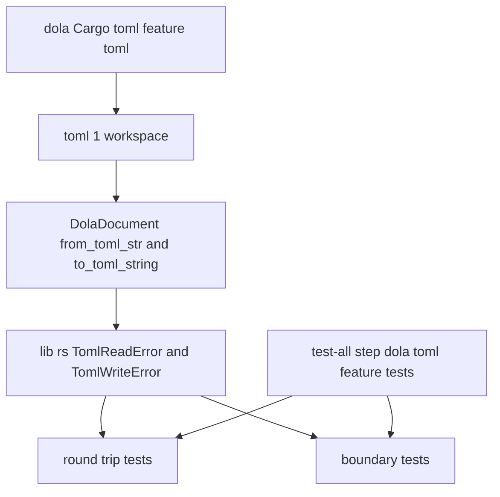

# 設計: dola-yaml-backend

## Overview

**目的**: crates.io に公開しているクレート `dola` の任意の機能 `yaml` を任意の依存 `serde_yaml` ごと外し、保守されていない `unsafe-libyaml` を依存の木から無くして、`deny.toml` の仮の見逃し（`RUSTSEC-2024-0449`）を消す。代わりに `dola` の書式の機能を TOML の 1 つ（機能 `toml`・ワークスペースの `toml` 1）にし、その機能の下で `DolaDocument` を TOML で読み書きする入口を `dola` 自身が持つ。

**使う人**: 完了の全体テストと `/release` の手元の確かめを回す areka の開発者（依存の監査が見逃しなしで緑になる）と、crates.io の `dola` の利用者（`features = ["toml"]` だけで TOML の定義を読み書きできる）。

**変わること**: `crates/dola/Cargo.toml` の任意の依存と機能が `serde_yaml`／`yaml` から `toml`／`toml` に替わる。`DolaDocument` に TOML の読み書きの関数が 2 つ足される（足すだけ）。全体テスト `tools/test-all.ps1` に機能 `toml` を有効にした `dola` のテストの段が 1 つ増える。`Cargo.lock` から 3 項目（`serde_yaml`・`unsafe-libyaml`・`ryu`）が消え、増えるクレートは 0。

### Goals

- どの機能を有効にしても `dola` の依存の木に `unsafe-libyaml`・`serde_yaml` が無く、見逃しを消した `cargo deny check` が終了コード 0 になる（実測済み・下の「実測の結果」）。
- 機能 `toml` の下で `DolaDocument::from_toml_str`・`DolaDocument::to_toml_string` を持ち、完全な文書が TOML で等しく往復し、書き出しが毎回 1 バイトも違わない（実測済み）。
- 機能 `toml` のテスト（往復と NaN／無限大の境界）が全体テストで毎回回る。
- README・steering・テストの先頭の説明・roadmap の申し送りが直しの後の形と合う。

### Non-Goals

- JSON の直列化の振る舞い・機能 `json` を戻すこと（`serde_json` は開発専用の依存のまま）。
- YAML を別のクレートで残すこと。
- `dola` の型の形・validate の規則・`dola` のほかのモジュールを変えること。
- `deny.toml` のほかの行（`[graph] all-features = true` など）を変えること。
- `dola` の公開の手順と版の番号の上げ方（`/release` が決める）。
- docs.rs で機能 `toml` の関数を見せる設定（`[package.metadata.docs.rs]`）。要件に無いので足さない（README が関数の名前を書く）。

## Boundary Commitments

### This Spec Owns

- `dola` の書式の機能の旗: 任意の機能は `toml` の 1 つだけ・既定の機能は無い（`crates/dola/Cargo.toml`）。
- 機能 `toml` の下の TOML の読み書きの入口 2 つと、その誤りの型の名前 2 つ（`TomlReadError`・`TomlWriteError`）。
- `dola` のテストのうち TOML の往復・TOML の読み書きの失敗・TOML の NaN／無限大の境界のテストと、テストの束の先頭の説明 3 か所。
- 全体テストの段 `dola toml feature tests`（`tools/test-all.ps1`）と、その段の説明（スクリプトの `.DESCRIPTION`・`tech.md` の Testing・`kiro-complete` の段の一覧の 1 語）。
- `deny.toml` の `RUSTSEC-2024-0449` の 1 項目（説明のコメント 3 行を含む）の削除。
- `crates/dola/README.md` の書式の 2 行・steering の dola の記述 4 か所・roadmap「次のリリースへの申し送り」の dola の 1 項目。
- `Cargo.lock` と `THIRD-PARTY-NOTICES.md` の追随（道具が作る物・手で直さない）。

### Out of Boundary

- `dola` の公開の型（`DolaDocument`・`DynamicValue`・`TransitionValue` ほか）の serde の形と、JSON での往復。
- validate の数値の規則（`crates/dola/src/validate/rules.rs`）。Object の値（`DynamicValue`）の中の数を数値の規則に入れるかどうかは、この spec では決めない（下の「NaN と無限大の扱い」）。
- `crates/dola/src` の書式の例のコメント（`compile/mod.rs` 72 行目・`value.rs` 7・8 行目）。
- `deny.toml` のほかの行、ほかのクレート、`/release` の手順書と `doc/crates-io-publish.md`。
- 見どころの本文（次の `/release` が申し送りを読んで書く）。

### Allowed Dependencies

- 外の依存は `toml` 1 だけ（根の `Cargo.toml` の `[workspace.dependencies]` の `toml = "1"`・`Cargo.lock` に既に在る 1.1.6・既定の機能のまま）。`dola` の `Cargo.toml` は `workspace = true` で引き、版を直書きしない。
- 入口の中で使うのは `toml::from_str`・`toml::to_string_pretty`・`toml::de::Error`・`toml::ser::Error` だけ。
- 向きは `toml` → `crates/dola/src/document.rs`（入口）→ `crates/dola/src/lib.rs`（誤りの型の名前の公開）→ テスト。`dola` のほかのモジュールは `toml` を使わない。

### Revalidation Triggers

- ワークスペースの `toml` の大きな版上げ（1 → 2）: `TomlReadError`・`TomlWriteError` の正体が変わる＝`dola` の公開の形が変わる。版上げの PR は往復のテストと境界のテストを通し、申し送りに書く。
- `dola` の型の serde の形の変更（`#[serde(untagged)]`・`skip_serializing_if` など）: TOML の往復のテストが守る範囲が動く。
- validate の数値の規則の変更（とくに `DynamicValue` を規則に入れる直し）: 境界のテストの Object の値の確かめを書き直す。
- 全体テストの段の名前・並びの変更: `kiro-complete` と `tech.md` の段の一覧も直す。

## Architecture

### Existing Architecture Analysis

- `dola` は型を serde の導出だけで持ち、`crates/dola/src` には書式のクレートを呼ぶコードが無い（`serde_yaml` の語も `cfg(feature = "yaml")` も `src` に 0 件）。機能 `yaml` が足していたのは依存 1 つだけで、使い手はテスト 1 本だけだった。
- 2026-11-13 の `audit-dola`（#440）が機能 `json`・`toml` と既定の機能を消し、`serde_json` を `[dev-dependencies]` へ移した（まだ公開していない）。機能を外す形の先例はこれと 0.0.2 の `runtime`。
- 全体テスト `tools/test-all.ps1` は任意の機能を有効にしない（`cargo test --workspace` だけ）。ワークスペースで `dola` の任意の機能を有効にするクレートは 0 本なので、機能の下のテストは今まで一度も回っていなかった。

### Architecture Pattern & Boundary Map



- 形: 機能の旗の下に、文書の型の関数を 2 つ足すだけ。新しいモジュールも新しい型も作らない。
- 既存の形を保つ: serde の導出の型はそのまま・JSON の扱い（開発専用の依存）はそのまま・validate は読み込みの入口と別（JSON のときと同じく、読んだ後に利用者が `validate()` を呼ぶ）。
- steering との合い方: 外の依存は既にワークスペースに在る物だけ（`tech.md`「意図的依存追加」に当たる新しいクレートは 0）。ログ無しの失敗の禁止は、ライブラリの入口が `Result` で理由を返す形で守る（`dola` は記録の仕組みを持たない）。

### Technology Stack

| 層 | 選んだ物・版 | この spec での役目 | メモ |
|---|---|---|---|
| ライブラリ（dola） | `toml` 1（`Cargo.lock` の 1.1.6・既定の機能 `std`・`serde`・`parse`・`display`） | TOML の読み書き | 任意の依存。`areka-sylphya`・`ukadoc-survey` が既に引く同じ版。引く木＝`serde_spanned`・`toml_datetime`・`toml_parser`・`toml_writer`・`winnow`（全部 `Cargo.lock` に在る） |
| 道具 | PowerShell 7（`tools/test-all.ps1`）・`cargo test` | 機能 `toml` のテストを毎回回す段 | 既存の `Step` 関数を使う |
| 監査 | `cargo deny` 0.20.2・`cargo about` | 見逃しなしの監査・謝辞の作り直し | 設定は `ignore` の 1 項目を消すだけ |

## File Structure Plan

### Modified Files

- `crates/dola/Cargo.toml` — `[dependencies.serde_yaml]`（3 行）を `[dependencies.toml]`（`workspace = true`・`optional = true`）に替え、`[features]` の `yaml = ["dep:serde_yaml"]` を `toml = ["dep:toml"]` に替える。既定の機能は足さない。
- `crates/dola/src/document.rs` — `#[cfg(feature = "toml")] impl DolaDocument` に `from_toml_str`・`to_toml_string` を足す（下の「TOML の入口」）。既存の構造体と `#[cfg(test)]` の部分は変えない。
- `crates/dola/src/lib.rs` — `#[cfg(feature = "toml")]` の下で `toml::de::Error` を `TomlReadError`、`toml::ser::Error` を `TomlWriteError` の名前で公開する 1 行を足す。ほかの `pub use` は変えない。
- `crates/dola/tests/general/integration_test/serialization_round_trip.rs` — 1 行目の説明を「JSON（開発専用の依存 `serde_json`）と TOML（機能 `toml`）」に直し、`#[cfg(feature = "yaml")] mod yaml_integration_tests` を消して、`#[cfg(feature = "toml")] mod toml_integration_tests` を足す（往復・2 回の書き出しの一致・読み書きの失敗）。JSON の 3 本は変えない。
- `crates/dola/tests/general/integration_test/mod.rs` — 1 行目「JSON/TOML/YAML round-trip」を、JSON は開発専用・TOML は機能 `toml` と分かる説明に直す。
- `crates/dola/tests/compile/boundary_test.rs` — 3 行目「外部入力（JSON/TOML/YAML）」を「外部入力（JSON・機能 `toml` の TOML）」に直し、260〜262 行目の注記を TOML が入口になる書き方に直し、`#[cfg(feature = "toml")]` の境界のテストを足す（下の「NaN と無限大の扱い」）。
- `crates/dola/README.md` — 13・17 行目から YAML を消し、機能 `toml` で TOML の読み書き（`DolaDocument::from_toml_str`・`to_toml_string`）ができること、ほかの書式は serde の導出で利用者が選んだクレートで扱えることを書く（英文のまま）。
- `deny.toml` — 43〜46 行目（説明のコメント 3 行と `RUSTSEC-2024-0449` の項目）だけを消す。41 行目の決まりのコメントと `ignore = [` `]` は残す。
- `tools/test-all.ps1` — `x64 workspace tests` の段の直後に `Step 'dola toml feature tests' { cargo test -p dola --features toml --no-fail-fast -j 4 }` を足し、`.DESCRIPTION` の段の一覧に 1 行足して番号を振り直す（7 行目の「`cargo test` を回す段（5・6）」は「5・7」に直し、新しい 6 は取り寄せが赤でも回ることを書き足す）。
- `.claude/skills/kiro-complete/SKILL.md` — 433 行目の段の一覧の `x64 workspace tests` の後に `dola toml feature tests` を 1 つ足す（全体テストの手順の説明・要件 3.3 が許す範囲）。
- `.kiro/steering/tech.md` — 32 行目の `toml` の行の dola の文を「`dola` の任意の機能 `toml` も同じ 1 を使う」に直す。「dola クレート依存」の `serde_yaml` の行を `toml` の行（1・機能 `toml`・`DolaDocument` の TOML の読み書きの入口・既定の機能は無い・`serde_json` は開発専用）に替える。「フルテスト」の節に段 `dola toml feature tests` の 1 項目を足し、85 行目の「取り寄せが失敗したら `cargo test` を回す段を飛ばす」の文に、この段は検体を使わないので取り寄せが赤でも回ることを書き足す。
- `.kiro/steering/product.md` — 38 行目「宣言的アニメーション定義フォーマット（JSON/TOML/YAML）」の書式の列挙を、書式の機能は `toml` だけ（ほかは serde の導出で利用者が選ぶ）の形に直す。
- `.kiro/steering/structure.md` — 262 行目「`serde` + feature flags (`json`, `toml`, `yaml`)」を「`serde` ＋任意の機能 `toml`（`toml`）」の形に直す。
- `.kiro/steering/roadmap.md` — 207 行目の「`v0.1.0` の後・`audit-dola`」の項目を、`audit-dola` とこの spec の分を合わせた 1 項目に書き直す（下の「申し送りの項目」）。

### Generated Files（手で直さない）

- `Cargo.lock` — `cargo` が直す。`dola` の依存の行の `serde_yaml` が `toml` に替わり、`ryu`・`serde_yaml`・`unsafe-libyaml` の 3 項目が消える（実測の差分は 1 行足し 26 行消し）。
- `THIRD-PARTY-NOTICES.md` — 全体テストの `-License` の段の `cargo about generate --workspace about.hbs -o THIRD-PARTY-NOTICES.md` で作り直す。`cargo about` は任意の機能を有効にせず、`toml` 1 の系統は既に謝辞に在る（`areka-sylphya` が引く）ので、差分 0 の見込み。差分が出たらその物をそのままコミットする。

## Components and Interfaces

| 部品 | 層 | 役目 | 要件 | 頼る物 | 契約 |
|---|---|---|---|---|---|
| 機能の旗 | `crates/dola/Cargo.toml` | 任意の機能を `toml` の 1 つにする | 1.1, 2.1 | `toml` 1（P0） | — |
| TOML の入口 | `crates/dola/src/document.rs`・`lib.rs` | `DolaDocument` の TOML の読み書き | 2.2, 2.3, 3.1 | `toml` 1（P0） | Service |
| 往復のテスト | `serialization_round_trip.rs`・`integration_test/mod.rs` | 往復・決まった書き出し・失敗の誤り・JSON の 3 本 | 2.3, 2.4, 2.5, 2.7, 2.8, 3.2 | TOML の入口（P0） | — |
| 境界のテスト | `crates/dola/tests/compile/boundary_test.rs` | TOML の NaN／無限大の入口の確かめと注記 | 2.8, 4.1, 4.2, 4.3 | TOML の入口・validate（P0） | — |
| 全体テストの段 | `tools/test-all.ps1` ほか段の一覧 | 機能 `toml` のテストを毎回回す | 2.6, 7.1 | `cargo test`（P0） | Batch |
| 監査の設定 | `deny.toml` | 見逃しの 1 項目を消す | 1.2, 1.3, 1.4, 1.5 | `cargo deny`（P0） | — |
| 説明と生成物 | README・steering・`Cargo.lock`・謝辞 | 直しの後の形に合わせる | 5.1〜5.5 | — | — |
| 申し送りの項目 | `.kiro/steering/roadmap.md` | crates.io の利用者への正味の差を 1 項目に | 6.1〜6.6 | — | — |

### dola ライブラリ

#### TOML の入口

| 欄 | 中身 |
|---|---|
| 役目 | 機能 `toml` の下で、`DolaDocument` を TOML の文字列から読み、TOML の文字列へ書く |
| 要件 | 2.2, 2.3, 3.1 |

**責任と決まり**

- 読む入口は TOML を `DolaDocument` に読むだけで、validate は呼ばない（JSON を serde で読むときと同じ。数値の規則は利用者が `validate()` で、または `compile_storyboard` が当てる）。
- 書く入口は `toml::to_string_pretty` で書く（人が読み書きする定義のため・配列は 1 要素 1 行）。鍵の順は `BTreeMap` が決めるので、同じ文書は毎回同じバイト列になる。
- どちらも panic せず、失敗は `Err` で返す。TOML の形の誤り・欄の欠け・型の食い違いは `TomlReadError`、TOML で書けない値（`DynamicValue::Null`＝TOML に null が無い）は `TomlWriteError`。
- 既存の公開の型・関数・トレイトの形は変えない（関数 2 つと名前 2 つを足すだけ・どれも機能 `toml` の下）。

**頼る物**

- 外: `toml` 1 — 読み書きと誤りの型（P0）。
- 内へ: 利用者のコードとこの spec のテスト。

**契約**: Service [x]

##### Service Interface

```rust
// crates/dola/src/lib.rs
#[cfg(feature = "toml")]
pub use toml::{de::Error as TomlReadError, ser::Error as TomlWriteError};

// crates/dola/src/document.rs
#[cfg(feature = "toml")]
impl DolaDocument {
    /// TOML の文字列から読む（validate はしない）
    pub fn from_toml_str(s: &str) -> Result<DolaDocument, TomlReadError>;
    /// TOML の文字列へ書く（`toml::to_string_pretty`）
    pub fn to_toml_string(&self) -> Result<String, TomlWriteError>;
}
```

- 前提: 機能 `toml` が有効。
- 後の状態: `from_toml_str(&doc.to_toml_string()?)? == doc`（`DynamicValue::Null` を含まない文書）。読んだ文書は validate を通っているとは限らない。
- 決まり: 誤りの型は `toml` 自身の型をそのまま返し、`dola` の中で名前だけを付けて公開する。`Display` が行と桁と理由を持つ（実測: `TOML parse error at line 1, column 18 … string values must be quoted`・`missing field `schema_version``・`UnsupportedType(Some("unit"))`）。利用者は `toml` を自分の依存に書かずに、この 2 つの名前で誤りを受けて持てる。

**Implementation Notes**

- 名前の決め: `DolaError` に枝を足す形は採らない（`DolaError` は `#[non_exhaustive]` でない公開の enum で、枝を足すと網羅の `match` を書いた利用者が壊れる＝要件 3.1 に反する。機能の有無で枝の数が変わるのもよくない）。自前の包む型も作らない（`toml` の誤りが既に理由を持ち、包んでも足すものが無い）。
- 危うさ: 誤りの型の正体が `toml` 1 の型なので、ワークスペースの `toml` を 2 に上げると `dola` の公開の形が変わる（Revalidation Triggers）。`dola` は 0.x で、版上げは申し送りに書く。

### テスト

往復のテストと境界のテストは新しい境界を作らないので、要約の行と下の「Testing Strategy」で足りる。どちらも `#[cfg(feature = "toml")]` の `mod` に入れ、既定のビルド（`cargo test --workspace`）では作られない。

### 道具

#### 全体テストの段

| 欄 | 中身 |
|---|---|
| 役目 | 全体テストで、機能 `toml` を有効にした `dola` のテストを毎回回し、合否を一覧に入れる |
| 要件 | 2.6, 7.1 |

**契約**: Batch [x]

##### Batch / Job Contract

- 起動: `tools/test-all.ps1` の毎回の走り（引数に関係なく）。`x64 workspace tests` の段の直後に、既存の `Step` 関数で `cargo test -p dola --features toml --no-fail-fast -j 4` を回す。段の名前は `dola toml feature tests`。
- 入力: 無し（検体を使わない・ネットを使わない）。そのため検体の取り寄せが赤でも飛ばさない（`TestStep` でなく `Step` を使う）。
- 出力: 段の終了コードが末尾の一覧に `OK`／`FAIL` で載り、赤なら全体テストの終了コードが 1 になる。
- 再実行: 何度回しても同じ（`target\` の `dola` の成果物は機能の組ごとに別に持たれ、既定の機能のビルドを壊さない）。

**Implementation Notes**

- 選んだ理由: 全体テストは任意の機能を有効にしないので、機能の下のテストを回すには機能を名指しする段が要る。ほかの道（`dola` の `[dev-dependencies]` に自分自身を機能 `toml` つきで書く・機能の下のテストを `cfg` 無しで書く）は、ワークスペースのテストのビルドの全部で `dola` の機能が変わる、または入口のテストにならないので採らない。
- かかる時間: 実測で `cargo test -p dola --features toml` は依存がビルド済みのとき約 16 秒（`dola` 本体と 8 本のテストの束を作り直す）。`dola` の 604 本と境界の追加分が回る。
- 並走: C19 のほかの spec は `tools/test-all.ps1` を回すだけで直さない。`kiro-complete` の段の一覧は全体テストの説明として同じ直しに入れる。

### 設定と文書

#### 監査の設定（`deny.toml`）

- 43〜46 行目だけを消す。消した後の `cargo deny check` は終了コード 0（実測・`advisories ok, bans ok, licenses ok, sources ok`。残る警告は `async-executor` の yanked と重複の版で、どちらも `warn`＝終了コードに響かない）。
- 新しい見逃しの指定・機能の除外・クレートの除外は足さない（1.4）。
- 着地までに別の勧告で赤になったら、見逃しで黙らせず、勧告の番号と引いているクレートを報告に残して開発者の判断を仰ぐ（1.5・作業の決まり）。

#### 申し送りの項目（`roadmap.md`）

- 207 行目の `audit-dola` の項目を、公開済みの最新の版（書く時点で `v0.1.0`・書く前に `product.md` の公開済みの版で確かめる）と比べた正味の差の 1 項目に書き直す。頭は「`v0.1.0` の後」（6.5）。
- 中身（6.2〜6.4）: ⑴ 機能 `json`（既定で有効だった）と既定の機能が無くなった＝壊れる変更 ⑵ 機能 `yaml` と任意の依存 `serde_yaml` が消えた＝壊れる変更・`Cargo.toml` の機能の指定を消せば直る ⑶ 機能 `toml` は続けて指定できる・引く `toml` の版が 0.8 から 1 に上がった・機能 `toml` の下で `DolaDocument::from_toml_str`／`to_toml_string`（誤りは `TomlReadError`／`TomlWriteError`）を持つ＝利用者は自分で `toml` を依存に書かなくてよい。
- 「機能 `yaml` の行き先は `dola-yaml-backend` が決める」の文を消し、決まった結果だけを書く（6.6）。同じ話の項目を 2 つ並べない（6.1）。

## NaN と無限大の扱い

TOML は `nan`・`inf`・`-inf`（と `+nan`・`-nan`・`+inf`）を書ける。`toml` 1 で読むと、どれも f64 の値として読めて、読み込みでは断られない（実測）。そのため数値の欄の入口は validate の数値の規則が守る。

| 欄の種類 | 欄（実測した物） | 読み込み | validate |
|---|---|---|---|
| 型の決まった `f64` | 変数の `initial`・`max`・遷移の `delay`・`duration`・ストーリーボードの `time_scale` | 読める | `InvalidNumber` で拒む |
| `#[serde(untagged)]` の値 | 遷移の `to`（`TransitionValue::Scalar`）・ストーリーボードの中の遷移の `to`・`loop_offset`（`LoopOffset::Scalar`）・`at` の `offset`（`KeyframeRef::WithOffset`）・ベジェの点（`EasingFunction::Parametric`） | 読める | `InvalidNumber` で拒む |
| Object の値（`DynamicValue::Float`） | `type = "object"` の変数の `initial`・遷移の `to` の表や配列の中の数 | 読める | 通る（数値の規則の外） |

- 要件 4.2・4.3 の「数値の欄」は、上の 1 段目と 2 段目（compile と実行の時刻と補間に使う数）と読む。境界のテストはこの 2 段の欄で、3 つの値のそれぞれを確かめる。
- 3 段目の Object の値は、補間しない中身として運ぶ値で、数値の規則の外（`DynamicValue` の等しさとハッシュは NaN を 1 つの値として扱う作り）。実測で、読めて validate を通り、`compile_storyboard` も panic せず通る。境界のテストは「panic しない」ことだけを 1 本で確かめ、注記にこの扱いを書く。数値の規則に入れるかどうかは validate の直しになり、この spec の範囲の外（Out of Boundary・設計の討議で開発者に確かめる候補）。
- 書く入口は f64 の NaN・無限大を `nan`・`inf` で書き、読み戻すと同じ値になる（実測）。validate を通らない文書でも書けるのは JSON の serde と同じで、入口は validate をしない。

## Requirements Traceability

| 要件 | 要約 | 部品 | 契約・確かめ |
|---|---|---|---|
| 1.1 | 依存の木に `unsafe-libyaml`・`serde_yaml` が無い | 機能の旗・`Cargo.lock` | `cargo tree --workspace --all-features` に 0 件 |
| 1.2 | `ignore` から `RUSTSEC-2024-0449` とコメントを消す | 監査の設定 | `deny.toml` の差分が 43〜46 行目だけ |
| 1.3 | 見逃し無しで `cargo deny check` が 0 | 監査の設定 | 実測で終了コード 0・全体テストの `-License` の段 |
| 1.4 | ほかの行を変えず新しい見逃しを足さない | 監査の設定 | 同上の差分 |
| 1.5 | 別の勧告で赤なら黙らせず報告 | 監査の設定 | 作業の決まり（実装と完了の報告） |
| 2.1 | 任意の機能は `toml` だけ・既定の機能は無い | 機能の旗 | `crates/dola/Cargo.toml` の `[features]` |
| 2.2 | 機能 `toml` の下の読み書きの入口 | TOML の入口 | `from_toml_str`・`to_toml_string`・`TomlReadError`・`TomlWriteError` |
| 2.3 | 失敗は panic せず理由つきの誤り | TOML の入口・往復のテスト | 形の誤り・欄の欠け・Null の書き出しの 3 つ |
| 2.4 | 完全な文書が等しく往復 | 往復のテスト | `complete_document_toml_roundtrip`（実測で緑） |
| 2.5 | 2 回の書き出しが 1 バイトも違わない | 往復のテスト | 2 回の `to_toml_string` の一致（実測で緑） |
| 2.6 | 機能 `toml` のテストが全体テストで毎回回る | 全体テストの段 | `dola toml feature tests` |
| 2.7 | YAML のテストと見出しが無い | 往復のテスト | `yaml_integration_tests` の削除 |
| 2.8 | テストの先頭の説明 3 か所 | 往復のテスト・境界のテスト | 1 行目・1 行目・3 行目の文 |
| 3.1 | 既存の公開の形を変えない（足すだけ） | TOML の入口 | 関数 2 つと名前 2 つだけを機能の下に足す |
| 3.2 | JSON の往復のテストが同じ本数で緑 | 往復のテスト | `json_integration_tests` の 3 本を変えない |
| 3.3 | `crates/dola/` の外は許された物だけ | File Structure Plan | 変えるファイルの一覧 |
| 4.1 | 注記を TOML が入口になる書き方に | 境界のテスト | 260〜262 行目の注記 |
| 4.2 | TOML の `nan`・`inf`・`-inf` は断られるか拒まれ、panic しない | 境界のテスト | 数値の欄で validate が `InvalidNumber` |
| 4.3 | 型の決まった欄と untagged の欄のそれぞれで | 境界のテスト | 「NaN と無限大の扱い」の表の 1・2 段 |
| 5.1 | README に YAML を挙げず機能 `toml` を書く | 説明と生成物 | `crates/dola/README.md` 13・17 行目 |
| 5.2 | `tech.md` の dola の依存に `toml` の行 | 説明と生成物 | 「dola クレート依存」 |
| 5.3 | `product.md`・`structure.md` の書式の機能は `toml` だけ | 説明と生成物 | 38 行目・262 行目 |
| 5.4 | `Cargo.lock` に `serde_yaml`・`unsafe-libyaml` が無い | 説明と生成物 | 実測の差分 |
| 5.5 | 謝辞は道具で作り直した物と同じ | 説明と生成物 | 全体テストの `-License` の段 |
| 6.1 | 申し送りは正味の差の 1 項目 | 申し送りの項目 | 207 行目の書き直し |
| 6.2 | 機能 `json` と既定の機能の削除を壊れる変更として | 申し送りの項目 | ⑴ |
| 6.3 | 機能 `yaml`・`serde_yaml` の削除と直し方 | 申し送りの項目 | ⑵ |
| 6.4 | 機能 `toml` の継続・0.8→1・入口 | 申し送りの項目 | ⑶ |
| 6.5 | 頭は「`v{版}` の後」 | 申し送りの項目 | 「`v0.1.0` の後」（書く前に確かめる） |
| 6.6 | 未決の書き方を含まない | 申し送りの項目 | 古い文の削除 |
| 7.1 | 完了の全体テストがライセンスの段込みで緑 | 全体テストの段・監査の設定 | `tools/test-all.ps1 -Format -License` |
| 7.2 | 触っていないクレートだけ赤なら 1 回だけ回し直す | 完了の手順 | `kiro-complete` の決まりどおり |

## Error Handling

- 読む入口: TOML の形の誤り・欄の欠け（`schema_version` は必須）・型の食い違い・untagged の腕のどれにも合わない値は `Err(TomlReadError)`。`Display` が行・桁・理由を持つ。
- 書く入口: TOML で表せない値（`DynamicValue::Null`）は `Err(TomlWriteError)`（実測 `UnsupportedType(Some("unit"))`）。TOML から読んだ文書は Null を持たないので、TOML で読んだ物を書き戻す道では起きない。
- 数値の規則を外れた値は読む入口では断らず、validate が `InvalidNumber` で拒む（上の表）。
- どの入口も panic しない（`unwrap` を使わない）。

## Testing Strategy

### 機能 `toml` の下のテスト（段 `dola toml feature tests` が毎回回す）

- `complete_document_toml_roundtrip`（2.4）: `build_complete_document()`（変数 3 種・名前つきとインラインの遷移・`TransitionValue` の Scalar と Dynamic・`at` と `between`・純粋なキーフレーム）を `to_toml_string` で書き、`from_toml_str` で読み戻して等しい。表の入れ子・表の配列（`[[storyboard.*.entry]]`）・`Option` の省略・untagged の腕を通る。実測で緑。
- `toml_output_is_identical_twice`（2.5）: 同じ文書の 2 回の書き出しが等しい。実測で緑。
- `toml_read_errors_carry_a_reason`（2.3）: `"schema_version = "`（形の誤り）と `""`（`schema_version` の欠け）が `Err` になり、誤りの文が空でなく、欠けの方は欄の名前を含む。
- `toml_write_of_null_is_an_error`（2.3）: `DynamicValue::Null` を持つ Object の変数の文書の書き出しが `Err` になる。
- 境界のテスト `toml_non_finite_numbers_are_rejected_by_validate`（4.2・4.3）: 型の決まった欄（変数の `initial`・遷移の `delay`・`time_scale`）と untagged の欄（遷移の `to`・`loop_offset`・`at` の `offset`）のそれぞれに `nan`・`inf`・`-inf` を入れた TOML を読み、読めて、validate が `InvalidNumber` でその欄を名指しして拒む。
- 境界のテスト `toml_non_finite_in_object_value_does_not_panic`（4.2）: Object の変数の `initial` と遷移の `to` の表の中に `nan`・`inf` を入れた TOML を読み、validate と `compile_storyboard` が panic せずに終わる（Object の値は数値の規則の外＝通る）。

### 既定のビルドのテスト（段 `x64 workspace tests`）

- `json_integration_tests` の 3 本（3.2）: 変えずに緑のまま。
- `json_rejects_nan_literal_at_deserialization_boundary`: 注記だけを直し、確かめの中身は変えない。

### 静的な確かめ（実装と完了のとき）

- `cargo tree --workspace --all-features` の出力に `unsafe-libyaml`・`serde_yaml` が 0 件（1.1）。`cargo tree -p dola --features toml -e normal` で新しいクレートが 0（実測済み）。
- `crates/dola` の下で `yaml` の語を grep して、テストと README と `Cargo.toml` に 0 件（2.7・5.1）。
- `cargo deny check` の終了コード 0（1.3）と、`tools/test-all.ps1 -Format -License` の全部の段の緑と謝辞の差分 0（5.5・7.1）。

## 実測の結果（2026-11-13・作業枝 `cd8a0763` の上・測った後に元へ戻した）

- 機能 `toml`（`toml` 1.1.6）と上の入口を仮に足し、`cargo test -p dola --features toml` を回した。往復と 2 回の書き出しの一致は緑。`dola` の全部のテスト（単体 219・compile 58・cue 58・general 62・runtime 119・trigger 44・validation 44）も緑。
- 書き出しの形: 表の入れ子（`[variable.bg_image.initial]`）・表の配列（`[[storyboard.greeting.entry]]`）・`at = "visible"`・`easing = "quadratic_in_out"`・`initial = 0`（i64）と `initial = 0.0`（f64）。`DynamicValue` の整数と小数の区別も往復で保たれる。
- NaN と無限大: 上の表のとおり（12 の欄 × 6 つの書き方〔`nan`・`inf`・`-inf`・`+nan`・`-nan`・`+inf`〕＝72 通り。読み込みで断られた物は 0。数値の欄の 60 通りは全部 validate が `InvalidNumber` で拒み、Object の値の 12 通りは validate を通る）。
- `Cargo.lock` の差分: `dola` の依存の `serde_yaml` → `toml`、`ryu`・`serde_yaml`・`unsafe-libyaml` の削除。増える項目 0。
- `deny.toml` の 43〜46 行目を消した `cargo deny check`: 終了コード 0。
