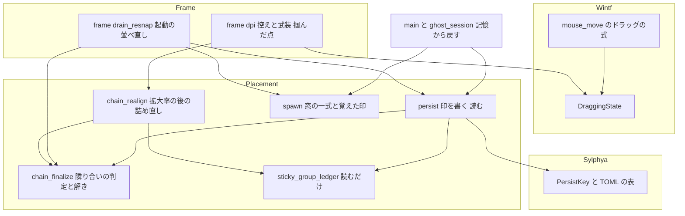
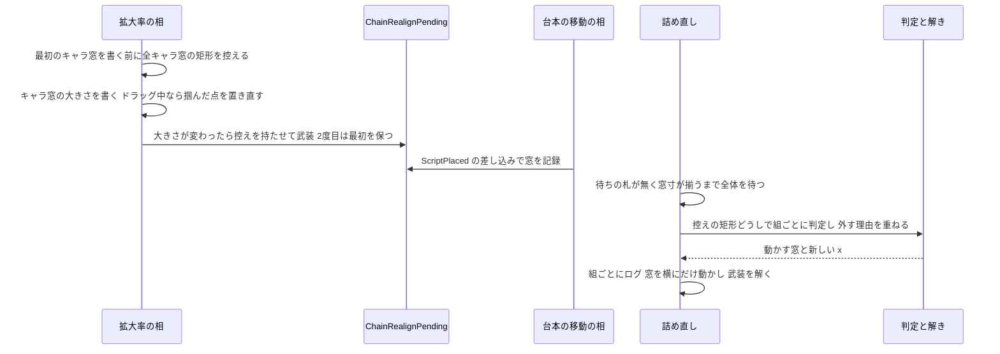
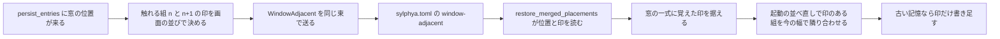

# 設計書: dpi-realign-remembered-chain

## Overview

**目的**: 拡大率が変わったあとの「詰め直し」の対象を、位置がどこから来たか（既定の位置のままか・記憶から戻したか）でなく、**変わる直前に隣り合っていたか**で決め直す。あわせて、拡大率の違う画面をまたぐドラッグで掴んだ点が落とした点に来るようにし、起動し直しても隣り合わせたままにするため、記憶に**隣り合いの印**を足す。

**利用者**: areka の利用者（拡大率を変える・拡大率の違う画面へキャラクターを運ぶ）と、ぱすた（「窓際のぱすたさん」）のように窓を重ねて組にするゴーストの作者。

**変わること**: 今の詰め直しは起動の並べ直しの判定 `finalize_chain` を流用し、記憶から戻したスコープを必ず外す。完了 spec `areka-P0-char-position-save-on-exit` の着地で 2 回目の起動から全員が記憶から戻るので、誰も詰め直されなくなった（後退）。この設計は、変わる直前のキャラ窓の矩形を武装のときに控え、その矩形どうしの隣り合いで組ごとに決める。決め方の核（隣り合いの判定と、本体から順に詰める解き）は 1 つの純関数にまとめ、拡大率の後の詰め直し・起動の並べ直し（記憶から戻した組）・記憶に書く印の 3 か所が同じものを使う。

### Goals

- 拡大率の 1 回の変化につき 1 回、変わる直前に隣り合っていた組を、記憶やドラッグの有無にかかわらず隣り合わせに戻す（要件 1）。
- 離れていた組・重なっていた組・一緒に動く組の窓・ドラッグの最中の窓・変わった後に台本が置き直した窓は動かさない（要件 2・3）。
- 拡大率の違う画面をまたぐドラッグで、掴んだ点を窓の大きさの比で合わせる（要件 4）。
- 詰め直した位置は記憶に書かず、記憶に隣り合いの印を足して、起動・読み直し・切り替えのあとも隣り合わせて立たせる（要件 5・6）。
- 組ごとの判断をログに残し、改めた決め方を `doc/COMPAT_ARCHITECTURE.md` §8 に残す（要件 7）。決定論のテストで固める（要件 8）。

### Non-Goals

- 記憶に位置が無いキャラクターを本体の隣へ並べる起動の並べ直しの決まり（完了 spec `areka-P0-scope-chain-gap`）は変えない。
- 詰め直した位置・起動で隣り合わせた位置を作業領域の中へ寄せること（`window-work-area-clamp` の持ち分）。
- 拡大率の切り替えの途中の見え方（`dpi-transition-two-tick-bounce`）・倍率の変わりの合図 `OnShellScaling` を送るか（`shell-scale-linkage`）。
- 表情の差し替えで絵の大きさが変わったときに横へ動かさない約束は変えない。
- 記憶の版（`format-version`）は上げない。

## Boundary Commitments

### This Spec Owns

- **隣り合いの判定と詰めの解き**: 2 つのキャラ窓の矩形から「左に隣り合う・右に隣り合う・離れている・重なっている」を決める規則と許す幅（`ADJACENT_TOLERANCE_PX`）、組ごとの決め（`PairDecision`）から動かす窓と新しい x を出す解き（`resolve_chain`）。
- **拡大率の後の詰め直しの対象の決め方**: 変わる直前の矩形の控え（`ChainRealignPending.before`）、武装の後に台本が置いた窓の記録（`ChainRealignPending.script_moved`）、組ごとの外す理由（組・ドラッグの最中・台本・控えに無い）。
- **起動の並べ直しのうち、記憶から戻した組の隣り合わせ**（要件 6.3〜6.5）。記憶に位置が無い組の並べ方は今のまま。
- **隣り合いの印**（記憶の新しい鍵 `PersistKey::WindowAdjacent`・TOML の表 `[window-adjacent]`・値 `left`／`right`／`none`）の意味と、書く中身（いつ書くかは今ある 4 つの時機のまま）。
- **ドラッグの掴んだ点の合わせ**: ドラッグ中のキャラ窓の大きさが拡大率で変わったときに、ドラッグの始めの値（`DraggingState`）を掴んだ点の比で置き直すこと。wintf のドラッグの位置の式がその値を読むこと。
- 組ごとの判断のログ（要件 7.1・7.2）と、`doc/COMPAT_ARCHITECTURE.md` §8 の表の末尾への 2 行（要件 7.3）、処理の説明の書き直し（要件 7.4）。

### Out of Boundary

- `placement/transition_judge.rs`・`placement/follow/window_move.rs`・`placement/{config,measure}.rs`・`placement/follow/drag_follow.rs`・`emo2_boot` の結線の列（`mod.rs`・`ghost_switch.rs`・`frame/{attach,switch,wiring}.rs`）には触れない。
- `emo2_boot/frame/drain_resnap.rs` の `run_move_drain_phase` と `PositionCue`／`MoveCueSink` には触れない（`descript-window-keys` が腕を 2 つ足す）。`emo2_boot/frame.rs` の呼び順（`run_move_drain_phase` → `finalize_chain_once` → `realign_chain_once`）は変えない（frame.rs で触るのはテストの接続宣言だけ）。
- wintf の `ecs/drag/dispatch.rs`・`drag/mod.rs`・`drag/state/mod.rs`・`drag/context.rs` は変えない（`DraggingState` の欄は今のまま使う）。
- 記憶に書く時機・記憶から戻した位置を作業領域へ寄せる規則・詰め直した位置の作業領域への寄せ。
- sylphya の書かない形への差し替えの口（`readonly-mode` の持ち物）と `format-version`。
- `placement/mod.rs` には新しいモジュールを足さない（新しい純関数は `chain_finalize.rs` に置く）。

### Allowed Dependencies

- 依存の向き: `areka-sylphya`（記憶の形）← `wintf`（`DraggingState`・`WindowPos`）← `areka::placement`（`chain_finalize` の純関数 ← `chain_realign`・`persist`・`spawn`）← `areka::emo2_boot::frame`（`dpi`・`drain_resnap`）← `ghost_session`・`main`。上向きの参照は作らない。
- 唯一の例外: 印 `ScriptPlaced`（`chain_finalize.rs`）の差し込みの知らせ（bevy の部品の差し込みの口 `on_insert`）が `chain_realign` の受け口 1 つを指す。印の定義が知らせの行き先を名指しするだけで、`chain_finalize` の判定は `chain_realign` に依らない。
- 窓の組は `placement/sticky_group_ledger.rs` の `StickyGroupLedger::group_of` を読むだけ（書かない）。
- 新しい外部の依存（crate）は足さない。bevy_ecs 0.19 の部品の差し込みの口は `spawn.rs`（`on_remove`）ほかで使っている形をそのまま使う。

### Revalidation Triggers

- `ADJACENT_TOLERANCE_PX` の値・隣り合いの判定の規則を変えるとき（記憶の印の読みが変わる）。
- 隣り合いの印の鍵の名前（正準 `areka.window.scope(ID).adjacent`・TOML `[window-adjacent]`）や値の語を変えるとき（`readonly-mode`・`mcp-scope-rect-property`・`get_property` で読む側が確かめ直す）。
- 「組」を番号の続く 2 つ（n−1 と n）とする決めを変えるとき（`extra-character-windows`・`multi-ghost-runtime` が確かめ直す）。
- `window-work-area-clamp` が詰め直し・起動の隣り合わせの位置へ寄せを当てるとき（この spec の解きの後に寄せが入る）。
- `DraggingState` の意味（`initial_inset` がドラッグの始めの窓の左上である）を wintf が変えるとき。

## Architecture

### Existing Architecture Analysis

- **毎フレームの相の順**（`emo2_boot/frame.rs`）: 作業領域の同期 → 装着 → 拡大率の相（`run_dpi_phase`・ここで武装）→ 作業領域の再スナップ → 表示の指令 → 窓寸の報告の回収 → 再スナップ → 台本の移動（`run_move_drain_phase`）→ 起動の並べ直し（`finalize_chain_once`）→ 拡大率の後の詰め直し（`realign_chain_once`）→ 文字。この順は変えない。
- **武装と解決の 1 往復**（`chain_realign.rs`）: 拡大率の相でキャラ窓が大きさの変化を伴って書かれたとき武装し、待ちの札（`DpiSyncHold`）が無く全スコープの窓寸が実表示寸に揃った最初のフレームで 1 度だけ解く。往復の形と待ちの扱い（揃うまで全体を待ち、長く待てば 1 度だけ `warn!`）は保つ。
- **キャラ窓の位置の書き手は 1 つ**（`follow::window_move`）。ゴースト窓は `DpiSuggestedRectPolicy::ExternalAuthority` を持つので、`WM_DPICHANGED` の勧めの矩形は窓に書かれない＝拡大率の相が書く前の `WindowPos` は変わる直前の位置と大きさである。
- **台本の印** `ScriptPlaced` は `\![move]` の対象（`emo2_boot/move_cue_place.rs`）と連れ動いた組の相手（`placement/follow/sticky_follow.rs`）に付く。時刻を持たない。
- **記憶に書く 4 つの時機**（ドラッグの確定・組の相手の確定・起動の最後に並べ終えた時点・既定の位置への並べ直し）は、どれも `placement/persist.rs` の `persist_entries` を通る。窓の位置の書き手 `enqueue_window_set_pos` は `WindowPos` をその場で書き換えるので、`persist_entries` が呼ばれた時点の `WindowPos` は画面に出ている並びである。
- **記憶から戻す道は 1 本**（起動・読み直し・切り替えとも `ghost_session::open_ghost_windows` → `main.rs` の `restore_merged_placements`）。

### Architecture Pattern & Boundary Map



**Architecture Integration**:
- 選んだ形: 既存の「武装 → 一度きりの解決」の状態機械に、変わる直前の控えを持たせる拡張。判定は純関数 1 つ（`judge_adjacency`）と解き 1 つ（`resolve_chain`）に集め、3 か所の呼び手が組ごとの決め（`PairDecision`）を作って渡す。
- 境界の分け方: 純関数（判定・解き・印の語）は `chain_finalize.rs`、World を読む糊は呼び手の側（拡大率の後＝`chain_realign.rs`、起動＝`drain_resnap.rs`、記憶＝`persist.rs`）。
- 保つ形: 一度きりの往復・揃うまで待つ走査 `collect_chain_states`（起動と共有）・単一の窓の書き手・記憶の書き手 `persist_entries`・呼び順。
- 新しい部品の理由: 控え（拡大率の後の判定に要る）・印（起動し直しても隣り合いを見分けるのに要る）・掴んだ点の置き直し（件 9）。
- steering: ログ無しの失敗経路を作らない（取り出せない窓は `warn!`＋理由）・1 フレーム遅らせる解を取らない（控え・印・置き直しはどれも同じフレームの中で効く）・決定論のテスト必達・1 ファイル 1,000 行以下（新しいテストは兄弟の新しいファイル）。

### Technology Stack

| Layer | Choice / Version | Role in Feature | Notes |
|-------|------------------|-----------------|-------|
| ECS | bevy_ecs 0.19.1 | 資源 `ChainRealignPending`・部品の差し込みの口 `on_insert`（`ScriptPlaced`） | 新しい依存なし。差し込みの口は `spawn.rs` の `on_remove` と同じ書き方 |
| 窓・ドラッグ | wintf（ワークスペース内） | `DraggingState`・`WindowPos`・wndproc のドラッグの式 | `mouse_move.rs` だけを直す |
| 記憶 | areka-sylphya（ワークスペース内）・toml | 新しい鍵 `WindowAdjacent`・表 `[window-adjacent]` | `format-version` は 1 のまま |
| ログ | tracing | 組ごとの判断・取り出せない理由・書き足し | 既存の target `areka::persist::save` を使う |

## File Structure Plan

### Directory Structure

```
crates/areka/src/
├── placement/
│   ├── chain_finalize.rs                  # 純関数の核: ChainRect・判定・印の語・PairDecision・resolve_chain（finalize_chain はこの上に載せ直す）
│   ├── chain_finalize_adjacency_tests.rs  # 新: 判定・解き・印の語の決定論テスト
│   ├── chain_realign.rs                   # 拡大率の後の詰め直し: 控え・台本の記録・組ごとの決め・ログ
│   ├── persist.rs                         # 印を書く（persist_entries に足す）・古い記憶への書き足し・印を読む
│   ├── persist_adjacency_tests.rs         # 新: 印の書き足し・読み戻し・古い記憶の決定論テスト
│   ├── spawn.rs                           # ScopeWindows に覚えた印の欄
│   └── chain_realign_script_moved_tests.rs # 新: ScriptPlaced の差し込みの記録の決定論テスト
├── emo2_boot/
│   ├── frame.rs                           # 新しいテストの接続宣言だけ（呼び順は変えない）
│   ├── frame/dpi.rs                       # 控えと武装・掴んだ点の置き直し
│   ├── frame/drain_resnap.rs              # finalize_chain_once_with で記憶から戻した組の隣り合わせ（run_move_drain_phase は触らない）
│   ├── frame_chain_realign_adjacency_tests.rs  # 新: 拡大率の後の詰め直しの FrameHarness テスト
│   ├── frame_chain_realign_exclusion_tests.rs  # 新: 外す理由（組・ドラッグ・台本・控えに無い）の FrameHarness テスト
│   ├── frame_chain_finalize_remembered_tests.rs # 新: 起動・作り直しでの隣り合わせの FrameHarness テスト
│   └── frame_dpi_drag_grab_tests.rs       # 新: 掴んだ点の置き直しのテスト
├── alert.rs                               # 書けなかった記憶の知らせの語: WindowAdjacent を「窓の位置」へ
├── alert_memory_write_tests.rs            # 印の鍵が「窓の位置」の語になる行を足す
├── main.rs                                # restore_merged_placements が覚えた印も返す
├── main_restore_seam_tests.rs             # 戻り値の形の変更に合わせる
└── ghost_session.rs                       # 覚えた印を窓の一式へ据える
crates/areka-sylphya/src/persist/
├── mod.rs                                 # PersistKey::WindowAdjacent・正準の鍵・TOML の写し
├── format.rs                              # FormatDoc.window_adjacent・表 [window-adjacent] の読み書き
└── persist_window_adjacent_tests.rs       # 新: 鍵と表の往復・寛容な読み・古いファイル
crates/wintf/src/ecs/window_proc/
├── mouse_move.rs                          # ドラッグの式が DraggingState を読む
└── mouse_move_drag_origin_tests.rs        # 新: 式の決定論テスト
doc/COMPAT_ARCHITECTURE.md                 # §8 の表の末尾に 2 行
```

新しいテストのファイルは、それぞれの本番ファイルにパス属性つきの接続宣言を 1 つ足して繋ぐ（`chain_finalize_adjacency_tests.rs` は `chain_finalize.rs`・`chain_realign_script_moved_tests.rs` は `chain_realign.rs`・`persist_adjacency_tests.rs` は `persist.rs`・`frame_*` の 4 本は `emo2_boot/frame.rs`・`persist_window_adjacent_tests.rs` は `persist/mod.rs`・`mouse_move_drag_origin_tests.rs` は `mouse_move.rs`）。

### Modified Files

- `crates/areka/src/placement/chain_finalize.rs` — 純関数の核を足す（下の「隣り合いの判定と詰めの解き」）。`ScriptPlaced` に差し込みの口を付ける。`finalize_chain` は今の約束（入力・出力・事後条件）を変えずに `resolve_chain` の上へ載せ直す。冒頭の説明と `ScopeChainState::default_x` の説明から、拡大率の後の詰め直しが既定の位置で決めるという記述を外す（7.4）。
- `crates/areka/src/placement/chain_realign.rs` — `ChainRealignPending` に控えと台本の記録を持たせ、`arm_chain_realign` が控えを受け取る。解決で `finalize_chain` を使うのをやめ、組ごとの決めを作って `resolve_chain` へ渡し、組ごとにログを出す。冒頭の説明を書き直す（7.4）。
- `crates/areka/src/placement/persist.rs` — `persist_entries` が窓の位置の鍵を見て、触れる組の印を足す。`persist_unremembered_char_positions` が古い記憶の印だけを書き足す。印を読む関数と、記憶から戻したスコープと印の一覧を作る関数を足す。
- `crates/areka/src/placement/spawn.rs` — `ScopeWindows` に `remembered_adjacency: Option<AdjacencyMark>` を足し、読み書きの関数を足す（構造体の字面は `spawn.rs` と `spawn_cleanup_tests.rs` の 2 か所）。
- `crates/areka/src/emo2_boot/frame/dpi.rs` — 第 2 巡の最初のキャラ窓を書く前に控えを取り、武装へ渡す。`reconcile_window_size` のキャラ窓の腕で、大きさが変わりドラッグ中なら掴んだ点を置き直す。
- `crates/areka/src/emo2_boot/frame/drain_resnap.rs` — `finalize_chain_once_with` が記憶から戻したスコープに覚えた印から決めを作り、`resolve_chain` で解き、組ごとにログを出す。記憶から戻したスコープには既定の位置を付けない（今の「届かないはずの分かれ道」の `debug!` を正常の道の説明へ改める）。`run_move_drain_phase`・`collect_chain_states` の待ちの意味は変えない。
- `crates/areka/src/emo2_boot/frame.rs` — 新しいテストの接続宣言（`#[cfg(all(test, target_pointer_width = "64"))]` の形）だけ。
- `crates/areka/src/emo2_boot/frame_chain_realign_tests.rs` — `a_dragged_scope_stays_out_of_the_realign` を新しい決め方の意図に書き直す（下の Testing Strategy）。
- `crates/areka/src/emo2_boot/frame_chain_realign_arm_tests.rs`・`frame_chain_finalize_persist_*_tests.rs`・`placement/persist_entries_tests.rs`・`placement/persist_finalize_save_tests.rs` — 武装の関数の引数・送る鍵に印が加わることに合わせて直す（陳腐化した主張の更新）。
- `crates/areka/src/main.rs` — `restore_merged_placements` の 2 つ目の戻り値を `BTreeMap<usize, Option<AdjacencyMark>>`（鍵＝記憶に位置があるスコープ・値＝覚えた印）にする。集める処理は `persist.rs` の関数へ移し、`main.rs` の行数を増やさない。
- `crates/areka/src/alert.rs` — 書けなかった記憶の知らせの語を選ぶ `remembered_text` の `match` は `PersistKey` の全種を名指しし、残りの腕を持たない。`PersistKey::WindowAdjacent { .. }` を `WindowPos`・`BalloonOffset` と同じ「窓の位置」の腕へ足す（足さないとビルドが通らない）。兄弟のテスト `alert_memory_write_tests.rs` に、印の鍵だけが書けなかったときも「窓の位置」の語になる行を足す。`write_failure_sites_tests.rs` の 13 種の表は変わらない（印は位置と同じ束で送るので、書く口は増えない）。
- `crates/areka/src/ghost_session.rs` — 窓を作る閉包で、記憶から戻したスコープの既定の位置を外す今の処理に、覚えた印を窓の一式へ据える 1 行を足す。
- `crates/areka-sylphya/src/persist/mod.rs` — `PersistKey::WindowAdjacent { scope }`・正準の鍵・`apply_entry`・`doc_to_entries`・読み込みの順の説明。書かない形への差し替えの口には触れない。
- `crates/areka-sylphya/src/persist/format.rs` — `FormatDoc.window_adjacent`・表の読み書き・`is_all_absent`。`FORMAT_VERSION` は 1 のまま。
- `crates/wintf/src/ecs/window_proc/mouse_move.rs` — ドラッグ中の窓の位置の式が、ドラッグ対象の `DraggingState` があればその値を読み、無ければ今の控え（スレッドの持ち物）を読む。純関数に切り出して兄弟のテストを置く。
- `doc/COMPAT_ARCHITECTURE.md` — §8 の表の末尾に 2 行（要件 7.3）。

## System Flows

### 拡大率が変わったフレームの流れ



- 控えは「武装が起きる前の最初のキャラ窓の書き込み」の直前に 1 度だけ取る。待ちの札で窓ごとにフレームが割れても、まだ書かれていない窓の `WindowPos` は変わる前のままなので、最初の武装の控えがそのまま正しい（2 度目の武装は最初の控えを保つ・1.7）。
- 台本の移動の相は詰め直しより前に走るので、同じフレームの `\![move]` も記録に入る（3.1）。解いた後は武装が無いので記録もされず、上書きもしない（3.2）。

### 記憶の印を書いて読む流れ



- 印は「スコープ n の窓が、スコープ n−1 の窓に対して、書いた時点の画面でどう並んでいたか」。画面に出ている並び（`WindowPos`）で決めるので、拡大率の後に詰め直した（記憶には書かない）並びのまま利用者が隣をドラッグで動かしても、印はその時に見えていた並びを表す。

## Requirements Traceability

| Requirement | Summary | Components | Interfaces | Flows |
|-------------|---------|------------|------------|-------|
| 1.1 | 変わる直前に隣り合っていた組を記憶・ドラッグにかかわらず隣り合わせる | ChainRealign・ChainCore・DpiSnapshot | `arm_chain_realign`・`judge_adjacency`・`resolve_chain` | 拡大率の流れ |
| 1.2 | 隣り合いの定義と許す幅 | ChainCore | `judge_adjacency`・`ADJACENT_TOLERANCE_PX` | — |
| 1.3 | 本体に近い側を止め、もう一方を横にだけ・左右を保つ | ChainCore | `resolve_chain`（`JoinLeft`／`JoinRight`） | — |
| 1.4 | 縦を変えない | ChainRealign | 解決で y を据え置く | 拡大率の流れ |
| 1.5 | 3 体以上・前の結果を次の基準 | ChainCore | `resolve_chain`（番号の続く組・昇順） | — |
| 1.6 | 1 回の変化に 1 回・揃った後 | ChainRealign | 武装と解決の 1 往復（今のまま） | 拡大率の流れ |
| 1.7 | 続けて変わる | ChainRealign・DpiSnapshot | 2 度目の武装は最初の控えを保つ | 拡大率の流れ |
| 1.8 | 記憶から戻した窓だけで詰める | ChainRealign | 判定が `default_char_pos` を読まない | 拡大率の流れ |
| 2.1 | 離れていた組を動かさない | ChainCore | `Adjacency::Apart` → `Keep` | — |
| 2.2 | 重なっていた組を動かさない | ChainCore | `Adjacency::Overlapped` → `Keep` | — |
| 2.3 | 一緒に動く組の窓を動かさない | ChainRealign | `StickyGroupLedger::group_of` → `KeepReason::StickyGroup` | — |
| 2.4 | ドラッグの最中の窓を動かさず寄せもしない | ChainRealign | `DraggingState` → 両側の組を `KeepReason::Dragging` | — |
| 2.5 | 表情の差し替えでは詰めない | DpiSnapshot | 武装は拡大率の相だけ（今のまま） | — |
| 3.1 | 変わった後・詰める前の台本の移動を上書きしない | ChainRealign・ChainCore | `ScriptPlaced` の `on_insert` → `script_moved` → `KeepReason::ScriptMovedAfterArm` | 拡大率の流れ |
| 3.2 | 詰めた後の台本の移動を上書きせず再び詰めない | ChainRealign | 解決で武装を解く（今のまま） | 拡大率の流れ |
| 3.3 | 変わる前に台本で置かれ隣り合っていた窓は対象 | ChainRealign | 武装の前の印は記録しない・判定は印を読まない | — |
| 3.4 | ぱすたの並びを保つ | ChainRealign・ChainCore | 組（2.3）と重なり（2.2）で外す | — |
| 4.1 | 掴んだ点を窓の大きさの比で合わせる | DragGrab・WintfDragOrigin | `rescale_drag_grab`・`dragging_window_origin` | — |
| 4.2 | 落とした点に掴んだ点 | DragGrab | 置き直した `DraggingState` を `drag_follow` がそのまま読む | — |
| 4.3 | 大きさが変わらないドラッグは変えない | DragGrab・WintfDragOrigin | 置き直しは大きさが変わったときだけ・値が同じなら式の結果も同じ | — |
| 4.4 | 窓の大きさは拡大率で変わる | DpiSnapshot | `reconcile_window_size` の書き込みは変えない | — |
| 4.5 | 組の相手は同じだけ動く | DragGrab | `sticky_follow` の差の式は変えない | — |
| 4.6 | 確定の位置を今までどおり記憶へ | DragGrab・AdjacencyPersist | `drag_follow` の書く時機は変えない | 記憶の流れ |
| 5.1 | 読み直し・切り替えのあとも同じに詰める | ChainRealign・RestorePath | 窓を作り直すと武装が消え、判定は作り方を見ない | — |
| 5.2 | 作り方で決め方を変えない | ChainRealign・BootRemembered・RestorePath | 戻す道は 1 本 | 記憶の流れ |
| 6.1 | 詰め直した位置を書かない | ChainRealign | 解決は `persist_entries` を呼ばない（今のまま） | — |
| 6.2 | 位置を書くときに印を一緒に書く | AdjacencyPersist・PersistFormat | `persist_entries` が `WindowAdjacent` を足す | 記憶の流れ |
| 6.3 | 戻すとき、覚えたときに隣り合っていた組を今の幅で隣り合わせる | BootRemembered・RestorePath・ChainCore | `remembered_decision`・`resolve_chain` | 記憶の流れ |
| 6.4 | 覚えたときに離れていた・重なっていた・組だった組は詰めない | BootRemembered・AdjacencyPersist | 印 `none` → `Keep` | 記憶の流れ |
| 6.5 | 印の無い古い記憶は位置のまま・印だけ書き足して記録 | BootRemembered・AdjacencyPersist | 印なし → `Keep(NoRememberedMark)`・`persist_unremembered_char_positions` で書き足し＋`info!` | 記憶の流れ |
| 6.6 | 隣り合わせた位置を書かず・寄せの規則を変えない | BootRemembered | 記憶から戻したスコープに既定の位置を付けない | 記憶の流れ |
| 7.1 | 組ごとの判断・動かした窓・量・直前の隙間をログに | ChainRealign・BootRemembered | `info!`（組ごとの行） | 拡大率の流れ |
| 7.2 | 控えに無い窓は動かさず理由を記録し続ける | ChainRealign | `KeepReason::Unreadable` と `warn!` | 拡大率の流れ |
| 7.3 | §8 に改めた記録 | DocRecord | `doc/COMPAT_ARCHITECTURE.md` §8 の表の末尾 2 行 | — |
| 7.4 | 処理の説明を合わせる | ChainRealign・ChainCore | 冒頭の説明の書き直し | — |
| 8.1 | 記憶あり全員で 200→100・逆・往復の隙間が閉じる | テスト | `frame_chain_realign_adjacency_tests.rs` | — |
| 8.2 | 2.1〜2.4・3.1〜3.3 のテスト | テスト | `frame_chain_realign_exclusion_tests.rs`・`chain_realign_script_moved_tests.rs` | — |
| 8.3 | 1 回だけ・表情の差し替えのテストを保つ | テスト | 今あるテストを保つ | — |
| 8.4 | 3 体のテスト | テスト | `chain_finalize_adjacency_tests.rs`・`frame_chain_realign_adjacency_tests.rs` | — |
| 8.5 | 件 9 の実測の形のテスト | テスト | `frame_dpi_drag_grab_tests.rs`・`mouse_move_drag_origin_tests.rs` | — |
| 8.6 | 要件 6 の 5 つの形のテスト | テスト | `frame_chain_finalize_remembered_tests.rs`・`persist_adjacency_tests.rs`・`persist_window_adjacent_tests.rs` | — |
| 8.7 | 実機の確かめ | 実機の手順 | 排他テストの机・拡大率の違う 2 画面 | — |

## Components and Interfaces

| Component | Domain/Layer | Intent | Req Coverage | Key Dependencies (P0/P1) | Contracts |
|-----------|--------------|--------|--------------|--------------------------|-----------|
| ChainCore | placement（純関数） | 隣り合いの判定・印の語・組ごとの決めからの解き | 1.2, 1.3, 1.5, 2.1, 2.2, 6.3, 6.4 | なし | Service |
| ChainRealign | placement | 拡大率の後の詰め直しの控え・記録・決め・ログ | 1.1, 1.4, 1.6, 1.7, 1.8, 2.3, 2.4, 3.1〜3.4, 5.1, 5.2, 6.1, 7.1, 7.2, 7.4 | ChainCore (P0)・StickyGroupLedger (P1)・DraggingState (P1) | Service, State |
| DpiSnapshot | emo2_boot frame | 控えを取り武装へ渡す | 1.1, 1.6, 1.7, 2.5, 4.4 | ChainRealign (P0) | Service |
| DragGrab | emo2_boot frame | ドラッグ中の大きさの変化で掴んだ点を置き直す | 4.1〜4.6 | DraggingState (P0) | Service |
| WintfDragOrigin | wintf window_proc | wndproc のドラッグの式が `DraggingState` を読む | 4.1, 4.3 | DraggingState (P0) | Service |
| BootRemembered | emo2_boot frame | 起動の並べ直しで記憶から戻した組を覚えた印で隣り合わせる | 5.2, 6.3〜6.6, 7.1 | ChainCore (P0)・GhostWindows (P0) | Service |
| AdjacencyPersist | placement | 印を書く・書き足す・読む | 4.6, 6.2, 6.4, 6.5 | ChainCore (P0)・sylphya (P0) | Service |
| PersistFormat | sylphya | 新しい鍵と TOML の表 | 6.2 | toml (P1) | State |
| RestorePath | main・ghost_session・spawn | 覚えた印を窓の一式へ運ぶ | 5.1, 5.2, 6.3 | AdjacencyPersist (P0) | State |
| DocRecord | doc | §8 の記録 | 7.3 | — | — |

### placement（純関数）

#### ChainCore（`placement/chain_finalize.rs`）

| Field | Detail |
|-------|--------|
| Intent | 2 つのキャラ窓の矩形の隣り合いの判定と、組ごとの決めから動かす窓と新しい x を出す解き |
| Requirements | 1.2, 1.3, 1.5, 2.1, 2.2, 6.3, 6.4 |

**Responsibilities & Constraints**
- World を持たない純関数だけを置く。ログは出さない（呼び手が組ごとに出す）。
- 「組」は番号の続く 2 つ（スコープ n−1 と n、n ≥ 1）。本体（最も小さい番号）から昇順に解き、n の基準は n−1 の**解いた後の** x（1.5）。
- 解きは x だけを決める。y は扱わない（1.4）。飽和演算で panic しない。

**Contracts**: Service [x]

##### Service Interface

```rust
/// キャラ窓の矩形（物理 px・左上と大きさ）。
#[derive(Debug, Clone, Copy, PartialEq, Eq)]
pub struct ChainRect { pub x: i32, pub y: i32, pub w: i32, pub h: i32 }

/// 隣り合いと見なす隙間・重なりの幅の上限（物理 px）。
pub const ADJACENT_TOLERANCE_PX: i32 = 2;

/// 組 (n−1, n) の並びの判定。`gap` は向かい合う端の隙間（負は重なり）。
#[derive(Debug, Clone, Copy, PartialEq, Eq)]
pub enum Adjacency {
    /// n が n−1 の左に隣り合う（|gap| ≤ 許す幅）。
    Left { gap: i32 },
    /// n が n−1 の右に隣り合う（|gap| ≤ 許す幅）。
    Right { gap: i32 },
    /// 隙間が許す幅より広い、または縦の範囲が重ならない。
    Apart { gap: i32 },
    /// 重なりが許す幅を超える（gap < −許す幅）。
    Overlapped { gap: i32 },
}

/// 前の窓 `prev`（n−1）に対する `cur`（n）の並びを決める。
/// 左右は中心の x の大小で決める（cur の中心 < prev の中心 → 左）。
/// 左なら gap = prev.x − (cur.x + cur.w)、右なら gap = cur.x − (prev.x + prev.w)。
/// 縦の範囲（[y, y+h)）が重ならなければ Apart。
pub fn judge_adjacency(prev: ChainRect, cur: ChainRect) -> Adjacency;

/// 記憶に書く隣り合いの印（スコープ n に付き、組 (n−1, n) を表す）。
#[derive(Debug, Clone, Copy, PartialEq, Eq)]
pub enum AdjacencyMark { Left, Right, Separate }
impl AdjacencyMark {
    /// 記憶の値の語: "left" / "right" / "none"。
    pub fn as_str(self) -> &'static str;
    /// 語から戻す。知らない語は None（読み手が warn! を出す）。
    pub fn parse(value: &str) -> Option<Self>;
    /// Left/Right はそのまま、Apart/Overlapped は Separate。
    pub fn from_adjacency(adjacency: Adjacency) -> Self;
}

/// 組 (n−1, n) をどうするか（先頭のスコープの値は読まない）。
#[derive(Debug, Clone, Copy, PartialEq, Eq)]
pub enum PairDecision { JoinLeft, JoinRight, Keep(KeepReason) }

/// 動かさない理由（ログの語は as_str の固定語）。
#[derive(Debug, Clone, Copy, PartialEq, Eq)]
pub enum KeepReason {
    Apart { gap: i32 },                     // "apart"
    Overlapped { gap: i32 },                // "overlapped"
    StickyGroup { scope: usize },           // "sticky-group"
    Dragging { scope: usize },              // "dragging"
    ScriptMovedAfterArm { scope: usize },   // "script-moved"
    Unreadable { scope: usize },            // "unreadable"
    ExplicitlyPlaced,                       // "explicitly-placed"（起動: 既定から動かされた・台本の印）
    RememberedSeparate,                     // "remembered-separate"（起動: 印 none）
    NoRememberedMark,                       // "no-remembered-mark"（起動: 古い記憶）
    NonPositiveWidth,                       // "non-positive-width"
}
impl KeepReason { pub fn as_str(&self) -> &'static str; }

/// 解きの入力（スコープ 1 件・昇順に並べる）。
#[derive(Debug, Clone, Copy, PartialEq, Eq)]
pub struct ChainSlot { pub scope: usize, pub current_x: i32, pub width: i32, pub decision: PairDecision }

/// 本体から昇順に解き、動かす窓と新しい x を返す（今の x と同じものは含めない）。
/// JoinLeft: new_x = base_x − width(n)。JoinRight: new_x = base_x + width(n−1)。
/// Keep・幅が非正（n または n−1）: 動かさず、今の x を次の基準にする。
pub fn resolve_chain(slots: &[ChainSlot]) -> Vec<ChainMove>;

/// 起動の並べ直しで記憶から戻したスコープに当てる決め（Left→JoinLeft・Right→JoinRight・
/// Separate→Keep(RememberedSeparate)・None→Keep(NoRememberedMark)）。
pub fn remembered_decision(mark: Option<AdjacencyMark>) -> PairDecision;
```

- 事前条件: `slots` はスコープの昇順。
- 事後条件: 返した指示を全部当てると、`JoinLeft` の組は `x(n−1) == x(n) + w(n)`、`JoinRight` の組は `x(n) == x(n−1) + w(n−1)` が今の幅で成り立つ。
- `finalize_chain(states)` は約束を変えない: `default_x == Some(current_x)` のスコープを `JoinLeft`、それ以外を `Keep(ExplicitlyPlaced)` として `resolve_chain` に渡すだけの形へ載せ直す（今の `chain_finalize_tests.rs` がそのまま檻になる）。

**Implementation Notes**
- 許す幅 2 px は「各窓の下端中央を保つ置き直しで、幅の半分の整数割りが窓ごとに最大 1 px ずれる」ことから 2 つの窓の分を足した値。実機の確かめ（8.7）で測り直し、変えるときは定数 1 つと説明を直す。
- 「組＝番号の続く 2 つ」の限り: スコープ 2 がスコープ 0 にだけ隣り合い 1 と隣り合わない並び（星形）は詰め直さない。3 体目を出す `extra-character-windows` の既定の並べは鎖（n は n−1 の左）なので当たらない。広げるときは `resolve_chain` の基準の選び方を変える（Revalidation Triggers）。

### placement

#### ChainRealign（`placement/chain_realign.rs`）

| Field | Detail |
|-------|--------|
| Intent | 拡大率の後の詰め直しの対象を、変わる直前の隣り合いと外す理由で決めて 1 度だけ解く |
| Requirements | 1.1, 1.4, 1.6, 1.7, 1.8, 2.3, 2.4, 3.1〜3.4, 5.1, 5.2, 6.1, 7.1, 7.2, 7.4 |

**Responsibilities & Constraints**
- 武装と解決の 1 往復・待ちの札の確かめ・揃うまで待つ走査（`collect_chain_states` を関数として受け取る形）・見送りの一発の `warn!` は今のまま。
- 判定は `GhostWindows::default_char_pos` も `ScriptPlaced` の有無も読まない（1.8・3.3）。
- 記憶には書かない（6.1）。動かしは今と同じ `move_window_with_route(.., PlacementRoute::ChainRealign)`（システム由来の経路・既定の位置は書き手が運ぶ）。

**Dependencies**
- Inbound: 拡大率の相 `dpi.rs` — 控えを渡して武装する (P0)
- Inbound: `ScriptPlaced` の差し込みの口 — 武装中に台本が置いた窓を知らせる (P0)
- Outbound: ChainCore — 判定と解き (P0)
- Outbound: `StickyGroupLedger::group_of` — 組の窓 (P1)
- External: wintf `DraggingState` — ドラッグの最中 (P1)

**Contracts**: Service [x] / State [x]

##### Service Interface

```rust
/// 武装中であること・変わる直前の控え・武装の後に台本が置いた窓。
#[derive(Resource, Debug, Clone, PartialEq, Eq)]
pub struct ChainRealignPending {
    pub armed_frame: u32,
    /// 武装の時点で控えたキャラ窓の矩形（スコープ, 矩形）。控えられなかったスコープは入らない。
    pub before: Vec<(usize, ChainRect)>,
    /// 武装中に `ScriptPlaced` が差し込まれた窓（同じ窓が何度入ってもよい）。
    pub script_moved: Vec<Entity>,
}

/// 全キャラ窓の今の矩形を控える（`WindowPos` の位置と大きさが揃わない窓は入れない）。
pub fn snapshot_char_rects(world: &World) -> Vec<(usize, ChainRect)>;

/// 武装する。`ChainFinalized` が無い・既に武装中なら何もしない（控えは最初の武装のものを保つ）。
pub fn arm_chain_realign(world: &mut World, before: Vec<(usize, ChainRect)>);

/// `ScriptPlaced` の差し込みの口（on_insert）。武装中なら窓を `script_moved` に積む。
pub(super) fn note_script_placed_after_arm(world: DeferredWorld, hook: HookContext);

/// 解決（署名は今のまま）。
pub fn realign_chain_once_with<F>(world: &mut World, collect: F)
where F: FnOnce(&World) -> Result<ChainRealignScan, ChainDeferReason>;
```

**組 (n−1, n) の決め（解決のとき・上から最初に当たったもの）**

| 順 | 条件 | 決め | ログの語 |
|---|---|---|---|
| 1 | n−1 か n が控えに無い | `Keep(Unreadable{scope})`＋`warn!`（理由: 変わる直前の位置か大きさを控えられなかった） | `unreadable` |
| 2 | n が窓の組に入っている（`group_of(n).is_some()`） | `Keep(StickyGroup{n})` | `sticky-group` |
| 3 | n−1 か n のキャラ窓に `DraggingState` がある | `Keep(Dragging{scope})`（n−1 がドラッグ中でも n を寄せない＝2.4） | `dragging` |
| 4 | n のキャラ窓が `script_moved` にある | `Keep(ScriptMovedAfterArm{n})` | `script-moved` |
| 5 | 控えの矩形どうしの `judge_adjacency` が `Left`／`Right` | `JoinLeft`／`JoinRight` | `adjacent-left`／`adjacent-right` |
| 6 | `Apart`／`Overlapped` | `Keep(Apart)`／`Keep(Overlapped)` | `apart`／`overlapped` |

- 組や台本は「その窓を動かさない」だけで、n−1 が組の窓・台本の窓でも、n が変わる直前に n−1 と隣り合っていれば n を n−1 の今の位置へ寄せる（1.1）。ドラッグだけは要件 2.4 が寄せることも禁じるので両側で外す。
- `resolve_chain` へ渡す今の x と幅は `collect_chain_states` の結果（窓寸が実表示寸に揃った後の値）。y は今の値を据え置く（1.4）。
- 判定が既定の位置も台本の印も読まないので、`char-position-save-on-exit` の要件 1.7 の是正で外れていた「並べ終える前に台本が縦にだけ動かした相方」も、変わる直前に隣り合っていれば詰め直される（3.3）。起動の並べ直しでその窓を外す働き（`finalize_chain_once_with` の既定の位置を揃える所）は変えない。

##### State Management
- 状態: `None`（平時）→ `Some{armed_frame, before, script_moved}`（武装）→ `None`（解決）。窓の一式を閉じるとき（`app_exit.rs`）に資源ごと外れるので、控えと記録も一緒に消える（5.1・`app_exit.rs` は触らない）。
- 2 度目の武装は何もしない（控えと記録は最初の武装のまま・1.7）。

**Implementation Notes**
- ログ（7.1）: 解決のとき組ごとに 1 行 `info!(prev_scope, scope, decision = 語, before_gap, from_x, to_x, dx, "chain_realign: …")`。控えの判定の隙間 `before_gap` は 1・2・3・4 の理由で外した組では判定しないので出さない。動かした窓の行は今の行を組の行へまとめる。
- 7.2 の解釈: 「取り出せない」は控え（変わる直前の位置と大きさ）に無い窓。今の走査が揃うまで待つ理由（窓寸が未着・待ちの札・まだ表示されていない）は「待つ」であって取り出せないではないので、今のまま全体を待つ（`collect_chain_states` は起動と共有で、意味を変えない）。
- 7.4: 冒頭の説明の「明示的に再配置されたスコープの除外は `finalize_chain` の判定をそのまま使う…誰も触っていないスコープは対象に残る」を、新しい決め方（控え・組ごとの決め・外す理由の表）に書き直す。
- 危うさ: 武装から解決までの数フレームのあいだにドラッグを始めて落とし終えた窓は、ドラッグの記録が残らないので、控えで隣り合っていれば寄せ戻される。解決はふつう武装と同じか数フレーム後で、5 px を越えるドラッグをその間に始めて終える手順は現実には起きにくいので、手当てしない（実機の確かめで見る）。

#### AdjacencyPersist（`placement/persist.rs`）

| Field | Detail |
|-------|--------|
| Intent | 位置を記憶に書くとき隣り合いの印を一緒に書き、古い記憶に印だけを書き足し、記憶から印を読む |
| Requirements | 4.6, 6.2, 6.4, 6.5 |

**Responsibilities & Constraints**
- 書く時機は足さない。今の 4 つの時機がどれも通る `persist_entries` の中で、送る束に窓の位置の鍵（`PersistKey::WindowPos { scope: k, .. }`）があれば、触れる組（k と k+1 のうち 1 以上で窓の一式にあるもの）の印を足す。`drag_follow.rs`・`sticky_follow.rs`・`reset_pos.rs` は直さない。
- 印は書く時点の画面の並び（各キャラ窓の `WindowPos`）で決める: n が組に入っていれば `Separate`、そうでなければ `AdjacencyMark::from_adjacency(judge_adjacency(rect(n−1), rect(n)))`。矩形が読めない窓の組は印を書かず `warn!`（target `areka::persist::save`）を出して続ける。
- 位置の鍵の値は変えない（6.1・6.6）。

**Contracts**: Service [x]

##### Service Interface

```rust
/// 印 1 つ分の記憶の項目。
pub fn adjacency_entry(scope: u32, mark: AdjacencyMark) -> (PersistKey, String);

/// 記憶の項目からスコープの印を読む。無ければ None。知らない語は warn! を出して None。
pub fn saved_adjacency(entries: &[(PersistKey, String)], scope: usize) -> Option<AdjacencyMark>;

/// 記憶に位置（x・y の両方）があるスコープと、その覚えた印の一覧（restore_merged_placements が返す）。
pub fn restored_scope_marks(
    entries: &[(PersistKey, String)],
    merged: &[ScopePlacement],
) -> BTreeMap<usize, Option<AdjacencyMark>>;

/// 送る束に窓の位置があれば、触れる組の印を足して送る（署名は今のまま）。
pub fn persist_entries(world: &World, entries: Vec<(PersistKey, String)>);

/// 並べ終えた時点の保存（署名は今のまま）。今の動きに加えて、記憶から戻したスコープ n ≥ 1 で
/// 覚えた印が無い（GhostWindows::remembered_adjacency が None）ものは、位置を書かずに
/// 画面の並びから決めた印だけを同じ束へ足し、info!（「古い記憶に隣り合いの印だけを書き足した」）を残す。
pub fn persist_unremembered_char_positions(world: &World);
```

**Implementation Notes**
- スコープ 0 は前の窓が無いので印を持たない。「印が無い古い記憶」（6.5）はスコープ 1 以上についてだけ言う。
- 束の中で同じ鍵が 2 度出る（位置を書いた窓の印と、古い記憶の書き足しが同じスコープを指す）ときは、どちらも同じ画面の並びから決めるので値は同じ。1 つにまとめてから送る。
- 送った束が書けなかったときの知らせ・`readonly-mode` の「書かない」は、同じ `persist_put` を通るので、印にもそのまま効く。

#### RestorePath（`main.rs`・`ghost_session.rs`・`placement/spawn.rs`）

| Field | Detail |
|-------|--------|
| Intent | 記憶から読んだ印を窓の一式へ運ぶ |
| Requirements | 5.1, 5.2, 6.3 |

**Contracts**: State [x]

```rust
// main.rs: 2 つ目の戻り値の形だけを変える（鍵の集まりは今の BTreeSet と同じ）。
fn restore_merged_placements(..) -> (Vec<ScopePlacement>, BTreeMap<usize, Option<AdjacencyMark>>);

// spawn.rs
pub struct ScopeWindows { /* 今の欄 */ pub remembered_adjacency: Option<AdjacencyMark> }
impl GhostWindows {
    pub fn remembered_adjacency(&self, scope: usize) -> Option<AdjacencyMark>;
    pub fn set_remembered_adjacency(&mut self, scope: usize, mark: Option<AdjacencyMark>) -> bool;
}
```

- `ghost_session.rs` の窓を作る閉包は、今の `clear_default_char_pos(scope)` に続けて `set_remembered_adjacency(scope, mark)` を呼ぶ。起動・読み直し・切り替えはどれもこの閉包を通る（5.1・5.2）。
- 「記憶から戻したスコープ」は今と同じく `default_char_pos == None` で表し、印はそのスコープについてだけ意味を持つ。

### emo2_boot frame

#### DpiSnapshot（`emo2_boot/frame/dpi.rs` の `dpi_phase_with`）

| Field | Detail |
|-------|--------|
| Intent | 変わる直前の矩形を控えて武装へ渡す |
| Requirements | 1.1, 1.6, 1.7, 2.5, 4.4 |

- 第 2 巡で最初にキャラ窓を処理する直前に、`chain_realign::snapshot_char_rects(world)` を 1 度だけ取る（この巡で 1 度・バルーン窓だけの巡では取らない）。武装の条件（書いた・キャラ窓・大きさが変わった）は今のまま。武装するときに控えを渡す。武装済み・起動の並べ直しの前なら `arm_chain_realign` が何もしない。
- 第 1 巡（待ちの札のゲート）・`reconcile_window_size` の書き込み・`size_changed` は変えない。

#### DragGrab（`emo2_boot/frame/dpi.rs` の `reconcile_window_size`）

| Field | Detail |
|-------|--------|
| Intent | ドラッグ中のキャラ窓の大きさが変わったとき、掴んだ点を窓の大きさの比で合わせる |
| Requirements | 4.1〜4.6 |

```rust
/// 掴んだ点の窓の中の位置 g = drag_start − initial_inset を、g' = round(g × after ÷ before)
/// （縦横別・四捨五入）にし、置き直した initial_inset = drag_start − g' を返す。
/// before の縦か横が 0 以下なら initial_inset をそのまま返す。
pub(super) fn rescale_drag_grab(
    drag_start: PhysicalPoint,
    initial_inset: (f32, f32),
    before: SizeI,
    after: SizeI,
) -> (f32, f32);
```

- `reconcile_window_size` のキャラ窓の腕で、書く前の大きさ（`WindowPos.size`）を読み、書き込みが起き、大きさが変わり、窓に `DraggingState` があれば `initial_inset` を置き直す。`debug!` に前後の掴んだ点と大きさを残す。`DraggingState` の無い窓・大きさの変わらない書き込みでは何もしない（4.3）。
- 置き直した値は、組に入った窓（ぱすた）の位置を決める `drag_follow.rs` の `policy_mapped_position`（ドラッグ中と落とした時）がそのまま読む（4.2・`drag_follow.rs` は直さない）。組の相手は `sticky_follow.rs` の差の式で同じだけ動く（4.5）。落とした位置を記憶に書く時機は変えない（4.6）。
- 窓の大きさが変わるのと同じ呼び出しの中で置き直すので、次のカーソルの移動・落とした時の計算は新しい大きさに合った掴んだ点を使う（1 フレーム遅れない）。置き直した `initial_inset` は整数の値で持つ（`drag_follow.rs` と `mouse_move.rs` がどちらも `as i32` で読むので、端数を持たせると読み手ごとに 1 px 割れる）。
- 大きさを書いたその巡のうちは、窓は下端中央を保つ置き直しの位置にいて、カーソルの次の移動（画面をまたぐドラッグの最中は続けて届く）か落とした時に、掴んだ点がカーソルの下に来る位置へ置かれる。大きさの書き込みと同じ巡で位置をもう一度書く形は、拡大率の相のキャラ窓の書き込みを 1 巡 1 回とする今の約束を破り、`follow/window_move.rs`（触らない）の書き手を通さずに位置を決めることになるので取らない。
- 危うさ: 画面をまたいだ直後、待ちの札で大きさの書き込みが見送られているあいだに落とすと、落とした位置は前の大きさで決まり、後から大きさだけが下端中央を保って変わる（掴んだ点が落とした点から外れる）。待ちは表の整合までの数フレームで、実機の確かめ（8.7 ⑵）で見る。
- 実測の形（8.5）: 1108×1368 → 831×1026、g = (225, 806) → g' = (169, 605)。落とした点 (−1500, 1000) で窓の左上 (−1669, 395)。

#### BootRemembered（`emo2_boot/frame/drain_resnap.rs` の `finalize_chain_once_with`）

| Field | Detail |
|-------|--------|
| Intent | 起動・作り直しの並べ直しで、記憶から戻した組を覚えた印で今の幅で隣り合わせる |
| Requirements | 5.2, 6.3, 6.4, 6.5, 6.6, 7.1 |

**スコープ n（n ≥ 1）の決め**

| 条件 | 決め |
|---|---|
| 記憶に位置が無く（`default_x == Some(current_x)`）、台本の印が無い | `JoinLeft`（今の起動の並べ直しのまま） |
| 記憶に位置が無く、既定から動かされたか台本の印がある | `Keep(ExplicitlyPlaced)`（今のまま） |
| 記憶から戻した（`default_x == None`）で、台本の印がある | `Keep(ExplicitlyPlaced)` |
| 記憶から戻したで、n が窓の組に入っている | `Keep(StickyGroup{n})` |
| 記憶から戻した、上のどれでもない | `remembered_decision(GhostWindows::remembered_adjacency(n))` |

- 基準は n−1 の解いた後の x（記憶の有無・印にかかわらず）で、今の起動の並べ直しと同じ。
- 動かした窓のうち記憶から戻したスコープには既定の位置を付けない（`set_default_char_pos` を呼ばない）。このため並べ終えた時点の保存は今どおりそのスコープを書かない（6.6）。今の「届かないはずの分かれ道」の `debug!` は、記憶から戻した窓を隣り合わせた正常の道の説明へ改める。
- ログ（7.1）: 記憶から戻したスコープの組ごとに 1 行 `info!(prev_scope, scope, decision = 語, from_x, to_x, dx, "chain_finalize: 記憶から戻した組 …")`。記憶に位置の無い組は今の行のまま。
- 覚えたときと今の幅が同じなら、戻した位置が既に隣り合っているので `resolve_chain` は動かす指示を出さない（6.4 の後段）。
- 呼び順・`ChainFinalized` の一度きり・`persist_unremembered_char_positions` の呼び所は変えない。古い記憶への印の書き足し（6.5）はその関数の中で行う。

### wintf

#### WintfDragOrigin（`wintf/src/ecs/window_proc/mouse_move.rs`）

| Field | Detail |
|-------|--------|
| Intent | wndproc が窓を動かすドラッグの式が、ECS の `DraggingState` を正本として読む |
| Requirements | 4.1, 4.3 |

```rust
/// ドラッグの式の始めの値を選ぶ。live（ドラッグ対象の DraggingState）があれば
/// (initial_inset を整数にしたもの, drag_start_pos)、無ければ控えの (initial_window_pos, start_pos)。
pub(crate) fn dragging_window_origin(
    snapshot_origin: Point,
    snapshot_start: PhysicalPoint,
    live: Option<&DraggingState>,
) -> (Point, PhysicalPoint);
```

- `Dragging` の腕で `move_window` のとき、スナップショットの `entity` の `DraggingState` を `world_borrow.world()` から読み、この関数で始めの値を選んでから今の式 `origin + (current − start)` を当てる。`DragConstraint` の当て方は変えない。
- `DraggingState` は `dispatch.rs` が控えと同じ値（窓座標の始めの左上・始めのカーソル）で入れるので、誰も置き直さない限り結果は今と同じ（4.3）。
- 兄弟のテスト `mouse_move_drag_origin_tests.rs` を `mouse_move.rs` の接続宣言で繋ぐ（今の中のテストは動かさない）。

### sylphya

#### PersistFormat（`areka-sylphya/src/persist/{mod,format}.rs`）

| Field | Detail |
|-------|--------|
| Intent | 隣り合いの印の鍵と TOML の表 |
| Requirements | 6.2 |

**Contracts**: State [x]

```rust
pub enum PersistKey {
    /* 今の 9 種 */
    /// 隣り合いの印（キャラクタースコープ別）→ 正準 key `areka.window.scope(ID).adjacent`・
    /// TOML `[window-adjacent]` の `"ID" = "left" | "right" | "none"`。値の意味は呼び手（areka）が持つ。
    WindowAdjacent { scope: u32 },
}

pub struct FormatDoc {
    /* 今の欄 */
    /// 隣り合いの印: スコープ ID → 値の文字列。
    pub window_adjacent: BTreeMap<String, String>,
}
```

- 書き: `to_toml_string` は空でないときだけ `[window-adjacent]` を書く。`apply_entry` は `doc.window_adjacent` へ入れる（読み・合わせ・書きのマージで他の鍵は温存）。
- 読み: `read_toml_str` は表の値のうち文字列だけを取り、ほかの型は無しとして読む（寛容）。`doc_to_entries` は数でない ID を読み飛ばす（`window` と同じ）。`is_all_absent` に入れる。
- `FORMAT_VERSION` は 1 のまま。この表を知らない前の areka は表を読み飛ばし、自分が書くときに落とす。その後この areka が読むと印が無い＝6.5 の古い記憶の道に入る（位置のまま立ち、印だけ書き足す）。
- 正準の鍵は `parse_dotted` → `to_canonical_string` で往復することを檻で確かめる（今の `canonical_key_round_trips_with_to_canonical_string` の形）。鏡像にも入るので `get_property` で読める値になる（areka の名前空間で、正典の鍵と当たらない）。

### doc

#### DocRecord（`doc/COMPAT_ARCHITECTURE.md` §8）

- §8 の表の末尾に 2 行を足す（列は「項目 | 裁量 | 根拠 | 出典 spec」）:
  1. **拡大率の後の詰め直しの対象**: `areka-P0-dpi-transition-atomicity` 要件 6.2 の「保存位置を戻したスコープ・台本やドラッグで動かしたスコープを外す」を、「変わる直前に隣り合っていた組（許す幅 2 px・番号の続く組）を詰め、離れていた・重なっていた・組の窓・ドラッグ中・武装の後に台本が置いた窓は動かさない」へ改めた。理由: `char-position-save-on-exit` の後は 2 回目の起動から全員が記憶から戻り、既定の位置で決める判定では誰も詰め直されない（後退）。
  2. **キャラ窓の位置の記憶に隣り合いの印を持たせる**: 2026-08-14 の裁定（拡大率の変更をまたぐ保存位置の追従はしない）のうち「保存の形に拡大率の情報を持たせない」の部分を、キャラ窓の位置について改めた（印は拡大率そのものでなく並びの情報で、位置の値は換算しない）。理由: 案 B（詰めた位置を書く）は拡大率を戻した起動で組が重なって固まり、案 C（書かない）は起動し直すと組が離れて固まる。`format-version` は上げない。

## Data Models

### Logical Data Model

- 印は「スコープ n の窓とスコープ n−1 の窓の組」の 1 件で、スコープ n の鍵に付く（n ≥ 1）。値は `left`（n が n−1 の左に隣り合う）・`right`（右に隣り合う）・`none`（離れていた・重なっていた・n が窓の組に入っていた）。
- 印は位置の記憶とは独立に書き換わる: スコープ k の位置を書くと、組 (k−1, k) と (k, k+1) の印が画面の並びで書き直される。スコープ k+1 の位置の値は書き換えない。
- 印が意味を持つのは、そのスコープの位置が記憶にあるとき（記憶から戻したスコープ）だけ。記憶に位置の無いスコープの印は読まれない（起動の並べ直しが今の規則で並べる）。

### Physical Data Model（`<ghost>/profile/areka/sylphya.toml`）

```toml
format-version = 1

[window."0"]
x = "1500"
y = "300"

[window."1"]
x = "1032"
y = "300"

[window-adjacent]
"1" = "left"
```

## Error Handling

### Error Strategy

| 起きること | 扱い | ログ |
|---|---|---|
| 変わる直前の矩形を控えられない窓（`WindowPos` の位置か大きさが無い） | 控えに入れない。解決でその窓に触れる組を `Keep(Unreadable)` にし、ほかの組を続ける（7.2） | `warn!`（scope・理由「変わる直前の位置か大きさを控えられなかった」） |
| 解決の走査が揃わない（窓寸の未着・待ちの札など） | 今のまま全体を待ち、有界の待ちを超えたら 1 度だけ | 今の `warn!` |
| 記憶の印の値が知らない語 | 印が無いとして読む（6.5 の道） | `warn!`（scope・値） |
| 印を決めるときに窓の矩形が読めない | その組の印を書かず、位置は書く | `warn!`（target `areka::persist::save`・scope・欠けたもの） |
| 掴んだ点の置き直しで前の大きさが 0 以下・読めない | 置き直さない | `debug!`（大きさが無いのは窓が生える前で、ドラッグ中には起きない） |
| 送った束が書けない | sylphya が今どおり知らせる | 今のまま |

### Monitoring

- 組ごとの判断の行（`chain_realign:` と `chain_finalize:`）の語は `KeepReason::as_str`／`adjacent-left`／`adjacent-right` の固定語で、隙間の報告を受けたときに「走らなかった」（武装・解決の `debug!` が無い）と「走って動かさないと判断した」（組の行の語）を見分けられる（要件 7 の目的）。

## Testing Strategy

新しいテストはすべて兄弟の新しいファイルに置く（上限の近い `persist_restore_tests.rs`・`frame_test_support.rs` には足さない）。FrameHarness に乗るテストは `#[cfg(all(test, target_pointer_width = "64"))]` で繋ぐ。

### 純関数（`placement/chain_finalize_adjacency_tests.rs`）

1. `judge_adjacency`: 隙間 0・±1・±2 は隣り合い、+3 は離れ、−3 は重なり（1.2）。左右の決め（中心の大小）。縦の範囲が重ならない組は離れ。ぱすたの形（同じ左上）は重なり（2.2）。
2. `resolve_chain`: `JoinLeft`・`JoinRight` の式、`Keep` の窓の今の x が次の基準になること、3 体で前の結果が次の基準になること（1.3・1.5・8.4）。幅が非正の窓は動かさない。
3. `AdjacencyMark` の語の往復・知らない語・`from_adjacency`、`remembered_decision` の 4 通り。
4. `finalize_chain` の今のテスト（`chain_finalize_tests.rs`）が載せ直しの後も全部通ること（起動の並べ直しの約束を保つ）。

### 拡大率の後の詰め直し（FrameHarness）

- `frame_chain_realign_adjacency_tests.rs`（8.1・8.4）: 全スコープの既定の位置を外した（記憶から戻した）形で、200%（幅 764・672）→ 100%（382・336）で隙間が許す幅以内に閉じる・100% → 200% で重なりが閉じる・200% → 100% → 200% の往復・解決の前に 2 度目の変化が来ても最初の控えで解く（1.7）・右に隣り合っていた組が右のまま詰まる・3 体の鎖。
- `frame_chain_realign_exclusion_tests.rs`（8.2）: 離れていた組（2.1）・重なっていた組（2.2）・組の窓（`StickyGroupLedger` に組を据える・2.3）・ドラッグ中の窓とその隣（`DraggingState` を付ける・2.4）・武装の後に `\![move]` で置いた窓（3.1）・解決の後の `\![move]` が上書きされず 2 度目が走らない（3.2）・武装の前に台本で置かれ隣り合っていた窓は詰まる（3.3）・控えに無い窓は動かさず `warn!` が出てほかの組は詰まる（7.2）。それぞれ陽性の対（外す理由が無ければ詰まる）を同じテストに置く。
- `chain_realign_script_moved_tests.rs`: 武装中だけ `ScriptPlaced` の差し込み（付け直しを含む）が記録され、武装の前・解決の後・武装していないあいだの差し込みは記録されないこと。
- `snapshot_char_rects`（`frame_chain_realign_exclusion_tests.rs`）: `WindowPos` の位置か大きさが無いキャラ窓は控えに入らず、バルーン窓は控えに入らないこと。
- 今あるテストは保つ（8.3）: `one_transition_realigns_exactly_once`・`a_surface_swap_during_a_conversation_never_arms_the_realign`・待ちの札・停滞の警告。
- 書き直す: `a_dragged_scope_stays_out_of_the_realign` は新しい決め方では「ドラッグしたから」でなく「離れていたから」（`DRAG_DX = 120`）で通るので、名前と主張を「変わる前にドラッグで離して置いた窓は動かない」に改め、陽性の対に「ドラッグで隣に付け直した窓は詰まる」を足す。ドラッグの最中の除外は `frame_chain_realign_exclusion_tests.rs` が持つ。

### 掴んだ点（8.5）

- `frame_dpi_drag_grab_tests.rs`: `rescale_drag_grab` に実測の形（1108×1368 → 831×1026・g = (225, 806)）を入れ、置き直した値と落とした点 (−1500, 1000) から出る左上 (−1669, 395)、落とした点と掴んだ点の差が縦横 1 px 以内（4.1・4.2）。`DraggingState` の付いたキャラ窓へ `reconcile_window_size` で大きさを書くと置き直り、`DraggingState` の無い窓・同じ大きさの書き込みでは変わらない（4.3）。前の大きさの縦か横が 0 以下なら置き直さない。バルーン窓の大きさの書き込みでは置き直さない。
- `mouse_move_drag_origin_tests.rs`: `live` があればその値、無ければ控えを使う。値が同じなら結果も同じ（4.3）。

### 記憶（8.6）

- `persist_window_adjacent_tests.rs`（sylphya）: 正準の鍵の往復・TOML の往復・マージで他の鍵が残る・文字列でない値は無し・表の無い古いファイルでも読める・書き出しの `format-version` は 1。
- `persist_adjacency_tests.rs`: `persist_entries` に位置の鍵を渡すと触れる組の印が足される（左・右・離れ・重なり・組）・位置の値は変わらない・バルーンのオフセットだけの束には足さない・矩形の読めない窓の組は印を書かず `warn!` を出し、位置は書く・同じ束に同じ印の鍵が 2 度出ても 1 つにまとめて送る。`persist_unremembered_char_positions` が古い記憶（印なし）に印だけを書き足し、位置を書かず、`info!` を残す（6.5・⑸）。`restored_scope_marks` が位置のあるスコープだけを鍵にし、知らない語を無しにする。
- `frame_chain_finalize_remembered_tests.rs`: ⑴ 実行中に 200% → 100% で詰めた後、送られた束に位置が無い（6.1）⑵ 200% で隣り合って覚えた（印 `left`）組を 100% の幅で起動すると隣り合って立ち、窓の一式を閉じて作り直しても同じ（読み直し・切り替えの道＝同じ閉包・5.1）⑶ 印 `none` の組は詰めない ⑷ 覚えたときと今の幅が同じなら誰も動かない ⑸ 印の無い古い記憶は位置のまま立つ。
- 直す今のテスト: 並べ終えた時点の保存で「送る鍵は x・y だけ」（`char-position-save-on-exit` 1.5）を主張するテストは、6.2 で中身が変わったので「x・y と隣り合いの印」に改める。`restore_merged_placements` の戻り値の形を使うテスト（`main_restore_seam_tests.rs`・`frame_chain_finalize_persist_*`）は鍵の集まりで読む形に直す。

### 実機（8.7）

- 開発者の机（主の画面 200%・拡大率の違う 2 画面）で排他テストの机を持って、要件 8.7 の ⑴〜⑷ を emo2 とぱすたで確かめる。判定は画面と、組ごとの判断の行（`RUST_LOG` で `chain_realign`・`chain_finalize`・`areka::persist::save` を info まで開ける）で行う。許す幅 2 px が実機の並びで足りるかもここで見る。

## Optional Sections

### Migration Strategy

- 記憶の形は表を 1 つ足すだけで、版は上げない。この spec より前の記憶は印が無い＝6.5 の道（位置のまま立ち、起動の最後に印だけ書き足す）で次の起動から新しい形になる。
- 戻す手当て: この spec の前の areka で開くと表が落ちるだけで、位置の記憶は壊れない。

### 並走ウェーブ（C11）との約束

- 触るファイルは File Structure Plan のとおり。要件で足した `areka-sylphya/src/persist/{mod,format}.rs`・`main.rs`・`ghost_session.rs` の内、`persist/mod.rs` は `readonly-mode` も触る（向こうは書かない形への差し替えの口・こちらは鍵の一覧と TOML の写し）。文字の当たりは後に着地する側が取り込む。`readonly-mode` のセッションには 2026-10-23 の要件の話し合いの後にこの当たりを知らせた。正準の鍵 `areka.window.scope(ID).adjacent` は sylphya の汎用の構文 `key.rs` の `parse_dotted` で読めるので、`mcp-scope-rect-property` の `vocab/dotted.rs` には触れない。`alert.rs` は C11 のどの spec も名指ししていない。
- `descript-window-keys` との約束（`run_move_drain_phase`・`PositionCue`／`MoveCueSink` に触れない・frame.rs の呼び順を変えない）は守る。`drain_resnap.rs` で触るのは `finalize_chain_once_with` だけ。
- 約束をまたぐ所はほかに無い。`wintf/src/ecs/drag/dispatch.rs` は要件の触る所に挙がっていたが、この設計では触らない。`placement/sticky_follow.rs`・`emo2_boot/move_cue_place.rs`（`ScriptPlaced` を差し込む所）も触らない（差し込みの口は印の定義の側に付ける）。
